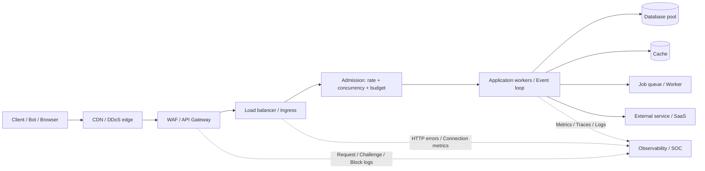
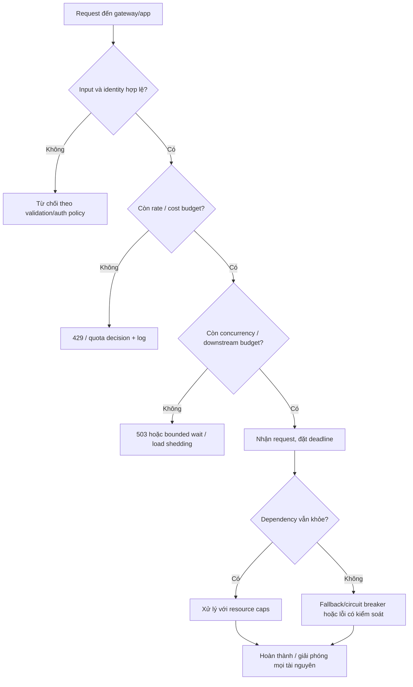
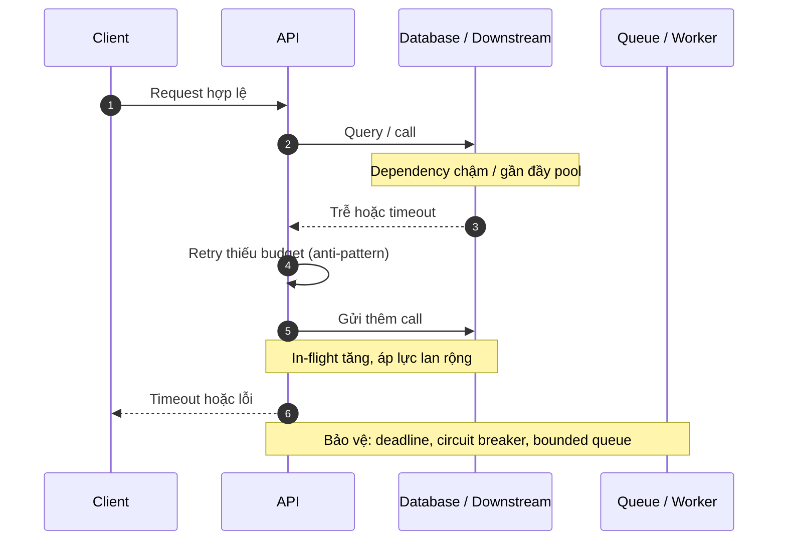

# Resource exhaustion trong application

> **Học phần:** `SECURITY_NETWORK_SECURITY`  
> **Chương:** DDoS  
> **Chủ đề:** Resource exhaustion trong application — nhận diện tình trạng ứng dụng cạn kiệt tài nguyên do yêu cầu quá tải, phân biệt DDoS tầng ứng dụng với lỗi công suất thông thường và thiết kế phòng vệ nhiều lớp từ WAF/CDN, giới hạn truy cập đến bảo vệ runtime, cơ sở dữ liệu và dịch vụ phụ thuộc.

## Mục tiêu học tập

Sau bài này, người học có thể:

1. Giải thích **application-layer DoS/DDoS** và cơ chế làm cạn kiệt CPU, bộ nhớ, thread, kết nối, hàng đợi, database pool, băng thông phản hồi, hạn mức dịch vụ hoặc chi phí.
2. Phân biệt **tốc độ yêu cầu** với **chi phí xử lý trên mỗi yêu cầu**; dùng các chỉ số concurrency, queue depth, latency và saturation để phân tích nghẽn.
3. Phát hiện các dấu hiệu quá tải tầng HTTP/API từ WAF, CDN, load balancer, IDS/IPS, application metrics, tracing và log cơ sở dữ liệu.
4. Thiết kế phòng vệ theo **rate limit, concurrency limit, request budget, backpressure, timeout, cancellation, load shedding** và quota dựa trên danh tính/tài nguyên.
5. Đánh giá vai trò của caching, queue, circuit breaker, autoscaling, egress restriction, phân đoạn mạng và các cơ chế giảm tải bên ngoài origin.
6. Xây dựng playbook ứng phó an toàn và bộ kiểm thử có kiểm soát để bảo vệ tính sẵn sàng mà không chặn nhầm người dùng hợp lệ.

## 1. Resource exhaustion ở tầng ứng dụng là gì?

**Resource exhaustion** là trạng thái một hoặc nhiều tài nguyên hữu hạn bị dùng hết hoặc bị giữ quá lâu, khiến ứng dụng không phục vụ được yêu cầu hợp lệ trong thời gian mong muốn. Tài nguyên có thể là:

- CPU time, memory/heap, garbage collector, file descriptor và socket;
- worker thread, event loop, goroutine/task, request slot và số kết nối đồng thời;
- hàng đợi tác vụ, thread pool, connection pool đến database hoặc cache;
- khả năng truy vấn, đọc/ghi đĩa, băng thông giữa các microservice;
- hạn mức gọi dịch vụ ngoài (API, email, SMS, payment), chi phí cloud hoặc tài nguyên vùng (quota).

**Denial of Service (DoS)** là sự cố làm suy giảm hoặc mất khả năng phục vụ. Khi lưu lượng/tác động đến từ nhiều nguồn phối hợp, thường gọi là **Distributed Denial of Service (DDoS)**. Trong thực tế có thể khó khẳng định mức độ “phối hợp” chỉ từ log: một làn sóng người dùng thật, bot crawler, hệ thống retry lỗi hoặc nhiều client độc lập vẫn có thể tạo ra quá tải.

**Application-layer DDoS**, thường được liên hệ với tầng 7 trong mô hình OSI, nhắm tới chức năng HTTP, API và những thao tác mà backend phải xử lý. Nó khác với việc chỉ làm bão hòa **băng thông mạng** hoặc **khả năng xử lý packet của thiết bị**, dù các loại tấn công có thể diễn ra đồng thời.

**Ý cốt lõi:** Một request HTTP có dung lượng nhỏ có thể đòi hỏi lượng lớn công việc phía server; số lượng request không phải thước đo duy nhất của mức độ nguy hiểm.

### Ví dụ mở đầu

Một API `GET /reports/monthly?tenant=...` nhận yêu cầu hợp lệ. Mỗi request phải truy vấn nhiều bảng, tổng hợp dữ liệu, dựng tệp và gọi một dịch vụ lưu trữ. Nếu có nhiều yêu cầu cùng lúc, các request có thể giữ database connection và worker trong thời gian dài. Người dùng hợp lệ bắt đầu gặp timeout ngay cả khi tổng Mbps không cao.

Vấn đề cần giải quyết là **điều khiển chi phí xử lý**, **phân chia công bằng tài nguyên** và **khả năng hạ cấp dịch vụ có kiểm soát**. Một firewall chỉ nhìn thấy TCP 443 có thể không biết request nào tạo báo cáo nặng hơn hàng trăm lần so với request xem trang tĩnh.

## 2. Phân biệt DDoS tầng ứng dụng và những nguyên nhân quá tải khác

| Tình huống | Biểu hiện quan sát được | Cách phân biệt ban đầu |
|---|---|---|
| **L3/L4 volumetric DDoS** | Băng thông, packet per second hoặc connection-state ở biên tăng mạnh | Xem interface, upstream, SYN/UDP, flow, khả năng scrubbing |
| **Application-layer DDoS** | Endpoint tốn CPU/DB, latency tăng, error 5xx, queue/worker bão hòa | Theo route, principal, cost, request pattern, origin metrics |
| **Làn sóng traffic hợp lệ** | Số request tăng theo sự kiện kinh doanh; có nhiều phiên hợp lệ | Đối chiếu chiến dịch, user/session, hành vi sử dụng thực |
| **Retry storm** | Client/service tự động retry sau timeout, sinh thêm tải | Trace/correlation ID, retry policy, thời điểm lỗi bắt đầu |
| **Thay đổi code gây regression** | CPU/DB/query time tăng sau deploy dù RPS không đổi | So sánh trước/sau release, profiler, query plan |
| **Dependency bị suy giảm** | Request chờ DB, cache hoặc API ngoài; thread bị giữ lâu | Pool wait time, downstream latency, timeout và circuit breaker |
| **Traffic crawler hoặc automation** | Nhiều lượt xem tương tự, tỷ lệ cache miss cao, đặc điểm bot | Đối chiếu danh tính, quyền, lịch crawl, WAF signals |
| **Resource exhaustion do lỗi nội bộ** | Memory leak, file descriptor leak, deadlock, queue không thoát | Runtime metrics và thread/heap diagnostics |

Đôi khi **một lỗi code và hành vi lạm dụng cùng tồn tại**: endpoint có chi phí không giới hạn tạo ra rủi ro lớn khi lượng request tăng. Việc phân loại “attack hay bug” hữu ích cho điều tra, nhưng quyết định kỹ thuật vẫn là **đặt ngân sách tài nguyên và giới hạn hành vi**.

**Đừng dùng mỗi tỷ lệ 4xx/5xx làm kết luận.** `429 Too Many Requests` có thể cho thấy rate limiter đang bảo vệ hệ thống; `503 Service Unavailable` có thể là load shedding có chủ đích. Trái lại, một ứng dụng vẫn trả `200` nhưng latency p99 tăng nhiều lần đã có thể ảnh hưởng đáng kể đến trải nghiệm.

## 3. Một HTTP request tiêu thụ tài nguyên ra sao?

Xem đường đi đơn giản:



Mỗi tầng có **giới hạn khác nhau**:

| Tầng | Tài nguyên giới hạn | Dấu hiệu bão hòa |
|---|---|---|
| CDN/edge | Băng thông, năng lực kiểm tra/challenge, quota theo hợp đồng | Edge throttling, origin bypass, spike qua endpoint không cache |
| WAF/API gateway | Request parsing, policy evaluation, connection/request rate | Hàng đợi, latency gateway, nhiều request bị đánh dấu |
| Load balancer/ingress | Connection, active stream, worker, upstream slot | 502/503/504, pending requests, connection errors |
| Ứng dụng | CPU, heap, thread/task, socket, concurrent work | Saturation, GC, latency p95/p99, thread pool đầy |
| Database | Connection pool, transaction lock, CPU, IOPS | Pool wait, long queries, lock wait, timeout |
| Cache | Hit ratio, memory, command throughput | Miss storm, eviction, backend traffic tăng |
| Async queue | Queue depth, backlog age, worker concurrency | Job bị trì hoãn, tăng disk/storage hoặc dead-letter |
| Dịch vụ phụ thuộc | Quota API, rate limit, latency, billing | `429`/`5xx` từ downstream, retry storm, chi phí tăng |

**Bảo vệ tại một tầng có thể chuyển áp lực sang tầng khác.** Ví dụ, đẩy job nặng vào queue giúp request HTTP trả nhanh, nhưng nếu không giới hạn tốc độ tạo job, queue và worker vẫn có thể bị lấp đầy.

## 4. Hiểu mô hình công suất: tốc độ, thời gian và concurrency

### 4.1 Little's Law

Trong một hệ thống ổn định, với đơn vị thời gian nhất quán, **Little's Law** mô tả mối quan hệ trung bình:

\[
L = \lambda W
\]

Trong đó:

- `L`: số request/job **trung bình đang ở trong hệ thống**;
- `λ` (lambda): tốc độ hoàn thành/đến ổn định, ví dụ request/giây;
- `W`: thời gian trung bình mỗi request ở trong hệ thống, gồm chờ và xử lý.

**Ví dụ minh họa:**

- Nếu hệ thống xử lý ổn định `200 request/giây` và thời gian ở trong hệ thống trung bình là `0,4 giây`, số request in-flight trung bình khoảng `200 × 0,4 = 80`.
- Nếu một dependency chậm khiến thời gian tăng thành `2 giây` trong khi throughput **vẫn duy trì được** `200 request/giây`, mức in-flight tương ứng là `400`. Nếu năng lực xử lý thực tế không đáp ứng, hàng đợi có thể tăng và trạng thái **không còn ổn định**; không được tiếp tục áp công thức như một dự báo chắc chắn khi hệ thống đang sụp tải.

Đây là minh họa về quan hệ giữa **độ trễ** và **số công việc đang giữ tài nguyên**, không phải khẳng định mọi request cần một thread. Hệ thống event-driven có thể có nhiều request chờ I/O với số thread nhỏ hơn, nhưng vẫn giữ memory, socket, database session hoặc quota.

### 4.2 Concurrency, throughput và utilization khác nhau

- **Throughput:** số yêu cầu hoàn thành/giây.
- **Concurrency:** số yêu cầu đang chờ hoặc xử lý đồng thời.
- **CPU utilization:** tỷ lệ thời gian CPU bận, không đo đầy đủ database saturation hoặc hàng đợi.
- **Queue depth:** số công việc đang chờ; tăng liên tục là dấu hiệu hệ thống không theo kịp đầu vào.
- **Latency p50/p95/p99:** phân vị thời gian xử lý; tail latency thường tăng mạnh khi tài nguyên gần bão hòa.

Một máy có CPU trung bình 35% vẫn có thể không phục vụ được request nếu pool kết nối database chỉ có vài slot hoặc một lock giữ quá lâu. Ngược lại, CPU 85% không tự khẳng định DDoS nếu hệ thống hoạt động đúng ngân sách.

### 4.3 Service demand và giới hạn thực tế

Một thao tác có thể dùng:

```text
request cost ≈
    CPU work
  + memory retained
  + database queries / locks
  + disk and network I/O
  + downstream API work
  + queued background jobs
```

Đây là mô hình định tính, **không cộng các đại lượng khác đơn vị thành một con số** nếu chưa chuẩn hóa. Trong thực tế nên dùng budget riêng cho CPU time, DB query count/time, output bytes, số job, request body và concurrent requests.

**Nguyên tắc:** Một API “rẻ” theo số byte HTTP có thể “đắt” theo CPU, fan-out microservice, truy vấn hoặc chi phí tiền.

## 5. Các dạng resource exhaustion ở tầng ứng dụng

### 5.1 CPU-bound work

Ứng dụng có thể bận vì parse/validate dữ liệu phức tạp, dựng template, nén/giải nén, xử lý hình ảnh, tính toán báo cáo, truy vấn lọc nhiều điều kiện hoặc xử lý biểu thức không giới hạn. Một công đoạn có độ phức tạp tăng nhanh theo kích thước input làm rủi ro lớn hơn.

**Phòng vệ:** giới hạn kích thước/độ sâu input, độ phức tạp biểu thức, số đối tượng xử lý, thời gian CPU và chi phí theo endpoint; đẩy tác vụ nặng qua hàng đợi có quota.

### 5.2 Memory-bound work

Những thao tác nhận body quá lớn, tải toàn bộ tệp vào heap, giữ nhiều request trong hàng đợi, gom kết quả DB vào memory hoặc giữ session/cache không giới hạn có thể dẫn tới GC pressure và out-of-memory.

**Phòng vệ:** streaming khi phù hợp, giới hạn body/upload, phân trang, cap số item, max queue size, memory budget và chính sách cache có eviction. Không chỉ giới hạn số request.

### 5.3 Thread, socket và connection exhaustion

Request kéo dài có thể chiếm worker thread, connection hoặc socket. Ngay cả trong mô hình async, mỗi request vẫn giữ ít nhiều trạng thái và có thể chiếm downstream connection. Truyền request chậm, response stream lâu, keep-alive và timeout quá lớn làm tăng số kết nối đang giữ.

**Phòng vệ:** đặt thời hạn đọc header/body, idle timeout, request deadline, giới hạn connection/stream/concurrency theo điểm thực thi; đảm bảo streaming và long-lived connection được quản lý như một loại dịch vụ riêng.

### 5.4 Database connection / query exhaustion

Một endpoint có thể thực hiện truy vấn đắt, thiếu index, lọc không có giới hạn hoặc giữ transaction lâu. Khi pool đầy, request mới xếp hàng; retry từ các tầng làm tệ hơn.

**Phòng vệ:** query budget, timeout, index và plan phù hợp, pagination, pool isolation cho luồng quan trọng, circuit breaker/backpressure và loại bỏ N+1 queries.

### 5.5 Disk, storage, cache và queue exhaustion

Upload/temp files, tạo báo cáo, log quá mức, archive extraction, cache miss đồng loạt hoặc queue task không có TTL tạo áp lực lên disk, object storage và worker.

**Phòng vệ:** quota theo user/tenant, giới hạn số job đang chờ, kiểm tra dung lượng, cleanup an toàn, idempotency, TTL và giới hạn lưu log/payload.

### 5.6 Exhaustion của downstream quota và chi phí

Một request có thể kích hoạt email, SMS, dịch vụ AI, geocoding, payment, storage hoặc API bên ngoài tính phí. Nếu không giới hạn số lần gọi, một lượng request vừa phải có thể gây **cạn hạn mức hoặc tăng chi phí**.

**Phòng vệ:** quota theo tài khoản và hoạt động, request budget, giới hạn fan-out, idempotency key, caching, bảo vệ credential và cost alert. Đây là rủi ro **resource consumption** ngay cả khi CPU của ứng dụng chưa bão hòa.

## 6. Vì sao ứng dụng có “khuếch đại chi phí”?

Không phải “amplification” ở đây nhất thiết là cơ chế phản xạ UDP trên mạng. Trong application-layer exhaustion, **chi phí xử lý phía backend có thể lớn hơn nhiều so với chi phí tạo request**.

Ví dụ phòng vệ:

| Chức năng | Vì sao chi phí lớn | Giới hạn nên đặt |
|---|---|---|
| Search tự do | Query scan lớn, regex/filter phức tạp | Bộ lọc được phép, max rows, query timeout, index |
| Xuất báo cáo | Nhiều truy vấn + render PDF/CSV + upload | Quota job, async processing, giới hạn khoảng thời gian |
| API aggregation | Một request fan-out nhiều microservice | Fan-out cap, deadline và circuit breaker |
| Upload/parse | Body lớn, giải nén, metadata/antivirus | Size/count/expansion limit, streaming, sandbox |
| Login/credential check | Hash password và truy cập IdP | Rate limit theo identity/IP + account-safe backoff |
| Image/video processing | CPU/GPU, memory, storage | Budget theo tài khoản, max resolution/duration |
| Resource listing | Phân trang thiếu giới hạn | Max page size, cursor pagination |
| Webhook creation | Tạo nhiệm vụ và gọi endpoint khác | Quota per tenant, queue bound, destination validation |

Thay vì chỉ chặn “nhiều request”, cần giới hạn **số thao tác đắt**. Ví dụ, một người dùng có thể được phép nhiều yêu cầu đọc cache nhẹ nhưng chỉ một số tác vụ export đồng thời.

**Không coi request nào tốn tài nguyên là tấn công.** Hoạt động hợp lệ như kỳ quyết toán, nhập dữ liệu, backup hoặc sự kiện marketing có thể tăng tải. Hệ thống cần phục vụ người dùng công bằng, ghi nhận tình trạng quá tải và giảm chất lượng có kiểm soát.

## 7. Tín hiệu nhận biết đang cạn kiệt tài nguyên

### RED và USE

Hai nhóm chỉ số hữu ích:

- **RED:** *Rate*, *Errors*, *Duration* — tốc độ yêu cầu, lỗi và thời gian phản hồi.
- **USE:** *Utilization*, *Saturation*, *Errors* — mức sử dụng, mức bão hòa và lỗi của tài nguyên.

Áp dụng theo từng route/service và theo tài nguyên, không chỉ tổng kết ở cluster.

| Quan sát | Ý nghĩa có thể | Cần đối chiếu |
|---|---|---|
| RPS tăng đột biến ở một route | Traffic surge hoặc automation | Tỷ lệ cache hit, user thực, chiến dịch, bot signal |
| p95/p99 latency tăng trước 5xx | Tail latency và hàng đợi đang xấu đi | DB wait, thread pool, GC, downstream |
| CPU cao + thread pool chưa đầy | Công việc CPU-bound | Profiling, endpoint cost, deploy |
| CPU thấp nhưng pool DB đầy | Chờ connection/lock/query | DB metrics, transactions, N+1 |
| Heap tăng + GC pause dài | Đối tượng giữ nhiều, leak hoặc body lớn | Memory profile, in-flight, cache |
| Queue depth/age tăng liên tục | Tốc độ nhận việc > xử lý | Producer rate, worker capacity, TTL |
| Cache hit ratio giảm | Key churn, miss storm, invalidation | Origin RPS, cache policy |
| 429 tăng | Giới hạn truy cập đang kích hoạt | Ai bị ảnh hưởng, fairness, error budget |
| 503 tăng cùng saturation | Load shedding / overload | Số request bị từ chối, sức khỏe dịch vụ |
| WAF challenge/block tăng | Lưu lượng đáng ngờ hoặc rule gây false positive | Rule ID, route, user journey, edge vs origin |
| Egress/downstream API tăng | Fan-out hoặc cost exhaustion | Quota, bill, job, service account |

**Cần có baseline theo giờ/ngày và chu kỳ nghiệp vụ.** Tần suất truy cập bình thường của giờ cao điểm có thể khác rất xa ban đêm. Không nên cảnh báo DDoS chỉ vì vượt một ngưỡng RPS bất biến.

### Dữ liệu log/trace nên có

```text
time=2026-11-28T10:00:00Z
request_id=req-demo-008
route=/reports/export
principal=tenant-demo / role=report-viewer
response_status=429
waf_action=allow
admission_decision=rate_limited
app_processing_ms=0
source_zone=internet-via-edge
trace_id=trace-example-008
```

Bản ghi minh họa chỉ nên chứa metadata đủ phục vụ điều tra. **Không ghi token, mật khẩu, dữ liệu cá nhân hoặc payload đầy đủ** vào log được truy cập rộng. Khi thêm địa chỉ IP, user-agent hay device ID, áp chính sách bảo vệ và thời hạn lưu phù hợp.

## 8. Rate limiting: giới hạn tốc độ theo thực thể phù hợp

**Rate limiting** giới hạn số request hoặc lượng “tín dụng” công việc trong một khoảng thời gian. Nó hữu ích ở CDN, WAF, API gateway, reverse proxy và ứng dụng.

### 8.1 Định nghĩa “ai” bị giới hạn

Các khóa định danh thường dùng:

- **User/account ID** đã được xác thực cho chức năng đăng nhập;
- **API key, client ID, service identity** của tích hợp;
- **Tenant/project** để bảo vệ công bằng giữa khách hàng;
- **Session/device** khi đáng tin và phù hợp với chính sách;
- **Source IP/CIDR** như tín hiệu bổ trợ cho traffic chưa xác thực.

**IP không luôn tương ứng một người dùng**: NAT/CGNAT, proxy, mạng di động, VPN và Wi-Fi công cộng có thể gom nhiều người dùng vào cùng IP. Giới hạn quá chặt theo IP dễ chặn nhầm cả công ty hoặc khu dân cư. Trái lại, tạo giới hạn chỉ theo một header do client tự khai báo có thể bị giả mạo.

Nếu dùng `X-Forwarded-For` hoặc `Forwarded`, chỉ tin các giá trị đã được **proxy đáng tin xác thực/ghi nhận**, với trusted-proxy chain rõ ràng. Không dùng giá trị client tùy ý gửi để phân loại quyền.

### 8.2 Token bucket

Token bucket cho phép mức trung bình và một lượng burst có kiểm soát:

- Bucket có dung lượng tối đa `B` token.
- Token được bổ sung với tốc độ `r` token/giây.
- Mỗi request tiêu thụ `c` token; request tốn tài nguyên hơn có thể có chi phí lớn hơn.
- Nếu không đủ token thì request bị từ chối, hoãn có giới hạn hoặc chuyển sang chế độ khác theo policy.

Mô hình token count theo khoảng thời gian Δt:

\[
tokens_{new} = \min(B,\ tokens_{old} + r \Delta t)
\]

**Ví dụ:** Nếu bucket tối đa `20` token, bổ sung `2 token/giây` và mỗi request nhẹ tốn một token, client được burst tối đa 20 request khi bucket đầy nhưng không thể duy trì lâu dài mức cao hơn khoảng 2 request/giây nếu không có token dư. Đây là **ví dụ học tập**, không phải mức cấu hình nên áp cho mọi API.

### 8.3 Các thuật toán thường gặp

| Cơ chế | Ưu điểm | Hạn chế |
|---|---|---|
| **Fixed window counter** | Dễ giải thích và triển khai | Có thể tạo burst quanh ranh giới cửa sổ |
| **Sliding window** | Phân bố giới hạn mượt hơn | Tốn state/ước lượng hơn tùy cách làm |
| **Token bucket** | Cho phép burst có kiểm soát, hỗ trợ cost token | Cần quản lý state và logic refill nhất quán |
| **Leaky bucket / queue shaping** | Làm đều tốc độ xử lý | Có thể tăng latency; cần queue hữu hạn |
| **Adaptive rate limit** | Điều chỉnh theo tình trạng backend | Cần tín hiệu tốt, tránh dao động và chặn nhầm |

Khi chạy **nhiều replica**, mỗi node có bucket riêng sẽ tạo hạn mức tổng khác dự định. Hạn mức dùng chung cần atomicity, cơ chế consistency phù hợp hoặc phân bổ quota cho từng node/partition. Nếu kho quota bị lỗi, phải định nghĩa rõ **fail-open/fail-closed** theo tính thiết yếu của route và bảo vệ an toàn.

### 8.4 Trả mã HTTP đúng ngữ nghĩa

- **`429 Too Many Requests`:** client/principal vượt chính sách giới hạn tần suất. Có thể kèm `Retry-After` thích hợp.
- **`503 Service Unavailable`:** hệ thống không thể phục vụ tạm thời do overload/bảo trì; có thể kèm `Retry-After` khi dự báo hợp lý.
- **`413 Content Too Large`:** request content vượt giới hạn kích thước mà server cho phép.
- **`408 Request Timeout`** hoặc hành vi đóng kết nối tương ứng: request không hoàn thành đúng thời hạn theo server; mã/hành vi phụ thuộc tầng thực thi.

Không có một mã HTTP duy nhất cho mọi cơ chế phòng vệ. **Client retry phải có jitter, exponential backoff, số lần và deadline hữu hạn**; nếu tất cả client retry tức thì, một đợt quá tải có thể trở thành retry storm.

## 9. Concurrency limit, backpressure và load shedding

Rate limit kiểm soát **tốc độ**, nhưng không trực tiếp giới hạn **số tác vụ cùng giữ tài nguyên**. Endpoint chậm có thể khiến hàng nghìn request tồn đọng dù RPS không cực lớn. Vì vậy phải kết hợp:

### 9.1 Concurrency limit

Giới hạn tối đa số request/job đang xử lý cho toàn service, từng route, tenant hoặc dependency. Khi đạt ngưỡng, request mới có thể nhận `429`/`503` hoặc chờ trong **hàng đợi nhỏ có giới hạn**, tùy lý do và thiết kế.

- Route xem báo cáo đơn giản có thể được cấp pool độc lập với route tạo báo cáo tốn CPU.
- Traffic quản trị sự cố có thể cần **capacity reserve** riêng để hệ thống vẫn quản trị được khi quá tải.
- Worker background có concurrency thấp hơn cho tác vụ sử dụng nhiều database connection.

### 9.2 Backpressure

**Backpressure** truyền tín hiệu từ consumer đang bão hòa tới producer để giảm tốc độ tạo việc. Ví dụ, job queue có giới hạn backlog; khi queue gần đầy, API tạo job từ chối request mới thay vì tiếp tục nhận vào một hàng đợi không giới hạn.

**Hàng đợi vô hạn không làm tăng năng lực xử lý.** Nó chỉ trì hoãn lỗi, tăng memory/storage và khiến latency có thể vượt mức chấp nhận. Theo dõi cả **queue depth** và **độ tuổi job lâu nhất**.

### 9.3 Load shedding

**Load shedding** là từ chối có chủ đích một phần traffic khi không thể đáp ứng toàn bộ, nhằm bảo vệ những request quan trọng và tránh sụp đổ dây chuyền. Nó nên có tính **dự đoán được và công bằng**:

- Giữ sức khỏe và khả năng điều khiển dịch vụ.
- Ưu tiên các luồng thiết yếu theo chính sách nghiệp vụ đã duyệt.
- Từ chối sớm, trước khi request chiếm DB connection và tạo hàng loạt downstream calls.
- Trả lỗi ngắn gọn, nhất quán, có hướng dẫn retry an toàn khi hợp lý.
- Đo tỷ lệ request bị shed theo tenant/route để phát hiện bất công.

### Mô hình luồng chấp nhận request



Sơ đồ là khái niệm; nếu triển khai rate budget và concurrency budget ở nhiều nơi, cần chắc chắn có **thu hồi token/permit và rollback reservation** đúng nhánh lỗi, tránh rò rỉ tài nguyên bảo vệ.

## 10. Timeout, cancellation và các giới hạn cứng

### 10.1 Deadline nhiều lớp

Đặt deadline có phối hợp ở:

- Edge/load balancer: header/body/idle timeout và tổng thời gian chờ phù hợp.
- API gateway: request timeout và hạn mức body, số stream.
- Ứng dụng: service-level deadline, task cancellation.
- Database: query timeout, transaction timeout, connection acquisition timeout.
- Downstream HTTP: connect/read/overall timeout và retry budget.

Ví dụ, nếu gateway trả timeout sau 10 giây nhưng backend tiếp tục chạy job trong 90 giây vì không truyền cancellation, tài nguyên vẫn có thể bị giữ **sau khi client không còn chờ**. Đặt deadline xuyên các service và xử lý cancellation khi nền tảng hỗ trợ.

**Timeout quá thấp cũng gây lỗi**, nhất là với upload, streaming, báo cáo hợp lệ hoặc đường truyền chậm. Cần phân loại endpoint và đo thời gian phục vụ thực tế.

### 10.2 Giới hạn dữ liệu và độ phức tạp

| Kiểu giới hạn | Phòng vệ | Rủi ro khi thiếu |
|---|---|---|
| Max request body / upload size | Giảm body lớn và bộ nhớ giữ | Exhaustion ở parser/heap/temp storage |
| Max header size/count | Giảm chi phí parse header | Memory/CPU pressure tại edge/proxy |
| Max JSON nesting/array size | Hạn chế parser và business object lớn | CPU, recursion và allocation quá mức |
| Max page size / result count | Hạn chế query và response | DB/memory/network exhaustion |
| Max graph/search depth | Giới hạn tác vụ có độ phức tạp cao | Fan-out, query explosion |
| Max archive expanded size | Hạn chế giải nén bất thường | Disk/memory exhaustion |
| Max active uploads/streams | Chia sẻ connection/worker công bằng | Cạn socket/file descriptor |
| Max jobs / tenant | Hạn chế async processing | Queue/worker/storage cost exhaustion |
| Downstream fan-out cap | Tránh một request sinh nhiều lời gọi | Cascading overload và bill tăng |

Không phải mọi giới hạn đều áp dụng ở WAF: ví dụ, “tổng chi phí truy vấn DB” chỉ được biết ở ứng dụng hoặc tầng dữ liệu. Thiết kế phòng vệ phải đặt điểm kiểm soát **nơi có đủ ngữ cảnh**.

## 11. Cache, CDN và khả năng phục vụ khi backend bão hòa

**CDN và caching** có thể hấp thụ lượng lớn request giống nhau mà không cần gọi origin. Nhưng cache cũng có điểm mù:

- Endpoint có dữ liệu cá nhân, phụ thuộc cookie/token hoặc thao tác ghi thường **không nên cache công khai**.
- URL query khác nhau có thể tạo nhiều cache key và nhiều cache miss.
- Cache TTL quá ngắn hoặc đồng thời hết hạn dễ tạo **thundering herd** lên backend.
- Một phản hồi có thể rất tốn CPU nhưng chỉ xuất hiện một lần nên khó nhận lợi ích cache.
- Dữ liệu stale có thể không được phép dùng cho báo cáo tài chính hoặc xác thực.

### Cơ chế hỗ trợ

- **Cache control đúng ngữ cảnh:** xác định public/private/no-store, key và TTL theo dữ liệu.
- **Request coalescing / single-flight:** nhiều request tới cùng dữ liệu chỉ kích hoạt một truy vấn/lần tính toán backend khi phù hợp.
- **Stale-while-revalidate / stale-if-error:** phục vụ bản cũ có giới hạn cho dữ liệu cho phép, giảm áp lực khi backend chậm.
- **Pre-compute:** tạo báo cáo tốn CPU theo lịch hoặc khi dữ liệu thay đổi, thay vì tính từ đầu cho mỗi request.
- **Graceful degradation:** tạm ẩn gợi ý/analytics không thiết yếu, giữ chức năng đăng nhập và giao dịch chính.

**Cache không thay thế rate limit**. Client có thể yêu cầu nhiều key khác nhau hoặc các endpoint không cache; phải tiếp tục giám sát origin RPS, cache hit ratio và cost trên mỗi request.

## 12. Circuit breaker, retries và cách tránh quá tải dây chuyền

Một dependency chậm dễ gây hệ quả dây chuyền:



**Circuit breaker** mở khi dependency có tỷ lệ lỗi/độ trễ theo policy vượt ngưỡng, tạm ngăn gửi thêm call để cho hệ thống hồi phục. Sau khoảng kiểm tra, chuyển sang trạng thái thử (half-open) với số request giới hạn.

Các lưu ý:

- Circuit breaker không sửa lỗi dữ liệu/logic ở downstream; phải có **fallback hoặc lỗi có kiểm soát**.
- Retry chỉ khi thao tác **an toàn/idempotent hoặc có idempotency key** và còn deadline.
- Áp retry budget, backoff có jitter; không cho nhiều tầng retry chồng nhau.
- Nếu yêu cầu bị hủy, các tác vụ downstream nên được hủy khi khả thi.
- Giảm dữ liệu trả về trong error response; tránh stack trace và logging quá mức dưới tải cao.

Một hệ thống có autoscaling vẫn có thể thất bại vì database hoặc dịch vụ đối tác **không scale tương ứng**. Scale API replicas có thể làm **tăng** tổng số kết nối vào database nếu không có giới hạn thích hợp.

## 13. Vai trò của WAF, CDN, firewall, IDS/IPS và phân đoạn mạng

Không một lớp nào đơn lẻ xử lý được mọi resource exhaustion.

| Lớp | Giúp được gì? | Không nên kỳ vọng |
|---|---|---|
| **CDN / DDoS provider** | Hấp thụ traffic volumetric, cache, rate/challenge tại edge | Biết đầy đủ chi phí xử lý DB hoặc quyền nghiệp vụ |
| **WAF** | Phân tích HTTP, rule theo route, bot signal, limit, challenge | Tự phân biệt chắc chắn request đắt/hợp lệ khi thiếu app context |
| **L3/L4 firewall / ACL** | Giới hạn zone, protocol, IP/port, session | Đánh giá độ phức tạp của `/reports/export` |
| **API gateway** | Quota, per-client policy, auth, request size, concurrency | Bảo đảm DB không bão hòa nếu backend không có budget |
| **IDS/NDR** | Quan sát hành vi mạng, lưu lượng bất thường, correlation | Chứng minh DDoS chỉ dựa vào một signature |
| **IPS** | Drop/chặn lưu lượng theo cơ chế inline và policy | Chặn mọi request hợp lệ nhưng gây quá tải hoặc chống false positive tự động |
| **DNS security** | Bảo vệ resolver, kiểm soát tên đích, phát hiện chỉ dấu | Chặn toàn bộ quá tải HTTP vào endpoint công khai |
| **NAC / VPN / Wi-Fi** | Gắn nguồn với identity/zone, bảo vệ guest/employee segmentation | Đảm bảo một user hợp lệ không lạm dụng API nặng |
| **Cloud network controls** | SG/NACL, routing, private endpoint, egress restriction | Kiểm soát chi phí CPU/DB của application tự động |
| **Runtime / application** | Cost budget, concurrency, validation, timeout, authorization | Hấp thụ băng thông volumetric vượt uplink |
| **Database / queue** | Query budget, pool caps, worker/job quotas | Phát hiện mọi mối đe dọa trước khi đến ứng dụng |

**Giới hạn phạm vi origin:** nếu dịch vụ chỉ được phép đi qua CDN/WAF, có thể dùng cấu hình nguồn mạng/identity/tunnel thích hợp để giảm đường **direct-to-origin bypass**. Tuy nhiên cần bảo đảm vẫn có đường quản trị, health check và ứng phó sự cố được cấp phép.

### HTTP/2, HTTP/3 và lưu lượng mã hóa

- **HTTP/2** cho nhiều stream trong một kết nối; cần giới hạn số stream/request/concurrency phù hợp, không chỉ đếm TCP connections.
- **HTTP/3/QUIC** chạy trên UDP, các lớp L4/TCP-only có thể không nhận đầy đủ ngữ nghĩa request.
- WAF muốn phân tích HTTP payload phải ở điểm có thể đọc request đã giải mã theo kiến trúc và chính sách TLS.
- Nhiều request đi qua một kết nối proxy/NAT; chặn theo một IP đơn lẻ có thể gây ảnh hưởng người dùng hợp lệ.
- Một số traffic có thể đi đường private/CDN/edge khác; cần inventory và đo **origin reachability**.

## 14. Detection: nhận ra quá tải trước khi ứng dụng sụp

Không nên chỉ đặt một cảnh báo cố định “RPS vượt N”. Thay vào đó kết hợp **mức sử dụng tài nguyên**, **chất lượng phục vụ**, **bất thường theo route/principal** và **ngữ cảnh kinh doanh**.

### Tín hiệu theo chuỗi

```text
Edge / WAF:
  request rate per route/identity
  bot/challenge signals and rule hit
  cache hit/miss and origin requests

Load balancer / App:
  active and queued requests
  p50/p95/p99 latency and error rate
  429/503 counts and admission decisions
  CPU, heap, GC, worker/event loop utilization

Database / Dependencies:
  connection pool active/idle/waiters
  query latency, lock waits, slow queries
  downstream timeouts and retry count

Business / Security:
  successful transactions and login rate
  affected tenant/user cohorts
  network flow patterns and egress
  configuration/deploy and on-call change windows
```

### Những tổ hợp cảnh báo hữu ích

| Điều kiện tương quan | Hành động phân tích |
|---|---|
| RPS tăng + p99 tăng + pool DB wait cao | Khoanh vùng endpoint và query/transaction |
| RPS không tăng nhưng latency tăng sau deploy | Điều tra regression/dependency thay vì kết luận DDoS |
| Edge bị challenge mạnh nhưng origin ổn | Kiểm tra hiệu quả edge policy và false positive |
| Error 503 + queue age tăng | Kiểm tra admission/backpressure, tạm giảm việc ít ưu tiên |
| Cache hit giảm mạnh + origin CPU tăng | Kiểm tra cache key, TTL, invalidation và route dynamic |
| Một tenant tiêu thụ nhiều job/cost hơn quota | Giám sát fairness và điều chỉnh theo hợp đồng |
| Nhiều client cùng retry sau lỗi downstream | Cắt retry storm, áp deadline và backoff |
| Sensor/metrics ngừng báo trong lúc incident | Xem telemetry gap; “không có alert” không đồng nghĩa an toàn |

**Tỷ lệ 429 cao có thể là tín hiệu phòng vệ đang hoạt động**, nhưng nếu khách hàng hợp lệ bị chặn nhầm, đó cũng là sự cố cần khắc phục. Theo dõi **tỷ lệ request thành công của người dùng hợp lệ**, không chỉ khả năng chặn traffic.

## 15. Bản đồ nguyên nhân để triage

Khi có báo động, bắt đầu từ tài nguyên bị bão hòa:

| Hiện tượng | Câu hỏi đầu tiên | Đường xử lý |
|---|---|---|
| Network saturated | Uplink/edge bị nghẽn hay origin? | Liên hệ provider/CDN/scrubbing, network team |
| CPU saturated | Route/function nào tăng CPU time? | Profiling, giảm cost, cap concurrency/rate |
| Heap/GC saturated | Body/cache/queue có giữ quá nhiều dữ liệu? | Size cap, streaming, giảm in-flight, memory diagnostics |
| Thread/connection pool full | Request đang chờ gì? | Deadlines, connection limits, điều tra downstream |
| DB connections exhausted | Pool wait và slow queries tăng? | Query budgets, giảm đồng thời, index/timeout |
| Queue backlog tăng | Producer có vượt worker capacity? | Backpressure, quota, bounded queue |
| External quota/cost tăng | Endpoint nào sinh fan-out? | Per-operation cost caps, IAM/API rate limit |
| Response byte tăng | Endpoint nào trả dữ liệu lớn? | Pagination, size caps, caching, authorization |
| Login latency tăng | IdP, hash workload hoặc bot traffic? | Layered auth rate limit, capacity reserve, anti-abuse |

**Dữ liệu cần bảo toàn:** trace/metric theo thời gian, chính sách WAF và gateway, bản phát hành gần nhất, flow logs, xác thực principal, database metrics và request ID mẫu (đã redaction). Không nên thu thập toàn bộ body/request có dữ liệu nhạy cảm chỉ để chẩn đoán nhanh.

## 16. Quy trình ứng phó khi nghi ngờ application-layer DDoS

### Giai đoạn 1 — Xác nhận và phân loại

1. Xác định **dịch vụ, route và nhóm người dùng** đang bị ảnh hưởng.
2. So sánh baseline và lịch kinh doanh: chiến dịch, sự kiện, backup, deploy hoặc job định kỳ.
3. Đọc edge/WAF, ingress, app, DB và dependency metrics, không chỉ nhìn IP.
4. Kiểm tra mạng/route: có phải volumetric saturation ở upstream hay backend resource exhaustion?
5. Xác định severity theo tác động thực tế và mức độ tự tin; không gắn nhãn “DDoS chắc chắn” nếu chưa có bằng chứng.

### Giai đoạn 2 — Giữ dịch vụ và giảm tải

- Bảo toàn các route giao dịch thiết yếu và khả năng quản trị.
- Kích hoạt/chỉnh **rate/concurrency/cost limits** ở điểm phù hợp theo playbook đã được phê duyệt.
- Dùng WAF/CDN challenge hoặc bot protection **theo phạm vi**, tránh chặn nhầm toàn bộ IP của NAT lớn.
- Chuyển xử lý tốn tài nguyên sang async với **queue hữu hạn**, hoặc tạm vô hiệu tính năng phụ khi có quy trình.
- Điều chỉnh timeout/circuit breaker/retry budget để tránh sụp dây chuyền.
- Khi băng thông mạng bị bão hòa, phối hợp upstream ISP/DDoS provider; một rule ở origin không xử lý được nghẽn trước origin.
- Nếu cần scale, xem nút thắt DB/cache/queue và quota tài chính trước khi thêm replica.

### Giai đoạn 3 — Giám sát tác động phụ

Theo dõi sau khi thay rule:

- Tỷ lệ giao dịch hợp lệ thành công; login, checkout, API quan trọng.
- 429/403/503 theo route, tenant và thiết bị được phép.
- p95/p99, worker/DB pool, queue age, memory, cache hit ratio.
- Tỷ lệ WAF challenge thất bại/thành công và khả năng origin bypass.
- Các đơn vị/nhóm người dùng bị chặn nhầm; log bảo vệ thông tin cá nhân.

Nếu chính sách mới khiến sự cố nặng hơn, sử dụng rollback theo change control. Lưu chính xác ai thay đổi, khi nào, vì sao và phạm vi áp dụng.

### Giai đoạn 4 — Hồi phục và rút kinh nghiệm

- Xác nhận hoạt động bình thường theo **sức khỏe ứng dụng và business metrics**, không chỉ “RPS giảm”.
- Tăng dần quota/bỏ biện pháp khẩn cấp, nhưng duy trì giới hạn cơ bản đã được kiểm chứng.
- Đối chiếu trace, log và sự kiện thay đổi để tìm **resource bottleneck thực**.
- Rà soát code, cấu hình proxy, pool, queue, cache, autoscaling và dependency.
- Cập nhật playbook, owner của policy, runbook rollback và lịch capacity testing có kiểm soát.

## 17. Case study: báo cáo tổng hợp làm nghẽn database pool

**Bối cảnh giả lập:** Ứng dụng báo cáo có ba route:

- `GET /health`: trả trạng thái nhỏ, gần như không sử dụng DB.
- `GET /reports/summary`: dùng cache, có truy vấn khi cache miss.
- `POST /reports/export`: tạo báo cáo lớn, thực hiện nhiều query và ghi tệp.

Hệ thống bình thường phục vụ khoảng `200 requests/giây` trên tất cả route, với thời gian lưu trong hệ thống trung bình `0,4 giây`. Sau một đợt truy cập lớn và đồng thời xuất báo cáo, latency của những request tương tự có thể tăng tới `2 giây`.

### Phân tích định lượng minh họa

Nếu **throughput vẫn giữ 200 requests/giây ở trạng thái ổn định**:

\[
L_{before}=200\times0.4=80
\]

\[
L_{after}=200\times2=400
\]

Tức số request trung bình đang xử lý hoặc chờ có thể tăng **5 lần** dù tốc độ hoàn thành tương tự. Trong hệ thật, khi DB pool đầy, throughput có thể giảm và queue tăng không giới hạn, khiến mô hình cân bằng không còn đúng. Cần đo thêm **pool waiters, queue age, DB query time**.

### Thiết kế giảm tải

| Điểm bảo vệ | Thay đổi | Mục đích |
|---|---|---|
| API gateway | Rate limit theo tenant/API key và route | Không để một khách hàng chiếm toàn bộ tài nguyên |
| Ứng dụng | Limit số export đồng thời, request deadline | Giảm công việc nặng đang giữ DB pool |
| Tác vụ export | Async queue có giới hạn, max pending per tenant | Ngăn hàng đợi tăng vô hạn |
| Database | Query timeout, pool budget, index và tối ưu truy vấn | Giảm thời gian giữ connection |
| Cache | Cache/single-flight cho summary khi phù hợp | Giảm truy vấn giống nhau |
| WAF/CDN | Giảm traffic tự động không hợp lệ ở edge | Giảm request tới origin |
| Observability | Route-level latency, export queue, DB wait và business success | Xác định chính xác tác động và cải thiện |

**Điểm đánh đổi:** Nếu đặt giới hạn export quá chặt, nhân viên làm quyết toán có thể bị chặn đúng lúc cần. Quota nên theo SLA/tenant/tác vụ, có cơ chế xem trạng thái job và retry sau theo chính sách, không chỉ trả lỗi không giải thích.

### Dấu hiệu xác nhận giải pháp hiệu quả

- Database pool wait giảm, không xuất hiện hàng đợi tăng liên tục.
- p95/p99 của các route giao dịch thiết yếu trở lại ngưỡng mục tiêu.
- Tạo export có cơ chế thông báo trạng thái/tiến độ, không giữ HTTP connection lâu quá cần thiết.
- Tỷ lệ hoàn thành tác vụ và công bằng giữa tenant cải thiện.
- 429/503 không tăng không kiểm soát ở user hợp lệ.

## 18. Thiết kế admission control trong ứng dụng

**Admission control** quyết định request có được phép bắt đầu công việc tốn tài nguyên hay không. Đây là cơ chế hữu ích khi WAF chỉ có một phần ngữ cảnh.

### Mã giả theo lớp service

```text
onRequest(request):
    identity = authenticate(request)
    resource = authorize(identity, request)

    estimatedCost = classifyOperation(resource, request.route)
    enforceInputLimits(request)
    enforceTenantQuota(identity.tenant, estimatedCost)

    if not rateBudget.tryAcquire(identity, estimatedCost):
        return 429 with safe retry guidance

    permit = concurrencyBudget.tryAcquire(request.route, identity.tenant)
    if permit is unavailable:
        return 503 or 429 according to overload policy

    try:
        deadline = chooseDeadline(request.route)
        result = executeWithDeadlineAndResourceCaps(request, deadline)
        return result
    finally:
        release(permit)
        recordSafeMetricsAndDecision()
```

Các thao tác `tryAcquire`, `release` và `enforce...` là **pseudo-interface**, không phải thư viện cụ thể. Khi hiện thực cần quyết định xử lý khi quota store lỗi, concurrency permit rò rỉ, cancellation, resource reservation và retry. Không được thu lại “token đã tiêu thụ” theo logic không nhất quán hoặc cho user đổi khóa định danh một cách tùy ý.

### Java: concurrency gate tối giản

Ví dụ dưới đây tập trung vào việc **giới hạn công việc đồng thời**, không phải implementation hoàn chỉnh của HTTP filter, rate limiting hay hệ phân tán.

```java
import java.util.concurrent.Semaphore;

public final class ExportAdmissionGate {
    private final Semaphore slots = new Semaphore(8, true);

    public <T> T runIfCapacity(CheckedTask<T> task) throws Exception {
        if (!slots.tryAcquire()) {
            throw new CapacityRejectedException("Export capacity is full");
        }
        try {
            return task.run();
        } finally {
            slots.release();
        }
    }

    @FunctionalInterface
    public interface CheckedTask<T> {
        T run() throws Exception;
    }

    public static final class CapacityRejectedException
            extends RuntimeException {
        public CapacityRejectedException(String message) {
            super(message);
        }
    }
}
```

**Giới hạn của ví dụ:**

- Giá trị `8` chỉ là ví dụ; phải chọn theo tài nguyên đo được, không sử dụng máy móc ở production.
- Semaphore chỉ giới hạn **trong một JVM instance**; nếu có 10 replica, tổng slot có thể lên tới 80 nếu không có admission chung.
- Đoạn code không hiện thực deadline, authentication, per-tenant fairness, status HTTP, tracing hoặc job async.
- Tác vụ chạy vô hạn vẫn giữ permit mãi; cần timeout/cancellation và kiểm soát tác vụ bên trong.
- Không đặt thời gian chờ vô hạn trước khi lấy permit; ví dụ trên dùng `tryAcquire()` không chặn, giúp từ chối sớm.
- Nếu `task` tạo downstream asynchronous work, permit cần bảo vệ **đúng vòng đời tài nguyên**, không chỉ khoảng thời gian tạo job.

### Đặt rate limit ở đâu cho hợp lý?

| Vị trí | Cần có | Loại giới hạn gợi ý |
|---|---|---|
| CDN/WAF | IP/ASN/bot signals, URL, edge capacity | Burst và anomaly/challenge theo đường public |
| API gateway | Authenticated principal, tenant, API key, route | Quota và rate theo client/route |
| Application | Chi phí thật của thao tác, quyền, job | Concurrency, per-operation budget, deadline |
| Database | Query/transaction, connection pool | Timeout, query cost, pool caps |
| Job worker | Pending jobs, per-tenant tasks, external quota | Bounded queue, worker slots, token budget |

Không nên đặt **mọi giới hạn ở một tầng**: chỉ WAF không biết query cost; chỉ backend có thể quá muộn nếu upstream đã bị nghẽn.

## 19. Kiểm thử an toàn không tạo sự cố thật

Kiểm thử phòng vệ có thể đánh giá bằng **unit/integration tests, mô phỏng quota, test dưới công suất thấp và staging cô lập**, thay vì gửi lưu lượng áp lực lớn ra Internet hoặc hệ thống sản xuất.

### Kiểm thử hành vi

```gherkin
Feature: Application resource budgets protect availability

  Scenario: Expensive requests have a tenant quota
    Given tenant A has consumed its permitted export budget
    When tenant A requests another export
    Then the new export is rejected with the documented quota response
    And no database-intensive export begins
    And the decision is recorded without sensitive payloads

  Scenario: Lightweight requests remain available
    Given the export concurrency gate is full in a test environment
    When an authorized user requests a lightweight status endpoint
    Then the status endpoint is served within its defined budget
    And no export slot is required for that endpoint

  Scenario: Input size is bounded
    Given the API accepts report filters with a documented maximum size
    When a request exceeds that maximum size
    Then validation rejects the request before expensive processing
    And no unbounded job or query is created

  Scenario: Downstream timeout releases capacity
    Given a stubbed downstream dependency does not respond
    When an admitted task exceeds its deadline
    Then the task returns a controlled failure
    And its concurrency permit is eventually released
    And a timeout metric is emitted

  Scenario: Retry behavior is bounded
    Given a dependency returns a retriable temporary error
    When the client retry policy runs in the test
    Then the configured retry budget and deadline are enforced
    And no unbounded retry loop is created
```

### Điều kiện đạt

- Request vượt quota không tạo job/DB query tốn tài nguyên ngoài ý muốn.
- Khi queue/pool đầy, server **từ chối sớm** với phản hồi rõ ràng; không xếp hàng vô tận.
- Permit/connections được giải phóng sau thành công, lỗi, timeout và cancellation.
- Route thiết yếu vẫn có tài nguyên phục vụ trong thử nghiệm bão hòa một tính năng phụ.
- Không có dữ liệu nhạy cảm trong thông báo lỗi hoặc log chung.
- Mọi ngưỡng test được công bố trước và chạy trên **môi trường được phép, giới hạn tải**.

### Cách xây bộ thử có thể lặp lại

1. Dùng fake clock hoặc simulator kiểm tra token bucket, fixed window và retry budget.
2. Dùng stub downstream có độ trễ kiểm soát để kiểm tra deadline/circuit breaker.
3. Dùng database nhỏ và query mock cho test phân trang, giới hạn row và max concurrency.
4. Test theo từng tenant với ID nhân tạo, xác nhận không tenant nào vượt quota nhờ thay đổi một header không đáng tin.
5. So sánh metrics trước/sau cấu hình giới hạn, bao gồm tỷ lệ xử lý đúng người dùng hợp lệ.
6. Ghi version của WAF policy, gateway policy và application build để có thể quy kết kết quả.

Không chạy thử tải vượt năng lực hoặc gửi lượng lớn request vào hệ thống không được phép. Những mô phỏng hành vi có kiểm soát đủ để kiểm tra **đa số logic chính sách**; kiểm thử năng lực toàn hệ thống phải có quy trình riêng, người chịu trách nhiệm, mức dừng và phương án phục hồi.

## 20. Threat modeling cho resource exhaustion

Một threat statement có thể viết:

> Một API tạo báo cáo cho phép mỗi tài khoản yêu cầu nhiều tác vụ phức tạp đồng thời, không có quota theo tenant, giới hạn job hay deadline. Nếu workload nhận nhiều yêu cầu không phù hợp khả năng xử lý, database pool và queue có thể đầy, khiến các giao dịch hợp lệ chậm hoặc thất bại. Giảm thiểu bằng kiểm soát cost/concurrency theo tenant, bounded queue, query timeout, WAF/rate limiting ở ingress và đo business SLO.

### STRIDE theo ranh giới tin cậy

| Nhóm STRIDE | Liên hệ với resource exhaustion | Phòng vệ liên quan |
|---|---|---|
| **Spoofing** | Client giả mạo identity hoặc địa chỉ để tránh quota | Authn, token scope, trusted proxy chain |
| **Tampering** | Đổi cấu hình limit, queue, WAF, autoscaling | RBAC, IaC review, audit policy |
| **Repudiation** | Không biết ai tạo job/tăng quota | Request ID, principal audit, change tracking |
| **Information Disclosure** | Hệ thống trả lỗi chứa path, token, stack trace trong lúc quá tải | Error handling, log redaction, hạn chế debug |
| **Denial of Service** | CPU, DB, memory, queue, socket hoặc cost bị cạn | Admission control, timeout, cost caps, CDN/WAF |
| **Elevation of Privilege** | Lợi dụng logic service hoặc cloud IAM quá rộng để sửa hạn mức/quyền | Authorization, identity separation, least privilege |

**Resource exhaustion là vấn đề tính sẵn sàng**, nhưng thường liên quan đến cả kiểm soát danh tính và đường mạng. Một request xuất phát từ VPN hoặc trong cùng subnet không mặc nhiên được tin cậy: người dùng nội bộ, service bị chiếm hoặc job lỗi đều có thể gây quá tải.

### Đánh giá rủi ro theo tài sản

Một endpoint tạo báo cáo thời gian thực trên hệ thống thanh toán có thể có **impact** cao hơn endpoint tìm kiếm catalogue không thiết yếu. Nhưng các chỉ số ban đầu còn phụ thuộc:

- SLO của nghiệp vụ và khung giờ quan trọng;
- mức độ tách biệt tài nguyên giữa route/tenant;
- dữ liệu nhạy cảm và khả năng gián đoạn quá trình xác thực/khôi phục;
- thời gian phục hồi khi job/queue/database đã bị bão hòa;
- khả năng scale và chi phí phát sinh khi autoscale;
- việc công nghệ giảm tải có tác động đến user hợp lệ.

## 21. Những hiểu nhầm thường gặp

**“DDoS bắt buộc phải có lưu lượng Mbps rất cao.”** Sai. Một workload có thể bị cạn DB connection/CPU vì những thao tác xử lý đắt dù tổng băng thông không lớn.

**“Cứ tăng số replica là xử lý được resource exhaustion.”** Không luôn đúng. DB, cache, queue hoặc downstream quota có thể là nút thắt chung; mở rộng API còn có thể làm chúng nghẽn nhanh hơn.

**“Bật WAF là giải quyết được mọi yêu cầu nặng.”** WAF chỉ nhìn thấy một phần HTTP và không biết đầy đủ chi phí query/transaction. Ứng dụng vẫn cần cost budget và giới hạn đồng thời.

**“Rate limit theo IP luôn công bằng.”** Không. Một IP có thể đại diện nhiều người dùng qua NAT/CGNAT/VPN, và địa chỉ nguồn không đồng nghĩa danh tính đã xác thực.

**“Timeout chỉ cần ở gateway.”** Không. Nếu backend vẫn chạy sau khi client đã được trả timeout, tài nguyên vẫn bị tiêu thụ. Cần deadline/cancellation ở những tầng phù hợp.

**“Đưa mọi công việc vào queue sẽ tránh DDoS.”** Queue không giới hạn dễ trở thành nơi cạn memory/storage và làm job chậm ngày càng lâu. Cần bound, TTL, quota và backpressure.

**“Cứ trả 429 là hệ thống an toàn.”** Rate limiter có thể bảo vệ tài nguyên nhưng làm mất trải nghiệm người dùng nếu ngưỡng/khóa định danh sai. Phải đo business success và false positive.

**“Không có IDS alert nghĩa là không có DoS.”** Sai. Tải hợp lệ nhưng thiếu capacity, cache miss storm hay nhiều request tới endpoint đắt vẫn có thể gây gián đoạn mà không khớp chữ ký.

**“Chặn IP đáng ngờ là đủ.”** Một sự kiện có thể đến từ nhiều nguồn hoặc IP dùng chung; chính sách ở edge nên phối hợp identity, behavior, route và cost để hạn chế chặn nhầm.

**“Autoscaling vô hạn là chiến lược chịu tải.”** Không. Quota provider, băng thông upstream, trạng thái dữ liệu và ngân sách tiền đều hữu hạn; cần giới hạn và giám sát chi phí.

## 22. Bài tập tổng hợp có gợi ý đáp án

**Đề bài:** Dịch vụ `document-service` có ba loại thao tác:

- Xem metadata (nhẹ, thường được cache).
- Search toàn văn (có thể dùng CPU/DB nhiều).
- Export PDF (tốn CPU, memory và storage, có queue xử lý).

Một buổi sáng, lượng request `/search` tăng và p99 latency đạt 8 giây. CPU ứng dụng chỉ 45%, nhưng database connection pool gần đầy; số job export chờ xử lý cũng tăng. WAF chưa thấy dấu hiệu rõ của traffic volumetric.

### Câu hỏi

1. Vì sao không thể kết luận “không có DDoS” chỉ vì CPU 45% và WAF ít alert?
2. Hai loại tài nguyên đang có dấu hiệu bão hòa là gì?
3. Nên đặt rate/concurrency/quota tại các tầng nào?
4. Đề xuất hai thay đổi ngắn hạn và ba thay đổi dài hạn.
5. Làm sao bảo đảm người dùng hợp lệ vẫn hoàn thành thao tác thiết yếu?
6. Cần thu thập gì để phân biệt surge hợp lệ, retry storm, regression và lạm dụng?

### Gợi ý đáp án

**(1)** CPU không đại diện mọi bottleneck; DB pool và job queue có thể đầy. WAF không hiểu đầy đủ chi phí search/export, và traffic hợp lệ vẫn có thể làm cạn tài nguyên.

**(2)** Database connection/pool wait và export queue backlog. Cần đo thời gian chờ DB, queue age và số worker thực tế.

**(3)** Edge/WAF kiểm soát traffic rõ ràng không hợp lệ; API gateway đặt quota theo tenant/identity; application giới hạn search depth, query time, export concurrency; DB có pool/query budget; worker có queue bound.

**(4)** Ngắn hạn: giảm mức đồng thời của search/export và bật load shedding có kiểm soát cho tính năng phụ; rà soát client retry. Dài hạn: tối ưu truy vấn và index, cache/single-flight với dữ liệu phù hợp, tạo job async có quota và idempotency, thiết kế dashboard chi phí theo tenant.

**(5)** Reserve tài nguyên cho route thiết yếu, đặt ngưỡng khác nhau theo tính chất chi phí và hợp đồng, phản hồi lỗi minh bạch có retry phù hợp, giám sát conversion/transaction success của từng nhóm user.

**(6)** Trace/metrics theo route và principal, DB slow query/pool, gateway request rate, WAF signals, app version/change ticket, retry logs, cache hit ratio, lịch chiến dịch và độ phủ sensor. Không kết luận “tấn công” chỉ từ một spike.

## 23. Checklist phòng vệ resource exhaustion

- [ ] Đã lập danh mục endpoint và **chi phí xử lý** (CPU, memory, DB, I/O, job, downstream call).
- [ ] Có baseline cho RPS, p95/p99 latency, 429/503, CPU/GC, connection pool, queue age và business success.
- [ ] Rate limit không chỉ dựa vào IP khi có danh tính user/API key/tenant đáng tin.
- [ ] Đã có giới hạn đồng thời toàn cục, theo route và những tác vụ tốn tài nguyên.
- [ ] Các request lớn/phức tạp có body size, depth, page size, result count và query time cap.
- [ ] Hàng đợi job có max depth, max age/TTL, quota theo tenant, idempotency và worker budget.
- [ ] Timeout, cancellation, circuit breaker và retry budget được phối hợp giữa gateway, app, DB và downstream.
- [ ] Các thao tác phụ có thể giảm chất lượng hoặc tạm hoãn mà vẫn bảo vệ dịch vụ thiết yếu.
- [ ] Cache/CDN có key, TTL, quyền truy cập, single-flight và điều kiện dùng stale phù hợp.
- [ ] WAF/CDN rate/challenge được kiểm thử để không chặn nhầm NAT/IP chia sẻ hoặc người dùng thật.
- [ ] Traffic origin không thể dễ dàng đi vòng qua policy dự kiến bằng đường direct hoặc private bypass.
- [ ] Đã xét HTTP/2 stream, HTTP/3/QUIC, IPv4/IPv6, VPN split tunnel và cloud routes.
- [ ] Kiểm soát ingress, egress, firewall, NAC, DNS, IDS/IPS, phân đoạn và cloud IAM phối hợp với app budget.
- [ ] Có quy trình liên hệ upstream DDoS provider nếu nghẽn xảy ra ngoài origin.
- [ ] Có dashboard theo route/tenant, telemetry redaction, alert theo saturation và dấu hiệu mất log.
- [ ] Ngưỡng limit, policy và ngoại lệ có owner, lý do, phiên bản, ngày rà soát và kế hoạch rollback.
- [ ] Đã kiểm thử trong lab/staging, bao gồm negative tests, cancellation, quota store failure và fairness.
- [ ] Tổ chức có runbook triage, các bước giảm tải theo thẩm quyền, communication và post-incident review.

## Kết luận

**Resource exhaustion trong application** là một dạng đe dọa tính sẵn sàng mà nút thắt không nhất thiết nằm ở đường truyền. Điều quan trọng là hiểu **công việc mà mỗi request tạo ra**, tài nguyên nào hữu hạn và điều gì xảy ra khi người dùng, bot hoặc lỗi nội bộ đẩy hệ thống vượt ngân sách phục vụ. Kiến trúc chống chịu tốt kết hợp **WAF/CDN, firewall và phân đoạn, xác thực, rate/cost/concurrency limits, hàng đợi hữu hạn, deadline, caching, circuit breaker, autoscaling có ngân sách và telemetry đa lớp**. Mục tiêu cuối cùng không chỉ là chặn lưu lượng đáng ngờ, mà là **giữ dịch vụ quan trọng sẵn sàng và phân chia tài nguyên công bằng cho người dùng hợp lệ**.

**Tài liệu học sâu:** OWASP *Denial of Service Cheat Sheet* và OWASP API Security Top 10 mục **API4: Unrestricted Resource Consumption**; NIST SP 800-61 (*Incident Response*), NIST SP 800-94 (*Intrusion Detection and Prevention Systems*); RFC 9110 (*HTTP Semantics*), RFC 6585 (bao gồm HTTP status `429`), RFC 9113 (HTTP/2); tài liệu vận hành về RED/USE, backpressure và Little's Law. Các ngưỡng cụ thể phải được đo, kiểm thử và điều chỉnh theo runtime, cloud provider, reverse proxy, dữ liệu và SLO thực tế của tổ chức.
