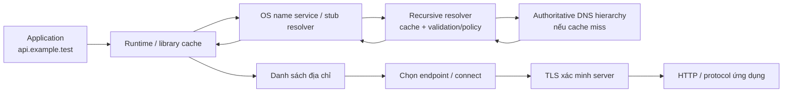
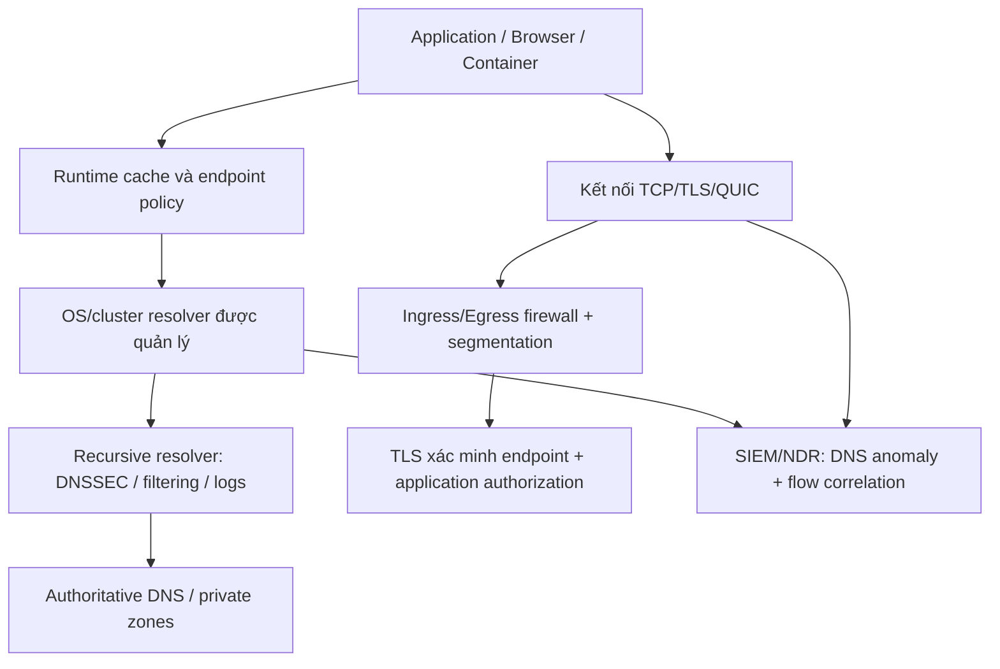
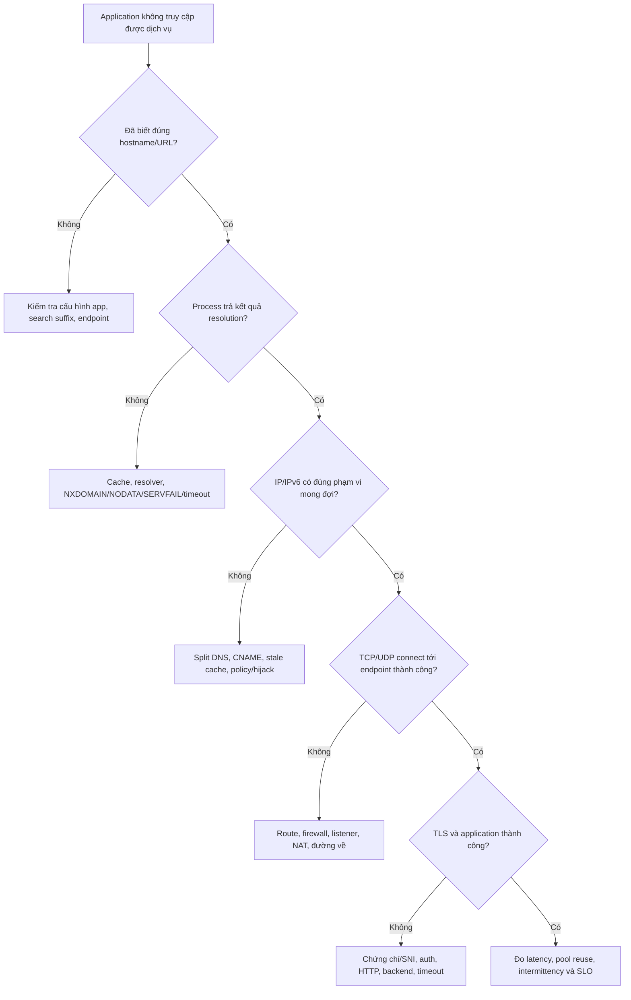

# DNS resolution trong application: từ hostname đến kết nối an toàn

Khi ứng dụng gọi `https://api.example.test/orders`, bước đầu tiên thường không phải gửi HTTP request. Ứng dụng cần biến hostname `api.example.test` thành địa chỉ mạng có thể kết nối, chọn một endpoint phù hợp, rồi thiết lập kết nối TCP/TLS hoặc QUIC. Quá trình này được gọi là **name resolution**, trong đó **DNS resolution** là một cơ chế quan trọng nhưng không phải cơ chế duy nhất.

DNS tưởng như chỉ là “tìm IP”, nhưng trong hệ thống phân tán nó ảnh hưởng trực tiếp đến **độ sẵn sàng, độ trễ, failover, load balancing, định danh dịch vụ và an ninh mạng**. Một câu trả lời DNS hợp lệ cũng chưa chứng minh server thực sự là dịch vụ đáng tin cậy: ứng dụng vẫn phải xác minh TLS, xác thực request và thực thi chính sách truy cập.

Trong module **SECURITY_NETWORK_SECURITY**, hiểu DNS resolution từ góc nhìn application giúp phối hợp các lớp phòng vệ như phân đoạn mạng, firewall, VPN, IDS/IPS, bảo vệ DNS, giám sát lưu lượng và cloud networking. Người vận hành sẽ biết vì sao một dịch vụ báo “không tìm thấy host”, vì sao thay đổi DNS chưa có tác dụng, và làm thế nào để ứng dụng không trở thành nạn nhân của DNS spoofing, DNS rebinding hoặc SSRF.

Sau bài học, bạn có thể:

- Mô tả luồng **application → runtime/OS resolver → recursive resolver → authoritative DNS → IP/endpoint** và những điểm có cache.
- Giải thích vai trò của bản ghi `A`, `AAAA`, `CNAME`, `SRV`, `HTTPS/SVCB`, `TXT`, `NS`, `SOA` trong những tình huống ứng dụng thường gặp.
- Phân biệt DNS lookup, TCP/UDP connection, TLS verification và HTTP request; không suy ra “DNS hỏng” từ mọi lỗi kết nối.
- Thiết kế timeout, cache, TTL, retry, failover và giám sát DNS một cách có kiểm soát.
- Hiểu hành vi DNS trong Java/JVM, container, Kubernetes, private network và cloud.
- Phân tích rủi ro DNS cache poisoning, spoofing, hijacking, rebinding và giới hạn của DNSSEC, DoH, DoT.
- Sử dụng log, `dig`, `getent`, `nslookup`, `tcpdump` và dữ liệu ứng dụng để khoanh vùng sự cố.

> **Quy ước ví dụ:** Các hostname thuộc `.test` và các địa chỉ `192.0.2.0/24`, `198.51.100.0/24`, `203.0.113.0/24`, `2001:db8::/32` trong bài chỉ dành cho tài liệu minh họa, không được kỳ vọng phân giải hay kết nối được ngoài môi trường lab đã cấu hình.

## 1. DNS resolution bắt đầu ở application nhưng không dừng ở DNS

Một đoạn chương trình thường chỉ cung cấp **hostname**, không chọn trực tiếp một authoritative DNS server. Thư viện mạng hoặc runtime sẽ sử dụng cơ chế resolution của nền tảng để lấy những địa chỉ phù hợp. Tùy hệ thống, resolution có thể đi qua cache của ứng dụng, JVM, file hosts, hệ thống tra cứu tên (ví dụ NSS), local DNS stub, recursive resolver hoặc DNS service của cluster.



Sơ đồ mô tả một đường đi thường gặp, **không bắt buộc mọi ứng dụng đi qua từng bước**:

- Một process có thể dùng file `/etc/hosts` hoặc cơ chế tên máy cục bộ mà không tạo DNS query.
- Một ứng dụng có thể tích hợp DNS client riêng, sử dụng DoH, service discovery hoặc cache độc lập.
- Resolver có thể trả câu trả lời từ cache, không hỏi authoritative server mỗi lần.
- Thư viện HTTP có thể tái sử dụng kết nối đang mở, nên **gửi thêm HTTP request không nhất thiết kích hoạt lookup mới**.
- DNS resolver nội bộ hoặc split DNS có thể trả địa chỉ khác so với resolver công cộng.

**DNS resolution** trả thông tin để lựa chọn đích. **Kết nối thành công** còn cần routing, firewall, listener, TLS và logic ứng dụng.

### 1.1. Phân biệt các vai trò trong chuỗi resolution

| Thành phần | Vai trò | Điểm dễ nhầm |
|---|---|---|
| Application | Cần tên dịch vụ và phát lệnh kết nối | Không phải ứng dụng nào cũng tự gửi packet DNS. |
| Runtime/library | Cung cấp API resolve, cache, lựa chọn địa chỉ, connection pool | Cache của JVM khác cache recursive resolver và DNS TTL nhận được. |
| OS name service / stub | Chọn nguồn tra cứu tên, có thể kết hợp hosts, DNS và dịch vụ cục bộ | `dig` có thể không đi qua cùng cơ chế tra cứu tên của ứng dụng. |
| Recursive resolver | Trả lời client bằng cache hoặc truy vấn các DNS server liên quan | Có thể áp DNSSEC validation, filtering và caching theo cấu hình. |
| Authoritative DNS | Cung cấp dữ liệu authoritative cho các zone được quản lý | Không biết ứng dụng đã kết nối TCP/TLS thành công chưa. |
| DNS policy/resolver gateway | Chặn, sửa hướng hoặc log truy vấn theo chính sách | Thông báo “không tìm thấy tên” có thể do policy, không phải zone không tồn tại. |
| Endpoint/server | Nhận kết nối tới IP và port đã chọn | IP đúng chưa chứng minh danh tính dịch vụ. |

### 1.2. Recursive lookup và authoritative answer

Giả sử cache chưa có `api.example.test`. Recursive resolver có thể sử dụng cấu trúc DNS phân cấp để tìm nơi có thẩm quyền đối với zone; trong trường hợp phổ biến, quá trình liên quan thông tin ở root, TLD và authoritative nameserver. Resolver gửi câu trả lời về cho stub/application rồi có thể cache theo TTL và chính sách.

Điều này không có nghĩa ứng dụng phải trực tiếp truy vấn root hay TLD. Cũng không nhất thiết có chuỗi root → TLD → authoritative trong mọi lookup, vì resolver có cache, forwarder, zone nội bộ hoặc đã biết nameserver cần hỏi.

### 1.3. Resolution khác connect

```text
1. Lookup:        api.example.test -> 198.51.100.20, 2001:db8::20
2. Address choice: client chọn/thử địa chỉ phù hợp theo runtime và môi trường
3. Transport:     TCP SYN/SYN-ACK/ACK hoặc QUIC qua UDP
4. Security:      TLS xác minh chứng chỉ cho hostname mong đợi
5. Application:   gửi HTTP request và đọc response
```

Thất bại ở bước 1 có thể xuất hiện dưới dạng lỗi resolution. Thất bại ở bước 3 thường là timeout/refused/no route. Bước 4 có thể gặp lỗi certificate hoặc TLS handshake. Bước 5 có thể trả HTTP `401`, `403`, `502` hay `504`. Cần xác định **bước nào đã hoàn thành** trước khi quy lỗi cho DNS.

## 2. Những DNS record liên quan tới ứng dụng

DNS không chỉ lưu một hostname và một IPv4. Ứng dụng và hệ thống discovery có thể dùng nhiều loại resource record (RR):

| Loại RR | Nội dung | Ứng dụng thường gặp |
|---|---|---|
| `A` | Tên → địa chỉ IPv4 | Kết nối IPv4 tới API/web. |
| `AAAA` | Tên → địa chỉ IPv6 | Kết nối IPv6, hệ thống dual-stack. |
| `CNAME` | Tên bí danh → canonical name | Trỏ một hostname sang tên của dịch vụ khác/CDN. |
| `SRV` | Dịch vụ + protocol → target hostname/port và các giá trị priority/weight | Một số giao thức service discovery; HTTP client thông thường không mặc nhiên tra SRV. |
| `HTTPS` / `SVCB` | Metadata binding/đặc tính dịch vụ theo cơ chế hỗ trợ | Một số client hiện đại khám phá thông số endpoint, ALPN hoặc địa chỉ gợi ý. |
| `TXT` | Dữ liệu văn bản theo chuẩn/ứng dụng sử dụng | Xác minh domain, SPF và metadata dịch vụ. Không phải record địa chỉ. |
| `MX` | Mail exchanger của domain | Gửi email; client HTTP thường không dùng MX để tìm API. |
| `NS` | Nameserver của zone | DNS delegation và quản trị authoritative DNS. |
| `SOA` | Thông tin quản trị zone | Liên quan cache negative response, zone properties. |
| `PTR` | Ánh xạ ngược IP → tên trong reverse DNS | Ghi log, inventory và một số kiểm tra theo giao thức; không xác thực máy chủ HTTPS. |
| `CAA` | Ràng buộc CA được phép cấp chứng chỉ cho domain | Giảm nguy cơ cấp chứng chỉ trái mong muốn; không thay TLS certificate validation tại client. |

### 2.1. A, AAAA và multi-address

Một hostname có thể trả về nhiều `A` và `AAAA`:

```text
api.example.test.  60  IN  A     198.51.100.20
api.example.test.  60  IN  A     198.51.100.21
api.example.test.  60  IN  AAAA  2001:db8::20
```

Đây là mô hình minh họa. DNS trả nhiều địa chỉ **không tự đảm bảo** client sẽ kết nối thành công hoặc phân tải công bằng:

- Runtime có thể chọn/thử IPv6 hoặc IPv4 theo chính sách hệ điều hành.
- Một thư viện có thể dùng kỹ thuật kiểu **Happy Eyeballs** để giảm thời gian chờ khi một họ địa chỉ gặp lỗi; hành vi cụ thể tùy client.
- DNS round-robin hoặc câu trả lời nhiều địa chỉ không có health check đầu cuối theo mặc định.
- Kết nối đang mở hoặc connection pool có thể tiếp tục dùng địa chỉ cũ sau khi DNS trả IP mới.

Vì vậy một sự cố “chỉ một số người dùng lỗi” có thể do **một IP backend hỏng**, cấu hình IPv6 thiếu hoặc các resolver trả các tập địa chỉ khác nhau.

### 2.2. CNAME không phải một redirect HTTP

```text
api.example.test.     300 IN CNAME api-gateway.example.test.
api-gateway.example.test. 60 IN A 198.51.100.20
```

DNS trả ra mối quan hệ tên. Nó không yêu cầu trình duyệt chuyển URL hoặc thay hostname đích dùng để xác minh TLS. Khi client gọi `https://api.example.test`, **hostname cần xác thực ở TLS vẫn là `api.example.test`** theo request của client, trừ khi ứng dụng chủ động chọn hostname mới.

Các ràng buộc của CNAME (ví dụ không cùng tồn tại với một số loại dữ liệu tại cùng owner name theo nguyên tắc DNS) cần được hệ thống DNS quản lý đúng. DNS provider có thể có tính năng ALIAS/flattening riêng, không nên coi đó là RR chuẩn có cùng hành vi với CNAME.

### 2.3. SRV và service discovery

Một record SRV có thể mô tả:

```text
_myservice._tcp.example.test. 60 IN SRV 10 50 8443 node-a.example.test.
_myservice._tcp.example.test. 60 IN SRV 20 50 8443 node-b.example.test.
```

Các trường SRV gồm **priority, weight, port, target**. Chúng chỉ hữu ích nếu ứng dụng hoặc thư viện **chủ động hỗ trợ lookup và lựa chọn endpoint theo SRV**; `InetAddress.getAllByName("myservice.example.test")` không tự biến thành một SRV discovery client.

### 2.4. TTL và sự thay đổi record

**TTL (Time To Live)** trong RR là hướng dẫn về thời gian một DNS cache có thể lưu câu trả lời theo cơ chế DNS. TTL hiển thị ở recursive resolver có thể giảm dần theo thời gian và có thể chịu chính sách caching của resolver; TTL **không phải cam kết mọi ứng dụng sẽ cập nhật địa chỉ đồng thời**.

Một record TTL `60` giây không buộc mọi HTTP connection pool đóng kết nối sau 60 giây, cũng không bảo đảm một JVM đang cache sẽ resolve lại trong đúng 60 giây. Cần thiết kế vòng đời DNS và vòng đời **kết nối mạng** như hai vấn đề liên quan nhưng khác nhau.

## 3. Các lớp cache: vì sao sửa DNS nhưng ứng dụng vẫn dùng IP cũ?

Một hostname có thể bị cache ở nhiều vị trí:

```text
HTTP client / service discovery cache
          |
    Runtime/JVM cache
          |
   OS stub / local DNS cache
          |
     Recursive resolver
          |
   Authoritative DNS zone
```

Không phải hệ thống nào cũng có mọi lớp trên. Cùng một record có thể có **TTL được áp khác nhau** hoặc được giữ trong cấu trúc ứng dụng lâu hơn thời gian cache DNS.

### 3.1. Positive caching

Khi một lookup thành công trả các địa chỉ, cache có thể giữ mapping hostname → địa chỉ trong một khoảng thời gian. Điều này giảm độ trễ và tải DNS, nhưng có thể làm ứng dụng tiếp tục sử dụng địa chỉ cũ sau khi hạ tầng thay đổi.

Ví dụ:

```text
10:00  api.example.test -> 198.51.100.20 (TTL 300s)
10:01  Ops sửa authoritative record thành 198.51.100.21
10:02  Resolver A vẫn có cache cũ
10:05+ Một số resolver/client bắt đầu thấy record mới
```

Thời điểm thực tế phụ thuộc lúc cache nhận câu trả lời, thời gian còn lại, các lớp cache và chính sách từng thành phần. **Không thể dự đoán chính xác tất cả client chuyển sang IP mới chỉ từ TTL của authoritative record ở thời điểm sửa.**

### 3.2. Negative caching

DNS có thể cache kết quả **không tìm thấy tên** (`NXDOMAIN`) hoặc **không có dữ liệu cho loại record được hỏi** (`NOERROR` nhưng không có answer phù hợp, thường gọi NODATA). Negative caching được điều khiển bởi quy tắc DNS và các thông tin thích hợp trong phản hồi, có thể liên quan SOA.

Hậu quả vận hành: nếu ứng dụng khởi chạy và truy vấn tên dịch vụ **trước khi record được tạo**, một lớp cache có thể giữ kết quả âm. Ngay cả khi record sau đó xuất hiện, ứng dụng vẫn báo lỗi resolution trong một khoảng thời gian.

**Lỗi resolution không nhất thiết là NXDOMAIN.** `SERVFAIL`, timeout, `REFUSED`, lỗi chính sách hoặc không tìm được địa chỉ thích hợp có thể được ánh xạ thành thông báo tương tự ở tầng ứng dụng.

### 3.3. Cache của ứng dụng và cache của kết nối

Hãy phân biệt:

| Cơ chế | Đối tượng được lưu | Hậu quả |
|---|---|---|
| DNS positive cache | Hostname → record/IP | Có thể tiếp tục trả địa chỉ cũ. |
| DNS negative cache | Kết quả tra cứu không thành công theo điều kiện | Có thể tiếp tục báo không tìm thấy tên dù record vừa được sửa. |
| Connection pool / keep-alive | Kết nối TCP/TLS đang mở tới endpoint | Có thể tiếp tục gửi nhiều request mà không resolve lại. |
| HTTP response cache | Response HTTP theo caching policy | Không nhất thiết liên quan TTL DNS. |
| Service discovery registry cache | Danh sách endpoint hoặc metadata riêng của ứng dụng | Có thể độc lập với DNS TTL. |

Một ứng dụng dùng HTTP/2 hoặc gRPC có thể giữ kết nối dài hạn tới một địa chỉ đã resolve. Thay DNS **không tự đóng** kết nối đang sống, và failover DNS **không thay thế** timeout, health checking và reconnect logic.

## 4. DNS trong Java/JVM

Java cung cấp API phân giải hostname qua lớp `java.net.InetAddress`. Khi dùng thư viện HTTP, database driver hoặc gRPC, việc resolve có thể được runtime/thư viện thực hiện bên dưới. Một thư viện có thể giữ cache hoặc connection pool riêng; cần xem tài liệu của client thực tế để biết lúc nào nó lookup lại.

### 4.1. Ví dụ Java: đo kết quả resolution

Đoạn mã Java sau minh họa **application nhìn thấy những IP nào**. Khi không có DNS phù hợp cho tên `.test`, hãy thay bằng hostname trong lab được cấp quyền:

```java
import java.net.Inet4Address;
import java.net.Inet6Address;
import java.net.InetAddress;
import java.net.UnknownHostException;
import java.util.concurrent.TimeUnit;

public class DnsResolutionDemo {
    public static void main(String[] args) {
        String hostname = args.length > 0 ? args[0] : "api.example.test";
        long startedAt = System.nanoTime();

        try {
            InetAddress[] addresses = InetAddress.getAllByName(hostname);
            for (InetAddress address : addresses) {
                String family = address instanceof Inet4Address ? "IPv4"
                    : address instanceof Inet6Address ? "IPv6" : "Other";
                System.out.printf("%s -> %s (%s)%n",
                    hostname, address.getHostAddress(), family);
            }
        } catch (UnknownHostException ex) {
            System.err.println("Không phân giải được " + hostname
                + ": " + ex.getMessage());
        } finally {
            long elapsedMs = TimeUnit.NANOSECONDS.toMillis(
                System.nanoTime() - startedAt);
            System.out.println("Elapsed: " + elapsedMs + " ms");
        }
    }
}
```

Chạy trong môi trường có Java:

```bash
javac DnsResolutionDemo.java
java DnsResolutionDemo api.example.test
```

**Giải thích giới hạn:**

- `InetAddress.getAllByName` lấy những địa chỉ do **cơ chế name service mà Java đang sử dụng** trả về; nguồn có thể bao gồm hosts file và cache, không nhất thiết sinh packet DNS mới.
- Nó không bảo đảm sẽ trả tất cả record authoritative có tồn tại, hoặc thử kết nối đến từng địa chỉ.
- `UnknownHostException` là lỗi ở API Java, **không chứng minh** DNS server đã trả `NXDOMAIN`; muốn biết nguyên nhân chính xác cần log runtime, DNS response/timeout và cấu hình resolver.
- Thời gian đo gồm chi phí API/caching; kết quả rất nhỏ có thể chỉ là **cache hit**, không thể dùng thay trực tiếp cho DNS network latency.

### 4.2. JVM DNS caching

Trên JVM, hành vi cache địa chỉ có thể chịu các **Java security properties** như:

```properties
# Các giá trị dưới đây chỉ minh họa chính sách;
# phải chọn theo yêu cầu dịch vụ, JDK và hướng dẫn của tổ chức.
networkaddress.cache.ttl=60
networkaddress.cache.negative.ttl=10
```

`networkaddress.cache.ttl` điều chỉnh thời gian cache positive theo cơ chế và phiên bản JDK liên quan; `networkaddress.cache.negative.ttl` áp cho cache negative. Các giá trị đặc biệt và mặc định có thể khác giữa JDK/cấu hình bảo mật; ví dụ một giá trị cho cache vô hạn có thể nguy hiểm khi endpoint thay đổi. **Đây là security properties, không nên mặc định đặt `-Dnetworkaddress.cache.ttl=...` sẽ có cùng hiệu lực trên mọi JVM.**

Để áp một chính sách như vậy, xem file/cơ chế Java security properties được runtime hiện tại hỗ trợ, kiểm tra tác động trên chính phiên bản JDK sử dụng và xác minh bằng bài kiểm thử thay đổi record. Không chỉnh trực tiếp cấu hình JDK production khi chưa có kế hoạch kiểm thử, phân quyền và rollback.

### 4.3. `HttpClient` và ranh giới timeout

Ví dụ Java 17 dùng API HTTP client chuẩn:

```java
import java.net.URI;
import java.net.http.HttpClient;
import java.net.http.HttpRequest;
import java.net.http.HttpResponse;
import java.time.Duration;

public class ApiRequestDemo {
    public static void main(String[] args) throws Exception {
        HttpClient client = HttpClient.newBuilder()
            .connectTimeout(Duration.ofSeconds(3))
            .build();

        HttpRequest request = HttpRequest.newBuilder()
            .uri(URI.create("https://api.example.test/health"))
            .timeout(Duration.ofSeconds(10))
            .GET()
            .build();

        HttpResponse<String> response = client.send(
            request, HttpResponse.BodyHandlers.ofString());
        System.out.println("HTTP status: " + response.statusCode());
    }
}
```

Ở đây `connectTimeout` là giới hạn liên quan **thiết lập kết nối mới**; request timeout ràng buộc yêu cầu HTTP theo hành vi của API. Không được mặc định một thuộc tính connect timeout **luôn giới hạn riêng mọi bước DNS lookup** trong mọi JDK/thư viện. Nếu cần deadline tổng, retry budget, cancellation và telemetry DNS cụ thể, phải kiểm tra behavior của client dùng trong production.

Một `HttpClient` có thể **tái sử dụng connection**; gọi cùng URI lần hai không buộc ứng dụng hỏi DNS lần nữa. Nếu backend IP thay đổi, kiểm tra vòng đời pool, thời gian chờ, retries và cơ chế cân bằng địa chỉ trong client chứ không chỉ thay TTL.

### 4.4. Không tự thay URL hostname bằng IP sau resolve

Nếu ứng dụng kết nối HTTPS tới IP trực tiếp nhưng cần xác thực hostname `api.example.test`, việc đổi URL thành `https://198.51.100.20` có thể khiến **SNI, HTTP Host và TLS hostname verification** hoạt động khác mong đợi. Hãy giữ danh tính hostname đúng trong URL và dùng client/network stack hỗ trợ lựa chọn IP, xác minh chứng chỉ và routing phù hợp.

Đặc biệt trong code chống SSRF, thao tác “kiểm tra IP rồi vẫn gọi URL hostname theo cách tự resolve lần nữa” có thể tạo lỗi **time-of-check/time-of-use**. Biện pháp an toàn cần kiểm soát endpoint được kết nối thực tế và egress policy, không chỉ một lần `InetAddress.getAllByName`.

## 5. DNS timeout, retry và failover trong application

Ứng dụng cần xử lý DNS như một **dependency phân tán** có thể chậm hoặc thất bại. Tuy nhiên retry không giới hạn có thể làm sự cố nghiêm trọng hơn.

### 5.1. Các nhóm kết quả DNS khác nhau

| Quan sát | Nghĩa thông thường | Hướng xử lý |
|---|---|---|
| Có `A`/`AAAA` phù hợp | Resolver trả địa chỉ | Tiếp tục connection và TLS; chưa chứng minh server khỏe. |
| `NXDOMAIN` | Tên được hỏi không tồn tại theo phản hồi DNS | Kiểm tra chính tả, search suffix, zone/delegation, split DNS và negative cache. |
| `NOERROR` nhưng không có answer phù hợp (NODATA) | Tên có thể tồn tại nhưng không có RR loại đang hỏi | Kiểm tra loại `A`/`AAAA`, alias chain và loại dịch vụ. |
| `SERVFAIL` | Resolver không xử lý thành công | Kiểm tra upstream, DNSSEC validation, authoritative server và resolver logs. |
| `REFUSED` | DNS server từ chối xử lý truy vấn theo chính sách | Kiểm tra ACL/policy, resolver được phép và nguồn truy vấn. |
| Timeout không có response | Không nhận phản hồi trong khoảng chờ | Kiểm tra route, firewall, packet loss, UDP/TCP, resolver overload. |
| Truncated response (`TC`) | Câu trả lời UDP bị đánh dấu cắt ngắn | Client/resolver theo quy trình có thể thử TCP; kiểm tra TCP/53 và cấu hình EDNS. |

**Một thông báo lỗi ứng dụng có thể gộp nhiều trường hợp DNS.** Tối ưu là log được nguyên nhân dưới dạng có thể phân loại (không lộ dữ liệu nhạy cảm), và sử dụng resolver/packet evidence khi điều tra.

### 5.2. Retry phải có deadline và giới hạn

Nguyên tắc thiết kế:

1. Có **end-to-end deadline** cho thao tác ứng dụng, không chỉ cho TCP connect.
2. Phân biệt lỗi **có thể thử lại** (ví dụ resolver timeout tạm thời) với lỗi cần sửa cấu hình (ví dụ hostname sai).
3. Sử dụng **backoff và jitter** khi client/thư viện hỗ trợ để tránh hàng nghìn instance cùng truy vấn lại đúng một thời điểm.
4. Đặt giới hạn số lần thử và **retry budget** chung; không xếp chồng nhiều lớp retry không kiểm soát.
5. Theo dõi negative caching và thay đổi endpoint; retry ngay trong thời gian cache lỗi có thể không tạo truy vấn mới.
6. Với thao tác có side effects, phải xét **idempotency** và trạng thái request trước khi gửi lại ở tầng HTTP.

Ví dụ một tác vụ có deadline 2 giây không nên thực hiện mười lần lookup/chờ mạng kéo dài mỗi lần vài giây. Cũng không nên bật retry vô hạn khi authoritative DNS đang lỗi; sự gia tăng query có thể khiến resolver thêm quá tải.

### 5.3. Failover qua DNS có giới hạn

Một phương án thay đổi DNS từ IP hỏng sang IP khỏe **không đủ** để đảm bảo failover nhanh:

- DNS cache ở client/recursive resolver có thể giữ record cũ.
- Một client có thể giữ kết nối lâu dài hoặc chỉ thử IP đầu tiên trong danh sách.
- Có thể có IPv6 và IPv4 với tình trạng khác nhau.
- Nếu lỗi xảy ra sau khi TCP/TLS kết nối (ví dụ server trả `500`), DNS thuần túy không biết lỗi ứng dụng.

Cho hệ thống yêu cầu sẵn sàng cao, cân nhắc load balancer với health check, connection timeout phù hợp, pool eviction/reconnect, multiple endpoint strategy hoặc service discovery được thiết kế rõ. DNS là **một phần của failover**, không phải thay thế cơ chế kiểm tra sức khỏe.

## 6. DNS trong container, Kubernetes và mạng cloud

### 6.1. Container thường có cấu hình resolver riêng

Ứng dụng chạy trong container có thể thấy cấu hình `/etc/resolv.conf` khác host, hoặc sử dụng DNS stub do runtime cung cấp. Cơ chế NSS/hosts và network namespace cũng có thể khác.

Đừng suy luận rằng `dig` trên laptop của người vận hành và `getAllByName` trong container sẽ nhận cùng kết quả. Khi troubleshooting, cần **thử từ đúng process/container/network namespace** hoặc một môi trường có DNS/network policy tương đương.

### 6.2. Kubernetes Service DNS

Trong một cluster Kubernetes với cluster domain thường dùng là `cluster.local`, một Service có tên `orders` trong namespace `production` thường có DNS name dạng:

```text
orders.production.svc.cluster.local
```

Cluster domain **có thể được cấu hình khác**. Pod thường nhận search domains và `ndots` theo DNS policy/cluster configuration. Ví dụ tên ngắn `orders` có thể được mở rộng lần lượt với các search suffix, làm phát sinh nhiều query trước khi tìm đúng mục tiêu.

```text
Application trong Pod:
    orders
       |
    resolver + search domains / ndots
       |
    CoreDNS hoặc dịch vụ cluster DNS tương ứng
       |
    Service name → ClusterIP / endpoint theo loại Service
```

Đặc điểm cần chú ý:

- **Service ClusterIP** là địa chỉ ảo ổn định theo vòng đời Service; traffic tới Pod/backend do hệ thống cluster routing xử lý. Không phải mỗi request DNS sẽ chọn một Pod trực tiếp.
- **Headless Service** có cơ chế trả địa chỉ endpoint phù hợp khác ClusterIP Service, hữu ích cho những trường hợp discovery cụ thể.
- Tên bên ngoài có thể được forward ra DNS resolver upstream theo cấu hình CoreDNS.
- `dnsPolicy`, `dnsConfig`, search suffixes và `ndots` ảnh hưởng số lượng, thứ tự truy vấn và độ trễ.
- NetworkPolicy, node routing và cấu hình egress có thể chặn đường tới DNS server hoặc dịch vụ đích.

Đối với hệ thống Java, mỗi Pod là một process/JVM có cache và connection pool riêng. Autoscaling khiến số lượng request DNS tăng khi nhiều Pod khởi động đồng thời; nên đo cache hit/miss, hiệu năng resolver và hành vi lúc rollout.

### 6.3. Private DNS và split-horizon

Một hostname có thể trả IP khác nhau tùy **resolver và mạng nguồn**:

```text
Trên VPN / mạng doanh nghiệp:
  api.corp.example.test → 10.20.4.12

Ngoài Internet:
  api.corp.example.test → NXDOMAIN hoặc câu trả lời khác theo chính sách
```

Mô hình này thường được gọi là **split-horizon/split DNS**. Nó phù hợp với dịch vụ nội bộ nhưng gây khó chẩn đoán nếu ứng dụng dùng resolver ngoài mạng, VPN không đẩy đúng DNS configuration hoặc conditional forwarding bị lỗi.

Không nên kết luận authoritative zone hỏng chỉ vì `dig` qua một resolver công cộng cho kết quả khác DNS nội bộ. Hãy xác minh **view, routing, DNS policy, search domain và môi trường thực hiện truy vấn**.

### 6.4. Cloud DNS và giới hạn bảo mật

Cloud VPC/VNet thường cung cấp resolver và private DNS zone với cơ chế truy cập theo mạng, tài khoản hoặc policy của nhà cung cấp. Tuy nhiên:

- Private DNS name **không tự ngăn truy cập** nếu tài nguyên có public endpoint hoặc route khác.
- Security group/firewall quy định reachability theo IP/port và trạng thái; DNS chỉ cung cấp thông tin tên/địa chỉ.
- Một số DNS service do cloud cung cấp được xử lý đặc biệt trong datapath và không bị firewall/security group kiểm soát hệt một server DNS thông thường.
- Resolver logs/flow logs có độ bao phủ và retention tùy cấu hình, không phải nguồn chứng cứ hoàn chỉnh cho mọi truy vấn.

Để bảo vệ dịch vụ nội bộ phải kết hợp **private routing, ingress policy, service identity, TLS/mTLS, authN/authZ và giám sát**, không chỉ ẩn hostname khỏi DNS public.

## 7. DNS transport và lựa chọn resolver đáng tin

### 7.1. DNS truyền thống dùng UDP và TCP

DNS thường sử dụng UDP port `53`; TCP port `53` cũng là phần thiết yếu của giao thức, dùng trong nhiều tình huống như trả lời lớn, retry khi truncated và một số tác vụ khác. EDNS(0) hỗ trợ thương lượng những thuộc tính bổ sung, bao gồm thông tin kích thước UDP payload được đề xuất.

**Không nên chỉ mở UDP/53 rồi chặn TCP/53 theo mặc định cho mọi resolver**: điều này có thể khiến những query cần TCP thất bại. Ngược lại, mở DNS server của tổ chức cho mọi nguồn Internet có thể tạo rủi ro resolver bị lạm dụng, cần ACL và policy rõ ràng.

### 7.2. DNS-over-TLS và DNS-over-HTTPS

| Cơ chế | Đường đi phổ biến | Bảo vệ và giới hạn |
|---|---|---|
| DNS truyền thống | UDP/TCP `53` | Không tự mã hóa hay xác thực phản hồi giữa stub và resolver. |
| **DoT** (DNS-over-TLS) | TLS qua TCP `853` theo triển khai thông thường | Bảo vệ kênh tới resolver được xác minh; không tự xác thực tính đúng đắn dữ liệu authoritative. |
| **DoH** (DNS-over-HTTPS) | HTTPS, thường TCP `443` hoặc QUIC/HTTP/3 nếu hỗ trợ | Bảo vệ kênh tới DNS service; có thể làm quan sát DNS ở firewall/IDS truyền thống khó hơn. |
| **DoQ** (DNS-over-QUIC) | QUIC theo cơ chế và cổng dịch vụ cấu hình | Một lựa chọn DNS mã hóa khác; khả năng hỗ trợ phụ thuộc client/resolver. |

**Mã hóa kênh DNS** và **xác thực dữ liệu DNS** là hai bài toán khác nhau. DoH/DoT bảo vệ đường truyền từ client đến resolver đã lựa chọn, nhưng resolver vẫn có thể trả dữ liệu do chính sách, lỗi cấu hình hoặc nguồn upstream không đáng tin. DNSSEC giải quyết một khía cạnh khác, được trình bày ở mục sau.

### 7.3. Resolver nào thật sự được ứng dụng sử dụng?

Trình duyệt có thể bật secure DNS riêng; ứng dụng Java có thể dựa vào môi trường name service; container có DNS stub; máy trong VPN có conditional forwarding. Do đó một câu hỏi “DNS của máy là gì?” nên được phân thành:

1. Resolver **runtime/ứng dụng đang gọi**.
2. Resolver **OS hoặc container đang cấu hình**.
3. Upstream resolver/forwarder **thật sự xử lý query**.
4. Policy DNS hoặc encrypted DNS có thể đổi đường đi.

Với DoH/DoT, packet capture ở tầng mạng có thể chỉ thấy kết nối TLS đến resolver, không thấy QNAME. Khi cần quan sát DNS theo chính sách công ty, ưu tiên log từ **resolver quản lý hoặc endpoint được phép**; không giả định có thể đọc tên miền từ ciphertext.

## 8. DNSSEC, tính toàn vẹn và xác thực endpoint

**DNSSEC** là cơ chế ký và xác minh dữ liệu DNS để giúp resolver có khả năng kiểm tra tính xác thực nguồn dữ liệu và tính toàn vẹn bản ghi khi chuỗi tin cậy phù hợp. Một **validating recursive resolver** có thể xác minh chữ ký cùng chain of trust từ trust anchor qua zone delegation.

DNSSEC có thể giúp phát hiện một số phản hồi bị sửa đổi/giả mạo, nhưng:

- **Không mã hóa** DNS query/response; người quan sát đường mạng vẫn có thể thấy tên miền nếu DNS truyền thống không mã hóa.
- Không xác minh application server có khỏe, được cấp quyền hoặc đang chạy đúng phiên bản.
- Không thay thế **TLS certificate hostname verification** khi ứng dụng kết nối HTTPS.
- Không đảm bảo nội dung DNS đúng nghiệp vụ nếu chính authoritative zone bị cấu hình sai hoặc tài khoản quản trị bị chiếm.
- Validation có thể gây `SERVFAIL` khi chữ ký/chain sai hoặc dữ liệu không thể xác minh theo chính sách; cần điều tra thay vì tự tắt validation.

### 8.1. Ba lớp tin cậy không nên nhầm

| Câu hỏi | Cơ chế liên quan | Điều cần biết |
|---|---|---|
| Query DNS có bị người trên đường nghe/sửa giữa client và resolver không? | DoH/DoT và kênh tới resolver được xác minh | Bảo vệ kênh, không đủ chứng minh record do authoritative ký. |
| Dữ liệu DNS có chứng thực được theo chain of trust không? | DNSSEC validating resolver | Xác thực dữ liệu DNS trong phạm vi zone có DNSSEC hợp lệ. |
| IP được chọn có phục vụ đúng hostname HTTPS không? | TLS certificate, hostname validation, PKI/mTLS | Client phải xác thực endpoint, kể cả DNS trả địa chỉ có vẻ đúng. |

Nếu client nhận một kết quả DNS sai dẫn đến IP của đối tượng giả, **TLS hostname verification** thường là rào cản quan trọng để ngăn kết nối HTTPS thành công tới server không có chứng chỉ phù hợp. Tuy nhiên không nên coi TLS là biện pháp duy nhất trước mọi lỗi routing, DNS hoặc compromise CA/endpoint.

## 9. Các mối đe dọa DNS ảnh hưởng trực tiếp đến application

### 9.1. Spoofing và cache poisoning

**DNS spoofing** là việc tạo hoặc khiến client nhận phản hồi DNS giả mạo. **Cache poisoning** là làm một resolver/cache lưu dữ liệu sai, khiến nhiều client sau đó được trả IP/record không đáng tin.

Hậu quả có thể gồm kết nối tới máy chủ giả, chuyển hướng truy cập, ngừng dịch vụ hoặc hỗ trợ hoạt động lừa đảo. Các lớp bảo vệ:

- Chọn resolver có quản trị, cập nhật bản vá và chính sách an toàn.
- Sử dụng DNSSEC validation ở nơi phù hợp.
- Bảo vệ kênh client–resolver khi cần bằng DoH/DoT có xác minh resolver.
- Giữ **TLS hostname verification** và service authentication; không bỏ xác minh khi lỗi DNS.
- Giám sát thay đổi bất thường của DNS record, authoritative zone và quyền chỉnh sửa DNS.

### 9.2. DNS hijacking và thay đổi chính sách resolver

Nếu cấu hình DHCP, VPN, router, container hoặc DNS client bị thay đổi, ứng dụng có thể dùng resolver không dự kiến. Kẻ tấn công hoặc cấu hình lỗi có thể chuyển hướng tên miền tới IP khác.

Kiểm tra resolver hiệu lực, DHCP/VPN settings, DNS route, hệ thống identity của người thay đổi cấu hình, log resolver và sự khác nhau giữa môi trường. **Đừng chỉ hỏi một DNS server công cộng rồi kết luận** hệ thống nội bộ bị hijack.

### 9.3. DNS rebinding và SSRF

Một ứng dụng cho phép người dùng nhập URL để server tải nội dung có thể gặp rủi ro **Server-Side Request Forgery (SSRF)**. DNS rebinding làm hostname do đối tượng không tin cậy kiểm soát **thay đổi kết quả resolve theo thời gian**, ví dụ lúc kiểm tra trả public IP, lúc kết nối lại trả private/loopback/link-local IP.

```text
Ứng dụng nhận URL do người dùng nhập
        |
        v
Validate hostname/IP một lần → thấy IP public, cho qua
        |
        v
Thư viện HTTP resolve lần nữa → địa chỉ đã thay đổi
        |
        v
Kết nối tới một endpoint nội bộ không được phép
```

Đây là mô hình rủi ro khái niệm; không yêu cầu dùng payload tấn công. Chỉ kiểm tra hostname bằng biểu thức chuỗi hoặc kiểm tra IP **một lần trước khi kết nối** là chưa đủ.

Biện pháp phòng vệ nhiều lớp:

1. **Allowlist URL/hostname/đích** theo nghiệp vụ thay vì nhận URL tùy ý nếu có thể.
2. Chuẩn hóa và kiểm tra scheme, port, hostname và từng bước **redirect**; không tin đường dẫn chuyển hướng sang vùng nội bộ.
3. Xác minh tất cả địa chỉ có thể resolve và địa chỉ **thực sự được kết nối**, xử lý IPv4, IPv6 và các dạng biểu diễn đặc biệt.
4. Thiết kế cơ chế kết nối sao cho kết quả xác minh được **ràng buộc tới endpoint sử dụng**, tránh lỗi time-of-check/time-of-use; vẫn giữ hostname hợp lệ cho TLS SNI/certificate verification.
5. Áp **egress firewall, proxy policy, network segmentation** và chặn tiếp cận private, loopback, link-local hoặc endpoint nhạy cảm từ workload không có nhu cầu.
6. Giới hạn quyền của service account và bảo vệ metadata service/cloud credentials theo cơ chế nền tảng.
7. Ghi log URL đích và quyết định policy ở mức an toàn, không lưu token hoặc nội dung nhạy cảm ngoài nhu cầu.

**DNS filtering không thay thế bảo vệ SSRF ở ứng dụng và mạng.** Một đích IP trực tiếp hoặc URL redirect có thể đi vòng kiểm soát tên miền.

### 9.4. DNS tunneling và exfiltration

DNS tunneling lạm dụng truy vấn/response DNS để chuyên chở dữ liệu hoặc điều khiển kết nối ngoài mục đích phân giải tên thông thường. NDR/DNS security có thể tìm những tín hiệu như số lượng QNAME dài, nhãn tên có entropy cao, tần suất truy vấn khác thường, nhiều subdomain mới hoặc traffic tới resolver ngoài chính sách.

Những đặc điểm này **không tự chứng minh tấn công**: CDN, telemetry và SDK có thể sinh tên động. Cần đối chiếu owner, ứng dụng phát truy vấn, resolver logs, địa chỉ đích, lịch thay đổi và tài sản liên quan trước khi chặn.

### 9.5. Dangling DNS và subdomain takeover

Một record CNAME/A trỏ tới dịch vụ cloud/CDN đã xóa hoặc tài nguyên không còn thuộc tổ chức có thể để lại **dangling DNS configuration**. Trong một số điều kiện của nhà cung cấp, đối tượng khác có thể chiếm tài nguyên đích và phục vụ nội dung dưới hostname đáng tin cậy.

Để phòng vệ, quản lý vòng đời record gắn với tài nguyên cloud, kiểm tra hostname trước khi xóa deployment, giám sát record không còn target hợp lệ và quy trình xác minh quyền sở hữu domain. **Không phải mọi CNAME hỏng đều có thể bị takeover**; điều kiện phụ thuộc dịch vụ và khả năng đăng ký lại tài nguyên.

## 10. Thiết kế bảo vệ DNS theo nhiều lớp



### 10.1. Chính sách resolver và egress

- Workload nên biết **resolver nào được phép sử dụng**. DNS nội bộ/private zone nên đi đúng resolver/forwarder.
- Hạn chế truy vấn DNS đến server bất kỳ khi có yêu cầu kiểm soát egress; đồng thời xét DoH/DoT có thể sử dụng port/giao thức khác.
- Resolver cần giới hạn nguồn được phép hỏi để tránh trở thành **open resolver** hoặc bị lạm dụng.
- Bật DNSSEC validation hoặc bảo vệ dữ liệu theo khả năng/tình trạng zone và yêu cầu tổ chức.
- Xây dựng chính sách DNS filtering cho domain độc hại, nhưng có quy trình xử lý false positive, log và ngoại lệ có thời hạn.
- Không làm hỏng DNS ứng dụng chỉ để siết chặt firewall; các luồng cần thiết như TCP/53, private forwarding và health check phải được xét.

### 10.2. Service identity và kết nối đến origin

Sau resolution, ứng dụng cần bảo đảm **đúng dịch vụ**, không chỉ đúng IP:

- HTTPS: xác minh certificate cho hostname cần kết nối; kiểm tra trust chain và TLS configuration.
- Dịch vụ nội bộ: cân nhắc mTLS/service identity cho traffic nhạy cảm.
- Database/API: xác thực và phân quyền ở ứng dụng; không dựa vào việc hostname nằm trong domain nội bộ.
- Network policy: chỉ cho các kết nối **đã được phê duyệt** giữa app, database, DNS resolver và dịch vụ hạ tầng.
- Cloud: endpoint và credential được giới hạn theo IAM/identity, không phó mặc cho DNS private name.

### 10.3. Ghi log và quyền riêng tư

DNS queries có thể phản ánh hành vi người dùng, tài sản và các dịch vụ nhạy cảm. Quy trình quan sát nên:

1. Giới hạn nguồn log đúng mục đích an ninh/vận hành.
2. Ghi timezone, resolver, client identity, QNAME/QTYPE/RCODE và latency theo khả năng sản phẩm.
3. Phân quyền và mã hóa lưu trữ/log transport; xác định retention.
4. Tránh ghi trực tiếp token hoặc dữ liệu nhạy cảm trong hostname/URL.
5. Correlate DNS với flow/endpoint logs nhưng ghi rõ hạn chế do NAT, cache và encrypted DNS.

Một flow tới IP không luôn ánh xạ một-một với DNS query gần nhất: IP có thể phục vụ nhiều hostname, và cache/hosts file có thể khiến client **không hỏi DNS trong khoảng quan sát**.

## 11. Kiểm tra DNS từ môi trường chạy ứng dụng

Các lệnh sau là công cụ quan sát, **không thay thế việc đọc resolver behavior trong process**. Chỉ thực hiện trên hệ thống được phép kiểm tra và thay hostname `.test` bằng tên hoạt động thật trong lab.

### 11.1. Linux

```bash
# Cấu hình resolver và search domains nhìn thấy ở môi trường hiện tại.
cat /etc/resolv.conf

# Với hệ thống có systemd-resolved:
resolvectl status

# Tra cứu tên theo cơ chế name service của hệ điều hành (tùy distro/NSS).
getent ahosts api.example.test

# Truy vấn DNS trực tiếp bằng dig, hiển thị response status và TTL.
dig api.example.test A
dig api.example.test AAAA

# Truy vấn qua một resolver được chỉ định trong lab;
# 192.0.2.53 là địa chỉ tài liệu, không dùng ngoài lab đã cấu hình.
dig @192.0.2.53 api.example.test A

# Buộc dùng TCP khi cần kiểm tra đường DNS qua TCP/53.
dig +tcp api.example.test A
```

`getent` sử dụng cơ chế name service/NSS phù hợp của môi trường, có thể xét `/etc/hosts`; `dig` thường truy vấn DNS trực tiếp theo cấu hình resolver hoặc server chỉ định. Hai lệnh **có thể trả kết quả khác nhau mà không có nghĩa một lệnh sai**.

Nếu nghi vấn DNSSEC:

```bash
# Yêu cầu các thông tin DNSSEC có thể được resolver trả theo cấu hình;
# việc có bản ghi/chỉ số DNSSEC không tự chứng minh ứng dụng đã validation.
dig +dnssec api.example.test A
```

Trường `AD` trong DNS response có ngữ nghĩa liên quan xác thực dữ liệu, nhưng **không nên tin mù quáng một cờ do resolver không tin cậy trả**. Cần biết resolver có thực hiện validation và đường giao tiếp tới nó có được bảo vệ theo mô hình đe dọa hay không.

### 11.2. Windows

```powershell
# Tra tên miền theo DNS client của Windows.
Resolve-DnsName api.example.test -Type A
Resolve-DnsName api.example.test -Type AAAA

# Xem cấu hình DNS server của các adapter.
Get-DnsClientServerAddress

# Kiểm tra định tuyến/kết nối transport riêng sau khi DNS resolution.
Test-NetConnection api.example.test -Port 443
```

`Test-NetConnection` không tách hoàn toàn DNS, TCP và TLS; kết nối TCP đến port `443` thành công **không chứng minh TLS certificate hoặc HTTP thành công**.

### 11.3. Trong Kubernetes

```bash
# Xem cấu hình DNS của một Pod đã xác định đúng namespace và tên.
kubectl -n production exec my-app-pod -- cat /etc/resolv.conf

# Nếu image có công cụ name-service:
kubectl -n production exec my-app-pod -- getent hosts orders.production.svc.cluster.local
```

Các lệnh chỉ có tác dụng khi namespace/Pod tồn tại, có quyền `kubectl exec` và image chứa công cụ cần dùng. Một container tối giản có thể không có `sh`, `getent`, `dig` hoặc `nslookup`; không nên tự kết luận Pod không phân giải DNS chỉ vì lệnh không tồn tại.

### 11.4. Packet capture tại đúng điểm

```bash
# DNS truyền thống trên interface phù hợp.
sudo tcpdump -ni eth0 -s 0 '(udp port 53 or tcp port 53)'

# Capture vào file để phân tích tương quan thời gian.
sudo tcpdump -ni eth0 -s 0 -w dns-debug.pcap \
  '(udp port 53 or tcp port 53)'
```

Chỉ bắt packet tại máy/mạng được phép và bảo vệ file PCAP. Capture DNS/53 **không thấy QNAME của DoH/DoT**; cũng không thấy cache hit bên trong JVM hoặc app. Nếu response bị truncated rồi chuyển sang TCP, filter chỉ `udp port 53` có thể khiến người phân tích bỏ lỡ giao tiếp quan trọng.

Trong Wireshark, display filter `dns` có thể hiện các packet DNS được nhận diện; đọc transaction ID, question name/type, response code, answer, TTL và thời gian request/response. Không kết luận rằng tên miền đã “resolve thành công trong Java” chỉ vì một packet DNS response được nhìn thấy ở sensor khác.

## 12. Troubleshooting: tìm đúng lớp lỗi trước khi sửa DNS

### 12.1. Quy trình điều tra



### 12.2. Những tình huống điển hình

**Tình huống A — `UnknownHostException` ngay sau khi triển khai Service mới**

Quan sát: Java báo không phân giải được `orders.production.svc.cluster.local`. CoreDNS vẫn khỏe, nhưng record chưa được tạo khi process khởi chạy. Có thể runtime đã cache lỗi negative hoặc tên/namespace sai.

Kiểm tra: xác nhận Service/namespace/cluster domain, resolution trực tiếp trong Pod, DNS response, TTL/negative cache và thời gian deployment. **Không sửa firewall ingress của database** khi lỗi vẫn ở bước name resolution.

**Tình huống B — DNS authoritative đã đổi IP nhưng ứng dụng tiếp tục gọi IP cũ**

Quan sát: `dig` từ máy quản trị trả IP mới nhưng request của service Java vẫn tới IP cũ.

Kiểm tra: JVM DNS caching, resolver hiệu lực trong container, connection pool và các kết nối TCP đang mở. Nếu HTTP client giữ kết nối lâu, cần thiết kế reconnect/pool lifetime phù hợp thay vì kết luận DNS propagation hỏng.

**Tình huống C — `A` hoạt động, `AAAA` trả địa chỉ nhưng IPv6 timeout**

Quan sát: một số client chọn IPv6 và treo; IPv4 hoạt động bình thường.

Kiểm tra: DNS AAAA, IPv6 route/firewall, server IPv6 listener, ICMPv6 NDP/PMTU, hành vi chọn địa chỉ/Happy Eyeballs của client. Không xóa `AAAA` tùy tiện nếu ứng dụng cần dual-stack và có thể sửa đường IPv6 đúng cách.

**Tình huống D — DNS `SERVFAIL` sau khi thay khóa DNSSEC**

Quan sát: validating resolver trả `SERVFAIL`, non-validating resolver hoặc authoritative server vẫn có dữ liệu.

Giả thuyết: chain of trust, DS/DNSKEY, chữ ký hết hạn hoặc thời gian hệ thống sai. Xem kết quả validation và thay đổi zone/registrar; tránh tắt DNSSEC validation như một giải pháp lâu dài.

**Tình huống E — DNS UDP hoạt động với tên đơn giản, tên có response lớn thất bại**

Quan sát: lookup trả lời nhỏ được, lookup có DNSSEC records hoặc answer lớn bị timeout; TCP/53 đang bị chặn.

Giả thuyết: vấn đề EDNS, truncation/TCP fallback hoặc đường truyền/MTU. Kiểm tra response `TC`, `dig +tcp`, firewall cho UDP/TCP `53` và packet hai đầu. Không chỉ tăng timeout vô hạn.

**Tình huống F — DNS nội bộ dùng được trên VPN nhưng hỏng khi kết nối từ container**

Quan sát: laptop qua VPN resolve được hostname private, Pod dùng resolver khác trả NXDOMAIN.

Kiểm tra: resolver config trong Pod, CoreDNS forwarding, private zone visibility, conditional forwarder, routing VPN/VPC và policy DNS. Tách lỗi **zone view** khỏi lỗi route tới endpoint sau khi resolve.

**Tình huống G — NDR thấy ứng dụng đổi resolver và query domain lạ**

Quan sát: flow logs cho thấy workload chuyển truy vấn DNS tới một resolver ngoài chính sách; query frequency và đích kết nối thay đổi.

Đây là dấu hiệu cần điều tra, **chưa chứng minh DNS tunneling hay compromise**. Xác minh config/deployment, process, owner, DNS logs, egress policy và các thay đổi gần thời điểm sự kiện.

### 12.3. Bảng nhanh theo symptom

| Symptom | Lớp nghi vấn | Bằng chứng cần thu |
|---|---|---|
Ứng dụng báo không tìm được hostname | Resolution/cache | App logs, NSS/Java cache behavior, DNS RCODE, search domains. |
`dig` đúng nhưng Java sai | Nguồn tra cứu/cache khác nhau | Resolver trong process, `/etc/hosts`, JVM cache, thời gian query. |
DNS trả IP mới nhưng kết nối vẫn IP cũ | Cache/connection pool | Socket đang mở, pool lifetime, runtime cache, TTL. |
Query chỉ lỗi một số loại record | RR type/policy/UDP size | A/AAAA/CNAME, RCODE, EDNS, TCP fallback. |
DNS trả IP đúng, `connect` timeout | Mạng/transport | Route, firewall ingress-egress, SYN/ACK hoặc QUIC flow. |
TCP tốt nhưng certificate mismatch | TLS/hostname | SNI, SAN, trust store, proxy/load balancer. |
Chỉ lỗi ở Kubernetes | Cluster DNS/network policy | `resolv.conf`, namespace/FQDN, CoreDNS, CNI, Pod identity. |
Chỉ lỗi ngoài VPN | Split DNS/private network | Resolver/zone view, VPN DNS configuration, private routing. |
Truy vấn DNS tăng đột biến | Cache miss/negative query/loop/malware | Process, hostname pattern, TTL, resolver logs, release changes. |

## 13. Observability và SLO cho DNS ở application

Nếu DNS là dependency quan trọng, chỉ kiểm tra “resolver đang chạy” là chưa đủ. Ứng dụng cần đo **cả thời gian resolve lẫn thành công của kết nối phía sau**:

| Metric | Câu hỏi | Chú ý |
|---|---|---|
| DNS lookup attempts | Có bao nhiêu lần ứng dụng thực sự thực hiện lookup? | Cache hit và connection reuse có thể làm số lookup thấp. |
| DNS latency | Lookup mất bao lâu ở runtime/điểm đo? | Cache hit không phải network DNS latency. |
| Lookup error rate | Có bao nhiêu lookup thất bại? | Phân loại NXDOMAIN/NODATA/SERVFAIL/timeout khi có dữ liệu. |
| Positive/negative cache hit | Cache có giúp giảm tải? Có giữ dữ liệu lỗi quá lâu? | Không phải API nào cũng cung cấp trực tiếp counter này. |
| Resolver saturation | Resolver có quá tải, dropped query hoặc latency cao? | Phân biệt lỗi local với upstream. |
| Domain/endpoint novelty | Workload có gọi tên/đích mới ngoài kỳ vọng? | Dùng ngữ cảnh deploy/role để tránh false positive. |
| TCP connect / TLS / HTTP success | Sau resolution dịch vụ có dùng được? | Đây là bước khác DNS; nên có metric riêng. |
| Stale endpoint usage | Client có tiếp tục gửi tới địa chỉ đã loại bỏ? | Kiểm tra pool, TTL và service discovery. |

### 13.1. Log tối thiểu cho mỗi lần gọi dịch vụ

Một log có thể lưu (theo chính sách bảo mật):

```text
timestamp=... environment=prod service=checkout
target_host=api.example.test target_port=443
lookup_ms=12 address_family=IPv4 resolved_ip=198.51.100.20
connect_ms=25 tls_result=success http_status=200 request_id=...
```

Đây chỉ là **schema gợi ý**, không phải dữ liệu từ một client Java mặc định. Nếu có connection reuse, **không nên ghi `lookup_ms=12` cho mỗi request** như thể luôn có lookup mới; dùng trường “lookup skipped/cache/reused” phù hợp.

Hạn chế lưu IP/hostname nhạy cảm khi không cần, không ghi token/cookie và liên kết log với request ID từ hệ thống tin cậy. Đặt tiêu chí alert theo role, error budget và ảnh hưởng thực tế, thay vì tạo một cảnh báo cho mọi DNS query lẻ.

### 13.2. Runbook sự cố DNS

1. Chốt **hostname, environment, process/container, timestamp và loại lỗi** ở application.
2. Xác định nguồn tên: hosts/service registry/DNS/DoH, search domains và resolver thực tế.
3. Kiểm tra câu trả lời `A`/`AAAA`, `CNAME` chain, RCODE, TTL, negative cache và split DNS.
4. So kết quả từ đúng môi trường app với recursive resolver/authoritative data trong phạm vi được phép.
5. Kiểm tra network path đến resolver bằng UDP/TCP hoặc encrypted DNS phù hợp.
6. Nếu IP đã được trả, chuyển sang **connect, route, firewall, TLS và application** để không sửa nhầm lớp.
7. Đối chiếu cache JVM, pool, deployment/failover và xác định liệu app còn dùng endpoint cũ không.
8. Thử lại sau thay đổi với cả positive/negative test, đo latency và ghi bài học cho runbook.

## 14. Bài tập tự kiểm tra

### Bài 1: DNS thành công có nghĩa HTTPS an toàn?

Ứng dụng resolve `api.example.test` ra `198.51.100.20`, kết nối TCP `443` được, nhưng TLS báo hostname mismatch. Có nên tắt certificate verification?

**Gợi ý:** Không. DNS resolution, TCP và TLS là ba bước khác nhau. Kiểm tra hostname trong URL/SNI, SAN của certificate, proxy/vhost và cấu hình endpoint. Bỏ verify làm mất một lớp xác thực máy chủ quan trọng.

### Bài 2: thay đổi TTL nhưng JVM vẫn kết nối IP cũ

Ops hạ DNS TTL xuống 30 giây rồi sửa A record. Sau vài phút, service Java vẫn gửi request tới địa chỉ cũ. Nêu ít nhất ba khả năng.

**Gợi ý:** JVM DNS cache cấu hình khác TTL authoritative, recursive resolver còn cache cũ, `HttpClient`/driver giữ connection pool, service discovery cache riêng hoặc ứng dụng dùng resolver/hosts khác.

### Bài 3: phân biệt NODATA và NXDOMAIN

Query `AAAA` trả `NOERROR` nhưng không có AAAA answer; query `A` trả địa chỉ IPv4. Có thể nói hostname không tồn tại không?

**Gợi ý:** Không. Tên có thể tồn tại nhưng không có bản ghi `AAAA` phù hợp; đây khác `NXDOMAIN`. Ứng dụng vẫn có thể dùng IPv4 tùy yêu cầu.

### Bài 4: DoH có thay DNSSEC?

Application dùng DNS-over-HTTPS tới resolver tin cậy. Điều đó có bảo đảm bản ghi authoritative đã được ký hợp lệ và server HTTPS cuối cùng là đúng không?

**Gợi ý:** Không. DoH mã hóa/xác thực đường kết nối tới resolver. DNSSEC (với validating resolver và chain of trust phù hợp) giúp xác thực dữ liệu DNS. TLS certificate verification xác thực endpoint HTTPS.

### Bài 5: DNS rebinding trong dịch vụ tải URL

Một service nhận URL từ người dùng. Nó resolve hostname một lần để chặn IP private rồi gọi HTTP client với hostname đó. Vì sao vẫn có nguy cơ?

**Gợi ý:** Địa chỉ DNS có thể thay đổi giữa kiểm tra và kết nối; redirect có thể đổi đích; IPv6/representation đặc biệt có thể bị bỏ sót. Cần kiểm soát địa chỉ kết nối thực, allowlist theo nghiệp vụ, kiểm tra mọi redirect và chính sách egress ở mạng.

### Bài 6: ứng dụng Kubernetes không resolve được tên ngắn

Trong namespace `production`, ứng dụng dùng tên ngắn `orders` nhưng Service thực nằm ở namespace `payments`. DNS cluster còn hoạt động. Nên kiểm tra gì?

**Gợi ý:** Namespace, search domains, `ndots`, tên Service, cluster domain và FQDN; tên ngắn có thể bị mở rộng theo namespace hiện tại, không mặc định tìm ở namespace khác.

### Bài 7: DNS query ít nhưng traffic HTTP rất cao

NDR chỉ thấy vài truy vấn DNS cho `api.example.test`, trong khi flow logs có hàng nghìn request hoặc lượng byte lớn tới backend. Có phải NDR mất DNS query?

**Gợi ý:** Chưa chắc. Caching, HTTP keep-alive/HTTP2 multiplexing, hosts/service discovery và việc sensor không nhìn cùng đường có thể giải thích. Cần đối chiếu cache và connection pool, proxy/NAT, telemetry coverage và log ứng dụng.

## 15. Checklist cho DNS resolution an toàn và ổn định

- [ ] Ứng dụng có hostname dịch vụ và môi trường rõ ràng, không hardcode IP khi cần service discovery/failover.
- [ ] Đã biết resolver thực tế của runtime/container, search domains và chính sách private/split DNS.
- [ ] A/AAAA/CNAME/SRV/HTTPS records được dùng đúng theo khả năng ứng dụng; không nhầm CNAME với redirect HTTP.
- [ ] Các lớp positive/negative DNS cache và connection pool được xét khi thay đổi IP/TTL.
- [ ] Có deadline, timeout, retry budget và backoff/jitter phù hợp; không retry vô hạn gây quá tải resolver.
- [ ] Đã tính tới IPv4/IPv6 selection, DNS answer nhiều địa chỉ, health checking và long-lived connections.
- [ ] Resolver đáng tin, có giới hạn nguồn truy vấn; DNS-over-TLS/HTTPS và DNSSEC được chọn theo đúng mục tiêu bảo vệ.
- [ ] DNSSEC validation lỗi không bị “sửa” mặc định bằng cách tắt xác minh.
- [ ] TLS certificate/hostname verification và service auth vẫn hoạt động sau DNS resolution.
- [ ] Ứng dụng nhận URL từ nguồn không tin cậy có phòng vệ SSRF/rebinding, kiểm tra redirect và egress policy.
- [ ] Firewall cho luồng DNS hợp lệ cả UDP/TCP/53 hoặc encrypted DNS theo kiến trúc; không vô tình phá private DNS.
- [ ] Tài nguyên cloud/container/Kubernetes được kiểm tra đúng namespace, resolver, route và policy.
- [ ] Có DNS logs/flow/EDR/NDR để phát hiện resolver lạ, DNS tunneling và thay đổi dịch vụ không được phép.
- [ ] Đã đo lookup latency/error, connect/TLS/HTTP success và xác minh failover trên môi trường thích hợp.
- [ ] Có runbook, chủ sở hữu DNS zone, quyền chỉnh sửa record, kế hoạch rollout/rollback và kiểm toán thay đổi.

**Ghi nhớ:** Trong ứng dụng, DNS resolution không chỉ là một packet hỏi tên miền. Đó là chuỗi **lookup → caching → chọn địa chỉ → kết nối → xác thực endpoint → xử lý request**. Thiết kế tốt phải nắm rõ từng điểm có thể thất bại, giới hạn rủi ro từ dữ liệu DNS không tin cậy và phối hợp resolver, firewall, TLS, giám sát, cơ chế retry cùng vòng đời kết nối để xây dựng hệ thống mạng ổn định và an toàn.
