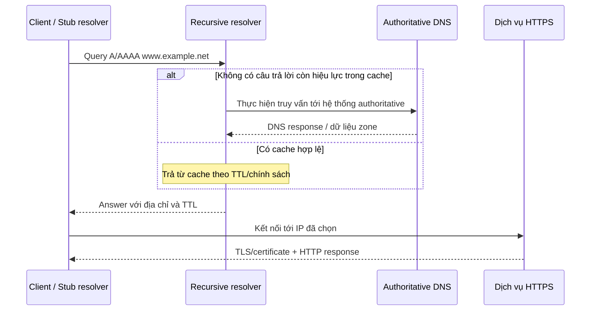
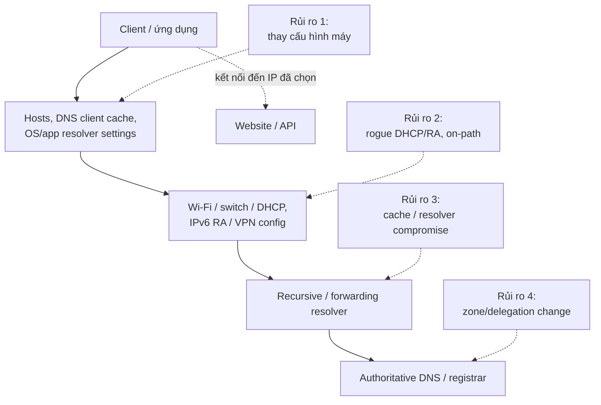
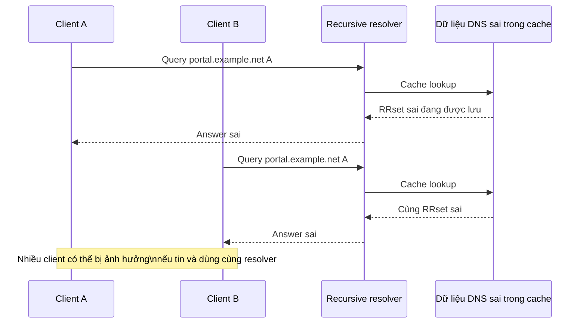
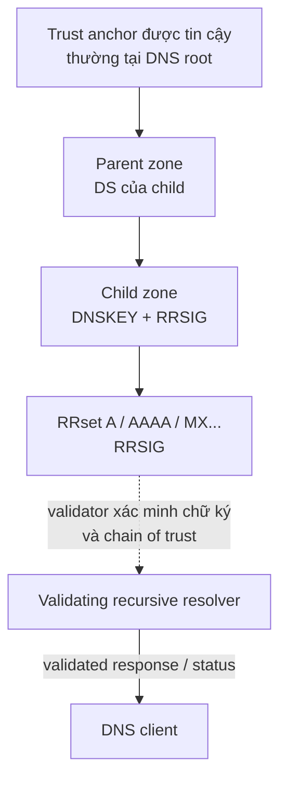
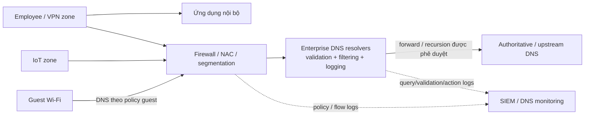
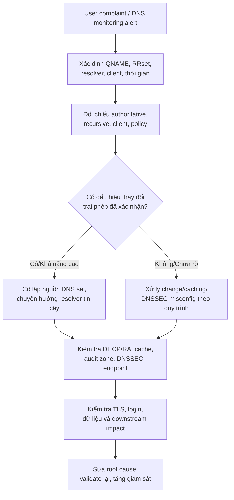

# DNS spoofing: nhận diện, phòng vệ và điều tra giả mạo phân giải tên miền

**DNS spoofing** (giả mạo thông tin phân giải tên miền) là hiện tượng một chủ thể không được phép làm cho máy khách, bộ phân giải hoặc thành phần mạng **nhận và sử dụng câu trả lời DNS không đúng với nguồn dữ liệu được tin cậy**. Một tên miền hợp lệ có thể bị dẫn đến địa chỉ không mong muốn, bản ghi thư điện tử bị thay đổi hoặc một thiết bị bị thuyết phục sử dụng DNS resolver do bên khác kiểm soát. Tác động phụ thuộc vào tài nguyên và các lớp xác thực phía sau: điều hướng nhầm website, gián đoạn dịch vụ, thu thập thông tin hoặc hỗ trợ hành vi giả mạo.

Trong mô-đun **SECURITY_NETWORK_SECURITY**, DNS spoofing liên hệ chặt chẽ với **bảo vệ DNS, phân đoạn mạng, kiểm soát truy cập Wi-Fi/Ethernet, firewall, VPN, giám sát lưu lượng, threat modeling và kiến trúc cloud**. Đây không chỉ là câu chuyện “DNS trả IP sai”: cần hiểu **ai cung cấp câu trả lời, ở mắt xích nào, máy khách dựa vào đó ra quyết định gì và bằng chứng nào xác nhận sự can thiệp**.

Bài học tập trung vào **phòng vệ, quan sát và điều tra trong hệ thống được phép quản trị**. Các tên miền, IP và bản ghi log đều là ví dụ; không hướng dẫn phát tán phản hồi DNS giả hoặc chiếm quyền resolver của bên khác.

## 1. DNS hoạt động thế nào trong một truy vấn bình thường?

Người dùng nhập một hostname như **www.example.net**. Ứng dụng thường yêu cầu hệ thống phân giải tên thành địa chỉ; các thành phần liên quan có thể gồm:

- **Stub resolver** của hệ điều hành hoặc ứng dụng.
- **Recursive resolver**: nhận câu hỏi từ client, dùng cache hoặc thực hiện tra cứu tiếp theo.
- **Root, TLD và authoritative name servers**: cùng tạo nên chuỗi ủy quyền và cung cấp dữ liệu của zone.
- **DNS cache** ở client, ứng dụng, resolver hoặc các lớp trung gian.
- **DNS policy service**: có thể trả lời có chủ đích theo phân đoạn mạng, nội bộ, lọc an toàn hoặc quyền truy cập.
- **Ứng dụng và giao thức sau DNS**: HTTPS/TLS, SMTP, VPN hoặc kết nối đến dịch vụ được phân giải.



Sơ đồ giản lược: recursive resolver có thể phải truy vấn nhiều cấp, nhận referral/CNAME, validate DNSSEC hoặc dùng upstream forwarder thay vì tự đi toàn bộ chuỗi. Client cũng có thể sử dụng DNS qua TLS/HTTPS hoặc proxy phân giải thay, tùy hệ điều hành/ứng dụng.

### 1.1. Một bản ghi DNS gồm những gì?

| Thuộc tính | Ý nghĩa trong điều tra |
| --- | --- |
| **QNAME** | Tên miền được hỏi, ví dụ www.example.net |
| **QTYPE** | Loại bản ghi: A, AAAA, MX, CNAME, TXT, NS, PTR... |
| **RRset** | Tập bản ghi cùng tên, loại và class; có thể gồm nhiều giá trị hợp lệ |
| **TTL** | Khoảng thời gian một bản ghi có thể được cache, theo điều kiện thực tế |
| **RCODE** | Kết quả như NOERROR, NXDOMAIN, SERVFAIL, REFUSED |
| **Resolver/server trả lời** | Điểm mà client thực sự nhận kết quả, khác với authoritative origin |
| **DNSSEC metadata** | DNSKEY, DS, RRSIG, NSEC/NSEC3, trạng thái validation nếu áp dụng |

**TTL không phải chữ ký xác thực.** TTL quyết định hành vi lưu cache, không chứng minh bản ghi đáng tin. Một câu trả lời có TTL thấp vẫn có thể sai; TTL cao cũng có thể là cấu hình bình thường.

### 1.2. DNS và kết nối ứng dụng là hai bước khác nhau

DNS giúp ứng dụng biết nơi cần kết nối. DNS **không tự chứng minh** server đích là một thực thể hợp lệ. Đối với website HTTPS, trình duyệt còn xác minh **chứng chỉ TLS, hostname và chuỗi tin cậy**. Nếu DNS bị thay đổi nhưng đích mới không có chứng chỉ hợp lệ, trình duyệt hiện đại có thể phát cảnh báo TLS hoặc từ chối kết nối. **Không yêu cầu người dùng bỏ qua cảnh báo chứng chỉ** trong quá trình chẩn đoán.

## 2. DNS spoofing là gì và khác các hiện tượng DNS khác ra sao?

Trong cách dùng rộng, DNS spoofing mô tả hành vi làm cho bên nhận tin một **câu trả lời DNS giả** hoặc cấu hình DNS trái phép. Cần phân biệt các cơ chế vì chúng có biện pháp giảm thiểu khác nhau.

| Hiện tượng | Cơ chế ở mức khái niệm | Bằng chứng đặc trưng | Lớp phòng vệ ưu tiên |
| --- | --- | --- | --- |
| **Forged DNS response** | Câu trả lời được tạo bởi bên không có thẩm quyền nhưng bị bên nhận chấp nhận là phản hồi thật | Gói DNS đến từ nguồn/đường không phù hợp, answer không khớp truy vấn hợp lệ | Xác minh phản hồi, DNSSEC, kiểm soát đường mạng |
| **DNS cache poisoning** | Cache resolver lưu câu trả lời hoặc delegation sai và cung cấp lại cho nhiều client | Nhiều client cùng resolver nhận dữ liệu sai cho đến khi cache thay đổi/hết hạn | Resolver cập nhật, DNSSEC validation, cache protection |
| **Rogue DNS / DNS server redirection** | Máy khách bị thay cấu hình để hỏi resolver không được phê duyệt | DHCP/DHCPv6/RA/VPN policy hoặc cấu hình OS chỉ tới DNS lạ | NAC, DHCP snooping, RA Guard, MDM/VPN policy |
| **Hosts-file/local override** | Máy hoặc ứng dụng có bản ghi cục bộ ưu tiên hơn DNS | Hosts file, browser/OS resolver settings, policy override | Hardening, EDR, quyền sửa cấu hình |
| **Authoritative DNS/registrar compromise** | Dữ liệu DNS gốc hoặc quyền quản lý zone bị thay đổi | Audit registrar/DNS provider, lịch sử zone, thay đổi NS/DS | MFA, phân quyền, khóa domain, change control |
| **DNS hijacking qua thiết bị mạng** | Router/CPE/proxy hoặc thiết bị trong đường đi đổi hướng truy vấn | Cấu hình DNS tại gateway, NAT/redirect và packet path | Quản trị router, phân đoạn, xác thực thiết bị |
| **Cấu hình DNS sai hợp lệ** | Bản ghi hoặc resolver trả kết quả không mong muốn nhưng không có hành vi giả mạo | Change ticket, rollout, TTL/cache, split-horizon | Kiểm soát thay đổi và quy trình vận hành |

**Không phải mọi câu trả lời khác nhau giữa hai resolver đều là tấn công.** CDN, cân bằng tải địa lý, DNS trả lời theo vị trí, split-horizon, negative caching và cập nhật zone có thể khiến kết quả hợp lệ thay đổi theo thời điểm và nơi truy vấn.

### 2.1. Phân biệt spoofing, phishing và domain hijacking

- **DNS spoofing:** làm sai kết quả phân giải hoặc đường lấy kết quả DNS.
- **Phishing:** lừa người dùng cung cấp thông tin hoặc thực hiện hành động; có thể dùng website giả mà **không cần** can thiệp DNS.
- **Domain hijacking:** chiếm hoặc thao túng quyền quản trị tên miền, registrar hoặc cấu hình delegation; có thể dẫn tới sai DNS nhưng khác về điểm kiểm soát.
- **BGP hijacking/route leak:** thay đổi đường đi mạng; có thể hỗ trợ can thiệp DNS hoặc làm mất kết nối, nhưng không đồng nghĩa đã giả mạo nội dung DNS.

Đội điều tra cần đặt đúng tên cơ chế để chọn bằng chứng và nơi khắc phục.

## 3. Những ranh giới tin cậy có thể bị tác động

DNS có nhiều mắt xích. Kẻ tấn công không nhất thiết phải kiểm soát toàn bộ authoritative DNS để làm một máy khách nhận kết quả sai.



Mỗi ranh giới cần trả lời ba câu hỏi:

1. **Chủ thể nào được phép thay dữ liệu?** Administrator, DHCP server, registrar, DNS operator, resolver policy hay app owner?
2. **Dữ liệu nào được tin?** Cấu hình client, delegation chain, bản ghi được DNSSEC xác thực hay câu trả lời đến từ một DNS forwarder?
3. **Nếu bị thay đổi, ai chịu ảnh hưởng?** Một laptop, một VLAN, toàn bộ VPN user group, một recursive resolver hay người dùng Internet toàn cầu?

Một **hosts-file override** chỉ ảnh hưởng máy có cấu hình đó. **Cache poisoning tại recursive resolver** có thể ảnh hưởng nhiều máy cùng hỏi resolver. **Zone compromise** có thể tác động đến mọi resolver lấy dữ liệu mới từ authoritative system, sau khi tính đến cache và TTL.

## 4. Giả mạo phản hồi DNS ở mức giao thức

Trong DNS cổ điển qua UDP, truy vấn và phản hồi dùng các trường giúp resolver ghép câu trả lời với yêu cầu: transaction ID, địa chỉ/cổng, QNAME, QTYPE và những dữ liệu giao thức khác. Một phản hồi giả chỉ nguy hiểm nếu bên nhận **chấp nhận nó như câu trả lời thích hợp**.

Các yếu tố làm giảm khả năng chấp nhận nhầm gồm:

- **Transaction ID và source-port randomization** tạo thêm độ khó cho việc dự đoán câu trả lời hợp lệ.
- Resolver kiểm tra sự tương ứng của **QNAME/QTYPE**, địa chỉ/cổng và trạng thái truy vấn đang chờ.
- Kiểm tra **bailiwick** hạn chế nhận các bản ghi bổ sung không thuộc phạm vi ủy quyền phù hợp.
- Kiểm tra record/delegation và caching policy theo triển khai resolver.
- **DNSSEC validation** xác minh tính xác thực của dữ liệu trong vùng có chuỗi ký tin cậy và cấu hình đúng.

Những yếu tố này không thay thế nhau. Randomization và kiểm tra nguồn giúp giảm khả năng nhận nhầm gói, còn DNSSEC cung cấp cơ chế mật mã xác minh dữ liệu của zone đã ký.

### 4.1. Tại sao phải quan tâm đến cổng và transport?

DNS dùng **UDP/53** và **TCP/53** trong nhiều trường hợp; TCP có thể được dùng khi cần truyền dữ liệu hoặc khi phản hồi bị truncated và client/resolver thực hiện fallback thích hợp. Resolver có thể sử dụng các giao thức khác như **DNS over TLS (DoT)** hoặc **DNS over HTTPS (DoH)** khi đã được cấu hình.

Lưu lượng DNS qua UDP không có handshake TCP; nhưng không vì thế mà bất kỳ packet nào gửi đến cổng 53 cũng phải được client/resolver chấp nhận. Phần mềm DNS vẫn phải ghép đúng truy vấn, trạng thái phiên/giao thức và policy.

### 4.2. Bailiwick checking là gì?

Khi hỏi một tên miền, recursive resolver có thể nhận referral, NS và các bản ghi bổ sung (*additional data*). **Bailiwick checking** giúp resolver không tin và cache tùy tiện mọi địa chỉ được kèm trong phản hồi ở ngoài phạm vi ủy quyền thích hợp.

Một cách diễn giải an toàn:

- Resolver nên nhận dữ liệu theo **quan hệ ủy quyền đáng tin** của zone.
- Những bản ghi không có cơ sở thẩm quyền phù hợp không nên được dùng làm dữ liệu xác thực cho một tên miền khác.
- Cách triển khai, điều kiện chấp nhận glue và các tối ưu DNS phụ thuộc resolver và tiêu chuẩn giao thức.

Không nhầm bailiwick với **DNSSEC**: bailiwick là kiểm soát tính hợp lệ theo ngữ cảnh và cấu trúc ủy quyền, trong khi DNSSEC dựa trên chữ ký và chuỗi tin cậy mật mã.

## 5. Cache poisoning và vai trò của TTL

Recursive resolver thường cache kết quả để tăng tốc và giảm tải truy vấn lên authoritative server. Nếu **câu trả lời sai được cache**, nhiều client sử dụng resolver có thể thấy kết quả sai trong một khoảng thời gian.



Đây là tình huống logic để hiểu **tác động lan truyền**. Không phải mọi câu trả lời không mong đợi trong cache đều do poisoning; DNS cache có thể chứa dữ liệu cũ hợp lệ do TTL chưa hết, một record được cập nhật gần đây, hoặc một **local policy override** do quản trị viên cấu hình.

### 5.1. TTL và negative caching

- **TTL** là thời gian cache tương ứng với bản ghi, có thể giảm dần qua các lần trả lời.
- Resolver và client có thể có các giới hạn TTL và cơ chế cache riêng, nên giá trị thực thấy có thể khác giá trị authoritative.
- **Negative caching** lưu một số phản hồi phủ định như không có tên/bản ghi theo quy tắc DNS để giảm truy vấn lặp.
- Thay đổi bản ghi ở authoritative không luôn xuất hiện ngay ở mọi client vì các cache còn sống.

Khi xử lý sự cố, cần xác định **bản ghi sai được trả từ cache, authoritative, policy hay local override** trước khi flush cache. **Flush cache** có thể giảm ảnh hưởng của một dữ liệu sai được lưu, nhưng không khắc phục root cause nếu nguồn dữ liệu sai hoặc resolver vẫn nhận dữ liệu giả.

### 5.2. Bản ghi nào có thể bị ảnh hưởng?

| Loại bản ghi | Tác động nếu bị thay đổi trái phép | Lưu ý điều tra |
| --- | --- | --- |
| **A/AAAA** | Dẫn client đến địa chỉ IPv4/IPv6 sai | So sánh đúng RRset, CDN và split-horizon |
| **CNAME** | Điều hướng alias tới tên khác | Theo dấu chuỗi CNAME và owner |
| **MX** | Thay đổi hệ thống nhận email cho domain | Đối chiếu mail flow, TLS/MTA policy và DNSSEC nếu có |
| **NS / delegation** | Thay đổi nơi zone được ủy quyền | Kiểm tra registrar, parent zone, DNS provider audit |
| **TXT** | Gây sai chính sách hoặc xác minh dịch vụ | Đừng tự ý xóa SPF/DKIM/DMARC và token xác minh hợp lệ |
| **SRV** | Chỉ định sai đích/cổng cho client dùng SRV | Đối chiếu ứng dụng thực sự phụ thuộc loại record |
| **PTR** | Đảo địa chỉ thành tên khác, ảnh hưởng một số chính sách/ghi log | Kiểm tra reverse zone và chủ thể có quyền |
| **DNSSEC DS/DNSKEY** | Làm thay đổi hoặc phá chuỗi xác thực khi có quyền cập nhật phù hợp | Kiểm tra key rollover, chain of trust, audit và thời gian |

Một số bản ghi DNS được công khai có chủ đích để dịch vụ hoạt động. Không phải “nhìn thấy NS/MX/TXT” là lộ secret; vấn đề là **tính đúng đắn, nguồn thẩm quyền và khả năng thay đổi trái phép**.

## 6. Rogue resolver và giả mạo DNS trong mạng LAN/Wi-Fi

Trong doanh nghiệp, một tình huống quan trọng là client **không hỏi đúng resolver**. Một thiết bị hoặc cấu hình không được phê duyệt có thể khiến máy khách sử dụng DNS server ngoài chính sách thông qua DHCP, cấu hình router, VPN hoặc cơ chế khác.

### 6.1. DHCPv4 và lựa chọn DNS server

DHCPv4 có thể cấp cho client **địa chỉ IP, subnet/gateway, DNS resolver** và các tùy chọn khác. Nếu mạng có nguồn DHCP không được phép, client có thể nhận resolver sai. Các chỉ số cần điều tra gồm:

- DNS server hiện tại trên client.
- DHCP server identifier, thời điểm lease, interface/VLAN/SSID.
- Log của switch/AP và DHCP server được phê duyệt.
- Có nhiều nguồn DHCP trả lời trong cùng broadcast domain không?
- Policy ở client/MDM/VPN có ghi đè DNS server hay không?
- DNS server đó có nằm trong inventory và phạm vi cho phép không?

**DHCP snooping** trên switch có thể giới hạn DHCP server được tin cậy tại những cổng phù hợp, nếu thiết bị và topology hỗ trợ. Nó không sửa được laptop đã bị malware tự thay resolver và không mặc nhiên bảo vệ IPv6.

### 6.2. IPv6: Router Advertisement và DNS settings

Client IPv6 có thể học thông tin mạng thông qua **Router Advertisement (RA)**, và một số môi trường dùng **RDNSS** trong RA hoặc **DHCPv6** để cung cấp DNS server. Vì thế:

- Chỉ kiểm tra DHCPv4/DNS IPv4 có thể bỏ sót đường phân giải qua IPv6.
- **RA Guard** và **DHCPv6 Guard** khi được hỗ trợ có thể giúp giảm nguồn RA/DHCPv6 không được phép.
- Cần đánh giá các giới hạn triển khai, extension headers và khả năng tương thích thiết bị.
- **IPv6 Neighbor Discovery** có vai trò thiết yếu; chặn ICMPv6 hoặc RA tràn lan có thể phá mạng hợp lệ.

### 6.3. 802.1X, NAC và phân đoạn mạng

Một thiết kế an toàn cho Wi-Fi/Ethernet nên có:

- **802.1X/NAC** cho các vùng doanh nghiệp phù hợp, quản lý danh tính và posture của thiết bị.
- Phân tách **guest, employee, IoT, management** và các vùng nhạy cảm theo ranh giới tin cậy.
- Không cho client bình thường gửi trả lời DNS như authoritative/recursive resolver nội bộ nếu không được phê duyệt.
- Giới hạn truy cập đến dịch vụ DNS quản trị, zone transfer và giao diện điều khiển.
- Giám sát đổi cấu hình switch/AP, DHCP server và DNS resolver.
- Bảo vệ Wi-Fi bằng chuẩn xác thực/mã hóa phù hợp; **ẩn SSID** không phải cách bảo vệ DNS.

**Lưu ý:** một thiết bị trong VLAN có thể vẫn ảnh hưởng đến client qua cơ chế không liên quan trực tiếp DNS như ARP/ND nếu các kiểm soát layer 2 không đúng. Khi điều tra phải phân biệt **DNS responder giả** với **đường mạng bị chuyển hướng**.

## 7. DNSSEC: xác thực dữ liệu DNS bằng chữ ký

**Domain Name System Security Extensions (DNSSEC)** bổ sung khả năng xác minh **tính xác thực nguồn dữ liệu và toàn vẹn RRset** của các zone đã ký, thông qua chữ ký số và **chain of trust**. DNSSEC không mã hóa nội dung DNS và không làm tên miền trở thành bí mật.

### 7.1. Các loại bản ghi quan trọng

| Record | Vai trò |
| --- | --- |
| **DNSKEY** | Công bố khóa công khai dùng trong cơ chế DNSSEC của zone |
| **RRSIG** | Chữ ký đối với một RRset đã ký |
| **DS** | Thông tin liên kết tin cậy từ parent zone đến khóa của child zone |
| **NSEC / NSEC3** | Bằng chứng xác thực cho sự không tồn tại của tên hoặc loại bản ghi trong các tình huống hỗ trợ |
| **SOA / NS** | Dữ liệu quản trị/ủy quyền DNS, không tự là chữ ký |
| **A/AAAA/CNAME/MX...** | Dữ liệu nghiệp vụ có thể được bảo vệ bởi RRSIG nếu zone đã ký hợp lệ |

### 7.2. Chuỗi xác thực ở mức khái niệm



Đây là sơ đồ rút gọn, không mô tả đầy đủ các bản ghi DS/DNSKEY/RRSIG của từng zone và thao tác key rollover. Quan trọng là resolver xác minh chữ ký với khóa được nối tới **trust anchor đáng tin**, chứ không chỉ kiểm tra có tồn tại một RRSIG bất kỳ.

### 7.3. Các trạng thái validation

Với một validating resolver, có thể gặp các trạng thái logic:

- **Secure:** dữ liệu có thể được xác minh qua chuỗi DNSSEC hợp lệ.
- **Insecure:** không có chuỗi DNSSEC để xác minh nhưng sự vắng mặt của chuỗi đó được đánh giá phù hợp, chẳng hạn một vùng chưa ký.
- **Bogus:** dữ liệu có kỳ vọng cần xác minh nhưng validation thất bại; resolver thường không đưa câu trả lời như dữ liệu hợp lệ và có thể trả **SERVFAIL**, tùy chính sách/triển khai.
- **Indeterminate:** chưa thể xác định trạng thái trong một số điều kiện đặc biệt.

**Một vùng chưa ký không mặc nhiên “bogus”.** DNSSEC chỉ xác thực các vùng có chuỗi tin cậy hợp lệ; với các vùng không ký, vẫn cần các biện pháp chống spoofing khác.

### 7.4. AD, DO và CD không giống nhau

Trong công cụ DNS, cần hiểu:

- **DO (DNSSEC OK)**: thể hiện bên hỏi có thể nhận dữ liệu DNSSEC; **không tự yêu cầu hoặc chứng minh validation**.
- **AD (Authenticated Data)**: cờ do resolver đánh dấu liên quan dữ liệu được xác thực; chỉ có ý nghĩa khi **tin cậy resolver và đường giao tiếp với nó** và hiểu cách triển khai.
- **CD (Checking Disabled)**: cờ liên quan yêu cầu resolver không thực hiện một số kiểm tra validation cho câu hỏi; **không dùng nó như phép chứng minh dữ liệu hợp lệ**.

Không được diễn giải “trong phản hồi có RRSIG” là “client chắc chắn đã xác minh” hoặc “thấy AD trên một gói DNS không được bảo vệ từ resolver lạ” là bảo đảm an toàn.

### 7.5. Giới hạn của DNSSEC

- DNSSEC **không mã hóa** QNAME/QTYPE và nội dung phản hồi.
- DNSSEC **không ngăn client bị cấu hình hỏi resolver giả**; một validating client hoặc kênh đáng tin có thể giảm rủi ro tùy mô hình.
- DNSSEC **không ngăn registrar hoặc authoritative operator có quyền hợp pháp** ký và công bố dữ liệu sai do tài khoản bị chiếm.
- DNSSEC không thay thế **TLS certificate validation** và bảo mật ứng dụng.
- DNSSEC có thể tạo **SERVFAIL** khi cấu hình ký/DS/rollover lỗi, dẫn đến gián đoạn hợp lệ.
- Với **split-horizon/private zones**, phải thiết kế validation, tên nội bộ và policy overrides phù hợp; không giả định mọi local response có thể xác minh qua DNS công khai.

Một giải pháp DNSSEC tốt phải có **quy trình rollover, quản lý khóa, giám sát và kế hoạch phục hồi**, không chỉ bật một tùy chọn ở DNS provider.

## 8. DNSSEC khác DoH, DoT và bảo vệ HTTPS như thế nào?

Nhiều người nhầm “DNS được mã hóa” với “dữ liệu DNS được xác thực từ authoritative zone”. Đó là **hai mục tiêu khác nhau**.

| Cơ chế | Mục tiêu chính | Không tự bảo đảm |
| --- | --- | --- |
| **DNSSEC** | Xác thực dữ liệu DNS đã ký và chain of trust | Mã hóa truy vấn, quyền riêng tư, độ đúng của nội dung website |
| **DoT (DNS over TLS)** | Bảo vệ kênh client ↔ DNS server bằng TLS khi client xác thực đúng endpoint | Dữ liệu authoritative đã ký hoặc resolver không đưa policy sai |
| **DoH (DNS over HTTPS)** | Bảo vệ trao đổi DNS trên HTTPS tới resolver được cấu hình | Tự động xác thực mọi RRset theo DNSSEC |
| **VPN** | Bảo vệ kết nối theo tunnel, tùy cấu hình route/DNS | DNS query không bị cấu hình sai hoặc bị thay ở resolver |
| **HTTPS/TLS của website** | Xác thực server theo hostname/certificate và bảo vệ kết nối ứng dụng | DNS trả đúng IP; không thay thế AuthZ/nghiệp vụ |
| **HSTS** | Buộc HTTPS cho các host nằm trong phạm vi chính sách khi trình duyệt hỗ trợ | Ngăn mọi dạng DNS spoofing hoặc bảo vệ giao thức không phải web |
| **DNS filtering/RPZ** | Chặn hoặc thay đổi phản hồi theo policy an toàn | Xác minh nguồn gốc mọi bản ghi DNS bằng chữ ký |

**DoH/DoT bảo vệ chặng từ client đến resolver đã xác thực**, nhưng resolver vẫn phải thu thập/đánh giá dữ liệu từ hệ thống DNS và thực thi chính sách của mình. Có thể kết hợp **DoH/DoT + DNSSEC validation + bảo vệ endpoint + HTTPS** để giải quyết nhiều ranh giới khác nhau.

Đối với tổ chức, có thể cần điều khiển resolver được phép và chính sách sử dụng DoH/DoT sao cho vừa bảo vệ riêng tư vừa duy trì DNS filtering/telemetry. Không coi mọi DoH là độc hại: có người dùng và ứng dụng sử dụng nó hợp pháp. Phải xác minh chính sách và đường ứng dụng trước khi chặn.

## 9. Thiết kế mạng doanh nghiệp chống DNS spoofing

Một kiến trúc an toàn cần xác định **client được phép hỏi resolver nào, resolver lấy dữ liệu từ đâu, ai được thay zone và cách ghi lại quyết định**.



Sơ đồ minh họa, không yêu cầu mọi zone sử dụng cùng resolver. Một số tổ chức dùng internal forwarding, cloud DNS resolver, split-horizon và private zone riêng; điều quan trọng là **luồng DNS có chủ sở hữu và chính sách nhất quán**.

### 9.1. Các lớp kiểm soát

| Lớp | Biện pháp | Lý do |
| --- | --- | --- |
| **Endpoint** | Hardening, MDM/EDR, hạn chế quyền sửa DNS/hosts, kiểm tra VPN client | Ngăn thay resolver/hosts trái phép |
| **Wi-Fi/Ethernet** | WPA-Enterprise/802.1X, NAC, DHCP snooping, RA/DHCPv6 Guard khi phù hợp | Giảm khả năng cấp cấu hình DNS lạ trong LAN |
| **Firewall/ACL** | Client zone chỉ truy vấn DNS endpoint được phê duyệt theo protocol phù hợp | Giảm đường ra DNS ngoài chính sách |
| **Recursive resolver** | Bản vá, DNSSEC validation, source-port randomization, bailiwick checks, ACL đích dùng resolver | Giảm cơ hội cache poisoning và recursive misuse |
| **Authoritative DNS** | MFA, RBAC, change approval, registrar protection, DNSSEC khi phù hợp | Chống thay đổi zone/delegation trái phép |
| **Cloud/SaaS** | IAM cho DNS zones, audit logs, private endpoint và kiểm tra drift | Quản lý nhiều nơi tạo/thay bản ghi |
| **Application** | HTTPS/TLS validation, certificate pinning nếu thiết kế phù hợp, authorization | Chặn tác động tiếp theo của việc điều hướng nhầm |
| **Monitoring** | Resolver logs, DNS change logs, endpoint DNS config, flow, IDS/IPS/NDR | Tìm nguyên nhân và xác định phạm vi |

### 9.2. Split-horizon DNS và vùng nội bộ

**Split-horizon DNS** cho kết quả khác nhau theo vị trí client/resolver. Ví dụ **portal.corp.example.net** chỉ phân giải đúng trong mạng doanh nghiệp; khách bên ngoài nhận phản hồi khác hoặc không có dữ liệu.

Điều này **không phải spoofing nếu là thiết kế có phê duyệt**. Để tránh điều tra nhầm, cần lưu:

- Zone/view nào trả câu hỏi.
- Client từ zone/interface hoặc VPN group nào.
- Policy forwarding và cache theo từng view.
- Tên nội bộ có xuất hiện trong Certificate Transparency hoặc public DNS do cấp chứng chỉ không phù hợp không.
- DNSSEC validation và exception cho private zones được thiết kế thế nào.

Không sử dụng DNS nội bộ như lớp bảo vệ duy nhất: **dịch vụ quản trị vẫn cần firewall, VPN/ZTNA, MFA và kiểm soát quyền** ngay cả khi hostname không có trong DNS công khai.

## 10. Phát hiện DNS spoofing qua những tín hiệu nào?

Không có một chỉ số đơn nhất xác nhận DNS spoofing. Cần đối chiếu **câu trả lời DNS, nguồn DNS, thời điểm, đường mạng và tác động của ứng dụng**.

| Tín hiệu | Giả thuyết cần kiểm tra | Nguồn dữ liệu |
| --- | --- | --- |
| Client dùng resolver khác inventory | Rogue DHCP/RA/VPN policy hoặc người dùng đổi cấu hình | OS/MDM, DHCP, AP, switch, VPN |
| Nhiều client cùng resolver nhận answer bất thường | Cache sai, policy rewrite hoặc resolver bị tác động | Recursive DNS logs, cache status, zone/view |
| Authoritative khác với recursive | Cache cũ, split-horizon, CDN hoặc poisoning | So sánh authoritative/recursive với ngữ cảnh chuẩn |
| DNSSEC validation failure/SERVFAIL | DNSSEC misconfig, rollover lỗi hoặc dữ liệu bị sửa | Validator logs, DS/DNSKEY/RRSIG và thay đổi zone |
| IP trả về không thuộc hạ tầng mong đợi | Change không được phê duyệt, CDN routing hoặc spoofing | Asset inventory, DNS change history, provider logs |
| Trình duyệt báo TLS certificate mismatch | DNS/route/proxy sai hoặc cấu hình chứng chỉ lỗi | TLS certificate validation, DNS answers, proxy/app logs |
| QNAME/TTL/RCODE biến đổi đột ngột | Cập nhật zone, cache behavior, DNS failure hoặc can thiệp | Query logs, thời gian, authoritative answers |
| Nhiều DNS responses không tương ứng truy vấn đang chờ | Lỗi giao thức, trùng lặp, đường mạng lạ hoặc phản hồi giả | Packet capture có phạm vi, IDS/NDR |
| Thay đổi NS/DS/zone ngoài ticket | Thay đổi trái phép hoặc vận hành sai | Registrar/DNS provider audit, IaC diff |
| Resolver bị tăng đột ngột lỗi validation | Kết nối upstream, thay đổi DNSSEC, tấn công hoặc lỗi triển khai | Resolver metrics, provider status, mạng |

**Chênh lệch TTL, IP hoặc SERVFAIL đơn lẻ không chứng minh bị spoofing.** Ví dụ một CDN có thể trả nhiều IP theo vùng, một resolver dùng cache cũ hoặc một zone đang lỗi DNSSEC.

### 10.1. Trường log tối thiểu

Nên có:

- **Event time** kèm UTC/timezone và nguồn đồng hồ.
- Client/source IP hoặc định danh thiết bị theo chính sách riêng tư.
- QNAME, QTYPE, QCLASS nếu cần.
- Resolver/server, view hoặc policy được áp dụng.
- Response code, answer RRset, TTL và CNAME chain khi có.
- Cache hit/miss và validation status nếu sản phẩm hỗ trợ.
- DNS transport (UDP/TCP/DoT/DoH), destination/port và session ID nếu có.
- Thay đổi DNS/DHCP/VPN/MDM/registrar trong cùng khoảng thời gian.
- Request/trace ID hoặc phiên ứng dụng khi có thể nối tới kết quả TLS và HTTP.

Không phải mọi resolver log đầy đủ các trường trên; cần **đọc schema thực tế** trước khi diễn giải. Không thu thập toàn bộ QNAME của nhân viên vô thời hạn nếu chính sách bảo vệ dữ liệu không cho phép.

## 11. Quy trình điều tra khi nghi ngờ tên miền bị đổi hướng

Thứ tự khuyến nghị:

### Bước 1 — Xác định hiện tượng của người dùng

Ghi tên miền, thời điểm, thiết bị, mạng đang dùng (Wi-Fi, Ethernet, VPN), trình duyệt/ứng dụng và biểu hiện:

- Trang không mở được?
- Trang hiện khác với kỳ vọng?
- TLS cảnh báo chứng chỉ?
- DNS query trả NXDOMAIN/SERVFAIL?
- Có bị chuyển đến trang nội bộ của tổ chức hoặc captive portal hợp lệ không?

Tránh suy ra nguồn tấn công từ ảnh chụp màn hình duy nhất.

### Bước 2 — Xác định resolver thực tế trên client

Đọc cấu hình DNS server của **từng interface** và chính sách VPN/MDM; kiểm tra IPv4 **và IPv6**. Một trình duyệt có thể sử dụng DoH resolver riêng khác resolver được hệ điều hành hiển thị.

Xác định:

1. Resolver nào đã thực sự được hỏi?
2. Ai cấp cấu hình (static/MDM/DHCP/RA/VPN)?
3. Có hosts-file hoặc cache cục bộ ưu tiên hơn không?
4. Cùng client chuyển mạng khác thì còn lỗi không?

### Bước 3 — So sánh câu trả lời tại các điểm tin cậy

Sử dụng **tên miền công khai thuộc quyền kiểm tra hoặc tên được phép kiểm thử**, lấy answer từ:

- Resolver đang được client sử dụng.
- Resolver doanh nghiệp dự phòng nếu có.
- Authoritative DNS của domain theo thiết kế, khi được phép.
- Một resolver tham chiếu được phê duyệt, với lưu ý split-horizon/CDN.

Ghi RRset đầy đủ, TTL, CNAME chain, RCODE, thời gian và nguồn resolver. **Không kết luận chỉ dựa trên hai IP khác nhau**.

### Bước 4 — Xác minh thay đổi có chủ đích

Kiểm tra:

- Change ticket, deployment, cập nhật zone, DNS provider và registrar.
- Policy DNS filtering/RPZ hoặc captive portal.
- Split-horizon, DNS forwarding, negative cache.
- DNSSEC key rollover/DS update và validation log.
- Thay đổi DHCP/RA/VPN/MDM cùng thời điểm.

### Bước 5 — Khoanh vùng và xử lý

Nếu có căn cứ chỉ một **client** bị thay DNS, ưu tiên cô lập và điều tra endpoint, khôi phục cấu hình qua kênh quản trị đáng tin, bảo đảm không bị thay lại. Nếu **nhiều client cùng resolver** bị ảnh hưởng, ưu tiên điều tra resolver/cache/policy và thu hồi nguồn phản hồi sai. Nếu có bằng chứng **zone hoặc registrar** bị sửa, kích hoạt quy trình kiểm soát tài khoản, thay đổi DNS và khôi phục tính đúng đắn ở nguồn.

### Bước 6 — Kiểm tra tác động tới ứng dụng và dữ liệu

Ngay cả khi đã khôi phục DNS, cần xác minh:

- Người dùng có bỏ qua cảnh báo TLS hoặc nhập credential vào trang không đáng tin không?
- Có truy cập đến IP lạ với hostname bị ảnh hưởng không?
- Có login/session bất thường hoặc token được sử dụng ngoài mong đợi không?
- Ứng dụng mail/API/VPN có bị sai đích không?
- Có cần thay credential, thu hồi session, rà soát log và thông báo sự cố theo chính sách không?

**Khôi phục DNS không chứng minh dữ liệu chưa bị lộ.** Tuy nhiên cũng không mặc định kết luận đã lộ dữ liệu nếu chưa có bằng chứng.

## 12. Lệnh kiểm tra DNS an toàn trong phạm vi được phép

Các lệnh sau **chỉ dùng để quan sát**, không phát phản hồi giả hoặc sửa cấu hình. Thay tên miền và resolver bằng tài sản được phép quản trị. Dùng **example.net** và các địa chỉ minh họa để tránh hiểu nhầm thành tài sản thực.

### 12.1. Trên Linux/macOS có dig

```bash
# Xem câu trả lời qua resolver mặc định của hệ thống / công cụ
dig www.example.net A
dig www.example.net AAAA

# So sánh với một resolver tham chiếu do tổ chức phê duyệt
# 192.0.2.53 chỉ là địa chỉ ví dụ; thay bằng DNS server thật của lab
dig @192.0.2.53 www.example.net A +noall +answer

# Kiểm tra bản ghi NS và chuỗi alias
dig example.net NS
dig www.example.net CNAME

# Yêu cầu dữ liệu DNSSEC (DO) để quan sát khi zone hỗ trợ
dig +dnssec example.net DNSKEY
dig +dnssec example.net A
```

Lệnh **dig +dnssec** yêu cầu dữ liệu DNSSEC khi phù hợp nhưng **không tự bảo đảm đã validation**. Nếu kiểm tra độ tin cậy của một RRset, dùng resolver có DNSSEC validation đáng tin và đánh giá trạng thái validation của nó. Không mặc định tên ví dụ có DNSSEC hoặc luôn trả một bộ bản ghi cụ thể.

Trên Linux dùng systemd-resolved, có thể tham khảo:

```bash
# Các resolver theo interface và trạng thái hiện thời
resolvectl status

# Truy vấn tên qua cơ chế phân giải của systemd-resolved
resolvectl query www.example.net

# Kiểm tra các giao diện mạng (lệnh có thể khác theo distro)
ip address
ip route
```

**resolvectl status** phản ánh systemd-resolved khi đang sử dụng; trình duyệt bật DoH có thể hỏi resolver khác. Một số distro dùng NetworkManager hoặc cơ chế DNS khác; lệnh và trường hiển thị thay đổi theo hệ điều hành.

### 12.2. Trên Windows PowerShell

```powershell
# DNS server được cấu hình trên từng giao diện
Get-DnsClientServerAddress

# Truy vấn DNS thông thường
Resolve-DnsName -Name www.example.net -Type A
Resolve-DnsName -Name www.example.net -Type AAAA

# Xem thông tin đang được cache trên client
Get-DnsClientCache

# Quan sát cấu hình mạng, DHCP và gateway
Get-NetIPConfiguration
```

Các lệnh trên không sửa cấu hình. Một số chức năng hoặc kết quả có thể khác nhau theo phiên bản Windows, chính sách hệ thống hoặc DNS client được ứng dụng sử dụng.

### 12.3. Packet capture có bộ lọc khi cần thiết

Trong một mạng thử nghiệm được phép quản trị:

```bash
# Chỉ lấy một mẫu ngắn lưu lượng DNS UDP/TCP port 53
# tại giao diện có liên quan, không bắt toàn mạng vô hạn.
sudo tcpdump -ni eth0 -c 100 '(udp port 53 or tcp port 53)'
```

**Capture chỉ thấy giao thức tại điểm bắt.** DoH/DoT được mã hóa không hiện query name dưới dạng UDP/53 thông thường; kết nối DNS qua proxy hoặc resolver trên máy có thể không đi qua interface đang theo dõi. Khi dùng pcap, ghi interface, thời gian, bộ lọc, chiều đi/về và giới hạn giám sát. QNAME có thể tiết lộ hoạt động cá nhân, nên chỉ thu thập/lưu giữ theo quyền và mục đích điều tra.

### 12.4. Cách đọc kết quả mà không kết luận quá sớm

| Kết quả thử | Có thể suy ra | Cần xác minh tiếp |
| --- | --- | --- |
| Client dùng DNS IP lạ | Cấu hình DNS không khớp inventory | DHCP/RA/VPN/MDM, cấu hình ứng dụng, chủ thể thay đổi |
| Hai resolver trả A khác nhau | Có sự khác biệt tại thời điểm truy vấn | CDN, cache, split-horizon, RRset, authoritative |
| Resolver trả SERVFAIL cho zone ký DNSSEC | Có lỗi hoàn tất phân giải hoặc validation | Validator log, chain/DS/DNSKEY/RRSIG, mạng upstream |
| Trình duyệt báo chứng chỉ sai | Danh tính TLS của đích không phù hợp với hostname/kỳ vọng | DNS, proxy, TLS config, thời gian, trust store |
| Có AD bit trong phản hồi | Resolver cho biết dữ liệu được xác thực theo ngữ cảnh của nó | Có tin resolver/kênh trả lời? Có thực sự bật validation? |
| Không thấy DNS/53 trong capture | Traffic không xuất hiện ở điểm đó | DoH/DoT, interface khác, cache local, filter sai |
| Sau khi cache hết hạn, answer tự thay đổi | Dữ liệu mới được lấy hoặc policy thay đổi | Zone history, TTL, cache source, không suy ngay poisoning |

## 13. Thực hành điều tra: ba trường hợp có cùng triệu chứng

Giả sử nhân viên phản ánh **portal.example.net** dẫn đến một địa chỉ khác với dự kiến. Dưới đây là ba tình huống có bề ngoài tương tự.

### 13.1. Trường hợp A — Rogue DHCP trên Wi-Fi khách

**Bối cảnh:** Một số máy ở guest Wi-Fi bắt đầu dùng DNS resolver không thuộc danh sách của doanh nghiệp. Máy ở VLAN nhân viên không bị ảnh hưởng.

**Bằng chứng nên kiểm tra:**

- DHCP lease của client cho thấy DNS server khác inventory.
- AP/switch ghi nhận DHCP offer từ nguồn không được phê duyệt.
- Log của DHCP server hợp lệ không khớp cấu hình mà client nhận.
- DNS query trên máy ảnh hưởng đi đến resolver lạ.
- Ứng dụng nhận bản ghi không tương ứng với resolver doanh nghiệp.

**Kết luận phù hợp nếu xác minh được:** nguồn cấp cấu hình DNS ở guest zone bị can thiệp; đây là **rogue DNS redirection qua DHCP**, chưa nhất thiết là cache poisoning.

**Khắc phục:** cô lập nguồn cấp DHCP không được phép theo quy trình, sửa kiểm soát switch/AP (DHCP snooping, NAC, client isolation khi phù hợp), khôi phục lease/DNS thông qua mạng tin cậy và kiểm tra user có truy cập đích sai không.

### 13.2. Trường hợp B — Cache resolver có bản ghi cũ hợp lệ

**Bối cảnh:** Đội vận hành vừa đổi IP backend từ **192.0.2.20** sang **192.0.2.21**. Một vài client vẫn nhận địa chỉ cũ đến khi TTL hết hạn.

**Bằng chứng:**

- DNS change ticket và authoritative zone history xác nhận cập nhật hợp lệ.
- Resolver cũ có cache entry còn TTL; resolver vừa khởi tạo tra cứu thấy RRset mới.
- Không có thay đổi bất thường ở DHCP, registrar hoặc DNSSEC validation.
- Sai khác biến mất sau khi cache được cập nhật.

**Kết luận:** hiện tượng **stale cache / propagation theo TTL**, không đủ bằng chứng gọi là DNS spoofing.

**Khắc phục:** điều chỉnh quy trình DNS rollout, hạ TTL trước thay đổi khi cần, giữ backend cũ hoạt động trong thời gian chuyển đổi và kiểm chứng từng resolver. Không biến mọi khác biệt cache thành sự cố an ninh.

### 13.3. Trường hợp C — Recursive resolver trả câu trả lời sai không có thay đổi được phê duyệt

**Bối cảnh:** Nhiều client dùng cùng recursive resolver thấy IP không nằm trong inventory. Authoritative DNS và các resolver validation tham chiếu trả RRset mong đợi, còn resolver nghi vấn tiếp tục trả dữ liệu lạ.

**Cách điều tra:**

1. Ghi đủ QNAME/QTYPE, RRset, TTL, resolver IP, thời gian và các client bị ảnh hưởng.
2. So sánh cache/policy/forwarding của resolver với cấu hình đã phê duyệt.
3. Đọc audit log về thay đổi cấu hình, phiên bản phần mềm, tình trạng DNSSEC validation.
4. Nếu có traffic data phù hợp, đối chiếu packet và log tương ứng truy vấn.
5. Loại trừ split-horizon, RPZ, CDN geo-answer, upstream forwarder hoặc lỗi triển khai.
6. Xác minh liệu bản ghi sai do **cache bị đầu độc**, **policy nội bộ**, hay **resolver bị chiếm quyền**.

**Kết luận:** chỉ dùng nhãn **cache poisoning** khi đã có căn cứ nguồn và cơ chế dữ liệu sai được đưa vào cache trái phép; cho đến lúc đó nên báo “resolver trả answer không được phê duyệt, nghi vấn compromise/poisoning”.

**Khắc phục:** chuyển client sang resolver sạch theo phương án đã phê duyệt; cô lập/khôi phục resolver nghi vấn; kiểm tra phần mềm, khóa/tài khoản quản trị, forwarding policy và khả năng tái diễn. **Không chỉ flush cache** rồi đóng ticket nếu nguyên nhân chưa rõ.

## 14. DNS spoofing và xác thực HTTPS/TLS

DNS bị đổi hướng **không tự động cho phép một website giả mạo được chấp nhận như website thật**. Trình duyệt/HTTP client còn có bước TLS:

1. Client phân giải hostname thành IP.
2. Client kết nối đến địa chỉ được chọn.
3. Server cung cấp chứng chỉ TLS và thực hiện bắt tay.
4. Client kiểm tra **hostname, thời hạn, chain of trust và các điều kiện liên quan**.
5. Ứng dụng xử lý HTTP chỉ sau khi kết nối TLS được chấp nhận.

Nếu đích sai không có chứng chỉ phù hợp, trình duyệt thường cảnh báo hoặc dừng. **HSTS** có thể ngăn việc tự động chuyển về HTTP và giảm khả năng người dùng bỏ qua một số điều kiện HTTPS trong trình duyệt hỗ trợ. Tuy nhiên:

- Người dùng có thể vẫn gặp rủi ro nếu tự bỏ qua cảnh báo TLS ở các ngữ cảnh không có HSTS hoặc app kiểm tra chứng chỉ sai.
- Một ứng dụng dùng HTTP thuần có ít lớp bảo vệ danh tính server hơn.
- Một thiết bị có trust store bị chỉnh sửa hoặc CA bị lạm dụng là rủi ro khác, không giải quyết được chỉ bằng DNS.
- SMTP, các giao thức cũ và ứng dụng riêng có thể có mô hình xác thực đích khác HTTPS.
- TLS hợp lệ chỉ xác thực đích theo mô hình chứng chỉ; **không chứng minh ứng dụng có phân quyền nội bộ đúng**.

**Tuyệt đối không xem việc bỏ kiểm tra TLS là cách “sửa lỗi DNS spoofing”.** Nếu gặp lỗi chứng chỉ, cần xác minh tên miền, IP, đường proxy và nguồn tin cậy trước.

## 15. Ứng phó sự cố và bảo toàn bằng chứng

Một runbook DNS spoofing cần xử lý đồng thời **khôi phục độ tin cậy DNS** và **đánh giá tác động tới ứng dụng/người dùng**.



*Không phải mọi bước đều tuần tự. Khi có nguy cơ cấp bách tới credential hoặc dữ liệu, cô lập/thu hồi phiên có thể được thực hiện trước khi xác định toàn bộ cơ chế.*

### 15.1. Tối thiểu hóa rủi ro khi khôi phục

- **Không thay DNS toàn mạng** khi mới chỉ xác minh một client; lựa chọn thay đổi theo phạm vi thực.
- **Không xóa hàng loạt bản ghi** nếu chưa xác minh record cần cho mail, VPN, CDN, chứng chỉ và đối tác.
- **Không tắt DNSSEC validation** lâu dài chỉ vì SERVFAIL: tìm lỗi DS/DNSKEY/signature/rollover hoặc mạng upstream.
- **Không tự ý flush resolver cache** trước khi lưu đủ bằng chứng nếu đang điều tra hành vi trái phép.
- **Không đổ lỗi cho client** chỉ dựa vào IP lạ; có thể đó là CDN, captive portal hoặc mạng split-horizon hợp pháp.
- **Không coi đã an toàn** chỉ vì bản ghi A/AAAA trở lại bình thường; kiểm tra hậu quả về credential, session và log truy cập.
- **Không đưa raw packet capture hoặc log có thông tin cá nhân** vào kênh không được phân quyền.

### 15.2. Nội dung báo cáo sự cố

Một báo cáo cần phân biệt **bằng chứng quan sát**, **giả thuyết** và **kết luận**:

```yaml
case_id: "DNS-SEC-004-EXAMPLE"
first_observed_at: "2026-11-28T03:10:00Z"
domain: "portal.example.net"
qtype: "A"
client_zone: "guest-wifi"
suspected_resolver: "192.0.2.53"
expected_answer:
  - "192.0.2.20"
observed_answer:
  - "198.51.100.20"
evidence:
  - source: "client-dns-settings"
    detail: "DNS server does not match approved inventory"
  - source: "dhcp-lease"
    detail: "DNS option from unexpected source; needs validation"
  - source: "dns-query-log"
    detail: "Same QNAME/QTYPE and unexpected answer"
alternative_explanations:
  - "split-horizon or approved policy response"
  - "stale cache or recent authorized change"
assessment: "Possible rogue DNS redirection; not yet proven"
containment: "Use approved resolver via managed configuration"
owner: "Network Security + DNS Operations"
next_step: "Correlate DHCP/AP audit with endpoint timeline"
```

**192.0.2.0/24** và **198.51.100.0/24** là các dải IP phục vụ tài liệu. Bản ghi này chỉ là ví dụ quy trình, không phải sự cố có thật.

### 15.3. Bằng chứng cần giữ

| Nhóm | Nội dung hữu ích |
| --- | --- |
| Client | DNS settings, cache, hosts file status, VPN profile, thời gian |
| LAN/Wi-Fi | AP association, switch port, VLAN, DHCP/RA events, NAC state |
| Resolver | Query logs, cache/policy status, validation logs, forwarder config, thay đổi phần mềm |
| Authoritative/registrar | Zone history, NS/DS change, tài khoản thực hiện, audit timestamp |
| Network | DNS flow/pcap có giới hạn, route/NAT, firewall policy events |
| Application | TLS errors, certificate observations, HTTP/request trace |
| Identity | Login/session anomalies nếu có dấu hiệu tác động |
| Change management | Ticket, deployment, rollback, thời điểm cập nhật |

Log và pcap phải được bảo vệ theo chính sách riêng tư vì QNAME, địa chỉ client, username và traffic có thể tiết lộ thông tin cá nhân/nhạy cảm.

## 16. Kiểm thử phòng vệ DNS spoofing một cách an toàn

Mục tiêu kiểm thử là **xác nhận chính sách và khả năng quan sát**, không phải phát tán gói giả ra mạng thật. Có thể tạo môi trường lab tách biệt với resolver, client và authoritative zone do nhóm sở hữu.

### 16.1. Kiểm thử cấu hình

| Test ID | Mục đích | Kết quả mong đợi |
| --- | --- | --- |
| **T01** | Client doanh nghiệp nhận DNS server từ DHCP/MDM/VPN đúng thiết kế | Resolver đúng inventory theo interface và nhóm |
| **T02** | Client guest không truy cập trực tiếp resolver nội bộ nhạy cảm | Firewall/NAC chặn đúng, client vẫn dùng được DNS được cấp |
| **T03** | Chặn DHCP/RA không được phép trong lab được quản trị | Client không nhận DNS server từ nguồn trái policy |
| **T04** | Validating resolver truy vấn zone có DNSSEC hợp lệ | Validation thành công theo thiết kế |
| **T05** | Resolver gặp zone lab cố ý có cấu hình DNSSEC lỗi | Validator báo lỗi phù hợp, không âm thầm chấp nhận dữ liệu sai |
| **T06** | Thay đổi A/AAAA có phê duyệt trong zone lab | Cache/TTL và client update theo thời gian dự kiến |
| **T07** | Thay policy split-horizon theo ticket | Client nội bộ/ngoài nhận kết quả dự kiến, không kết luận nhầm spoofing |
| **T08** | Client truy cập HTTPS ở địa chỉ không khớp danh tính TLS trong lab | Client báo lỗi chứng chỉ/không tự bỏ qua |
| **T09** | Resolver primary unavailable | Client dùng failover theo policy và vẫn có khả năng DNSSEC validation phù hợp |
| **T10** | Tạo sự kiện thay DNS server được phê duyệt | Audit/log/alert phản ánh đúng sự kiện, có owner và timestamp |

**Lưu ý T05:** mô phỏng DNSSEC validation failure nên thực hiện bằng **zone lab cô lập** hoặc dữ liệu thử do tổ chức quản lý. Không chỉnh DS hoặc key của domain production để tạo lỗi kiểm thử.

### 16.2. Phép thử âm tính và dương tính

- **Dương tính:** truy vấn DNS hợp lệ phân giải đúng; HTTPS đến đúng dịch vụ và chứng chỉ hợp lệ; user dùng được nghiệp vụ.
- **Âm tính:** nguồn DNS không được phép không thể cấp resolver cho client; lưu lượng đến resolver cấm bị chính sách chặn; dữ liệu DNSSEC không hợp lệ trong lab không được coi như secure.
- **Đo false positive:** các trường hợp CDN, split DNS, private zone, failover và TTL update hợp lệ không gây cảnh báo sai nghiêm trọng.
- **Đo observability:** log chỉ đúng điểm thực thi và có thể kết hợp thời gian/zone/client để điều tra.
- **Đo tính sẵn sàng:** thay đổi rule không làm hỏng DNS của email, VPN, SSO, cập nhật hệ điều hành hoặc service nội bộ.

## 17. Những sai lầm phổ biến

| Hiểu lầm | Vì sao không chính xác | Cách làm đúng |
| --- | --- | --- |
| “Hai resolver trả IP khác nhau là DNS spoofing” | CDN, TTL, split-horizon và policy có thể khác | So ngữ cảnh, RRset, authoritative và change |
| “DNS cache cũ chắc bị poisoning” | Cache có thể còn TTL hợp lệ | Đọc timestamp, TTL, cache source và zone history |
| “DNSSEC mã hóa DNS” | DNSSEC xác thực dữ liệu, không che nội dung | Dùng DoT/DoH khi cần bảo vệ kênh |
| “Dùng DoH là không cần DNSSEC” | Transport TLS bảo vệ chặng tới resolver, không xác thực RRset authoritative | Kết hợp resolver tin cậy và DNSSEC validation |
| “Thấy RRSIG là client đã validate” | Bản ghi chữ ký có thể được chuyển tới client không kiểm tra | Xác minh resolver/client validation |
| “AD bit luôn đáng tin” | AD phải đến từ resolver/kênh tin cậy và chính sách phù hợp | Kiểm tra nguồn, kết nối và trạng thái resolver |
| “SERVFAIL chứng minh DNS bị tấn công” | Lỗi mạng hoặc DNSSEC rollover cũng gây SERVFAIL | Kiểm tra validator, DNSKEY/DS và upstream |
| “Có HTTPS thì DNS spoofing vô hại” | Dịch vụ không phải HTTPS, credential/cấu hình sai và DoS vẫn có rủi ro | Giữ TLS validation, DNS protection và điều tra hậu quả |
| “Dùng DNS nội bộ là đủ bảo vệ admin” | Hostname có thể lộ qua nguồn khác | MFA, VPN/ZTNA, firewall và AuthZ |
| “Chặn mọi DNS/53 sẽ giải quyết” | Client/service có thể cần DNS và có DoT/DoH | Thiết kế DNS egress policy và failover rõ |
| “DHCP snooping bảo vệ mọi tình huống DNS” | Không kiểm soát local hosts, IPv6 RA hay DNS proxy trong ứng dụng | NAC, RA Guard, MDM/EDR, monitoring |
| “Flush cache là đã sửa root cause” | Resolver hoặc authoritative vẫn có thể cung cấp dữ liệu sai | Xác định nguồn sai và sửa điểm kiểm soát |
| “Thay resolver từ public sang public khác sẽ luôn an toàn” | Có thể trái chính sách, sai split DNS và làm lộ tên nội bộ | Chỉ chuyển sang resolver đã được phê duyệt |
| “Không có log DNS/53 là không có truy vấn” | Cache local, DoH/DoT, giao diện khác hoặc log thiếu | Kiểm tra endpoint và đường thực |
| “Zone đã ký DNSSEC thì registrar không thể bị chiếm” | Người có quyền zone/DS/key có thể thay dữ liệu hợp lệ về mặt ký | MFA, RBAC, domain protection và audit |

## 18. Checklist triển khai bảo vệ DNS

- [ ] Có danh mục tên miền, authoritative zones, recursive resolvers, forwarders và owner.
- [ ] Biết client mỗi zone/VLAN/SSID/VPN sử dụng resolver nào theo IPv4 **và IPv6**.
- [ ] Chỉ những thành phần được cấp quyền mới thay cấu hình DNS, DHCP/RA và zone.
- [ ] Wi-Fi/LAN áp NAC/802.1X, DHCP snooping, RA/DHCPv6 Guard khi phù hợp.
- [ ] Firewall xác định đường DNS egress được phép, không phá nhu cầu DNS hợp lệ.
- [ ] Endpoint được quản lý có chính sách DNS/hosts/VPN và quyền thay đổi cấu hình.
- [ ] Recursive resolver đã được vá, giới hạn client, bảo vệ cache, kiểm tra bailiwick và dùng nguồn randomness phù hợp.
- [ ] DNSSEC validation được bật và giám sát nơi thiết kế yêu cầu; có quy trình xử lý SERVFAIL/rollover.
- [ ] Đã phân biệt DNSSEC với DoH/DoT và chính sách DNS filtering.
- [ ] Authoritative DNS/registrar được bảo vệ bằng MFA, RBAC, audit và change approval.
- [ ] DS/DNSKEY/RRSIG/negative answers được theo dõi khi domain dùng DNSSEC.
- [ ] Có xử lý split-horizon/private DNS và tránh đánh dấu sai dữ liệu hợp lệ.
- [ ] App HTTPS xác minh chứng chỉ đúng hostname; không khuyến khích bỏ qua lỗi TLS.
- [ ] Đã giới hạn đường quản trị và truy cập trực tiếp tới origin/ứng dụng nhạy cảm.
- [ ] Log DNS có query, result, resolver, validation, timestamp và policy context phù hợp.
- [ ] Có đối chiếu DHCP/RA, DNS change, zone/registrar audit, firewall, VPN và application traces.
- [ ] Có playbook điều tra DNS đổi hướng và cách khôi phục resolver/zone theo phạm vi ảnh hưởng.
- [ ] Kiểm thử bao gồm bản ghi hợp lệ, DNSSEC lỗi trong lab, split DNS, failover và HTTPS identity.
- [ ] Mỗi phát hiện có owner, mức tin cậy, dữ kiện quan sát, giả thuyết thay thế và tiêu chí đóng.
- [ ] Bảo vệ log/packet capture, che dữ liệu nhạy cảm và hạn chế thời gian lưu giữ.

## 19. Tình huống tổng hợp: bảo vệ DNS cho công ty có VPN, cloud và Wi-Fi

Một công ty dùng:

- **www.example.net**: website khách hàng qua CDN.
- **api.example.net**: API công khai qua WAF.
- **portal.corp.example.net**: ứng dụng nội bộ chỉ dành cho nhân viên qua VPN/ZTNA.
- **Employee Wi-Fi**: xác thực 802.1X và nhận DNS server do doanh nghiệp quản lý.
- **Guest Wi-Fi**: vùng tách biệt và chính sách DNS riêng.
- **Cloud private zone**: chứa tên workload quản trị/ứng dụng nội bộ.

### 19.1. Thiết kế phòng vệ

1. Zone public có change approval, audit và bảo vệ tài khoản quản trị DNS.
2. DNSSEC cho các zone public khi được thiết kế/điều hành với khả năng rollover phù hợp.
3. Resolver doanh nghiệp thực hiện validation theo chính sách, phân tách view nội bộ/public.
4. Máy managed nhận DNS qua MDM/VPN/DHCP đã phê duyệt; không dựa vào ẩn tên miền nội bộ làm AuthZ.
5. Guest/IoT không truy cập trực tiếp DNS management hoặc application network.
6. VPN/ZTNA áp nhóm danh tính, route và resolver theo thiết kế; truy cập portal vẫn cần MFA/authorization.
7. Web/API xác minh TLS; nguồn origin chỉ chấp nhận kết nối từ đường đã phê duyệt.
8. SIEM tương quan DNS query và DNS admin change với network/identity/application alerts.

### 19.2. Kịch bản vận hành

Một ngày, nhiều laptop Guest Wi-Fi báo portal public có IP bất thường, trong khi máy employee dùng VPN hoạt động bình thường.

**Không nên kết luận ngay** rằng Internet DNS của công ty bị chiếm. Đội vận hành đối chiếu DNS server thực tế trên các laptop, DHCP/RA events của SSID guest, query log và authoritative answer. Nếu chứng minh máy khách nhận resolver không được phép, nhóm xử lý nguồn cấp cấu hình LAN/Wi-Fi. Nếu DNS server đúng nhưng resolver trả dữ liệu khác mà không có policy/change, chuyển hướng điều tra resolver/cache. Nếu authoritative thay đổi ngoài lịch, phải kiểm tra quyền quản lý zone/registrar.

Song song, kiểm tra client có nhận cảnh báo TLS, có thực hiện đăng nhập vào đích lạ và cần thu hồi session hay không. Sau khắc phục, đo lại **độ đúng câu trả lời DNS, HTTPS handshake, khả năng đăng nhập hợp lệ và mức độ phát sinh alert**.

## 20. Ghi nhớ

**DNS spoofing không chỉ là một gói phản hồi sai.** Nó có thể xuất phát từ **endpoint bị đổi resolver, rogue DHCP/IPv6 RA, cache poisoning, can thiệp vào đường DNS, hoặc thay đổi trái phép authoritative zone và registrar**. Muốn phân tích đúng phải xác định ranh giới tin cậy, nguồn câu trả lời, client/resolver bị ảnh hưởng và cơ chế thay đổi dữ liệu.

Phòng vệ hiệu quả kết hợp **client hardening, 802.1X/NAC và phân đoạn Wi-Fi, DNS egress policy, recursive resolver an toàn, DNSSEC validation, DoH/DoT ở ngữ cảnh phù hợp, bảo vệ tài khoản quản trị DNS, HTTPS/TLS validation và giám sát đa nguồn**. DNSSEC xác thực dữ liệu đã ký, DoH/DoT bảo vệ kênh tới resolver, còn TLS của ứng dụng xác thực dịch vụ sau khi phân giải — mỗi cơ chế bảo vệ một phần khác nhau.

Khi gặp answer bất thường, hãy **so sánh với thiết kế DNS và thay đổi đã được phê duyệt trước khi quy kết tấn công**, bảo toàn bằng chứng và điều tra tác động đến truy cập/credential. Mục tiêu cuối cùng là bảo đảm **máy khách dùng đúng dữ liệu DNS, truy cập đúng dịch vụ và không bị chuyển hướng hoặc gián đoạn ngoài chính sách**, đồng thời giữ hoạt động hợp lệ của doanh nghiệp.
