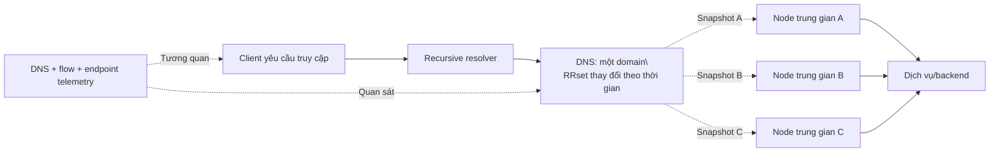
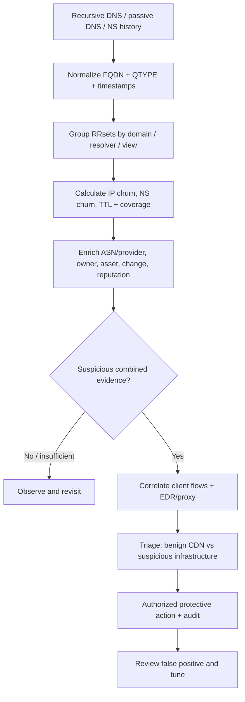

# Fast flux trong DNS security: cơ chế, phát hiện và phòng vệ

## Mục tiêu học tập

Sau bài học, bạn có thể:

1. Giải thích **fast flux** là gì, vì sao việc thay đổi nhanh các bản ghi DNS có thể che giấu hoặc duy trì hạ tầng độc hại, và tại sao **TTL thấp hoặc nhiều IP không tự chứng minh tấn công**.
2. Phân biệt **single-flux**, **double-flux**, **domain flux/DGA**, **DNS rebinding**, **dynamic DNS** và các hình thức cân bằng tải hợp pháp như CDN/anycast.
3. Phân tích bản ghi **A, AAAA, NS, CNAME**, DNS TTL, cache và sự thay đổi **RRset** theo thời gian, tránh kết luận sai từ một lần truy vấn.
4. Thu thập, chuẩn hóa và tương quan **passive DNS, recursive DNS logs, authoritative DNS, NetFlow/IPFIX, proxy, TLS metadata, EDR và inventory** để điều tra một tên miền.
5. Thiết kế detection theo **IP/NS churn, TTL, độ đa dạng mạng, thời gian quan sát, hành vi client và tín hiệu an ninh bổ trợ**, cân nhắc false positive và drift.
6. Đề xuất phòng vệ theo nhiều lớp: **protective DNS, RPZ/policy filtering, firewall/egress control, giám sát endpoint, IDS/IPS, threat intelligence và incident response**.
7. Thực hành trên **dữ liệu mô phỏng ngoại tuyến**, tạo kết luận có mức độ tin cậy và lập kế hoạch khắc phục mà không truy cập hạ tầng lạ.

## 1. Fast flux là gì?

**Fast flux** là kỹ thuật làm cho một hoặc nhiều tên miền được liên kết với **tập địa chỉ IP thay đổi thường xuyên**, thường có vòng đời DNS ngắn. Trong bối cảnh an ninh mạng, kỹ thuật này có thể được dùng để duy trì khả năng truy cập tới hạ tầng **lừa đảo, phân phối mã độc hoặc command-and-control (C2)** dù một số node bị vô hiệu hóa hoặc bị chặn.

Một mô hình thường được mô tả là **fast-flux service network**: một tên miền trỏ luân phiên đến nhiều node trung gian, có thể là máy đã bị chiếm quyền và hoạt động như proxy/relay, che hoặc phân tán đường đến backend. Không phải mọi trường hợp fast flux đều hoạt động theo một topology duy nhất.

**Quan sát quan trọng:** Một tên miền trỏ đến nhiều IP và thay đổi nhanh **không đủ** để khẳng định đó là fast flux độc hại. Hệ thống **CDN, cân bằng tải toàn cầu, cloud autoscaling, disaster recovery** hoặc dịch vụ phân tán hợp pháp cũng có thể dùng TTL thấp, nhiều IP và thay đổi bản ghi.

Trong module `SECURITY_NETWORK_SECURITY`, fast flux là một chủ đề **DNS security** kết nối trực tiếp với reconnaissance, threat modeling, firewall, IDS/IPS, phân tích lưu lượng, giám sát xâm nhập và kiểm soát truy cập từ môi trường doanh nghiệp ra Internet.

### 1.1. Ví dụ quan sát DNS giả lập

Giả sử tên `portal.lab.example.test` thuộc một **DNS lab riêng**. Quan sát được:

```text
Thời điểm UTC        A RRset được trả về                          TTL
00:00:00             192.0.2.10, 192.0.2.11                      30 s
00:01:00             192.0.2.11, 192.0.2.12                      30 s
00:02:00             192.0.2.13, 192.0.2.14                      20 s
00:03:00             192.0.2.15, 192.0.2.16                      20 s
00:04:00             192.0.2.10, 192.0.2.17                      30 s
```

Trong năm snapshot, có **8 địa chỉ IPv4 duy nhất**. Việc các IP xuất hiện rồi biến mất là **tín hiệu churn** đáng chú ý, nhưng chưa nói gì chắc chắn về **chủ sở hữu, tính độc hại, nguyên nhân thay đổi, khả năng truy cập dịch vụ** hay việc kết quả có đến từ cùng một DNS view.

Các dải `192.0.2.0/24`, `198.51.100.0/24`, `203.0.113.0/24` và `2001:db8::/32` được dành cho tài liệu; `lab.example.test` chỉ là tên minh họa, không mặc định có bản ghi thật trên Internet.

### 1.2. Sơ đồ logic



Sơ đồ minh họa một dạng hạ tầng thay đổi node. Nhiều hệ thống hợp pháp cũng có **nhiều edge node**; điều phải điều tra là **đặc trưng kết hợp của DNS, hạ tầng, traffic, danh tính và mục đích dịch vụ**.

## 2. Kiến thức DNS cần nắm để hiểu fast flux

### 2.1. DNS RRset, A/AAAA, NS và CNAME

| Thành phần | Chức năng | Ý nghĩa khi phân tích fast flux |
|---|---|---|
| **FQDN** | Tên miền đầy đủ ở một node DNS | Khóa chính để tổng hợp các quan sát; phải chuẩn hóa |
| **A** | Liên kết tên với IPv4 | Theo dõi tập IPv4 được trả về theo thời gian |
| **AAAA** | Liên kết tên với IPv6 | Bắt buộc xét nếu dịch vụ hỗ trợ dual-stack |
| **RRset** | Tập record cùng owner name, class và type | So sánh *tập* địa chỉ, không chỉ một dòng trả về |
| **NS** | Chỉ định nameserver cho zone/delegation | Theo dõi biến động tên máy chủ authoritative hoặc địa chỉ của chúng |
| **CNAME** | Tên bí danh tới tên canonical khác | Cần theo chuỗi alias và ghi rõ zone nào thuộc phạm vi khảo sát |
| **TTL** | Thời gian lưu cache được quảng bá cho record | Giúp hiểu tần suất resolver có thể lấy lại dữ liệu, không bằng tần suất thay đổi thật |
| **Authoritative answer** | Dữ liệu do nameserver có thẩm quyền cung cấp | Có ích để phân biệt bản ghi hiện tại với cache hay dữ liệu lịch sử |
| **Recursive resolver** | Phân giải thay client, thường có cache | Cùng tên có thể được trả các snapshot khác nhau theo resolver/vị trí |

**TTL thấp không bắt buộc resolver phải hỏi lại ngay đúng từng giây**, và không thể coi số TTL đọc qua resolver là TTL gốc của authoritative: TTL hiển thị có thể **giảm dần do cache**. Một vài resolver có chính sách TTL min/max hoặc serve-stale; hành vi thật phụ thuộc triển khai.

**Thứ tự địa chỉ trong RRset không phải churn**. Nếu hai câu trả lời chứa đúng cùng IP nhưng đổi vị trí, đây vẫn là **cùng một tập**. Cần loại trùng và so sánh theo tập hợp, đồng thời không coi một lần chỉ thấy một phần kết quả là bằng chứng RRset đã thay đổi đầy đủ.

### 2.2. Delegation và NS không giống A record

Một subdomain có thể được **ủy quyền** cho nameserver khác. Khi phân tích NS, cần phân biệt:

- **Tên NS tại delegation** do zone cha công bố.
- **NS RRset tại apex của zone con** do zone con công bố.
- **Địa chỉ A/AAAA của các hostname NS**.
- Những kết quả còn nằm trong **cache** của recursive resolver.

Vì vậy câu “nameserver đã thay đổi” có thể có nhiều nghĩa: đổi **tên NS**, thay **địa chỉ NS**, thay **đường đến authoritative** hoặc chỉ là **cache ở điểm quan sát khác nhau**. Tài liệu điều tra phải ghi rõ loại bản ghi và nguồn dữ liệu tương ứng.

### 2.3. Một vòng phân giải có thể qua CNAME hoặc hệ thống phân phối

Ví dụ:

```text
app.lab.example.test.
    CNAME -> edge.lab-cdn.example.test.
                 A    -> 192.0.2.20
                 AAAA -> 2001:db8::20
```

Đây là **mẫu minh họa tên**. Khi thấy `app` đổi IP, có thể sự thay đổi nằm ở **đích CNAME/CDN**, không phải quản trị viên của `app` đang cập nhật bản ghi A tại cùng zone. Phải giữ **chuỗi CNAME**, DNS provider và phạm vi sở hữu khi điều tra.

## 3. Single-flux và double-flux

### 3.1. Single-flux

**Single-flux** thường dùng để chỉ trường hợp **A/AAAA RRset của domain dịch vụ thay đổi nhanh**, trong khi cơ chế authoritative nameserver tương đối ổn định theo quan sát.

```text
service.lab.example.test
  T0 -> 192.0.2.10, 192.0.2.11
  T1 -> 192.0.2.11, 192.0.2.12
  T2 -> 192.0.2.13, 192.0.2.14

Authoritative NS:
  ns1.lab.example.test
  ns2.lab.example.test
  (ổn định trong cửa sổ quan sát)
```

Tập IP dịch vụ có thể là các proxy/front node, còn backend nằm ở nơi khác. Tuy nhiên **single-flux không đồng nghĩa chắc chắn có botnet**; đó chỉ là mô hình DNS cần gắn với các bằng chứng khác.

### 3.2. Double-flux

**Double-flux** thường mô tả trường hợp biến động không chỉ ở **địa chỉ dịch vụ** mà còn ở **hạ tầng DNS authoritative**, chẳng hạn tên NS và/hoặc địa chỉ dùng để liên hệ nameserver cũng thay đổi trong các giai đoạn quan sát.

```text
service.lab.example.test
  A RRset thay đổi theo thời gian

DNS delegation / nameserver infrastructure
  T0 -> ns1.lab.example.test, ns2.lab.example.test
  T1 -> ns1.lab.example.test, ns2.lab.example.test
  T2 -> ns3.lab.example.test, ns4.lab.example.test
  T3 -> ns5.lab.example.test, ns6.lab.example.test
```

Double-flux có thể làm **độ bền hạ tầng** cao hơn và tăng khó khăn khi cố xác định một điểm duy nhất để xử lý; phân tích chỉ dựa A record sẽ bỏ qua tầng DNS authoritative.

**Lưu ý:** một số tài liệu dùng thuật ngữ double-flux cho biến động **IP của nameserver**, không nhất thiết luôn đổi **nhãn NS**. Vì vậy báo cáo cần nêu chính xác **đã thấy NS name churn, NS-address churn, hay cả hai**, thay vì dựa vào nhãn phân loại chung.

### 3.3. Bảng so sánh

| Đặc trưng | Single-flux điển hình | Double-flux điển hình |
|---|---|---|
| A/AAAA của domain dịch vụ | Thay đổi thường xuyên | Thay đổi thường xuyên |
| NS name / NS address | Không phải tín hiệu chính, có thể ổn định | Một hoặc cả hai cũng biến động đáng kể |
| Nguồn dữ liệu cần | Passive DNS A/AAAA và traffic client | Thêm NS/delegation/authoritative và địa chỉ NS theo thời gian |
| Điều **chưa** chứng minh | Các IP là bot/proxy độc hại | NS bị chiếm quyền hoặc domain có mục đích xấu |
| Khó khăn phân tích | Cache, CDN, cloud IP churn | Thêm bất đồng bộ zone cha/con, cache NS, glue và delegation |

Không thể kết luận single hay double chỉ từ **một truy vấn DNS hiện tại**.

## 4. Phân biệt các kỹ thuật và hiện tượng có vẻ giống fast flux

| Hiện tượng | Đặc trưng trọng tâm | Khác fast flux ở điểm nào? |
|---|---|---|
| **Fast flux** | **Một hoặc một số tên** trỏ nhanh tới các tập IP/node thay đổi, có thể thêm biến động NS | Tập trung vào **churn của ánh xạ tên → hạ tầng** |
| **Domain flux / DGA** | Hệ thống tạo/thử **nhiều tên miền** theo thuật toán hoặc lịch | Trọng tâm là **thay đổi domain được tìm kiếm**, không nhất thiết IP của một domain |
| **Dynamic DNS** | Một hostname được cập nhật do IP thiết bị thay đổi | Có thể rất hợp lệ và thường phục vụ một tài sản/nhóm nhỏ |
| **CDN/GSLB/geo-DNS** | Phân phối người dùng tới edge dựa trên vị trí, tải, khả dụng | Nhiều IP, TTL thấp, churn **có lý do vận hành hợp lệ** |
| **Anycast** | Nhiều vị trí quảng bá cùng một IP prefix/địa chỉ | Có thể **không đổi DNS record** dù điểm phục vụ đã thay đổi |
| **DNS rebinding** | Một tên có thể phân giải sang các dải IP khác nhau theo chuỗi truy cập, có thể lạm dụng ranh giới tin cậy của ứng dụng/browser | Mục tiêu và điều kiện khai thác khác; không đồng nghĩa fast flux |
| **DNS cache poisoning** | Dữ liệu cache bị đưa vào trạng thái sai/không xác thực | Liên quan **tính toàn vẹn câu trả lời**, không bắt buộc có churn nhiều IP |
| **Load balancer autoscaling** | Node phục vụ tăng/giảm theo tải hoặc deploy | Churn có thể hợp lệ, cần đối chiếu inventory và change logs |

**DGA và fast flux có thể cùng xuất hiện**, nhưng detector tìm nhiều NXDOMAIN không thể thay thế detector theo dõi churn của cùng một domain. Tương tự, **DNSSEC** giúp xác minh dữ liệu DNS theo chuỗi tin cậy, nhưng một domain được ký hợp lệ vẫn có thể do tác nhân xấu kiểm soát; DNSSEC **không phân loại mục đích website**.

### 4.1. Fast flux hay CDN hợp pháp?

Hai trường hợp đều có thể biểu hiện:

- TTL ngắn.
- Nhiều A/AAAA trong một RRset hoặc đổi theo thời gian.
- Hệ thống phân phối toàn cầu, số lượng IP/ASN lớn.
- Một số phản hồi khác nhau giữa các resolver và khu vực.

Để phân biệt, cần thêm **ngữ cảnh tài sản và hạ tầng**, chẳng hạn CDN provider đã được tổ chức xác nhận, bản ghi CNAME chính thức, lịch triển khai, nguồn IP được quản lý, cert/TLS, application behavior và tín hiệu từ endpoint. **Không** xây rule kiểu “TTL dưới 60 giây = botnet”.

## 5. Threat modeling: fast flux tạo rủi ro gì?

Từ góc độ mạng doanh nghiệp, một số kịch bản cần xem xét:

1. **Truy cập domain độc hại thay đổi địa chỉ:** danh sách chặn chỉ theo IP có thể trở nên lỗi thời nhanh, vì domain trỏ sang IP khác.
2. **Phishing hoặc phân phối nội dung nguy hiểm:** người dùng truy cập một tên miền mà backend hoặc proxy nodes đổi thường xuyên, làm điều tra khó khăn.
3. **Command-and-control (C2):** endpoint bị xâm nhập có thể liên lạc với một domain có nhiều điểm tiếp nhận lưu lượng thay đổi.
4. **Khó khăn chặn và điều tra:** nhiều IP được nhìn thấy có thể chỉ là node trung gian, không phải người vận hành hạ tầng hay máy chủ gốc.
5. **Trùng hạ tầng hợp pháp:** chặn theo IP/ASN quá rộng có thể ảnh hưởng CDN/cloud, khách hàng khác hoặc dịch vụ nghiệp vụ.
6. **Thay đổi DNS nhiều lớp:** NS churn có thể khiến việc xác định authoritative data, cache và chuỗi delegation phức tạp hơn.

Một điều tra tốt nêu **tác động và giả thuyết có thể kiểm chứng**, không lấy việc domain “đổi IP liên tục” làm bằng chứng đủ để quy kết malware.

### 5.1. Những câu hỏi ưu tiên

- **Ai** đã truy vấn domain: user, workload, device, ứng dụng hoặc service account nào?
- **Khi nào** truy vấn và kết nối xảy ra? Dữ liệu đã được chuẩn hóa UTC chưa?
- **Tên miền nào** thực sự được hỏi? Có chuỗi CNAME, redirect, alias hoặc DNS view không?
- **Tập IP nào** được trả và đã được client kết nối tới IP nào?
- **Tài sản/nhóm vận hành** có sử dụng domain trong danh mục approved SaaS, CDN hoặc đối tác không?
- **Dấu hiệu ở endpoint** có tương ứng tiến trình mới, liên kết phishing, tải file hoặc hành vi không mong đợi không?
- **Đâu là điểm kiểm soát**: resolver doanh nghiệp, proxy, firewall, ZTNA, EDR hay cloud egress?
- **Biện pháp chặn** có ảnh hưởng tới một ứng dụng hoặc IP dùng chung không?

## 6. Thu thập bằng chứng: nhìn từ nhiều lớp

### 6.1. Nguồn dữ liệu chính

| Nguồn | Dữ liệu hữu ích | Giới hạn cần ghi |
|---|---|---|
| **Recursive DNS logs** | QNAME/QTYPE, client, resolver, timestamp, RCODE, RRset/TTL nếu được ghi | Cache có thể trả dữ liệu cũ; DoH/DoT ngoài resolver làm mất tầm nhìn |
| **Passive DNS** | Lịch sử FQDN ↔ A/AAAA/CNAME/NS, first/last seen, nguồn quan sát | Không đầy đủ; không xác nhận mọi IP còn hoạt động |
| **Authoritative DNS/zone management** | Record và thay đổi được quản lý, serial, owner/delegation | Chỉ có nếu được cấp quyền; không cho biết client thực tế dùng gì |
| **NetFlow/IPFIX/cloud flow logs** | IP/port/protocol, byte, thời gian, interface hoặc workload ID | Không có domain name mặc định; sampling, NAT và export delay |
| **Proxy/secure web gateway** | HTTP Host, request URL theo chính sách, user, kết quả truy cập | HTTPS/TLS, QUIC hoặc proxy bypass giới hạn nhìn thấy |
| **TLS metadata/certificate logs** | Cert SAN, version, SNI nếu quan sát được, thời gian phiên | ECH/mã hóa có thể che tên; chứng thư không chứng minh trang an toàn |
| **EDR/endpoint logs** | Tiến trình, socket, danh tính, DNS client, kết nối ra ngoài | Cần agent, quyền truy cập và xác minh chất lượng |
| **RDAP/domain registration** | Thông tin domain/registrar và mốc đăng ký theo nguồn cho phép | Dữ liệu có thể được ẩn hoặc thay đổi; domain mới không tự là độc hại |
| **Threat intelligence** | Domain/indicator, phân loại, thời gian hiệu lực, confidence | Feeds có FP, cũ, hoặc quy kết chưa đầy đủ |
| **Asset/CMDB/IaC** | Chủ sở hữu, approved provider, change ticket, SaaS inventory | Có thể không cập nhật kịp shadow IT |

Một record DNS chỉ chứng minh **dữ liệu trả về tại thời điểm và điểm quan sát**; nó **không** chứng minh địa chỉ IP đó là bot, proxy độc hại, server đang chạy hay thuộc một tổ chức cụ thể.

### 6.2. Các mốc thời gian không tương đương

- **Query time:** khi client hoặc resolver hỏi tên.
- **Answer observed time:** khi một RRset được thấy ở sensor/provider.
- **DNS TTL:** thời gian cache được quảng bá cho record.
- **Flow start/end:** khi có kết nối mạng được quan sát.
- **Ingestion time:** khi log vào hệ thống tập trung.
- **Passive-DNS first/last seen:** lần đầu/cuối trong **dữ liệu của nguồn đó**, không phải tuổi đời thật của domain.

Để nối `client → query → answer → connection`, cần mốc UTC, độ lệch đồng hồ, client/resolver mapping, NAT/VPN session và khoảng thời gian liên kết phù hợp. Nếu truy vấn chỉ thấy ở resolver tập trung, không nên giả định IP nguồn của resolver là endpoint cuối.

### 6.3. Phạm vi và quyền điều tra

Đối với tên miền ngoài tổ chức, ưu tiên **nguồn thụ động, resolver logs và threat intelligence**; mọi truy vấn DNS chủ động, kiểm tra web hay liên hệ host lạ phải tuân thủ quyền khảo sát và chính sách. Không quét hàng loạt các IP đã xuất hiện trong RRset, không truy cập nội dung nguy hiểm chỉ để “thử”, và không can thiệp nameserver của bên khác.

## 7. Những đặc trưng giúp nhận diện fast flux

**IP churn** là tín hiệu trung tâm nhưng phải được diễn giải cùng ngữ cảnh.

### 7.1. Các đặc trưng thường dùng

| Feature | Định nghĩa thực hành | Điều cần cảnh giác |
|---|---|---|
| **unique_A_24h / unique_AAAA_24h** | Số IP khác nhau quan sát trong 24 giờ cho một FQDN | CDN/cloud lớn cũng có nhiều IP; thiếu dữ liệu làm số đếm thấp |
| **RRset turnover** | Mức thay đổi giữa các snapshot của cùng loại record | Resolver khác nhau, cache và địa lý ảnh hưởng |
| **first_seen/last_seen và observation_count** | Mức phủ theo thời gian/nguồn | “Mới thấy” không phải “mới đăng ký” |
| **TTL distribution** | Median/min/P95 của TTL quan sát | TTL ở recursive cache thường giảm, không phản ánh TTL gốc |
| **IP/ASN diversity** | Số prefix/ASN chứa các IP được trả về | Một provider lớn có thể phân phối qua nhiều mạng |
| **Network/geo distribution** | Mức phân tán theo nhóm mạng/vị trí địa lý có nguồn xác thực | IP geolocation thiếu chính xác; CDN phân tán rộng là bình thường |
| **NS name churn** | Số tên NS và mức đổi tập NS ở các snapshot | NS ở cha/con và cache phải được phân biệt |
| **NS address churn** | Số địa chỉ A/AAAA của NS thay đổi theo thời gian | Không đồng nghĩa tên NS bị đổi |
| **Client connection correlation** | Client thực sự đã kết nối tới các IP được trả | Có thể dùng cache, CNAME, proxy hoặc kết nối cũ |
| **Reputation/threat context** | Indicator đáng tin, EDR, phishing report, traffic bất thường | Các nguồn có FP và tuổi dữ liệu khác nhau |

Nên dùng **nhiều cửa sổ** (vài phút, giờ, ngày) và ghi rõ nguồn/độ phủ. Một domain chỉ có hai quan sát chưa đủ cơ sở để đánh giá biến động hàng ngày.

### 7.2. Jaccard và tỷ lệ thay đổi RRset

Với hai RRset A và B:

```text
Jaccard_similarity(A, B) = |A ∩ B| / |A ∪ B|
RRset_turnover(A, B)    = 1 - Jaccard_similarity(A, B)
```

Giá trị turnover:

- **0:** hai tập giống nhau.
- **1:** không có địa chỉ chung.
- **Giữa 0 và 1:** mức thay đổi một phần.

Ví dụ:

```text
A = {192.0.2.10, 192.0.2.11}
B = {192.0.2.11, 192.0.2.12}

|A ∩ B| = 1
|A ∪ B| = 3

turnover = 1 - 1/3 ≈ 0,667
```

**Đây chỉ là chỉ số thay đổi tập hợp**, không phải tỷ lệ máy bị xâm nhập hoặc xác suất domain độc hại. Trong trường hợp cả hai tập rỗng, phải định nghĩa cách xử lý rõ ràng thay vì chia 0; thường bỏ qua snapshot không có record và ghi lý do.

### 7.3. Cần có baseline theo nhóm

Một rule `unique_ip > 10 và ttl < 60` sẽ tạo false positive trên nhiều hệ thống hợp pháp. Baseline nên xét:

- **Ứng dụng/role:** CDN, global DNS, load balancer, domain doanh nghiệp, thiết bị IoT.
- **Provider và kiến trúc:** cloud, anycast, dynamic DNS, môi trường staging.
- **Vị trí resolver:** internal/external, region, DNS view và cache.
- **Độ dài quan sát:** một giờ và một tháng không có cùng ngưỡng.
- **Thay đổi hợp lệ:** migration, failover, rollout, mở rộng region.
- **Chất lượng dữ liệu:** số snapshot, sampling, mất log, record trùng, độ trễ.

Một detector tốt cho phép **trạng thái “không đủ bằng chứng”** thay vì buộc gán mọi domain thành benign/malicious.

## 8. Quy trình phát hiện và tương quan theo domain

### 8.1. Pipeline khái niệm



Đầu ra nên mô tả được:

1. **Domain/FQDN và QTYPE** được quan sát.
2. **Window** bắt đầu/kết thúc, số query/answer/snapshot và resolver.
3. **Danh sách IP/NS** đã chuẩn hóa, chuỗi CNAME nếu có.
4. **TTL** và churn score, kèm caveat cache/nguồn dữ liệu.
5. **Nguồn liên hệ client**, traffic, endpoint process và những trường hợp đã được chứng thực.
6. **Đánh giá:** mức ưu tiên, confidence, lý do, dữ liệu còn thiếu.
7. **Hành động được cho phép:** alert, điều tra, block theo domain, hoặc ngoại lệ có thời hạn.
8. **Kết quả:** rule version, scope, thời điểm, người phê duyệt và phương án rollback.

### 8.2. Trình tự phân tích một tín hiệu

Giả sử hệ thống nhận `dns.fast_flux.suspected` cho `portal.lab.example.test`:

- Kiểm tra **RRset** có thay đổi thực sự hay chỉ đảo thứ tự.
- Xác định các bản ghi đến từ **cùng resolver/view** và còn trong cache không.
- Đối chiếu **thời gian IP xuất hiện** với các kết nối `client → IP:port`.
- Kiểm tra IP thuộc **CDN/SaaS/provider đã được phê duyệt** hay các nhóm mạng phân tán không có owner rõ ràng.
- Xem liệu **NS name/address churn** có xảy ra đồng thời không.
- Tìm **dấu hiệu độc lập**: email phishing, EDR process, download bất thường, threat intelligence với nguồn/mốc tin cậy.
- Đánh giá mức ảnh hưởng tới nghiệp vụ nếu chặn domain hoặc IP.
- Ra quyết định dựa trên bằng chứng và lưu trạng thái không chắc chắn khi chưa đủ.

**Không được tự động biến “nhiều IP” thành hành động chặn cả subnet/ASN**. Một node IP có thể phục vụ nhiều tên và khách hàng khác nhau.

### 8.3. Chú ý ngữ cảnh DNS của IPv6 và HTTPS

- Cả **A và AAAA** đều quan trọng; nếu chỉ thu IPv4 có thể bỏ lỡ một phần đường kết nối.
- **HTTPS/SVCB** có thể cung cấp thông tin đích/parameter mà client dùng; cần hiểu alias và service binding khi có.
- **DoH/DoT** chuyển DNS qua kênh mã hóa; sensor mạng có thể không đọc được QNAME nhưng resolver/endpoint được quản lý vẫn có thể cung cấp log theo chính sách.
- **Encrypted ClientHello (ECH)** có thể hạn chế suy luận hostname từ TLS handshake. Không nên thiết kế detection dựa hoàn toàn vào SNI.
- **DNSSEC** kiểm tra tính toàn vẹn/xác thực của dữ liệu DNS đã ký, **không** đánh giá domain là độc hại hay an toàn.

## 9. Từ alert tới phản ứng: protective DNS và các lớp phòng vệ

### 9.1. Protective DNS / RPZ / policy filtering

**Protective DNS** là cách dùng resolver hoặc DNS policy để từ chối, cảnh báo, chuyển hướng hoặc xử lý có kiểm soát các truy vấn tới domain được xác định là rủi ro. **Response Policy Zone (RPZ)** là một cơ chế chính sách DNS được hỗ trợ bởi một số resolver; cú pháp và hành vi tùy nền tảng.

Biện pháp có thể gồm:

- Chặn hoặc cảnh báo **domain/FQDN cụ thể** có bằng chứng đáng tin, thay vì theo dõi mỗi IP quay vòng.
- Áp policy theo **nhóm user, device, zone, application**, mức quan trọng và mục đích truy cập.
- Đồng bộ threat intelligence có **source, confidence, first/last seen, expiration** để tránh giữ block lỗi thời.
- Dùng **allowlist có kiểm soát** cho CDN/đối tác đã xác nhận; không tạo allow `*.domain` quá rộng vì một false positive.
- Cảnh báo khi endpoint cố dùng resolver không được phê duyệt hoặc truy cập DNS qua đường khác, theo chính sách riêng.
- Lưu bản ghi **action, policy ID, thời điểm, actor, reason** và kiểm tra hiệu lực.

**DNS block không đồng nghĩa cắt mọi kết nối:** client có thể còn cache địa chỉ, phiên TCP/QUIC đang mở, hoặc truy cập qua IP, proxy hay kênh DNS khác. Vì vậy cần **egress policy và giám sát kết nối thực tế**.

### 9.2. Chặn ở DNS hay ở IP?

| Điểm kiểm soát | Ưu điểm | Giới hạn |
|---|---|---|
| **DNS domain filtering** | Phù hợp khi IP thay đổi nhanh; tập trung theo tên | Bị ảnh hưởng bởi cache, resolver bypass, encrypted DNS ngoài quản lý |
| **Firewall IP/port** | Chặn luồng thực tế tới IP theo tuyến | IP churn nhanh, dùng chung CDN/cloud, dễ tăng FP/cần cập nhật |
| **HTTP proxy / secure web gateway** | Có thể gắn request với domain/user khi đúng đường | Không bao phủ ứng dụng không qua proxy, HTTPS/ECH/QUIC có giới hạn |
| **EDR/NAC containment** | Ngăn endpoint thực hiện hoạt động không hợp lệ | Cần độ tin cậy đủ cao; nguy cơ ảnh hưởng nghiệp vụ |
| **ZTNA/microsegmentation** | Chỉ cho workload truy cập đúng ứng dụng | Không tự chứng minh domain Internet có độc hại hay không |
| **Threat intel + IDS/SIEM** | Tương quan nhiều tín hiệu và ưu tiên điều tra | Phụ thuộc nguồn dữ liệu, tuning và chất lượng alert |

**Dùng nhiều lớp** là cách thực tế vì fast flux có thể làm luật theo IP nhanh chóng lạc hậu.

### 9.3. Sinkhole và cách diễn giải kết quả

Một resolver được quản trị có thể phản hồi địa chỉ của **sinkhole** do tổ chức kiểm soát thay vì địa chỉ của domain bị chặn, hoặc trả câu trả lời từ chối theo policy. Đây là công cụ điều tra/phòng vệ **khi có quyền thực thi**, không phải thủ thuật để chiếm domain của bên khác.

Cần quan tâm:

- Sinkhole phải được đặt trong vùng có ACL, logging và bảo vệ quyền riêng tư.
- Không nên ghi lại payload/secret không cần thiết từ client.
- Phản hồi từ sinkhole có thể khiến ứng dụng sinh lỗi lặp hoặc retry mạnh; cần rate limiting và health monitoring.
- Thay đổi câu trả lời DNS có thể làm phát sinh **DNSSEC validation failure** với client validating nếu trả dữ liệu không khớp chuỗi xác thực; lựa chọn policy response phải được thiết kế và kiểm thử phù hợp.
- Không thể chỉ từ một truy vấn đến sinkhole kết luận host đã bị nhiễm; có thể là web preload, security scanner hoặc ứng dụng hợp lệ.

## 10. Triage một domain nghi ngờ fast flux

### Giai đoạn 1 — Xác nhận hiện tượng

1. Ghi chính xác FQDN, zone, QTYPE, thời điểm UTC, resolver/view và nguồn telemetry.
2. Thu thập **nhiều snapshot trong khoảng phù hợp** hoặc lịch sử passive DNS; kiểm tra dữ liệu trùng và cache.
3. So sánh A/AAAA RRsets bằng tập hợp; tính TTL distribution và mức IP churn.
4. Kiểm tra NS ở delegation/zone apex, địa chỉ NS và tương quan biến động.
5. Gắn nhãn **observed churn**, **suspected fast flux** hoặc **insufficient data** dựa trên bằng chứng.

### Giai đoạn 2 — Điều tra ngữ cảnh

6. Đối chiếu CDN/provider/approved SaaS, tài sản, deployment và thay đổi DNS hợp lệ.
7. Xác định endpoint/client đã truy vấn và kết nối, liên hệ IP/hostname theo mốc thời gian.
8. Phân tích EDR process, proxy logs, nhận dạng ứng dụng, traffic egress và cảnh báo độc lập.
9. Kiểm tra threat intelligence có nguồn và thời gian, không coi reputation score là xác thực tuyệt đối.
10. Đánh giá liệu có hành vi ảnh hưởng **C2, phishing hoặc tải nội dung không mong muốn** hay không.

### Giai đoạn 3 — Quyết định và giảm thiểu

11. Với bằng chứng đủ mạnh, triển khai DNS policy/egress block đúng **domain, user hoặc workload** và có thời hạn, phê duyệt tương xứng.
12. Nếu endpoint có dấu hiệu compromise, phối hợp quy trình incident response để cô lập an toàn, thu thập bằng chứng và khôi phục.
13. Giám sát false positive và dịch vụ hợp lệ sau khi bật rule; có thể rollback nhanh nếu gây tác động ngoài dự kiến.
14. Lưu timeline, phiên bản policy, evidence, owner, triage decision và bước hậu kiểm.

**Không** gửi lệnh điều khiển đến các IP nghi vấn, không kết nối để thử khai thác backend, và không công khai danh tính chủ sở hữu IP chỉ từ một phép tra geolocation.

## 11. Lab ngoại tuyến: đo IP churn và NS churn

Lab này sử dụng **dữ liệu tĩnh được viết sẵn**; không phát query DNS, không quét IP và không truy cập Internet.

### 11.1. Tập dữ liệu giả định

Trong lab, ghi năm snapshot từ cùng một điểm quan sát:

| Snapshot UTC | A RRset | TTL nhìn thấy | NS RRset (giả lập) |
|---|---|---:|---|
| T0 — 00:00 | `192.0.2.10`, `192.0.2.11` | 30 s | `ns1`, `ns2` |
| T1 — 00:01 | `192.0.2.11`, `192.0.2.12` | 30 s | `ns1`, `ns2` |
| T2 — 00:02 | `192.0.2.13`, `192.0.2.14` | 20 s | `ns3`, `ns4` |
| T3 — 00:03 | `192.0.2.15`, `192.0.2.16` | 20 s | `ns5`, `ns6` |
| T4 — 00:04 | `192.0.2.10`, `192.0.2.17` | 30 s | `ns5`, `ns6` |

Trong bảng, `ns1` đến `ns6` chỉ là **nhãn rút gọn trong dữ liệu mô phỏng**, không phải nameserver có thể truy vấn. Trong môi trường thật, dùng FQDN NS đầy đủ, phân biệt delegation/authoritative và ghi nguồn chính xác.

Quan sát:

- Có **8 IPv4 duy nhất** qua năm snapshot.
- RRset turnover từ T0 sang T1 là **0,667** (một địa chỉ chung trên ba địa chỉ thuộc hợp).
- T1→T2, T2→T3, T3→T4 có turnover **1,0**.
- Mean turnover qua bốn cặp liên tiếp khoảng **0,917**.
- NS RRset đổi ở **2/4** cặp liên tiếp trong dữ liệu giả định.
- TTL nhỏ và IP/NS đổi là tín hiệu để **điều tra**, không đủ quy kết ý đồ độc hại.

### 11.2. Python minh họa xử lý offline

Mã dưới chỉ tính toán trên dữ liệu cố định, không mở socket:

```python
snapshots = [
    {"time": "T0", "ttl": 30, "a": {"192.0.2.10", "192.0.2.11"},
     "ns": {"ns1", "ns2"}},
    {"time": "T1", "ttl": 30, "a": {"192.0.2.11", "192.0.2.12"},
     "ns": {"ns1", "ns2"}},
    {"time": "T2", "ttl": 20, "a": {"192.0.2.13", "192.0.2.14"},
     "ns": {"ns3", "ns4"}},
    {"time": "T3", "ttl": 20, "a": {"192.0.2.15", "192.0.2.16"},
     "ns": {"ns5", "ns6"}},
    {"time": "T4", "ttl": 30, "a": {"192.0.2.10", "192.0.2.17"},
     "ns": {"ns5", "ns6"}},
]

def turnover(left, right):
    union = left | right
    if not union:
        return None  # Không định nghĩa khi cả hai đều rỗng.
    return 1 - len(left & right) / len(union)

all_addresses = set().union(*(entry["a"] for entry in snapshots))
ip_turnovers = []
ns_changes = 0

for previous, current in zip(snapshots, snapshots[1:]):
    ip_turnovers.append(turnover(previous["a"], current["a"]))
    if previous["ns"] != current["ns"]:
        ns_changes += 1

print("unique_ipv4:", len(all_addresses))
print("ip_turnovers:", [round(x, 3) for x in ip_turnovers])
print("mean_turnover:", round(sum(ip_turnovers) / len(ip_turnovers), 3))
print("ns_change_intervals:", ns_changes)

# Đây chỉ là tín hiệu biến động, KHÔNG phải nhãn độc hại.
suspected_flux_pattern = (
    len(all_addresses) >= 7
    and sum(ip_turnovers) / len(ip_turnovers) > 0.8
    and min(row["ttl"] for row in snapshots) <= 30
)
print("investigation_candidate:", suspected_flux_pattern)
```

Kết quả dự kiến:

```text
unique_ipv4: 8
ip_turnovers: [0.667, 1.0, 1.0, 1.0]
mean_turnover: 0.917
ns_change_intervals: 2
investigation_candidate: True
```

**Ngưỡng trong ví dụ chỉ dùng cho bài tập**, không phải quy tắc production. Năm snapshot và TTL đọc từ một nguồn không đủ đại diện toàn bộ hành vi domain; một CDN hay cloud deployment có thể cho các điểm số tương tự.

### 11.3. So sánh với tình huống CDN hợp lệ

Giả sử `assets.lab.example.test` được tổ chức xác nhận trỏ tới CDN, trả 8 IP khác nhau tùy vị trí resolver và TTL thấp. Nếu detector đơn giản báo “fast flux”, analyst nên:

1. Kiểm tra chuỗi CNAME và nhà cung cấp CDN đã được khai báo.
2. So với hành vi CDN bình thường theo **vùng địa lý, thời gian và resolver**, tránh gộp ngẫu nhiên.
3. Kiểm tra `asset owner`, change ticket, domain registration và cert liên quan.
4. Xem client traffic có đi qua đúng dịch vụ/edge hợp lệ không.
5. Kết luận **benign high-churn** khi có bằng chứng thích hợp, giữ audit thay vì xóa toàn bộ lịch sử.

Ngược lại, một domain có nhiều IP nhưng chỉ **3–4 snapshot**, thiếu client logs và không rõ owner nên để trạng thái **insufficient evidence**, không ép về benign hoặc malicious.

### 11.4. Ma trận kiểm thử detection

| Test | Dữ liệu vào | Kết quả mong đợi |
|---|---|---|
| Cùng RRset đảo thứ tự | IP giống nhau, chỉ đổi vị trí hiển thị | Turnover = 0 |
| Churn mạnh trong lab | T0–T4 như bảng | Báo candidate kèm score, không khẳng định malware |
| Cùng domain từ hai DNS view | Internal và public trả khác nhau | Không gộp sai một chuỗi thời gian |
| TTL giảm từ cache | Cùng answer, TTL giảm dần | Không báo authoritative churn giả |
| NS delegation không đổi | A thay nhanh nhưng NS ổn định | Không tự gọi double-flux |
| NS có nhãn khác ở cha/con | Dữ liệu delegation và zone apex khác | Chú thích nguồn, không coi tất cả là churn |
| IP lịch sử không còn active | Passive DNS cũ, hiện NXDOMAIN/NODATA | Đánh dấu historical, không xác nhận dịch vụ chạy |
| CDN có change ticket | Nhiều IP/ASN, TTL ngắn và owner hợp lệ | Enrich, giảm ưu tiên hoặc closed-as-benign có bằng chứng |
| Telemetry bị mất | Thiếu một nửa snapshot | Đánh dấu quality thấp; không tự kết luận ổn định |
| IPv6-only anomaly | AAAA biến động nhưng A ổn định | Detector vẫn thấy tín hiệu ở AAAA |
| Domain block đã kích hoạt | Client vẫn có kết nối qua IP/cache | Kiểm tra egress/endpoint và phiên hiện hữu |
| False positive gây ảnh hưởng | DNS policy chặn ứng dụng hợp lệ | Có rollback, audit và điều chỉnh scope |

## 12. Các bẫy phân tích dễ gây kết luận sai

### 12.1. Đếm quá nhiều IP không có nghĩa có nhiều backend

Một địa chỉ IP có thể đại diện cho edge/proxy, một dịch vụ dùng nhiều IP, và nhiều tên miền có thể dùng chung cùng IP. Số lượng IP **không** cho biết trực tiếp số node bị nhiễm, số máy chủ gốc hay số người kiểm soát hạ tầng.

### 12.2. IP không đủ để quy kết danh tính

Nguồn AS, geolocation, RDAP hay một dịch vụ lưu trữ có thể cho biết mạng được công bố, **không tự xác định người vận hành thực**. Một IP cloud/CDN có thể do nhiều khách hàng dùng chung theo thời gian.

### 12.3. TLS cert không chứng minh hợp pháp

Chứng thư được cấp hợp lệ chỉ hỗ trợ xác thực danh tính miền trong ngữ cảnh TLS; domain phishing có thể sử dụng HTTPS hợp lệ. CT logs có thể giúp tìm tên miền từng được cấp cert, nhưng **không xác nhận một dịch vụ đang chạy** hoặc một host có mục đích an toàn.

### 12.4. Chặn mọi IP liên quan có thể gây thiệt hại

Nếu tên nghi vấn trỏ đến edge CDN dùng chung, blacklisting toàn IP/ASN có thể ảnh hưởng các dịch vụ khác. Cần chọn **tầng kiểm soát phù hợp**: domain policy ở resolver, định danh ứng dụng ở proxy hoặc điều khiển endpoint khi có bằng chứng.

### 12.5. Phản hồi DNS bị cache hoặc được phân phối

DNS RRset ở cùng thời điểm có thể khác theo resolver và vị trí do geo-DNS/CDN. Một số DNS provider trả các tập con khác nhau của pool. Đừng coi mỗi kết quả khác nhau là “đổi toàn bộ cơ sở hạ tầng”; phải ghi **nguồn truy vấn, cache state, TTL và cửa sổ**.

### 12.6. “Không thấy DNS” không chứng minh không có kết nối

Endpoint có thể:

- Sử dụng DNS cache ở OS/browser/ứng dụng.
- Truy cập qua IP đã biết.
- Dùng DoH/DoT hoặc resolver khác.
- Đi qua proxy/VPN với cách ghi log khác.
- Giữ phiên kết nối qua thời gian tên miền đã đổi IP.

Vì thế phải nối DNS logs với flow, proxy, IdP, EDR và firewall; thiếu một nguồn không đồng nghĩa không có hành vi.

## 13. Giám sát lâu dài và chỉ số vận hành

| Nhóm chỉ số | Giá trị để vận hành |
|---|---|
| **Detection coverage** | Tỷ lệ endpoint/workload/zone có DNS/flow telemetry đủ chất lượng |
| **Candidate volume** | Số domain bị gắn nghi vấn/ngày; tách theo loại dịch vụ |
| **False positive / confirmed findings** | Hiểu chi phí triage và độ tin cậy của rule |
| **Triage time** | Thời gian analyst có đủ ngữ cảnh để phân loại |
| **Mean time to containment** | Thời gian từ xác nhận rủi ro tới khi action được thực thi |
| **Block efficacy** | Tỷ lệ truy vấn bị chặn, nhưng phải kiểm tra cả kết nối còn chạy |
| **Policy exception age** | Ngoại lệ/allowlist đã quá hạn hoặc không còn owner |
| **Telemetry health** | Resolver log gaps, IPFIX sampling, EDR coverage, time drift |
| **Infrastructure churn trends** | Theo dõi thay đổi baseline để phát hiện drift hợp pháp và bất thường |

Một rule đạt số alert thấp chưa chắc tốt: có thể sensor đã mất kết nối hoặc các endpoint dùng resolver khác. Theo dõi **health của nguồn dữ liệu** độc lập với số phát hiện.

### 13.1. Vòng cải tiến phát hiện

1. **Đo** các đặc trưng từ telemetry có nguồn, mốc thời gian và độ phủ rõ.
2. **Triage** candidate theo thông tin tài sản, CDN/provider, endpoint và threat intelligence.
3. **Gắn nhãn** confirmed malicious, benign legitimate churn, unknown/insufficient evidence.
4. **Hiệu chỉnh** ngưỡng và feature theo loại hệ thống; tránh whitelist quá rộng.
5. **Đánh giá lại** trên dữ liệu holdout theo thời gian, theo dõi thay đổi false positive.
6. **Triển khai** policy với version, rollback và giám sát hiệu lực.
7. **Định kỳ rà soát** các biến động do chuyển đổi cloud, DNS provider, CDN và ứng dụng.

## 14. Anti-pattern thường gặp

| Anti-pattern | Vì sao sai | Cách sửa |
|---|---|---|
| `TTL < 60` ⇒ độc hại | CDN/geo-DNS có TTL thấp | Kết hợp churn, owner, behavior và telemetry |
| `unique_ip > N` ⇒ botnet | Cloud/CDN dùng pool IP lớn | Baseline theo vai trò/provider và client context |
| Chỉ lấy một lần `dig` | Không biết lịch sử và khác biệt resolver | Thu thập theo thời gian hoặc dùng passive DNS |
| Đếm thứ tự record là churn | DNS có thể đảo thứ tự RRset | Chuẩn hóa tập hợp trước so sánh |
| Gộp NS apex với delegation | Khác nguồn, cache và zone | Ghi chi tiết RRset, source, view |
| Chỉ theo A record | Bỏ qua AAAA/IPv6, NS churn | Thu A/AAAA và NS theo phạm vi |
| Coi DGA là fast flux | Domain churn khác IP churn | Detector cho từng kỹ thuật |
| Gọi mọi IP trong RRset là bot | IP có thể là CDN/cloud hoặc node hợp pháp | Gắn nhãn observed address, xác minh thêm |
| Blacklist IP hàng loạt | Collateral damage với shared infrastructure | Ưu tiên domain/identity-aware filtering, có rollback |
| DNS block là đã xử lý xong | Client có cache, direct-IP hoặc DoH | Tương quan egress và endpoint, xác minh |
| DNSSEC ⇒ nội dung đáng tin | DNSSEC không đánh giá ý đồ chủ domain | Defense in depth và protective DNS |
| Đổi policy mà không test dịch vụ | Có thể cắt SaaS/ứng dụng chính | Canary, kiểm thử, audit và hạn dùng |
| Tự học baseline từ mọi alert | Nguy cơ hấp thụ hành vi xấu | Review có kiểm soát, giữ lịch sử và version |
| Thiếu dữ liệu bị hiểu là bình thường | Mất detection coverage | Cảnh báo data-quality độc lập |

## 15. Câu hỏi ôn tập và đáp án

**Câu 1 — Fast flux so với DGA.** Trong 10 phút, một endpoint thử hàng trăm tên miền khác nhau nhưng mỗi tên chỉ trả một địa chỉ cố định. Đây có phải dấu hiệu điển hình của fast flux không?

**Đáp án:** Đây gợi ý **domain flux/DGA hoặc thử nhiều domain**, không tự chứng minh **IP churn của cùng một tên**. Cần xem cách sinh tên, tỷ lệ NXDOMAIN, endpoint process và ngữ cảnh khác.

**Câu 2 — CDN.** Một domain của doanh nghiệp có TTL=30 giây, 20 IP duy nhất trong một ngày và được xác nhận dùng CDN. Có nên chặn vì “fast flux” không?

**Đáp án:** Không chỉ từ các số này. Cần xác minh provider, CNAME, owner, lịch deploy và hành vi client. Nhiều IP/TTL thấp có thể hoàn toàn hợp lệ.

**Câu 3 — Double-flux.** A RRset thay nhanh nhưng NS names và NS addresses không đổi. Có đủ bằng chứng double-flux chưa?

**Đáp án:** Chưa. Kết quả có thể phù hợp **single-flux pattern**, nhưng cần đánh giá trong cửa sổ đủ dài và nguồn NS đúng. Double-flux cần quan sát thêm sự biến động ở tầng authoritative nameserver.

**Câu 4 — Churn.** Hai lần DNS trả cùng ba IP theo thứ tự khác nhau. Turnover theo tập hợp bằng bao nhiêu?

**Đáp án:** **0**, vì tập địa chỉ không thay đổi. Không tính thứ tự record là đổi tập.

**Câu 5 — TTL.** Một recursive resolver trả TTL=22 rồi 12 cho cùng RRset. Có thể kết luận authoritative DNS đã hạ TTL không?

**Đáp án:** Không. Đây có thể chỉ là **TTL giảm khi cache đếm ngược**. Muốn biết TTL gốc cần ghi ngữ cảnh authoritative/cache và truy vấn có quyền, không dựa vào hai phản hồi này.

**Câu 6 — Domain block.** SOC thêm domain nghi vấn vào protective DNS nhưng endpoint vẫn có kết nối TLS đến một IP từng thuộc domain. Vì sao?

**Đáp án:** Endpoint có thể đang giữ **DNS cache hoặc phiên đã mở**, dùng direct-IP/proxy, hoặc truy vấn qua resolver khác. Cần kiểm tra flow/EDR và áp egress control phù hợp nếu đã có đủ quyền/bằng chứng.

**Câu 7 — DNSSEC.** Một domain được ký DNSSEC hợp lệ có thể liên quan phishing/C2 không?

**Đáp án:** Có. DNSSEC bảo vệ tính xác thực/toàn vẹn dữ liệu DNS theo chuỗi tin cậy, không xác minh mục đích nghiệp vụ hay sự an toàn nội dung.

**Câu 8 — Khi không có log.** Không thấy query tới domain trong DNS logs 24 giờ. Có thể kết luận tổ chức không truy cập domain đó không?

**Đáp án:** Không. Cần kiểm tra DNS telemetry coverage, client cache, DoH/DoT, proxy/VPN và lưu lượng qua IP; còn cần xác minh thời gian log có đầy đủ.

**Câu 9 — NS đổi theo địa chỉ.** Tên `ns1.example.test` vẫn giữ nguyên nhưng địa chỉ A/AAAA liên kết với NS thay đổi mạnh. Có phải một dạng biến động hạ tầng NS không?

**Đáp án:** Có thể, đây là **NS-address churn**; cần phân biệt với **NS-name churn** và kiểm tra authoritative/delegation. Không kết luận double-flux độc hại chỉ từ một biến động.

**Câu 10 — Quyết định chặn.** Alert churn điểm cao, nhưng là domain CDN do phòng kỹ thuật xác nhận. Nên giữ block tự động hay làm gì?

**Đáp án:** Xác minh bằng chứng và tác động, **giảm mức ưu tiên hoặc tạo ngoại lệ có owner/phạm vi/thời hạn** nếu phù hợp. Cập nhật baseline và lưu dấu vết; tránh xóa toàn bộ rule hoặc mở allowlist quá rộng.

## 16. Checklist khi xây dựng phát hiện và phòng vệ fast flux

- [ ] Xác định **FQDN, QTYPE, resolver/view, time window và độ phủ dữ liệu**.
- [ ] Lưu cả A/AAAA, chuỗi CNAME và NS/delegation trong phạm vi phù hợp.
- [ ] Chuẩn hóa chữ hoa/thường, trailing dot, IDNA, tập hợp và địa chỉ IPv4/IPv6.
- [ ] Không đánh đồng TTL đọc từ cache với TTL gốc hoặc thời gian thay đổi authoritative.
- [ ] Tính unique IP, RRset turnover, TTL distribution và mức NS name/address churn.
- [ ] Tách single-flux, double-flux, DGA, CDN, dynamic DNS, rebinding và anycast.
- [ ] Xem xét ASN/provider, inventory/owner, change tickets, endpoint identity, threat intel và chứng cứ kết nối.
- [ ] Gắn **confidence, evidence source, timestamp và data-quality** cho mỗi phát hiện.
- [ ] Không coi nhiều IP hoặc IP ở quốc gia/ASN khác nhau là bằng chứng máy bị nhiễm.
- [ ] Triển khai protective DNS/RPZ, firewall egress, proxy/EDR và segmentation theo scope, có kiểm soát ngoại lệ.
- [ ] Đảm bảo policy xét IPv4/IPv6 và kênh resolver/proxy/VPN khác; giám sát DoH/DoT theo quyền cho phép.
- [ ] Kiểm thử ảnh hưởng đến CDN/SaaS hợp lệ trước khi chặn domain/IP diện rộng.
- [ ] Mỗi hành động containment có owner, approval, TTL, audit, rollback và xác minh thực tế.
- [ ] Có runbook phân tích các endpoint đã hỏi/kết nối domain nghi vấn, phối hợp SOC/asset owner.
- [ ] Dùng dữ liệu tổng hợp/lab được phép; không quét hoặc liên hệ hàng loạt các IP lạ.
- [ ] Theo dõi false positive, telemetry loss, baseline drift và cập nhật quy tắc có review.

## 17. Tài liệu tham khảo

- [RFC 1034 — Domain Names: Concepts and Facilities](https://www.rfc-editor.org/rfc/rfc1034): cấu trúc và phân giải DNS.
- [RFC 1035 — Domain Names: Implementation and Specification](https://www.rfc-editor.org/rfc/rfc1035): định dạng bản ghi, truy vấn và TTL DNS.
- [RFC 2181 — Clarifications to the DNS Specification](https://www.rfc-editor.org/rfc/rfc2181): RRset, TTL và những nguyên tắc liên quan.
- [RFC 8499 — DNS Terminology](https://www.rfc-editor.org/rfc/rfc8499): thuật ngữ DNS chuẩn hóa.
- [RFC 4033 — DNS Security Introduction and Requirements](https://www.rfc-editor.org/rfc/rfc4033): DNSSEC và phạm vi bảo vệ xác thực DNS.
- [RFC 7011 — Specification of the IPFIX Protocol](https://www.rfc-editor.org/rfc/rfc7011): telemetry để đối chiếu DNS với lưu lượng mạng.
- [RFC 7858 — DNS over Transport Layer Security (TLS)](https://www.rfc-editor.org/rfc/rfc7858): DNS mã hóa qua TLS và giới hạn quan sát trên mạng.
- [RFC 8484 — DNS Queries over HTTPS (DoH)](https://www.rfc-editor.org/rfc/rfc8484): truy vấn DNS qua HTTPS.
- [MITRE ATT&CK T1568.001 — Dynamic Resolution: Fast Flux DNS](https://attack.mitre.org/techniques/T1568/001/): phân loại hành vi hạ tầng thay đổi IP để hỗ trợ C2.
- [MITRE ATT&CK T1568.002 — Dynamic Resolution: Domain Generation Algorithms](https://attack.mitre.org/techniques/T1568/002/): đối chiếu kỹ thuật sinh nhiều tên miền.
- **ICANN SSAC SAC025 — Fast Flux Hosting and DNS:** bối cảnh lịch sử về fast-flux hosting và tác động đối với hệ sinh thái DNS.

**Ghi nhớ:** *Fast flux* là **mô hình biến động ánh xạ DNS và hạ tầng phục vụ**, không phải nhãn độc hại chỉ từ TTL hay số IP. Phân tích đúng cần **quan sát theo thời gian, phân biệt single/double flux, đối chiếu CDN/provider hợp pháp và kết hợp DNS với lưu lượng, danh tính, endpoint và threat intelligence**. Phòng vệ cần hành động ở **tầng domain lẫn network/endpoint**, với mức tin cậy, giới hạn tác động và khả năng rollback rõ ràng.
