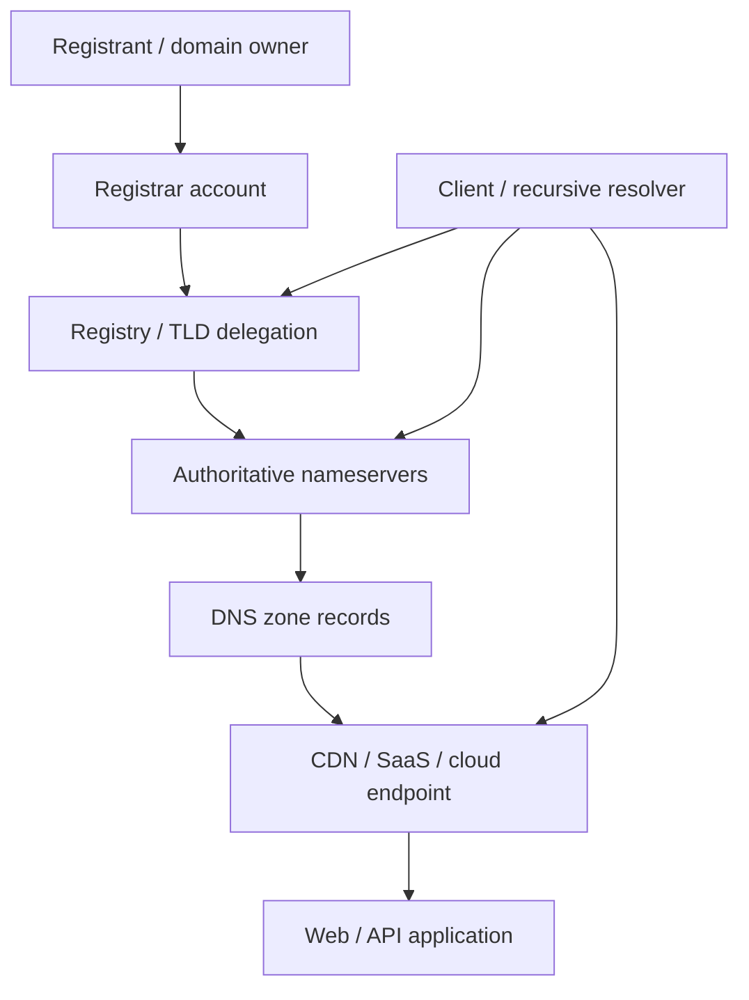
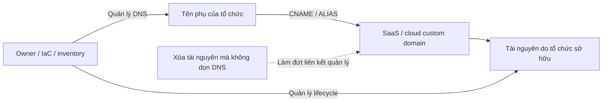
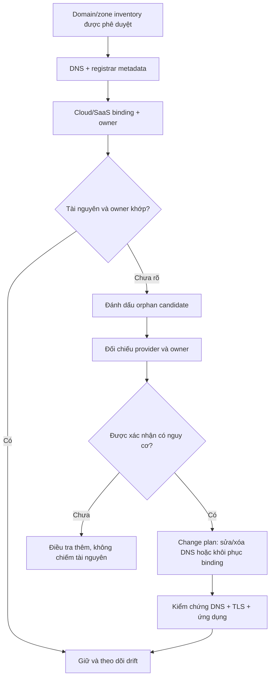

# Domain takeover: nhận diện, phòng ngừa và ứng phó chiếm quyền tên miền

## 1. Domain takeover là gì và tại sao ảnh hưởng an ninh mạng?

**Domain takeover** là tình huống một chủ thể không được phép giành quyền kiểm soát tên miền hoặc một phần không gian tên của tổ chức, khiến họ có khả năng thay đổi hoặc phục vụ nội dung qua các tên mà người dùng, hệ thống, đối tác đã tin cậy. Trong vận hành, thuật ngữ này đôi khi được dùng rộng, bao gồm cả **chiếm quyền đăng ký tên miền gốc** (*domain hijacking*), **thao túng cấu hình DNS** (*DNS hijacking*) và **chiếm quyền tên miền phụ do cấu hình trỏ tới dịch vụ không còn được sở hữu** (*subdomain takeover*).

Ba sự cố có thể có biểu hiện tương tự — website hoặc email đi sai đích — nhưng **điểm kiểm soát bị mất, cách xác minh và biện pháp khắc phục khác nhau**. Vì vậy cần phân loại rõ trước khi điều tra.

Ví dụ giả định: doanh nghiệp sở hữu `example.com`. Website `www.example.com` vẫn hoạt động bình thường, nhưng `help.example.com` còn trỏ đến một ứng dụng hỗ trợ đã ngừng sử dụng ở nhà cung cấp SaaS. Nếu nhà cung cấp **cho phép chủ thể khác gắn hostname cũ mà không có bằng chứng sở hữu thích hợp**, tên phụ đó có thể bị phục vụ nội dung ngoài ý muốn. Ngược lại, nếu tài khoản registrar của `example.com` bị chiếm, tác nhân xấu có thể tác động rộng hơn nhiều, chẳng hạn thay đổi nameserver cho cả domain.

### Các hệ quả đối với CIA và mối đe dọa mạng

- **Confidentiality (bí mật):** người dùng có thể gửi thông tin đăng nhập, dữ liệu biểu mẫu hoặc tài liệu đến endpoint đã bị kiểm soát.
- **Integrity (toàn vẹn):** nội dung web, luồng xác thực, một số bản ghi DNS hoặc cấu hình dịch vụ có thể bị thay đổi trái phép.
- **Availability (sẵn sàng):** domain bị trỏ sai, ngừng gia hạn hoặc mất DNS có thể khiến website, email, VPN và API gián đoạn.
- **Trust/reputation:** người dùng dễ tin một hostname nằm dưới domain quen thuộc; hệ thống SSO, callback hoặc dịch vụ đối tác có thể dựa trên tên đó.

Trong hệ thống bảo mật mạng, chủ đề này liên hệ trực tiếp tới **DNS security, kiểm kê bề mặt tấn công, phân đoạn, firewall, WAF/CDN, TLS, xác thực kết nối, giám sát xâm nhập và threat modeling**. Firewall bảo vệ đường IP không đủ nếu tổ chức mất quyền kiểm soát điểm ánh xạ tên hoặc danh tính vận hành DNS.

## 2. Phân loại: mất quyền ở tầng nào?

| Tình huống | Đối tượng bị kiểm soát | Dấu hiệu thường gặp | Chủ thể cần phối hợp |
|---|---|---|---|
| **Registrar account takeover** | tài khoản quản lý đăng ký domain | thay đổi liên hệ, khóa, nameserver hoặc yêu cầu chuyển domain ngoài ý muốn | registrar, registry theo quy trình, đội quản trị domain |
| **Unauthorized domain transfer / registration hijack** | quyền đăng ký/nhà đăng ký quản lý domain | domain bị chuyển hoặc cập nhật trạng thái trái phép | registrar/registry, pháp chế và incident response |
| **DNS provider/account hijack** | bảng ghi zone hoặc tài khoản DNS hosting | A/AAAA/CNAME/MX/TXT/NS bị thay đổi, đích DNS khác thiết kế | DNS provider, chủ zone, SOC |
| **Subdomain takeover do dangling record** | hostname còn trỏ đến dịch vụ/định danh đã giải phóng | record tồn tại nhưng tài nguyên phía sau không còn được tổ chức liên kết | owner ứng dụng, DNS owner, cloud/SaaS provider |
| **Dangling NS delegation** | một delegated subzone hoặc hostname nameserver không còn được kiểm soát | NS của zone con trỏ tới nameserver hoặc domain đã mất quyền sở hữu | đội DNS, registrar/provider tùy cấu hình |
| **Domain expiration / lapse** | quyền duy trì đăng ký domain | không gia hạn, hết giai đoạn cứu hộ, tên có thể được đăng ký lại theo chính sách TLD | registrar, chủ hợp đồng, tài chính/pháp chế |
| **DNS cache poisoning / resolver hijack** | kết quả phân giải được client hoặc resolver tin dùng | chỉ một số client/vùng nhận câu trả lời sai | DNS resolver, ISP, endpoint/network team |

**Không đánh đồng các hiện tượng trên:** cache poisoning có thể làm người dùng tới sai địa chỉ nhưng không nhất thiết là tổ chức **mất quyền đăng ký domain**. Một CNAME hỏng có thể khiến website không chạy mà **chưa có bất kỳ người nào chiếm được hostname**. Domain expiration không tự động đồng nghĩa một người khác đã đăng ký thành công.

## 3. Chuỗi kiểm soát DNS: registrar, registry, zone và dịch vụ đích

Để đánh giá chiếm quyền, cần hiểu ai có thẩm quyền ở từng bước:



Đây là sơ đồ **mối quan hệ trách nhiệm và quá trình phân giải rút gọn**, không phải luồng một DNS query thực tế đi lần lượt qua tài khoản registrar. Registrar và registry quản lý đăng ký/delegation; client resolver sử dụng dữ liệu DNS được công bố để tìm điểm phục vụ.

### 3.1. Các ranh giới tin cậy cần vẽ

1. **Con người → registrar:** tài khoản nào có quyền thay đổi đăng ký, nameserver và thông tin liên hệ?
2. **Registrar/registry → DNS hosting:** danh sách NS và thông tin DS/DNSSEC của domain được vận hành bởi ai?
3. **DNS hosting → cloud/SaaS/CDN:** record trỏ đến dịch vụ nào, và quyền **gắn hostname tùy chỉnh** ở dịch vụ đó được chứng minh bằng gì?
4. **DNS → TLS:** ai có thể đáp ứng yêu cầu xác minh quyền kiểm soát domain để xin/chuyển chứng chỉ TLS?
5. **DNS → ứng dụng:** có đường trực tiếp nào tới origin nằm ngoài WAF/CDN không? Chứng chỉ và xác thực backend còn được thực thi không?
6. **Đăng ký domain → nghiệp vụ:** các hệ thống email, SSO, VPN, mobile app, API webhook nào phụ thuộc vào domain?

**Nguyên lý:** kiểm soát IP và kiểm soát hostname là **hai tầng khác nhau**. Một máy chủ Production có thể được đặt đúng security group nhưng người dùng vẫn bị đưa sang dịch vụ khác nếu DNS delegation hoặc record bị thay đổi trái phép.

## 4. Một domain hết hạn có thể dẫn tới những gì?

Tên miền thông thường được đăng ký theo kỳ hạn và phải **gia hạn**. Quy trình hết hạn thực tế phụ thuộc **TLD, registry, registrar, tình trạng hợp đồng và chính sách từng thời điểm**.

Không nên cho rằng mọi domain đều lần lượt trải qua một lịch cố định “30 ngày grace → 30 ngày redemption → xóa”. Một số TLD có khoảng gia hạn/cứu hộ, cách đình chỉ DNS và thời điểm được đăng ký lại khác nhau.

Các trạng thái cần giám sát:

| Trạng thái/vấn đề | Ý nghĩa với tổ chức | Biện pháp |
|---|---|---|
| **Sắp tới hạn gia hạn** | tồn tại rủi ro gián đoạn nếu quy trình thanh toán/hợp đồng thất bại | owner rõ, tự gia hạn nếu thích hợp, kiểm tra phương thức thanh toán |
| **Gia hạn không thành công** | tên có thể ngừng phục vụ theo chính sách | cảnh báo nhiều kênh, liên hệ registrar ngay |
| **Domain bị suspend/hold** | DNS có thể không hoạt động dù zone hosting vẫn còn | xác minh trạng thái tại registrar/registry, không tự sửa sai bằng đổi IP ngẫu nhiên |
| **Domain ở giai đoạn có thể khôi phục** | tùy TLD, vẫn có quy trình cứu hộ và chi phí | thực hiện theo quy trình chính thức của registrar |
| **Đăng ký đã chấm dứt và tên có thể được cấp lại** | nguy cơ người khác nắm quyền đối với tên cũ | xem như sự cố mất tài sản, xử lý phụ thuộc email/SSO/URL và pháp lý |

**Tài sản không sử dụng vẫn có thể quan trọng.** Một domain cũ có thể còn được ghi trong email khôi phục tài khoản, OAuth redirect URI, cấu hình mobile app, tài liệu nội bộ, cert hoặc URL của đối tác. Nếu đơn vị mới kiểm soát domain, độ tin cậy mà dịch vụ khác dành cho tên này có thể tạo rủi ro dây chuyền.

### Ví dụ lập danh mục gia hạn

```yaml
# Dữ liệu minh họa: không phải kết quả truy vấn đăng ký thực tế
domain: example.com
business_owner: customer-platform
technical_owner: dns-operations
registrar_contact: registrar-admin-group
renewal_mode: auto-with-manual-audit
expiry_date: "2027-06-30"
critical_dependencies:
  - customer-website
  - mail-routing
  - sso-callbacks
notification_channels:
  - operations-ticket
  - security-oncall
last_verified_at: "2026-11-28T00:00:00Z"
```

Để ra quyết định gia hạn, phải đối chiếu **thông tin có thẩm quyền từ registrar/registry**; dữ liệu ngày trên dashboard nội bộ chỉ là bản sao và có thể đã cũ.

## 5. Registrar account takeover và chuyển domain trái phép

### 5.1. Điểm rủi ro ở control plane

Registrar account là nơi có thể quản lý nameserver, thông tin liên hệ, khóa chuyển và nhiều thao tác quan trọng đối với domain. Nếu tài khoản đó bị chiếm, kẻ xấu có thể gây ảnh hưởng cho cả không gian tên mà không cần truy cập máy chủ ứng dụng.

Các đường rủi ro thường gặp ở góc độ phòng thủ:

- Tài khoản dùng mật khẩu yếu, dùng lại hoặc bị đánh cắp qua phishing.
- MFA không được bật, cấu hình yếu hoặc có quy trình khôi phục dễ bị lạm dụng.
- Email phục hồi registrar nằm trên **chính domain đang được quản lý**, khiến mất domain có thể gây phụ thuộc vòng.
- Nhiều nhân viên dùng chung một tài khoản quản trị, không có audit người thực hiện.
- Nhân viên/vendor đã nghỉ nhưng vẫn có quyền.
- Thông tin liên hệ hoặc kênh phê duyệt chuyển nhượng không được bảo vệ.

### 5.2. Registrar lock, registry lock và kiểm soát chuyển nhượng

- **Registrar lock / transfer lock** thường liên quan tới trạng thái ngăn chuyển domain theo cơ chế registrar/registry hỗ trợ, chẳng hạn `clientTransferProhibited`. Hành vi chi tiết phụ thuộc TLD/nhà cung cấp; không nên suy luận nó chặn **mọi** thao tác chỉnh DNS.
- **Registry lock** (khi TLD/registry cung cấp) bổ sung quy trình xác thực/phê duyệt cho những thay đổi nhạy cảm như chuyển nhượng hoặc đổi delegation; mức bảo vệ tùy dịch vụ đã đăng ký.
- **MFA chống phishing, phân quyền người quản trị, xác nhận ngoài băng và thông báo độc lập** giúp bảo vệ kênh ra quyết định.
- **Domain transfer authorization code** và quyền truy cập kênh liên hệ phải được bảo vệ như bí mật vận hành, không lưu trong ticket công khai.

Không mô tả “domain locked” như một trạng thái nhị phân đủ an toàn. Cần biết **loại khóa đang bật, thay đổi nào thực sự bị chặn, ai được tháo khóa, log và bước khôi phục**.

### 5.3. Checklist tối thiểu với domain quan trọng

1. Mỗi domain có owner nghiệp vụ và owner kỹ thuật rõ.
2. Tài khoản registrar dùng MFA mạnh và hạn chế số người được cấp quyền.
3. Có cơ chế kiểm tra và phê duyệt ngoài băng cho yêu cầu chuyển/đổi NS quan trọng.
4. Bật khóa chuyển và cân nhắc registry lock cho domain có giá trị cao khi được hỗ trợ.
5. Email/điện thoại khôi phục không phụ thuộc hoàn toàn vào cùng domain đang quản lý.
6. Kiểm tra danh sách contact, quyền vendor và lịch sử đăng nhập/thay đổi.
7. Có theo dõi expiration và diễn tập liên hệ registrar khi mất quyền truy cập.

## 6. DNS provider hijack: sai khác giữa trạng thái mong muốn và thực tế

Doanh nghiệp có thể vẫn sở hữu domain tại registrar, nhưng một tài khoản hoặc API token của **DNS hosting provider** bị lộ và dùng để thay đổi zone. Hậu quả có thể gồm:

- `A`/`AAAA` của web/API trỏ tới endpoint không nằm trong thiết kế.
- `CNAME` của một hostname được thay đổi sang dịch vụ khác.
- `MX` hoặc một số bản ghi liên quan email bị thay đổi, làm ảnh hưởng đường thư.
- `TXT` phục vụ các quy trình xác minh domain bị thêm/sửa.
- `NS` trong zone hoặc cấu hình delegation bị chỉnh, làm thay đổi phần không gian tên được phục vụ.
- `CAA` bị đổi để tác động tới chính sách cấp chứng chỉ theo cơ chế CA kiểm tra.

Một số thao tác yêu cầu quyền ở registrar/registry, một số chỉ cần quyền ghi DNS zone. Cần phân biệt **bản ghi NS trong zone**, **delegation ở parent zone** và **quyền thay đổi tại registrar**.

### 6.1. Phòng vệ tại DNS hosting

- Dùng danh tính cá nhân và role có phạm vi tối thiểu; tránh API token toàn quyền cho CI/CD nếu chỉ cần thay một record.
- Bảo vệ API key/secret và kiểm soát pipeline Infrastructure as Code (IaC).
- Ghi audit log mọi thay đổi quan trọng với actor, IP/identity, thời điểm, diff và ticket.
- Thực thi review/approval cho thay đổi `NS`, `MX`, `TXT` xác minh domain và record phục vụ ứng dụng nhạy cảm.
- Giám sát **record ngoài ý muốn** bằng so sánh trạng thái thực với bản thiết kế được phê duyệt.
- Chuẩn bị bản sao zone và quy trình khôi phục mà không phát tán khóa riêng hoặc secret vào repo.
- Kiểm tra quyền vendor, service account, automation và danh sách tổ chức dự phòng.

### 6.2. TTL không phải một nút “undo”

**Time To Live (TTL)** là thông tin cache DNS dùng để quyết định thời gian có thể giữ dữ liệu. Sửa record ở authoritative provider **không đảm bảo toàn bộ resolver lập tức bỏ cache cũ**. Tùy DNS negative caching, giá trị TTL, chain CNAME và trạng thái delegation, người dùng có thể nhận các kết quả khác nhau trong một khoảng thời gian.

Khi xử lý sự cố, cần xác minh trạng thái từ **authoritative nameserver**, từ một vài recursive resolvers được lựa chọn và từ các điểm quan sát hợp lệ. Không kết luận “đã khôi phục” chỉ vì một lệnh `dig` trả đúng record.

## 7. Subdomain takeover qua dangling DNS record

### 7.1. Dangling CNAME nghĩa là gì?

**Dangling CNAME** là bản ghi bí danh còn trỏ tới hostname của một dịch vụ mà tổ chức **không còn sử dụng hoặc không còn giữ liên kết tài nguyên tương ứng**.

Ví dụ giả định:

```text
help.example.com
      CNAME → discontinued-helpdesk.provider.example

DNS của tổ chức: vẫn có CNAME.
Tài nguyên bên cung cấp SaaS: đã bị xóa hoặc tách liên kết.
```

**Khi nào mới có nguy cơ takeover?** Phải có **điều kiện bổ sung** ở nhà cung cấp: một chủ thể khác có thể đăng ký/khai báo tài nguyên hoặc hostname đích và chứng minh quyền sở hữu theo cơ chế **không đủ chặt**, dẫn tới việc họ phục vụ nội dung dưới `help.example.com`. Cách hoạt động phụ thuộc từng dịch vụ, trạng thái định danh, xác minh hostname, TLS và việc provider ngăn trùng domain.

Vì vậy:

**Có dangling CNAME ≠ đã takeover ≠ chắc chắn có thể takeover.**

Tài nguyên có thể đã xóa nhưng namespace đích không còn cấp lại được; provider có thể yêu cầu TXT-based validation hoặc proof of domain control; lỗi 404/“not found” có thể là cấu hình ứng dụng bình thường. Không suy luận lỗ hổng có thể khai thác chỉ từ một banner hoặc CNAME.

### 7.2. Chuỗi quyền sở hữu hợp lệ



Ranh giới ở đây là **DNS zone của tổ chức** và **bộ điều khiển custom-domain ở provider**. Một record DNS vẫn đúng cú pháp nhưng không còn được liên kết với quyền sở hữu hiện tại có thể khiến hệ thống kiểm kê bỏ sót khoảng trống.

### 7.3. Vì sao quá trình xóa dịch vụ thường gây rủi ro?

Lý do hay gặp:

- Đội ứng dụng xóa môi trường staging hoặc tài nguyên CDN mà không thông báo đội DNS.
- Pipeline IaC quản lý resource nhưng DNS record do người khác tạo thủ công.
- Đổi nhà cung cấp SaaS, giữ CNAME cũ “để dự phòng”.
- Chủ dự án rời công ty; hostname còn trong DNS nhưng không có owner.
- Tài nguyên bị xóa ở account/project khác, dữ liệu asset inventory không phủ hết.
- Cơ chế gắn hostname thay đổi theo phiên bản provider, khiến kiểm tra ownership cũ không còn phù hợp.

Giải pháp bền vững không chỉ là scan DNS: phải **liên kết vòng đời DNS với vòng đời dịch vụ** và yêu cầu xóa/đổi record theo quy trình phê duyệt.

## 8. Dangling A/AAAA, IP cloud và các trường hợp không phải CNAME

Một số tổ chức dùng bản ghi `A`/`AAAA` trỏ trực tiếp tới IP cloud. Khi VM, load balancer hoặc IP reservation bị giải phóng, record có thể còn trỏ tới **địa chỉ không thuộc tài nguyên đang vận hành**.

Điều này gây nguy cơ theo các điều kiện của nhà cung cấp và mô hình cấp phát:

- IP có thực sự được **cấp lại** cho chủ thể khác không?
- Nhà cung cấp có hỗ trợ IP reservation/static allocation và ràng buộc quyền sở hữu không?
- Load balancer/proxy vẫn kiểm tra `Host`, TLS, tenant hoặc custom-domain ownership không?
- Các thay đổi NAT, route hoặc security group có làm đường IP bị sai đích không?

**Một A record trỏ tới IP không phản hồi không chứng minh một người khác có thể sở hữu IP đó**. Không nên “thử nhận IP” hoặc tạo tài nguyên nhằm kiểm chứng khả năng chiếm quyền ngoài phạm vi được phép. Trong công việc phòng thủ, hãy đối chiếu **resource ID, IP allocation, billing, danh sách VPC/VNet/project và owner**.

Các cấu hình khác cần đánh giá:

| Dạng liên kết | Ví dụ | Cách xác minh |
|---|---|---|
| **CNAME** | hostname phụ → hostname CDN/SaaS | đối chiếu custom-domain binding, provider account và cơ chế validation |
| **A/AAAA** | hostname → IP của dịch vụ cloud | đối chiếu IP allocation và resource identity |
| **ALIAS/ANAME flattening** | record tại DNS provider tương đương cơ chế alias đến dịch vụ | kiểm tra target trong DNS control plane, không chỉ kết quả A được flatten |
| **NS delegation** | zone con → danh sách nameserver | xác minh nameserver và domain chứa nameserver còn thuộc quyền quản lý |
| **Wildcard record** | `*.example.com` → đích chung | đánh giá các tên con không được khai báo riêng và quyền gắn hostname |
| **SRV/service discovery** | tên service → hostname/port đích | kiểm tra ứng dụng sử dụng và tài nguyên đích |

Wildcard DNS làm tăng số hostname có thể được phân giải, nhưng **không có nghĩa tự động tồn tại một lỗ hổng takeover cho mọi tên con**. Cần hiểu router ứng dụng, chứng chỉ TLS, custom-domain policy và phần kiểm soát tại dịch vụ.

## 9. Dangling NS delegation và delegated subzone

Một tổ chức có thể **ủy quyền** vùng `dev.example.com` cho nhóm khác hoặc nhà cung cấp dịch vụ DNS chuyên biệt:

```text
Parent zone: example.com
  dev.example.com.  NS  ns1.delegated-zone.example.net.
  dev.example.com.  NS  ns2.delegated-zone.example.net.

Child zone: dev.example.com
  Các bản ghi do nameserver của zone con trả lời
```

Nguy cơ xảy ra khi **delegation vẫn còn nhưng hệ thống nameserver hoặc quyền sở hữu tên nameserver bị mất**. Khi đó không chỉ một record có thể bị ảnh hưởng mà **cả vùng được ủy quyền** có nguy cơ mất kiểm soát, tùy điều kiện chiếm quyền thực tế.

Các dấu hiệu cần review:

- Nameserver được chỉ định có còn do tổ chức/provider hợp lệ quản lý?
- Hostname nameserver có nằm dưới domain khác sắp hết hạn hoặc không còn sở hữu không?
- Child zone còn tồn tại và có người chịu trách nhiệm không?
- DNSSEC chain-of-trust giữa parent và child có được cấu hình/cập nhật đúng không?
- Delegation, glue records khi cần, IPv4/IPv6 và thay đổi provider có nhất quán không?

**DNSSEC** có thể khiến resolver xác thực từ chối dữ liệu không khớp chuỗi tin cậy, nhưng không nên xem đây là bảo đảm tuyệt đối nếu bản thân **chủ thể có quyền đăng ký/delegation** bị chiếm. Sai lệch DS/DNSKEY cũng có thể làm DNS phân giải thất bại; xử lý cần phối hợp với owner DNS có chuyên môn.

## 10. Tác động lên website, email, SSO và các dịch vụ phụ thuộc

Một domain thường được sử dụng **vượt ra ngoài website**. Đánh giá rủi ro takeover cần lập danh sách phụ thuộc:

| Hệ thống | Dữ liệu/niềm tin phụ thuộc domain | Tác động tiềm năng |
|---|---|---|
| Website / API | hostname HTTPS, DNS, URL khách hàng lưu | phishing, nội dung sai hoặc mất dịch vụ |
| CDN / WAF | custom domain, origin mapping, chứng chỉ | đường vào lệch khỏi lớp kiểm tra hoặc gián đoạn |
| Email | MX, SPF, DKIM, DMARC, mail address và recovery flow | thất lạc thư, mạo danh hoặc rủi ro luồng phục hồi tài khoản tùy cấu hình |
| SSO / OAuth / OIDC | redirect URI, callback, issuer metadata, allowed origins | rủi ro luồng xác thực nếu cấu hình tin cậy cho hostname mất kiểm soát |
| SAML | ACS/metadata URL, chứng chỉ và endpoint đối tác | tin cậy không còn đúng giữa IdP và SP |
| Cookies / browser | scope của cookie theo domain/path, thuộc tính bảo vệ | một số thiết kế có thể chịu rủi ro từ subdomain không đáng tin |
| TLS/PKI | quyền chứng minh kiểm soát hostname, CAA, CT | có thể xuất hiện chứng chỉ bất thường tùy cơ chế validation |
| Mobile app | API hostname hoặc deep link được nhúng vào phiên bản app cũ | khách hàng phiên bản cũ vẫn gọi endpoint đã mất |
| Webhooks/partner integrations | callback URL và allowlist hostname | dịch vụ đối tác gửi dữ liệu đến endpoint sai |
| VPN / remote access | hostname gateway, trust anchors/certificate pinning nếu có | kết nối lỗi hoặc nguy cơ điều hướng sai khi các điều kiện bảo vệ khác yếu |

### 10.1. Cookies và hostname được chiếm

Không được khẳng định “chiếm một subdomain là đọc được mọi cookie của domain mẹ”. Trình duyệt thực thi **host-only/domain-scoped cookies**, `Secure`, `HttpOnly`, `SameSite`, các tiền tố cookie, quy tắc same-origin và nhiều giới hạn khác nhau.

Một subdomain không đáng tin **có thể** tạo rủi ro trong một số cấu hình chia sẻ cookie hoặc chính sách origin quá rộng. Phải đánh giá cấu hình thực tế trước khi kết luận có thể đọc, ghi đè hoặc lợi dụng phiên.

### 10.2. Email và xác thực domain

**SPF, DKIM, DMARC** hỗ trợ các cơ chế xác thực và chính sách email; chúng không phải khóa bảo vệ quyền đăng ký domain. Nếu quyền quản lý DNS hoặc domain bị mất, một số bản ghi liên quan email có thể bị thay đổi. Đồng thời việc thay `MX` không tự có nghĩa mọi tài khoản email hoặc bí mật đã bị chiếm; cần xác minh luồng thư và đăng nhập ở nhà cung cấp mail.

### 10.3. TLS và Certificate Transparency

Việc có thể điều khiển một hostname có thể ảnh hưởng đến một số phương thức **xác minh quyền kiểm soát domain** khi cấp chứng chỉ TLS. Tuy nhiên, CA vẫn có yêu cầu validation riêng và không phải mọi người chỉ đổi một record đều có thể cấp mọi loại chứng chỉ.

**Certificate Transparency (CT)** cung cấp dấu vết về chứng chỉ được ghi nhận công khai; CT hữu ích để phát hiện tên miền/chứng chỉ bất thường, **không phải cơ chế trực tiếp ngăn phát hành** và không chứng minh website đang hoạt động tại thời điểm kiểm tra.

## 11. Tín hiệu phát hiện sớm và độ tin cậy của bằng chứng

Phòng thủ tốt cần kết hợp **đăng ký domain, cấu hình DNS, inventory dịch vụ, TLS và nhật ký thay đổi**.

| Tín hiệu | Điều gợi ý | Điều không thể kết luận ngay |
|---|---|---|
| Domain sắp hết hạn | cần kiểm tra gia hạn/hợp đồng | domain đã bị đăng ký bởi người khác |
| Registrar gửi thông báo đổi NS/contact | cần xác thực change request | thay đổi là trái phép nếu chưa đối chiếu owner |
| NS/MX/A/AAAA/CNAME ngoài baseline | zone có drift hoặc nhà cung cấp đã đổi | bị xâm nhập mà không kiểm tra IaC/change ticket |
| CNAME trỏ tới dịch vụ không phản hồi | có thể có tài sản đã xóa hoặc outage | chắc chắn takeover khả thi |
| IP cloud không khớp inventory | record cũ hoặc khác scope account/project | IP đã cấp cho bên thứ ba |
| CT xuất hiện chứng chỉ mới | cần kiểm tra yêu cầu cấp, hostname, issuer | kẻ tấn công đã có quyền quản lý domain |
| DNS kết quả khác nhau giữa resolver | cache, geo-routing, split DNS, thay đổi delegation | mỗi kết quả khác nhau đều là tấn công |
| HTTP trả lỗi “resource not found” | backend/custom-domain không khớp | có thể đăng ký tên đó ở provider |
| Tài khoản DNS mới được cấp quyền | thay đổi quản trị cần kiểm tra | hành động không hợp lệ nếu có ticket/approval |

**Quy tắc phân loại:** dấu hiệu từ DNS/CT là **hypothesis**; phát hiện có bằng chứng cần liên kết với **tài nguyên và quyền quản trị thật**. Đánh giá nguy cơ takeover có điều kiện theo provider nên giao cho nhóm AppSec/DNS xác minh trên cơ sở tài liệu và cấu hình của chính tổ chức.

## 12. Quy trình phát hiện tài sản và dangling record được cấp phép

### Bước 1 — Xác định phạm vi có quyền

Thu danh sách domain, zone và các subdomain từ registrar, DNS provider, hệ thống quản lý dịch vụ và IaC trong **phạm vi tổ chức cho phép**. Đặt scope account, project, region, owner và mức độ quan trọng.

Không nhầm **domain nhìn thấy trên Internet** với **tài sản thuộc tổ chức**; CDN, SaaS, hosting dùng chung có thể có nhiều tenant.

### Bước 2 — Thu DNS và thông tin đăng ký

Đối với các tên đã được phê duyệt, đọc `A`, `AAAA`, `CNAME`, `NS`, `MX`, `TXT`, `CAA` và những record phù hợp. Đối chiếu trạng thái registrar/registry, nameserver thực dùng và thông tin gia hạn được owner xác nhận.

### Bước 3 — Ánh xạ tới tài nguyên đích

Với mỗi record, tìm **native resource ID**, custom-domain binding, account/tenant, hợp đồng và người phụ trách trong cloud/SaaS. Ví dụ `help.example.com` trỏ tới SaaS hỗ trợ: cần xác minh **dịch vụ vẫn thuộc tenant hợp lệ** và cơ chế chứng minh quyền sở hữu domain của provider còn hiệu lực.

### Bước 4 — Phân loại kết quả theo độ chắc chắn

- **Confirmed owned and active:** DNS record và tài nguyên đích khớp owner, trạng thái hợp lệ.
- **Stale/orphan candidate:** record còn, không tìm được resource hoặc owner; chưa kết luận chiếm quyền.
- **Potential takeover condition:** tài liệu và trạng thái provider chỉ ra khả năng gắn lại hostname/định danh; cần xác minh có thẩm quyền.
- **Confirmed unauthorized change:** có bằng chứng DNS/registrar thay đổi ngoài phê duyệt hoặc tài nguyên không thuộc tổ chức đang phục vụ hostname.
- **Unavailable evidence:** không đủ quyền/API lỗi; giữ trạng thái chưa xác định thay vì coi tài sản đã biến mất.

### Bước 5 — Xác nhận bằng con đường an toàn

Đối chiếu từ **control plane thuộc tài khoản tổ chức, hợp đồng nhà cung cấp, inventory, change ticket và log**. Nếu cần kiểm thử riêng, dùng hostname/tài nguyên **thử nghiệm do chính tổ chức sở hữu** hoặc làm việc với provider; không đăng ký custom hostname/tenant của bên khác nhằm “chứng minh” một tên miền có thể bị chiếm.

### Bước 6 — Khắc phục và kiểm tra lại

Xác định ai phải xử lý record hoặc dịch vụ, mô tả rủi ro và phụ thuộc. Sau thay đổi, xác minh DNS, TLS, ứng dụng, email/callback liên quan và telemetry. Lưu trạng thái cùng bằng chứng, không xóa lịch sử phát hiện ngay.



## 13. Các thao tác DNS đọc thông tin để xác minh

Những lệnh sau chỉ giúp **quan sát**, không thay đổi DNS hoặc đăng ký tài nguyên:

```bash
# Domain và hostname trong ví dụ chỉ dùng cho mục đích tài liệu
dig example.com NS
dig example.com SOA
dig www.example.com A
dig www.example.com AAAA
dig help.example.com CNAME

# Quan sát delegation và kết quả theo đường phân giải khi được phép
dig +trace example.com NS

# Kiểm tra bản ghi phục vụ DNSSEC và chính sách cấp chứng chỉ
dig example.com DS
dig example.com DNSKEY
dig example.com CAA
```

**Lưu ý kỹ thuật:**

- `example.com` là domain tài liệu; các câu trả lời thực của nó không đại diện cho hệ thống người học.
- `dig +trace` tạo truy vấn tới các nameserver cần thiết; phải tuân thủ phạm vi và mức truy vấn được phép.
- Hệ thống có **split-horizon DNS** có thể trả bản ghi khác nhau giữa mạng nội bộ và Internet.
- Một `CNAME` có thể đi qua nhiều bước; DNS provider có thể flatten alias thành A/AAAA nên kết quả truy vấn DNS ngoài không bộc lộ hết cấu hình control plane.
- `NXDOMAIN`, `SERVFAIL`, `REFUSED` và timeout không đồng nghĩa; kết luận phải dựa trên record, quyền quản trị, cấu hình authoritative và trạng thái provider.
- Một domain không có `DS` không tự chứng minh bị takeover; DNSSEC là tùy chính sách và trạng thái triển khai.

Thông tin đăng ký domain hiện thường được truy vấn qua **RDAP** hoặc giao diện registrar/registry có thẩm quyền. Dữ liệu công khai có thể bị ẩn vì chính sách bảo vệ quyền riêng tư; **không suy ra không có owner chỉ vì thông tin người đăng ký bị redacted**.

## 14. Lưu bản ghi asset inventory và trạng thái ownership

Để xử lý quy mô lớn, mỗi hostname cần liên kết **DNS record ↔ service binding ↔ owner ↔ lifecycle**.

Ví dụ JSON minh họa:

```json
{
  "fqdn": "help.example.com",
  "parent_domain": "example.com",
  "record_type": "CNAME",
  "record_target": "discontinued-helpdesk.provider.example",
  "zone_owner": "dns-operations",
  "application_owner": "customer-support-platform",
  "provider": "example-saas",
  "provider_tenant": "tenant-placeholder",
  "service_resource_id": "resource-placeholder",
  "lifecycle_state": "decommission-review",
  "ownership_verification": "not-yet-confirmed",
  "exposure": "public-hostname",
  "first_seen": "2026-11-01T00:00:00Z",
  "last_seen": "2026-11-28T00:00:00Z",
  "evidence": [
    "authoritative-dns-record",
    "cmdb-owner-lookup",
    "provider-control-plane-review-pending"
  ],
  "next_action": "validate-binding-before-dns-change"
}
```

Các trường là dữ liệu **giả định**, không phải kết quả quét hoặc tài khoản thật. `first_seen` và `last_seen` là thời gian **hệ thống kiểm kê quan sát**, khác thời gian resource được tạo/xóa.

**Một định danh DNS không phải định danh tài sản duy nhất.** Cần lưu cả account/subscription/project, region và native resource ID để không nhầm tài nguyên có tên gần giống hoặc IP được provider dùng lại.

### Cấp độ tin cậy của kết luận

| Mức | Bằng chứng | Quyết định hợp lý |
|---|---|---|
| **Observed** | bản ghi DNS/CT được nhìn thấy | tạo bản ghi kiểm kê |
| **Correlated** | gắn được provider, resource ID, owner và trạng thái | đánh giá lifecycle và policy |
| **Potential risk** | orphan/stale và có điều kiện có thể bị provider tái gắn | ưu tiên khắc phục và xác nhận theo tài liệu |
| **Confirmed incident** | có bằng chứng quyền đăng ký/DNS đã đổi trái phép hoặc hostname đang phục vụ nội dung trái phép | kích hoạt incident response |
| **Resolved** | record/binding/registration đã khôi phục và dịch vụ kiểm tra ổn | theo dõi sau khắc phục |

Không ghi nhãn **“confirmed takeover”** cho mọi CNAME lỗi. Cách trình bày bằng chứng quyết định độ tin cậy của danh mục và mức ưu tiên phản ứng.

## 15. Phòng vệ nhiều lớp: registrar, DNS, SaaS và ứng dụng

### 15.1. Bảo vệ quyền đăng ký tên miền

- Gia hạn theo lịch, có cảnh báo độc lập và người chịu trách nhiệm.
- MFA mạnh, tách quyền, không dùng chung tài khoản; hạn chế kênh khôi phục dễ bị tấn công.
- Transfer lock; đánh giá registry lock cho domain quan trọng khi hỗ trợ.
- Kiểm tra thay đổi NS, registrar/contact, trạng thái `clientTransferProhibited` và những mã trạng thái đăng ký liên quan.
- Có kênh liên hệ khẩn cấp với registrar/registry, hồ sơ chứng minh ownership/hợp đồng được bảo vệ.

### 15.2. Bảo vệ DNS hosting và delegated zones

- Quyền DNS API tối thiểu; secret/token được xoay vòng và không đặt trong mã nguồn.
- Thay đổi record có owner, ticket, review và audit log; các record nhạy cảm cần phê duyệt thích hợp.
- Theo dõi drift giữa IaC/source of truth và cấu hình thực.
- DNSSEC theo thiết kế và quy trình quản lý khóa/DS phù hợp.
- Tách zone quyền nhạy cảm, kiểm soát NS delegation và domain chứa nameserver.
- Có log và backup cấu hình, bảo vệ sẵn sàng của authoritative provider.

### 15.3. Bảo vệ custom domain ở cloud/CDN/SaaS

- Xác nhận provider có cơ chế **proof of domain control** phù hợp trước khi gắn custom hostname.
- Gắn hostname với **account/tenant và resource ID** do tổ chức quản lý.
- Không xóa cloud/SaaS resource trong khi record công khai còn trỏ đến nếu chưa có kế hoạch migration/decommission phù hợp.
- Sau đổi nhà cung cấp, kiểm tra target alias/CNAME, certificate, route và quyền owner cũ.
- Phối hợp với nhà cung cấp khi phát hiện binding cũ/mập mờ; không thử gắn tài sản của người khác.
- Giới hạn truy cập trực tiếp tới origin và xác thực upstream để tránh đường bypass CDN/WAF ngoài ý muốn.

### 15.4. Bảo vệ tầng ứng dụng và danh tính

Một cấu hình DNS đúng không thay thế:

- Xác thực và authorization từng API/object.
- TLS đúng hostname/cert chain, quản lý chứng chỉ và kiểm tra custom-domain ownership.
- Chính sách OAuth/OIDC callback và SAML endpoint được review theo owner.
- Cookie scope phù hợp, `Secure`, `HttpOnly`, `SameSite` và các biện pháp phòng vệ trình duyệt.
- MFA ở tài khoản quan trọng và giám sát thay đổi email recovery.
- WAF/IDS/IPS và segmentation để hạn chế ảnh hưởng khi endpoint bị dẫn tới nơi không đúng.

Phòng vệ phải giảm **blast radius**: một hostname thử nghiệm mất kiểm soát không nên mặc nhiên cho phép đọc dữ liệu production hoặc kiểm soát tài khoản của các hệ thống khác.

## 16. DNSSEC, CAA, CT và DoH/DoT giúp được gì?

Các cơ chế này thường được nhắc cùng DNS security nhưng **giải quyết vấn đề khác nhau**:

| Công nghệ | Bảo vệ/chức năng chính | Điều không thể đảm bảo |
|---|---|---|
| **DNSSEC** | xác minh tính xác thực/toàn vẹn dữ liệu DNS qua chain of trust được cấu hình đúng | không ngăn người đang có quyền hợp lệ tại registrar/DNS provider thay record trái mục đích; không gia hạn domain |
| **CAA** | chỉ định CA nào được phép cấp chứng chỉ cho domain theo cơ chế xác minh CAA | không khóa đăng ký domain hay bảo đảm không cấp được chứng chỉ khi domain/zone đã bị kiểm soát |
| **Certificate Transparency** | dấu vết công khai về chứng chỉ để phát hiện hành vi cấp bất thường | không tự ngăn chứng chỉ được cấp và không chứng minh website thuộc tổ chức |
| **DoH/DoT** | bảo vệ nội dung DNS query/transport ở những chặng hỗ trợ | không bảo vệ quyền registrar, không tự xác minh bản ghi nếu không có các kiểm soát khác |
| **Registry/registrar lock** | hạn chế một số thay đổi đăng ký/chuyển nhượng theo dịch vụ | không thay thế IAM của DNS hosting hoặc chống dangling CNAME |
| **WAF/CDN** | lọc/chống lạm dụng HTTP tại điểm edge | không sửa domain hết hạn, không chặn mọi thay đổi DNS trái phép |
| **DNS monitoring** | phát hiện record/delegation drift | chỉ phát hiện nếu có baseline, nguồn đúng và quy trình phản ứng |

### 16.1. DNSSEC khi domain thật sự bị chiếm quyền

Nếu một attacker chỉ can thiệp vào **recursive cache** mà không thể tạo chữ ký DNSSEC hợp lệ, resolver có xác minh DNSSEC có thể phát hiện phản hồi không hợp lệ trong các điều kiện phù hợp.

Nhưng nếu tài khoản hoặc quyền quản lý **zone cùng với key material** bị kiểm soát, hoặc cấu hình delegation/DS ở registry bị thay đổi bởi chủ thể có quyền không mong muốn, DNSSEC không phải lớp bảo vệ tuyệt đối trước việc chiếm quyền.

Thao tác chuyển DNSSEC provider cũng có thể gây **lỗi xác minh và mất phân giải** nếu DS/DNSKEY không được phối hợp đúng. Vì vậy DNSSEC cần runbook chuyển đổi/rollback và giám sát, không chỉ bật một cờ.

### 16.2. Chứng chỉ TLS có khôi phục được niềm tin?

Nếu domain đã trỏ sai, chỉ “cấp lại cert” không chứng minh hệ thống đúng. Quá trình khôi phục phải kiểm soát **quyền domain, DNS, provider binding, chứng chỉ, ứng dụng và cơ chế revoke/rotate khi có bằng chứng key bị lộ**. Kiểm chứng TLS chain và hostname từ nhiều điểm, kết hợp CT monitoring và log CA khi cần.

## 17. Monitoring liên tục và kiểm soát drift

Domain takeover là bài toán **quản lý vòng đời và kiểm soát thay đổi liên tục**, không chỉ scan một lần.

### 17.1. Các luồng cảnh báo cần có

1. **Registration lifecycle:** domain sắp hết hạn, auto-renew thất bại, registrar/registry status bất thường.
2. **Registrar/NS changes:** thay nameserver, registrar contact, trạng thái transfer lock hoặc yêu cầu transfer.
3. **DNS record drift:** thay `A/AAAA/CNAME/MX/NS/TXT/CAA` ngoài quy trình phê duyệt.
4. **Dangling resource candidates:** DNS còn nhưng asset inventory/cloud control plane không tìm thấy binding hợp lệ.
5. **SaaS custom-domain changes:** hostname bị tháo liên kết, tenant/resource bị xóa hoặc thay đổi ownership.
6. **CT monitoring:** chứng chỉ mới cho domain quan trọng, issuer, SAN, thời điểm cấp khác baseline.
7. **Web/API health:** HTTP/TLS mismatch, redirect bất thường, endpoint phục vụ nội dung sai hoặc lỗi ngoài dự kiến.
8. **Identity changes:** registrar/DNS provider login mới, API token mới hoặc quyền IAM tăng bất thường.

### 17.2. Kết hợp dữ liệu sự kiện và snapshot

Không nên chỉ dựa vào webhook: event có thể bị mất, tài khoản giám sát hết quyền hoặc dịch vụ ghi log không đầy đủ. Cần:

- **Snapshot định kỳ** vùng DNS và registrar metadata.
- **Audit events** cho thay đổi đã xảy ra.
- **Asset inventory** từ cloud/SaaS và service catalog có owner.
- **Verification** của thay đổi quan trọng từ control plane thực.
- **SLA phản hồi** cho domain sắp hết hạn, NS drift và subdomain có nguy cơ cao.

Nếu API trả `AccessDenied` hoặc một scope không được liệt kê, ghi rõ **inventory incomplete**; không kết luận tài sản đã xóa hoặc domain không còn owner.

### 17.3. KPI vận hành

| KPI | Ý nghĩa |
|---|---|
| **Critical domain ownership coverage** | tỷ lệ domain trọng yếu có owner và kênh liên hệ được xác minh |
| **Renewal readiness** | tỷ lệ domain có gia hạn/tài chính/cảnh báo được kiểm tra trước hạn |
| **DNS record-to-resource linkage** | tỷ lệ record được nối tới resource ID/tenant và ứng dụng sở hữu |
| **Orphan/dangling backlog** | số record chưa đối soát hoặc cần xóa/khôi phục |
| **Time to detect DNS drift** | thời gian từ thay đổi tới khi phát hiện |
| **Time to restore control** | thời gian khôi phục đăng ký, NS, record hoặc binding sau sự cố |
| **Critical delegated-zone coverage** | tỷ lệ zone con có owner, nameserver và trạng thái DNSSEC rõ |
| **False-positive findings** | phát hiện được gắn nguy cơ nhưng thực tế là thiết kế hợp lệ |
| **CT anomaly review latency** | thời gian xem xét một chứng chỉ bất thường |

Đừng chỉ đo “bao nhiêu subdomain đã quét”. Danh mục có 100% record nhưng **không gắn owner và quyền provider** vẫn khó bảo vệ trước takeover do vòng đời tài nguyên.

## 18. Quy trình decommission và migration tránh tạo dangling DNS

Một trong những thời điểm dễ phát sinh orphan record nhất là khi **xóa tài nguyên hoặc chuyển provider**.

### 18.1. Checklist trước khi ngừng dịch vụ

1. Xác định **hostname, bản ghi DNS, certificate, custom-domain binding, IaC state và owner**.
2. Liệt kê phụ thuộc: người dùng, API client, email, webhook, SSO callback, mobile app, tài liệu và đối tác.
3. Quyết định **giữ hostname** để redirect sang dịch vụ mới, chuyển quyền quản lý hoặc xóa hoàn toàn.
4. Chuẩn bị DNS/certificate/endpoint mới với xác thực domain phù hợp; kiểm chứng trước khi chuyển traffic.
5. Điều chỉnh DNS theo kế hoạch chuyển đổi và theo dõi cache/TTL.
6. Nếu xóa hostname, **gỡ record trỏ tới dịch vụ cũ** theo trình tự an toàn và xác nhận từ nguồn authoritative.
7. Chỉ sau khi đã kiểm soát hostname và phụ thuộc, **gỡ custom-domain binding hoặc giải phóng resource cũ** theo chính sách provider.
8. Kiểm tra sau thay đổi: DNS, TLS, HTTP, callbacks và asset inventory; lưu change ID và bằng chứng.

**Trình tự chính xác phụ thuộc provider và yêu cầu không gián đoạn.** Không có một quy tắc tuyệt đối “xóa DNS trước xóa tài nguyên” cho mọi mô hình, nhưng không được để **hostname công khai lâu dài trỏ tới một resource/định danh không còn kiểm soát**. Khi có nguy cơ cao, tham khảo quy trình decommission chính thức của provider.

### 18.2. Xử lý trường hợp owner không rõ

Không xóa DNS record chỉ vì không thấy owner ở CMDB:

- Tìm thay đổi trong DNS provider/IaC và metadata cấp phát cloud.
- Hỏi nhóm ứng dụng, đối tác, tài chính và đội chịu trách nhiệm domain.
- Kiểm tra log hợp lệ để biết còn giao dịch hay phụ thuộc hoạt động không.
- Nếu rủi ro cao, áp kiểm soát tạm thời phù hợp và đưa vào quy trình change khẩn cấp.
- Ghi quyết định và người phê duyệt; xác minh ảnh hưởng sau khi chỉnh record.

Một hostname cũ vẫn có thể phục vụ thiết bị, ứng dụng di động hoặc hệ thống khách hàng có chu kỳ cập nhật dài.

## 19. Incident response khi phát hiện domain takeover

**Phân biệt sự cố đăng ký/domain root, DNS record unauthorized change và subdomain takeover** trước khi chọn hành động. Các bước sau mô tả quy trình phòng thủ tổng quát.

### Giai đoạn A — Triage và xác định sự thật

1. Xác nhận **hostname/domain nào** bị ảnh hưởng, điểm quan sát, thời điểm và bằng chứng.
2. Kiểm tra trạng thái registrar/registry, delegation NS, authoritative answers và log thay đổi DNS.
3. Đối chiếu với ticket/migration hợp lệ để loại trừ thay đổi được phê duyệt.
4. Xác định có **quyền sở hữu bị chuyển**, chỉ có record đổi hay tài nguyên SaaS custom-domain bị mất liên kết.
5. Liệt kê hệ thống liên quan: web/API, email, SSO, cert, VPN, webhook, CDN/WAF và dữ liệu nhạy cảm.
6. Kích hoạt incident commander và các owner tương ứng; bảo toàn bằng chứng.

### Giai đoạn B — Ngăn lan ảnh hưởng và khôi phục quyền

| Loại sự cố | Hành động chính theo thẩm quyền | Điều cần tránh |
|---|---|---|
| Registrar/transfer hijack | liên hệ registrar/registry khẩn, khóa/khôi phục tài khoản và quyền đăng ký; bảo vệ kênh phục hồi | tự ý sửa hạ tầng không liên quan khi chưa xác định quyền đăng ký |
| DNS provider compromise | thu hồi credential/token, khóa thay đổi trái phép, restore zone đã được duyệt và kiểm tra log | chỉ chỉnh một record mà không xử lý quyền API đã bị lộ |
| Dangling subdomain có bằng chứng rủi ro | liên hệ DNS/service owner, xóa/sửa record hoặc phục hồi provider binding đúng quyền, kiểm tra phụ thuộc | thử chiếm custom domain bằng tài khoản ngoài phạm vi |
| DNS cache/resolver tampering | điều tra resolver, DNSSEC validation, network/endpoint control và upstream | nhầm với mất quyền đăng ký domain |
| Domain expiration | thực hiện gia hạn/phục hồi chính thức khi còn khả thi, xử lý phụ thuộc email/SSO | cho rằng gia hạn thành công là mọi client đã lập tức khôi phục |

Trong sự cố nghiêm trọng, có thể cần **thu hồi/đổi secret, token, credential, DNS API keys và session** nếu bằng chứng chỉ ra khả năng lộ hoặc lạm dụng. Thao tác phải có đánh giá blast radius; không xoay vòng hàng loạt mà thiếu phương án phục hồi dịch vụ trọng yếu.

### Giai đoạn C — Xác minh và hậu kiểm

- Kiểm tra registrar/registry state, NS delegation, DS/DNSSEC, authoritative DNS và recursive DNS từ nhiều nơi.
- Xác minh TLS hostname/cert, redirect, API response, SSO callback, email delivery và các client cũ.
- Đối chiếu CT và log xác minh domain để tìm những thay đổi cần xem xét thêm.
- Xem lại quyền registrar/DNS provider, MFA, API token, tài khoản phục hồi và change approval.
- Theo dõi đến khi TTL/cache liên quan đã ổn định theo điều kiện thực tế; tránh hứa mốc “DNS propagation” cố định.
- Lưu timeline, bằng chứng, tác động, owner, biện pháp phòng ngừa và bài kiểm thử hồi quy.

### Ma trận ưu tiên khi phản ứng

| Mức ảnh hưởng | Ví dụ | Hướng xử lý |
|---|---|---|
| **Rất cao** | domain chính/NS/MX bị đổi trái phép, tác động diện rộng | kích hoạt incident response ngay, phối hợp registrar/DNS provider |
| **Cao** | subdomain phục vụ SSO, login, API nhạy cảm có bằng chứng mất quyền | cô lập/khôi phục theo quy trình, kiểm tra secret và client |
| **Trung bình** | staging/marketing hostname có dangling record nhưng chưa có bằng chứng chiếm quyền | xác minh provider/owner sớm, lập change an toàn |
| **Thấp/cần điều tra** | CT nhắc tên cũ hoặc DNS record lỗi nhưng owner vẫn giữ quyền | kiểm tra tình trạng thực, không gắn nhãn confirmed takeover |

Xếp ưu tiên theo **mức quan trọng của domain, khả năng ảnh hưởng thực, độ chắc chắn của bằng chứng và phụ thuộc nghiệp vụ**. Có thể sử dụng điểm rủi ro nội bộ, nhưng không coi điểm tự tính là xác suất chính xác của việc khai thác.

## 20. Tình huống thực hành: support subdomain cũ và DNS provider dùng chung

### Bối cảnh giả định

Doanh nghiệp dùng `example.com` cho website và email. Subdomain `support.example.com` từng trỏ tới hệ thống ticket SaaS. Sau khi ngừng hợp đồng, cloud/SaaS resource đã bị xóa nhưng DNS record chưa được gỡ. Đội bảo mật nhận cảnh báo rằng hostname vẫn trỏ tới tên dịch vụ cũ.

**Thông tin hiện có:**

```text
support.example.com.  CNAME  old-ticketing.vendor.example.

CMDB: ứng dụng hỗ trợ đã ngừng sử dụng.
DNS zone: CNAME vẫn còn.
Provider binding: chưa có bằng chứng được xác nhận.
HTTP: trả lỗi cấu hình hoặc không phục vụ trang.
```

### Xử lý đúng quy trình

1. Xác minh `support.example.com` thuộc zone do tổ chức quản lý và có owner DNS.
2. Từ **tài khoản SaaS của tổ chức**, kiểm tra tình trạng resource, custom-domain binding và hợp đồng; xác định provider thực sự còn giữ tên như thế nào.
3. Không kết luận chỉ từ màn hình lỗi rằng bất kỳ người dùng Internet nào cũng có thể tái gắn hostname.
4. Xem liệu domain cũ còn trong **email thông báo hỗ trợ, shortcut, tài liệu khách hàng, OAuth redirect hoặc cookie scope**.
5. Nếu cần tiếp tục dịch vụ: thiết lập destination mới, xác minh TLS/ownership rồi chuyển DNS có kiểm soát.
6. Nếu không cần: gỡ DNS record theo change plan, xác minh từ authoritative DNS, theo dõi client còn gọi hostname.
7. Xem xét các trường hợp tương tự trong danh sách **CNAME tới SaaS/cloud đã dừng**, kết hợp owner và native resource ID.

**Kết quả điều tra mẫu:**

| Trường | Kết quả minh họa |
|---|---|
| Hostname | `support.example.com` |
| Nhóm nguy cơ | dangling CNAME / potential subdomain takeover |
| Bằng chứng | DNS còn, ứng dụng đã dừng, binding provider cần xác minh |
| Độ chắc chắn | potential; **chưa xác nhận takeover** |
| Ảnh hưởng tiềm năng | URL hỗ trợ khách hàng và niềm tin thương hiệu |
| Owner xử lý | DNS operations + customer support platform |
| Quyết định | xác nhận provider, sau đó xóa hoặc chuyển record |
| Điều kiện đóng | DNS/resource/owner đồng nhất, client hợp lệ không bị ảnh hưởng ngoài dự tính |

### Câu hỏi phản biện

- Nếu provider bắt buộc xác minh domain qua TXT record trước khi cho gắn custom hostname, kết luận rủi ro thay đổi thế nào?
- Nếu CNAME trỏ tới hostname vẫn đang được tổ chức quản lý nhưng web trả 404 do ứng dụng lỗi, có được gọi là takeover không?
- Nếu support domain còn dùng làm OAuth callback, cần kiểm tra gì trước khi xóa record?
- Nếu authoritative DNS đã đổi nhưng vài recursive resolvers còn cache cũ, làm thế nào xác minh khôi phục mà không tuyên bố quá sớm?

## 21. Những hiểu lầm cần tránh

1. **“Dangling CNAME chắc chắn có thể takeover.”** Còn tùy nhà cung cấp, quyền gắn hostname và trạng thái định danh.
2. **“HTTP 404 nghĩa là hostname bị chiếm.”** Một ứng dụng hợp lệ cũng có thể trả 404.
3. **“Domain hết hạn sẽ được người khác mua ngay ngày hôm sau.”** Lifecycle phụ thuộc TLD và nhà đăng ký.
4. **“Registrar lock chặn mọi thay đổi DNS.”** Transfer lock thường không thay thế quyền và chính sách ở DNS hosting.
5. **“DNSSEC làm registrar/DNS provider không thể bị chiếm.”** DNSSEC bảo vệ tính xác thực dữ liệu theo chain được tin cậy, không thay IAM của control plane.
6. **“TLS certificate chứng minh tổ chức còn sở hữu domain.”** Chứng chỉ có thời hạn, quy trình validation và trạng thái DNS/registrar có thể thay đổi.
7. **“CT xuất hiện hostname là endpoint còn hoạt động.”** CT ghi lịch sử chứng chỉ, không phản ánh trực tiếp trạng thái server.
8. **“Mất subdomain là tự đọc được mọi cookie.”** Cookie scope và chính sách trình duyệt quyết định rủi ro cụ thể.
9. **“Xóa cloud resource là xong.”** DNS, webhook, SSO và client có thể còn trỏ tới tài nguyên cũ.
10. **“CNAME chỉ tới IP dùng chung nên IP đó thuộc công ty.”** IP/CDN/SaaS có thể phục vụ nhiều tenant.
11. **“Sửa bản ghi DNS là khôi phục hoàn toàn.”** Cần xử lý quyền quản trị, cache, cert và phụ thuộc ứng dụng.
12. **“Chỉ quét DNS công khai là đủ.”** Cần registrar, tài khoản DNS, inventory cloud/SaaS và owner.
13. **“Có firewall/WAF thì không thể mất domain.”** Chúng kiểm soát lưu lượng, không trực tiếp bảo vệ hợp đồng đăng ký domain.
14. **“Để chứng minh lỗ hổng phải chiếm thử hostname.”** Việc đăng ký/claim tên không được sở hữu có thể gây tác động và vượt quyền; phòng thủ có thể xác minh bằng control plane, hợp đồng và môi trường lab riêng.

## 22. Bài tập và câu hỏi tự kiểm tra

**Câu 1.** Phân biệt **registrar domain hijacking**, **DNS provider account compromise** và **subdomain takeover qua dangling CNAME** bằng điểm kiểm soát bị ảnh hưởng, dấu hiệu và cách xử lý.

**Câu 2.** Vì sao một CNAME trỏ tới ứng dụng SaaS đã xóa chưa đủ chứng minh một người khác có thể phục vụ nội dung ở hostname đó?

**Câu 3.** So sánh registrar lock và registry lock; chúng bảo vệ những thao tác nào và tại sao vẫn phải bảo vệ tài khoản DNS provider?

**Câu 4.** Đối với `dev.example.com` được ủy quyền qua NS tới một provider khác, cần kiểm tra các thành phần nào để tránh dangling delegation?

**Câu 5.** Domain hết hạn và còn xuất hiện trong OAuth callback. Tại sao tác động có thể vượt ngoài việc website không mở được?

**Câu 6.** DNSSEC, CAA, CT và DoH/DoT hỗ trợ những ranh giới nào và không ngăn được những kiểu takeover nào?

**Câu 7.** Một hostname trả về IP cloud không khớp CMDB. Nêu ít nhất ba lý do hợp lệ hoặc chưa đủ dữ liệu trước khi gọi đó là sự cố chiếm quyền.

**Câu 8.** Khi phát hiện NS bị đổi trái phép, hãy nêu thứ tự phối hợp giữa registrar, DNS provider, SOC, đội ứng dụng và các dịch vụ email/SSO liên quan.

**Bài tập thiết kế A — inventory:** lập danh mục tối thiểu 8 hostname cho một doanh nghiệp có website, API, email, VPN, SSO, SaaS support và các môi trường thử nghiệm. Với mỗi hostname, ghi owner, loại record, đích, native resource ID/tenant, tình trạng gia hạn, quyền thay đổi DNS và lịch review.

**Bài tập thiết kế B — decommission:** một ứng dụng ở cloud đã ngừng sử dụng nhưng còn CNAME và chứng chỉ. Viết kế hoạch tắt dịch vụ an toàn, xử lý DNS, TLS, phụ thuộc khách hàng, các bước kiểm chứng và rollback; không thực hiện đăng ký tài nguyên không thuộc quyền quản lý.

**Bài tập thiết kế C — tabletop incident:** giả sử registrar thông báo NS của domain production vừa thay ngoài giờ triển khai. Thiết kế timeline 60 phút đầu với hành động của SOC, registrar, DNS owner, SRE, email/identity team và đầu mối thông tin khách hàng. Xác định bằng chứng cần bảo toàn và cách kiểm tra khôi phục.

## 23. Tổng kết

**Domain takeover** là một nhóm rủi ro liên quan **quyền đăng ký, quyền quản lý DNS, delegation và quyền gắn hostname vào dịch vụ bên thứ ba**. Cần phân biệt rõ **registrar/domain hijacking**, **DNS hijacking**, **domain expiration** và **subdomain takeover do dangling record**, bởi mỗi trường hợp có điều kiện, phạm vi và cách ứng phó khác nhau.

Để phòng vệ, tổ chức cần bảo vệ **registrar/registry controls**, gia hạn domain đúng hạn, quản lý **DNS provider IAM và audit**, duy trì **record-to-resource ownership inventory**, xác minh custom-domain binding, kiểm soát **NS delegation** và quy trình decommission/migration. **DNSSEC, CAA, CT monitoring, TLS, WAF, firewall, VPN và IDS/IPS** cung cấp những lớp bảo vệ bổ trợ nhưng không có lớp nào thay thế kiểm soát sở hữu tên miền. Phát hiện có giá trị nhất là kết hợp **bằng chứng DNS + control plane + owner + tác động ứng dụng**, rồi khắc phục có phê duyệt và xác minh đầy đủ.

**Tài liệu tham khảo để đọc sâu:** RFC 1034/RFC 1035 (*Domain Names*); RFC 4033–4035 (DNS Security / DNSSEC); RFC 6844 và RFC 8659 (*DNS Certification Authority Authorization*); RFC 7480–7484 (RDAP); RFC 6962 (Certificate Transparency); tài liệu ICANN/registrar về transfer policy, domain status và recovery; tài liệu của DNS/cloud/SaaS provider về custom-domain verification và secure decommissioning; OWASP guidance về domain/subdomain takeover và asset inventory.
