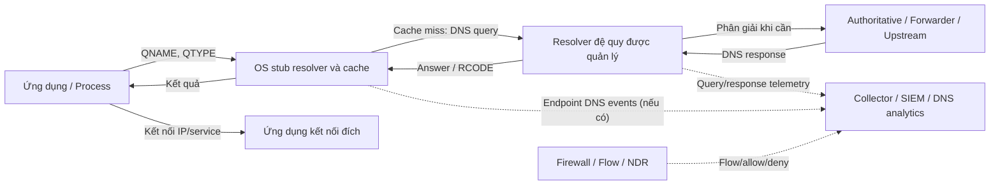
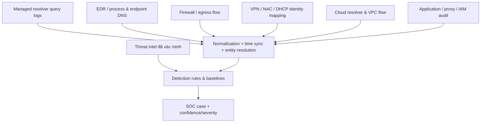

# Monitoring DNS query bất thường

> **Học phần:** `SECURITY_NETWORK_SECURITY`  
> **Chương:** DNS security  
> **Trọng tâm:** Thu thập, chuẩn hóa, phân tích và điều tra truy vấn DNS bất thường nhằm phát hiện dấu hiệu liên lạc nguy hiểm, sai lệch chính sách hoặc sự cố vận hành; kết hợp giám sát DNS với firewall, VPN, NAC/Wi-Fi, IDS/IPS, phân đoạn, ứng dụng và hạ tầng đám mây.

## Mục tiêu học tập

Sau bài này, người học có thể:

1. Mô tả vòng đời một DNS query, những điểm quan sát được và những khoảng mù do cache, resolver riêng, mã hóa DNS, NAT hoặc thay đổi topology.
2. Phân biệt **sự kiện DNS bất thường** với **bằng chứng xâm nhập**, tránh suy đoán chỉ từ tên miền lạ, NXDOMAIN hoặc TXT query.
3. Nhận diện các nhóm dấu hiệu thường được giám sát: tăng NXDOMAIN, subdomain bất thường, tên miền có cấu trúc giống DGA, tần suất/nhịp truy vấn lạ, DNS tunneling, thay đổi resolver và dấu hiệu lạm dụng DNS.
4. Thiết kế baseline theo **thiết bị, danh tính, zone, workload, loại truy vấn, khoảng thời gian** và mục đích nghiệp vụ.
5. Xây dựng rule thống kê có cửa sổ thời gian, ngưỡng tối thiểu, điều kiện correlation, đánh giá false positive và chỉ số kiểm chứng.
6. Điều tra từ DNS log sang firewall/flow, proxy, VPN/NAC, EDR, IDS/IPS, cloud và application audit.
7. Thiết kế cách phản ứng bảo vệ quyền riêng tư, có thẩm quyền và khả năng rollback khi chặn tên miền hoặc resolver.

## 1. Vì sao cần theo dõi DNS query bất thường?

**DNS (Domain Name System)** giúp ứng dụng tìm thông tin về tên miền, thường là địa chỉ IP để kết nối, nhưng cũng có các loại bản ghi phục vụ email, xác minh quyền, dịch vụ nội bộ và những chức năng khác. Vì hầu hết hệ thống phụ thuộc DNS, hoạt động truy vấn là nguồn **network telemetry** hữu ích để tìm dấu hiệu không phù hợp hành vi dự kiến.

Ví dụ:

- Một máy chủ database vốn chỉ sử dụng vài hostname nội bộ bỗng tạo nhiều truy vấn tới tên miền ngoài chưa từng gặp.
- Một endpoint phát sinh hàng trăm tên miền không tồn tại trong vài phút.
- Một thiết bị IoT gửi các truy vấn TXT với nhãn tên miền rất dài và thay đổi liên tục.
- Một máy trạm vẫn sử dụng resolver ngoài doanh nghiệp dù chính sách yêu cầu DNS qua resolver được quản lý.
- Một đợt triển khai phần mềm tạo lượng lớn truy vấn mới do service discovery hoặc cấu hình lỗi.

**Tất cả là tín hiệu cần kiểm chứng, không phải kết luận đã có mã độc.** DNS thường xuyên có thay đổi do CDN, telemetry, service discovery, phần mềm cập nhật, thử nghiệm, quảng cáo, ứng dụng di động hoặc thay đổi đường mạng.

### Vai trò trong kiến trúc phòng vệ mạng

Giám sát DNS giúp bổ sung bằng chứng cho:

- **Firewall/egress policy:** Đích mạng có xuất hiện trong danh sách cho phép hoặc blocklist có nguồn tin cậy không?
- **Segmentation:** Thiết bị ở guest, user, app, data hay management zone có sử dụng đúng resolver không?
- **VPN/NAC/Wi-Fi:** Địa chỉ IP client tại thời điểm truy vấn thuộc user/thiết bị/phiên nào?
- **IDS/IPS/NDR:** Truy vấn DNS có xảy ra cùng các kết nối hoặc alert đáng ngờ không?
- **Cloud/hybrid:** Workload đang sử dụng VPC resolver, private zone, DNS forwarding hay dịch vụ ngoài?
- **Incident response:** Có đường liên lạc, tải xuống hoặc xuất dữ liệu sau truy vấn không?

DNS là **một nguồn tín hiệu**, không tự phản ánh mọi kết nối hoặc thao tác ứng dụng. Một kết nối có thể sử dụng IP trực tiếp, dữ liệu DNS có sẵn trong cache, hoặc đi qua cơ chế phân giải khác.

## 2. Luồng phân giải DNS và nơi thu thập tín hiệu

Một luồng phổ biến:



Cần phân biệt:

- **Stub resolver:** thành phần ở máy trạm hoặc workload gửi yêu cầu tới resolver.
- **Recursive resolver:** tìm và cache câu trả lời thay client; có thể forward tới resolver khác.
- **Authoritative DNS server:** trả lời cho zone mà nó có thẩm quyền; không nhất thiết nhìn thấy client thực sau recursive resolver.
- **DNS cache:** làm giảm số query đi tới upstream; số query ở ứng dụng **không bằng** số query quan sát ở recursive upstream.
- **DNS forwarding/private DNS:** trong cloud và hybrid, đường đi có thể qua nhiều resolver và vùng tên khác nhau.

### Vị trí triển khai giám sát

| Điểm quan sát | Có thể biết | Khoảng mù hoặc hạn chế |
|---|---|---|
| **Managed recursive resolver** | Client truy vấn QNAME/QTYPE, response/RCODE, thời gian nếu logging hỗ trợ | Không thấy DNS từ resolver khác; có thể thiếu process/user |
| **Endpoint DNS telemetry/EDR** | Process/user, thời điểm, query từ host nếu agent hỗ trợ | Không bao phủ thiết bị không có agent; cache và cơ chế phân giải riêng |
| **Firewall/Network flow** | Client → resolver hoặc kênh DNS theo IP/port; bytes/tần suất | Không luôn thấy QNAME, đặc biệt khi mã hóa |
| **Passive DNS/NDR sensor** | Query/response DNS plaintext trên đường quan sát | Không thấy DNS mã hóa; SPAN/tap có thể mất gói |
| **Authoritative DNS logs** | Truy vấn đi tới zone của tổ chức, nguồn resolver hoặc client theo kiến trúc | Không tự cho biết user nội bộ; QNAME minimization có thể giảm thông tin |
| **Cloud resolver query logs** | Truy vấn của workload/VPC theo dịch vụ hỗ trợ | Phạm vi, độ trễ, field, giới hạn và chi phí phụ thuộc provider |
| **DNS proxy/security gateway** | Tên miền, category, quyết định policy, identity khi có | Chỉ traffic đi qua chính gateway |
| **Application/service logs** | Hostname mà dịch vụ thực sự yêu cầu, outcome, trace ID | Không bao phủ mọi DNS và phụ thuộc instrument của ứng dụng |

**Nguyên tắc chọn sensor:** Thu thập ở vị trí có thể xác định được **principal hoặc workload**, đồng thời xem được kết quả giải tên khi phù hợp. Quan sát ở nhiều vị trí giúp xác minh, nhưng cần chống đếm trùng cùng một truy vấn đi qua nhiều resolver.

## 3. Một bản ghi DNS telemetry nên có những gì?

Để phân tích thống kê và điều tra, nên chuẩn hóa ít nhất:

| Trường | Ý nghĩa | Lưu ý |
|---|---|---|
| `event_time` | Thời gian truy vấn và múi giờ | Đồng bộ NTP, độ trễ ingestion; không gộp nhầm các cửa sổ |
| `sensor_id` / `resolver_id` | Nguồn log | Cần biết topology và phạm vi quan sát |
| `src_ip` / `src_port` | Địa chỉ client theo góc nhìn sensor | NAT/proxy/forwarder có thể che client thật |
| `client_identity` / `device_id` | User, device, workload nếu có | Phải lấy từ nguồn xác thực, không suy từ IP hiện tại |
| `source_zone` | Guest, user, app, data, VPN, cloud... | Liên hệ mức mong đợi và policy |
| `qname` | Tên miền được hỏi | Cần chuẩn hóa thận trọng; có thể chứa thông tin cá nhân |
| `qtype` / `qclass` | A, AAAA, TXT, MX, SRV, PTR... | Type hiếm không tự là độc hại |
| `rcode` | NOERROR, NXDOMAIN, SERVFAIL... | RCODE không phản ánh đầy đủ nguyên nhân |
| `answer` / `answer_count` | Câu trả lời nếu được log | Có thể thiếu do policy, cache, response size |
| `ttl` | TTL ở response khi có | Cần biết là TTL gốc hay TTL còn lại trong cache |
| `latency_ms` | Thời gian trả lời | Phụ thuộc sensor và cache; hữu ích cho phát hiện sự cố |
| `transport` | UDP/TCP/DoT/DoH/DoQ khi xác định được | Không mặc định port 443 nghĩa là DoH |
| `policy_action` | Allow/Block/Sinkhole/Monitor nếu có | Phân biệt policy filtering và DNS response gốc |
| `query_id`/`request_id` | Khóa correlation nếu hệ thống hỗ trợ | Tránh dựa vào một ID không duy nhất giữa các sensor |

Ví dụ một sự kiện **mô phỏng**, không chứa IOC thật:

```json
{
  "event_time": "2026-11-28T08:30:12Z",
  "sensor_id": "dns-rec-01",
  "src_ip": "10.20.30.15",
  "client_identity": "device:workstation-demo-15",
  "source_zone": "USER",
  "qname": "test-label.example.test",
  "qtype": "A",
  "rcode": "NXDOMAIN",
  "response_count": 0,
  "resolver_id": "dns-rec-01",
  "transport": "udp",
  "policy_action": "allow",
  "correlation_id": "dns-event-demo-013"
}
```

`example.test` được dùng như tên miền minh họa. Trong dữ liệu thật, một số trường có thể không sẵn có; **không tự suy diễn client identity, process hay policy action nếu sensor không cung cấp**.

### Phân biệt `NXDOMAIN`, `NOERROR/NODATA` và `SERVFAIL`

- **NXDOMAIN:** tên miền được hỏi không tồn tại theo kết quả giải quyết của DNS. Không nhất thiết là do truy vấn độc hại.
- **NOERROR với câu trả lời rỗng/NODATA:** tên tồn tại nhưng không có record thuộc QTYPE được hỏi hoặc trường hợp tương đương. Không nên tính nhầm là NXDOMAIN.
- **SERVFAIL:** resolver không hoàn thành giải quyết; có thể do vấn đề upstream, DNSSEC validation, timeout hay lỗi khác.
- **REFUSED:** server từ chối xử lý truy vấn theo chính sách hoặc cấu hình, không phải tên không tồn tại.

Một hệ thống lọc DNS có thể thay đổi cách phản hồi (ví dụ REFUSED, NXDOMAIN, sinkhole hoặc response khác). Khi phân tích, cần biết **RCODE từ authoritative/upstream hay từ security policy**; tỷ lệ NXDOMAIN do block policy có thể tạo tín hiệu khác với lỗi tên thực.

## 4. Chuẩn hóa dữ liệu trước khi phát hiện bất thường

Chất lượng detection phụ thuộc mạnh vào việc xử lý dữ liệu đầu vào. Các quyết định chuẩn hóa nên được lưu trong **schema/pipeline version**.

### 4.1 Chuẩn hóa FQDN

- Lưu **raw QNAME** khi được phép để điều tra; song song tạo dạng chuẩn hóa.
- Thường có thể lower-case tên miền DNS khi phân tích vì tên miền không phân biệt hoa/thường theo quy tắc DNS thông thường. Không tự thay đổi dữ liệu nhị phân của loại record không phải tên miền.
- Hiểu dấu chấm kết thúc ở tên miền tuyệt đối; `example.test.` thường tương đương `example.test` trong phân tích tên.
- Xử lý IDN/Punycode nhất quán theo thư viện và tiêu chuẩn được lựa chọn; không dùng biểu diễn hiển thị của Unicode làm khóa duy nhất.
- Tách label, FQDN, registered domain và public suffix cho mục tiêu thống kê.
- Với `CNAME`, phân biệt **tên được hỏi** và **chuỗi tên/đích được trả lời**; không tự gộp chúng thành một.

**Registered domain/eTLD+1:** Nếu cần nhóm theo domain đăng ký, dùng dữ liệu **Public Suffix List** hoặc logic tương đương được cập nhật phù hợp. Cách lấy **hai label cuối** không chính xác với nhiều public suffix đa cấp hoặc private suffix. Với zone nội bộ, có thể cần quy tắc namespace riêng.

### 4.2 Chuẩn hóa danh tính nguồn

- Một IP client có thể thay đổi theo DHCP/VPN lease hoặc được dùng chung qua NAT/CGNAT.
- Một container/pod có thể đổi IP sau rollout, trong khi workload identity ổn định.
- Log tại resolver upstream có thể chỉ thấy IP của DNS forwarder, không thấy máy trạm.
- Một thiết bị có nhiều interface và có thể đổi mạng giữa Wi-Fi, LAN và VPN.

Giữ **thời gian sự kiện + source IP + sensor path**, rồi nối với bản ghi NAC/DHCP/VPN/EDR/cloud tại **thời điểm tương ứng**. Không dùng mapping IP hiện tại để suy ngược user từ sự kiện nhiều ngày trước.

### 4.3 Dedupe và mất mẫu

Cùng truy vấn có thể được ghi ở endpoint, resolver và NDR; resolver cũng có thể retry upstream. Đếm tất cả bản ghi như request độc lập có thể làm tăng giả tạo tỷ lệ. Ngược lại, sampling, mất packet, log bị rate-limit hoặc cache làm giảm độ phủ.

Định nghĩa rõ **đơn vị đếm**: query mà managed resolver nhận từ client, query upstream, request ứng dụng hay unique QNAME trong một window. Mọi dashboard và rule phải dùng đơn vị thống nhất.

## 5. Những nhóm bất thường DNS đáng theo dõi

Một dấu hiệu đơn lẻ không nên kích hoạt kết luận “máy bị chiếm”. Các loại sau là **giả thuyết điều tra** cần kết hợp bối cảnh.

| Loại tín hiệu | Biểu hiện | Giả thuyết cần kiểm tra | Nguyên nhân hợp lệ dễ nhầm |
|---|---|---|---|
| **NXDOMAIN burst** | Nhiều query nhận NXDOMAIN trong cửa sổ ngắn | DGA, lỗi DNS, tên miền tạo tự động | Search suffix sai, service discovery, typo, app bug |
| **Nhiều subdomain duy nhất** | Một client hỏi nhiều label khác nhau dưới một domain | DNS tunneling, tracking, query-generated labels | CDN cache-busting, telemetry, anti-bot, email validation |
| **Tên có độ dài/entropy cao** | Label dài, chữ/số biến động, ít giống từ ngữ | DGA/tunneling hoặc token hóa trong QNAME | UUID, build hash, tracking identifier, SRV/service labels |
| **QTYPE bất thường** | TXT, NULL hoặc loại record ít gặp tăng bất thường | Dữ liệu được đóng gói trong DNS, cấu hình app khác thường | SPF/DKIM/verification, service discovery, DNSSEC-related |
| **Tần suất đều đặn hoặc theo đợt** | Query lặp nhịp lạ, burst sau khoảng im lặng | Beaconing/automation | Health check, agent, NTP-like scheduling, polling |
| **Domain mới với client** | Domain chưa từng được client/workload hỏi | Thay đổi công việc, liên lạc không dự kiến | Deploy, SaaS mới, update hoặc hoạt động người dùng |
| **DNS response bất thường** | Nhiều SERVFAIL, timeout, TTL thấp | Lỗi resolver, đổi hạ tầng hoặc cấu hình | Sự cố upstream, DNSSEC issue, CDN thay đổi |
| **Resolver ngoài policy** | Client hỏi resolver không được duyệt | Vượt DNS filtering hoặc cấu hình sai | VPN split DNS, BYOD, app có resolver riêng |
| **Truy vấn từ zone không mong đợi** | Database/control plane hỏi domain công khai hiếm gặp | Workload bị lạm dụng hoặc mất chuẩn egress | Cập nhật/thay đổi dependency đã được phê duyệt |
| **DNS amplification/reflection symptom** | Lượng traffic DNS response lớn hoặc mất cân xứng trên link | Lạm dụng dịch vụ DNS, traffic volumetric | Zone transfer hợp lệ, traffic peak, hệ resolver lớn |
| **CNAME/answer biến đổi liên tục** | Đích trả lời thay đổi nhanh | Hạ tầng biến động, fast-flux-like signal | CDN, global load balancing, multi-region SaaS |

**Rủi ro của rule “bất cứ TXT query nào cũng high severity”:** nhiều hệ thống mail xác minh SPF/DKIM, domain ownership và cấu hình dịch vụ bằng TXT. QTYPE chỉ là **đặc tính**, không phải kết quả phân loại mã độc.

## 6. Phát hiện dấu hiệu tên miền được tạo tự động (DGA-like)

**Domain Generation Algorithm (DGA)** là một cách tạo tên miền theo thuật toán; trong giám sát, một số chiến dịch có thể biểu hiện qua nhiều tên miền có cấu trúc khó đọc và nhiều phản hồi không tồn tại. Nhưng các ứng dụng hợp lệ cũng tạo hostname với mã/hash hoặc nhãn ngẫu nhiên.

### Tín hiệu có thể kết hợp

- **Tỷ lệ NXDOMAIN** của cùng client tăng so với baseline.
- Số **registered domain** mới hoặc số **QNAME duy nhất** tăng nhanh.
- Phân bố độ dài label, tỷ lệ ký tự chữ/số và entropy có thay đổi.
- Một nhóm client có mẫu tạo tên giống nhau vào các thời điểm gần nhau.
- Hành vi DNS liên hệ với process, domain reputation đã kiểm chứng hoặc kết nối network bất thường.
- Tên miền xuất hiện ngoài dependency của workload, đặc biệt khi nguồn thuộc zone nhạy cảm.

### Vì sao entropy không đủ?

**Shannon entropy** đo độ bất định phân bố ký tự của chuỗi:

\[
H(X)=-\sum_i p_i\log_2 p_i
\]

Trong thực tế, entropy cao có thể xuất hiện trong GUID, mã định danh, cache key, token tracking hoặc các dịch vụ legitimate dùng hostname biến động. Ngược lại, tên miền độc hại có thể dùng từ điển tự nhiên để không có entropy cao.

**Không áp entropy lên toàn bộ FQDN rồi kết luận.** Cần biết label được xét (ví dụ leftmost label), kích thước mẫu, ngôn ngữ, loại domain và mô hình ứng dụng. Kết quả nên là một tín hiệu kết hợp, không phải bằng chứng khẳng định.

### Lập profile theo vai trò

Một laptop người dùng có thể hỏi nhiều website khác nhau; một workload billing chỉ nên cần một số dependency được phê duyệt. Threshold “100 domain mới/giờ” có thể vô nghĩa nếu không phân biệt **user browsing** và **fixed-function server**.

## 7. Nhận biết dấu hiệu DNS tunneling và truyền dữ liệu qua DNS

**DNS tunneling** về mặt khái niệm là việc đưa dữ liệu/trao đổi ứng dụng vào cấu trúc truy vấn và câu trả lời DNS, làm DNS trở thành kênh truyền không đúng mục đích phân giải tên. Trong bối cảnh bảo mật, nó có thể được dùng cho liên lạc không được phê duyệt hoặc rò rỉ dữ liệu; một số sản phẩm kỹ thuật có thể sử dụng DNS khác thường vì mục đích hợp lệ.

**Dấu hiệu cần phân tích kết hợp:**

1. Nhiều **subdomain duy nhất** dưới cùng một registered domain, thay đổi nhanh, ít query lặp.
2. Label dài và có tính biến động cao; có thể kèm entropy cao.
3. Truy vấn phát sinh với chu kỳ hoặc burst khác baseline của client/zone.
4. Phân bố QTYPE, độ dài request/response, số lượng answer khác đáng kể với máy tương tự.
5. Lượng DNS traffic/bytes ra ngoài tăng dù các ứng dụng không có dependency DNS như vậy.
6. Một miền được truy vấn lâu dài nhưng thiếu tương quan với kết nối ứng dụng bình thường theo mô hình nghiệp vụ.
7. Endpoint/process telemetry cho biết ứng dụng không có lý do tương ứng để tạo lượng truy vấn đó.

**Giới hạn quan trọng:**

- DNS tunneling **không bắt buộc** dùng TXT; các loại record khác nhau có thể xuất hiện.
- TXT records có mặt trong nhiều luồng hợp lệ; dùng TXT ≠ tunneling.
- Payload có entropy cao có thể do legitimate telemetry/tracking.
- Chỉ số bytes từ flow DNS không tự chứng minh lượng dữ liệu bí mật được truyền.
- Resolver cache, DNS query minimization và mã hóa DNS làm số liệu từng điểm khác nhau.
- Kết luận exfiltration cần bằng chứng về **nguồn dữ liệu, kênh, đích và nội dung/tác động** theo phạm vi điều tra được phép.

### Một ví dụ kiểm thử mang tính mô tả

Giả định workstation `10.20.30.15` gửi nhiều truy vấn có label dạng `abc001.measure.example.test`, `abc002.measure.example.test`... trong một phút. Điều này có thể là:

- SDK tạo request mã kiểm tra;
- ứng dụng thử nghiệm tạo nhiều hostname;
- một hoạt động sử dụng DNS làm kênh dữ liệu ngoài mục đích.

**Cách phân biệt:** xác định process và owner, xem domain/service có được phê duyệt, kiểm tra cấu trúc truy vấn theo thời gian, so sánh nhóm máy tương tự, đối chiếu route/egress và application telemetry. Không chỉ dựa vào nhãn “random-looking”.

## 8. NXDOMAIN, SERVFAIL và các sai lệch về khả năng phục vụ

Nhiều NXDOMAIN không nhất thiết là hoạt động tấn công. Đó cũng có thể là **sự cố vận hành** có tác động rộng.

### Các nguyên nhân hợp lệ thường gặp

- DNS search suffix được nối sai tên, dẫn tới nhiều tên không tồn tại.
- Service discovery hỏi hostname pod/service vừa thay thế hoặc chưa đăng ký.
- Ứng dụng retry không có giới hạn khi cấu hình endpoint sai.
- Một doanh nghiệp đổi domain hoặc DNS forwarding làm resolver chưa đồng bộ.
- Trình duyệt/ứng dụng dùng prefetch, telemetry hoặc tên truy vấn độc lập.
- DNS filtering trả NXDOMAIN cho domain bị chặn theo policy, làm tăng thống kê NXDOMAIN.

**SERVFAIL tăng** có thể liên quan upstream timeout, loop forwarding, lỗi DNSSEC validation, network degradation hoặc resolver bão hòa. Vì vậy một dashboard DNS security nên có **nhánh triage sự cố dịch vụ**, không đẩy mọi đợt SERVFAIL thành incident C2.

### Phân tích đúng đơn vị

Nên theo dõi đồng thời:

- Số query tổng;
- Số và tỷ lệ RCODE;
- Số client/source zone bị ảnh hưởng;
- Số registered domain và unique QNAME;
- Thay đổi latency;
- Số query bị policy deny/sinkhole;
- Sự thay đổi gần thời điểm deploy, thay đổi DNS rule hoặc network policy.

Một tỷ lệ NXDOMAIN 50% trên 2 truy vấn **không đáng so sánh** trực tiếp với 50% trên 100.000 truy vấn. Luôn đi kèm **mẫu số và ngưỡng số lượng tối thiểu**.

## 9. Baseline: “bất thường so với cái gì?”

Detection tốt cần mô tả **hành vi mong đợi theo bối cảnh**, thay vì một ngưỡng cho toàn bộ tổ chức.

### Phân nhóm baseline

| Chiều phân nhóm | Ví dụ | Vì sao cần |
|---|---|---|
| **Security zone** | Guest, user, app, data, management | Nhu cầu DNS và rủi ro khác nhau |
| **Loại thiết bị** | Laptop, IoT, server, domain controller, pod | Đặc trưng QTYPE và số domain khác nhau |
| **Workload/service** | Billing API, web proxy, CI runner | Dependency cố định hoặc biến động |
| **Principal** | User, tenant, service account | Giúp tìm hành vi ngoài nhu cầu đã được cấp |
| **Khoảng thời gian** | Giờ làm, batch ban đêm, cuối tuần | Tránh nhầm lịch hoạt động |
| **Vùng địa lý/network** | Văn phòng, VPN, cloud region | Cache/resolver/traffic khác |
| **QTYPE và RCODE** | A/AAAA/TXT/SRV/PTR; NOERROR/NXDOMAIN/SERVFAIL | Phân biệt loại sử dụng |
| **Đường resolver** | Corporate resolver, forwarder, DoT gateway | Số query nhìn thấy và độ phủ khác nhau |

**Cold start:** Một máy mới chưa có lịch sử không nên tự bị xem là tấn công. Có thể dùng baseline theo nhóm tài sản tương đồng, policy dependency hoặc chế độ monitor trước khi quyết định.

**Concept drift:** Phần mềm mới, chuyển cloud region, mở SaaS, thay CDN hoặc tăng quy mô làm hành vi hợp lệ thay đổi. Duy trì baseline có kiểm soát và khả năng so sánh trước–sau, không để dữ liệu bị tấn công tự động “đào tạo lại” thành hành vi bình thường.

### Độ dài cửa sổ

- **1–5 phút:** phát hiện burst nhanh nhưng nhạy với dao động và số lượng nhỏ.
- **15–60 phút:** phù hợp nhiều phép đo thống kê, tương quan deployment.
- **Theo ngày/tuần:** nhận biết trend, domain mới, workload drift và resolver policy violations.

Đây chỉ là **khoảng minh họa**; cửa sổ phải phù hợp độ trễ log và nhịp hoạt động của hệ thống.

## 10. Chỉ số và công thức hữu ích

### 10.1 NXDOMAIN ratio

\[
NXRatio=\frac{N_{NXDOMAIN}}{N_{all\ queries}}
\]

Dùng cùng điều kiện lọc: cùng client/workload, sensor, thời gian và phạm vi policy. Không trộn query từ endpoint với upstream retry của resolver.

**Ví dụ:** Trong 10 phút, workstation gửi 200 query qua resolver quản lý, trong đó 80 nhận NXDOMAIN:

\[
NXRatio=\frac{80}{200}=0.4=40\%
\]

Nếu baseline cùng nhóm là khoảng 2–8%, đây là biến động nên điều tra, **không phải bằng chứng DGA**. Cần kiểm tra số domain, search suffix, ứng dụng mới, deny policy và process.

### 10.2 Unique QNAME ratio

\[
UniqueRatio=\frac{N_{distinct\ QNAME}}{N_{all\ queries}}
\]

Tỷ lệ rất cao có thể xuất hiện khi nhiều tên khác nhau được tạo và ít được hỏi lại. Tuy nhiên user browsing, CDN, service discovery và tracking SDK cũng có thể có giá trị cao. Nên kết hợp **nhóm theo registered domain, QTYPE và client role**.

### 10.3 Tỷ lệ subdomain duy nhất theo registered domain

Với client `c` và registered domain `d` trong một cửa sổ:

\[
U(c,d)=|\{\text{QNAME khác nhau dưới } d\}|
\]

Nếu `U(c,d)` tăng mạnh so với baseline và kèm NXDOMAIN, label dài, quá trình không rõ chủ sở hữu, giả thuyết tunneling/DGA cần được kiểm tra. Tránh áp `U` mà không giới hạn số query tối thiểu.

### 10.4 Query volume và nhịp thời gian

Đo:

- queries/minute theo client và zone;
- số registered domain mới / giờ;
- phân vị độ dài QNAME và leftmost label;
- p95/p99 DNS latency;
- tỷ lệ SERVFAIL/REFUSED/policy blocked;
- tỷ lệ truy vấn tới resolver được quản lý so với luồng DNS ngoài policy;
- số client cùng hỏi một domain hiếm trong cùng cửa sổ.

Không dùng “tên miền mới thấy lần đầu” như chỉ dấu xấu duy nhất. Một triển khai phần mềm hợp lệ có thể đồng loạt bắt đầu truy vấn tên mới.

### 10.5 Mô hình điểm để xếp hàng triage

Ví dụ **không mang tính tiêu chuẩn**, tính điểm 0–5 theo bốn đặc trưng đã chuẩn hóa:

- `V`: mức bất thường về volume/rate;
- `N`: biến động NXDOMAIN và domain uniqueness;
- `A`: độ lệch khỏi dependency/asset role;
- `E`: evidence correlation (process, egress, IDS/EDR, DNS policy).

\[
Score=0.20V+0.20N+0.25A+0.35E
\]

Ví dụ `V=4, N=3, A=5, E=2`:

\[
Score=0.8+0.6+1.25+0.7=3.35
\]

Đây là điểm **hỗ trợ ưu tiên điều tra**, không phải ước lượng chính xác xác suất mã độc. Một bằng chứng xác nhận truy cập trái phép dữ liệu hoặc thay đổi đặc quyền có thể nâng incident severity theo chính sách dù score thấp. Ngưỡng cần được hiệu chỉnh từ tập sự kiện có nhãn, phân biệt confidence và impact.

## 11. Thiết kế rule phát hiện có cửa sổ thời gian

Một rule có thể tập trung vào **NXDOMAIN burst** với điều kiện số lượng và tỷ lệ cùng tăng. Mô tả policy học tập:

```yaml
ruleId: DNS-NXDOMAIN-ANOMALY-013
description: "NXDOMAIN burst trên managed resolver"
source:
  kind: managed-recursive-resolver
  unit: client-query
groupBy:
  - sensor_id
  - client_identity_or_stable_asset_id
window:
  length: 10m
criteria:
  minimumQueries: 100
  minimumNxdomainCount: 40
  minimumNxdomainRatio: 0.40
  compareToPeerBaseline: true
enrichment:
  - security_zone
  - asset_criticality
  - process_if_available
  - approved_dns_changes
response:
  initialAction: create_investigation_signal
  autoBlock: false
  retainEvidenceReferences: true
owner: security-detection-engineering
reviewCycle: monthly
```

**Lưu ý:** Đây là YAML **giả lập trung lập sản phẩm**, không phải rule nạp trực tiếp vào bất kỳ SIEM, Suricata hay resolver nào. Các ngưỡng là ví dụ để hiểu cách xây luật; không triển khai vào production trước khi kiểm chứng.

### Pseudocode tính toán

```text
for each trusted asset identity and 10-minute event-time window:
    events = eligible DNS client queries from managed resolver
    ignore duplicated records from multiple collectors
    total = count(events)
    nx = count(events where effective_rcode == NXDOMAIN)

    if total < minimumQueries:
        mark as insufficient sample
        continue

    ratio = nx / total

    if nx >= minimumNxdomainCount
       and ratio >= minimumNxdomainRatio
       and deviates_from_peer_or_own_baseline(asset, ratio):
        emit detection signal with:
          counts, ratio, window, asset, zone, sensor,
          baseline version, policy version, evidence references
        enrich with process/EDR/egress and known DNS changes
        do not assert compromise without corroboration
```

**Điểm quan trọng về streaming:**

- Sử dụng **event time**, định nghĩa xử lý sự kiện đến muộn và watermark khi nền tảng hỗ trợ.
- Bỏ trùng theo khóa sự kiện đáng tin; nếu không có ID, xây cơ chế gần đúng và ghi rõ sai số.
- Chọn mẫu số: query resolver thực nhận từ client, không phải số log event đã nhân đôi.
- Không ghi đè raw event khi thay đổi rule, schema hoặc baseline.
- Không tự chặn client vì một rule thống kê có khả năng false positive cao.

### Ví dụ đếm cụ thể

Trong cùng cửa sổ 10 phút:

| Asset | Tổng query | NXDOMAIN | Tỷ lệ NXDOMAIN | Kết luận theo rule ví dụ |
|---|---:|---:|---:|---|
| `ws-demo-01` | 200 | 80 | 40% | Đạt số lượng/tỷ lệ, cần so baseline |
| `ws-demo-02` | 10 | 8 | 80% | Không đủ mẫu để kích hoạt |
| `api-demo-01` | 500 | 35 | 7% | Không vượt ngưỡng NXDOMAIN |
| `build-agent-01` | 150 | 60 | 40% | Cần xem baseline CI và job đang chạy |

Rule ví dụ vẫn yêu cầu **lệch baseline** trước khi phát signal; bảng chỉ thể hiện điều kiện sơ bộ. CI/build agent có thể tạo tên tạm hoặc kiểm tra DNS khi test và cần đánh giá theo profile riêng.

## 12. Một mô hình correlation nhiều tín hiệu

Việc giám sát chỉ từ DNS log dễ tạo cảnh báo yếu. Tương quan nhiều nguồn giúp đánh giá **có kết nối thực sự, process nào tạo query và có hành động sau đó không**.



### Tương quan theo trình tự

Giả định có ba sự kiện:

1. **08:30:** Workstation hỏi nhiều subdomain mới dưới `measure.example.test`; tỷ lệ NXDOMAIN tăng.
2. **08:31:** EDR ghi nhận một process chưa có trong inventory đã phát sinh các DNS query đó.
3. **08:32:** Firewall ghi lưu lượng ra một endpoint ngoài allowlist bị từ chối.

Những sự kiện có thể cùng một tình huống nhưng **chưa khẳng định** dữ liệu đã bị xuất ra hoặc process là mã độc. Tiếp tục kiểm tra:

- Process executable, chữ ký, parent process và owner;
- độ tin cậy của mapping device/IP tại từng thời điểm;
- domain có trong dependency phê duyệt hoặc phần mềm mới không;
- lưu lượng được firewall cho phép hay deny, số byte và đích;
- ứng dụng có lý do nghiệp vụ nào tạo pattern như vậy;
- asset có dữ liệu nhạy cảm hoặc quyền quản trị không.

**Alert severity** phụ thuộc bằng chứng và tác động. Một tín hiệu thống kê chỉ nên khởi tạo triage; bằng chứng được xác nhận về dữ liệu/đặc quyền mới hỗ trợ nâng cấp mức xử lý.

## 13. DNS mã hóa: DoT, DoH, DoQ và điểm mù giám sát

Các giao thức DNS mã hóa bảo vệ truy vấn trên một chặng đường truyền nhất định, nhưng cũng thay đổi **khả năng quan sát ở mạng**.

| Giao thức | Đặc điểm phổ biến | Hạn chế giám sát trên đường mạng |
|---|---|---|
| DNS truyền thống | UDP/TCP port 53 | QNAME thường có thể quan sát nếu thấy traffic plaintext |
| **DoT** | TLS trên TCP 853 phổ biến | Không xem QNAME chỉ từ packet capture bên ngoài TLS |
| **DoH** | DNS qua HTTPS, thường TCP hoặc QUIC 443 | Khó phân biệt chỉ từ port và payload HTTPS đã mã hóa |
| **DoQ** | DNS qua QUIC, thường UDP 853 | QNAME bị bảo vệ trong QUIC |
| DNS nội bộ qua VPN/tunnel | DNS được vận chuyển trong kênh riêng | Sensor ngoài tunnel có thể chỉ thấy vỏ kết nối |

**Không phải traffic TCP 443 nào cũng là DoH.** Hostname/SNI có thể không có, bị hạn chế hoặc thay đổi theo TLS/ECH; nhận diện bằng IP cố định có thể chặn nhầm dịch vụ khác trên cùng CDN.

### Bố trí kiểm soát phù hợp

1. **Quản lý resolver trên endpoint:** Đặt DNS của thiết bị được quản lý, ứng dụng và VPN theo chính sách; ngăn thay đổi trái phép khi hợp lý.
2. **Dùng managed DoH/DoT gateway:** Tổ chức vẫn có thể cung cấp DNS mã hóa nhưng ghi telemetry **ở resolver đích được quản lý** theo chính sách.
3. **Egress policy:** Giới hạn kết nối DNS trực tiếp tới resolver ngoài được phê duyệt; kết hợp firewall/proxy/identity, không chỉ dựa vào cổng.
4. **Endpoint telemetry:** Khi có thể, quan sát process yêu cầu phân giải, kể cả khi traffic mạng được mã hóa.
5. **Phân tích flow metadata:** Dùng volume/timing/đích ở mức phù hợp và minh bạch về giới hạn, không khẳng định nhìn thấy query nội dung nếu không có quyền giải mã.
6. **Privacy:** Chọn các trường cần thu, chỉ cho người có nhiệm vụ truy cập và thiết lập retention.

**Không nên coi việc mã hóa DNS tự thân là dấu hiệu tấn công.** DoH/DoT/DoQ có giá trị bảo vệ tính riêng tư và toàn vẹn kênh; vấn đề của tổ chức là **đường resolver nào được quản lý và giám sát**, chứ không phải loại bỏ mã hóa một cách máy móc.

## 14. DNSSEC, DNS filtering và vai trò khác với monitoring

Ba khái niệm hay bị gộp:

| Cơ chế | Câu hỏi giải quyết | Không thay thế được |
|---|---|---|
| **DNS monitoring** | Client hỏi gì, hành vi nào bất thường, bằng chứng gì cần điều tra? | Không tự bảo đảm câu trả lời đúng hoặc chặn mọi truy vấn |
| **DNSSEC validation** | Câu trả lời DNS có thể được xác thực nguồn gốc/tính toàn vẹn trong chuỗi tin cậy không? | Không mã hóa truy vấn hoặc mặc định phân loại domain độc hại |
| **DNS filtering/RPZ** | Domain/query nào bị chặn hoặc chuyển hướng theo policy? | Không phát hiện mọi hoạt động nguy hiểm và có false positive |
| **DoH/DoT/DoQ** | Bảo vệ truy vấn DNS trên chặng có mã hóa | Không tự phát hiện C2/exfil hoặc chứng minh tên miền đáng tin |
| **Firewall/segmentation** | Client/workload được phép liên hệ resolver hoặc đích nào? | Không luôn biết QNAME/loại hành động ứng dụng |

Một resolver có DNSSEC validation có thể tránh tin một số phản hồi bị giả mạo, nhưng **không ngăn** client truy vấn domain có hạ tầng hợp lệ nhưng phục vụ mục đích nguy hiểm. Để phát hiện và giảm rủi ro, cần kết hợp **DNS monitoring, reputation đã xác minh, endpoint protection, egress restriction và application authorization**.

### Sự khác nhau giữa NXDOMAIN và policy block

Nếu DNS filtering trả về NXDOMAIN giả lập cho tên bị cấm, dashboard cần ghi **policy_action=block** (nếu có) và phân biệt với NXDOMAIN thông thường. Nếu không, khi feed được cập nhật, tỷ lệ NXDOMAIN tăng có thể bị hiểu nhầm là DGA burst.

## 15. Tình huống DNS bất thường ở các security zone

| Zone | Baseline kỳ vọng | Dấu hiệu đáng xem | Phòng vệ liên quan |
|---|---|---|---|
| **User/workstation** | Nhiều domain công cộng và SaaS, thay đổi theo công việc | Domain hiếm + process lạ + hành vi egress ngoài policy | EDR, web proxy, DNS security |
| **Guest Wi-Fi** | Internet qua resolver được chỉ định, không vào mạng nội bộ | Truy vấn/resolver ngoài chính sách, hướng tới tên nội bộ | Guest isolation, DNS/egress firewall |
| **Application** | Dependency tương đối rõ, service discovery | Domain mới ngoài allowlist, nhiều subdomain độc nhất | Workload identity, service policy, logging |
| **Data/Database** | Ít DNS ngoài, chủ yếu service nội bộ nếu có | Tên miền công cộng không phục vụ nghiệp vụ | Egress default deny, DB audit |
| **Management** | IdP, update, monitoring, control plane được phê duyệt | Domain lạ từ bastion, resolver khác | MFA/PAM, identity policy, SIEM |
| **IoT/OT** | Controller/broker và update endpoint ổn định | Tần suất/QTYPE đột ngột khác profile | Segmentation, gateway, policy hẹp |
| **CI/CD runner** | Nhiều registry/package endpoint theo job | Tên tạm tăng tương ứng job; cần phân biệt sai cấu hình | Job identity, allowlist registry, trace build |
| **Cloud/Kubernetes** | Cluster DNS, service records, private zones | Search-path churn, NXDOMAIN trong rollout, pod đổi IP | CNI, CoreDNS/managed logs, VPC flow |

**Không dùng chung ngưỡng duy nhất cho tất cả zone.** Một máy build truy vấn nhiều subdomain có thể bình thường, nhưng một database tạo đúng mẫu đó có thể cần điều tra ưu tiên cao.

## 16. Vận hành trên cloud, Kubernetes và hybrid network

### Cloud DNS resolver

Managed cloud DNS có thể tích hợp query logging, private DNS zone, resolver forwarding, split-horizon và firewall policy. Khi bật giám sát:

- Xác định **tài nguyên nào phát query**, không chỉ tên resolver hoặc NAT.
- Kiểm tra độ phủ ở nhiều VPC/VNet, account/project, region và kết nối hybrid.
- Tách truy vấn cho **private zones** và public internet khi làm baseline.
- Định nghĩa chi phí, khối lượng log và thời hạn lưu; log DNS chi tiết có thể rất lớn.
- Đối chiếu VPC flow log với DNS: một DNS query không bảo đảm kết nối tới IP trả về đã xảy ra.
- Bảo vệ quyền quản trị query logging và feed blocklist; thay đổi cấu hình cần audit.

### Kubernetes/CoreDNS

Trong cluster, search domains và `ndots` ở pod resolver có thể tạo nhiều lần thử tên trước khi hỏi tên tuyệt đối; điều này đôi khi làm tăng NXDOMAIN mà **không phải DGA**. Ngoài ra:

- Pod có thể đổi IP/namespace/labels, cần correlation theo workload identity và timestamp.
- CoreDNS hoặc resolver theo node có thể cache/forward khiến log upstream không phản ánh đủ số truy vấn.
- **NodeLocal DNSCache** (nếu triển khai) có thể thay đổi đường quan sát.
- Service discovery truy vấn record `A`, `AAAA`, `SRV` và những tên nội bộ; ngưỡng domain-uniqueness cần profile riêng.
- Kubernetes NetworkPolicy không tự xử lý nội dung DNS; egress tới resolver và quyền truy cập tài nguyên là các lớp khác nhau.

Một đợt rollout có nhiều pod chưa sẵn sàng có thể tạo burst SERVFAIL/NXDOMAIN và timeout; cần xem **deploy timeline, CoreDNS metrics, readiness và service records** trước khi mở incident an ninh.

### Hybrid, VPN và split DNS

Người dùng VPN có thể sử dụng split DNS hoặc DNS theo route chính sách. Query tới tên nội bộ có thể đi qua một resolver, còn tên công cộng đi qua resolver khác. Khi điều tra, không mặc định tất cả query của user đều hiển thị ở resolver trung tâm; cần biết profile VPN, DNS search domains, chính sách DoH và egress thực.

## 17. Playbook điều tra DNS query bất thường

### Bước 1 — Xác minh alert và chất lượng dữ liệu

Xem nguồn, rule version, event-time window, tổng query, RCODE, QTYPE, số unique QNAME, baseline và ngưỡng. Kiểm tra:

- Sensor có online, mất gói hoặc ingestion lag không?
- Có thay đổi DNS logging, RPZ/blocklist hoặc resolver topology gần đây không?
- Cùng query có bị ghi trùng tại hai điểm không?
- Mẫu số đủ lớn và sensor có phân biệt client thật với forwarder không?

### Bước 2 — Xác định tài sản và nguồn truy vấn

Dùng asset inventory, DHCP/VPN lease, NAC, cloud workload identity và EDR đúng thời điểm để xác định client. Ghi owner, zone, môi trường, mức quan trọng và những dependency được cấp.

**Không tự quy IP thành user** khi không có bản ghi lease/identity phù hợp.

### Bước 3 — Phân loại mẫu bất thường

Hỏi: tăng NXDOMAIN, qname uniqueness, TXT usage, query length, tần suất, domain hiếm hay resolver violation? So sánh cùng nhóm thiết bị và thời gian. Kiểm tra có app deploy, CI job, DNS search suffix hoặc cập nhật bảo mật được phê duyệt không.

### Bước 4 — Tương quan nhiều nguồn

- **EDR:** Process nào tạo query, parent process, chữ ký, thay đổi gần đây?
- **Firewall/flow:** Có kết nối tới IP đích hoặc resolver ngoài policy không; ALLOW hay DENY?
- **Proxy/WAF:** Có URL/API requests liên quan; không lầm HTTP traffic với DNS query.
- **IDS/IPS/NDR:** Có alert khác trên cùng asset, sensor ở vị trí nào, action là gì?
- **Cloud/IAM:** Workload có thay đổi role, truy cập secret/storage hoặc resource policy không?
- **App/DB:** Có hành vi đọc/xuất dữ liệu ngoài quyền hoặc lỗi cấu hình nào không?

### Bước 5 — Đánh giá severity và confidence

Ghi riêng:

- **Severity:** nguy cơ/tác động với tổ chức nếu tình huống đúng;
- **Confidence:** mức tin cậy rằng mẫu thật sự biểu thị hành vi nghi ngờ;
- **Impact confirmed:** tác động đã có bằng chứng, không đồng nhất với khả năng.

Một máy lab có nhiều query NXDOMAIN nhưng thuộc job thử nghiệm có thể được đóng benign; một database production có query ngoài baseline và EDR process lạ cần điều tra ưu tiên cao hơn.

### Bước 6 — Quyết định phản ứng an toàn

Theo quyền hạn và playbook:

- Áp block domain hoặc chuyển DNS policy theo **phạm vi hẹp, có owner**, sau khi xác minh đối tượng; tránh chặn IP CDN dùng chung quá rộng.
- Cô lập endpoint hoặc thu hồi token **chỉ khi có căn cứ phù hợp và thẩm quyền**, cân nhắc gián đoạn dịch vụ.
- Kiểm tra/tạm giới hạn egress từ zone nhạy cảm nếu có đường không cần thiết.
- Khắc phục cấu hình DNS hoặc search suffix nếu nguyên nhân là lỗi vận hành.
- Giữ log/evidence tham chiếu, ghi change ticket và phương án rollback.
- Giám sát false positive, ảnh hưởng người dùng hợp lệ và những đường resolver khác.

### Bước 7 — Kết thúc và cải thiện

Báo kết luận theo bằng chứng: benign, misconfiguration, suspicious-unconfirmed hoặc incident confirmed; lưu lý do và owner. Cập nhật baseline/rule test, đóng exception hết hạn và không xóa raw event chỉ vì case đã được deduplicate.

## 18. False positive: những mẫu dễ bị hiểu sai

| Mẫu cảnh báo | Nguyên nhân hợp lệ có thể | Cách phân biệt |
|---|---|---|
| **Nhiều NXDOMAIN** | Search suffix/`ndots`, service discovery lỗi | DNS config, CoreDNS/app logs, rollout |
| **Nhiều subdomain duy nhất** | CDN/telemetry/tracking, anti-bot | Domain owner, process, app dependency |
| **Label dài/entropy cao** | UUID, object ID, token tracking hoặc service routing | Format do app tạo, ý nghĩa business, process |
| **TXT query tăng** | SPF/DKIM, domain verification, service metadata | QTYPE baseline và workflow mail/SaaS |
| **Query lặp định kỳ** | Agent monitoring, health check, scheduled batch | Lịch task, owner, đồng bộ với job |
| **Domain mới trên nhiều máy** | Triển khai phần mềm hoặc policy mới | Change ticket, software inventory |
| **SERVFAIL/NXDOMAIN hàng loạt** | Lỗi upstream/DNSSEC/forwarder hoặc RPZ | Health resolver, rcode split, provider incident |
| **DoH traffic được nhận diện** | Trình duyệt/endpoint bảo vệ privacy theo cấu hình | Chính sách thiết bị/resolver, danh tính sản phẩm |

**Tuning tốt không phải tắt toàn bộ rule.** Có thể thêm allowlist/suppression **có thời hạn, chủ sở hữu, phạm vi client/process/domain**, sau khi xác nhận đúng hoạt động; vẫn giữ raw log và tín hiệu khác nếu activity vượt ngoài phạm vi.

### False negative và khoảng mù

Bị bỏ sót khi:

- client dùng DNS mã hóa ngoài resolver quan sát;
- có DNS cache hoặc file hosts, kết nối trực tiếp IP;
- sensor thiếu một VPC/region/VPN path;
- packet/flow log bị sampling, lost, delayed hoặc tắt;
- rule chỉ nhìn một QTYPE, một window hoặc một domain pattern;
- hoạt động nguy hiểm có lượng DNS thấp và giống hành vi bình thường.

Vì vậy monitoring DNS nên được xem là **phát hiện dựa trên bằng chứng khả kiến**, không phải cam kết phát hiện mọi loại C2/exfil.

## 19. Tình huống thực hành: hai nhánh từ cùng tín hiệu DNS

**Bối cảnh giả lập:** Máy trạm `ws-demo-15` thuộc user zone. Trong 10 phút, resolver ghi:

- 200 DNS client queries;
- 80 NXDOMAIN (40%);
- 125 unique QNAME;
- nhiều tên khác nhau dưới `measure.example.test`;
- một số record `TXT`, nhưng không phải đa số.

Sensor tạo signal `DNS-NXDOMAIN-ANOMALY-013`.

### Phân tích ban đầu

- **Signal hợp lệ về thống kê:** mẫu số đủ theo rule ví dụ, NXDOMAIN ratio vượt ngưỡng.
- **Chưa đủ kết luận:** chỉ biết query pattern và vài đặc điểm của hostname.
- **Cần làm giàu:** process, owner, chức năng ứng dụng, resolver route, egress flow, phần mềm mới cài và những asset có cùng pattern.

### Nhánh A — Cấu hình/SDK hợp lệ

EDR và change ticket cho thấy SDK kiểm thử được cài đúng lịch; nhóm phát triển xác nhận nó tạo hostname khác nhau để kiểm tra cơ chế DNS và bị cấu hình sai search suffix. Không có hành động trái quyền hoặc kết nối tới đích không được duyệt.

**Kết luận:** Sự kiện có thể là **misconfiguration/benign**, đồng thời vẫn có vấn đề chất lượng DNS/telemetry cần sửa. Giới hạn suppression đúng scope lab/test, theo dõi khi phần mềm đổi phiên bản.

### Nhánh B — Nghi ngờ cần điều tra sâu

EDR ghi process không nằm trong inventory; cùng thời điểm có outbound tới endpoint không thuộc dependency được duyệt, còn firewall log cho biết một số kết nối được cho phép. Chủ tài sản không xác nhận thay đổi, và app audit cho thấy truy cập dữ liệu khác thường.

**Kết luận:** Có cơ sở nâng **ưu tiên điều tra**, bảo toàn bằng chứng và kích hoạt quy trình phản ứng phù hợp. Không được tuyên bố **exfiltration đã thành công** cho tới khi kiểm tra nguồn dữ liệu, kênh liên lạc, lượng dữ liệu và hành động thực tế.

### Ma trận kết quả cần ghi

| Tiêu chí | Nhánh A | Nhánh B |
|---|---|---|
| Tỷ lệ NXDOMAIN | 40% | 40% |
| Process/owner | Được xác minh qua ticket | Chưa xác minh |
| Dependency/role | Thuộc workflow thử nghiệm | Ngoài profile của máy |
| Egress | Không có đường trái phép được xác nhận | Có lưu lượng ngoài profile |
| Cần điều tra dữ liệu | Theo phạm vi lỗi cấu hình | Có, dựa trên audit |
| Kết luận | Có bằng chứng benign | Suspicious; cần thêm chứng cứ |

**Bài học:** Cùng một giá trị thống kê không đủ xác định severity, nguyên nhân hay tác động. **Identity, role và bằng chứng correlation** giúp phân biệt.

## 20. Kiểm thử monitoring an toàn với dữ liệu tổng hợp

Không cần tạo DNS tunneling thật hoặc gửi truy vấn đến hệ thống bên ngoài để kiểm thử chính sách. Dùng **log nhân tạo, unit tests và replay trong pipeline cô lập** để xác minh logic cửa sổ, ngưỡng và phân loại.

### Dữ liệu mô phỏng đầu vào

```csv
event_time,asset,qname,qtype,rcode,zone
2026-11-28T08:30:00Z,ws-demo-01,app.example.test,A,NOERROR,USER
2026-11-28T08:30:01Z,ws-demo-01,notfound-01.example.test,A,NXDOMAIN,USER
2026-11-28T08:30:02Z,ws-demo-01,notfound-02.example.test,AAAA,NXDOMAIN,USER
2026-11-28T08:30:03Z,build-demo-01,job-01.build.example.test,A,NXDOMAIN,CI
2026-11-28T08:30:04Z,db-demo-01,db.internal.example.test,A,NOERROR,DATA
```

Đoạn CSV nhỏ này dùng để kiểm tra **schema và phép đếm**, không đủ số lượng để kích hoạt rule `minimumQueries: 100`. Một test ngưỡng thật phải sinh dữ liệu **trong bộ nhớ** với số lượng chính xác và biết trước kết quả.

### Kiểm thử hành vi Gherkin

```gherkin
Feature: Detect unusual DNS queries without conflating anomalies and incidents

  Scenario: High NXDOMAIN ratio with enough events creates a signal
    Given a managed resolver recorded 200 client queries for one asset in 10 minutes
    And 80 of these queries received NXDOMAIN
    And the asset deviates from its verified peer baseline
    When the DNS anomaly rule runs
    Then it emits an investigation signal with a 40 percent NXDOMAIN ratio
    And the raw event references and rule version are preserved
    And it does not assert confirmed compromise

  Scenario: Small samples do not trigger the same signal
    Given a client made only 10 queries in 10 minutes
    And 8 queries received NXDOMAIN
    When the DNS anomaly rule runs
    Then it records insufficient sample for this threshold
    And it does not generate an incident based solely on the ratio

  Scenario: A managed block policy is not silently counted as organic NXDOMAIN
    Given the resolver synthesizes NXDOMAIN for a blocked domain
    And the policy action is known as block
    When the pipeline computes organic NXDOMAIN anomalies
    Then the policy-blocked queries are classified separately
    And the rule documents its denominator and exclusions

  Scenario: Duplicate sensor records are not double-counted
    Given one client query is recorded by two authorized collectors
    And the events carry a trusted shared correlation key
    When the aggregation deduplicates client queries
    Then the query contributes once to client query statistics
    And both raw evidence records remain available

  Scenario: Unknown identity does not become a verified endpoint
    Given an upstream resolver log contains only a forwarding resolver IP
    When the case is enriched
    Then the client identity remains unresolved without trusted mapping
    And no specific user is accused from that IP alone

  Scenario: Legitimate deployment explains a query burst
    Given a signed and approved deployment creates new service DNS names
    And the asset owner confirms the affected workload and time window
    When analysts review the alert
    Then they may classify the case as benign configuration activity
    And any suppression is scoped, reviewed and time-limited
```

### Kiểm tra chất lượng pipeline

- Thời gian event không bị coi nhầm là ingestion time.
- Query bị đếm trùng do nhiều sensor được phát hiện hoặc gắn cờ.
- Có test phân biệt NXDOMAIN với NOERROR/NODATA, SERVFAIL và policy-blocked response.
- Registered domain được phân tích theo suffix đúng; tên nội bộ dùng namespace policy riêng.
- Log thiếu identity được gắn **unknown**, không tự nối user hiện tại.
- Rule xử lý không đủ mẫu, cửa sổ rỗng và sự kiện đến muộn một cách xác định.
- Một baseline thay đổi có version và khả năng so sánh kết quả trước/sau.
- Các sample chứa token hoặc dữ liệu cá nhân đã được loại bỏ hoặc thay thế an toàn.

## 21. Đo hiệu quả giám sát và vận hành lâu dài

Một dashboard tốt giúp thấy **vừa tình hình DNS, vừa sức khỏe sensor/pipeline và chất lượng detection**.

| Chỉ số | Giá trị vận hành | Điều cần tránh |
|---|---|---|
| Query rate theo zone/workload | Thấy thay đổi hành vi và năng lực resolver | Dùng tổng tổ chức che biến động nguồn |
| NXDOMAIN/SERVFAIL ratio | Nhận ra bất thường và lỗi DNS | Bỏ qua mẫu số, policy synthesized responses |
| New domains / unique QNAME | Thấy biến động dependency và cấu trúc truy vấn | Xem mọi domain mới là độc hại |
| Query length/QTYPE distribution | Nhận diện pattern mới | Gắn TXT/entropy cao với mã độc |
| Resolver policy violations | Phát hiện DNS ngoài đường quản lý | Kết luận QNAME khi chỉ có TLS flow |
| Alert-to-case precision | Đánh giá noise có điều tra | Không định nghĩa TP/FP và ground truth |
| False-negative review | Tìm detection gaps | Tuyên bố recall chính xác khi không có tập đối chứng |
| Time-to-triage | Theo dõi hiệu suất SOC | Lẫn severity của signal với priority của case |
| Sensor health / ingestion lag | Biết hệ thống có quan sát đủ không | “Không có alert = không có nguy cơ” |
| Retention/access audit | Bảo vệ riêng tư và trách nhiệm | Lưu mọi query vĩnh viễn không có lý do |

### Precision và recall

Khi có tập sự kiện đủ tin cậy:

\[
Precision=\frac{TP}{TP+FP}
\]

\[
Recall=\frac{TP}{TP+FN}
\]

**Thận trọng:** FN (hoạt động đáng phát hiện nhưng không được alert) thường khó biết trong môi trường sản xuất. Các chỉ số có thể được ước lượng từ lab, incident review hoặc mẫu đã điều tra, không phải sự thật tuyệt đối. Cần nêu rõ detection objective: *phát hiện NXDOMAIN burst* khác với *xác nhận DNS tunneling*.

### Dữ liệu riêng tư và trách nhiệm truy cập

DNS log có thể phản ánh domain người dùng truy cập, phần mềm đang dùng, thiết bị nội bộ, project và thói quen làm việc. Vì vậy:

1. Thu thập trường **cần cho mục đích an ninh/vận hành**, không ghi thêm nội dung không có nhu cầu.
2. Phân quyền SIEM/DNS log theo vai trò, bảo vệ kết nối sensor–collector và dữ liệu lưu trữ.
3. Định nghĩa retention, xóa/hủy theo chính sách và pháp luật áp dụng.
4. Ẩn hoặc băm/pseudonymize danh tính khi phù hợp; biết rằng QNAME có thể tự mang thông tin liên kết.
5. Có audit cho tìm kiếm, export, block policy và thay đổi rule/suppression.
6. Không tự động đem danh sách domain nội bộ, user, token hoặc dữ liệu nhạy cảm gửi tới dịch vụ reputation bên ngoài khi chưa được phê duyệt.

## 22. Những hiểu nhầm thường gặp

**“NXDOMAIN nhiều thì chắc chắn có DGA.”** Không. Lỗi suffix, service discovery, thử nghiệm, block policy và retry có thể tạo cùng tín hiệu. Cần baseline, process và correlation.

**“Tên miền có entropy cao chắc chắn là DNS tunneling.”** Không. UUID, hash, tracking và CDN có thể tạo label dài/ngẫu nhiên. Entropy là một đặc trưng thống kê, không phải bằng chứng.

**“TXT query là bất thường.”** Không tự động. TXT được dùng trong xác minh domain, mail, SPF/DKIM và nhiều giao thức hợp lệ. Cần xem ngữ cảnh và tần suất.

**“Thấy DNS query tới một IP thì chắc chắn có kết nối dữ liệu tới IP đó.”** DNS response chỉ cho biết kết quả phân giải, có thể có nhiều IP/record và cache; phải xem flow/proxy/app log.

**“DNSSEC mã hóa traffic DNS.”** Sai. DNSSEC cung cấp xác thực nguồn gốc/tính toàn vẹn DNS data trong chuỗi tin cậy, không mã hóa truy vấn; DoT/DoH/DoQ bảo vệ chặng giao tiếp theo giao thức tương ứng.

**“Chặn UDP/TCP 53 thì kiểm soát mọi DNS.”** Không. DoH, DoT, DoQ, cache và IP trực tiếp làm đường quan sát khác nhau. Cần endpoint, resolver và egress policy phù hợp.

**“Mọi kết nối HTTPS tới resolver đã biết đều là DoH.”** Không nhất thiết; chỉ từ IP/port không luôn phân biệt nội dung dịch vụ. Đặc biệt cần cân nhắc CDN và SNI/ECH.

**“Một IP tương đương một người dùng.”** Không. NAT/CGNAT, DHCP, VPN, proxy và workload churn làm mapping thay đổi theo thời gian.

**“Không có log DNS tức không có hoạt động đáng ngờ.”** Không. Cache, tunnel, DNS mã hóa, sensor không phủ, mất gói hoặc thiếu ingestion có thể khiến không nhìn thấy.

**“Tự chặn tất cả domain hiếm là cách phòng vệ tốt.”** Có thể chặn nhầm SaaS, CDN và dịch vụ chính đáng. Cần chính sách phản ứng có bằng chứng, scope, owner và rollback.

## 23. Checklist triển khai monitoring DNS query bất thường

- [ ] Có sơ đồ vòng đời DNS của user, server, Wi-Fi, VPN, cloud và Kubernetes, gồm resolver/forwarder/cache.
- [ ] Biết chính xác các điểm quan sát nhìn thấy **client query**, upstream query hay flow metadata.
- [ ] Schema chuẩn hóa có thời điểm, sensor, identity/zone, QNAME/QTYPE, RCODE, policy action và evidence ID khi có.
- [ ] Đã phân biệt NXDOMAIN, NOERROR/NODATA, SERVFAIL, REFUSED và response từ DNS filtering.
- [ ] Có normalization FQDN/IDN và xử lý registered domain đúng public suffix/private namespace.
- [ ] Entity resolution dựa trên DHCP/VPN/NAC/workload mapping đúng thời điểm; không suy IP hiện tại là user quá khứ.
- [ ] Dedupe nhiều sensor, kiểm soát sampling và lưu ingestion health/lag.
- [ ] Baseline theo asset class, zone, môi trường, lịch làm việc và chu kỳ deploy.
- [ ] Rule dùng ngưỡng mẫu số tối thiểu, event-time window và so sánh baseline có version.
- [ ] Theo dõi NXDOMAIN burst, unique subdomain, QNAME length, TXT/QTYPE, resolver violation và những thay đổi bất thường khác.
- [ ] Không coi entropy cao, domain mới, TXT hoặc NXDOMAIN riêng lẻ là xác nhận xâm nhập.
- [ ] Đã có correlation với firewall/egress, proxy, EDR, IDS/IPS, app/cloud IAM và DNS policy.
- [ ] Biết khoảng mù DoH/DoT/DoQ, DNS cache, direct IP, DNS split tunnel, NodeLocal DNSCache.
- [ ] DNSSEC, DNS filtering và DNS transport encryption được mô tả đúng chức năng, không dùng lẫn thay thế cho monitoring.
- [ ] Detection tuning/suppression có owner, lý do, thời hạn và vẫn bảo tồn raw log theo chính sách.
- [ ] Phản ứng chặn domain/resolver có thẩm quyền, đo false positive, test và rollback.
- [ ] Quyền đọc/export DNS log, retention và dữ liệu cá nhân được bảo vệ.
- [ ] Có kiểm thử với log tổng hợp: mức tối thiểu, mẫu số, rcode, duplicate, identity unknown và triển khai hợp lệ.
- [ ] Có dashboard về detection quality, thời gian triage và sức khỏe ingestion; đánh giá định kỳ những incident bị bỏ sót.
- [ ] Sau mỗi incident và thay đổi topology/phần mềm, cập nhật dependency inventory và rule/baseline có thể giải thích.

## Kết luận

**Monitoring DNS query bất thường** không phải là việc tìm một loại tên miền “xấu” trong log rồi tự động kết luận có tấn công. Đây là quy trình **quan sát đúng điểm, chuẩn hóa dữ liệu, xây baseline có ngữ cảnh, phát hiện sai lệch, tương quan bằng chứng và phản ứng có kiểm soát**. Các dấu hiệu như NXDOMAIN burst, nhiều subdomain, label biến động, QTYPE lạ hoặc resolver ngoài chính sách chỉ trở nên đáng tin hơn khi được đặt cạnh **danh tính thiết bị/workload, security zone, flow log, endpoint process, ứng dụng và audit**.

Trong kiến trúc mạng an toàn, giám sát DNS phối hợp với **firewall, egress allowlist, phân đoạn, NAC, VPN, IDS/IPS, cloud DNS và các biện pháp bảo vệ endpoint**. Mục tiêu là phát hiện những hành vi quan trọng sớm hơn, đồng thời không để false positive, dữ liệu thiếu tin cậy hoặc giám sát quá mức làm giảm chất lượng vận hành và quyền riêng tư.

**Tài liệu học sâu:** RFC 1034/1035 (DNS), RFC 2308 (DNS negative caching), RFC 4033–4035 (DNSSEC), RFC 6891 (EDNS(0)), RFC 7858 (DNS over TLS), RFC 8484 (DNS over HTTPS), RFC 9250 (DNS over QUIC); NIST SP 800-81 (*Secure Domain Name System Deployment Guide*, tham khảo phiên bản phù hợp); MITRE ATT&CK về giao tiếp qua DNS và DGA; OWASP *Logging Cheat Sheet*. Khi triển khai thực tế, phải kiểm tra tính năng và định dạng log, policy response, quyền riêng tư và khả năng query logging của **resolver, IDS/IPS, cloud provider và SIEM** đang dùng.
