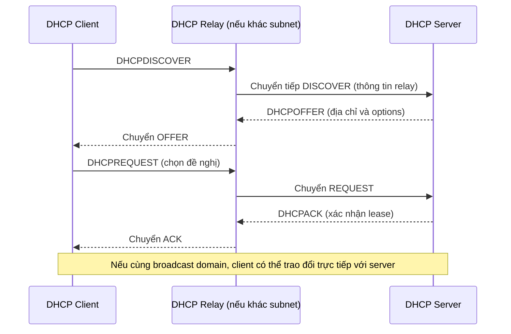
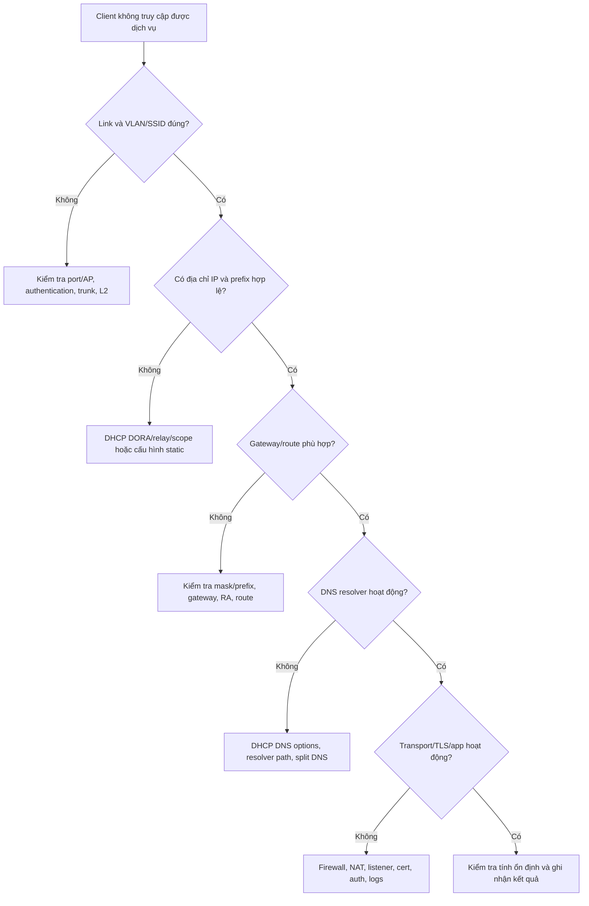

# Static và dynamic address: thiết kế, cấp phát và bảo vệ địa chỉ IP

Một máy chủ cơ sở dữ liệu thường cần địa chỉ dễ dự đoán để cấu hình giám sát và chính sách mạng. Trong khi đó, hàng trăm laptop, điện thoại hoặc thiết bị khách có thể vào và rời mạng mỗi ngày, không phù hợp để quản trị IP thủ công. **Static addressing** (gán địa chỉ tĩnh) và **dynamic addressing** (cấp phát địa chỉ động) là hai cách giải quyết các nhu cầu này, với những đánh đổi khác nhau về quản trị, khả năng mở rộng, tính sẵn sàng và bảo mật.

Trong chương **DHCP và IP management** của module **SECURITY_NETWORK_SECURITY**, lựa chọn cách cấp địa chỉ không chỉ là thao tác cấu hình máy tính. Nó ảnh hưởng trực tiếp đến phân đoạn VLAN/subnet, firewall và security group, truy cập qua VPN, bảo vệ DNS, nhận diện thiết bị, giám sát IDS/IPS và quản lý mạng Wi-Fi/cloud. Một địa chỉ được cấp đúng **không có nghĩa thiết bị đã được xác thực**; một địa chỉ thay đổi **không có nghĩa thiết bị đã đổi danh tính**.

Bài học giải thích cách gán IP tĩnh, DHCPv4, DHCP reservation, IPv6 SLAAC/DHCPv6 và những vấn đề an ninh liên quan. Sau khi học, bạn có thể:

- Phân biệt **IP static**, **IP dynamic**, **DHCP reservation** và **IP cố định ở lớp hạ tầng cloud**.
- Đọc cấu hình địa chỉ, prefix/subnet, default gateway, DNS resolver và lease; hiểu tại sao thiếu một trường có thể khiến máy không truy cập được mạng.
- Trình bày DHCPv4 DORA, thời hạn thuê địa chỉ, gia hạn, relay và cấp phát trên nhiều VLAN.
- Phân biệt gán địa chỉ IPv6 thủ công, SLAAC, DHCPv6, Router Advertisement và địa chỉ link-local.
- Thiết kế IP plan/IPAM có thể mở rộng và truy vết địa chỉ theo thời gian.
- Nhận diện DHCP rogue server, cấp phát nhầm mạng, IP conflict, DNS/DHCP mismatch và áp dụng phòng vệ lớp 2 phù hợp.
- Chẩn đoán lỗi bằng bảng kiểm chứng, thông tin lease, log DHCP, packet capture và kiểm tra route/firewall.

## 1. Static và dynamic address là gì?

**Static IP address** là địa chỉ được cấu hình cố định theo một cơ chế quản trị. Trong mô hình phổ biến nhất, quản trị viên đặt trực tiếp địa chỉ và prefix trên một interface, cùng gateway/DNS cần thiết. Địa chỉ duy trì cho tới khi cấu hình được thay đổi, interface/tài nguyên bị thay hoặc có yếu tố hạ tầng khác tác động.

**Dynamic IP address** là địa chỉ được chọn/cấp qua một cơ chế tự động, thường **DHCPv4** cho IPv4, hoặc **SLAAC/DHCPv6** cho IPv6. Địa chỉ động có thể được giữ qua nhiều lần kết nối/renew, nhưng không nên coi là vĩnh viễn nếu không có ràng buộc quản trị rõ ràng.

**DHCP reservation** là trường hợp quan trọng ở giữa: client vẫn sử dụng DHCP để lấy cấu hình, nhưng server được đặt chính sách cố gắng cấp một địa chỉ cụ thể cho client được nhận dạng phù hợp. Kết quả là địa chỉ tương đối ổn định trong phạm vi reservation, còn cơ chế nhận cấu hình vẫn là DHCP.

| Tiêu chí | Static cấu hình trên host | Dynamic qua DHCP | DHCP reservation |
|---|---|---|---|
| Nguồn địa chỉ | Quản trị trên thiết bị/OS/IaC | DHCP server chọn theo scope/pool và chính sách | DHCP server ánh xạ định danh client tới địa chỉ dự kiến |
| Địa chỉ có thể thay đổi? | Khi sửa cấu hình/tài nguyên hoặc điều kiện nền tảng | Có; lease không phải cam kết vĩnh viễn | Thường ổn định khi reservation và nhận diện client còn đúng |
| Gateway/DNS | Thường cấu hình riêng hoặc kết hợp cơ chế khác | Có thể được phát qua DHCP options | Vẫn nhận qua DHCP options |
| Thêm hàng trăm thiết bị | Tốn công, dễ cấu hình trùng | Phù hợp tự động hóa | Cần quản lý reservation cho từng thiết bị |
| Thay đổi DNS/gateway toàn mạng | Cập nhật từng host hoặc qua quản lý cấu hình | Điều chỉnh server, client nhận cấu hình mới theo quá trình renew | Tương tự DHCP động |
| Điều tra IP theo thời gian | Phải giữ inventory thay đổi | Cần log lease, thời gian và định danh client | Cần reservation và log lease/nhận diện |
| Rủi ro nổi bật | IP conflict, stale config, lỗi thao tác | Rogue DHCP, pool cạn, lease/relay lỗi | Định danh client đổi, reservation sai hoặc trùng |

Không có lựa chọn “an toàn tuyệt đối” chỉ bằng cách cố định IP. Bảo mật phụ thuộc **ai được cấp quyền vào mạng, địa chỉ có được kiểm chứng không, lưu lượng nào được phép và hệ thống được giám sát thế nào**.

### 1.1. Static/dynamic không đồng nghĩa public/private

Hai trục sau **độc lập**:

1. Địa chỉ **static hay dynamic** nói về cách cấp phát và mức ổn định.
2. Địa chỉ **public hay private** nói về phạm vi định tuyến/khả năng dùng trên Internet theo kế hoạch đánh địa chỉ.

Một laptop có thể nhận địa chỉ private `10.20.10.55` qua DHCP. Một máy chủ có thể dùng địa chỉ private `10.20.40.10` được gán tĩnh. Địa chỉ public của router cũng có thể do ISP cấp động hoặc cấp cố định.

Việc có IP public không tự bảo đảm host có thể nhận kết nối từ mọi nơi; ingress firewall, NAT, routing, nhà cung cấp và cấu hình dịch vụ vẫn ảnh hưởng. Ngược lại, một địa chỉ private có thể được các mạng khác truy cập qua VPN, peering hoặc kết nối riêng nếu routing/policy cho phép.

### 1.2. IP không phải danh tính người dùng

Một máy có thể:

- Nhận IP mới khi lease thay đổi, di chuyển sang VLAN khác hoặc đổi giao diện.
- Dùng nhiều địa chỉ IPv6 trên cùng interface.
- Chia sẻ IP public với nhiều máy sau NAT.
- Dùng địa chỉ giả/mạo ở những môi trường không có biện pháp chống spoofing.

Vì vậy, **IP-based allowlist** hữu ích để giới hạn nguồn mạng, nhưng không thay xác thực thiết bị/người dùng, chứng chỉ mTLS, IAM hay quyền ứng dụng.

## 2. Một cấu hình IP dùng được cần những gì?

Với IPv4, ba thành phần nền tảng thường gặp là **địa chỉ**, **subnet mask/prefix** và **default gateway**. DNS resolver giúp biến tên miền thành địa chỉ, nhưng không quyết định liệu host có đường IP tới đích hay không.

Ví dụ mạng nhân viên:

```text
VLAN:             10 (CORP)
Network:          10.20.10.0/24
Host IPv4:        10.20.10.55
Subnet mask:      255.255.255.0
Default gateway:  10.20.10.1
DNS resolver:     10.20.40.53
Search domain:    corp.example.test (nếu chính sách cần)
```

Trong ví dụ `/24`, 24 bit đầu là prefix mạng, tương đương mask `255.255.255.0`. Trong subnet IPv4 thông thường này:

- `10.20.10.0`: địa chỉ mạng.
- `10.20.10.1`: gateway được chọn theo thiết kế, không phải quy tắc bắt buộc gateway luôn là `.1`.
- `10.20.10.55`: địa chỉ host.
- `10.20.10.255`: broadcast address.

Các subnet `/31`, `/32` và nhiều cấu trúc đặc biệt có cách dùng khác, nên không áp máy móc quy tắc “hai địa chỉ luôn bị trừ” cho mọi prefix. Quan trọng là dùng đúng thiết kế subnet và khả năng hệ điều hành/router.

### 2.1. Host quyết định local hay remote như thế nào?

Giả sử `10.20.10.55/24` gửi packet tới:

| Đích | Cách chọn đường ở mô hình thông thường |
|---|---|
| `10.20.10.80` | Thuộc cùng prefix: tìm MAC của đích bằng ARP và gửi trong VLAN tương ứng. |
| `10.20.40.53` | Ngoài prefix: dùng route qua gateway `10.20.10.1` hoặc tuyến cụ thể hơn. |
| `198.51.100.20` | Đi qua default route nếu không có route cụ thể hơn. |

Nếu đặt sai mask `/16` thay vì `/24`, host có thể tưởng `10.20.40.53` nằm trên cùng link và cố ARP trực tiếp, khiến DNS “không chạy” dù tên DNS không có vấn đề. Nếu đặt sai gateway, host có thể liên lạc cùng subnet nhưng không ra subnet khác.

**Địa chỉ IP chỉ là một phần của đường kết nối**. Vẫn cần VLAN/trunk, ARP/NDP, route, firewall, listener và dịch vụ đích.

### 2.2. Điều gì xảy ra khi hai thiết bị dùng cùng IP?

**IP address conflict** xảy ra khi hai thiết bị đang hoạt động trên một miền mạng dùng cùng một địa chỉ mà không có cơ chế chia sẻ địa chỉ hợp lệ. ARP cache/neighbor state có thể thay đổi bất thường, kết nối bị chập chờn, log quy sai tài sản và một số dịch vụ mất khả năng tiếp cận.

Nguyên nhân thường gặp:

- Gán IP static trùng với pool DHCP.
- Sao chép cấu hình VM hoặc image chứa IP cứng.
- Hai DHCP server cấp cùng địa chỉ do thiết kế pool/failover sai.
- Reservation trùng hoặc định danh client bị thay đổi.
- Thiết bị chuyển sang VLAN/subnet khác nhưng còn cấu hình cũ.

Cần xử lý xung đột tại **nguồn cấp phát và inventory**, không chỉ xóa ARP cache rồi coi như đã giải quyết tận gốc.

## 3. Chọn static hay dynamic cho từng loại tài sản

Không nhất thiết “server phải static” hoặc “client phải dynamic” trong mọi nền tảng. Một số dịch vụ cloud có **private IP cố định do control plane quản lý**, còn máy ảo bên trong nhận cấu hình tự động; một số ứng dụng server tìm nhau bằng DNS/service discovery nên không cần hardcode IP tại OS.

| Tài sản | Cách làm thường phù hợp | Lý do/ngoại lệ |
|---|---|---|
| Laptop, điện thoại nhân viên | DHCPv4; IPv6 SLAAC/DHCPv6 theo mạng | Tự phục vụ khi vào/ra mạng, chuyển vị trí, nhận DNS/gateway mới. |
| Wi-Fi khách | Dynamic, scope riêng theo VLAN/SSID | Thiết bị thay đổi nhanh, cần giới hạn lease/pool phù hợp mật độ. |
| Camera, máy in, IoT | DHCP reservation hoặc static có IPAM | Muốn địa chỉ dự đoán được nhưng vẫn quản lý tập trung; xét MAC randomization và thay NIC. |
| DNS resolver/DHCP server/router/gateway | Địa chỉ được kiểm soát chặt, thường cố định | Phải ổn định cho các dependency; có thể dùng VIP/HA thay vì một IP duy nhất. |
| Database nội bộ | IP ổn định/reservation theo thiết kế hoặc endpoint do nền tảng quản lý | Client nên dùng tên dịch vụ; không cố định IP một instance nếu có failover. |
| Pod/container workload | Dynamic theo orchestrator/CNI | Pod IP có thể tái sử dụng; dùng Service/DNS và policy theo identity/label. |
| Cloud VM/ENI | Cơ chế IP do cloud control plane quản lý, có thể cố định private IP | Cần phân biệt IP gắn tài nguyên, guest OS DHCP và cấu hình bằng IaC. |
| WAN/ISP router | Static hoặc dynamic theo hợp đồng và khả năng ISP | VPN/site-to-site, DNS động hoặc failover có yêu cầu khác nhau. |

### 3.1. Quy tắc thực hành

**Ưu tiên cấp động** khi cần quản trị nhiều endpoint, thay đổi mạng thường xuyên và không có yêu cầu gắn IP cứng ở giao diện. **Ưu tiên địa chỉ có tính ổn định được quản lý** (static hoặc reservation/endpoint ảo) khi một hạ tầng quan trọng thật sự phụ thuộc vào IP. Dù chọn loại nào, phải có IPAM, DNS/service discovery, theo dõi thay đổi và chính sách phân đoạn tương ứng.

## 4. DHCPv4: địa chỉ động được cấp như thế nào?

**Dynamic Host Configuration Protocol for IPv4 (DHCPv4)** cho phép một client nhận địa chỉ IPv4 cùng các tham số mạng, từ một DHCP server hoặc qua DHCP relay. Quy trình thường được mô tả bằng **DORA**: Discover → Offer → Request → Acknowledgment.



### 4.1. Bốn bước DORA

1. **DHCPDISCOVER:** Client chưa có cấu hình hợp lệ có thể phát broadcast để tìm DHCP server. Ở mạng IPv4 thông thường, packet ban đầu có thể dùng source IP `0.0.0.0`, destination `255.255.255.255`, UDP source port `68` và destination port `67`.
2. **DHCPOFFER:** Một hoặc nhiều DHCP server có thể đề nghị địa chỉ trong scope cùng lease/options phù hợp với mạng của client.
3. **DHCPREQUEST:** Client chọn một đề nghị và thông báo yêu cầu địa chỉ/server tương ứng; cách phát broadcast/unicast tùy trạng thái client và quy tắc giao thức.
4. **DHCPACK:** Server xác nhận lease cùng tham số áp dụng. Một số tình huống server có thể trả **DHCPNAK** để từ chối một yêu cầu không hợp lệ, khiến client khởi động lại quá trình tìm cấu hình.

Đây là mô hình cấp mới điển hình; **gia hạn lease không phải lúc nào cũng lặp nguyên DORA**. Client có thể gửi DHCPREQUEST tới server đang cấp lease hoặc broadcast lại khi cần rebind.

### 4.2. Những DHCP options thường ảnh hưởng kết nối

| Option DHCPv4 | Ý nghĩa | Ví dụ |
|---|---|---|
| `1` | Subnet Mask | `255.255.255.0` |
| `3` | Router(s) / default gateway được đề xuất | `10.20.10.1` |
| `6` | DNS Server(s) | `10.20.40.53`, `10.20.40.54` |
| `15` | Domain Name | `corp.example.test` |
| `51` | IP Address Lease Time | `86400` giây |
| `53` | DHCP Message Type | Discover, Offer, Request, ACK... |
| `54` | DHCP Server Identifier | Định danh server trong trao đổi DHCP |
| `58`, `59` | Renewal (T1) và Rebinding (T2) Time | Bộ đếm liên quan gia hạn/rebind |
| `82` | Relay Agent Information (khi relay/trust domain hỗ trợ) | Thông tin đường/cổng relay để thực thi policy cấp phát |

Các giá trị trong bảng minh họa; **DHCP option 82** không nhất thiết được dùng trong mọi mạng và phải được xử lý theo trust boundary của switch/relay/server. Nhiều vendor còn hỗ trợ options chuyên biệt; client chỉ sử dụng chúng khi tính năng và cấu hình phù hợp.

### 4.3. Scope, pool và địa chỉ excluded

Giả sử VLAN 10 dùng `10.20.10.0/24`:

```text
Network:         10.20.10.0/24
Gateway:         10.20.10.1
Infrastructure:  10.20.10.2 - 10.20.10.30 (không cấp động)
DHCP pool:       10.20.10.50 - 10.20.10.220
Reservations:    theo danh sách quản lý, tránh đè pool hoặc theo cách server hỗ trợ
DHCP options:    router 10.20.10.1, DNS 10.20.40.53
```

Không chọn các địa chỉ đang được dùng tĩnh làm pool dynamic, trừ khi có thiết kế kiểm soát rõ. Khi dùng reservation nằm trong pool, hành vi bảo đảm không cấp trùng **phụ thuộc tính năng và cấu hình của DHCP server**; cần kiểm chứng trước triển khai.

## 5. Lease: địa chỉ động không phải địa chỉ thay đổi mỗi lần truy cập

**DHCP lease** là quyền sử dụng địa chỉ được server cấp cho client trong một khoảng thời gian. Một client có thể giữ cùng một địa chỉ qua nhiều lần gia hạn. Cũng có trường hợp khi máy chuyển mạng, server đổi pool, lease hết hạn hoặc client identity thay đổi, máy được cấp địa chỉ mới.

### 5.1. Vòng đời lease thường gặp

```text
Nhận DHCPACK -> dùng địa chỉ trong lease
       |
       | T1: thử RENEW với server đã cấp lease
       v
Nếu renew không thành công và tới T2:
       | REBIND với các DHCP server có thể tiếp cận
       v
Nếu hết hạn mà không có lease hợp lệ:
       | Client ngừng dùng địa chỉ hết hạn và tìm cấu hình mới
```

Với DHCPv4, các mốc thường thấy nếu không có giá trị override phù hợp là **T1 khoảng 50%** và **T2 khoảng 87,5%** tổng lease. Đây là mặc định/thực hành giao thức phổ biến, **không phải hằng số bắt buộc** ở mọi lease/client; phải xem options và hành vi thiết bị thực tế.

Ví dụ lease một ngày:

- Client nhận địa chỉ `10.20.10.55` với lease `24 giờ`.
- Khi tới mốc T1 phù hợp, client có thể thử renew bằng DHCPREQUEST.
- Nếu server không phản hồi và đến T2, client có thể rebind.
- Nếu lease hết hạn mà không được gia hạn, client phải xử lý theo trạng thái protocol, không được mặc nhiên tiếp tục dùng IP hết hạn như thể hợp lệ.

### 5.2. Khi không tìm được DHCP server

Tùy hệ điều hành và cấu hình, client có thể:

- Tiếp tục dùng lease **còn hiệu lực** trong giới hạn và trạng thái cho phép.
- Retry qua các khoảng chờ để tìm DHCP server.
- Dùng **IPv4 link-local** trong `169.254.0.0/16` theo khả năng triển khai, thường được gọi là APIPA trong một số môi trường Windows.
- Không nhận được cấu hình IPv4 dùng được, gây trạng thái “connected nhưng không có Internet”.

IPv4 link-local không tương đương địa chỉ trong subnet doanh nghiệp. Nó không có default router thông thường để giao tiếp Internet và không khắc phục được lỗi DHCP tại gateway. **Không phải mọi client đều tự chọn APIPA** sau một khoảng thời gian giống nhau.

### 5.3. Thời hạn lease nên dài hay ngắn?

| Môi trường | Xu hướng lựa chọn | Lưu ý |
|---|---|---|
| Văn phòng ổn định | Lease tương đối dài | Giảm traffic renew; cần quản lý khi di chuyển/tái cấp máy. |
| Wi-Fi khách hoặc sự kiện đông người | Có thể dùng lease ngắn hơn để tái sử dụng IP | Quá ngắn làm tăng tải DHCP và nguy cơ gián đoạn khi server lỗi. |
| IoT cố định | Reservation hoặc lease phù hợp độ ổn định thiết bị | Chú ý MAC randomization/hardware replacement. |
| Hạ tầng có failover/scope thay đổi | Điều chỉnh lease theo kế hoạch di chuyển | TTL DNS và lease IP là **hai cơ chế riêng**. |

Chọn lease bằng dữ liệu thực tế: số lượng client đồng thời, tốc độ thay thiết bị, thời gian ở lại mạng, năng lực server, khả năng failover và mục tiêu kiểm toán.

## 6. DHCP reservation khác static IP trên thiết bị

Một máy in có thể được đặt `10.20.30.20` theo hai cách:

**Phương án A — Static trên máy in:**

```text
IP             10.20.30.20/24
Gateway        10.20.30.1
DNS            10.20.40.53
Address mode   Manual/static
```

**Phương án B — Reservation tại DHCP server:**

```text
Client identifier / MAC theo cách nhận diện được hỗ trợ
       -> Reserved IPv4 10.20.30.20
Client mode: DHCP
       -> DHCPACK trả IP và các options phù hợp
```

Với reservation, việc đổi DNS/gateway trên DHCP server có thể được client nhận qua các lần cấu hình/renew theo quy trình DHCP, giảm rủi ro dữ liệu cũ trên từng thiết bị. Nhưng nếu client đổi MAC, bật **MAC randomization**, thay NIC, clone VM hoặc đổi client identifier thì server có thể xem đó là client khác.

**Không được xem MAC address là bằng chứng danh tính bảo mật.** MAC có thể thay đổi hoặc bị giả mạo. Nếu policy cấp IP dựa vào MAC, cần bổ sung 802.1X/NAC, kiểm soát port, inventory và các biện pháp anti-spoofing phù hợp.

### 6.1. Reservation không phải phân quyền mạng

Một router chỉ cho `10.20.30.20` được vào server quản trị có thể bị ảnh hưởng nếu IP/MAC không được ràng buộc hoặc endpoint bị chiếm quyền. IP reservation giúp vận hành ổn định, nhưng không thay host firewall, TLS/mTLS, tài khoản và vai trò ứng dụng.

### 6.2. Thay đổi IP theo quản lý tập trung

Khi chuyển máy in sang VLAN mới, phải xem đồng thời:

1. DHCP scope và reservation trong VLAN mới.
2. Switch port/SSID đúng VLAN, trunk và DHCP relay.
3. Default gateway, subnet mask và DNS được client nhận.
4. DNS `A`/`PTR`, máy chủ in, monitoring và firewall allowlist có thể đang dùng IP cũ.
5. IPAM/history, lease cũ và khả năng địa chỉ cũ được tái cấp cho thiết bị khác.

Một IP cố định bị “quên” trong firewall rule có thể tạo lỗi khó phát hiện khi tài sản đã chuyển vị trí.

## 7. Đặt IP static: cấu hình và kiểm chứng

Với hệ thống cần IP tĩnh, **không chỉ điền địa chỉ IP**. Quản trị viên phải bảo đảm address/prefix/gateway/DNS đúng thiết kế, không trùng DHCP pool hay thiết bị khác và được ghi nhận trong IPAM.

### 7.1. Ví dụ cấu hình mô tả cho Linux dùng Netplan

Đoạn YAML sau **chỉ minh họa** cho một hệ thống dùng Netplan và renderer tương thích. Tên interface `enp1s0` cần kiểm tra trên máy thật; không áp trực tiếp vào production khi chưa có kênh quản trị dự phòng và kế hoạch rollback.

```yaml
network:
  version: 2
  ethernets:
    enp1s0:
      dhcp4: false
      addresses:
        - 10.20.40.20/24
      routes:
        - to: default
          via: 10.20.40.1
      nameservers:
        addresses:
          - 10.20.40.53
          - 10.20.40.54
        search:
          - corp.example.test
```

Lưu ý:

- Không phải mọi Linux distro dùng Netplan; có nơi dùng NetworkManager, systemd-networkd, ifupdown hoặc cơ chế khác.
- `dhcp4: false` chỉ nói không dùng DHCPv4 cho interface ở ví dụ này; IPv6 có cơ chế riêng, có thể tiếp tục nhận RA/SLAAC nếu chưa được cấu hình.
- Các IP/gateway/DNS là ví dụ giả định, cần thay bằng network plan đã phê duyệt.
- Trong thực tế nên dùng cơ chế kiểm tra cấu hình và rollback an toàn của công cụ quản lý mạng đang sử dụng.

### 7.2. Lệnh quan sát an toàn trên Linux

```bash
# Danh sách interface và địa chỉ.
ip -br address

# Route và default gateway được hệ điều hành sử dụng.
ip route
ip -6 route

# IPv4 ARP và IPv6 Neighbor Discovery cache.
ip neigh show

# Resolver config nhìn từ môi trường hiện tại.
cat /etc/resolv.conf

# Nếu có systemd-resolved.
resolvectl status

# Trên các máy có NetworkManager.
nmcli device show
```

Một lệnh quan sát không nhất thiết cho toàn bộ cấu hình. Ví dụ `/etc/resolv.conf` có thể trỏ đến local stub resolver; upstream thực sự nằm trong cấu hình `systemd-resolved` hoặc dịch vụ riêng.

### 7.3. Windows: đọc địa chỉ, DHCP và gateway

```powershell
Get-NetIPConfiguration
Get-NetIPAddress -AddressFamily IPv4
Get-NetIPInterface -AddressFamily IPv4
Get-DnsClientServerAddress
ipconfig /all
```

Trong `ipconfig /all`, cần kiểm tra adapter nào đang hoạt động, `DHCP Enabled`, `IPv4 Address`, subnet mask, default gateway, DHCP server, lease obtained/expires và DNS servers khi các trường ấy có sẵn. Một máy có VPN/virtual adapters có thể có nhiều giao diện; không nên đọc nhầm IP của interface không tham gia đường đi đang điều tra.

## 8. DHCP relay: cấp IP động qua nhiều VLAN/subnet

DHCPv4 Discover ban đầu thường dùng broadcast trong subnet local. **Router không chuyển tiếp broadcast lớp 2 như một packet IP thông thường**. Khi DHCP server đặt ở subnet khác, có thể sử dụng **DHCP relay** trên router, switch lớp 3, firewall hoặc thiết bị hỗ trợ.

```text
VLAN 10: 10.20.10.0/24
  Laptop -- switch -- gateway/relay 10.20.10.1
                                    |
                              IP routing/policy
                                    |
                          DHCP server 10.20.40.5

VLAN 20: 10.20.20.0/24
  Guest ---- switch -- gateway/relay 10.20.20.1
                                    |
                              IP routing/policy
                                    |
                          DHCP server 10.20.40.5
```

Relay chuyển thông điệp giữa client và server, cung cấp thông tin về **mạng nguồn của client** để server chọn scope phù hợp. Với DHCPv4, trường `giaddr` (gateway IP address) thường liên quan đến cách relay cho server biết mạng/cổng trả lời. Các triển khai nâng cao có thể dùng option 82.

### 8.1. Vì sao scope đúng nhưng client vẫn nhận IP sai?

Các khả năng gồm:

- Client thực tế cắm ở **VLAN khác** với VLAN mong muốn.
- Relay/SVI cấu hình sai interface hoặc thông tin chuyển tiếp.
- DHCP server chọn scope không đúng theo relay/điều kiện policy.
- Có **rogue DHCP server** cùng broadcast domain.
- DHCP reservation hoặc client identifier dẫn đến assignment không mong muốn.

Để khắc phục, xác nhận **VLAN thực của client, Discover/Offer nhìn từ hai phía, server identifier và scope đã chọn**, rồi mới sửa cấu hình.

### 8.2. Firewall cho DHCP relay

Kết nối DHCP qua relay có thể có đặc điểm source/destination khác gói broadcast ban đầu. Policy cần cho phép đúng traffic **giữa relay và server** theo giao thức/port/đường đi mà thiết bị thực tế sử dụng. Không mở UDP `67/68` từ mọi nguồn đến toàn mạng chỉ để khắc phục timeout.

Đặc biệt, client ở VLAN 20 (guest) không cần quyền trực tiếp vào subnet server ngoài những dịch vụ được phê duyệt, chỉ vì DHCP server tập trung đặt ở VLAN 40. Relay và firewall phải duy trì ranh giới bảo mật.

## 9. IPv6: static, SLAAC và DHCPv6

IPv6 có nhiều cách hình thành địa chỉ hơn mô hình “DHCP hoặc tự nhập IPv4”. Một interface có thể đồng thời có **link-local address**, một hoặc nhiều global/ULA addresses, địa chỉ tạm cho quyền riêng tư và địa chỉ do DHCPv6/SLAAC cấp.

### 9.1. Link-local IPv6 và Neighbor Discovery

Địa chỉ link-local IPv6 thuộc `fe80::/10` được dùng trong giao tiếp trên link và các chức năng nền như Neighbor Discovery. Nó **không được router chuyển tiếp qua nhiều link như địa chỉ global**. Một địa chỉ IPv6 link-local có thể tồn tại ngay cả khi host chưa có global IPv6 để truy cập mạng khác.

IPv6 dùng **ICMPv6 Neighbor Discovery (NDP)** cho nhiều chức năng mà IPv4 dùng ARP cùng các cơ chế khác. Chặn toàn bộ ICMPv6 là lỗi phổ biến có thể gây hỏng Neighbor Solicitation/Advertisement, Router Advertisement và Path MTU Discovery.

### 9.2. SLAAC và Router Advertisement

**Stateless Address Autoconfiguration (SLAAC)** cho phép host tạo địa chỉ IPv6 dựa trên prefix và thông tin nhận từ **Router Advertisement (RA)**, cùng cơ chế tạo interface identifier được OS hỗ trợ. RA cũng có thể cung cấp thông tin default router; những thuộc tính DNS có thể được quảng bá qua RA options khi hỗ trợ.

```text
IPv6 Router
   |
   |  Router Advertisement:
   |  Prefix = 2001:db8:20:10::/64
   |  Default router lifetime và flags phù hợp
   v
Host:
   Link-local:  fe80::.../64 (trên link)
   Global:      2001:db8:20:10::<interface-id>
   Default router qua RA nếu cấu hình/nhận được hợp lệ
```

Prefix `2001:db8::/32` ở đây chỉ phục vụ tài liệu. Host có thể dùng **stable privacy** hoặc **temporary IPv6 addresses**, không mặc định lấy MAC tạo EUI-64. Việc thay đổi IPv6 temporary address là tính năng thiết kế quyền riêng tư, không nhất thiết là dấu hiệu tấn công.

### 9.3. DHCPv6 stateful và stateless

**DHCPv6** sử dụng cơ chế và message types khác DHCPv4; không có mô hình DORA y hệt. Các trao đổi thường gặp có thể gồm `SOLICIT`, `ADVERTISE`, `REQUEST`, `REPLY` hoặc quy trình nhanh theo năng lực hỗ trợ.

Hai mô hình sử dụng thường gặp:

- **Stateful DHCPv6:** DHCPv6 cấp địa chỉ IPv6 và/hoặc thông tin khác theo phương thức phù hợp.
- **Stateless DHCPv6:** host tự hình thành địa chỉ qua SLAAC nhưng lấy một số cấu hình bổ sung, ví dụ DNS resolver, qua DHCPv6.

**Điểm đặc biệt:** Default router IPv6 thông thường được học qua **Router Advertisement**, không phải qua DHCPv6 như DHCPv4 option router. Các cờ `M` và `O` trong RA có thể hướng dẫn host sử dụng DHCPv6, nhưng hành vi cụ thể tùy hệ điều hành và chính sách; không áp chúng như công tắc bảo đảm mọi client sẽ có cách cấu hình giống nhau.

| Cơ chế | Địa chỉ | Default gateway | DNS và cấu hình bổ sung |
|---|---|---|---|
| IPv6 static | Cấu hình thủ công/management system | Route thủ công hoặc học theo RA tùy thiết kế | Cấu hình riêng hoặc học bằng cơ chế khác |
| SLAAC | Host tạo địa chỉ từ prefix/RA | RA | RA RDNSS hoặc nguồn khác nếu hỗ trợ |
| DHCPv6 stateful | Server cấp IPv6 và thông tin theo yêu cầu | Thường vẫn từ RA | DHCPv6 options phù hợp |
| SLAAC + stateless DHCPv6 | SLAAC tạo địa chỉ | RA | DHCPv6 cung cấp thông số khác như DNS |

DHCPv6 thường dùng **UDP 546 ở client** và **UDP 547 ở server/relay**, kèm cơ chế multicast/relay tương ứng; không giả định broadcast IPv4 tồn tại trên IPv6.

### 9.4. Duplicate Address Detection và những giới hạn

IPv6 sử dụng cơ chế **Duplicate Address Detection (DAD)** để kiểm tra một địa chỉ dự kiến trên link có bị xung đột hay không theo protocol. Tuy nhiên DAD không phải hệ thống xác thực thiết bị; một host có thể nhận thông tin RA hoặc NDP giả trong môi trường lớp 2 thiếu phòng vệ.

RA Guard, DHCPv6 Guard và các cơ chế kiểm soát tại switch có thể giúp giảm một số nguy cơ, nhưng cần cấu hình phù hợp với IPv6 extension headers/đặc điểm nền tảng và không coi chúng là biện pháp duy nhất.

## 10. IP Address Management (IPAM): quản lý toàn bộ vòng đời địa chỉ

**IPAM** là tập quy trình/công cụ quản lý không gian địa chỉ, subnet, phân bổ, reservation, trạng thái sử dụng, quan hệ với tài sản và lịch sử thay đổi. Một spreadsheet chỉ ghi “IP này của máy A” có thể không đủ khi mạng dùng DHCP, NAT, IPv6 privacy addresses và workload cloud tự động tạo/xóa.

### 10.1. Dữ liệu IPAM tối thiểu

| Trường | Ví dụ | Mục đích |
|---|---|---|
| Network/prefix | `10.20.10.0/24` | Tránh chồng lấn, hỗ trợ route/ACL và capacity planning. |
| VLAN/VRF/VPC/zone | `VLAN10-CORP` | Biết địa chỉ thuộc ranh giới mạng nào. |
| Allocation type | `static`, `dynamic`, `reservation`, `cloud-managed` | Xác định chủ thể cấp và vòng đời. |
| IP/lease interval | `10.20.10.55`, thời gian lease | Biết ai giữ IP ở **thời điểm cụ thể**. |
| Owner/asset ID | `laptop-asset-042` | Truy vết thiết bị và người chịu trách nhiệm. |
| Client ID/MAC/DUID (khi cần) | Giá trị có kiểm soát truy cập | Đối chiếu DHCP và hiện tượng thiết bị đổi định danh. |
| Gateway/DNS/scope | `10.20.10.1`, `10.20.40.53` | Điều tra lỗi cấu hình. |
| Lifecycle | `reserved`, `assigned`, `available`, `retired` | Không tái sử dụng trước khi thu hồi/quyết định hợp lệ. |
| Change history | Ai/điều gì/khi nào/ticket | Audit, rollback và quản trị cấu hình. |

Tùy yêu cầu quyền riêng tư, không phải tất cả trường định danh cần lưu vô thời hạn. Nên giới hạn quyền xem MAC/user/IP history theo chính sách dữ liệu của tổ chức.

### 10.2. Tại sao log lease theo thời gian quan trọng?

Một firewall log lúc `09:30` ghi source `10.20.20.88`. Nếu DHCP pool dynamic có tái cấp địa chỉ, tại `17:00` IP này có thể thuộc thiết bị khác. Muốn điều tra sự kiện, cần đối chiếu:

1. Timestamp có timezone và sai số đồng hồ.
2. DHCP lease tại **thời điểm sự kiện**, không chỉ lease hiện tại.
3. VLAN/SSID, switch port hoặc AP và thông tin NAC/VPN.
4. NAT translation log nếu chỉ còn public IP/port.
5. Danh tính người dùng/thiết bị từ nguồn đáng tin cậy.

**Không quy kết một người dùng chỉ dựa trên IP hiện tại.** NAT, IP reuse, randomized MAC và thiết bị dùng chung đều có thể làm sai mối liên hệ.

### 10.3. Capacity planning cho pool

Nếu một VLAN khách có pool 180 địa chỉ, còn 250 thiết bị có thể kết nối đồng thời, việc DHCP hết IP là rủi ro thiết kế. Dùng các số đo:

- Số thiết bị đồng thời cực đại, không chỉ số lượng thiết bị đăng ký.
- Số lease chưa hết hạn, reservation, excluded addresses và khoảng dự phòng.
- Tốc độ khách đến/rời mạng, lease duration, MAC randomization.
- Khả năng thêm subnet hoặc thay đổi subnet/VLAN và hậu quả tới các thiết bị.

**Rút ngắn lease** có thể giúp tái sử dụng IP khi khách rời mạng, nhưng không tạo thêm địa chỉ cho những thiết bị đang hoạt động cùng lúc. Nếu nhu cầu đồng thời vượt capacity, cần thiết kế lại prefix/pool hoặc phân đoạn.

## 11. DHCP, DNS và firewall phải nhất quán

### 11.1. Địa chỉ cấp đúng nhưng DNS sai

Client có thể được cấp:

```text
IP:       10.20.10.55/24
Gateway:  10.20.10.1
DNS:      192.0.2.53   (chỉ là địa chỉ ví dụ, không truy cập được ở lab này)
```

Máy có thể ping gateway hoặc kết nối bằng IP, nhưng không resolve tên dịch vụ. Nguyên nhân nằm ở **DHCP option DNS**, đường route/firewall tới resolver, hoặc cấu hình resolver chứ không nhất thiết do “không có Internet”.

Khi chuyển mạng hoặc VPN, split DNS và search domain có thể thay đổi; cần xác định resolver hiệu lực mà ứng dụng thật sự dùng.

### 11.2. DHCP và Dynamic DNS (DDNS)

Trong một số mạng, DHCP server hoặc client cập nhật bản ghi DNS theo chính sách, ví dụ:

```text
host-042.corp.example.test  ->  10.20.10.55
```

**DDNS** hữu ích khi IP thay đổi nhưng tên thiết bị cần ổn định. Tuy nhiên cập nhật record phải được xác thực/ủy quyền, giới hạn zone và theo dõi stale records. Một client không tin cậy không nên có quyền tùy ý ghi đè hostname của máy quan trọng.

DNS TTL và DHCP lease duration có mục đích khác nhau; giảm TTL DNS không làm địa chỉ DHCP tự renew, còn lease mới không tự bảo đảm DNS record đã được cập nhật.

### 11.3. Chính sách firewall theo IP và việc tái cấp

Một rule `10.20.10.55 → database:5432 ALLOW` có thể vô tình cấp quyền cho thiết bị khác nếu IP được cấp động về sau. Với môi trường nhạy cảm:

- Ưu tiên chính sách theo **identity/workload security group** nếu nền tảng hỗ trợ.
- Hạn chế nguồn ở đúng subnet/segment và xác thực ứng dụng.
- Theo dõi IPAM/lease và cập nhật policy khi tài sản thay đổi.
- Không coi DHCP reservation là cơ chế chống giả mạo địa chỉ.

## 12. Rủi ro bảo mật khi cấp địa chỉ tự động

### 12.1. Rogue DHCP server

Một thiết bị không được phép có thể gửi DHCPOFFER trong cùng broadcast domain, dẫn client nhận cấu hình sai, chẳng hạn gateway hoặc DNS resolver do kẻ tấn công kiểm soát. Hậu quả có thể là ngắt kết nối, thay đổi đường truy cập hoặc tạo điều kiện theo dõi/chuyển hướng traffic.

**Phòng vệ:** DHCP snooping, kiểm soát cổng tin cậy, 802.1X/NAC, phân đoạn khách/IoT, giám sát DHCPOFFER bất thường, bảo vệ quyền cấu hình switch/AP. Không chỉ dựa vào tên DHCP server do packet tự khai.

### 12.2. DHCP starvation và pool exhaustion

Một lượng lớn yêu cầu địa chỉ hoặc nhiều client identifiers có thể làm pool cạn, khiến thiết bị hợp lệ không lấy được IP. Nhưng **pool exhaustion cũng có thể là sự cố vận hành** do mạng khách tăng đột biến, reservation sai hoặc lease quá dài.

Biện pháp giảm rủi ro gồm port security/rate limiting theo khả năng switch, DHCP snooping, kiểm soát thiết bị gia nhập mạng, giám sát utilization và capacity planning. Điều tra cần phân biệt lưu lượng tấn công với đỉnh nhu cầu hợp lệ.

### 12.3. DHCP snooping và trust boundary

**DHCP snooping** trên switch hỗ trợ có thể đánh dấu:

- **Untrusted ports:** thường là cổng nối client, hạn chế hoặc chặn thông điệp DHCP server không mong muốn.
- **Trusted ports:** thường là uplink về DHCP server/relay được phép, có thể chấp nhận thông điệp DHCP server.

Switch có thể tạo **binding table** liên hệ địa chỉ IP–MAC–port–VLAN–lease. Bảng này hữu ích cho các tính năng như Dynamic ARP Inspection (DAI) hoặc IP Source Guard khi được hỗ trợ.

**Cấu hình trusted port sai** có thể làm DHCP ngừng hoạt động hoặc để rogue server phát offer. Không bật toàn bộ cổng là trusted chỉ để “sửa” lỗi mạng. Trên trunk, relay và topology phức tạp, phải kiểm tra hành vi cụ thể của nền tảng.

### 12.4. ARP spoofing, IP spoofing và thiết bị đặt static

DHCP snooping chỉ quan sát các trao đổi DHCP thuộc phạm vi hỗ trợ; nó **không tự ngăn mọi hành vi giả mạo IP**. Một host có thể tự cấu hình IP static hoặc phát ARP giả, tùy biện pháp lớp 2 đang triển khai.

Cần kết hợp:

- **Dynamic ARP Inspection:** dùng binding hoặc cơ chế xác thực phù hợp để phát hiện ARP bất thường.
- **IP Source Guard:** kiểm tra nguồn IP/MAC/port theo khả năng switch.
- **802.1X/NAC:** xác thực việc thiết bị/người dùng được gia nhập mạng và có thể gán VLAN động.
- **Host firewall, segmentation và identity-aware policy:** hạn chế lưu lượng ngay cả khi địa chỉ được cấp hợp lệ.
- **Logging/SIEM/NDR:** phát hiện IP/MAC churn, rogue offers, lỗi DHCP, vi phạm policy và các sự kiện liên quan.

Một thiết bị đặt IP tĩnh có thể **không có DHCP snooping binding**. Khi sử dụng DAI/IP Source Guard, cần cơ chế khai báo tĩnh/ngoại lệ được kiểm soát cho các thiết bị hợp lệ, tránh khóa nhầm máy in, router hoặc IoT.

### 12.5. IPv6 RA và rogue DHCPv6

Trên mạng dual-stack, kiểm soát DHCPv4 không giải quyết hoàn toàn IPv6. Một thiết bị có thể phát **Router Advertisement không được phép**, làm host học default router hoặc prefix sai. Ngoài ra có nguy cơ DHCPv6 server/relay không được ủy quyền.

Biện pháp thích hợp có thể gồm **RA Guard, DHCPv6 Guard, kiểm soát port, NAC, IPv6 firewall và giám sát NDP**, phù hợp khả năng switch và topology. Không vô hiệu hóa toàn bộ ICMPv6 vì RA/NDP/PMTU là thành phần nền của mạng IPv6.

## 13. Static/dynamic trong mô hình phân đoạn và hạ tầng cloud

Ví dụ thiết kế mạng doanh nghiệp:

| Vùng | Subnet | Thiết bị | Cơ chế địa chỉ | Kiểm soát liên quan |
|---|---|---|---|---|
| VLAN 10 CORP | `10.20.10.0/24` | Laptop nhân viên | DHCP scope, lease theo nhu cầu | 802.1X, DHCP snooping, firewall tới ứng dụng nội bộ. |
| VLAN 20 GUEST | `10.20.20.0/24` | Khách Wi-Fi | DHCP scope riêng, capacity đủ | Guest isolation, deny guest → corp/server, DNS policy. |
| VLAN 30 IOT | `10.20.30.0/24` | Camera/máy in | Reservation hoặc static có IPAM | Chặn IoT → mạng nhạy cảm, NAC/DAI phù hợp. |
| VLAN 40 SERVER | `10.20.40.0/24` | API/DB/DNS/DHCP | Địa chỉ ổn định theo vai trò hoặc service endpoint | Firewall, TLS/mTLS, authN/authZ, monitoring. |
| VLAN 50 MGMT | `10.20.50.0/24` | Switch/router/firewall | Thường static/địa chỉ quản lý cố định | Chỉ từ VPN/bastion được phép, logging quản trị. |

### 13.1. Phân đoạn khác với phân bổ IP

Việc tạo `VLAN 20` và một DHCP scope `10.20.20.0/24` **không tự chặn khách truy cập server**. Khi có routing giữa VLAN, cần ACL/firewall đúng điểm giao cắt; khi các host cùng VLAN cần tách nhau, có thể cần port/client isolation, host firewall hoặc microsegmentation.

Địa chỉ tĩnh của database cũng không biến database thành “private”. Tính riêng tư phải xét subnet/route, public exposure, security group, host firewall, xác thực và quyền truy cập.

### 13.2. DHCP trong cloud và container

Cloud platform thường có **control plane gán private IP cho network interface**. Guest OS có thể nhận cấu hình bằng DHCP hoặc cơ chế tự động do nền tảng cung cấp. Do đó:

- Một private IP có thể được **giữ ổn định tại cloud ENI** trong khi trong VM, interface hiển thị đang dùng DHCP.
- Public IP có thể động hoặc gắn với đối tượng IP tĩnh/reserved của cloud theo dịch vụ.
- Không nên đặt IP thủ công trong guest OS trái với cơ chế được cloud hỗ trợ; có thể gây mất kết nối và lệch cấu hình.
- Trong Kubernetes, Pod IP thường do CNI quản lý, có thể đổi/tái sử dụng; ứng dụng nên dùng Service/DNS và policy theo workload.

Không giả định một địa chỉ thuộc DHCP pool truyền thống chỉ vì VM có trường `DHCP Enabled: Yes`. Cần hiểu **ai có thẩm quyền cấp IP ở tầng hạ tầng**.

### 13.3. VPN và remote users

VPN có thể cấp các địa chỉ tunnel từ một pool riêng, không giống IP của Wi-Fi/LAN; một user còn có thể đi qua NAT và dùng nhiều thiết bị. Khi thiết kế access policy và log, phải phân biệt:

1. Public IP trước VPN.
2. Tunnel/client IP được cấp trong phiên.
3. Inner source IP sau khi giải mã tunnel.
4. Danh tính người dùng/thiết bị được VPN xác thực.

Một `10.x.x.x` trong log backend chưa đủ để quy kết người dùng nếu không có VPN session/NAT/lease mapping đúng thời gian.

## 14. Troubleshooting static và dynamic address

### 14.1. Quy trình chẩn đoán theo lớp



### 14.2. Bảng triệu chứng

| Triệu chứng | Khả năng cần kiểm tra | Bằng chứng |
|---|---|---|
Máy có `169.254.x.x` | DHCP không nhận được cấu hình IPv4 hợp lệ; client fallback link-local | Discover/Offer, VLAN, DHCP relay, server, scope, cổng và log. |
| IP đúng subnet nhưng không tới gateway | Sai VLAN/mask, ARP, gateway lỗi, L2 policy | MAC/ARP table, port VLAN, route, interface counters. |
| Nhận IP `10.20.20.x` thay vì `10.20.10.x` | Gán nhầm VLAN, relay/scope sai, rogue DHCP | DHCP server identifier, port, offer, IPAM. |
| Hai máy lúc được lúc không với cùng IP | IP conflict, ARP flapping, address reuse | ARP/neighbor, DHCP leases, IPAM và MAC theo thời gian. |
| Lease không renew được | Server không phản hồi, route/relay lỗi, policy chặn hoặc timeout | Log DHCPREQUEST/ACK/NAK, T1/T2 và packet tương ứng. |
| IP mới được cấp, hostname vẫn trỏ IP cũ | DNS/DDNS/cache không đồng bộ | A/PTR, negative/positive cache, DNS update log, lease. |
| Truy cập bằng IP được nhưng tên miền lỗi | DNS resolver hoặc policy | DHCP option 6, route/firewall tới resolver, DNS RCODE. |
| Chỉ IPv6 hỏng | RA/SLAAC/DHCPv6/NDP/firewall IPv6 | RA, prefix, default route, DAD, ICMPv6, UDP 546/547. |
| DHCP pool cạn dù ít thiết bị online | Lease dài, nhiều client IDs, reservation/excluded sai hoặc lưu lượng bất thường | Pool utilization, lease history, MAC/ID churn, thời điểm khách ra/vào. |
| Cloud VM hiện DHCP nhưng cần IP ổn định | Control plane đã gắn fixed private IP hoặc IP bị thay khi thay ENI | Cloud interface metadata, IaC, network assignments. |

### 14.3. Quan sát DHCPv4 bằng packet capture

Trên một Linux host hoặc sensor có quyền, ví dụ:

```bash
# Ghi lại trao đổi DHCPv4 trên interface phù hợp.
sudo tcpdump -ni eth0 -e -vv '(udp port 67 or udp port 68)'

# Lưu vào PCAP trong một khoảng thời gian ngắn phục vụ điều tra.
sudo tcpdump -ni eth0 -s 0 -w dhcp-debug.pcap \
  '(udp port 67 or udp port 68)'
```

`eth0` chỉ là interface minh họa. Tại client, có thể thấy Discover/Request và Offer/ACK nếu lưu lượng đi qua vị trí capture; tại server qua relay, nguồn/đích và thông tin relay có thể khác. Bắt sai interface hoặc bị VLAN/offload/capture filter ảnh hưởng **không chứng minh server không hề gửi Offer**.

Wireshark có thể dùng filter `bootp` để quan sát DHCPv4 trong các phiên bản/dissector phổ biến, đồng thời xem Transaction ID (`xid`), `chaddr`, message type, offered address (`yiaddr`), server identifier, lease time, router/DNS options và relay `giaddr` khi có.

### 14.4. Kiểm tra DHCPv6 và Router Advertisement

```bash
# Quan sát DHCPv6 (UDP 546/547) và ICMPv6 liên quan IPv6.
sudo tcpdump -ni eth0 '(udp port 546 or udp port 547 or icmp6)'

# Địa chỉ và route IPv6 hiện có.
ip -6 address show
ip -6 route show
```

Khi chẩn đoán IPv6, phân biệt **link-local**, **global/ULA**, địa chỉ temporary, trạng thái DAD và default route từ RA. Có một địa chỉ IPv6 không đủ để kết luận máy có đường đến Internet IPv6.

### 14.5. Lệnh kiểm tra trên Windows

```powershell
ipconfig /all
Get-NetIPConfiguration
Get-NetIPAddress -AddressFamily IPv4
Get-NetIPAddress -AddressFamily IPv6
Get-NetRoute
Get-DnsClientServerAddress
```

Trong quá trình điều tra có thể phải renew lease, nhưng **release/renew có thể làm mất kết nối tạm thời**. Chỉ thực hiện trên interface và hệ thống được phép, tránh chạy từ xa trên server quan trọng khi không có kênh dự phòng.

## 15. Các tình huống thực tế cần phân biệt

### Tình huống A — Máy nhân viên vào VLAN khách

**Dấu hiệu:** Laptop có IP `10.20.20.80`, gateway `10.20.20.1`, trong khi chính sách yêu cầu thuộc VLAN 10.

**Giả thuyết:** Port access hoặc SSID/RADIUS gán VLAN 20, DHCP relay gửi từ subnet guest hoặc client kết nối nhầm SSID.

**Kiểm chứng:** Xác nhận port/SSID, trạng thái 802.1X/NAC, thông tin VLAN của switch/AP, DHCP transaction và server identifier. Không sửa scope guest để cấp IP của corporate cho client đang ở guest VLAN.

### Tình huống B — Máy in static xung đột với pool DHCP

**Dấu hiệu:** Máy in `10.20.30.20` lúc được lúc mất; DHCP server có lease cùng IP cho laptop.

**Nguyên nhân khả dĩ:** IP máy in được nhập trực tiếp nhưng không excluded/reserved đúng trên DHCP server.

**Khắc phục:** Kiểm kê IPAM, phân định quyền sở hữu IP, chỉnh pool/exclusion/reservation, đảm bảo không còn client khác giữ lease trùng và xác minh ARP sau khi sửa.

### Tình huống C — DHCP server chạy tốt nhưng một VLAN không nhận địa chỉ

**Dấu hiệu:** VLAN 10 nhận IP bình thường, VLAN 20 toàn bộ client không có IPv4 hữu ích.

**Giả thuyết:** VLAN 20 thiếu trên trunk, SVI/relay sai, scope VLAN 20 hết IP hoặc ACL chặn relay–server.

**Kiểm chứng:** Tìm Discover ở phía client, message forwarded ở phía relay, Offer/ACK ở phía server; xem scope và log, route/policy theo đúng đường. Không mặc định server chết chỉ vì một VLAN lỗi.

### Tình huống D — Sau thay NIC, thiết bị không nhận reservation cũ

**Dấu hiệu:** Camera dùng DHCP từng có IP `10.20.30.20`, thay NIC hoặc đổi MAC thì nhận IP khác.

**Giải thích:** Reservation có thể gắn với MAC/client identifier cũ. Cần cập nhật nhận diện thiết bị có kiểm soát, thu hồi lease/reservation không còn dùng, bảo đảm policy/monitoring theo asset không trỏ vào client khác.

### Tình huống E — Người dùng mới không lấy được IPv4 trong sự kiện

**Dấu hiệu:** Pool Wi-Fi guest đạt 100% utilization, thiết bị mới timeout khi DHCP.

**Kiểm chứng:** Đếm client đồng thời, lease active/expired, số pool usable, excluded/reserved và lịch dùng; phân biệt nhu cầu hợp lệ với DHCP starvation. Nếu nhiều client thực sự cùng hoạt động, **giảm lease duration không giải quyết hết thiếu capacity**; phải có kế hoạch mở rộng hoặc phân đoạn.

### Tình huống F — Cloud VM có IP “static” nhưng OS báo DHCP

**Dấu hiệu:** Console cloud cho biết private IP của ENI được gán cố định, trong guest OS `DHCP Enabled: Yes`.

**Giải thích:** Control plane có thể giữ quyền cấp IP ổn định cho interface trong khi guest nhận cấu hình tự động. Không nên đổi OS sang manual chỉ để đạt chữ “static”. Cần kiểm chứng hạ tầng, lifecycle của ENI/VM và cơ chế cloud được hỗ trợ.

### Tình huống G — IPv6 có địa chỉ nhưng không truy cập được mạng khác

**Dấu hiệu:** Host có `fe80::...` nhưng không có global/ULA route hoặc default router phù hợp.

**Giả thuyết:** RA không đến host, prefix không được quảng bá, IPv6 firewall chặn ICMPv6 hoặc cấu hình DHCPv6 bị hiểu nhầm là có gateway.

**Kiểm chứng:** Quan sát RA, prefix, default route, NDP/DAD, DHCPv6 khi cần. DHCPv6 không thay thế nguồn thông tin default router thông thường từ RA.

## 16. Bài thực hành kiểm chứng một thiết kế cấp phát

**Bối cảnh:** Lab có hai VLAN:

```text
VLAN 10 CORP:      10.20.10.0/24
   Gateway:        10.20.10.1
   DHCP pool:      10.20.10.50–10.20.10.220

VLAN 30 IOT:       10.20.30.0/24
   Gateway:        10.20.30.1
   Printer:        10.20.30.20 (reservation hoặc static)

Central DHCP:      10.20.40.5
Internal DNS:      10.20.40.53
```

### 16.1. Các bước thực hiện trong môi trường được phép

1. Tạo bảng IPAM cho hai subnet, gateway, pool/excluded range và địa chỉ máy in.
2. Xác minh switch port/SSID và trunk mang đúng VLAN; kiểm tra relay tới DHCP server nếu khác subnet.
3. Đặt một client VLAN 10 ở chế độ DHCPv4 và xem thông tin IP, prefix, gateway, DNS, lease.
4. Đọc DHCP log và/hoặc capture để xác minh DORA tương ứng với client, server identifier và scope đã chọn.
5. Kiểm tra máy in VLAN 30 nhận đúng `10.20.30.20` theo cơ chế đã thiết kế; xác minh địa chỉ không bị cấp lại cho client khác.
6. Từ client VLAN 10, kiểm tra gateway và DNS; sau đó thử kết nối một dịch vụ đã được chính sách cho phép.
7. Kiểm tra một luồng **không được phép** từ VLAN 30 tới hệ thống nhạy cảm trong phạm vi lab, đối chiếu firewall log; không suy ra phân đoạn an toàn chỉ từ VLAN ID khác.
8. Mô phỏng một sự cố **có kiểm soát** (ví dụ tạm bỏ relay trong lab có rollback), quan sát triệu chứng và phục hồi; không thực hiện trên mạng đang phục vụ người dùng thật.
9. Ghi kết quả, phiên bản cấu hình và bằng chứng; sau đó trả lab về trạng thái hoạt động bình thường.

### 16.2. Ma trận kết quả cần ghi nhận

| Kiểm tra | Kỳ vọng | Bằng chứng |
|---|---|---|
| Laptop VLAN 10 nhận DHCP | IPv4 `10.20.10.50–220`, prefix `/24`, gateway đúng | Lease client, log ACK và scope. |
| Máy in VLAN 30 dùng IP ổn định | `10.20.30.20`, không có thiết bị trùng | IPAM, reservation/static config, ARP/lease. |
| Client có thể dùng DNS nội bộ | Truy vấn được tên lab hợp lệ | Resolver settings, DNS log/response. |
| Guest/IoT không vào vùng nhạy cảm | Bị từ chối theo policy | Firewall log, điểm quan sát và kết quả test. |
| Khi relay lỗi trong lab | Client mới khó nhận DHCP, có log phù hợp | Capture trước/sau relay và quá trình khôi phục. |
| Sau phục hồi | Cấp phát bình thường, không trùng IP | Client lease và tình trạng pool. |

**Lưu ý:** Một client đã có lease còn hiệu lực vẫn có thể hoạt động khi DHCP server tạm mất. Muốn kiểm thử tình huống client mới, dùng thiết bị/lease thử nghiệm riêng, không làm gián đoạn địa chỉ của máy quản trị.

## 17. Bài tập ôn tập có hướng dẫn

### Bài 1. Static có an toàn hơn dynamic không?

Một tổ chức đặt IP static cho tất cả laptop và tuyên bố thiết bị lạ sẽ không thể vào mạng vì “không có DHCP”. Bạn đánh giá thế nào?

**Gợi ý:** IP static không xác thực thiết bị. Đối tượng không tin cậy vẫn có thể đặt IP thủ công nếu vào được lớp 2. Cần 802.1X/NAC, segmentation, host/firewall policy, chống spoofing và kiểm soát truy cập ứng dụng.

### Bài 2. Phân biệt DHCP reservation với static IP

Một máy in cần giữ IP `10.20.30.20`; doanh nghiệp thường xuyên thay DNS resolver. Nêu lợi ích và rủi ro của reservation.

**Gợi ý:** Reservation giúp DHCP vẫn cung cấp gateway/DNS mới qua lease, tập trung IP plan. Rủi ro gồm phụ thuộc DHCP, client identity/MAC đổi, server reservation sai; không coi MAC là danh tính đáng tin.

### Bài 3. DORA và renewal

Client đã có DHCP lease 24 giờ và tới thời điểm gia hạn. Nó có phải luôn gửi DHCPDISCOVER, chờ OFFER, rồi mới REQUEST không?

**Gợi ý:** Không. Trong trạng thái renew/rebind, DHCPREQUEST có thể được sử dụng mà không lặp lại nguyên DORA; khi gia hạn thất bại hoặc lease hết, hành vi đổi theo trạng thái protocol.

### Bài 4. IPv6 default gateway lấy từ đâu?

Một client nhận IPv6 qua DHCPv6 nhưng không có default route. Có phải DHCPv6 server quên gửi “option 3 giống DHCPv4”?

**Gợi ý:** Không. IPv6 default router thông thường được học từ RA; kiểm tra RA, ICMPv6, route, prefix và sự hỗ trợ của hệ điều hành.

### Bài 5. Phân biệt DHCP lỗi với DNS lỗi

Máy nhận `10.20.10.55/24`, gateway `10.20.10.1`; truy cập bằng IP được nhưng không tìm thấy `api.corp.example.test`. Bắt đầu ở đâu?

**Gợi ý:** Xem resolver trong DHCP options, route tới DNS server, split DNS, DNS response và cache. Việc có IP hợp lệ chứng minh bước cấp địa chỉ đã tương đối thành công, không chứng minh DNS hoạt động.

### Bài 6. IP conflict trong mạng máy in

DHCP pool bao gồm `.20`, máy in được cấu hình static `.20`. Sau đó DHCP server cấp `.20` cho laptop. Điều gì nên thay đổi?

**Gợi ý:** Tách/loại địa chỉ máy in khỏi pool hoặc dùng reservation theo cách server hỗ trợ, sửa inventory, kiểm tra lease/xung đột và xác nhận không còn host khác dùng IP đó.

### Bài 7. Tại sao điều tra chỉ bằng IP là nguy hiểm?

Firewall log lúc 08:00 thấy `10.20.20.88` truy cập hệ thống. Đến 18:00, IP đó thuộc laptop khác. Có thể dùng thông tin 18:00 để kết luận ai phát traffic lúc 08:00 không?

**Gợi ý:** Không. Cần DHCP lease history tại 08:00, MAC/client ID, switch/AP/NAC/VPN identity, NAT mapping và timestamp chính xác. IP có thể được tái cấp.

### Bài 8. Tại sao rút ngắn lease không luôn chữa hết pool exhaustion?

Pool Wi-Fi có 150 IP usable nhưng 220 thiết bị cùng online. Nếu giảm lease từ 24 giờ còn 1 giờ có đủ không?

**Gợi ý:** Không, nếu 220 thiết bị cần IP đồng thời. Thời hạn lease giúp tái sử dụng IP của thiết bị rời mạng; muốn phục vụ nhiều thiết bị đang hoạt động, phải tăng capacity hoặc phân vùng.

## 18. Checklist cấp phát IP an toàn, ổn định

- [ ] Có bảng subnet/prefix, VLAN/VRF/VPC, gateway, DNS, owner và scope trong IPAM.
- [ ] Đã chọn rõ static, dynamic, reservation hoặc cloud-managed IP theo vòng đời tài sản.
- [ ] Không có static IP trùng DHCP pool hoặc lease/reservation khác trong cùng miền mạng.
- [ ] DHCPv4 server có scope, excluded/reserved range, lease time và các options đúng nghiệp vụ.
- [ ] DHCP relay, routing và ACL/firewall giữa relay–server được cấu hình theo datapath thật.
- [ ] Switch/AP gán đúng VLAN/SSID; DHCP snooping và trusted port được kiểm chứng, không làm hỏng DHCP hợp lệ.
- [ ] Có phòng vệ rogue DHCP, pool exhaustion và spoofing; thiết bị IP tĩnh được xử lý đúng với DAI/IP Source Guard.
- [ ] DHCPv6/SLAAC, RA, NDP và ICMPv6 được đánh giá riêng với DHCPv4; không áp mô hình IPv4 máy móc sang IPv6.
- [ ] DNS/DDNS/private zones nhất quán với IPAM, reservation và thay đổi lease/tài sản.
- [ ] Các IP allowlist quan trọng có cơ chế quản lý thay đổi; không thay authN/authZ bằng “IP cố định”.
- [ ] Cloud ENI/VM, Pod/CNI và VPN tunnel IP được quản lý theo khả năng control plane, không ép cấu hình host trái thiết kế.
- [ ] Có lịch sử lease, NAT/identity mapping theo thời gian, đồng bộ timestamp, bảo vệ log và retention hợp lý.
- [ ] Giám sát DHCP availability, pool utilization, renew failures, rogue offers, IP conflicts và địa chỉ không còn dùng.
- [ ] Đã kiểm thử cả cấu hình hợp lệ và sự cố có kiểm soát; có rollback khi thay DHCP/relay/network settings.
- [ ] Có quy trình thu hồi IP, reservation, DNS record và firewall rule khi tài sản di chuyển hoặc ngừng hoạt động.

**Ghi nhớ:** Static và dynamic address là **lựa chọn quản trị địa chỉ**, không phải cơ chế chứng thực danh tính. Một mạng an toàn cần cấp đúng địa chỉ cho đúng tài sản, quản lý lease/reservation và lịch sử IP bằng IPAM, bảo vệ DHCP/RA trên mạng truy cập, kết hợp phân đoạn/firewall với DNS và xác thực ở tầng ứng dụng. Khi đó, cơ chế cấp phát IP vừa hỗ trợ khả năng mở rộng vừa cung cấp thông tin đáng tin cậy hơn cho vận hành và điều tra sự cố.
