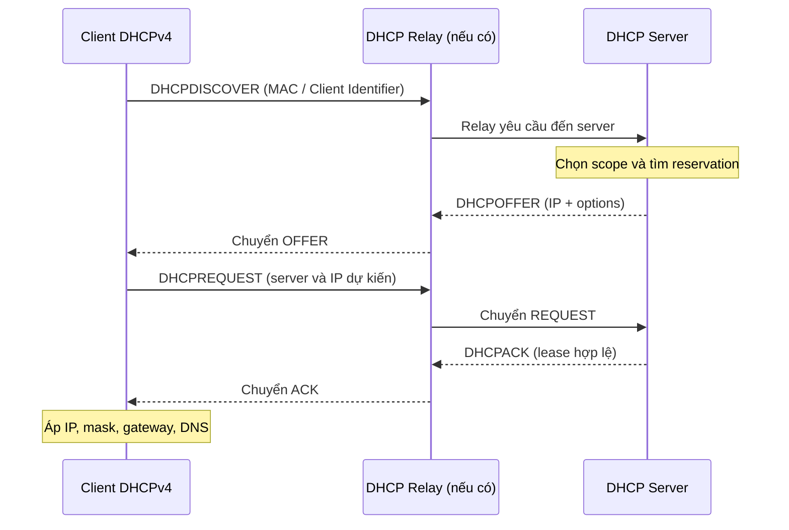
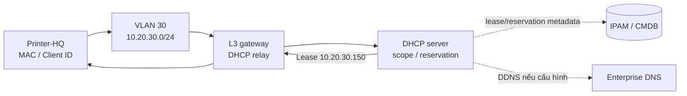
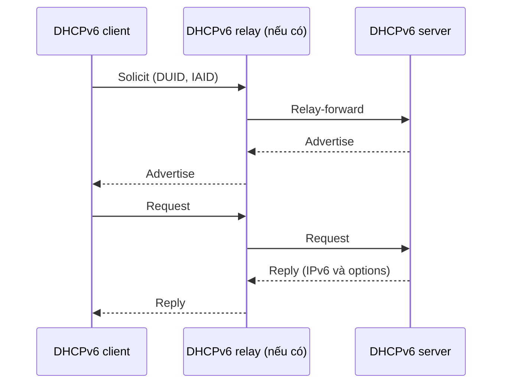
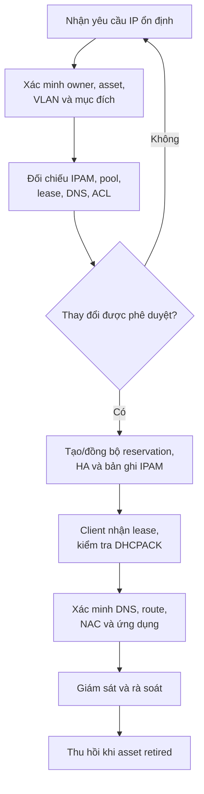
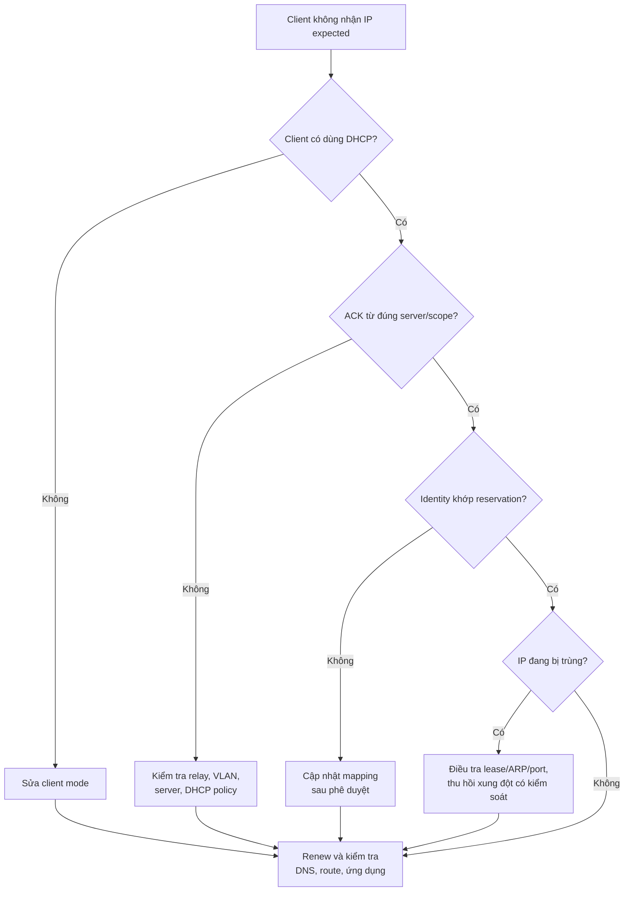

# Reserved address trong DHCP và IP Address Management

**Reserved address** trong quản trị DHCP thường là một **địa chỉ IP được đặt trước cho một client cụ thể** (*DHCP reservation*, còn được gọi là *fixed assignment* hoặc *static lease* tùy sản phẩm). Thay vì để DHCP server tự chọn địa chỉ bất kỳ còn trống trong vùng cấp phát động, quản trị viên định nghĩa một ánh xạ giữa **định danh của client** và **địa chỉ IP đã được duyệt**. Khi thiết bị dùng DHCP đúng cách, server sẽ ưu tiên cấp lại địa chỉ được gắn cho định danh đó trong phạm vi chính sách có hiệu lực.

Reservation thường được dùng cho máy in, camera, thiết bị IoT, máy trạm chuyên dụng, thiết bị đo lường, hệ thống giám sát và một số máy chủ cần IP ổn định để phục vụ DNS, truy cập từ dịch vụ khác hoặc quản trị. Nhưng **reservation không tự xác thực danh tính thiết bị**. Một thiết bị khác có thể tự đặt cùng IP hoặc giả mạo một số thuộc tính nhận diện nếu mạng thiếu bảo vệ.

Trong mô-đun **SECURITY_NETWORK_SECURITY**, kiến thức về reserved address được áp dụng cùng **DHCP/IPAM, phân đoạn mạng, firewall, 802.1X/NAC, DHCP snooping, VPN, DNS và giám sát lưu lượng**. Bài học trình bày cách phân biệt các loại “địa chỉ để dành”, thiết kế một scope an toàn, quản lý reservation theo vòng đời, điều tra IP conflict và kiểm thử khả năng hoạt động của hệ thống.

## 1. Mục tiêu học tập

Sau khi hoàn thành bài này, người học cần:

1. Phân biệt **DHCP reservation**, **static IP**, **excluded address/range**, lease động và các loại địa chỉ đặc biệt của IP.
2. Mô tả quá trình DHCPv4 cấp phát địa chỉ và vị trí DHCP server tra reservation.
3. Hiểu **MAC/chaddr, DHCPv4 Client Identifier, DHCPv6 DUID và IAID** cùng các giới hạn.
4. Xây dựng subnet có gateway, địa chỉ tĩnh của hạ tầng, pool động và reservation không xung đột.
5. Gắn reservation với **IPAM, DNS, DHCP relay, scope policy, failover và quản lý thay đổi**.
6. Thu thập bằng chứng khi thiết bị không nhận IP reserved, nhận sai gateway/DNS, trùng địa chỉ hoặc thay NIC.
7. Không nhầm địa chỉ đã đặt trước với **bằng chứng xác thực thiết bị hoặc giấy phép truy cập mạng**.

## 2. Đừng nhầm các nghĩa khác nhau của "reserved address"

| Thuật ngữ | Ai chọn địa chỉ? | Cách hoạt động | Lưu ý |
| --- | --- | --- | --- |
| **DHCP reservation** | Quản trị viên đặt ánh xạ trên DHCP server | Client vẫn yêu cầu IP qua DHCP và được server cấp theo định danh | Địa chỉ thường ổn định, nhưng vẫn phụ thuộc lease và cấu hình |
| **Static IP** | Người quản trị thiết bị hoặc công cụ cấu hình | Client sử dụng địa chỉ được đặt trực tiếp trên NIC | Không cần DHCP để cấu hình IP đó |
| **DHCP exclusion** | Quản trị viên DHCP scope | Một IP/vùng IP bị loại khỏi dải cấp phát tự động | **Không xác định host nào** được phép dùng IP |
| **Dynamic DHCP lease** | DHCP server theo pool và policy | IP có thể thay đổi theo thời điểm | Có lease time, renew/rebind |
| **IP được "reserved" bởi giao thức** | Tiêu chuẩn địa chỉ IP | Một IP/prefix có vai trò kỹ thuật đặc biệt | Không phải DHCP reservation |
| **IPAM allocation/reserved status** | Hệ thống quản lý địa chỉ | Ghi nhận IP đang được giữ cho dự án, thiết bị hoặc mục đích | Chưa chứng minh DHCP đã tạo reservation |

Câu nói **“đã reserve IP”** không đủ rõ để triển khai. Phải hỏi: IP có được DHCP server ánh xạ với client? Nó chỉ bị loại khỏi pool? Hay thực tế thiết bị được gán IP tĩnh?

### 2.1. Tại sao reservation vẫn có lease?

Một thiết bị dùng DHCP reservation thường vẫn tuân theo cơ chế lease. Nó có thể phải lấy IP khi khởi động, gia hạn khi lease gần hết hạn và xác nhận địa chỉ khi di chuyển mạng. Reservation giữ **ý định cấp phát ổn định**; không bảo đảm DHCP server/relay, VLAN hoặc mọi thiết bị liên quan luôn sẵn sàng.

Các rủi ro bao gồm: thay Client Identifier, NIC mới, reservation ở nhầm scope, IP bị một máy tĩnh khác chiếm, server failover chưa đồng bộ hoặc client chuyển sang VLAN khác. Vì thế không nói “IP đã reserve thì sẽ không bao giờ đổi”.

### 2.2. Địa chỉ đặc biệt IPv4 không phải reservation cho host

Trong subnet **10.20.30.0/24**, địa chỉ **10.20.30.0** thường là network address và **10.20.30.255** là directed broadcast cho subnet này. Địa chỉ **10.20.30.1** có thể được chọn làm gateway, còn **10.20.30.150** là một địa chỉ host hợp lệ.

Ý nghĩa của .0 và .255 **phụ thuộc prefix**, không phải quy tắc cho mọi mạng; các subnet /31 và /32 có trường hợp sử dụng riêng. Các dải như **127.0.0.0/8** (loopback), **169.254.0.0/16** (IPv4 link-local) hoặc **192.0.2.0/24** (tài liệu) có mục đích chuẩn khác nhau, không được dùng như pool client thông thường của doanh nghiệp. **10.0.0.0/8** là dải địa chỉ riêng; từng IP trong dải này vẫn phải được quy hoạch đúng subnet.

## 3. DHCP reservation tham gia vào quá trình DHCPv4 như thế nào?

Khi một client DHCPv4 chưa có IP hợp lệ cần cấu hình mạng, quá trình thường có **Discover → Offer → Request → Acknowledge (DORA)**.



Sơ đồ minh họa trường hợp có relay. Nếu client cùng broadcast domain với server, không cần relay; gói có thể broadcast/unicast theo trạng thái và cơ chế giao thức. Khi renew/rebind hoặc khởi động lại, client không nhất thiết gửi lại đúng toàn bộ DORA.

### 3.1. DHCP server thường dựa vào thông tin nào?

1. **Scope/subnet context**: interface nhận, địa chỉ relay, VLAN/giới hạn policy và các thông tin do thiết bị đáng tin cung cấp.
2. **Client identity**: MAC/chaddr hoặc Client Identifier theo cách engine thực thi.
3. **Reservation mapping**: có cấu hình gắn identity này với IP hợp lệ trong scope tương ứng không?
4. **Lease và pool state**: địa chỉ có xung đột, đã cấp cho client khác hay bị policy loại trừ không?
5. **DHCP options**: subnet mask, router, DNS, search domain, lease time, các tùy chọn riêng khác.

Server không nhất thiết cấp IP reserved bằng mọi giá nếu cấu hình không hợp lệ. Hệ thống cũng có thể phải phát hiện địa chỉ đã dùng trước khi ACK hoặc xử lý sự kiện client yêu cầu một địa chỉ không thích hợp.

### 3.2. Renew và rebind

Sau khi nhận lease, client thường cố gắng **renew** lease với server đã cấp trước khi hết hạn. Nếu không thành công, nó có thể chuyển sang **rebind** theo cơ chế DHCP. T1 và T2 có thể do server cung cấp; không được mặc định mọi client có thời gian gia hạn giống nhau. Việc client vẫn sử dụng IP trong một khoảng thời gian khi server mất liên lạc không chứng minh DHCP đã có HA hoàn chỉnh.

## 4. Thiết kế một subnet có địa chỉ được đặt trước

Giả sử doanh nghiệp xây dựng VLAN 30 cho máy in và thiết bị chuyên dụng.

```text
Subnet:      10.20.30.0/24
Gateway:     10.20.30.1
Infra static:10.20.30.2 - 10.20.30.20
DHCP pool:   10.20.30.100 - 10.20.30.199
Reservation: 10.20.30.150  <->  Printer-HQ
Dynamic IP:  10.20.30.176  <->  Laptop-test (ví dụ)
Broadcast:   10.20.30.255
```

**10.20.30.0/24** thuộc không gian riêng và được dùng như một thiết kế minh họa. IPAM quản lý toàn bộ subnet, còn DHCP server cấp các địa chỉ theo policy.

| Thành phần | Địa chỉ | Cơ chế quản lý |
| --- | --- | --- |
| Network | 10.20.30.0/24 | IPAM, routing |
| Gateway của VLAN | 10.20.30.1 | Static/network configuration |
| Vùng dành cho hạ tầng | 10.20.30.2–20 | Excluded khỏi pool động nếu được dùng tĩnh |
| Pool DHCP | 10.20.30.100–199 | DHCP scope |
| Printer-HQ | **10.20.30.150** | DHCP **reservation** |
| Laptop-test | 10.20.30.176 | Dynamic DHCP lease |
| Broadcast IPv4 /24 | 10.20.30.255 | Không cấp host thông thường |

### 4.1. Reservation trong pool hay ngoài pool?

Điều này **phụ thuộc DHCP server**. Có sản phẩm yêu cầu reservation nằm trong scope/pool đang phục vụ; sản phẩm khác hỗ trợ địa chỉ ngoài dải động nhưng vẫn thuộc subnet/scope, với các quy tắc riêng. Trong ví dụ, **10.20.30.150 nằm trong pool .100–.199** và phải được server thực thi là dành riêng cho Printer-HQ.

Trước khi triển khai, cần xác minh:

- Cách sản phẩm ưu tiên reservation so với dải động và exclusion.
- Server có ngăn cấp **10.20.30.150** cho client khác không.
- Có lease cũ hoặc host đặt tĩnh đang chiếm địa chỉ không.
- Failover server có cùng mapping và trạng thái không.
- Thiết bị có đang đặt **DHCP mode** thay vì static IP không.

Đừng lấy việc IPAM hiển thị “reserved” làm bằng chứng DHCP đã được cấu hình đúng.

## 5. Định danh DHCPv4: MAC, chaddr và Option 61

Phần lớn giao diện quản trị DHCP cho phép nhập **MAC address** khi tạo reservation. Tuy nhiên, DHCPv4 còn có các trường nhận diện khác.

- **chaddr**: địa chỉ phần cứng client trong header DHCPv4, đi kèm hardware type và hardware length.
- **Client Identifier (Option 61)**: định danh mà client có thể cung cấp; có thể có cấu trúc khác MAC đơn thuần.
- **Circuit/Relay metadata**: thông tin đường truy cập do relay đáng tin cung cấp, tùy sản phẩm và policy.

Server có thể ưu tiên một trong các trường theo cấu hình/triển khai. Nếu client gửi Option 61 nhưng reservation được tạo theo một identity không khớp, thiết bị có thể nhận IP động thay vì IP được đặt trước.

### 5.1. Vì sao MAC hoặc Client Identifier có thể thay đổi?

| Tình huống | Hệ quả với reservation |
| --- | --- |
| Laptop bật Wi-Fi MAC randomization | Định danh ở SSID có thể khác MAC ban đầu |
| Cắm USB-C Ethernet hoặc docking | NIC đang dùng có MAC khác Wi-Fi |
| Thay card mạng | Reservation cũ vẫn trỏ MAC của card cũ |
| Clone VM | MAC hoặc Client Identifier có thể trùng/được tái tạo |
| OS/PXE boot sử dụng client identity khác nhau | Cùng thiết bị nhưng request có định danh khác |
| Thiết bị có Ethernet và Wi-Fi | Mỗi interface có thể dùng định danh khác |
| Firmware hoặc DHCP client update | Cách gửi Client Identifier có thể thay đổi |

**Bước xác minh quan trọng nhất:** đọc client identity từ **DHCP request thực tế và log server**, không chỉ tin nhãn MAC trên thiết bị hay hồ sơ trong IPAM.

### 5.2. MAC không phải danh tính đáng tin cậy

MAC và một số định danh DHCP có thể bị thay đổi hoặc giả mạo. Reservation chỉ chọn IP cho identity được quan sát; nó **không bảo đảm tính xác thực mật mã** của máy. Với thiết bị truy cập vùng nhạy cảm, kết hợp **802.1X/EAP-TLS, NAC, thiết bị quản lý và xác thực dịch vụ**.

## 6. Reservation khác static IP ở những điểm nào?

| Tiêu chí | DHCP reservation | Static IP trên host |
| --- | --- | --- |
| IP ổn định | Có khi mapping, client và server hoạt động đúng | Có khi cấu hình host giữ nguyên |
| Nơi cấu hình chính | DHCP server/IPAM | OS/thiết bị hoặc config management |
| Nhận gateway/DNS option tập trung | Thường thuận tiện | Cần cấu hình/automation riêng |
| Phụ thuộc DHCP khi cấp/renew | Có | Không để cấu hình IP tĩnh |
| Phụ thuộc MAC/Client ID | Có theo mô hình matching | Không |
| Nguy cơ conflict | Vẫn có nếu host khác tự đặt IP hoặc cấu hình sai | Vẫn có nếu không kiểm soát IPAM |
| Khả năng audit tập trung | Tốt nếu DHCP/IPAM tích hợp | Cần quản lý cấu hình máy thật |
| Xác thực danh tính thiết bị | **Không** | **Không** |

Máy in, camera và một số thiết bị IoT thường phù hợp với reservation. Gateway router, thành phần DNS/DHCP cốt lõi hoặc các hệ thống bắt buộc hoạt động khi DHCP server mất liên lạc có thể phù hợp hơn với static IP hoặc cơ chế được nhà sản xuất hỗ trợ.

Không có quy tắc “mọi server phải dùng static” hoặc “mọi thiết bị cố định nên dùng reservation”. Quyết định phụ thuộc **SLO, khả năng HA và đường phụ thuộc khởi động**.

## 7. DHCP scope, VLAN, VRF và relay

Reservation phải tồn tại trong **scope phù hợp vị trí mạng thực của client**. Nếu Printer-HQ chuyển từ VLAN 30 sang VLAN 40 có subnet khác, server không nên cấp một địa chỉ thuộc VLAN 30 như thể nó thuộc mạng đang kết nối.



**DHCP relay** giúp client tại VLAN khác mạng server nhận DHCP. Với DHCPv4, trường **giaddr** thường hỗ trợ server xác định subnet/đường phản hồi. **Option 82 (Relay Agent Information)** có thể cung cấp ngữ cảnh circuit/remote ID khi relay và server được cấu hình phù hợp.

Option 82 **không tự là chứng chỉ thiết bị**: chỉ được tin thông tin từ relay/port đã được cấu hình là nguồn đáng tin. Cần kiểm thử trường hợp client đổi cổng hoặc thiết bị trung gian.

### 7.1. Một số lỗi scope/relay thường gặp

- Relay trỏ sai DHCP server hoặc route trả lời không hợp lệ.
- Client chuyển VLAN nhưng reservation vẫn nằm scope cũ.
- Hai server cùng phục vụ VLAN nhưng chỉ một bên có reservation.
- Scope sai mask, gateway hoặc DNS.
- DHCP server không xử lý Option 82 theo quy tắc đã thiết kế.
- Firewall chặn lưu lượng DHCP relay hoặc hạ tầng liên quan.
- Vị trí thực tế khác dữ liệu trên IPAM.

Thu đủ **port/SSID/VLAN, relay address, server identifier, client identity, IP trong OFFER/ACK và timestamp** để tìm đúng điểm lỗi.

## 8. DHCP options vẫn quan trọng với một địa chỉ đã reserve

Máy nhận đúng IP có thể vẫn không hoạt động nếu các options còn lại không chính xác.

| Thông tin DHCPv4 | Chức năng | Triệu chứng khi sai |
| --- | --- | --- |
| IP address | Địa chỉ của client | Không khớp thiết kế, trùng host |
| Subnet mask | Quyết định vùng on-link | Truy cập gateway/peer lỗi |
| **Router (Option 3)** | Default gateway | Cùng VLAN được nhưng liên VLAN/Internet lỗi |
| **DNS Server (Option 6)** | Recursive resolver | Kết nối theo IP được nhưng hostname lỗi |
| Search domain | Hỗ trợ tra tên ngắn | Nội bộ phân giải sai/không được |
| **Lease time (Option 51)** | Thời gian hiệu lực lease | Renew, trạng thái stale hoặc timeout |
| **Server Identifier (Option 54)** | Định danh DHCP server | Client liên hệ không đúng server |
| **Client Identifier (Option 61)** | Định danh client | Reservation không khớp |

Một số DHCP server cho phép đặt option riêng ở mức **reservation**, **scope**, **policy** hoặc **server**. Quy tắc kế thừa/ưu tiên khác nhau: phải **đối chiếu DHCPACK** và đặc tả sản phẩm, không chỉ đọc màn hình cấu hình.

### 8.1. Reservation không sửa được sự cố DNS

Ví dụ Printer-HQ nhận đúng **10.20.30.150** nhưng không giải được tên print-server.corp.example.net. Nguyên nhân có thể do DNS server sai, split DNS, ACL chặn DNS hoặc bản ghi A cũ. Chuyển IP reservation sang số khác không tự khắc phục những lỗi đó.

## 9. IPv6: DHCPv6 reservation, DUID/IAID và SLAAC

IPv6 không đơn giản là DHCPv4 với địa chỉ dài hơn. Host có thể dùng **SLAAC**, DHCPv6 hoặc phối hợp, tùy thiết kế và hệ điều hành.

### 9.1. Định danh DHCPv6

Trong DHCPv6:

- **DUID (DHCP Unique Identifier)** dùng để nhận diện client/server theo mô hình giao thức.
- **IAID (Identity Association Identifier)** phân biệt các identity association của client.
- **IA_NA** thường gắn với việc yêu cầu/cấp địa chỉ IPv6 không tạm thời qua DHCPv6.
- **IA_PD** dùng trong prefix delegation, **khác** reserve một địa chỉ cho host.

Một DHCPv6 reservation có thể khớp theo **DUID + IAID + subnet/association** hoặc cơ chế hãng cung cấp. Không mặc định có thể sao chép MAC từ reservation DHCPv4 sang DHCPv6.



Đây là quá trình thông thường; DHCPv6 có thể dùng **Rapid Commit** hoặc các trao đổi khác, nên không bắt buộc luôn có đủ bốn bước như hình.

### 9.2. SLAAC không đi qua DHCPv6 reservation

Nếu một máy tự tạo IPv6 bằng **Router Advertisement và SLAAC**, reservation DHCPv6 trên server có thể **không quyết định** địa chỉ mà ứng dụng đang sử dụng. Client có thể có nhiều IPv6 trên cùng NIC, trong đó có temporary/privacy addresses.

Cần kiểm tra RA/prefix, policy M/O, hệ điều hành và cấu hình client thật; không suy rằng mọi OS tuân cùng một cách sử dụng DHCPv6.

### 9.3. Reserved IPv6 prefix không phải DHCP reservation

- **fe80::/10**: link-local.
- **ff00::/8**: multicast.
- **2001:db8::/32**: prefix dành cho tài liệu.
- **::1**: loopback.

IPv6 **không có broadcast** như IPv4. Việc đặt trước một địa chỉ trong prefix IPv6 hợp lệ cho thiết bị là một lựa chọn quản trị, không biến prefix đó thành dải đặc biệt theo giao thức.

## 10. IPAM: quản trị reservation theo vòng đời

**IP Address Management (IPAM)** theo dõi subnet, IP, chủ sở hữu, trạng thái và quan hệ với DNS/DHCP. IPAM giúp tránh reservation mồ côi, IP trùng, thiết bị bị thay mà hồ sơ không cập nhật hoặc firewall rule còn tham chiếu tài sản đã nghỉ sử dụng.

### 10.1. Một bản ghi quản trị tối thiểu

| Trường | Ví dụ | Giá trị quản trị |
| --- | --- | --- |
| Reservation ID | RES-VLAN30-PRINTER-HQ | Tham chiếu trong ticket |
| VRF/VLAN/subnet | Corporate / VLAN 30 / 10.20.30.0/24 | Xác định ngữ cảnh |
| Reserved IP | 10.20.30.150 | Địa chỉ dự kiến |
| Identity type/value | DHCPv4 MAC / 02:42:ac:11:00:50 | Quy tắc matching |
| Asset ID và tên | ASSET-PRINT-025 / Printer-HQ | Chủ thể được cấp |
| DNS hostname | printer-hq.corp.example.net | Theo dõi bản ghi A/PTR |
| Owner | Facilities | Người chịu trách nhiệm |
| DHCP server/scope | dhcp-core / vlan30 | Điểm cấu hình |
| ACL dependency | Printer → print service | Rủi ro đổi địa chỉ |
| Change ticket | NET-CHANGE-2026-014 | Dấu vết phê duyệt |
| Lifecycle state | Active / Retired | Quản lý thu hồi |

MAC ví dụ **02:42:ac:11:00:50** là địa chỉ minh họa, không định danh thiết bị thật.

### 10.2. Pseudoconfiguration dùng cho IPAM

```yaml
# Chỉ mô tả hồ sơ quản trị, KHÔNG phải cấu hình DHCP server thực thi.
reservation_id: RES-VLAN30-PRINTER-HQ
scope:
  vlan: 30
  vrf: corporate
  subnet: 10.20.30.0/24
  dynamic_pool: 10.20.30.100-10.20.30.199
  gateway: 10.20.30.1
  dhcp_server_group: dhcp-corporate-ha
reservation:
  address: 10.20.30.150
  identity_type: dhcpv4-mac
  identity_value: "02:42:ac:11:00:50"
  expected_client_mode: dhcp
asset:
  id: ASSET-PRINT-025
  hostname: printer-hq.corp.example.net
  owner: facilities
security:
  segment: printer
  nac_role: managed-iot
  acl_dependencies:
    - printer-to-print-service
lifecycle:
  state: active
  change_ticket: NET-CHANGE-2026-014
  review: quarterly
```

Schema trên độc lập hãng và có các tên field tự đặt; không thể áp trực tiếp vào Kea, ISC DHCP, Windows DHCP hoặc dịch vụ cloud mà không dịch sang cấu hình đúng sản phẩm.

### 10.3. Quy trình đầy đủ



**Không chỉ tạo reservation rồi đóng ticket.** Địa chỉ phải thực sự được cấp, không trùng, kết nối đúng, có chủ sở hữu và có quy trình thu hồi.

## 11. DHCP reservation và DNS/DDNS

IP ổn định giúp cấu hình hostname và các hệ thống giám sát dễ hơn. Ví dụ:

- DHCP reservation: **Printer-HQ → 10.20.30.150**.
- DNS A: **printer-hq.corp.example.net → 10.20.30.150**.
- Hệ thống quản lý máy in kết nối bằng hostname.
- Log mạng ghi IP, port, zone và thời gian.

Một số hệ thống cho phép **Dynamic DNS (DDNS)** khi cấp lease, nhưng cần xác định **client hay DHCP server** có quyền cập nhật DNS và quy tắc cập nhật. Nếu reservation bị xóa hoặc đổi IP, bản ghi A/AAAA/PTR cũ phải được xử lý.

### 11.1. Những điểm cần kiểm soát

1. Tên thiết bị có thống nhất với asset inventory không?
2. Bản ghi A/AAAA có phản ánh đúng IP hiện thời không?
3. Có PTR cần dùng cho monitoring/audit không?
4. Nếu client tự gửi hostname, hệ thống có chấp nhận cập nhật DNS mà không có kiểm soát không?
5. Khi thay NIC hoặc chuyển VLAN, ai cập nhật DNS?
6. Với DHCPv6/SLAAC, ai quản lý AAAA khi địa chỉ thay đổi?

**DNS không phải bằng chứng xác thực thiết bị.** Reverse DNS và DHCP lease có thể hữu ích trong điều tra, nhưng không thay thế chứng chỉ, NAC hoặc phân quyền ứng dụng.

## 12. Địa chỉ ổn định không đồng nghĩa danh tính đáng tin

Một firewall rule chỉ cho **10.20.30.150** truy cập hệ thống quản trị có thể tạo cảm giác an toàn vì IP đó “được reserve cho máy in”. Nhưng reservation không ngăn host khác tự đặt IP đó, hoặc gửi DHCP bằng định danh giả.

### 12.1. Những rủi ro có thể gặp

- **IP spoofing/static IP** trong cùng segment khi không có binding/port control.
- **MAC spoofing/clone** làm server hoặc switch nhận diện nhầm thiết bị.
- **Rogue DHCP server** cấp địa chỉ và gateway/DNS sai cho client.
- **ARP spoofing hoặc IPv6 Neighbor Discovery abuse** làm lệch đường traffic.
- **Stale IPAM mapping** sau khi thay NIC hoặc thay asset.
- **NAT/shared IP** khiến một IP không tương ứng một người dùng.
- **Thiết bị bị xâm nhập** nhưng vẫn mang IP reserved hợp lệ.

### 12.2. Lớp kiểm soát bổ sung

| Công nghệ | Vai trò bảo vệ | Cần lưu ý |
| --- | --- | --- |
| **802.1X/NAC** | Xác thực/ủy quyền trước khi cấp truy cập mạng | IoT có thể cần ngoại lệ có đánh giá |
| **DHCP snooping** | Giới hạn nguồn DHCP trusted và lập binding khi hỗ trợ | Phụ thuộc cấu hình VLAN/port và mô hình relay |
| **IP Source Guard** | Kiểm soát IP/MAC/port dựa trên binding/chính sách | Cần phương án cho thiết bị tĩnh và môi trường đặc thù |
| **Dynamic ARP Inspection** | Phát hiện/hạn chế ARP không khớp binding | Chỉ đúng khi nguồn binding tin cậy và trust ports thiết kế chuẩn |
| **Firewall/ACL segmentation** | Giới hạn luồng giữa những vùng tin cậy | Có thể không nhìn thấy lưu lượng cùng VLAN ở L2 |
| **Device certificate / service auth** | Xác nhận danh tính thiết bị hoặc dịch vụ | Phải quản lý khóa, vòng đời và thu hồi |
| **IPAM/DNS/CMDB audit** | Theo dõi thay đổi, phát hiện mapping sai | Dữ liệu hồ sơ có thể trễ |

**DHCP snooping không biến reservation thành xác thực mật mã**. Khi switch dùng các cơ chế binding, một host static IP hợp lệ cũng có thể cần binding do quản trị viên xác nhận; cấu hình sai có thể làm mất mạng hợp lệ.

### 12.3. Option 82 và trust boundary

**DHCP Option 82** có thể chứa thông tin circuit/remote ID do relay đưa vào để hỗ trợ policy theo vị trí. Chỉ xem nó đáng tin khi **đường relay và cổng trusted được quản lý đúng**; không dùng một chuỗi Option 82 bất kỳ làm bằng chứng xác thực người dùng.

## 13. Phụ thuộc vào firewall và phân đoạn mạng

Reservation có thể giúp viết firewall rule với đích hoặc nguồn ổn định, nhưng security policy không nên chỉ xét IP.

Ví dụ chính sách an toàn hơn cho Printer-HQ:

- Thiết bị phải nằm trong **printer zone/VLAN** được quản lý.
- Cổng truy cập sử dụng **NAC hoặc kiểm soát L2** phù hợp.
- Chỉ cho luồng in hoặc quản lý **đúng đích và cổng nghiệp vụ**.
- Giao diện quản trị thiết bị yêu cầu xác thực riêng; không “tin cậy IP”.
- Log lưu source/destination, time, rule ID, zone và asset mapping để điều tra.

Khi thay reservation, cần kiểm tra **ACL phụ thuộc IP cũ**, bản ghi DNS, monitoring, allowlist dịch vụ và các tác vụ tích hợp. Nếu không, DHCP có thể hoàn toàn đúng nhưng ứng dụng vẫn bị deny do firewall.

## 14. DHCP server HA và tránh cấp phát chồng địa chỉ

Một subnet có nhiều DHCP server cần **mô hình phối hợp địa chỉ rõ ràng**, không phải hai server tùy ý cùng cấp phát pool.

Một số mô hình theo nền tảng:

- **DHCP failover** được sản phẩm hỗ trợ với cơ chế chia sẻ lease/state.
- **Active/standby** có đồng bộ reservations/policies.
- **Scope splitting** với các dải không chồng nhau theo thiết kế.
- **Cloud-managed DHCP** với các giới hạn và cơ chế sẵn sàng riêng.

Nếu một server biết **10.20.30.150** là reservation nhưng server thứ hai vẫn coi địa chỉ đó cấp động được, có nguy cơ xung đột.

### 14.1. Kiểm thử HA

- Khi server chính không hoạt động, server dự phòng có cấp đúng reserved IP cho client mới khởi động không?
- Client đang có lease có renew/rebind đúng không?
- DHCP options, VLAN và scope policy có giống nhau không?
- Có IP allocation conflicts hoặc lease state bất nhất không?
- Khi server chính quay lại, các bản ghi đã được đồng bộ chưa?
- Có log/cảnh báo khi HA replication gặp lỗi không?

**Không ngắt DHCP production tùy tiện để thử HA.** Thực hiện trong lab hoặc cửa sổ thay đổi đã được phê duyệt.

## 15. Xung đột địa chỉ IP: tìm đúng nguyên nhân

Một địa chỉ được reserve vẫn có thể bị **host khác sử dụng**. Khi đó việc một máy không mở được website hoặc thiết bị IoT mất kết nối có thể bắt nguồn từ **IP conflict**, không phải bản thân reservation lỗi.

| Triệu chứng | Khả năng | Bằng chứng |
| --- | --- | --- |
| Client nhận IP khác | Client ID/MAC không khớp, scope sai, server khác cấp | DHCPACK, server ID, lease table |
| Địa chỉ được reserve nhưng server báo in use | Lease cũ hoặc host tự đặt tĩnh | DHCP logs, IPAM, ARP/ND |
| Kết nối tới IP chập chờn | Hai host cùng IP hoặc ARP mapping thay đổi | ARP history, switch MAC/port |
| IP đúng nhưng không có mạng | Sai VLAN, mask, gateway, DNS hoặc NAC | DHCP options, route, port/VLAN, policy log |
| Client đổi IP sau thay NIC | Reservation gắn identity cũ | Asset change và request identity |
| Địa chỉ không đúng khi đổi mạng | Reservation ở scope cũ | Relay/giaddr, VLAN, scope |
| IPv6 không dùng IP đã reserve | SLAAC hoặc DHCPv6 ID khác | RA, DUID/IAID, địa chỉ IPv6 thực |

Một báo cáo hữu ích cần ghi **thời gian, client identity, VLAN/port, IP thực, DHCP server, OFFER/ACK, lease time, ARP/ND mapping và những thay đổi gần đây**.

### 15.1. Quy trình điều tra

1. Xác minh **client đang chạy DHCP mode**, interface nào đang dùng.
2. Lấy MAC/chaddr và Client Identifier từ request hoặc log server.
3. Tìm đúng DHCP server/scope được client liên hệ.
4. Kiểm tra IP trong OFFER/ACK, reservation, lease history và IPAM.
5. Xác minh có một host tĩnh hoặc server thứ hai đã cấp trùng không.
6. Kiểm tra mask/gateway/DNS/VLAN/firewall sau khi nhận IP.
7. Khắc phục identity, lease hoặc xung đột bằng **thay đổi có kiểm soát**.
8. Renew trên **một thiết bị thử được phép** rồi kiểm tra lại cả kết nối ứng dụng.

**Không xóa toàn bộ lease database hoặc reboot hàng loạt thiết bị** để giải quyết một IP conflict chưa rõ nguyên nhân.



## 16. Lệnh kiểm tra chỉ đọc

Các lệnh dưới đây dành cho **thiết bị, DHCP server và mạng mà người thực hiện có quyền quản trị**. Chúng không tạo hoặc xóa reservation.

### 16.1. Linux client

```bash
# Địa chỉ và các interface
ip -br address
ip link show dev eth0

# Route và DNS client
ip route
ip -6 route
resolvectl status

# Nếu máy dùng NetworkManager
nmcli device show

# Log NetworkManager trong một khung thời gian
journalctl -u NetworkManager --since "2026-11-28 08:00:00" --no-pager
```

Thông tin DHCP lease trên Linux tùy dịch vụ như NetworkManager, systemd-networkd hoặc dhclient. Không có một vị trí lease file áp dụng chung cho mọi distro.

### 16.2. Windows client

```powershell
# Tổng quan lease, DHCP server, gateway và DNS
ipconfig /all

# Địa chỉ, interface và resolver
Get-NetIPConfiguration
Get-NetIPAddress -AddressFamily IPv4
Get-DnsClientServerAddress
```

Cần xem chi tiết **DHCP Enabled**, thời điểm lease được cấp/hết hạn và IP DHCP server theo từng NIC, không chỉ nhìn kết quả ping.

### 16.3. Windows DHCP Server (đọc reservation và lease)

Nếu đã cài DHCP Server PowerShell module và có quyền phù hợp:

```powershell
Get-DhcpServerv4Reservation -ComputerName "dhcp-core.example.net" -ScopeId 10.20.30.0
Get-DhcpServerv4Lease -ComputerName "dhcp-core.example.net" -ScopeId 10.20.30.0
Get-DhcpServerv4Scope -ComputerName "dhcp-core.example.net" -ScopeId 10.20.30.0
```

Tên server mang tính minh họa. Những lệnh này nhằm **đọc dữ liệu**; module hoặc cách triển khai khác có thể có field và quyền truy cập khác.

### 16.4. Packet capture có bộ lọc

```bash
# Chỉ lấy tối đa 100 packet DHCPv4 tại interface được phép quản trị
sudo tcpdump -ni eth0 -c 100 '(udp port 67 or udp port 68)'

# DHCPv6 sử dụng UDP 546/547, khác DHCPv4
sudo tcpdump -ni eth0 -c 100 '(udp port 546 or udp port 547)'
```

Chỉ dùng capture trong phạm vi được phép, giới hạn số gói và thời gian. Pcap có thể chứa **MAC, hostname, Client Identifier và thông tin hạ tầng**; không công khai hoặc lưu giữ quá mức cần thiết.

## 17. Quy trình nghiệm thu reservation an toàn

Ma trận kiểm thử nên có **kịch bản được cấp IP và kịch bản không được cấp**; đồng thời kiểm tra rằng quyền truy cập mạng không dựa riêng vào IP.

| Test | Tình huống | Kết quả cần xác minh |
| --- | --- | --- |
| **T01** | Printer-HQ khởi động ở VLAN 30, DHCP mode | Nhận 10.20.30.150 qua DHCPACK |
| **T02** | Laptop khác trong cùng pool | Không được cấp 10.20.30.150 |
| **T03** | Printer-HQ renew/rebind | Giữ IP theo reservation còn hiệu lực |
| **T04** | Printer-HQ chuyển sang VLAN có scope khác trong lab | Không dùng sai địa chỉ của VLAN 30 |
| **T05** | Server chính unavailable trong test HA | Server dự phòng có cùng reservation/options |
| **T06** | Thay DNS option được duyệt | Client nhận option và phân giải tên đúng |
| **T07** | Kiểm thử IP trùng trong lab tách biệt | Có tín hiệu conflict và quy trình giải quyết an toàn |
| **T08** | Thiết bị không được phép dùng IP giống máy in trong lab | NAC/L2/firewall/service auth vẫn thực thi deny |
| **T09** | Thiết bị ngừng sử dụng | IPAM, DNS, reservation và ACL được rà soát/thu hồi |
| **T10** | DHCPv6 client đúng DUID/IAID | Nhận IPv6 dự kiến theo DHCPv6 policy |
| **T11** | Client có SLAAC | Không suy reservation DHCPv6 kiểm soát mọi IPv6 |
| **T12** | Thiết bị nhận đúng IP nhưng sai DNS/gateway | Nghiệm thu phát hiện lỗi option và kết nối ứng dụng |

Đừng cố giả mạo địa chỉ hoặc gây xung đột trên production chỉ để chứng minh rule hoạt động. Kiểm thử các tình huống âm tính trong **lab được phép**, có tài khoản, tài sản và phương án phục hồi.

## 18. Ba tình huống vận hành

### 18.1. Máy in được reserve nhưng nhận IP động

**Bối cảnh:** IPAM nói Printer-HQ dùng **10.20.30.150**, nhưng sau thay NIC, máy nhận **10.20.30.176**.

**Bằng chứng:** DHCP server trả ACK cho Client Identifier/MAC mới. Reservation cũ vẫn khớp MAC của NIC đã hỏng. Không nhất thiết có IP conflict.

**Khắc phục:** xác minh asset/NIC mới; cập nhật reservation và IPAM theo ticket; kiểm tra lease cũ và DNS; renew trên máy in, rồi xác minh dịch vụ in/scan.

**Bài học:** một reservation không tự động theo tên máy hoặc chủ sở hữu khi phần cứng và định danh DHCP đã thay.

### 18.2. Camera có IP reserved nhưng bị giả danh

**Bối cảnh:** camera được đặt trước IP và một firewall rule tin tưởng source IP đó cho phép truy cập một hệ thống nội bộ.

**Vấn đề:** host khác có thể tự đặt IP đó nếu mạng không ngăn, còn reservation không xác thực thiết bị.

**Thiết kế đúng:** VLAN IoT, NAC/802.1X hoặc phương án phù hợp thiết bị, DHCP snooping, IP Source Guard/DAI khi hỗ trợ, firewall least privilege và xác thực ở service. Chỉ dựa trên IP cho quyền quản trị là không đủ.

### 18.3. DHCP failover cấp trùng IP

**Bối cảnh:** hai DHCP server cùng phục vụ một subnet nhưng không có cơ chế điều phối đúng. Một bên reserve **10.20.30.150**, bên còn lại coi IP đó có thể cấp động.

**Triệu chứng:** kết nối tới máy in chập chờn, ARP/MAC mapping thay đổi và hai server có lease khác nhau.

**Điều tra:** đối chiếu ACK/lease logs của cả hai server, cấu hình failover, Option 54/relay, reservation replication và IPAM. Xác định host đang dùng IP trước khi thu hồi.

**Khắc phục:** sửa failover hoặc thiết kế scope splitting không chồng lấn, xử lý lease trùng có kiểm soát, đồng bộ reservations rồi nghiệm thu lại. **Tăng lease time hoặc reboot máy in** không sửa được lỗi hai server tự do cấp cùng IP.

## 19. Checklist thiết kế và vận hành

- [ ] Đã phân biệt reservation, static IP, DHCP exclusion và special-purpose IP.
- [ ] Có inventory subnet/prefix, gateway, VLAN/VRF, DHCP scope và dải pool.
- [ ] IP được reserve thuộc scope/subnet hợp lệ và phù hợp tính năng của DHCP server.
- [ ] Không chồng lấn với lease đang dùng, thiết bị đặt IP tĩnh hoặc scope của server khác.
- [ ] Reservation khớp đúng MAC/chaddr, Client Identifier hoặc DHCPv6 DUID/IAID theo sản phẩm.
- [ ] Đã xác minh client nhận lease thực tế thay vì chỉ kiểm tra một bản ghi cấu hình.
- [ ] Client nhận đúng subnet mask, gateway, DNS và các DHCP options cần thiết.
- [ ] Relay, giaddr, Option 82 và chính sách trusted path được thiết kế rõ.
- [ ] DHCP HA/failover đồng bộ policy, reservation và lease state theo mô hình hỗ trợ.
- [ ] IPAM lưu device ID, owner, hostname, IP, scope, change ticket và trạng thái vòng đời.
- [ ] DNS A/AAAA/PTR/DDNS nhất quán với địa chỉ được cấp khi cần.
- [ ] Với IPv6 đã phân biệt SLAAC, DHCPv6, DUID/IAID và prefix delegation.
- [ ] Không xem IP/MAC là bằng chứng danh tính mạnh cho chính sách nhạy cảm.
- [ ] 802.1X/NAC, DHCP snooping, IP Source Guard/DAI, firewall segmentation được dùng khi phù hợp.
- [ ] Thiết bị không được phép vẫn không truy cập được tài nguyên nhạy cảm dù IP giống thiết bị hợp lệ.
- [ ] Có giám sát pool utilization, DHCP failures, duplicate IP, DHCP relay và HA health.
- [ ] Có runbook cho đổi NIC, clone VM, xung đột lease và chuyển VLAN.
- [ ] Quy trình đổi/thu hồi reservation có audit, backup và khả năng rollback.
- [ ] Log/pcap được thu thập tối thiểu và bảo vệ định danh thiết bị.
- [ ] Các phép thử chỉ thực hiện trong phạm vi được phép, có kiểm tra luồng hợp lệ và luồng bị cấm.

## 20. Tổng kết

**DHCP reserved address** là ánh xạ một **định danh client** đến **địa chỉ IP được DHCP server cấp theo chính sách**. Nó khác **static IP đặt trên thiết bị**, **excluded address không được cấp động**, và **special-purpose address range** có ý nghĩa theo chuẩn IP. Trong DHCPv4, cần hiểu MAC/chaddr và Client Identifier; trong DHCPv6, phải xét DUID/IAID và sự tương tác với SLAAC.

Giá trị của reservation là **IP ổn định nhưng vẫn quản lý tập trung**, hỗ trợ DNS, giám sát, IPAM và giảm thay đổi cấu hình thiết bị. Để an toàn, cần triển khai cùng **DHCP relay/HA, IPAM/DNS, 802.1X/NAC, DHCP snooping, kiểm soát L2, firewall/ACL và xác thực dịch vụ**. Một địa chỉ được reserve giúp xác định nơi nên cấp IP, **không bảo đảm người đang sử dụng IP chính là thiết bị được cấp quyền**.
