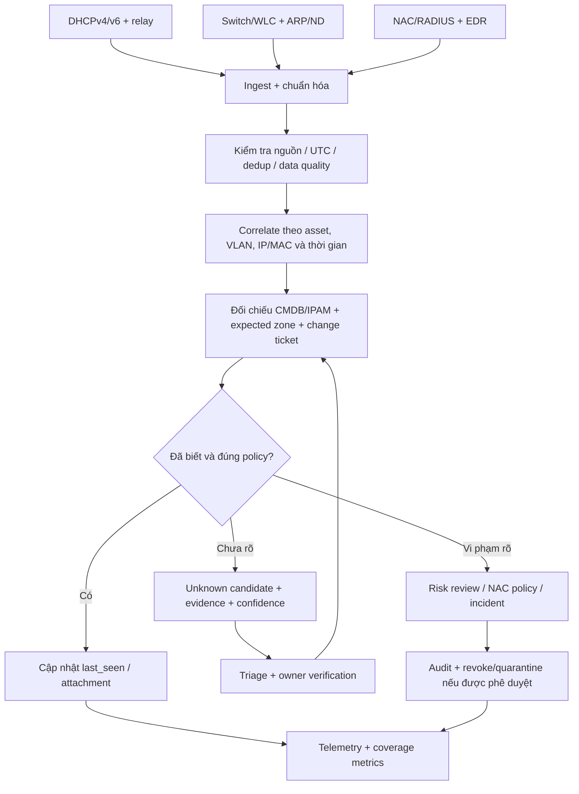

# Theo dõi thiết bị mới xuất hiện trong DHCP và IP management

## Mục tiêu học tập

Sau bài học, bạn có thể:

1. Giải thích vì sao phát hiện **thiết bị mới xuất hiện trên mạng** là một bài toán kết hợp **DHCP, IPAM, tài sản, kiểm soát truy cập mạng và telemetry lớp 2/lớp 3**, không phải chỉ tìm địa chỉ IP chưa từng thấy.
2. Đọc đúng các sự kiện **DHCPv4 DORA, DHCP lease/renewal/release, DHCP relay**, cũng như những khác biệt của **DHCPv6, SLAAC, Router Advertisement (RA)** và IPv6 privacy addresses.
3. Liên kết thông tin **MAC, IP, VLAN/subnet, switch port, SSID/AP, DHCP client identifier, danh tính 802.1X/RADIUS và asset ID**, hiểu giới hạn của từng khóa nhận dạng.
4. Định nghĩa chính xác **first seen**, **last seen**, **known asset**, **unknown candidate** và **confirmed unauthorized**, tránh nhầm DHCP cấp lại IP, thiết bị roaming hoặc MAC ngẫu nhiên với một thiết bị vật lý mới.
5. Thiết kế pipeline phát hiện, chấm ưu tiên và cảnh báo từ **DHCP/IPAM, ARP/ND, switch/WLC, NAC, EDR, SIEM, cloud inventory và CMDB**, có độ tin cậy và khả năng truy vết.
6. Lập quy trình xác minh, cô lập theo rủi ro và phản ứng với **rogue DHCP, thiết bị không được cấp phép, giả mạo MAC và xung đột địa chỉ**, không gây gián đoạn dịch vụ hợp lệ.
7. Thực hành bằng **dữ liệu giả lập ngoại tuyến** và ma trận nghiệm thu gồm thiết bị cấp IP động, IP tĩnh, IPv6, endpoint di chuyển và các nguồn log thiếu hoặc sai.

## 1. Vì sao phải theo dõi thiết bị mới xuất hiện?

Trong mạng doanh nghiệp, một thiết bị mới có thể là máy tính của nhân viên vừa được cấp phát, camera IoT mới lắp, máy ảo được tự động tạo, điện thoại dùng Wi-Fi khách, máy in của đối tác hoặc thiết bị **không được cấp phép** kết nối vào mạng nội bộ.

Theo dõi thiết bị mới giúp:

- **Asset discovery:** biết có tài sản nào vừa xuất hiện, thuộc ai, phục vụ mục đích nào và đã được ghi trong CMDB/IPAM chưa.
- **Network Access Control (NAC):** kiểm tra quyền vào VLAN/SSID/tài nguyên thay vì cho rằng có địa chỉ IP là đã được tin cậy.
- **Threat detection:** phát hiện tài sản lạ trong management plane, mạng máy chủ hoặc phân đoạn dữ liệu nhạy cảm.
- **Incident response:** nối một địa chỉ IP tại thời điểm sự cố với switch port, máy chủ DHCP, tài khoản mạng và thiết bị thực tế.
- **Change management:** so sánh thiết bị mới với kế hoạch triển khai, thay máy, mở rộng dịch vụ và thu hồi tài sản.
- **Address management:** phát hiện cấp phát trùng, thiết bị dùng IP ngoài scope, cấu hình DHCP sai và IP tĩnh không được quản lý.

Trong module `SECURITY_NETWORK_SECURITY`, năng lực này bổ trợ trực tiếp cho **segmentation, firewall, VPN, IDS/IPS, bảo vệ DNS, wireless security, cloud security và mô hình hóa mối đe dọa**. Nhìn thấy một endpoint mới là điểm khởi đầu cho **xác minh danh tính và áp chính sách**, không phải bằng chứng ngay lập tức về xâm nhập.

> **Nguyên tắc quan trọng:** “Mới thấy trong telemetry” khác với “thiết bị vật lý mới”; “không có trong inventory” khác với “độc hại”; và “nhận DHCP lease thành công” khác với “được phép truy cập hệ thống nhạy cảm”.

### 1.1. Những khái niệm dễ nhầm

| Khái niệm | Ý nghĩa | Điều không thể suy ra trực tiếp |
|---|---|---|
| **New IP** | Một địa chỉ vừa được cấp/quan sát | Không chứng minh có thiết bị mới |
| **New MAC** | Một địa chỉ MAC chưa thấy trong tập dữ liệu | Không chứng minh là phần cứng mới; MAC có thể ngẫu nhiên hoặc giả mạo |
| **New DHCP client ID** | Một identifier DHCP mới xuất hiện | Không bảo đảm tương ứng duy nhất với thiết bị vật lý |
| **New lease** | Server vừa cấp một lease hoặc thay binding | Không chứng minh người dùng có quyền truy cập nội bộ |
| **First seen** | Thời điểm một nguồn telemetry lần đầu ghi nhận entity | Không phải thời điểm thiết bị được chế tạo hoặc kết nối lần đầu trên toàn tổ chức |
| **Unknown asset** | Không khớp inventory đủ tin cậy tại thời điểm đối chiếu | Không tự đồng nghĩa thiết bị trái phép |
| **Unauthorized device** | Thiết bị đã được xác minh không đáp ứng chính sách cho zone/loại truy cập | Cần bằng chứng, chính sách và quyết định có thẩm quyền |
| **Rogue DHCP server** | Server không được ủy quyền cung cấp DHCP service | Là nguy cơ riêng; không nên đánh đồng với DHCP client lạ |

## 2. DHCPv4 cung cấp những tín hiệu gì?

**DHCPv4** cung cấp cấu hình IPv4 tự động cho client. Quá trình thường được mô tả bằng bốn thông điệp **DORA**:

```mermaid
sequenceDiagram
    participant C as DHCP Client
    participant S as DHCP Server
    C->>S: DHCPDISCOVER (tìm server)
    S-->>C: DHCPOFFER (đề nghị cấu hình)
    C->>S: DHCPREQUEST (yêu cầu địa chỉ/cấu hình)
    S-->>C: DHCPACK (xác nhận lease)
    Note over C,S: Qua relay khi khác subnet; luồng thực tế có thể khác
```

DHCPv4 thường dùng **UDP/67 (server)** và **UDP/68 (client)**. Khi server khác subnet, **DHCP relay agent** chuyển tiếp message qua ranh giới mạng, có thể đặt thông tin gateway/relay trong `giaddr` và gắn **Option 82** theo thiết bị/chính sách.

**Không phải mọi client đều đi qua DORA đầy đủ ở mọi lần kết nối.** Client có thể renew hoặc rebind bằng DHCPREQUEST mà không phát DHCPDISCOVER mới. Hệ thống theo dõi chỉ bắt sự kiện DHCPDISCOVER sẽ bỏ lỡ thiết bị ở một số tình huống.

### 2.1. Trường DHCPv4 thường liên quan nhận diện

| Trường/sự kiện | Thông tin cung cấp | Cảnh báo khi dùng để nhận diện |
|---|---|---|
| `chaddr` | Địa chỉ phần cứng client trong thông điệp DHCP | MAC có thể bị thay đổi, ngẫu nhiên hóa hoặc giả mạo |
| **Option 61 (Client Identifier)** | Identifier do client khai báo | Có thể khác MAC; format/độ ổn định phụ thuộc client |
| **Option 12 (Host Name)** | Tên host client đề xuất | Có thể thiếu, đổi tên, trùng hoặc do client tự khai |
| **Option 81 (Client FQDN)** | Thông tin FQDN phục vụ cập nhật DNS theo thỏa thuận | Không chứng minh danh tính hoặc chủ sở hữu |
| `yiaddr` / địa chỉ cấp | IPv4 được server đề nghị/cấp | Có thể được cấp lại hoặc chuyển cho thiết bị khác về sau |
| **DHCPACK** | Server xác nhận lease/cấu hình | Không bảo đảm endpoint còn online sau đó |
| **DHCPNAK** | Server từ chối request trong tình huống giao thức xác định | Có thể do đổi subnet/cấu hình, không nhất thiết tấn công |
| **DHCPDECLINE** | Client báo địa chỉ được đề nghị có vẻ đã dùng | Tín hiệu cần xem IP conflict, không tự kết luận spoofing |
| **DHCPRELEASE** | Client thông báo không dùng lease | Không phải client nào cũng gửi RELEASE khi tắt máy |
| **Option 82 (Relay Agent Information)** | Có thể cung cấp thông tin circuit/remote ID theo thiết bị relay | Phải tin nguồn relay, không coi là thuộc tính toàn cầu luôn có |
| **Server ID, scope, relay/giaddr** | Giúp xác định máy chủ và mạng nguồn | Cần gắn nguồn log, VLAN và server đúng thời gian |

**Thông tin client tự khai** như hostname, client identifier hoặc vendor-class có thể hữu ích để phân nhóm nhưng **không phải bằng chứng xác thực mạnh**. Thiết kế nên phân biệt trường đã được thiết bị hạ tầng tin cậy ghi nhận với trường do endpoint có thể tùy ý đặt.

### 2.2. Một lease không phải danh tính người dùng

Ví dụ:

```text
10:00 UTC: DHCP server cấp 192.0.2.20 cho MAC-A
10:30 UTC: MAC-A ngắt kết nối hoặc hết lease
11:00 UTC: DHCP server cấp 192.0.2.20 cho MAC-B
```

Một alert firewall lúc **10:10** và một alert lúc **11:10** dù có cùng IP nguồn **không nhất thiết xuất phát từ cùng thiết bị**. Để điều tra phải dùng **đúng thời gian**, lease history, relay/scope, NAT/VPN mapping và bằng chứng switch/NAC.

Bản ghi cấp lease cần tối thiểu các thông tin `lease_start`, `lease_end/expiry`, `observed_at`, server/scope, IP và client identity **theo khả năng log thực tế**. Sự kiện DHCPACK là một mốc xử lý cấu hình, **không thay thế toàn bộ lịch sử sống/chết của thiết bị**.

### 2.3. DHCP relay và vị trí quan sát

Một DHCP server tập trung có thể cấp lease cho nhiều VLAN/subnet. Nếu không có `scope`, `giaddr`, Option 82 hoặc dữ liệu network device tương ứng, bản ghi lease khó cho biết client đã nối vào **switch port/SSID nào**.

```text
Endpoint -- Access switch / AP -- VLAN / DHCP relay -- DHCP server
            |                    |                   |
         Link/port log        Relay info          Lease history
            |                    |                   |
            +--------------- Asset correlation ------+
```

Một log từ server **có thể không phản ánh đầy đủ đường L2**, còn MAC trong message có thể không đủ tin cậy để quy kết người dùng. Cần tương quan với **switch/WLC/NAC** tại cùng thời điểm.

## 3. IPv6 làm thay đổi bài toán nhận diện thế nào?

Không thể dùng **DHCPv4 lease logs** để khẳng định đã kiểm kê toàn bộ thiết bị trong mạng **dual-stack**.

### 3.1. DHCPv6

DHCPv6 sử dụng **UDP/546 cho client** và **UDP/547 cho server/relay**. Một luồng phổ biến gồm `SOLICIT → ADVERTISE → REQUEST → REPLY`, nhưng có thể có trường hợp **Rapid Commit** rút ngắn trao đổi khi các bên hỗ trợ.

Những điểm khác so với DHCPv4:

- DHCPv6 dùng **DUID (DHCP Unique Identifier)** để nhận dạng client/server và **IAID** để phân biệt những identity association; không thể mặc nhiên quy DUID thành MAC hiện tại.
- Cơ chế relay có thông tin link/interface tùy triển khai; cần gắn với zone và đường vào thực tế.
- **IA_NA** có thể liên quan địa chỉ IPv6 thông thường; **IA_PD** liên quan prefix delegation.
- DHCPv6 **không phải cơ chế phổ quát để cung cấp default gateway cho host IPv6**; thông tin router/default route thường đến từ **Router Advertisement (RA)**.
- Một thiết bị có thể dùng DHCPv6, SLAAC, địa chỉ tĩnh hoặc kết hợp nhiều cách.

**Một DUID có thể ổn định qua các lần kết nối tùy client**, nhưng việc thay OS, clone VM, image lỗi hoặc thiết lập quyền riêng tư cũng có thể khiến identifier thay đổi/trùng. Cần phân tích thay vì gắn nhãn “một DUID = một máy” tuyệt đối.

### 3.2. SLAAC, Router Advertisement và Neighbor Discovery

Với **Stateless Address Autoconfiguration (SLAAC)**, host có thể tự tạo địa chỉ IPv6 dựa trên prefix do RA thông báo, không cần nhận IPv6 address lease từ DHCPv6 server.

Các thành phần liên quan:

- **Router Advertisement (RA):** router thông báo prefix và những tham số liên quan trên link.
- **Neighbor Discovery (ND):** cơ chế tìm neighbor/router và quản lý một số quan hệ IPv6; xem neighbor table để lấy bằng chứng địa chỉ hiện diện.
- **Duplicate Address Detection (DAD):** giúp host kiểm tra địa chỉ IPv6 được chọn không xung đột trên link theo cách giao thức định nghĩa.
- **Privacy/temporary IPv6 addresses:** host có thể dùng nhiều địa chỉ hoặc thay đổi interface identifier theo thời gian để giảm khả năng theo dõi.

Vì vậy, một laptop có thể có **một MAC Wi-Fi**, **nhiều địa chỉ IPv6** và **một lease DHCPv4**, hoặc **không có DHCPv6 lease**. Alert chỉ dựa “IPv6 mới thấy” có thể sinh quá nhiều false positive.

### 3.3. Những nguồn cần kết hợp cho IPv6

| Nguồn | Đóng góp | Giới hạn |
|---|---|---|
| DHCPv6 logs | DUID, IAID, địa chỉ/prefix và thời hạn theo server | Không thấy các địa chỉ chỉ được tạo bởi SLAAC |
| Router/host ND cache | IPv6 ↔ link-layer neighbor theo thời điểm | Cache có thể stale, bị giả mạo, không đầy đủ |
| Switch/WLC/NAC | Port/SSID và xác thực thiết bị | Không mặc nhiên thấy mọi địa chỉ IPv6 được host tạo |
| IPv6 firewall/flow logs | Traffic thực tới/vượt qua ranh giới | Không bảo đảm gắn được với danh tính vật lý |
| EDR/MDM/agent | Tập địa chỉ trên host, device ID | Phụ thuộc độ phủ agent và chính sách thu thập |
| IPAM/CMDB | Prefix ownership, subnet, zone và inventory | Cần cập nhật và đối chiếu thời điểm |

**DHCP snooping của IPv4 không tự động xử lý mọi rủi ro IPv6.** Cần rà soát riêng tính năng bảo vệ **rogue RA, rogue DHCPv6 và ND/source address** theo nhà cung cấp switch/WLC.

## 4. “Thiết bị mới” phải được định nghĩa theo ngữ cảnh

Một detector tốt không chỉ đếm khóa chưa thấy trong database.

### 4.1. Các trạng thái đề xuất

| Trạng thái | Ý nghĩa | Hành động điển hình |
|---|---|---|
| `KNOWN_ACTIVE` | Asset đã được inventory/ủy quyền và có bằng chứng đang hoạt động | Theo dõi bình thường |
| `KNOWN_REAPPEARED` | Asset đã biết xuất hiện lại sau thời gian vắng mặt | Kiểm tra thay đổi port/zone nếu bất thường |
| `NEW_OBSERVED` | Nhận được một dấu hiệu của entity chưa từng thấy tại nguồn hiện tại | Bổ sung telemetry, chưa quy kết |
| `UNKNOWN_CANDIDATE` | Không khớp inventory và có dấu hiệu presence đủ để xem xét | Enrich, yêu cầu xác minh owner |
| `PENDING_REGISTRATION` | Thiết bị mới đang trong onboarding/đăng ký hợp lệ | Quyền hạn theo vùng onboarding |
| `AUTHORIZED_NEW` | Đã xác minh và được phê duyệt theo chính sách | Gắn owner/asset ID, áp profile NAC đúng |
| `UNAUTHORIZED_CONFIRMED` | Đã có bằng chứng vi phạm quyền truy cập tại zone | Phản ứng theo mức độ rủi ro, có audit |
| `INACTIVE/RETIRED` | Không còn hoạt động hoặc đã thu hồi theo inventory | Không tự động tái cấp quyền nếu thiết bị xuất hiện lại |

Đây là **mô hình trạng thái cho bài học**, không phải schema cố định của một sản phẩm. Có thể bổ sung `INVESTIGATION_PENDING`, `QUARANTINED`, `DATA_INSUFFICIENT` theo nhu cầu.

### 4.2. Ba loại “first seen” riêng biệt

1. **First seen by source:** lần đầu **DHCP server A** hoặc **switch B** quan sát một identifier.
2. **First seen by zone:** lần đầu một asset xuất hiện trong một VLAN/SSID/management segment, kể cả đã được biết ở zone khác.
3. **First seen enterprise-wide:** lần đầu tổ chức nhận dạng một asset đã được tương quan từ nhiều nguồn.

Trong pipeline, mỗi thời điểm cần đi kèm **nguồn và tiêu chí định danh**. Một hệ thống vừa bật thu thập DHCP logs hôm nay sẽ đánh dấu hàng trăm thiết bị là “first seen”, dù chúng đã tồn tại nhiều năm.

### 4.3. New asset vs new attachment vs new address

```text
Asset đã biết, đổi từ Wi-Fi sang Ethernet
  -> New attachment (interface/port), không nhất thiết new asset

Asset đã biết, renew sang IPv4 khác
  -> New address/lease, không nhất thiết new asset

Cùng điện thoại dùng private MAC khác trên SSID khác
  -> New observed MAC, không chắc new physical device

Một thiết bị cắm trái phép vào management VLAN
  -> New presence in sensitive zone; mức ưu tiên cao hơn

VM/container được tạo theo lịch autoscaling
  -> New workload instance có thể hợp lệ theo inventory/IaC
```

Quyết định “mới” cần so với **đối tượng cần bảo vệ**: máy vật lý, network interface, workload, user, session hay kết nối mạng.

## 5. Nguồn telemetry: DHCP là một mảnh ghép

### 5.1. Ma trận nguồn bằng chứng

| Nguồn | Bằng chứng hữu ích | Điều không được khẳng định chỉ từ nguồn đó |
|---|---|---|
| **DHCPv4/v6 server** | Lease, client ID/DUID, IP, scope, lease interval, server | Client chắc chắn còn online hoặc được phép vào ứng dụng |
| **DHCP relay / Option 82** | Circuit/relay identity, subnet gốc tùy triển khai | Danh tính người dùng đã xác thực |
| **Switch MAC/FDB table** | MAC vừa được học ở port/VLAN | MAC là thật hoặc host còn đó sau khi aging |
| **Switch port link events** | Link up/down, port, trạng thái PoE | Có đúng một endpoint; sau unmanaged switch có thể nhiều thiết bị |
| **ARP table / ARP inspection** | IPv4 ↔ MAC/neighbor theo thời điểm | ARP là xác thực mạnh hoặc thông tin không stale |
| **IPv6 ND table** | IPv6 ↔ neighbor/link-layer association | Một IPv6 tương đương một thiết bị vật lý |
| **802.1X/RADIUS accounting** | Authenticated principal/device, NAS, port/SSID, session | Mỗi principal tương đương một máy trong mọi cấu hình |
| **Wireless controller/AP** | Association/disassociation, SSID, AP, client MAC | MAC private là định danh bền vững across SSID |
| **NAC/MDM/EDR** | Device ID, posture, chứng thư, managed status | Agent luôn có mặt trên mọi BYOD/IoT |
| **IPAM/CMDB** | IP/subnet/owner, asset lifecycle, expected role | Inventory không bao giờ trễ hoặc sai |
| **Firewall/NetFlow/IPFIX** | Traffic thực từ nguồn tới đích theo thời gian | Biết tên người dùng nếu chỉ có IP/NAT |
| **DNS/DHCP dynamic DNS** | Hostname/FQDN liên quan địa chỉ | Hostname là danh tính đáng tin |
| **Cloud/IaC/Kubernetes** | VM instance ID, NIC ID, workload identity, deployment | IP/MAC một workload ephemeral sẽ luôn ổn định |

Nguồn có thể báo **những sự thật khác nhau**: DHCPACK nói server cấp lease; AP association nói station kết nối; RADIUS Access-Accept nói thông tin xác thực được chấp nhận; firewall log nói một flow thực sự đi qua; CMDB nói **chủ sở hữu dự kiến**. Cần tách các sự kiện này thay vì gộp thành “thiết bị đã được cấp phép”.

### 5.2. Độ phủ và điểm mù

- **Static IPv4:** thiết bị đặt IP tĩnh sẽ không có quá trình lấy lease trên DHCP server.
- **IPv6 SLAAC:** thiết bị có thể giao tiếp IPv6 mà không có DHCPv6 record.
- **Wi-Fi guest/captive portal:** cùng thiết bị có thể được quan sát qua MAC riêng của SSID.
- **VPN/cloud overlay:** IP quan sát tại firewall có thể là IP tunnel, NAT hoặc proxy, không phải địa chỉ Wi-Fi của endpoint.
- **Containers/VMs:** nhiều workload có thể được tạo/xóa trong thời gian ngắn; IP có thể tái sử dụng.
- **SPAN/collector outage:** thiếu log do điểm quan sát lỗi không có nghĩa không có thiết bị.
- **Unmanaged switch:** nhiều MAC phía sau một access port, khiến “port → thiết bị” không còn quan hệ một-một.
- **Dual-stack:** IPv4 và IPv6 có thể chỉ hiện ở các hệ thống khác nhau; cần map về cùng asset khi có bằng chứng.

Kết luận kiểm kê phải ghi **những mạng đã bao phủ, những giao thức đã quan sát và các nguồn còn thiếu**.

## 6. Liên kết danh tính: không dùng một khóa duy nhất

### 6.1. Thứ bậc tín hiệu nhận diện

Một bảng gợi ý về **độ tin cậy trong điều kiện đã xác minh**:

| Tín hiệu | Độ phù hợp để nối asset | Cần kiểm tra |
|---|---|---|
| **Managed device ID / chứng thư thiết bị** | Cao nếu gắn qua quy trình cấp phát và xác thực đáng tin | Clone/compromise, vòng đời chứng thư, mapping tới asset |
| **802.1X EAP-TLS identity + RADIUS session** | Tốt cho phiên truy cập có dây/Wi-Fi khi cấu hình đúng | Máy/chứng thư được dùng bởi ai, NAS/port/SSID, session time |
| **Cloud instance/network-interface ID** | Tốt trong phạm vi tài khoản/provider tương ứng | Instance lifecycle, account/project/region, re-creation |
| **MAC + switch port + VLAN + thời điểm** | Bằng chứng attachment khá hữu ích | MAC spoofing, private MAC, thiết bị sau switch |
| **DHCPv4 client ID / DHCPv6 DUID** | Hữu ích để nối các lease theo client | Thay đổi, reuse, clone, implementation differences |
| **IPv4/IPv6 address** | Phù hợp quy chiếu tạm thời trong đúng time window | Lease reuse, NAT, multiple addresses, SLAAC |
| **Hostname / vendor class / OUI** | Có ích để gợi ý phân loại | Dễ giả mạo, trùng, randomization và vendor không luôn đúng |

Đây không phải điểm số chuẩn hóa theo tiêu chuẩn. Một certificate chưa được cấp đúng hoặc endpoint bị chiếm quyền vẫn có thể tạo rủi ro. Ngược lại, một thiết bị không có EDR hoặc 802.1X có thể là IoT hợp lệ cần phương án nhận diện bù.

### 6.2. MAC randomization và giả mạo địa chỉ

Nhiều hệ điều hành sử dụng **private/randomized MAC** trên Wi-Fi để tăng quyền riêng tư. MAC có thể ổn định trong một mạng nhưng khác trên mạng khác, hoặc thay đổi sau một khoảng/thao tác cấu hình theo hệ điều hành.

Hệ quả:

- Một điện thoại có thể tạo **nhiều MAC được quan sát** trên các SSID.
- Vendor/OUI lookup thường không giúp xác định hãng nếu địa chỉ là locally administered.
- Một MAC “mới” sau roam hoặc reset cấu hình **không chắc là thiết bị mới**.
- **MAC spoofing** có thể có biểu hiện giống MAC randomization; không phân biệt được chỉ bằng một cờ trong địa chỉ.

Để giảm false positive, gắn với **danh tính Wi-Fi/802.1X, chứng thư thiết bị, phiên WLC, asset registry** theo chính sách và quyền riêng tư. Không coi việc dùng MAC ngẫu nhiên là hành vi độc hại mặc định.

### 6.3. Một địa chỉ IP qua thời gian có thể thuộc nhiều thiết bị

Nếu IPAM cho thấy `192.0.2.30` từng gắn với `asset-A` rồi `asset-B`, flow log chỉ có IP và timestamp phải được nối với:

1. DHCP lease history hoặc static IP ownership tại thời điểm.
2. VLAN/VRF/network segment và địa chỉ có thể trùng giữa các miền.
3. NAT/CGNAT/VPN mapping nếu có.
4. Switch FDB/ARP/ND/WLC association hoặc NAC session.
5. Asset owner, chứng thư hoặc device identity nếu được ghi.

Đừng tạo một asset mới cho mỗi IP mới, và cũng đừng gộp hai asset thành một chỉ vì từng dùng chung IP.

## 7. Pipeline xử lý sự kiện và đối chiếu IPAM

Một quy trình có thể tổ chức thành:



### 7.1. Chuẩn hóa sự kiện

Ví dụ bản ghi **giả lập**:

```json
{
  "event_id": "evt-dhcp-20261128-012",
  "event_type": "dhcpv4.lease_ack",
  "occurred_at": "2026-11-28T08:10:00Z",
  "ingested_at": "2026-11-28T08:10:03Z",
  "source_system": "dhcp-server-lab-01",
  "site_id": "site-lab-01",
  "network_context": {
    "vlan_id": 30,
    "vrf": "guest",
    "subnet": "192.0.2.0/25",
    "relay_id": "relay-lab-01"
  },
  "observed_identity": {
    "mac": "7a:a1:a2:a3:a4:a5",
    "dhcp_client_id": "client-lab-024",
    "hostname_claimed": "phone-guest"
  },
  "assigned_ipv4": "192.0.2.42",
  "lease_expires_at": "2026-11-28T10:10:00Z",
  "correlation": {
    "asset_id": null,
    "identity_confidence": "unverified",
    "inventory_match": "none"
  }
}
```

`occurred_at` và `ingested_at` khác nhau: log có thể đến muộn. MAC/hostname/client ID trong ví dụ **không phải danh tính được xác minh**. Trường `asset_id=null` chỉ nói hệ thống chưa tìm được liên kết tại thời điểm xử lý.

### 7.2. Những trường dữ liệu nên lưu

- **Event ID, type và nguồn** để deduplicate và truy vết.
- **Event time UTC + ingestion time**, độ chính xác và độ lệch đồng hồ nếu biết.
- **Site / VRF / VLAN / subnet / SSID / AP / switch & port** trong phạm vi có thể thu.
- **DHCP server / scope / relay / Option 82 / message type**, thời gian bắt đầu/kết thúc lease.
- **MAC/client identifier/DUID/IAID/IPv4/IPv6**, có ghi mức tin cậy của từng trường.
- **Authenticated device/principal/session ID** từ NAC/RADIUS khi có và được phép.
- **Asset ID, owner, expected zone, approval/change ticket**, inventory revision.
- **Detection rule, confidence, reason, action, action outcome**.
- **Source health/sample/coverage**, vì detector không thể chính xác hơn telemetry đầu vào.

**Không thu thập tùy tiện dữ liệu nhạy cảm** từ thiết bị người dùng. MAC, IP, hostname, user và vị trí kết nối có thể là dữ liệu cá nhân hoặc có thể liên hệ tới cá nhân; cần kiểm soát truy cập, mục đích xử lý và retention phù hợp.

### 7.3. Correlation theo thời gian và ngữ cảnh

Mô hình logic cho một liên kết:

```text
Candidate identity =
  strong_device_identity (nếu đã xác thực)
  HOẶC
  nhóm bằng chứng (site + VLAN/SSID + MAC/client ID + time window)
  + network attachment (port/AP/relay)
  + inventory/owner/change context

IP được dùng như thuộc tính có thời hạn:
  (VRF/site, IP, valid_from, valid_to, source)
```

Sử dụng **khoảng thời gian nửa mở** `[start, end)` để tránh một IP tại đúng mốc chuyển lease bị gán đồng thời cho hai chủ, nhưng phải xử lý log thiếu hoặc đến muộn bằng trạng thái **unknown** chứ không tự suy ra duy nhất một thiết bị.

Một hệ thống tốt có thể giữ **nhiều giả thuyết identity** kèm confidence thay vì ép gộp các record chưa đủ chứng cứ.

## 8. Quy tắc phát hiện thiết bị mới theo mức độ rủi ro

### 8.1. Quy tắc ví dụ

| Điều kiện | Diễn giải ban đầu | Mức ưu tiên gợi ý |
|---|---|---|
| MAC/client ID lần đầu ở **guest VLAN**, có DHCPACK và AP association | Thiết bị guest mới; có thể là khách hợp lệ | Thấp, cần policy guest đúng |
| MAC lần đầu ở **management VLAN**, switch port mới link up và không khớp NAC | Thiết bị lạ ở phân đoạn nhạy cảm | Cao, cần xác minh ngay |
| Asset đã biết vừa đổi IPv4, cùng chứng thư/RADIUS identity | Address churn hợp lệ có khả năng cao | Thông tin |
| MAC mới nhưng authenticated device ID đã biết | Có thể private MAC/adapter mới | Xem xét nếu zone/port bất thường |
| IP tĩnh chưa có IPAM record, ARP + switch FDB cho thấy hoạt động | Unknown static endpoint candidate | Trung bình/cao theo zone |
| DHCP server trái phép phát OFFER/ACK trên access port | Nguy cơ rogue DHCP, cần xử lý riêng | Cao, có thể là sự cố hạ tầng |
| Cùng một IP ở cùng VRF/VLAN được hai MAC khác nhau tranh chấp | IP conflict/spoofing/misconfiguration | Trung bình/cao theo tác động |
| DHCP client ID trùng trên nhiều host đồng thời | Clone/bug hoặc trùng định danh | Cần phân tích, không vội coi là botnet |
| Cloud VM mới có instance ID và deployment ticket hợp lệ | Workload mới đã phê duyệt | Thông tin, cập nhật inventory |

**Ngưỡng và độ ưu tiên là ví dụ**, phải tùy môi trường, độ nhạy zone, khả năng giám sát và chính sách doanh nghiệp. Một host không có DHCP log **không được tự xem là an toàn**.

### 8.2. Bằng chứng tối thiểu trước khi tạo alert

Đối với **thiết bị mới chưa xác định**, nên yêu cầu một hoặc nhiều nguồn bổ trợ:

- DHCP lease mới **và** WLC association hoặc switch FDB tại cùng site/zone.
- Switch port link up **và** MAC thực sự tạo lưu lượng/ARP/ND trong cùng cửa sổ.
- Một địa chỉ IP tĩnh không có DHCP nhưng có **ARP/ND + switch port** xác nhận sự hiện diện.
- NAC xác thực danh tính thiết bị nhưng không tìm được inventory match — có thể ưu tiên cao hơn bản ghi MAC đơn lẻ.
- Một DHCP OFFER từ server không được phép trên cổng không tin cậy — thuộc loại **rogue server detection**, xử lý theo chính sách khác.

Nếu chỉ có **một IP mới ở flow logs**, detector nên ghi `unattributed_new_address` hoặc `insufficient_identity_data` thay vì “máy tính lạ đã vào LAN”.

### 8.3. Chấm ưu tiên không đánh đồng với xác suất tấn công

Một mô hình phân loại hành động có thể xét:

1. **Độ nhạy zone:** guest, user LAN, server, production, management/OOB.
2. **Chất lượng định danh:** chứng thư đã xác minh, RADIUS session, MAC/port, chỉ IP.
3. **Inventory mismatch:** không có owner, không nằm trong dải được phép, sai expected VLAN.
4. **Hành vi traffic:** kết nối tới tài nguyên bị deny, bất thường IDS/IPS, DNS, truy cập admin.
5. **Tác động:** hệ thống quan trọng hay IoT có quyền rộng.
6. **Độ mới theo thời gian:** lần đầu sau bao lâu và có triển khai đúng lịch không.

Có thể gán severity **cao** cho unknown candidate ở management VLAN dù độ tin cậy về **danh tính** mới ở mức trung bình. Ngược lại, một lease trong guest VLAN có độ chắc chắn cao rằng “client đang tồn tại” nhưng rủi ro an ninh có thể thấp nếu segmentation đúng.

**Severity**, **confidence** và **identity assurance** là các khái niệm khác nhau; nên lưu thành các trường riêng.

## 9. Kiểm soát rogue DHCP, giả mạo và truy cập trái phép

### 9.1. Rogue DHCP server

Một thiết bị không được phép có thể trả DHCP OFFER/ACK, làm client nhận **gateway, DNS hoặc IP configuration không đúng**. Tác động có thể là mất mạng, chuyển hướng traffic hoặc làm suy giảm kiểm soát.

Phòng vệ thường dùng:

- **DHCP snooping** trên switch hỗ trợ: chỉ cổng tin cậy (ví dụ uplink đến DHCP server/relay đã được phê duyệt) được phép gửi một số message từ phía server; access port không tin cậy bị hạn chế.
- Tách VLAN, quy hoạch server/relay và cập nhật danh mục **authorized DHCP servers**.
- Cảnh báo khi thấy **DHCPOFFER/DHCPACK từ nguồn không được phê duyệt** tại vị trí không đúng.
- Giới hạn rate và bảo vệ DHCP service theo tính năng thiết bị; theo dõi outage và relay error.
- Kiểm tra định kỳ đường kết nối ở Wi-Fi, switch access, hypervisor vSwitch và lab/VM có DHCP server nội bộ.

**Không bật DHCP snooping trên toàn mạng mà chưa kiểm tra topology.** Cấu hình trusted port sai có thể chặn DHCP hợp lệ và làm hàng loạt client không nhận được địa chỉ.

### 9.2. Dynamic ARP Inspection (DAI) và IP Source Guard

Trên các switch hỗ trợ:

- **Dynamic ARP Inspection (DAI)** giúp kiểm tra một số bản tin ARP dựa trên binding tin cậy, thường có thể liên kết với DHCP snooping database.
- **IP Source Guard** có thể giới hạn source IP/MAC tại cổng theo binding/ACL trên nền tảng tương ứng.
- DHCP snooping binding có thể cung cấp IP–MAC–VLAN–port cho một số cơ chế này.

Tuy nhiên, **thiết bị IP tĩnh** không có DHCP snooping binding tương ứng sẽ cần **static binding/ACL hoặc cơ chế trust được cấu hình cẩn thận**; nếu bỏ qua có thể chặn nhầm máy chủ, thiết bị IoT hoặc hạ tầng.

DAI chỉ là cơ chế bảo vệ ARP trong IPv4; với IPv6 cần đánh giá **RA Guard, DHCPv6-Shield, ND inspection và IPv6 source guard** theo hỗ trợ và giới hạn của sản phẩm. RA Guard có yêu cầu xử lý extension headers/fragmentation an toàn trong triển khai; không được mặc định mọi switch có mức bảo vệ tương đương.

### 9.3. NAC/802.1X và vùng onboarding

**802.1X/EAP** xác thực quyền truy cập trên switch/Wi-Fi khi thiết bị và hạ tầng hỗ trợ. NAC có thể dùng **RADIUS, dynamic VLAN, dACL, role/SGT, CoA/reauthentication** tùy nền tảng để đặt thiết bị vào vùng thích hợp.

Một luồng kiểm soát hợp lý:

1. Thiết bị kết nối, switch/AP ghi sự kiện **port/link hoặc association**.
2. NAC kiểm tra danh tính người dùng/thiết bị, chứng thư và posture khi áp dụng.
3. Unknown/unmanaged endpoint được đặt vào **guest/onboarding/remediation zone** có quyền hạn hẹp.
4. DHCP/IPAM gắn IP với đúng zone; asset inventory được cập nhật khi có approval.
5. Chỉ sau khi đạt policy, NAC/PEP mới cho phép mạng nội bộ/tài nguyên thích hợp.
6. Khi thiết bị bị thu hồi hoặc trở nên không tuân thủ, reauthorize/disconnect/quarantine theo runbook.

**MAC Authentication Bypass (MAB)** là phương án cho một số thiết bị không hỗ trợ 802.1X nhưng yếu hơn chứng thư: MAC có thể giả mạo. Cần kết hợp segment riêng, port location, owner và giám sát.

### 9.4. IPAM không tự thay thế firewall

Ghi một IP/host vào IPAM chỉ giúp **quản lý thông tin**; muốn ngăn truy cập trái phép còn cần **NAC, switch port policy, firewall, microsegmentation, VPN/ZTNA và authorization ở ứng dụng**.

Thiết bị lạ có IP từ DHCP nhưng bị NAC đặt trong guest VLAN không có đường đến production có thể là **mô hình an toàn hơn** so với tự cho phép mọi client đã nhận IP vào mạng nội bộ.

## 10. Thiết kế theo zone và môi trường

### 10.1. Mức kiểm soát khác nhau theo zone

| Zone | “Thiết bị mới” điển hình | Chính sách theo dõi |
|---|---|---|
| **Guest Wi-Fi** | Khách/điện thoại có private MAC | Ghi session và sponsor khi cần; client isolation, egress Internet, hạn thời gian |
| **Employee LAN/Wi-Fi** | Laptop mới, chuyển SSID, thay NIC | Đối chiếu 802.1X/MDM, owner, expected role; cảnh báo thiết bị không đăng ký |
| **IoT/OT** | Camera, máy in, cảm biến, PLC theo chính sách | Inventory nghiêm ngặt, allowlist dịch vụ, switch port/segment và change window |
| **Server/data center** | Bare-metal, VM, appliance | Đối chiếu deployment/IaC, hypervisor inventory, IPAM và firewall |
| **Management/OOB** | Admin appliance, console server/BMC | Ưu tiên rất cao với thiết bị/port lạ, mạng quản trị tách biệt |
| **Cloud VPC/VNet** | VM/NIC, workload autoscaling | Instance ID, security group/NSG, cloud inventory, activity log |
| **Kubernetes** | Pod có IP ngắn hạn, node mới | Phân biệt pod/workload vs node; đối chiếu cluster/namespace/deployment/owner |
| **VPN/remote access** | Client tunnel mới, virtual adapter | IdP/session/device ID, mapping VPN IP và remote posture |

Trong môi trường autoscaling, “IP mới” có thể xảy ra liên tục và hợp lệ. Nên giám sát theo **workload identity, deployment, namespace, cloud resource ID** thay vì coi mọi IP là thiết bị vật lý mới.

### 10.2. Wi-Fi và roaming

Ở Wi-Fi, cùng một station có thể di chuyển giữa các AP, renew IP hoặc đổi BSSID, nhưng vẫn là một thiết bị. WLC thường có log **association, reassociation, authentication, disassociation**, SSID và client MAC.

Để tránh đếm trùng:

- Gắn sự kiện roaming vào một **wireless session** nếu WLC cung cấp session identity đáng tin.
- So mốc bắt đầu/kết thúc phiên và danh tính 802.1X/MDM khi có.
- Không tạo “new device” mỗi lần client đổi AP.
- Với private MAC, phân biệt **per-SSID identity** với **managed device identity**; không dùng MAC để theo dõi cá nhân ngoài mục đích và quyền được cấp.

## 11. Vòng đời phản ứng và runbook điều tra

### Giai đoạn A — Xác nhận sự kiện

1. Xác minh **event type**: lease cấp mới, renew, switch MAC learned, AP association, ND neighbor, rogue offer hay inventory mismatch.
2. Kiểm tra **source health**, dữ liệu trùng, ingestion delay và timestamp UTC.
3. Đối chiếu asset/identifier theo **site, VRF, VLAN, port/AP và time window**.
4. Xác định có đổi IP, đổi MAC, roaming hoặc workload autoscaling hợp lệ không.
5. Gắn nhãn **new observed** hoặc **unknown candidate** và ghi mức tin cậy, không tự chuyển thành unauthorized.

### Giai đoạn B — Enrich và xác định quyền

6. Kiểm tra CMDB/IPAM, owner, request onboarding, change ticket hoặc danh sách thiết bị được duyệt.
7. Xem RADIUS/NAC, MDM/EDR, chứng thư thiết bị và phiên Wi-Fi/VPN.
8. Kiểm tra expected zone; thiết bị có ở management/production trái mục đích không?
9. Đối chiếu firewall/NetFlow/DNS/IDS với hoạt động sau khi xuất hiện.
10. Nếu không có câu trả lời đáng tin, chuyển cho **network owner, asset owner hoặc SOC** xác minh.

### Giai đoạn C — Giảm rủi ro có kiểm soát

11. Với thiết bị chưa được phê duyệt, áp chính sách **least privilege/onboarding/quarantine** theo khả năng NAC và quyền vận hành, không mặc định cô lập toàn bộ subnet.
12. Nếu phát hiện rogue DHCP/RA, xử lý **điểm phát không được ủy quyền** trên port/SSID/VM segment, kiểm tra cấu hình relay/trusted uplink.
13. Nếu có dấu hiệu xâm nhập, phối hợp incident response để bảo toàn log và điều tra host/credential.
14. Chỉ thực thi disable port, thay VLAN hoặc chặn network theo **runbook được cho phép** và phải có rollback/khả năng truy cập quản trị dự phòng.
15. Ghi **action, owner, thời điểm, kết quả PEP, ảnh hưởng tới người dùng, lý do và ticket**.

### Giai đoạn D — Đóng vòng lặp

16. Nếu thiết bị hợp lệ, đăng ký asset ID, owner, expected zone, policy và vòng đời.
17. Nếu được xác minh vi phạm, cập nhật incident, bằng chứng, phương án remediation và thời gian khắc phục.
18. Nếu là false positive do MAC randomization, IP reuse hay log thiếu, cải tiến correlation rule.
19. Rà soát stale IPAM entries, lease bindings, các rule ngoại lệ và coverage của telemetry.

**Không gửi kết luận “đã chặn thiết bị” chỉ vì NAC/API nhận yêu cầu.** Phải xác nhận điểm thực thi đã áp profile/ACL hoặc cổng đã vào đúng trạng thái và kiểm tra lưu lượng tương ứng.

## 12. Giám sát: điều gì cần báo và đo?

### 12.1. Mẫu cảnh báo có thể hành động

```json
{
  "alert_id": "new-asset-20261128-018",
  "alert_type": "asset.unknown_network_presence",
  "first_seen_at": "2026-11-28T08:10:00Z",
  "last_seen_at": "2026-11-28T08:11:00Z",
  "site": "site-lab-01",
  "vlan": 30,
  "zone": "guest",
  "mac_observed": "7a:a1:a2:a3:a4:a5",
  "ip_observed": "192.0.2.42",
  "evidence_sources": [
    "dhcp-server-lab-01",
    "wlc-lab-01"
  ],
  "asset_id": null,
  "classification": "unknown_candidate",
  "identity_confidence": "low",
  "risk_priority": "low",
  "policy_action": "guest_only",
  "investigation": "Check sponsor and guest session before inventory merge"
}
```

Dữ liệu hoàn toàn **giả lập**. Độ ưu tiên `low` ở đây do **guest zone đã được giới hạn**, không có nghĩa danh tính MAC này chắc chắn an toàn. Nếu cùng dấu hiệu xuất hiện trên management VLAN, độ ưu tiên có thể tăng đáng kể.

### 12.2. Chỉ số vận hành

| Chỉ số | Ý nghĩa |
|---|---|
| **Unknown candidates/site/day** | Tần suất thiết bị chưa khớp inventory, phân nhóm theo zone |
| **New observations by source** | Số lượng lease, port link, WLC association, ND; phát hiện thay đổi coverage |
| **Unknown resolved within SLA** | Khả năng xác minh và gắn owner sau alert |
| **Unmanaged devices in sensitive zones** | Rủi ro cần ưu tiên |
| **Rogue DHCP/RA events** | Sự kiện server/router không được ủy quyền, cần xác minh nguồn |
| **Identity match rate** | Tỷ lệ event nối được asset ID tin cậy |
| **False positive reasons** | MAC randomization, IP reuse, roaming, new telemetry source, autoscale |
| **Lease conflict / DECLINE count** | Dấu hiệu lỗi địa chỉ hoặc trùng cấp phát |
| **Policy enforcement success** | Số lần NAC/PEP xác nhận áp rule, không chỉ số request gửi đi |
| **Telemetry health** | DHCP log coverage, switch/WLC export, event lag, NTP drift |

**Số candidate giảm** không chắc là tích cực: có thể sensor bị tắt, DHCP server không gửi log, client chuyển sang static IP hoặc IPv6 SLAAC. Health và coverage phải được theo dõi **độc lập với kết quả detection**.

## 13. Bảo vệ dữ liệu, privacy và tính toàn vẹn log

Tập dữ liệu asset discovery có thể chứa liên kết giữa **địa chỉ IP/MAC, vị trí văn phòng, SSID, user, thời gian và hành vi truy cập**. Vì vậy:

- Thu thập đúng mục tiêu an ninh/vận hành, theo chính sách và quy định hiện hành.
- Phân quyền theo trách nhiệm; không cho mọi nhân viên truy cập lịch sử di chuyển/kết nối cá nhân.
- Bảo vệ kênh chuyển log và nơi lưu bằng xác thực, mã hóa phù hợp và cơ chế kiểm soát sửa/xóa.
- Định nghĩa thời hạn lưu theo nhu cầu điều tra và nghĩa vụ, không giữ toàn bộ log vô hạn.
- Ẩn/băm giá trị nhận diện khi phân tích tổng hợp nếu phù hợp, nhưng phải xem cách băm ảnh hưởng khả năng correlation theo thời gian.
- Lưu policy/rule version và nguồn dữ liệu để phát hiện log bị thay đổi hoặc sự kiện không đáng tin.
- Đồng bộ thời gian qua NTP, ghi UTC cùng nguồn timestamp; giám sát clock skew và log ingestion lag.
- Phân biệt **hostname do client tự khai** với danh tính đã được xác thực trong hệ thống.

Việc quản lý dữ liệu tốt giúp tăng **chất lượng bằng chứng** khi xử lý sự cố và tránh gắn sai hành vi cho một cá nhân.

## 14. Lab ngoại tuyến: đối chiếu thiết bị từ nhiều nguồn

Bài lab sử dụng **dữ liệu giả lập**: không scan, không phát DHCP/RA giả, không thao tác vào mạng production.

### 14.1. Topology và kỳ vọng

Giả sử mạng lab có:

```text
Site: site-lab-01
VLAN 10 (employee): 192.0.2.0/26
VLAN 30 (guest):    192.0.2.64/26
VLAN 40 (lab IoT):  192.0.2.128/26
Management VLAN:    198.51.100.0/25

Nguồn quan sát:
- DHCP server và relay (IPv4)
- Switch MAC/FDB/ARP
- WLC wireless association
- NAC/802.1X device identity
- Asset inventory/IPAM
```

Các dải trên là **địa chỉ tài liệu**, không phải cấu hình dùng trên Internet. Mỗi VLAN/VRF phải được định nghĩa rõ để tránh đồng nhất địa chỉ IP ở các namespace khác nhau.

### 14.2. Dữ liệu quan sát giả lập

| Sự kiện | MAC quan sát | IP | VLAN | Nguồn | Danh tính/đối chiếu |
|---|---|---|---:|---|---|
| E1 | `02:00:00:00:10:01` | `192.0.2.20` | 10 | DHCPACK | MAC đã có inventory |
| E2 | `02:00:00:00:10:01` | `192.0.2.20` | 10 | Switch FDB | Cùng MAC và zone |
| E3 | `7a:a1:a2:a3:a4:a5` | `192.0.2.80` | 30 | DHCPACK | Chưa có asset ID |
| E4 | `7a:a1:a2:a3:a4:a5` | `192.0.2.80` | 30 | WLC association | Chưa có asset ID |
| E5 | `02:00:00:00:40:09` | `192.0.2.150` | 40 | Switch FDB | IP tĩnh, chưa có inventory |
| E6 | `02:00:00:00:40:09` | `192.0.2.150` | 40 | ARP | Không có lease DHCP |
| E7 | `7e:b1:b2:b3:b4:b5` | `192.0.2.21` | 10 | RADIUS session | `device-cert-001` đã có inventory |
| E8 | `7e:b1:b2:b3:b4:b5` | `192.0.2.21` | 10 | DHCPACK | Private MAC khác máy đã đăng ký |

**Đáp án kỳ vọng:** E1/E2 là asset đã biết; E3/E4 là unknown candidate của guest; E5/E6 là unknown candidate **IP tĩnh** ở lab IoT; E7/E8 có device identity đã xác thực nên có thể ghép với asset đã biết dù MAC mới. Không kết luận E3–E6 là rogue hoặc độc hại nếu chưa có thêm bằng chứng.

### 14.3. Python minh họa correlation offline

Đoạn mã chỉ dùng danh sách trong bộ nhớ, **không mở socket hay truy cập mạng**:

```python
from collections import defaultdict

events = [
    ("02:00:00:00:10:01", 10, "dhcp_ack", None),
    ("02:00:00:00:10:01", 10, "switch_fdb", None),
    ("7a:a1:a2:a3:a4:a5", 30, "dhcp_ack", None),
    ("7a:a1:a2:a3:a4:a5", 30, "wlc_association", None),
    ("02:00:00:00:40:09", 40, "switch_fdb", None),
    ("02:00:00:00:40:09", 40, "arp_neighbor", None),
    ("7e:b1:b2:b3:b4:b5", 10, "radius_session", "device-cert-001"),
    ("7e:b1:b2:b3:b4:b5", 10, "dhcp_ack", None),
]

# Giả định asset inventory có dữ liệu đáng tin từ nguồn quản lý.
known_macs = {"02:00:00:00:10:01"}
known_device_ids = {"device-cert-001"}

by_attachment = defaultdict(lambda: {"sources": set(), "device_ids": set()})
for mac, vlan, source, device_id in events:
    entry = by_attachment[(vlan, mac)]
    entry["sources"].add(source)
    if device_id:
        entry["device_ids"].add(device_id)

for (vlan, mac), entry in sorted(by_attachment.items()):
    known = (
        mac in known_macs
        or bool(entry["device_ids"] & known_device_ids)
    )

    # Lab giả định: >=2 loại telemetry là đủ tạo candidate.
    has_corroboration = len(entry["sources"]) >= 2

    if known:
        status = "KNOWN_ASSET"
    elif has_corroboration:
        status = "UNKNOWN_CANDIDATE"
    else:
        status = "NEEDS_MORE_EVIDENCE"

    print(
        f"vlan={vlan} mac={mac} status={status} "
        f"sources={','.join(sorted(entry['sources']))}"
    )
```

Kết quả dự kiến về phân loại:

```text
VLAN 10, MAC 02:00:00:00:10:01 -> KNOWN_ASSET
VLAN 10, MAC 7e:b1:b2:b3:b4:b5 -> KNOWN_ASSET (nhờ device ID)
VLAN 30, MAC 7a:a1:a2:a3:a4:a5 -> UNKNOWN_CANDIDATE
VLAN 40, MAC 02:00:00:00:40:09 -> UNKNOWN_CANDIDATE
```

**Giới hạn của mã minh họa:** chưa xử lý event time, IP reuse, MAC cloning, source trust, multiple sites/VRF, session lifetime, dữ liệu đến muộn hay độ tin cậy của chứng thư. Trong production cần dùng **site/VRF/VLAN/time window** làm context, kiểm tra bằng chứng nguồn và duy trì trạng thái điều tra; không lấy “hai nguồn” làm tiêu chuẩn bảo mật tuyệt đối.

### 14.4. Vì sao không tìm new device chỉ từ DHCPACK?

Trong các ví dụ trên:

- Thiết bị IP tĩnh ở VLAN 40 có **FDB + ARP** nhưng không có DHCPACK.
- Thiết bị được ủy quyền dùng **private MAC mới** vẫn được nhận diện nhờ chứng thư/RADIUS.
- Một máy đã biết có thể nhận lease mới nếu di chuyển zone hoặc renew sau outage.
- Một VM mới có thể nhận IP động nhưng cần map về **instance/deployment** thay vì số IP.

Nếu detector chỉ kiểm tra `DHCPACK && MAC not in inventory`, nó vừa **bỏ sót IP tĩnh** vừa **tạo false positive** đối với các tình huống hợp lệ.

## 15. Ma trận nghiệm thu hệ thống thực tế

| Test case | Dấu hiệu mô phỏng | Kết quả mong đợi |
|---|---|---|
| Máy mới vào guest VLAN | DHCPACK + AP association, không có inventory | Candidate với policy guest, không kết luận tấn công |
| Laptop đã biết đổi IP | Lease mới, cùng device identity | Cập nhật IP/last_seen, không sinh asset trùng |
| Wi-Fi roaming | Đổi AP, cùng authenticated session/device | Attachment update, không tạo “thiết bị mới” |
| MAC ngẫu nhiên trên SSID khác | MAC mới nhưng chứng thư đã quản lý | Liên kết asset nếu chứng cứ đủ, giữ dấu vết MAC |
| Static IPv4 | Không có DHCP, FDB + ARP có mặt | Candidate được phát hiện từ nguồn khác |
| IPv6 SLAAC | IPv6 ND/flow mới, không có DHCPv6 record | Không báo “không tồn tại”; cần IPv6 identity correlation |
| IPv6 privacy rotation | Nhiều IPv6 cho cùng endpoint | Không tạo một asset cho mỗi địa chỉ |
| VM autoscaling được duyệt | VM/NIC ID mới có deployment/owner | New authorized workload, cập nhật inventory |
| Rogue DHCP Offer | Server không có trong danh mục ở access port | Alert riêng về rogue DHCP, có kiểm tra port trusted |
| Duplicate IPv4 | Hai MAC cùng claim IP trong cùng VRF/time window | Conflict investigation, không tự kết luận giả mạo |
| Một IP ở hai VRF | Trùng IP nhưng VRF khác nhau | Không gộp nhầm entity |
| Dữ liệu DHCP trễ | Lease event đến sau WLC event | Correlate theo event time, không nhân đôi |
| Collector ngừng ghi | Không còn DHCP logs dù switch vẫn học MAC | Alert telemetry health, giữ trạng thái unknown |
| Mất RADIUS/NAC | Auth data thiếu, DHCP vẫn cấp IP ở guest | Không coi đã được phép vào mạng nội bộ |
| NAC quarantine | Policy gửi tới PEP | Xác minh thực thi và đường đến tài nguyên nhạy cảm bị chặn |
| Rollback sau false positive | Máy hợp lệ bị chặn nhầm trong lab | Khôi phục profile, audit nguyên nhân, cập nhật rule |

**Không cần đưa thiết bị trái phép vào mạng production để kiểm thử.** Có thể dùng event replay, lab cô lập, dữ liệu tổng hợp và kiểm tra policy cấu hình với tài sản đã được cấp phép.

## 16. Cách điều tra các trường hợp khó

### 16.1. Có DHCP lease nhưng không thấy switch MAC

Các giả thuyết:

- Event của switch chưa đến hoặc quá thời gian giữ MAC/FDB.
- Endpoint đã ngắt mạng sau DHCPACK.
- Lease đến từ mạng khác qua relay, thiếu mapping switch.
- Port thuộc Wi-Fi/WLC, vSwitch hoặc overlay, không hiện tại access switch dự kiến.
- MAC client khai không khớp MAC đang được switch học (cấu hình, thiết bị trung gian hoặc giả mạo).

Hành động: kiểm tra **relay/scope, NAS/port/AP, event timestamp, source health**; không tuyên bố “MAC giả mạo” chỉ vì hai log thiếu khớp.

### 16.2. Switch có MAC lạ nhưng DHCP server không có lease

Có thể:

- Thiết bị dùng **static IPv4**.
- Thiết bị chỉ dùng IPv6/SLAAC.
- DHCP server khác hoặc DHCP relay logging thiếu.
- Thiết bị chưa xin IP, chỉ phát traffic lớp 2.
- Một switch/hypervisor đang bridge nhiều MAC.

Hành động: kiểm tra **FDB port/VLAN, ARP/ND, RADIUS/WLC, IPAM, traffic logs** và topology. Cần phân biệt MAC của thiết bị mạng/intermediate với endpoint cuối.

### 16.3. Một MAC xuất hiện ở hai port khác nhau

Có thể do:

- Roaming, chuyển cổng, thay docking station.
- Redundancy/virtualization, L2 topology hoặc MAC movement bình thường trong một số thiết kế.
- MAC spoofing/duplicate, loop hoặc cấu hình switch sai.

Hành động: kiểm tra mốc thời gian, switch MAC move events, topology và xác thực 802.1X. **Xuất hiện ở hai port khác thời điểm** không có nghĩa có hai host giả mạo cùng lúc.

### 16.4. Unknown device trong management VLAN

Đây là zone nhạy cảm: cần xác minh **lập tức nhưng có kiểm soát**:

1. Xác định port/interface, IP/MAC, loại thiết bị và nguồn telemetry.
2. So sánh với change window, asset inventory và ticket thiết bị mạng/BMC.
3. Kiểm tra AAA/NAC/EDR, quyền truy cập vào management services.
4. Nếu có bằng chứng vi phạm và runbook cho phép, giới hạn luồng/port hoặc đưa sang quarantine để bảo vệ quản trị.
5. Bảo toàn log, xác minh hiệu lực firewall/NAC và tránh tự khóa khỏi thiết bị hạ tầng.

Không dùng “quét toàn subnet để tìm thiết bị lạ” khi chưa có phạm vi được cấp phép; ưu tiên **telemetry thụ động và quản lý hạ tầng hiện có**.

## 17. Anti-pattern và cách sửa

| Anti-pattern | Vì sao gây lỗi | Cách sửa |
|---|---|---|
| `Mỗi IP mới = một thiết bị mới` | DHCP renew/reuse, IPv6 privacy và NAT làm sai asset count | Entity correlation + time-bounded IP binding |
| `Mỗi MAC mới = rogue` | Private MAC, thay NIC hoặc VM có thể hợp lệ | Device identity/NAC + zone/owner/change |
| Chỉ dùng DHCPv4 logs | Bỏ sót static IPv4, IPv6 SLAAC, DHCPv6 | Bổ sung switch, ARP/ND, IPv6 và cloud inventory |
| Chỉ dùng hostname/OUI làm định danh | Client tự khai; private MAC làm OUI kém chính xác | Ưu tiên danh tính xác thực, xem hostname/OUI là gợi ý |
| Không ghi VLAN/VRF/site | Địa chỉ trùng được gộp sai | Namespace và topology bắt buộc trong correlation |
| Dùng ingestion time thay event time | Log trễ tạo “first seen” sai | Chuẩn hóa UTC, watermark/late events |
| Coi DHCPACK là authorization | DHCP cấp IP không thay thế NAC/AAA/segmentation | Kiểm tra quyền ở PEP và ứng dụng |
| Bật DHCP snooping không rà topology | DHCP relay/uplink hợp lệ bị chặn | Phân loại trusted/untrusted port và staged rollout |
| Bật DAI mà quên static IP | Server/IoT có IP tĩnh bị gián đoạn | Static binding/ACL phù hợp, thử nghiệm |
| Tự động disable mọi port chứa unknown MAC | Chặn nhầm AP, virtual host, người dùng hợp lệ | Phân tầng rủi ro, phê duyệt, quarantine có rollback |
| Không kiểm tra IPv6 | Lỗ hổng nhìn thấy thiết bị qua IPv6 | RA/ND/DHCPv6/NAC và dual-stack policy |
| Không đo telemetry health | “Không thấy thiết bị mới” do mất log | Giám sát exporter/collector, sự kiện thiếu |
| Lưu user tracking quá rộng | Rủi ro privacy và lạm dụng dữ liệu | Purpose limitation, RBAC, retention và audit |
| Cập nhật IPAM mà không có owner | Inventory đầy record thiếu giá trị | Quy trình onboarding và rà soát vòng đời |
| Quên ngắt quyền khi asset nghỉ việc | Thiết bị cũ vẫn có thể kết nối | Revoke credential/NAC policy, asset retirement |

## 18. Câu hỏi ôn tập và đáp án

**Câu 1 — New IP hay new device?** Laptop `asset-101` trước đó dùng `192.0.2.20`, sau khi đổi Wi-Fi nhận `192.0.2.21`. NAC xác nhận cùng chứng thư. Đây là thiết bị mới?

**Đáp án:** Không có căn cứ khẳng định thiết bị mới. Đây có khả năng là **địa chỉ/attachment mới** cho asset đã biết. Cập nhật lịch sử IP và vị trí.

**Câu 2 — DHCP và thiết bị tĩnh.** Switch thấy MAC mới ở cổng access, ARP cho thấy thiết bị dùng IP tĩnh, nhưng server DHCP không có lease. Có nên bỏ qua vì DHCP trống?

**Đáp án:** Không. **Không có DHCP lease không chứng minh vắng mặt**. Đối chiếu switch, ARP, NAC, IPAM và owner để xác minh.

**Câu 3 — DHCPv6 và SLAAC.** Một thiết bị có nhiều địa chỉ IPv6 và không có bản ghi DHCPv6. Đây là lỗi monitoring?

**Đáp án:** Chưa chắc. Host có thể dùng **SLAAC và temporary IPv6 addresses**. Cần xem RA, ND, NAC và endpoint/network telemetry.

**Câu 4 — Private MAC.** Một điện thoại đã được đăng ký dùng một MAC khác khi chuyển SSID. Có được kết luận bị giả mạo không?

**Đáp án:** Không. Private/randomized MAC là hành vi có thể hợp lệ; kiểm tra session identity, 802.1X/MDM, owner và timing.

**Câu 5 — Rogue DHCP.** Một máy trong VLAN user bắt đầu gửi DHCPOFFER nhưng không nằm trong danh sách server cho phép. Mối quan tâm là gì?

**Đáp án:** Có dấu hiệu **rogue DHCP server** hoặc lab cấu hình nhầm. Kiểm tra switch port, trusted uplink, DHCP snooping, phạm vi, gateway/DNS mà client nhận và tác động; xử lý theo runbook.

**Câu 6 — DAI.** Vì sao bật DAI trên VLAN server có nhiều IP tĩnh mà không chuẩn bị binding có thể gây outage?

**Đáp án:** DAI có thể dựa vào binding tin cậy từ DHCP snooping; thiết bị IP tĩnh không có binding tương ứng và **ARP hợp lệ bị chặn**. Cần static binding hoặc cơ chế phù hợp và kiểm thử trước.

**Câu 7 — Cùng IP, hai máy.** IP `192.0.2.40` được lease cho MAC-A buổi sáng và MAC-B buổi chiều. Log firewall chỉ lưu IP nguồn. Có thể gắn cả hai sự kiện cho MAC-A không?

**Đáp án:** Không. Cần so **timestamp, lease interval, VRF/VLAN, NAT và connection logs**. IP reuse khiến quy kết theo IP đơn thuần dễ sai.

**Câu 8 — Một MAC hai cổng.** Một MAC xuất hiện trên port 5 lúc 09:00 và port 8 lúc 10:00. Có chắc là MAC spoof?

**Đáp án:** Không. Có thể do chuyển cổng, roaming, failover hoặc topology; đối chiếu **khoảng thời gian**, switch MAC move events và NAC session.

**Câu 9 — RADIUS và DHCP.** Vì sao client có DHCPACK vẫn có thể bị cô lập trong remediation VLAN?

**Đáp án:** DHCPACK chỉ cấp cấu hình IP. **NAC/802.1X, firewall và segmentation** quyết định tài nguyên nào được truy cập. Thiết bị mới có thể chỉ được phép đến dịch vụ onboarding.

**Câu 10 — False positive.** Một hệ thống vừa bắt đầu thu DHCP logs ngày hôm nay và báo 300 “thiết bị hoàn toàn mới”. Làm gì?

**Đáp án:** Kiểm tra **độ phủ lịch sử và nguồn mới được bật**. “First seen” ở collector mới không tương đương lần xuất hiện đầu của toàn mạng; đối chiếu CMDB/NAC/EDR và đặt thời gian warm-up.

**Câu 11 — Độ tin cậy.** Chỉ có một flow record chứa IP chưa nằm trong inventory. Có đủ để tự cô lập port không?

**Đáp án:** Chưa. IP có thể tái sử dụng, NAT hoặc thiếu asset mapping. Cần tìm port/VLAN, DHCP/ND, NAC/EDR và xác minh rủi ro theo chính sách.

**Câu 12 — Cloud autoscaling.** Mỗi ngày một cluster tạo hàng trăm pod với IP mới. Nên tạo một asset vật lý cho mỗi IP?

**Đáp án:** Không. Theo dõi **pod/workload identity, namespace, deployment, node và cloud resource ID**; vòng đời IP ngắn hạn là một thuộc tính, không phải bằng chứng có hàng trăm máy vật lý mới.

## 19. Checklist triển khai và nghiệm thu

- [ ] Định nghĩa “new” theo **asset, network interface, session, workload, zone hay IP**.
- [ ] Có danh mục **DHCPv4/v6 server, relay, scope, VLAN/VRF, SSID, AP, switch và cloud networks** trong phạm vi giám sát.
- [ ] Thu DHCP events gồm type, client identifier, MAC/DUID/IAID theo phiên bản, IP/prefix, thời gian và nguồn.
- [ ] Bổ sung switch FDB/port, ARP/ND, WLC, NAC/RADIUS, IPAM/CMDB, EDR và flow khi khả thi.
- [ ] Bao phủ **static IPv4, IPv6 SLAAC/privacy, DHCPv6, dual-stack và workload ephemeral**.
- [ ] Xác định **site/VRF/VLAN** và time window; không đồng nhất cùng IP ở các miền khác.
- [ ] Có correlation theo danh tính đã xác thực ưu tiên hơn MAC/IP tự khai.
- [ ] Nhận diện MAC randomization, roaming, DHCP renew/reuse, switch MAC move và VM cloning.
- [ ] Pipeline có event ID, UTC event time, ingestion time, dedup, late events và source-health.
- [ ] Phân biệt unknown candidate, pending onboarding, authorized new và confirmed unauthorized.
- [ ] Alert có asset/zone/port, bằng chứng, confidence, severity, owner, policy và hành động đề xuất.
- [ ] DHCP snooping, DAI, IP Source Guard, RA/DHCPv6 protections được thiết kế **theo topology**, không bật mù quáng.
- [ ] NAC/802.1X đặt unknown devices vào vùng quyền thấp; kiểm tra thực thi tại PEP.
- [ ] Có runbook điều tra, approval/rollback khi chặn port, cách xử lý rogue DHCP và quản lý sự cố.
- [ ] Bảo vệ dữ liệu cá nhân và log, RBAC/retention, đồng bộ thời gian và kiểm tra log integrity.
- [ ] Theo dõi telemetry coverage, false positive, inventory match rate, sự kiện rogue, policy enforcement.
- [ ] Kiểm thử bằng dữ liệu giả lập/lab được cấp phép; không cần đưa thiết bị trái phép vào production.
- [ ] Có quy trình đăng ký owner, duyệt zone, cấp/chặn quyền và retirement asset khi kết thúc vòng đời.

## 20. Tài liệu tham khảo

- [RFC 2131 — Dynamic Host Configuration Protocol](https://www.rfc-editor.org/rfc/rfc2131): DHCPv4, lease, trạng thái trao đổi và server/client.
- [RFC 2132 — DHCP Options and BOOTP Vendor Extensions](https://www.rfc-editor.org/rfc/rfc2132): các option DHCPv4 thông dụng.
- [RFC 3046 — DHCP Relay Agent Information Option](https://www.rfc-editor.org/rfc/rfc3046): Option 82 và vai trò relay.
- [RFC 4361 — Node-Specific Client Identifiers for DHCPv4](https://www.rfc-editor.org/rfc/rfc4361): một cách biểu diễn DHCPv4 client identifier dựa trên DUID/IAID.
- [RFC 8415 — Dynamic Host Configuration Protocol for IPv6 (DHCPv6)](https://www.rfc-editor.org/rfc/rfc8415): DHCPv6, DUID, IA, relay và các phương thức cấp phát.
- [RFC 4861 — Neighbor Discovery for IP version 6](https://www.rfc-editor.org/rfc/rfc4861): RA và Neighbor Discovery.
- [RFC 4862 — IPv6 Stateless Address Autoconfiguration](https://www.rfc-editor.org/rfc/rfc4862): SLAAC và duplicate address detection.
- [RFC 8981 — Temporary Address Extensions for Stateless Address Autoconfiguration in IPv6](https://www.rfc-editor.org/rfc/rfc8981): địa chỉ IPv6 tạm thời phục vụ quyền riêng tư.
- [RFC 5227 — IPv4 Address Conflict Detection](https://www.rfc-editor.org/rfc/rfc5227): phát hiện xung đột IPv4 với ARP.
- [RFC 6105 — IPv6 Router Advertisement Guard](https://www.rfc-editor.org/rfc/rfc6105) và [RFC 7113 — Implementation Advice for IPv6 RA-Guard](https://www.rfc-editor.org/rfc/rfc7113): bảo vệ trước RA không được phép và giới hạn triển khai.
- [RFC 7610 — DHCPv6-Shield: Protecting against Rogue DHCPv6 Servers](https://www.rfc-editor.org/rfc/rfc7610): biện pháp lọc server DHCPv6 không được phép.
- [NIST SP 800-207 — Zero Trust Architecture](https://csrc.nist.gov/pubs/sp/800/207/final): truy cập theo danh tính/tài nguyên, không tin cậy chỉ vì vị trí mạng.
- [NIST SP 800-53 Rev. 5 — Security and Privacy Controls](https://csrc.nist.gov/pubs/sp/800/53/r5/upd1/final): kiểm soát tài sản, truy cập, ranh giới mạng và audit theo nhóm kiểm soát.
- **IEEE 802.1X:** cơ chế điều khiển truy cập mạng theo cổng, với xác thực supplicant/authenticator và hệ thống xác thực.

**Ghi nhớ:** Theo dõi thiết bị mới là **bài toán nhận diện có ngữ cảnh**, không phải phép đếm IP hoặc MAC. DHCP/IPAM cung cấp lịch sử cấp địa chỉ; **switch, Wi-Fi, ARP/ND, NAC/RADIUS, endpoint và cloud inventory** giúp xác minh sự hiện diện và danh tính. Một hệ thống đáng tin phải **xử lý IP reuse, MAC randomization, IPv6 SLAAC, IP tĩnh và dữ liệu thiếu**, rồi mới quyết định cảnh báo hay cô lập đúng phạm vi quyền được cấp.
