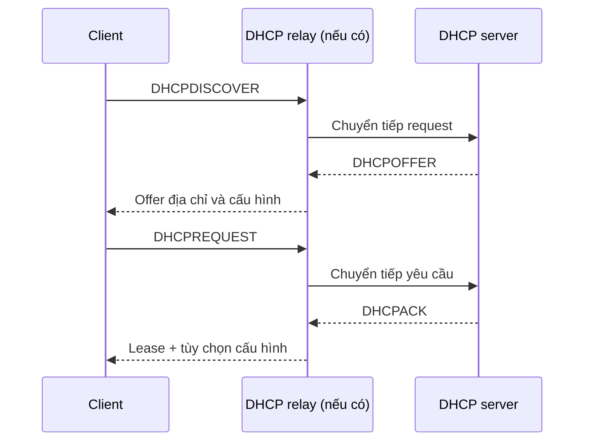
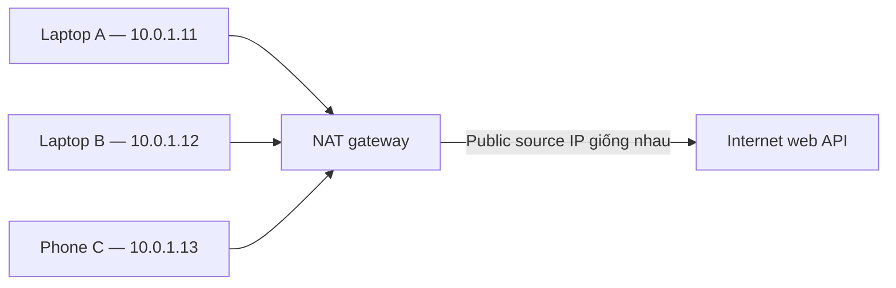
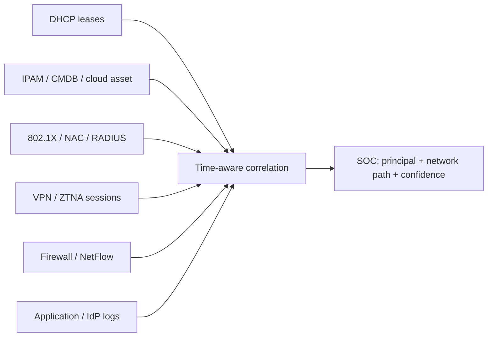
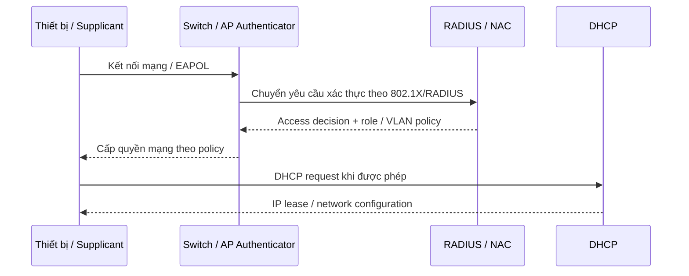
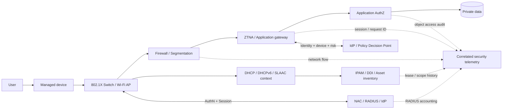

# Không dùng IP làm identity duy nhất trong DHCP và IP management

## 1. Vấn đề cốt lõi: IP cho biết đường đến, không đủ cho biết “ai”

**Địa chỉ IP** là một định danh dùng trong **định tuyến và chuyển tiếp gói tin ở tầng mạng**: thiết bị mạng dùng địa chỉ nguồn, đích và bảng định tuyến để chuyển lưu lượng tới một giao diện hoặc điểm cuối mạng. Tuy nhiên, trong bảo mật, **identity (danh tính)** trả lời câu hỏi khác: *người dùng, thiết bị, workload hoặc dịch vụ cụ thể nào đang thực hiện hành động, đã được xác thực ra sao và được cấp quyền gì?*

Địa chỉ IP có thể là một **tín hiệu ngữ cảnh quan trọng** cho firewall, ACL, IDS/IPS, DNS security, VPN và giám sát mạng. Nó **không nên là chứng cứ duy nhất** để kết luận một người đã đăng nhập, một thiết bị là đáng tin cậy hay một ứng dụng có quyền truy cập dữ liệu.

Xét ví dụ:

- Lúc 08:00, laptop của nhân viên A được DHCP cấp `10.20.4.55`.
- Lúc 13:00, A ngắt kết nối; sau khi lease được giải phóng và địa chỉ trở lại pool, DHCP có thể cấp `10.20.4.55` cho thiết bị B.
- Hệ thống ghi nhận một kết nối vào lúc 14:00 từ `10.20.4.55`.

Nếu hệ thống chỉ lưu “IP `10.20.4.55` thuộc về A”, điều tra sẽ **quy sai người hoặc thiết bị**. Muốn biết kết nối thuộc về ai còn phải có **thời điểm, dữ liệu lease, VLAN/subnet/VRF, danh tính đã xác thực, phiên mạng và log điểm truy cập**.

Ví dụ thứ hai: hàng trăm người dùng ở một chi nhánh đi Internet qua **một public IP sau NAT**. Website thấy cùng địa chỉ nguồn nhưng họ là những người, thiết bị và phiên hoàn toàn khác nhau. Cho toàn bộ người dùng của public IP đó quyền quản trị là một **quyết định ủy quyền quá rộng**.

> **Nguyên tắc:** IP là **network locator và một thuộc tính của phiên kết nối**; quyền truy cập cần gắn với **principal được xác thực** và được đánh giá trong **ngữ cảnh cụ thể**. Không loại bỏ IP khỏi security policy, nhưng không dùng nó làm **identity duy nhất**.

## 2. Phân biệt địa chỉ, danh tính, xác thực và ủy quyền

Các thuật ngữ dễ bị trộn lẫn:

| Khái niệm | Câu hỏi trả lời | Ví dụ | Giới hạn |
|---|---|---|---|
| **IP address / locator** | Gói tin đến/đi qua địa chỉ nào? | `10.20.4.55`; IPv6 của thiết bị | có thể đổi, chia sẻ, NAT hoặc lặp giữa các vùng |
| **MAC address** | Địa chỉ link-layer của interface trong miền L2 nào? | MAC của NIC Wi-Fi | có thể thay đổi/randomize/spoof; không xác thực người |
| **Device identity** | Đây là thiết bị nào do tổ chức quản lý? | device certificate, managed device ID | cần kiểm tra vòng đời chứng chỉ, quản lý enrollment và trạng thái thiết bị |
| **User identity** | Ai đang dùng hoặc thao tác? | tài khoản IdP/AD, subject ID | phải được xác thực; tài khoản có thể bị chia sẻ hoặc xâm nhập |
| **Workload identity** | Dịch vụ/tiến trình nào đang gọi? | service account, SPIFFE ID, cloud role | phải ràng buộc với môi trường thực thi và quyền cụ thể |
| **Authentication (AuthN)** | Principal có chứng minh danh tính không? | 802.1X/EAP-TLS, mTLS, MFA | xác thực thành công không có nghĩa được làm mọi thứ |
| **Authorization (AuthZ)** | Principal được phép làm gì với tài nguyên nào? | được đọc API A, không được truy vấn DB B | cần đánh giá theo resource và action |
| **Session / connection** | Sự kiện cụ thể xảy ra khi nào và theo đường nào? | RADIUS session ID, VPN session, flow 5-tuple | phiên có hạn, có thể chấm dứt hoặc được tạo lại |
| **IPAM inventory** | Địa chỉ/subnet được cấp và quản lý thế nào? | prefix, lease, reservation, owner | không tự xác nhận danh tính tại thời điểm request |

Ba câu hỏi nên tách riêng trong kiến trúc:

1. **Reachability:** có route và network policy cho kết nối từ A đến B không?
2. **Authentication:** ai đang thực hiện kết nối, với bằng chứng nhận dạng nào?
3. **Authorization:** chủ thể đó có quyền thực hiện hành động cụ thể đối với B không?

Firewall cho phép từ subnet quản trị tới cổng HTTPS chỉ trả lời **một phần của câu hỏi thứ nhất**. Ứng dụng vẫn phải xác thực phiên và kiểm tra quyền trên từng API/object.

### 2.1. Identity không phải một chuỗi duy nhất

Một username hoặc một certificate serial cũng không đủ nếu hệ thống không xác minh **nguồn cấp, hiệu lực, đối tượng gắn với credential, thời gian phiên và trạng thái thu hồi**. Danh tính an ninh thường là một **tập thuộc tính có bằng chứng**, chứ không phải một nhãn tự khai báo:

```text
principal = {
  kind: user | device | service,
  issuer: identity-provider-or-CA,
  subject: stable-identifier,
  authentication_method: EAP-TLS | OIDC | mTLS | ...,
  credential_state: valid-at-evaluation-time,
  session: authenticated-session-reference,
  context: posture + network + risk + time
}
```

Đây là mô hình khái niệm, không phải cấu hình của một sản phẩm cụ thể. Ngay cả **subject ổn định** cũng phải có lifecycle và kiểm soát cấp phát để tránh sử dụng lại hoặc gắn sai chủ sở hữu.

## 3. DHCP cấp địa chỉ động: tại sao IP không bền vững?

**Dynamic Host Configuration Protocol (DHCP)** phân phối cấu hình IP cho client. Trong IPv4, một phiên cấp phát phổ biến được mô tả bằng **DORA**:



Nếu không có relay, client và DHCP server có thể trao đổi trực tiếp trong cùng miền broadcast; sơ đồ relay chỉ minh họa trường hợp server nằm ở mạng khác. Khi gia hạn, client có thể dùng luồng thông điệp khác, không nhất thiết lặp toàn bộ DORA.

Một **lease** ghi rằng DHCP server đã cấp cấu hình địa chỉ cho một client theo dữ liệu và khoảng thời gian nhất định. Điều đó **không chứng minh** người dùng thực tế, phiên ứng dụng hoặc thiết bị đã hoàn toàn được xác thực.

### 3.1. Những trường của lease cần hiểu

| Trường/nguồn | Ý nghĩa | Hạn chế |
|---|---|---|
| `assigned_ip` | địa chỉ được cấp | có thể được tái cấp; trùng với mạng khác |
| `lease_start`, `lease_end` | khoảng thời gian lease có hiệu lực theo ghi nhận server | không chứng minh thiết bị dùng IP trong suốt khoảng đó |
| `client_identifier` | định danh client theo DHCP, tùy kiểu triển khai | có thể không ổn định/không phải danh tính tin cậy |
| `hardware_address` | MAC/hardware address quan sát trong quy trình | có thể spoof/randomize |
| `relay_information` | thông tin từ relay như giaddr/Option 82 khi có | giá trị chỉ đáng tin theo topology và cấu hình relay/switch |
| `scope` / `subnet` | vùng cấp phát và policy liên quan | cùng IP private có thể tồn tại ở nhiều VRF/tenant |
| `server_id` | DHCP server cấp phát | hữu ích khi nhiều server/failover |
| `reservation` | ánh xạ theo quy tắc quản trị | không đồng nghĩa xác thực thiết bị |
| `session_binding` | liên hệ lease với 802.1X/NAC/VPN, nếu có | cần tham chiếu tới nguồn xác thực có thẩm quyền |

**DHCP reservation** theo MAC/client ID giúp vận hành ổn định nhưng **không phải thiết bị được xác thực**. Một thiết bị không được phép có thể trình bày một địa chỉ MAC tùy ý nếu môi trường không có lớp kiểm soát khác.

### 3.2. Tái sử dụng IP không phải trường hợp hiếm

DHCP pool có thể thay đổi vì hết lease, client đổi mạng, pool bị thu nhỏ, failover, thiết bị bị khôi phục, subnet tái thiết kế hoặc chính sách phát địa chỉ đổi. Nhiều hệ thống còn chạy **IPv4 private addresses giống nhau trong các VRF/VPC/tenant khác nhau**.

Vì vậy, khóa tra cứu kiểu:

```text
ip_address = "10.20.4.55"
```

thường **không đủ duy nhất** cho điều tra hay cấp quyền. Cần thêm **scope, thời gian, nguồn ghi nhận và session context**.

## 4. IPv6 còn làm giả định “một thiết bị = một IP” yếu hơn

Trong IPv6, thiết bị có thể có **nhiều địa chỉ trên cùng interface**: link-local, global/ULA, temporary privacy address, địa chỉ từ DHCPv6 hoặc cấu hình thủ công, tùy hệ thống.

### 4.1. SLAAC, DHCPv6 và privacy addresses

- **SLAAC** cho phép client tự cấu hình một số địa chỉ IPv6 dựa trên Router Advertisement (RA) và quy trình tương ứng.
- **DHCPv6** có thể cấp địa chỉ hoặc thông tin cấu hình bổ sung; không phải mạng IPv6 nào cũng lấy địa chỉ từ DHCPv6.
- **Temporary privacy addresses** có thể được tạo/thay đổi để giảm khả năng theo dõi lâu dài từ một interface identifier cố định.
- **Stable interface identifiers** theo một cơ chế nhất định có thể bền hơn temporary addresses nhưng vẫn không phải bằng chứng danh tính người dùng.
- **IPv6 link-local** có phạm vi interface/link, không thể dùng làm khóa duy nhất trên toàn mạng.

Ví dụ, một laptop có thể trong cùng thời điểm phát sinh một số kết nối từ địa chỉ IPv6 temporary khác nhau; một thiết bị đa homing còn có Wi-Fi, Ethernet và VPN với các địa chỉ riêng.

**Điều tra IPv6 không thể chỉ tìm trong DHCP lease database.** Phải xem **RA/SLAAC, Neighbor Discovery, log switch/router, NAC session và endpoint/flow telemetry** phù hợp. Một số môi trường không có bảng ánh xạ đầy đủ từng IPv6 temporary address về người dùng nếu chưa thiết kế thu thập.

### 4.2. Dual stack và thay đổi đường đi

Ứng dụng có thể kết nối qua IPv4 hoặc IPv6 tùy resolver, network stack và khả năng tiếp cận. Nếu policy an ninh chỉ chặn/cấp quyền IPv4, người dùng hoặc workload có thể có **đường khác qua IPv6** do cấu hình chưa đồng nhất.

Khi triển khai zero-trust hoặc microsegmentation, cần xem cả:

- Firewall/ACL và security group cho IPv4 lẫn IPv6.
- Mạng khách/Wi-Fi, các cơ chế Router Advertisement và DHCPv6.
- DNS `A`/`AAAA`, DNS logs và đường VPN.
- Danh tính/ngữ cảnh áp dụng có nhất quán dù client đổi họ địa chỉ không?

Đừng coi việc “không thấy DHCPv6 lease” là bằng chứng không có thiết bị IPv6 đang hoạt động.

## 5. NAT, CGNAT, proxy và VPN khiến nhiều identity chung một IP

### 5.1. NAT/PAT

**Network Address Translation (NAT)** ánh xạ địa chỉ, và trong **Port Address Translation (PAT)** một public IP có thể đại diện cho nhiều phiên nội bộ thông qua các cổng nguồn khác nhau.



Một website chỉ thấy public IP thường **không đủ** phân biệt A/B/C. Trong điều tra được cấp phép, có thể cần **timestamp, source/destination IP, source/destination port, protocol và NAT translation logs** của gateway tương ứng, kết hợp ứng dụng và log mạng nội bộ.

**CGNAT** của nhà mạng làm tình huống rộng hơn: nhiều thuê bao có thể chia sẻ public IP; ngay cả port/time chỉ có ý nghĩa nếu có dữ liệu và cơ chế gắn phiên phù hợp của nhà mạng. Không dùng **public IP một mình** để kết luận một cá nhân thực hiện hành động.

### 5.2. Reverse proxy và client IP headers

Ở ứng dụng nằm sau CDN/WAF/load balancer, backend có thể thấy **địa chỉ IP của proxy**, không phải client. Các header `X-Forwarded-For` hoặc `Forwarded` có thể ghi chuỗi địa chỉ trung gian, nhưng nội dung do **client gửi vào có thể tự khai**.

Biện pháp:

1. Xác định chính xác **proxy/gateway tin cậy** trong đường đi.
2. Bảo đảm proxy được cấu hình **xóa hoặc chuẩn hóa header client không đáng tin** theo thiết kế.
3. Chỉ suy ra client IP từ trường và chuỗi proxy đáng tin trong phạm vi đã cấu hình.
4. Dù client IP được xác minh qua proxy, vẫn dùng **session/authentication principal** cho quyền ứng dụng.
5. Gắn `request_id`/`trace_id` để truy request qua proxy/WAF/backend, không phụ thuộc IP là khóa duy nhất.

### 5.3. VPN và Wi-Fi/roaming

Người dùng di chuyển giữa Wi-Fi, mạng di động và VPN có thể đổi IP trong một ngày hoặc có **nhiều IP đồng thời**. VPN concentrator có thể phân phát private tunnel IP theo pool và **tái sử dụng** địa chỉ sau khi phiên kết thúc.

Muốn điều tra phiên VPN cần đối chiếu **identity được xác thực, session ID, login/logout time, địa chỉ tunnel, public source ở bên ngoài VPN, tư thế thiết bị nếu được thu và log gateway**. Không kết luận hai request cùng tunnel IP ở hai thời điểm thuộc cùng người nếu IP đã được cấp lại.

## 6. Cloud, container và workload có identity khác IP

### 6.1. Virtual machines và cloud networking

Trong cloud, IP của VM có thể thay đổi khi recreate, scale, failover hoặc đổi attachment. Một VM có thể có nhiều NIC/IP, một IP public có thể kết thúc ở load balancer dùng chung, và private IP có thể được cấp lại.

Những định danh hữu ích hơn cho **workload attribution** có thể gồm:

- Cloud account/subscription/project và region.
- Instance/VM ID, NIC/ENI ID, VPC/VNet và subnet/VRF.
- IAM role, managed identity hoặc service account của workload.
- Image, deployment, owner, environment và resource tags/labels đã được quản lý.
- Phiên mTLS/identity ở service mesh hoặc dịch vụ.

**Resource ID** giúp liên kết tài sản theo lifecycle nhưng vẫn có thể thay đổi khi tái tạo. **IAM/service identity** là cơ sở chính cho authorization nếu được xác thực và ràng buộc đúng vào workload đang chạy.

### 6.2. Kubernetes

Pod IP là địa chỉ **của phiên bản Pod tại một thời điểm**, không phải danh tính bền vững của ứng dụng. Pod được tạo lại, scale, reschedule sẽ thay IP; nhiều pod cung cấp cùng một Kubernetes Service, và ingress/service mesh có thể che IP nguồn.

```text
Client workload
    ↓
Kubernetes Service / Ingress / Proxy
    ↓
Pod hiện tại (IP có thể thay đổi)
    ↓
Backend
```

Khi bảo vệ traffic east–west:

- **Kubernetes NetworkPolicy** dùng selector để chọn tập Pod/namespace theo các quy tắc của CNI; selector/label phải được quản lý đáng tin, không tự là identity có mã hóa.
- **Service account + workload identity + mTLS** giúp xác thực dịch vụ ở mức phù hợp với nền tảng.
- Logs cần chứa namespace, pod UID, service account, deployment/workload owner, trace ID và thời điểm.
- Không đánh đồng **Service ClusterIP** với user, container hoặc instance cụ thể.

Nếu attacker có quyền thay đổi label hoặc service account binding, policy dựa trên nhãn có thể bị ảnh hưởng. Do đó, **Kubernetes RBAC, admission control, workload attestation và network policy** là các lớp cần thiết phối hợp.

## 7. Khi dùng IP làm identity duy nhất, có những rủi ro nào?

| Rủi ro | Ví dụ giả định | Hệ quả |
|---|---|---|
| **False attribution** | lease được cấp lại, SOC gán log hôm nay cho người dùng hôm qua | điều tra sai, xử lý nhầm người |
| **Shared-source ambiguity** | hàng trăm thiết bị dùng một NAT public IP | không phân biệt client thật |
| **Authorization too broad** | một office IP được allow vào API quản trị | bất cứ ai ra Internet qua gateway đó có thêm đường truy cập |
| **Address reuse** | IP cũ của máy quản trị được cấp cho máy thử nghiệm | rule cũ cho thiết bị không dự kiến reachability |
| **Spoofing** | thiết bị trên mạng thiếu phòng vệ sử dụng địa chỉ nguồn không được cấp | traffic/ACL/log có thể bị hiểu sai |
| **IP mobility** | nhân viên đổi Wi-Fi/VPN/mobile data | user hợp lệ bị từ chối hoặc policy bị mở rộng quá mức |
| **IPv6 blind spot** | chỉ quản lý IPv4 DHCP/ACL | bỏ sót luồng và địa chỉ IPv6 |
| **Proxy identity loss** | backend chỉ ghi IP ingress | không truy được client/session gốc |
| **Cloud ephemeral IP** | IP Pod/VM được tái cấp cho workload khác | rule và điều tra không còn đúng |
| **Tenant collisions** | hai VPC/VRF đều dùng `10.0.0.5` | gộp nhầm hai tài sản khi không giữ scope |

Điều cần nhấn mạnh: **IP-based control không vô dụng**. Rule mạng như “tài nguyên DB chỉ được nhận kết nối từ phân đoạn ứng dụng” vẫn là một lớp phòng vệ mạnh. Sai lầm nằm ở việc **nâng giả định network reachability thành kết luận identity hoặc authority cuối cùng**.

### 7.1. Những quyết định không nên chỉ dựa trên IP

- Cho phép thay đổi cấu hình production hoặc truy cập bảng dữ liệu nhạy cảm.
- Quy trách nhiệm hành vi cho một **nhân viên cụ thể**.
- Đánh giá mức độ tin cậy của thiết bị đang kết nối mạng.
- Miễn MFA hoặc bỏ qua xác thực vì “đang ở mạng nội bộ”.
- Cấp quyền dài hạn cho VM/Pod bằng public/private IP tạm.
- Kết luận sự kiện từ IP đích là do một process/user cụ thể mà không xem log host.

Trong các trường hợp này, IP nên là **một điều kiện bổ trợ**, bên cạnh danh tính đã xác thực và chính sách tại tài nguyên.

## 8. Mô hình dữ liệu: sự kiện + IP + thời gian + scope + principal

Nếu cần **truy vết**, hệ thống phải biết **tại thời điểm sự kiện** địa chỉ được gắn với thiết bị hoặc phiên nào, trên đúng vùng mạng nào.

### 8.1. Ví dụ timeline cấp lại địa chỉ

| Thời gian UTC | Sự kiện | IP trong scope Corp-VLAN20 | Bằng chứng |
|---|---|---|---|
| 08:00 | Client A được cấp lease | `10.20.4.55` | DHCP server lease record |
| 08:02 | A xác thực 802.1X thành công | `10.20.4.55` | RADIUS/NAC session |
| 12:10 | A ngắt kết nối, lease còn có thể tồn tại cho tới thời điểm nhất định | `10.20.4.55` | switch/NAC disconnect event |
| 13:30 | địa chỉ được cấp lại cho B sau khi hết/hủy lease theo thực tế | `10.20.4.55` | DHCP lease transition |
| 14:05 | Firewall ghi nhận kết nối | `10.20.4.55` | flow 5-tuple + timestamp |

Trong ví dụ, kết nối lúc 14:05 phù hợp hơn với **B**, nhưng vẫn cần kiểm tra lease, phiên xác thực, cổng switch, nguồn log và thời gian hệ thống trước khi kết luận chắc chắn. Nếu A dùng IP tĩnh trái phép hoặc có bất thường lớp mạng, kết luận chỉ dựa trên DHCP vẫn có thể sai.

### 8.2. Mô hình liên kết có điều kiện thời gian

```text
event = {
  observed_at_utc,
  source_ip, source_port,
  destination_ip, destination_port,
  transport_protocol,
  network_scope,
  enforcement_point,
  request_or_flow_id
}

lookup(
  ip = event.source_ip,
  scope = event.network_scope,
  at_time = event.observed_at_utc
)
  → possible_lease / NAT_mapping / VPN_session
  → authenticated_device_session
  → authenticated_user_or_workload
  → application_authorization_event
```

Không phải lúc nào chuỗi cũng nối được đầy đủ. Kết quả truy vết nên cho phép **nhiều ứng viên và mức độ tin cậy**, thay vì tự động trả về một tên người dùng rồi coi là sự thật.

### 8.3. Khóa kết hợp theo ngữ cảnh

Đối với IPv4 private network, một bản ghi tốt thường cần:

```text
(network_id / tenant_id / VRF,
 IP_address,
 valid_from,
 valid_until,
 lease_or_session_id,
 source_of_truth)
```

Nếu cùng một IP được dùng ở nhiều VPC, namespace hoặc địa điểm, `network_id` là thiết yếu. Đối với NAT/PAT, nhiều kết nối cần thêm **source/destination port, protocol, mapping và timestamp**, không thể join chỉ với IP.

## 9. IP Address Management (IPAM) là nguồn thông tin gì?

**IPAM** giúp quản lý **prefix, subnet, pool, reservation, assignment, lifecycle và ownership**. Khi phối hợp DHCP/DNS, mô hình thường gọi là **DDI (DNS, DHCP and IP Address Management)**.

Một hệ thống IPAM tốt có thể trả lời:

- Dải `10.20.0.0/16` được phân cho tổ chức, môi trường hay site nào?
- Subnet nào phục vụ server, Wi-Fi khách, VPN, branch hoặc thiết bị IoT?
- Pool/lease nào đã được cấp; lúc nào và bởi server nào?
- Ai chịu trách nhiệm cho prefix hoặc DHCP scope?
- IP hiện có đang là static reservation, dynamic lease, VIP, NAT hoặc allocation của cloud?
- Có subnet trùng/route leak hoặc address pool gần cạn không?
- Cấu hình thực tế có lệch khỏi trạng thái mong muốn trong IPAM/IaC không?

Nhưng IPAM **không tự là Identity Provider**. “Owner của subnet” không phải người gửi request; “lease có MAC” không phải chứng cứ user; “IP static” không đồng nghĩa asset an toàn hoặc credential hợp lệ.

### 9.1. Gợi ý schema tài sản và bằng chứng

```json
{
  "address": "10.20.4.55",
  "address_family": "IPv4",
  "network_scope": "corp-site-a-vlan20",
  "allocation_kind": "dynamic_dhcp",
  "subnet": "10.20.4.0/24",
  "server_id": "dhcp-primary-site-a",
  "lease_id": "lease-placeholder-2091",
  "lease_valid_from": "2026-11-28T01:00:00Z",
  "lease_valid_until": "2026-11-28T09:00:00Z",
  "client_identifier": "client-id-placeholder",
  "observed_mac": "02:00:00:00:00:11",
  "authenticated_session_ref": "nac-session-placeholder",
  "device_inventory_ref": "device-placeholder",
  "attribution_confidence": "correlated-not-absolute",
  "evidence": [
    "dhcp-lease",
    "radius-accounting",
    "switch-port-session"
  ]
}
```

Tất cả ID, MAC và ngày trong JSON **chỉ minh họa**, không phải dữ liệu người dùng thật. `observed_mac` là thuộc tính quan sát được; không nâng nó thành bằng chứng không thể giả mạo.

### 9.2. Từ DDI tới Identity-Aware Network Security



Mục đích không phải tạo một bảng “IP → người” vĩnh viễn, mà là xây **chuỗi chứng cứ có thời gian**, giữ thông tin nguồn, mức tin cậy và lý do suy luận.

## 10. DHCP Snooping, DAI và IP Source Guard: bảo vệ sự nhất quán L2/L3

Ở mạng LAN, **DHCP Snooping** trên switch có thể giới hạn nơi cho phép phản hồi DHCP server và tạo **binding table** từ những giao dịch DHCP hợp lệ đã được quan sát. Một số thiết bị dùng dữ liệu này cho:

- **Dynamic ARP Inspection (DAI):** kiểm tra một số ánh xạ IP↔MAC trong ARP nhằm giảm ARP spoofing ở miền hỗ trợ.
- **IP Source Guard (IPSG):** giới hạn nguồn IP/MAC/port theo binding hoặc cấu hình đã được phép.
- Các cơ chế NAC/switch access policy hoặc quản trị vị trí kết nối.

**Cần hiểu phạm vi bảo vệ:**

| Cơ chế | Điều có thể giảm | Điều không tự chứng minh |
|---|---|---|
| DHCP Snooping | server DHCP không được phép trên port untrusted, hỗ trợ binding cho các tính năng khác | danh tính người dùng, độ an toàn hệ điều hành |
| DAI | ARP poisoning theo phạm vi cấu hình và thiết bị hỗ trợ | thiết bị có đúng là người/host được ủy quyền không |
| IP Source Guard | dùng IP ngoài binding trên port trong phạm vi hỗ trợ | kết nối ứng dụng đó là hợp lệ theo business |
| Port security | một số hành vi dùng MAC khác policy cổng | MAC là danh tính không thể giả mạo |
| 802.1X / EAP-TLS | xác thực client theo credential/chứng chỉ được chấp nhận | ứng dụng được phép đọc mọi dữ liệu ở phía sau |

### 10.1. Trust ports và DHCP relay

DHCP Snooping thường phân biệt **trusted ports** (ví dụ đường tới DHCP server/relay hợp lệ) và **untrusted ports** (client-facing). Cấu hình trust sai có thể cho rogue DHCP traffic đi qua hoặc làm đứt cấp địa chỉ hợp lệ.

**DHCP relay agent** cho phép client ở subnet khác trao đổi với DHCP server; DHCPv4 có thể dùng `giaddr` và tùy chọn relay-agent information **Option 82** để mô tả ngữ cảnh đường vào theo thiết kế. Nhưng dữ liệu relay cũng chỉ đáng tin khi được tạo và bảo vệ ở **hạ tầng mạng đã tin cậy**, không phải do mọi client tự khai đều đáng tin.

Khi dùng DHCP snooping/DAI/IPSG cần tính đến thiết bị **IP tĩnh, DHCP failover, phone + PC nối tiếp, Wi-Fi controller, hypervisor, trunk, uplink và voice VLAN**. Một policy áp dụng cứng khi thiếu binding có thể gây outage.

### 10.2. IPv6 có vấn đề riêng

IPv6 không dùng ARP như IPv4; Neighbor Discovery (ND), Router Advertisement và DHCPv6 có cơ chế khác. Cần xem các lớp bảo vệ như **RA Guard**, **DHCPv6 Shield** hoặc nguồn telemetry/ND inspection tương ứng nếu switch hỗ trợ.

Chúng không thay thế **xác thực thiết bị**. Một số mạng có tunnel, extension header hoặc thiết kế switch khác nhau; phải xác minh khả năng và giới hạn theo tài liệu phiên bản đang triển khai.

## 11. 802.1X, NAC và danh tính thiết bị/người dùng

**IEEE 802.1X** là khung **port-based network access control**. Các vai trò thường gồm:

1. **Supplicant:** client/thiết bị muốn kết nối.
2. **Authenticator:** switch hoặc Wi-Fi AP/controller kiểm soát quyền kết nối.
3. **Authentication server:** thường RADIUS server xác minh danh tính và trả quyết định/chính sách.



Luồng trên minh họa thứ tự hợp lý trong một thiết kế thông dụng; **chi tiết EAP, cấp IP, trạng thái cổng và RADIUS accounting phụ thuộc sản phẩm**. Một số thiết kế còn dùng guest/quarantine VLAN, pre-auth ACL hoặc cơ chế cho phép traffic DHCP/DNS ban đầu.

### 11.1. EAP-TLS và device certificates

Khi dùng **EAP-TLS**, client và authentication server có thể xác thực dựa trên chứng chỉ theo cấu hình PKI và phiên bản giao thức được hỗ trợ. Mô hình này có thể tăng độ tin cậy so với chỉ dùng địa chỉ MAC, với điều kiện:

- Quy trình **enrollment** bảo vệ việc cấp và gắn khóa riêng vào thiết bị/identity đúng.
- CA/trust anchors và xác minh server certificate đúng.
- Chứng chỉ có vòng đời, gia hạn và cơ chế thu hồi phù hợp.
- Client không được phép bỏ qua xác thực danh tính của máy chủ RADIUS/EAP.
- NAC policy gắn với **principal và posture**, không chỉ “có một cert bất kỳ”.

**Có chứng chỉ hợp lệ không đồng nghĩa thiết bị an toàn tuyệt đối**: khóa có thể bị lộ, thiết bị có thể nhiễm mã độc hoặc trạng thái compliance thay đổi. Vì vậy doanh nghiệp có thể kết hợp certificate với MDM/EDR, posture check và phân quyền theo role.

### 11.2. MAC Authentication Bypass (MAB)

Một số thiết bị IoT, máy in hoặc thiết bị chuyên dụng không hỗ trợ 802.1X, nên môi trường có thể dùng **MAB**, trong đó MAC đóng vai trò tín hiệu để đưa ra quyết định. Đây thường là **ngoại lệ độ tin cậy thấp hơn**, vì MAC có thể được thay đổi/spoof.

Giảm rủi ro bằng **phân đoạn IoT, allowlist đích dịch vụ, giám sát lưu lượng, kiểm kê thiết bị và review ngoại lệ**. Không nên cấp cùng mức quyền của laptop nhân viên đã xác thực EAP-TLS cho thiết bị chỉ dựa MAC.

### 11.3. Dynamic authorization và thay đổi phiên

NAC có thể gán role/VLAN/ACL dựa trên chính sách; một số nền tảng hỗ trợ cập nhật quyền phiên hoặc **CoA (Change of Authorization)**. Tuy nhiên, việc thay role/VLAN hay thu hồi session có thể cần **reauthentication, thay đổi DHCP lease và cập nhật IPAM**.

Nếu hệ thống SIEM chỉ nhìn vào IP cũ mà bỏ qua thời điểm reauth/CoA, mapping người dùng ↔ IP có thể bị sai khi thiết bị chuyển vùng.

## 12. Identity-aware access thay vì allow “IP tin cậy”

**Zero Trust** đề xuất không mặc định tin một yêu cầu chỉ vì nguồn ở “bên trong mạng”. Quyết định truy cập được đánh giá dựa trên **danh tính, trạng thái thiết bị, tài nguyên, hành động và ngữ cảnh rủi ro**, tùy chính sách của tổ chức.

Ví dụ thay cho “mọi client từ office public IP được vào admin API”:

```text
ALLOW admin-action ON production-service WHEN:
  user has authenticated with approved IdP
  AND user has role production-operator
  AND session meets required authentication strength
  AND device meets applicable managed-device policy
  AND request goes through approved privileged-access gateway
  AND action is authorized for this resource and time window

Network source IP is used as an additional risk/context signal,
not as the sole identity.
```

Đây là **policy khái niệm**, không phải ngôn ngữ cấu hình thực thi. Một hệ thống có thể không thu được đủ thuộc tính ở mọi request; khi thiếu tín hiệu bắt buộc, chính sách phải định nghĩa **hành vi mặc định** phù hợp mức nhạy cảm, cùng phương án vận hành khi IdP/NAC không khả dụng.

### 12.1. Không loại bỏ network segmentation

Identity-aware policy **bổ sung**, không thay hoàn toàn:

- Network firewall: chỉ cho application zone đến đúng DB port.
- NAC/802.1X: chỉ thiết bị đáp ứng điều kiện mới vào VLAN/role phù hợp.
- VPN/ZTNA: truy cập theo danh tính và ứng dụng, không mở toàn subnet không cần thiết.
- Application: AuthN/AuthZ trên từng endpoint, tenant, object.
- mTLS: dịch vụ xác thực đối tác kết nối; quyền vẫn phải xét action.
- IDS/IPS/SIEM: ghi nhận dấu hiệu bất thường và điều tra theo ngữ cảnh.

Thiết kế tốt kết hợp **khả năng tiếp cận tối thiểu** ở mạng với **ủy quyền tối thiểu** ở ứng dụng và **bằng chứng danh tính**.

## 13. Một kiến trúc tham chiếu: IPAM + NAC + Policy Enforcement



**Giải thích chức năng:**

- **DHCP/IPAM:** cấp/quản lý địa chỉ và lịch sử sử dụng theo subnet/scope; không quyết định người dùng được xem dữ liệu nào.
- **802.1X/NAC:** xác thực thiết bị/user theo khả năng nền tảng và quyết định role/kết nối mạng.
- **Firewall/segmentation:** giới hạn luồng nào có thể đi tới ứng dụng/dữ liệu; giữ lớp phòng vệ kể cả khi App AuthZ có lỗi.
- **ZTNA/app gateway/IdP:** đánh giá phiên truy cập theo danh tính và ngữ cảnh, nếu kiến trúc có triển khai.
- **Ứng dụng:** thực thi authorization ở cấp tác vụ/đối tượng — ví dụ người dùng A không được đọc hóa đơn của B.
- **SIEM/SOC:** ghép bằng chứng theo thời gian/nguồn, hỗ trợ cảnh báo và điều tra, không biến IP thành người dùng.

Điểm quan trọng là **không tạo một “single source of truth” giả** có dạng IP → human bất biến. Mỗi nguồn có một thẩm quyền khác nhau: DHCP cho lease, RADIUS cho phiên xác thực mạng, IdP cho principal, ứng dụng cho action, cloud control plane cho resource identity.

## 14. Threat modeling những đường bỏ qua identity

Trong STRIDE, giả định “IP là identity” gây rủi ro ở nhiều nhóm:

| Nhóm | Tình huống cần hỏi |
|---|---|
| **Spoofing** | địa chỉ nguồn/MAC hoặc header client IP có thể tự khai hay bị giả mạo không? |
| **Tampering** | DHCP/DNS/IPAM bindings, NAC role hoặc log có thể bị sửa trái phép không? |
| **Repudiation** | log có đủ thời gian, scope và principal để tránh quy trách nhiệm sai không? |
| **Information Disclosure** | một allowlist theo NAT IP có cho quá nhiều user truy cập dữ liệu nhạy cảm không? |
| **Denial of Service** | rogue DHCP hoặc hết pool làm thiết bị hợp lệ mất địa chỉ/kết nối không? |
| **Elevation of Privilege** | một IP cũ của máy quản trị có được cấp lại cho client không có quyền nhưng vẫn khớp ACL không? |

### 14.1. Đường lạm dụng IP-only authorization

```text
User hoặc device chưa được xác thực
  → có được đường ra qua shared NAT / trusted subnet
  → hệ thống đích nhìn thấy "trusted IP"
  → nếu policy chỉ kiểm tra IP: cấp quyền không đúng principal
```

**Không phải mọi client trong trusted subnet có thể làm mọi việc**: nếu backend còn AuthN/AuthZ, network IP-only allow có thể chỉ làm tăng reachability, không tự tạo quyền ứng dụng. Trong threat model cần ghi rõ giả định **“backend bỏ qua xác thực khi thấy IP nội bộ”** có tồn tại không; không kết luận exploit chỉ dựa trên sơ đồ route.

### 14.2. Asset và trust boundaries

Một bản threat model nên ghi:

```text
Asset:              Production admin API
Boundary:           Employee network / NAT → Admin gateway → API
Claimed identity:   Source IP or proxy header
Trust assumption:   Office public IP represents authorized admin
Failure mode:       Multiple users share NAT; proxy header may be untrusted
Security objective: Only authenticated operator on eligible device
Controls:           ZTNA/MFA, app RBAC, privileged access, network ACL
Evidence:           IdP session + device ID + request ID + NAT/flow logs
Residual risk:      Compromised privileged identity or device
```

Điều tra cần xem cả **quyền được cấp** và **ngữ cảnh tại thời điểm thực hiện**, không chỉ danh sách địa chỉ “được tin cậy”.

## 15. Identity correlation trong SOC: đừng quy trách nhiệm theo IP thô

Mục tiêu của phân tích sự kiện là **thu hẹp tập principal có thể liên quan** dựa trên bằng chứng. Nó không phải tự động suy ra danh tính pháp lý của người dùng từ mỗi gói tin.

### 15.1. Các bước phân tích một event

1. **Bảo toàn event gốc:** timestamp UTC, IP nguồn/đích, source/destination port, protocol, network scope, sensor/enforcement point, action và ID.
2. **Xác định điểm quan sát:** log ở phía trước/sau NAT, proxy, VPN, firewall, load balancer hay workload?
3. **Tìm ánh xạ đúng thời gian:** DHCP lease, cloud IP assignment, NAT translation, VPN address pool hoặc proxy request ID tương ứng.
4. **Liên kết phiên xác thực:** RADIUS accounting, 802.1X, IdP/VPN session, device certificate/MDM hoặc workload identity.
5. **Kiểm tra log đích:** ứng dụng và database đã nhận principal nào và thực hiện thao tác gì?
6. **Đánh giá độ chắc chắn:** có time drift, sampling, log thiếu, IP trùng scope hoặc hành vi đổi mạng không?
7. **Ghi kết luận có bằng chứng:** tách “IP được cấp cho thiết bị X theo DHCP” khỏi “user Y đã thực hiện thao tác Z”.

### 15.2. NAT logs và tính đủ dữ kiện

Đối với nhiều luồng PAT dùng chung public IP, ít nhất có thể cần:

```text
observed_at_utc
public_source_ip : public_source_port
destination_ip : destination_port
protocol
translation_mapping / private_source_ip:private_source_port
gateway_id
```

Không phải mọi log hay provider ghi được đầy đủ dữ kiện, và packet capture ở một bên gateway có thể chỉ thấy phiên đã dịch địa chỉ. Nếu không có mapping đáng tin, **kết luận phải ghi “không xác định đủ”**, không tự giả định.

### 15.3. Clock synchronization

Để ghép dữ liệu giữa DHCP, firewall, RADIUS, VPN và application, cần:

- Định dạng **UTC**, chỉ rõ timestamp có múi giờ hay không.
- Đồng bộ thời gian (NTP hoặc nguồn phù hợp) và theo dõi drift.
- Ghi **event time** khác với **ingest time** (thời gian SIEM nhận log).
- Giữ dấu mốc bắt đầu/kết thúc lease, reauthentication, disconnect, NAT mapping và thời điểm request.
- Ghi độ trễ sự kiện, sampling, missing logs và nguồn không xác thực.

Chênh lệch vài phút có thể làm mapping IP quay sang một người/thiết bị khác khi lease ngắn hoặc VPN pool có nhiều phiên.

## 16. Quyền riêng tư, retention và kiểm soát truy cập log

Kết hợp IP + DHCP + MAC + RADIUS + IdP + ứng dụng giúp điều tra chính xác hơn, nhưng cũng tạo **dữ liệu liên kết cá nhân và hành vi sử dụng mạng**. Vì vậy cần thiết kế bảo vệ dữ liệu:

- Chỉ thu trường cần thiết cho mục đích an ninh/vận hành đã xác định.
- Phân quyền truy cập theo vai trò, audit truy vấn và export dữ liệu mapping.
- Mã hóa log trên đường truyền và khi lưu theo mức độ nhạy cảm.
- Thời hạn lưu phù hợp yêu cầu nghiệp vụ, pháp lý và chính sách; không giữ vô thời hạn chỉ vì dễ thu.
- Pseudonymization/ẩn danh hóa có kiểm soát cho dashboard không cần danh tính người dùng cụ thể.
- Tách khả năng xem flow/network metadata khỏi quyền xem lịch sử gắn người dùng nếu không cần.
- Quy trình phê duyệt và bằng chứng truy cập khi điều tra liên quan đến nhân viên/khách hàng.

**Địa chỉ IP không luôn là dữ liệu không nhạy cảm**: khi liên kết với thời gian và tài khoản, nó có thể cho biết thói quen hoặc vị trí tương đối. Cách xử lý phải tuân thủ luật và chính sách hiện hành của tổ chức; không suy đoán thời hạn retention bắt buộc cho mọi quốc gia.

## 17. Vận hành DHCP/IPAM và NAC một cách an toàn

### 17.1. Quản trị lifecycle

- Mỗi DHCP scope/pool/subnet có owner, site, VRF, purpose và phạm vi cấp phát.
- DHCP failover, backup và xung đột IP được giám sát.
- Static assignments, reservations và dải loại trừ được quản lý trong IPAM.
- Tích hợp DHCP/DNS cập nhật có xác thực/phân quyền phù hợp khi sử dụng dynamic DNS.
- Quản trị 802.1X/RADIUS/IdP certificate và device enrollment/revocation.
- Mọi ngoại lệ MAB, fallback VLAN hoặc IP-based allow có owner, lý do, thời hạn review/expiration.
- Firewall và NAC policies được kiểm thử cho IPv4/IPv6, mạng khách, IoT, VPN, Wi-Fi và cloud.
- Khi thiết bị hoặc nhân viên offboard, thu hồi **credential/quyền phiên**; xóa IP reservation đơn thuần không thu hồi identity.

### 17.2. Phụ thuộc tính sẵn sàng

DHCP, DNS, RADIUS/IdP và IPAM là **shared infrastructure**. Khi một thành phần lỗi, hệ thống có thể mất cấp địa chỉ, xác thực mạng hoặc tra cứu identity. Cần quyết định rõ **fail-open/fail-closed và fallback** theo độ nhạy của vùng.

Ví dụ, cho thiết bị chưa xác thực vào VLAN quản trị chỉ vì RADIUS đang lỗi là rủi ro nghiêm trọng. Ngược lại, chặn mọi thiết bị công nghiệp trong sự cố NAC có thể tạo nguy cơ vận hành nếu chưa chuẩn bị quy trình khôi phục. Cần phân vùng, loại thiết bị, giới hạn quyền fallback, giám sát và tabletop exercise.

### 17.3. Change management

Mỗi thay đổi DHCP pool, VLAN assignment, VPN address pool, NAT gateway, proxy trust chain hoặc cloud subnet nên đặt câu hỏi:

1. Địa chỉ/phiên nào có thể bị tái cấp hoặc thay scope?
2. Rule nào đang dựa vào IP như thể đó là principal?
3. SIEM/CMDB có giữ được tương quan lịch sử sau migration không?
4. Tài sản IPv6, IoT, DHCP reservation và kết nối có IP tĩnh có bị bỏ sót không?
5. Có cần reauth, đổi cert, cập nhật NAC role hoặc thu hồi session không?
6. Kế hoạch rollback và kiểm chứng kết nối hợp lệ là gì?

Đừng tự động xóa toàn bộ IP-based ACL: hãy **phân loại theo rủi ro và phụ thuộc**, bổ sung identity checks, rồi thay đổi có kiểm soát.

## 18. Quy trình chuyển từ IP-only access sang identity-aware controls

### Bước 1 — Kiểm kê

Liệt kê các rule có ý nghĩa “trusted subnet/IP”:

- Firewall/ACL allowlist cho cổng quản trị, DB, API.
- WAF/IP allowlist hoặc API keys bị bỏ qua theo IP.
- SSH/RDP/bastion, VPN routes, cloud security group ingress.
- Các tích hợp SaaS dựa trên public egress IP.
- Static reservations được coi như chứng cứ thiết bị.

Đánh dấu **mục đích, owner, thời điểm review, nguồn authentication hiện có, tác động khi bỏ IP-only trust**.

### Bước 2 — Phân loại mức rủi ro

| Loại rule | Ví dụ | Ưu tiên |
|---|---|---|
| IP-only bypass authentication | mọi request từ office IP được coi là admin | cao: sửa AuthN/AuthZ ở điểm đích |
| IP-only privileged access | server quản trị chấp nhận mọi host từ subnet rộng | cao: PAM/ZTNA/802.1X và scope hẹp |
| IP-based network segmentation | API subnet được tới DB port | giữ như lớp phòng vệ, bổ sung service identity và DB auth |
| Vendor egress allowlist | đối tác cho công ty truy cập từ một NAT IP | phối hợp nhà cung cấp, thêm mTLS/OAuth/API key nếu phù hợp |
| Lab/legacy device reservation | máy in/IoT theo MAC/IP | cô lập vùng, hạn chế port, giám sát, lộ trình modernize |

### Bước 3 — Thiết kế identity và quyền

Chọn **IdP, EAP-TLS/cert hoặc workload identity** phù hợp; xác định subject và issuer, policy theo resource/action, device posture, thời hạn session và kịch bản thiếu khả năng xác thực.

### Bước 4 — Chạy song song và quan sát

Triển khai **monitor mode hoặc policy shadow evaluation** nếu hệ thống hỗ trợ: ghi nhận request nào sẽ bị từ chối theo identity policy mới, nhưng chưa chặn production traffic cho tới khi hiểu false positive và phụ thuộc.

### Bước 5 — Enforce và giữ network guardrails

Từng bước bật xác thực/ủy quyền bắt buộc, thắt chặt subnet/port nếu an toàn, kiểm tra IPv6/NAT/proxy và đường dự phòng; có canary, rollback, on-call owner và giám sát SLO.

### Bước 6 — Thu hồi ngoại lệ và xác minh

Xóa quyền IP-only không còn cần sau khi chứng minh luồng hợp lệ hoạt động, bảo đảm các tài khoản/thiết bị không đủ quyền bị từ chối. Ghi change ID, bằng chứng, ngoại lệ có hạn và review định kỳ.

## 19. Tình huống thực hành 1: firewall log chỉ có private IP

**Bối cảnh giả định:** SOC nhận cảnh báo một kết nối đáng ngờ từ `10.77.8.24` tới cổng quản trị trong vùng server lúc `2026-11-28T10:15:00Z`.

Thông tin ban đầu:

```text
Firewall event:
  time: 2026-11-28T10:15:00Z
  source: 10.77.8.24
  destination: 10.90.1.12
  destination_port: 443
  protocol: TCP
  action: allow
  ingress_zone: corp-wifi
```

**Sai lầm:** tìm trong file Excel “IP của nhân viên” rồi kết luận người từng sở hữu `10.77.8.24` đang đăng nhập server.

**Cách làm có bằng chứng:**

1. Xác định `corp-wifi` thuộc site, VLAN/VRF và DHCP pool nào.
2. Tra lease có hiệu lực **tại 10:15Z**, kiểm tra có IP conflict hoặc sự kiện DHCP failover không.
3. Đối chiếu Wi-Fi controller và RADIUS/NAC session: thiết bị/identity nào đang kết nối vào thời điểm đó?
4. Kiểm tra firewall log ở hai chiều; nếu có NAT/proxy, tra bản ghi ánh xạ tương ứng.
5. Kiểm tra ứng dụng quản trị: request có được **xác thực** không, subject nào, đã thực hiện hành động gì? Firewall “allow” không chứng minh đăng nhập thành công.
6. Nếu evidence thiếu/sai thời gian, ghi **mức độ tin cậy hạn chế**; không quy trách nhiệm cá nhân trước khi kiểm chứng.

**Câu hỏi quan trọng:** nếu cùng IP được cấp cho một thiết bị khác lúc 10:20Z, một truy vấn “IP hiện tại thuộc ai” lúc 15:00Z sẽ gây sai lệch thế nào?

## 20. Tình huống thực hành 2: một NAT IP được coi là admin

**Bối cảnh:** API quản trị cho phép bỏ qua xác thực người dùng khi thấy request đến từ public IP của văn phòng. Hệ thống văn phòng có hàng trăm thiết bị, gồm guest Wi-Fi, nhân viên và máy in, đi Internet qua một NAT gateway.

**Phân tích:**

1. Source IP tại API chỉ xác minh được **đường egress có vẻ đến từ gateway**, không xác minh người dùng hoặc thiết bị.
2. Nếu guest và nhân viên cùng đi qua public IP, allowlist sẽ gộp hai nhóm có độ tin cậy khác nhau.
3. Nếu reverse proxy chuyển request, client IP header chưa được kiểm soát, tín hiệu IP còn có thể bị diễn giải sai.
4. Rule mạng vẫn có thể là defense-in-depth cho endpoint quản trị, nhưng backend phải **xác thực và ủy quyền**.

**Thiết kế cải thiện:** đặt admin API sau privileged-access gateway/ZTNA, yêu cầu IdP + MFA khi phù hợp, role cụ thể, device posture, session timeout và application audit; giữ subnet/egress restrictions **như yếu tố bổ sung**, không làm cơ sở bỏ AuthN.

**Test chấp nhận:**

| Trường hợp | Kỳ vọng |
|---|---|
| Admin hợp lệ, thiết bị phù hợp, từ office | được vào đúng chức năng |
| Nhân viên không có role admin, cùng NAT IP | bị từ chối |
| Thiết bị guest Wi-Fi, cùng NAT IP | bị từ chối |
| Admin hợp lệ đổi từ Wi-Fi sang VPN theo policy | quyết định dựa trên session và ngữ cảnh, không tự mặc định mất identity |
| Client tự đặt `X-Forwarded-For` giống trusted IP | không được vượt qua proxy trust chain |
| Identity provider hoặc posture signal lỗi | áp chính sách fallback/fail behavior đã được phê duyệt |

Không cần mô phỏng tấn công vào tài sản không được cấp phép; các test có thể chạy trên môi trường staging và tài khoản thử nghiệm được tổ chức kiểm soát.

## 21. Thực hành quan sát địa chỉ và cấu hình, không xâm nhập

Các lệnh sau giúp **đọc thông tin mạng trên chính thiết bị được cấp quyền**; không phải công cụ chứng minh identity:

### 21.1. Linux

```bash
# Liệt kê IPv4 và IPv6 trên các interface
ip -br address show

# Xem route IPv4/IPv6
ip route show
ip -6 route show

# Xem tình trạng kết nối và địa chỉ/port nguồn-đích
ss -tun
```

Để xem lease DHCP trong hệ thống dùng NetworkManager/systemd-networkd hoặc DHCP client khác, cần dùng **công cụ phù hợp với hệ điều hành và quyền được cấp**; đường dẫn lưu lease không đồng nhất trên mọi bản phân phối.

### 21.2. Windows PowerShell

```powershell
# Đọc cấu hình IPv4/IPv6 và thông tin DHCP
Get-NetIPConfiguration -Detailed

# Xem địa chỉ IP trên interface
Get-NetIPAddress

# Xem bảng route hiện hành
Get-NetRoute
```

Lưu ý output thể hiện **trạng thái hiện tại** của máy, không cung cấp toàn bộ lịch sử ai sở hữu IP trước đó. Muốn điều tra lịch sử DHCP phải dùng DHCP server/IPAM, network access session và những nguồn log được quản lý.

### 21.3. Kiểm tra an toàn trong lab

Một bài lab có thể cấp IP động cho hai thiết bị thử nghiệm liên tiếp, lưu **lease history, RADIUS session ID và firewall flow** rồi chứng minh tại sao tìm mapping theo IP hiện tại làm sai attribution cho event quá khứ. Thực hiện trên DHCP pool riêng, không phá lease của thiết bị sản xuất.

## 22. Những hiểu lầm phổ biến

1. **“IP tĩnh nghĩa là identity tĩnh.”** Static IP là cấu hình địa chỉ, không có bằng chứng cryptographic về chủ thể.
2. **“DHCP reservation theo MAC xác thực thiết bị.”** MAC có thể được thay đổi; reservation phục vụ cấp phát.
3. **“IP nội bộ là đáng tin.”** Workload nội bộ vẫn có thể bị xâm nhập hoặc được cấp quyền sai.
4. **“Một IP nguồn là một người.”** NAT, CGNAT, proxy, VPN và shared hosts phá giả định đó.
5. **“DHCP lease còn hiệu lực nghĩa là thiết bị vẫn kết nối.”** Client có thể đã offline hoặc dùng interface khác.
6. **“Chỉ cần DHCP logs để truy IPv6.”** SLAAC và temporary addresses có thể không đi qua DHCPv6.
7. **“NAC có MAC address là đủ.”** 802.1X/certificate và posture nâng mức tin cậy so với MAC-only policy.
8. **“Đã xác thực thiết bị nghĩa là mọi user trên máy có quyền.”** Device identity và user authorization là hai lớp.
9. **“mTLS đã xác thực nên không cần AuthZ.”** Cần kiểm tra quyền đối với dịch vụ, action, tenant và dữ liệu.
10. **“Firewall allow nghĩa là user đăng nhập thành công.”** Allow chỉ xác nhận network policy cho luồng đi qua điểm đó.
11. **“Lấy IP từ header client tự gửi là tin cậy.”** Phải có proxy trust chain hợp lệ.
12. **“IPAM chứa owner nên xác định được người thực hiện mọi hành động.”** Owner của pool/resource không đồng nghĩa actor tại thời điểm event.
13. **“Cloud VM/Pod giữ IP mãi.”** Scaling/recreation/mobility thay đổi IP và resource lifecycle.
14. **“Zero Trust không cần network ACL.”** Identity policy và segmentation bổ sung nhau.
15. **“Log có username và IP là đủ.”** Cần timestamp, issuer, session, scope, event type và chất lượng nguồn.
16. **“Không join được IP thì đoán theo người dùng gần nhất.”** Thiếu bằng chứng phải được báo cáo rõ, không suy diễn.

## 23. Câu hỏi tự kiểm tra và bài tập

**Câu 1.** Phân biệt **network locator**, **user/device/workload identity**, **authentication** và **authorization** bằng một tình huống kết nối vào API quản trị.

**Câu 2.** DHCP lease `10.20.4.55` được cấp cho A vào buổi sáng, sau đó B nhận lại cùng IP. Một SIEM không lưu `valid_from/valid_until` có thể quy trách nhiệm sai như thế nào?

**Câu 3.** Tại sao public IP của văn phòng không chứng minh request đến từ một quản trị viên, dù website xác định IP đó đúng là của công ty?

**Câu 4.** DHCP Snooping, DAI, IP Source Guard và 802.1X có vai trò khác nhau thế nào? Cơ chế nào có thể cung cấp bằng chứng authentication mạnh hơn MAC address?

**Câu 5.** Một laptop dùng nhiều IPv6 temporary addresses và chuyển giữa Wi-Fi/VPN. Cần các nguồn log nào để liên kết kết nối với một thiết bị/phiên?

**Câu 6.** Pod IP thay đổi sau redeploy. Bạn nên chọn những định danh và policy nào để cấp quyền dịch vụ truy cập database?

**Câu 7.** Đối với log từ CGNAT, vì sao **source port, protocol, timestamp và NAT mapping** có thể cần thiết bên cạnh public IP?

**Câu 8.** Khi IdP/RADIUS không hoạt động, vì sao fail-open cho tất cả VLAN là lựa chọn nguy hiểm? Thiết kế fallback cần cân nhắc gì?

**Câu 9.** Điều gì khiến `X-Forwarded-For` trở thành tín hiệu đáng tin hoặc không đáng tin? Tại sao vẫn không dùng nó như cơ chế user authentication?

**Câu 10.** Một firewall rule cho application subnet tới database có nhất thiết phải xóa khi chuyển sang Zero Trust không? Giải thích vai trò defense in depth.

**Bài tập A — attribution timeline:** vẽ bảng 10 event gồm DHCP lease, 802.1X login/logout, VPN connect, NAT translation, firewall flow và API request. Thiết kế quy tắc join theo **time + scope + session**, đánh dấu ít nhất hai trường hợp thiếu bằng chứng và không tự gán người dùng.

**Bài tập B — policy redesign:** một hệ thống chỉ cho phép IP chi nhánh gọi API tài chính. Thiết kế thay bằng **user/service identity + MFA/mTLS khi phù hợp + per-action authorization**, giữ network restrictions tối thiểu, bổ sung logging và test các trường hợp đổi mạng, dùng chung NAT, tài khoản sai role và mất IdP.

**Bài tập C — mạng hỗn hợp:** xây kiến trúc có Wi-Fi doanh nghiệp, guest Wi-Fi, IoT MAB, DHCP relay, IPv6 SLAAC, VPN, NAT gateway và Kubernetes. Xác định **nguồn xác thực**, **nguồn cấp IP**, **điểm thực thi network policy** và **nguồn log** tại mỗi trust boundary; kiểm tra trường hợp một IP bị tái cấp.

**Bài tập D — thiết kế dữ liệu:** dùng JSON schema minh họa trong bài và bổ sung `source_of_truth`, `evidence_collected_at`, `clock_skew_tolerance`, `network_scope`, `valid_from`, `valid_until`. Giải thích vì sao một đối tượng `IP → username` đơn giản không đủ cho forensic investigation.

## 24. Tổng kết

Trong **DHCP và IP management**, địa chỉ IP là thông tin cốt lõi để cấu hình mạng và kiểm soát reachability, nhưng **không phải identity duy nhất hoặc bằng chứng xác thực đủ mạnh**. DHCP lease có thời hạn và có thể được cấp lại; NAT/CGNAT, proxy và VPN khiến nhiều client chia sẻ địa chỉ; IPv6, cloud và Kubernetes làm ánh xạ IP↔thiết bị hoặc workload thay đổi liên tục.

Thiết kế phòng thủ cần kết hợp **IPAM/DDI và dữ liệu DHCP theo thời gian** với **802.1X/NAC, RADIUS, device certificate, IdP, VPN/ZTNA session, mTLS/workload identity và application authorization**. Các lớp **DHCP Snooping, DAI, IP Source Guard, RA Guard, firewall, segmentation, IDS/IPS** giúp giảm spoofing và giới hạn đường kết nối, nhưng không thay thế xác thực/ủy quyền thực sự.

Đối với SOC, truy vết đáng tin phải dựa trên **timestamp, network scope, session, NAT mapping và bằng chứng từ nhiều nguồn**, đồng thời ghi rõ độ chắc chắn và bảo vệ quyền riêng tư. Đối với kiến trúc, **IP là điều kiện kiểm soát mạng; principal đã xác thực mới là nền tảng quyết định quyền truy cập**. Đây là cách duy trì an ninh mạng trong khi DHCP, địa chỉ và workload thay đổi liên tục.

**Tài liệu tham khảo để học sâu:** RFC 2131 (*Dynamic Host Configuration Protocol*); RFC 8415 (*DHCP for IPv6*); RFC 4862 (*IPv6 Stateless Address Autoconfiguration*); RFC 8981 (*Temporary Address Extensions for Stateless Address Autoconfiguration in IPv6*); RFC 7217 (*A Method for Generating Semantically Opaque Interface Identifiers with IPv6 SLAAC*); RFC 3046 (*DHCP Relay Agent Information Option*); RFC 6105 (*IPv6 Router Advertisement Guard*); NIST SP 800-207 (*Zero Trust Architecture*); NIST SP 800-63 (Digital Identity Guidelines); tài liệu IEEE 802.1X, RADIUS, mTLS và cloud workload identity của nền tảng đang triển khai.
