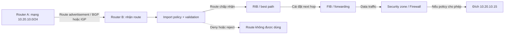
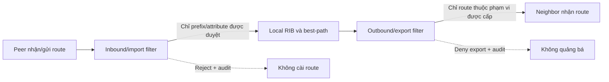
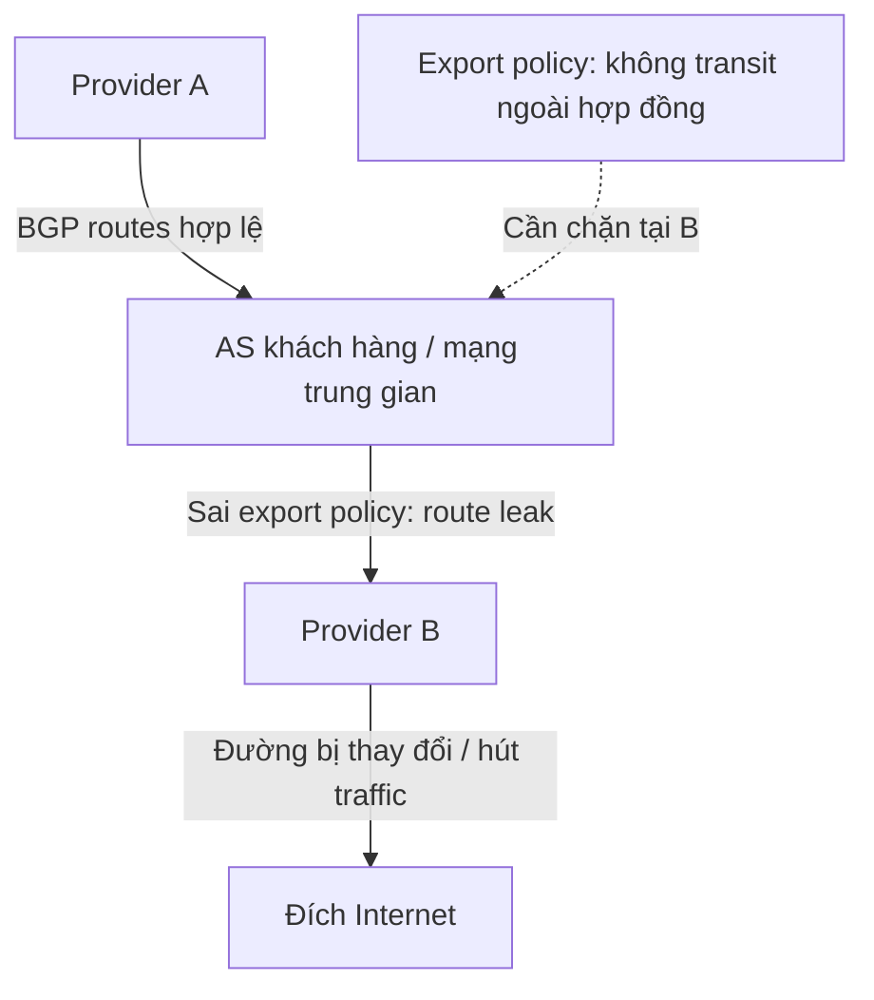
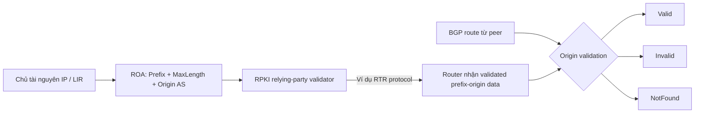
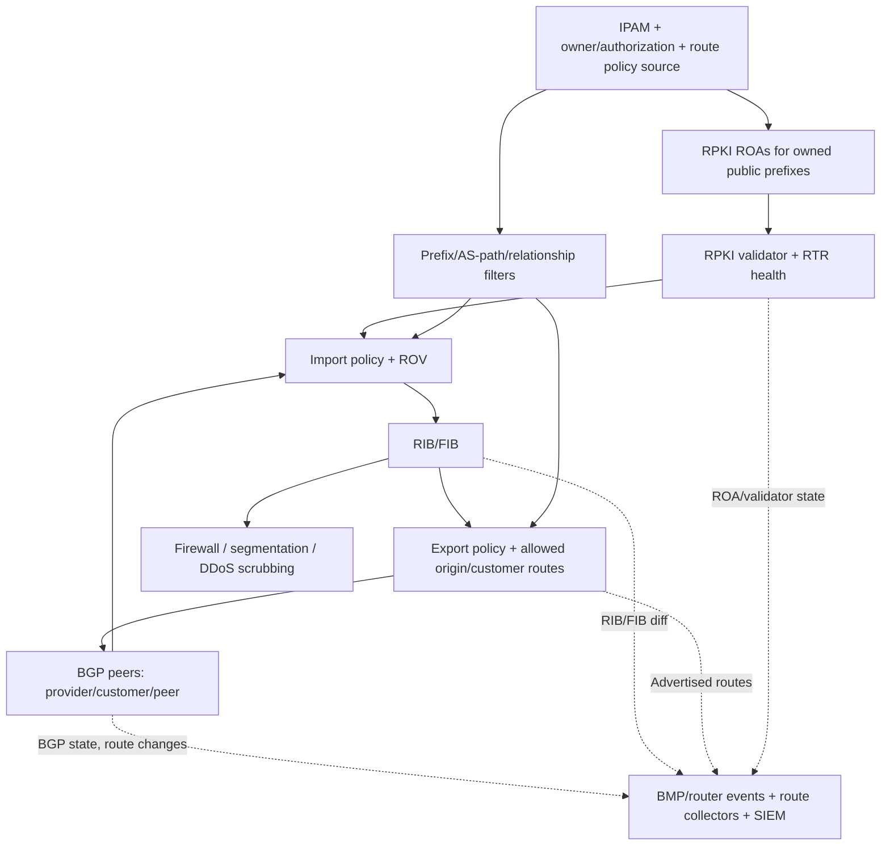

# Route advertisement

> **Học phần:** `SECURITY_NETWORK_SECURITY`  
> **Chương:** Routing security  
> **Chủ đề:** **Route advertisement** — cách router công bố khả năng đi tới các prefix, cách những thông tin đó được chấp nhận và lan truyền, cùng các biện pháp bảo vệ trước quảng bá sai, chiếm tuyến (*route hijack*), rò rỉ tuyến (*route leak*) và lỗi vận hành. Bài học kết nối bảo mật định tuyến với phân đoạn, firewall, VPN, cloud, IDS/IPS và khả năng phục hồi của mạng.

## Mục tiêu học tập

Sau bài học, người học có thể:

1. Giải thích route advertisement, prefix, next hop, route origination, route propagation, route redistribution và quan hệ giữa control plane với forwarding/data plane.
2. Phân biệt quảng bá tuyến trong **BGP** và trong các IGP như **OSPF** hoặc **IS-IS**, cũng như tuyến tĩnh và tuyến mặc định.
3. Thiết kế chính sách **import/export**, prefix filtering, kiểm soát độ dài prefix, route-maps/policy, xác thực neighbor, max-prefix và giám sát thay đổi tuyến.
4. Phân biệt **route hijack**, **route leak**, lỗi cấu hình, blackholing và bất thường về đường đi; biết giới hạn của mỗi nguồn chứng cứ.
5. Giải thích **RPKI ROA/Route Origin Validation (ROV)**, ba trạng thái Valid/Invalid/NotFound và lý do RPKI origin validation chưa xác thực toàn bộ AS path.
6. Kiểm tra tính nhất quán của quảng bá tuyến qua Internet edge, mạng nội bộ, cloud/hybrid, VPN, VRF và EVPN.
7. Lập quy trình triển khai, rollback và response với các bài kiểm thử được phép, không gây thay đổi định tuyến Internet thực.

## 1. Route advertisement là gì?

**Route advertisement** là việc một router hoặc thành phần điều khiển định tuyến **thông báo khả năng tiếp cận một hoặc nhiều mạng đích** cho các neighbor/peer theo giao thức và chính sách áp dụng. Dữ liệu công bố thường là **network prefix** (ví dụ `10.20.0.0/16`), kèm thông tin giúp peer chọn đường đi như next hop, thuộc tính ưu tiên và đường AS.

Ví dụ trong lab, router A biết mạng `10.20.10.0/24` nằm phía sau nó. Nếu A quảng bá prefix đó cho router B và B **chấp nhận** thông tin, B có thể chọn A làm đường đi tới prefix. Tuy nhiên:

- **Đã quảng bá** không đồng nghĩa peer đã **nhận**.
- Peer đã **nhận** không đồng nghĩa route được **chọn tốt nhất**.
- Route được **chọn** không đồng nghĩa nó đã **cài thành công trong forwarding table**.
- Có route và forwarding thành công **không đồng nghĩa firewall/ACL/IAM cho phép truy cập** ứng dụng.
- Có kết nối tới mạng đích cũng **không bảo đảm tuyến quay về** đã tồn tại và hợp lệ.

Do đó, khi nói một quảng bá là “đang hoạt động”, cần phân biệt **gửi, nhận, chấp nhận, chọn đường, cài đặt và chuyển tiếp thực tế**.

### Các thuật ngữ quan trọng

| Thuật ngữ | Ý nghĩa thực dụng | Điểm an ninh cần nhớ |
|---|---|---|
| **Prefix / NLRI** | Phạm vi mạng đích, như IPv4/IPv6 CIDR | Phải kiểm soát sở hữu, phạm vi và độ dài prefix |
| **Route origin** | Nơi thông tin reachability được khởi phát theo cách diễn giải giao thức | Không mặc nhiên chứng minh tổ chức được quyền công bố prefix |
| **Next hop** | Địa chỉ hoặc giao diện để chuyển tiếp theo đường đã chọn | Phải reachable và không dẫn ra đường không được dự kiến |
| **Neighbor / peer** | Router thiết lập quan hệ trao đổi định tuyến | Chỉ peer tin cậy, đúng role và policy |
| **RIB** | Routing Information Base; cơ sở dữ liệu tuyến của routing process/router | Chứa route ứng viên và lựa chọn theo nền tảng |
| **FIB** | Forwarding Information Base; thông tin dùng chuyển tiếp gói | Có thể khác RIB tạm thời hoặc vì lỗi tài nguyên |
| **Import policy** | Điều kiện chấp nhận/biến đổi route nhận từ peer | Không nhận prefix/thuộc tính ngoài phạm vi |
| **Export policy** | Điều kiện công bố route cho peer | Không quảng bá route không được phép |
| **Route redistribution** | Đưa thông tin từ một giao thức/bảng tuyến vào giao thức khác | Dễ vô tình lan tuyến nội bộ hoặc tạo loop |
| **Route leak** | Route được truyền vượt phạm vi/quan hệ định tuyến dự kiến | Có thể gây chuyển hướng, mất kết nối hoặc lộ đường nội bộ |
| **Route hijack** | Một prefix được công bố/chấp nhận bởi nguồn không có thẩm quyền | Có thể làm traffic bị hút về đường không mong muốn |

**Độ dài prefix:** `/24` cụ thể hơn `/16` trong IPv4, vì vậy một route `10.20.10.0/24` (nếu hợp lệ và có thể dùng) có thể chi phối lưu lượng tới mạng con đó so với `10.20.0.0/16` theo cơ chế **longest-prefix match** ở forwarding. Chính vì thế quảng bá **more-specific prefix** cần kiểm soát riêng.

## 2. Từ quảng bá đến lưu lượng thực: control plane và data plane



Trong mô hình này:

1. Router A gửi thông tin reachability.
2. Router B kiểm tra route theo **giao thức, route policy và các cơ chế xác minh được bật**.
3. Router B có thể học nhiều đường tới cùng prefix và chọn một đường theo thuật toán/cấu hình.
4. Route được chọn có thể được lập trình vào FIB nếu next hop và tài nguyên phù hợp.
5. Gói dữ liệu thực phải vượt qua ACL, firewall, security zone, tunnel và policy ứng dụng trước khi tới dịch vụ.

**Tách biệt quan trọng:** BGP/OSPF/IS-IS chủ yếu quản lý **thông tin đường đi**, không cấp quyền cho người dùng đăng nhập API hoặc truy xuất database. Một route leak có thể tạo đường mạng ngoài dự kiến; mức tác động thực còn phụ thuộc firewall, identity, application authorization và những đường phản hồi.

### Ba lớp cần quan sát đồng thời

| Lớp | Câu hỏi | Công cụ/bằng chứng |
|---|---|---|
| **Control plane** | Tuyến nào được nhận, xuất, lọc, chọn? | Neighbor state, Adj-RIB-In/Out hoặc bảng tương đương, policy hit, RIB |
| **Data plane** | Gói thực đi đâu và bị chặn tại đâu? | FIB, traceroute trong lab, interface counters, packet/flow logs |
| **Security/application** | Kết nối và hành động có được cấp phép không? | Firewall, VPN/NAC, IAM, API/DB audit, IDS/IPS |

Để điều tra đầy đủ còn cần **đồng bộ thời gian** giữa router, firewall, collector và ứng dụng. Khi route flap nhanh, log không có timestamp nhất quán dễ dẫn tới kết luận sai.

## 3. Route advertisement trong BGP

**Border Gateway Protocol (BGP)** trao đổi thông tin reachability, thường giữa các **Autonomous System (AS)** trên Internet bằng eBGP và trong một AS qua iBGP hoặc các kiến trúc thay thế phù hợp. BGP cũng được dùng cho một số mạng riêng, VPN và overlay như EVPN.

Một BGP update mang thông tin route gồm NLRI và các path attribute phù hợp ngữ cảnh. Những thuộc tính có thể liên quan an ninh và điều khiển đường đi:

| Thành phần | Vai trò thường gặp | Rủi ro cấu hình |
|---|---|---|
| **NLRI / prefix** | Mạng đích được công bố | Xuất prefix không thuộc quyền, quá cụ thể, hoặc chứa private/bogon lên Internet |
| **AS_PATH** | Chuỗi AS mà route đã đi qua theo BGP | Path giả, bất thường; không tự xác thực nguồn gốc hoặc từng hop |
| **NEXT_HOP** | Địa chỉ next hop được quảng bá | Unreachable next hop, route recursive sai, sai VRF |
| **LOCAL_PREF** | Chọn đường nội bộ trong AS, giá trị cao thường được ưu tiên hơn theo quy trình BGP | Gán ưu tiên sai có thể hút traffic vào tuyến không mong muốn |
| **MED** | Gợi ý hướng vào giữa các AS trong những điều kiện so sánh cụ thể | Không có hiệu lực tuyệt đối giữa mọi peer/provider |
| **Communities** | Tag hỗ trợ chính sách giữa các router/AS | Gắn nhầm community có thể thay đổi export/preference/blackhole |
| **ORIGIN attribute** | Thông tin nguồn gốc theo thuật toán BGP | **Không phải** chứng cứ sở hữu prefix hoặc xác thực origin AS bằng RPKI |
| **MP_REACH_NLRI / MP_UNREACH_NLRI** | Mở rộng trao đổi reachability cho các address family như IPv6/VPN/EVPN | Policy thiếu address-family có thể bỏ sót route |

Các attribute và thứ tự chọn best path phụ thuộc tiêu chuẩn, thuộc tính áp dụng và cách triển khai của sản phẩm. **Không dùng một danh sách thứ tự cứng cho mọi vendor**; đọc và kiểm thử thuật toán thực tế khi đánh giá sự cố.

### eBGP và iBGP

- **eBGP** trao đổi tuyến giữa các AS khác nhau; ranh giới quan hệ kinh doanh và tin cậy đặc biệt quan trọng.
- **iBGP** phân phối thông tin BGP trong một AS; cần thiết kế route reflector hoặc full mesh phù hợp, next-hop reachability, route policy và vòng lặp.
- **Route reflector** giảm số phiên iBGP nhưng làm tăng tầm ảnh hưởng của cấu hình export/import sai và cần giám sát các route được phản xạ.

**BGP session established không chứng minh route hợp lệ.** Một peer đúng danh tính vẫn có thể gửi một route ngoài thỏa thuận do lỗi cấu hình hoặc sự cố, vì vậy các bộ lọc **phải có ở từng phiên/quan hệ**.

## 4. Quảng bá trong OSPF và IS-IS khác BGP ra sao?

Trong mạng nội bộ, các **Interior Gateway Protocol (IGP)** cũng truyền reachability nhưng theo mô hình link-state khác BGP.

| Thuộc tính | BGP | OSPF | IS-IS |
|---|---|---|---|
| Môi trường thường gặp | Giữa AS, mạng lớn, VPN/EVPN, datacenter | Trong một tổ chức/miền quản trị | Trong một tổ chức/miền quản trị, nhất là mạng lớn |
| Cách lan thông tin | UPDATE chứa route/path attributes | LSA flood trong area/phạm vi phù hợp | LSP flood trong level/phạm vi phù hợp |
| Quyết định đường | BGP policy và best-path selection | SPF từ link-state database và metric | SPF từ link-state database và metric |
| Ranh giới an ninh | Peer role, import/export, RPKI/ROV, prefix filter | Neighbor/interface, area, LSA/redistribution, auth | Neighbor/interface, level, LSP/redistribution, auth |
| Rủi ro phổ biến | Route leak, origin hijack, more-specific route, sai export | LSA giả/sai, flooding, default/redistribution lỗi | LSP giả/sai, flooding, metric/redistribution lỗi |

**Cách gọi chuẩn:** OSPF quảng bá các **Link-State Advertisement (LSA)**; IS-IS quảng bá **Link-State PDU (LSP)**. Không nên mô tả cả ba giao thức như thể tất cả đều gửi “BGP route update”.

Trong OSPF, router không chỉ nhận một prefix rồi chọn đường độc lập như BGP; nó xây **link-state database** và chạy SPF để tính route. Vì vậy việc kiểm soát nguồn LSA, adjacency, area và redistribution quan trọng hơn mô phỏng policy eBGP trên mọi link.

### Tuyến tĩnh và default route

**Static route** được cấu hình trực tiếp, không tự động quảng bá. Tuy nhiên, nó **có thể bị đưa vào BGP/OSPF/IS-IS** nếu người vận hành cấu hình origination/redistribution phù hợp.

**Default route (0.0.0.0/0 hoặc ::/0)** có phạm vi ảnh hưởng rất rộng: nếu xuất sai, traffic không có route cụ thể hơn có thể đi qua hệ thống ngoài dự kiến. Default-route origination cần điều kiện rõ, ví dụ chỉ quảng bá khi **đường upstream thực sự hoạt động** và policy mong muốn còn đúng. Cơ chế track và failover cần kiểm thử trong lab.

## 5. Import policy và export policy — ranh giới phòng vệ quan trọng nhất

Trong BGP và nhiều hệ thống định tuyến, **import/inbound policy** xử lý route từ neighbor trước khi chấp nhận vào bảng xử lý; **export/outbound policy** xác định route nào được công bố cho neighbor.



**Nguyên tắc mặc định:** Tại ranh giới quan hệ định tuyến, nếu thiếu thông tin hoặc không được phê duyệt, nên thiết kế **deny/unadvertised by default** trong phạm vi chính sách khi nền tảng hỗ trợ. Đừng mặc định “peer đã established thì nhận hoặc xuất tất cả”.

### Ma trận policy theo loại peer

| Quan hệ | Nhận từ peer | Xuất tới peer | Điều phải tránh |
|---|---|---|---|
| **Upstream/provider** | Route đã ký hợp đồng (full table hoặc default/partial), có validation | Prefix của chính AS và customer được quyền transit theo chính sách | Xuất route đã học từ một provider sang provider khác nếu không được phép kinh doanh/transit |
| **Customer** | Chỉ prefix mà customer được phép origin/được quyền chuyển tiếp | Route dịch vụ phù hợp thỏa thuận, thường có thể full table/default | Customer quảng bá prefix người khác hoặc tràn quá nhiều prefix |
| **Peer ngang hàng** | Route của peer và customer cone được duyệt | Prefix chính AS và customer được phép quảng bá | Xuất route học từ provider hoặc peer khác gây leak |
| **Route reflector iBGP** | Route theo cluster/client và policy nội bộ | Route được phép phản xạ trong phạm vi AS | Chấp nhận nhầm next hop hoặc route vượt phạm vi tenant/VRF |
| **Đối tác mạng riêng** | Chỉ prefix dịch vụ đã thỏa thuận | Chỉ prefix phục vụ đối tác | Học default/Internet hoặc toàn bộ mạng quản trị không cần thiết |

Đây là **mô hình phổ biến để đánh giá**; các hợp đồng transit, route server, đặc thù peering và kiến trúc nội bộ có thể có policy khác. Phải lấy **thỏa thuận thực tế và source of truth** làm căn cứ.

### Ví dụ chính sách trung lập nhà cung cấp

```yaml
policyId: BGP-EXPORT-EDGE-001
environment: lab
peerRole: external-provider
neighbor: "AS65020"
sourceAS: "AS65010"
export:
  allowedPrefixes:
    - "198.51.100.0/24"
    - "2001:db8:100::/48"
  deny:
    - "unapproved-prefix"
    - "private-network-to-public-internet"
    - "route-learned-from-other-provider-unless-transit-approved"
  requireChangeApproval: true
import:
  permittedMode: default-route-only
  prefixes:
    - "0.0.0.0/0"
    - "::/0"
  validateNextHop: true
logging:
  neighborChanges: true
  policyCounters: true
  routeChanges: true
owner: network-operations
```

**Cảnh báo:** Đây là **mô tả policy giả lập**, không phải cú pháp dùng ngay trên router. AS65010/AS65020 thuộc dải AS private phục vụ lab; `198.51.100.0/24` và `2001:db8::/32` thuộc dải tài liệu. **Không được quảng bá các prefix/AS minh họa này lên Internet công cộng**. Trong mạng thật phải thay bằng ASN, prefix được sở hữu/ủy quyền, quy định import/export và tham số router đã được xác minh.

## 6. Prefix filtering và độ dài prefix

**Prefix filter** định nghĩa những địa chỉ mạng và **độ dài prefix** nào được chấp nhận hoặc công bố. Nó là cơ chế bảo vệ căn bản kể cả khi đã có RPKI.

### Lý do cần kiểm tra cả địa chỉ và mask length

Giả sử trong lab AS65010 sở hữu `10.20.0.0/16` và được phép phân phối riêng hai prefix `10.20.10.0/24`, `10.20.20.0/24` cho mạng nội bộ. Nếu dùng policy “allow any prefix nằm trong /16” mà không giới hạn độ dài, có thể vô tình cho phép cả nhiều tuyến cực cụ thể chưa được phê duyệt. Ngược lại, chỉ cho đúng hai /24 có phạm vi dễ kiểm soát hơn.

Đối với public BGP, bộ lọc có thể xét:

1. Prefix thực sự thuộc quyền origin hoặc khách hàng được ủy quyền;
2. **Độ dài prefix** phù hợp route policy, filter ở upstream và khả năng truyền trên Internet;
3. Các dải **special-use, private, link-local, loopback, multicast, documentation** không được công bố công khai;
4. Chính sách riêng cho IPv4 và IPv6;
5. Các route có overlap hoặc more-specific ngoài dự kiến.

Không có **một ngưỡng prefix length toàn cầu** đảm bảo mạng nào cũng chấp nhận. Trên Internet có các tập quán lọc dựa trên độ dài phổ biến, nhưng từng nhà mạng và address family có quy tắc riêng; phải xác minh với peer/provider khi thiết kế.

### Prefix filter không thay route origin validation

Một prefix thuộc allowlist có thể **vẫn bị quảng bá bởi sai AS** nếu policy không kiểm tra nguồn. RPKI ROA/ROV giải quyết một phần chuyện **ASN có được ủy quyền origin prefix** trên Internet. Ngược lại, route có trạng thái RPKI Valid vẫn có thể bị từ chối bởi import/export policy nếu route không thuộc quan hệ hoặc nhu cầu hiện tại.

## 7. Origination, aggregation và redistribution

### Route origination

Một router có thể quảng bá một prefix khi route đó hiện diện và phù hợp điều kiện origination của giao thức/nền tảng. Chẳng hạn, một lệnh BGP `network` trên nhiều nền tảng yêu cầu **route trùng chính xác** trong RIB; cú pháp/điều kiện cụ thể phụ thuộc router.

**Không quảng bá một prefix chỉ vì nó xuất hiện ở danh sách dự định**: cần chắc chắn có khả năng chuyển tiếp thực sự, kế hoạch failover và không làm blackhole traffic.

### Aggregation / summarization

**Aggregate route** (ví dụ /16 thay cho nhiều /24) làm giảm kích thước bảng tuyến và có thể đơn giản hóa policy. Nhưng summary quá rộng khi một phần mạng bên dưới không reachable có thể hút traffic vào điểm không có đường tới đích.

**Thiết kế an toàn:** chỉ quảng bá summary khi có khả năng xử lý traffic của phạm vi đó, biết các more-specific cần thiết và hành vi khi downstream bị mất; đặt route discard/Null có chủ ý chỉ khi đã hiểu hậu quả, không lấy nó thay cho reachability.

### Redistribution giữa giao thức

Khi đưa static/OSPF/IS-IS/connected routes vào BGP hoặc ngược lại, cần:

- Chỉ định nguồn route hợp lệ, không dùng redistribute “everything” không kiểm soát.
- Gắn tag/community/route source hoặc cơ chế tương đương để ngăn **tái phân phối vòng lặp**.
- Kiểm soát metric, administrative distance/preference và next hop.
- Kiểm tra không xuất subnet quản trị, link-local, guest hay route nội bộ ra Internet.
- Thiết kế chính sách độc lập cho IPv4/IPv6 và từng VRF.
- Có kế hoạch cho route withdraw khi nguồn route biến mất.

Một nguồn sai phổ biến là **redistribution hai chiều thiếu lọc**, khiến route quay về giao thức ban đầu dưới dạng mới, gây loop hoặc thay đổi đường đi.

## 8. Route hijack: quảng bá sai origin hoặc more-specific

**Route hijack** trong bối cảnh BGP thường là một AS công bố prefix mà nó không được quyền origin hoặc một **more-specific** thu hút traffic từ prefix hợp lệ. Kết quả phụ thuộc policy của các AS trung gian, độ dài prefix và mạng thực tế; có thể gây chuyển hướng, gián đoạn hoặc làm traffic tới nhầm nơi.

### Ví dụ khái niệm

Tổ chức A dự định công bố prefix P. Một mạng khác xuất hiện với một quảng bá P hoặc một prefix con của P theo đường BGP không được ủy quyền. Một số mạng nhận route và lựa chọn đường theo BGP/prefix matching, dẫn tới lưu lượng tới A bị chuyển hướng hoặc thất bại.

**Không phải mọi route khác dự kiến là hành vi thù địch.** Quảng bá sai có thể do lỗi cấu hình, import/export rộng, migration, mis-aggregation hoặc quy trình peering thiếu kiểm tra. Threat modeling nên mô tả **rủi ro/tác động**; kết luận ý định cần bằng chứng riêng.

### Giảm thiểu

- Đăng ký ROA RPKI chính xác cho public prefixes và origin ASN được ủy quyền;
- triển khai ROV ở biên nhận route khi phù hợp;
- lọc prefix và quan hệ peer, giới hạn more-specific được phép;
- theo dõi BGP origin change, AS_PATH change, more-specific và reachability từ nhiều vantage point;
- phối hợp nhanh với upstream/peer khi xác định quảng bá không hợp lệ;
- quản lý các route nguồn và thay đổi prefix origin trong migration.

## 9. Route leak: lan tuyến vượt quan hệ được phép

**Route leak** là việc một route được công bố vượt phạm vi hoặc vai trò định tuyến mà nó được phép đi qua. Một ví dụ điển hình là một AS học route từ provider A rồi **xuất sang provider B hoặc peer C** dù nó không được phép làm transit giữa các bên. Việc này có thể gây đường đi vòng, quá tải, gián đoạn hoặc chuyển lưu lượng qua mạng có năng lực/niềm tin khác.



### Hijack khác leak ở điểm nào?

| Góc nhìn | Route hijack | Route leak |
|---|---|---|
| Vấn đề chính | Quảng bá reachability của prefix theo origin không được phép hoặc một more-specific trái quyền | Chuyển tiếp route giữa các quan hệ không được phép |
| Có thể có origin ASN hợp lệ không? | Đặc trưng origin không hợp lệ trong nhiều trường hợp; trường hợp khác có kỹ thuật/path phức tạp | **Có**; origin vẫn đúng nhưng đường phân phối sai |
| RPKI ROV có chặn chắc không? | Chặn được một số origin-invalid khi policy reject | **Không** đủ để phát hiện/chặn mọi route leak |
| Kiểm soát trọng tâm | ROA/ROV, prefix filter, origin monitoring | Import/export theo role, AS path/relationship checks, policy, route leak detection |
| Hậu quả | Mất/đổi reachability, diversion, blackhole | Transit không mong muốn, lệch tuyến, tắc nghẽn, traffic exposure |

**BGP Roles và OTC (Only-to-Customer)** được tiêu chuẩn hóa để hỗ trợ giảm một số dạng route leak khi hai peer và thiết bị hỗ trợ, cấu hình đúng. Chúng **bổ trợ**, không thay thế prefix export/import policy và kiểm tra quan hệ. Triển khai thực tế nên đối chiếu RFC 9234 và khả năng sản phẩm.

## 10. RPKI, ROA và Route Origin Validation

**Resource Public Key Infrastructure (RPKI)** cung cấp hạ tầng chứng thực việc nắm giữ quyền tài nguyên số Internet và cơ chế ủy quyền route origin. Một **Route Origin Authorization (ROA)** liên kết **IP prefix, maximum prefix length và origin ASN** được phép. Router hoặc hệ xác minh có thể dùng dữ liệu RPKI để áp **Route Origin Validation (ROV)** cho các BGP route public.

### Chuỗi kiểm tra khái niệm



### Ba trạng thái quan trọng

| Trạng thái ROV | Ý nghĩa đơn giản | Xử lý cần cân nhắc |
|---|---|---|
| **Valid** | Có ROA phù hợp xác thực origin ASN và độ dài prefix được công bố | Có thể tiếp tục xét import policy khác; **không** bảo đảm đường đi sạch |
| **Invalid** | Có ROA bao phủ liên quan nhưng origin ASN hoặc độ dài quảng bá trái dữ liệu ủy quyền | Thường được cấu hình reject/deprefer theo chính sách đã kiểm thử và khuyến nghị vận hành |
| **NotFound** | Không có dữ liệu ROA liên quan đủ để xác định Valid/Invalid | **Không** đồng nghĩa Invalid hay độc hại; xử lý theo import policy khác |

**Điểm cần nhớ:** RPKI ROA xác minh **origin authorization**, không chứng minh AS_PATH ở mọi hop là thật, không chứng minh neighbor được phép **export** route theo quan hệ, và không xác thực payload ứng dụng/TLS.

### Ví dụ minh họa ROA trong lab

Giả sử mạng tài liệu `198.51.100.0/24` có một ROA giả định `origin AS65010, maxLength /24`. Nếu một BGP route của đúng `198.51.100.0/24` có origin AS65010 thì **phù hợp** với bộ dữ liệu giả định. Nếu prefix con `198.51.100.0/25` được quảng bá, nó **vượt maxLength /24**, nên không hợp lệ theo ROA này. Nếu origin khác AS65010 cũng sai điều kiện.

**Chỉ là mô phỏng logic ROV:** `198.51.100.0/24` là prefix tài liệu và AS65010 là AS private, **không thể dùng cấu hình đó làm ROA public thực**. Trong hệ thống thật, ROA do chủ tài nguyên hoặc bên được ủy quyền quản lý qua RPKI tương ứng.

### Các rủi ro vận hành RPKI

- ROA sai ASN khi đổi upstream/migrating origin;
- `maxLength` quá rộng có thể cho phép nhiều more-specific hơn dự định;
- quên khai ROA cho legitimate more-specific hoặc anycast origin;
- validator/cache không cập nhật, phiên RTR mất kết nối hoặc dữ liệu cũ;
- policy router diễn giải NotFound/Invalid sai;
- chỉ triển khai ROV ở một phần biên, trong khi đường khác tiếp nhận route không kiểm tra.

Thiết kế trạng thái **validator unavailable/stale data** theo sản phẩm và chính sách: không được coi mọi route tự động Valid khi hệ xác minh ngắt kết nối, cũng không nên cấu hình chặn toàn Internet mà không hiểu hành vi fail-safe/fail-operational. Theo dõi freshness, session và chính sách fallback.

## 11. Các nguồn bổ trợ: IRR, prefix list và route leak prevention

**Internet Routing Registry (IRR)** cung cấp các đối tượng mô tả chính sách, prefix và quan hệ ở một số cơ sở dữ liệu định tuyến; có thể dùng làm nguồn tạo bộ lọc sau khi kiểm tra độ tin cậy. Nhưng **dữ liệu IRR có thể cũ, không nhất quán, thiếu bảo đảm mật mã** hoặc có phạm vi khác nhau.

Do đó:

- Không xem bất kỳ đối tượng IRR nào là sự thật duy nhất;
- kiểm tra nguồn, owner, thời gian cập nhật và chính sách đăng ký;
- kết hợp **RPKI ROA/ROV** với prefix filter và peer contracts;
- tự động tạo prefix list từ nguồn đáng tin nhưng có review/diff, giới hạn kích thước và rollback;
- theo dõi sự thay đổi ROA/IRR/AS-SET và rủi ro tạo filter quá rộng;
- duy trì chính sách role-based export/import cho leak.

Một số giải pháp dùng **ASPA (Autonomous System Provider Authorization)** hoặc cơ chế path/relationship validation khác để góp phần nhận diện route leak; mức chuẩn hóa, hỗ trợ và triển khai phụ thuộc thời điểm/sản phẩm. Không nên ghi “ASPA thay thế hoàn toàn RPKI origin validation” hoặc coi nó luôn sẵn có trên mọi router.

### RPKI Valid vẫn có thể bị leak

Ví dụ route tới prefix của customer X có ROA đúng. Một mạng trung gian vẫn có thể công bố route đó trái quy tắc transit/peering. Origin ASN trong AS_PATH vẫn đúng, route có thể **Valid** theo ROV, nhưng **đường xuất route là sai**. Đó là lý do kiểm soát export theo vai trò là lớp phòng vệ độc lập.

## 12. Bảo vệ phiên định tuyến và control plane

Đường quảng bá tuyến có thể bị ảnh hưởng nếu phiên neighbor, thiết bị điều khiển hoặc giao thức mang thông tin bị tấn công/sai cấu hình.

### Các lớp bảo vệ thường dùng

| Biện pháp | Tác dụng | Giới hạn / lưu ý |
|---|---|---|
| **Peer allowlist / ACL control plane** | Chỉ địa chỉ/neighbor được duyệt có thể tới cổng điều khiển | IP ACL không tự chứng minh peer thật |
| **BGP TCP MD5 / TCP-AO khi được hỗ trợ** | Bảo vệ một số rủi ro giả mạo/can thiệp phiên theo cơ chế giao thức | Không xác minh quyền sở hữu prefix hay tính đúng của route |
| **GTSM / TTL security** | Hạn chế một số gói BGP giả mạo xa trong topology phù hợp | Không bảo vệ mọi mạng multi-hop/tunnel |
| **OSPF/IS-IS authentication** | Ngăn neighbor không có khóa phù hợp tham gia theo cơ chế hỗ trợ | Cần quản lý/luân chuyển khóa và kiểm thử adjacency |
| **Control-plane policing (CoPP)** | Hạn chế traffic quá mức tới CPU/router control plane | Ngưỡng sai có thể làm rớt hello/update hợp lệ |
| **Management plane isolation** | Hạn chế SSH/API/NETCONF và đổi cấu hình router | Vẫn cần MFA/RBAC/PAM, audit và kiểm soát thiết bị |
| **BGP prefix filters + max-prefix** | Hạn chế route sai và số lượng bất thường | Không phân loại toàn bộ route leak hoặc hijack một cách tuyệt đối |
| **RPKI ROV** | Kiểm tra origin ASN được ủy quyền cho public prefix | Không bảo đảm toàn AS path hoặc ngữ nghĩa export |
| **BGP Roles/OTC** | Hỗ trợ phát hiện/ngăn một số leak theo quan hệ khi cấu hình đúng | Cần hỗ trợ hai phía và chính sách đi kèm |
| **Change management / immutable backups** | Giảm lỗi cấu hình và giúp phục hồi | Không tự kiểm tra bảng tuyến đang được dùng |

BGP truyền thống dùng TCP port 179 cho phiên, nhưng lọc mỗi cổng này chưa đủ. Với OSPF, giao thức định tuyến dùng IP protocol 89; IS-IS hoạt động trực tiếp trên lớp liên kết theo các đặc điểm riêng. **Không áp cùng một ACL port TCP cho tất cả IGP.**

**Chú ý khi khóa phiên:** Việc thay khóa hoặc bật cơ chế authentication trên một phía có thể làm neighbor down. Cần kế hoạch đổi đồng bộ, kiểm tra khả năng hỗ trợ nền tảng và rollback.

## 13. Route advertisement trong VRF, VPN, EVPN và datacenter

Trong hạ tầng hiện đại, quảng bá tuyến không chỉ đi tới Internet.

### 13.1 VRF và route leaking nội bộ

**Virtual Routing and Forwarding (VRF)** tạo những bảng định tuyến logic riêng. Một VRF có thể có prefix giống với VRF khác, nhưng đường đi không tự trao đổi nếu không có cấu hình thích hợp.

Khi **route leaking giữa VRF** phục vụ shared services, quản trị hoặc một số luồng sản xuất, cần:

- xác định prefix nào được phép import/export và mục đích;
- không đưa toàn bộ route từ guest/dev/test vào production/management;
- gắn route target hoặc policy phù hợp với nền tảng;
- đảm bảo đường firewall/IPS dự định vẫn được áp dụng;
- kiểm tra cả **hướng phản hồi**;
- audit người thay đổi bảng VRF và rule import/export.

**Route leak** ở đây có thể là **rò rỉ reachability giữa các miền routing nội bộ**, khác với định nghĩa route leak liên AS trên Internet, nhưng cùng nguyên tắc: **đường đi vượt phạm vi cho phép**.

### 13.2 BGP EVPN/VXLAN

EVPN dùng BGP để quảng bá một số loại reachability cho overlay, có thể gồm MAC/IP và các thông tin route khác tùy EVPN route type, thiết kế và vendor. Chính sách EVPN route target/import-export quyết định VTEP/tenant nào học những reachability đó.

Rủi ro khi policy sai:

- một tenant/VRF học route ngoài phạm vi;
- tuyến trong overlay được quảng bá với sai next hop hoặc VTEP;
- route target được chia sẻ sai, vượt isolation;
- route type/address family không được filter đúng;
- control plane có route nhưng underlay không reachable, khiến lưu lượng đen.

**Không lấy RPKI ROA public Internet để thay cho cơ chế phân quyền tenant EVPN.** Bảo vệ underlay, peering, EVPN route policy, VRF/RT và cloud/application authorization phải được phối hợp.

### 13.3 SD-WAN, VPN và hybrid cloud

Route advertisement trong BGP over VPN, private interconnect, SD-WAN hoặc cloud transit ảnh hưởng trực tiếp tới việc workload nào có thể tới security zone khác. Ví dụ:

| Tình huống | Sai sót có thể có | Kiểm soát cần xác minh |
|---|---|---|
| On-prem → cloud VPC/VNet | Công bố cả dải management vào VPN partner | Prefix filter/route table/import-export theo môi trường |
| Cloud transit/hub-spoke | Spoke guest nhận route production không cần thiết | Segmentation route policy và firewall PEP |
| VPN user/branch | Default route sai khiến traffic đi đường không dự kiến | Split/full tunnel design, route precedence, DNS |
| Multi-region disaster recovery | Quảng bá route DR trước khi dịch vụ sẵn sàng | Health/conditional origination và failback plan |
| Partner BGP peering | Nhận prefix quá rộng hoặc sai address family | Hợp đồng prefix, max-prefix, auth, monitoring |
| EVPN tenant | Import nhầm route target | RT policy, tenant isolation, route visibility |

Route table trên cloud có thể không dùng BGP trực tiếp ở mỗi subnet; một số dịch vụ trung gian học route BGP rồi lập trình route table. Phải phân biệt **route được peer quảng bá** với **route được cloud control plane chấp nhận và cài đặt thực tế**.

## 14. Route advertisement và những lớp bảo mật khác

Route advertisement sai có thể tạo đường đến mạng nhạy cảm hoặc làm traffic đi qua một nơi khác, nhưng tác động phụ thuộc các kiểm soát tiếp theo.

| Lớp | Câu hỏi liên quan route security |
|---|---|
| **Segmentation** | Có route giữa zone không được phép? Có bypass firewall dự kiến? |
| **Firewall/ACL** | Rule còn match đúng khi next hop/interface/zone thay đổi? |
| **VPN/ZTNA** | Tunnel nào quảng bá prefix? User được vào mạng không đồng nghĩa có quyền với app |
| **NAC/Wi-Fi** | Guest hoặc BYOD có học route đến subnet nội bộ do cấu hình lỗi? |
| **IDS/IPS/NDR** | Sensor có còn nằm trên đường dữ liệu thực khi route đổi? |
| **DNS security** | Tên miền trả đúng IP nhưng mạng không có đường; hoặc route khiến traffic tới sai điểm |
| **WAF** | Origin có đường bypass WAF sau thay đổi routing/peering không? |
| **DDoS protection** | Route thay đổi có bỏ qua scrubbing/CDN/Anycast hoặc tăng tải sai link không? |
| **Cloud IAM / application authz** | Reachability tăng có đi kèm quyền truy cập trái phép không? |
| **Observability** | Log/flow có đủ từ cả control-plane update và data-plane traffic không? |

Ví dụ, backend chỉ nên gọi DB qua firewall kiểm tra. Nếu cloud peering và route advertisement mới tạo đường **trực tiếp** giữa hai subnet, firewall trung tâm có thể không còn quan sát đường đó. Vì vậy mỗi thay đổi định tuyến cần được rà soát **không chỉ ở router mà cả sơ đồ security zones và điểm thực thi chính sách**.

## 15. Giám sát quảng bá tuyến và phát hiện bất thường

### 15.1 Các tín hiệu quan trọng

| Chỉ số/sự kiện | Ý nghĩa có thể | Triage gợi ý |
|---|---|---|
| **BGP neighbor up/down** | Mất phiên, đổi đường, tác động kết nối | Xem thời gian, lỗi auth/transport, maintenance |
| **Received/accepted/advertised prefix count** | Route volume thay đổi | Phân biệt số nhận với số được policy accept và export |
| **Max-prefix warning/shutdown** | Peer vượt hạn mức hoặc bảng tăng ngoài dự kiến | Kiểm tra growth hợp lệ, filter, nguồn route và kế hoạch khôi phục |
| **Unexpected origin AS** | Prefix thấy origin khác baseline/ROA | Kiểm tra RPKI, migration, nguồn external route collector |
| **New more-specific prefix** | Có route hẹp hơn đang tác động forwarding | Xác nhận owner, nhu cầu traffic engineering, sự kiện hijack |
| **AS_PATH/next-hop change** | Đường đi và peer thay đổi | So sánh phiên bản/maintenance, route selection |
| **RPKI Invalid tăng** | Có route trái ROA hoặc cấu hình ROA sai | Kiểm tra dữ liệu ROA, origin, maxLength, validator health |
| **Route flap/withdrawal** | Chất lượng kết nối không ổn định | Xem interface, convergence, policy, upstream |
| **VRF/EVPN RT import change** | Tenant/zone học tuyến khác | Kiểm tra isolation và overlay/underlay |
| **Default route xuất hiện bất ngờ** | Traffic có thể đổi đường lớn | Xác nhận nguồn, import policy, reachability |
| **Traffic path asymmetry** | Hai chiều có đường khác nhau | Firewall stateful, NAT, traceroute được phép, FIB |
| **Sensor path changes** | Traffic không còn đi qua IDS/IPS dự định | Flow logs, routing policy, sensor coverage |

Một **route flap** có thể do maintenance, interface lỗi, thay đổi upstream, route withdraw/re-originate hoặc các nguyên nhân không độc hại. Không mặc định mọi bất thường định tuyến là hijack.

### 15.2 RIB/FIB/Adj-RIB và telemetry

- **Adj-RIB-In / received routes** (nếu sản phẩm phơi bày): route từ peer trước/hoặc sau một số bước policy theo semantics của nền tảng.
- **Loc-RIB / selected routes:** route được BGP chọn cho mục đích routing.
- **Adj-RIB-Out / advertised routes:** route thực sự được quảng bá cho peer, có thể có update-group/route-policy.
- **RIB và FIB:** route trong routing table so với route dùng chuyển gói.

**Thận trọng:** Tên hiển thị `received-routes`, `routes`, `advertised-routes` hoặc soft-reconfiguration có khác nhau theo sản phẩm và cấu hình. Không suy ra router thực đã gửi prefix chỉ từ việc prefix nằm trong local RIB.

### 15.3 Log và nguồn bổ trợ

- Router/route reflector BGP state, update log, BMP (BGP Monitoring Protocol) khi hỗ trợ;
- route collector/vantage point độc lập trên Internet để thấy các đường phân phối;
- RPKI validator status, RTR session health, dữ liệu ROA và lịch đổi prefix;
- IRR/source-of-truth inventory, IPAM, CRM/hợp đồng peering;
- NetFlow/sFlow/IPFIX hoặc flow logs để quan sát data traffic;
- firewall/IDS/IPS, cloud route logs, VPN và ứng dụng để xác minh ảnh hưởng.

**Bảo vệ telemetry:** Bảng tuyến, session details và topology có thể nhạy cảm; giới hạn quyền truy cập, tránh xuất toàn bộ thông tin nội bộ ra kênh công cộng.

## 16. Một mô hình threat modeling cho route advertisement

Dùng STRIDE để xác định điểm yếu trong đường quảng bá:

| Nhóm STRIDE | Kịch bản | Phòng vệ |
|---|---|---|
| **Spoofing** | Một bên giả mạo peer/control-plane identity hoặc origin route | Peer auth, ACL/GTSM, RPKI ROV, policy |
| **Tampering** | Route policy/ROA/neighbor/RT bị sửa sai | RBAC/PAM, IaC review, change control, audit |
| **Repudiation** | Không biết ai đổi export filter hoặc tạo ROA | Log thay đổi, version, approval, chứng cứ route update |
| **Information Disclosure** | Lộ prefix nội bộ qua peering hoặc route leak làm lộ topology | Export deny, VRF isolation, giới hạn telemetry |
| **Denial of Service** | Quảng bá sai/more-specific/withdraw gây blackhole hoặc quá tải CPU/router | Prefix filter, max-prefix, CoPP, route stability |
| **Elevation of Privilege** | Route bypass security boundary tạo reachability rồi bị khai thác với authz sai | Phối hợp routing policy, firewall/segmentation, IAM |

### Threat statement mẫu

> Một router ở biên được kết nối với provider và peer nhưng chưa có export policy theo quan hệ. Nếu route học từ provider được quảng bá sang peer, mạng có thể trở thành transit ngoài thỏa thuận, gây lệch tuyến, nghẽn liên kết hoặc bỏ qua điểm kiểm soát. Giảm thiểu bằng export allowlist, BGP role/OTC nếu hỗ trợ, cảnh báo route leak, change review và kiểm thử advertised routes trước khi đưa vào production.

**Phân biệt tác động với chứng cứ:** Route xuất hiện ở peer là bằng chứng reachability được công bố/nhận; muốn kết luận dữ liệu đã bị đánh cắp hoặc người dùng bị lộ phải có **network flow và application evidence** phù hợp.

## 17. Thiết kế phòng vệ theo nhiều lớp cho Internet edge

Một Internet edge an toàn có thể có các kiểm soát sau:



**Điểm thiết kế:**

1. Dùng **source of truth** để quản lý prefix được cấp quyền và quan hệ neighbor.
2. Tạo **import/export allowlist** có review; không tự động thay filter bằng dữ liệu không xác thực.
3. Quản lý **ROA** đúng origin và `maxLength`, kiểm tra trước thay đổi origin/anycast.
4. Bật **ROV** theo chính sách đã thử và theo dõi validator/RTR.
5. Hạn chế route leak bằng role-based policy; BGP Roles/OTC hỗ trợ nơi đã triển khai được.
6. Kiểm soát số route nhận (max-prefix) và giám sát tình trạng session.
7. Bảo vệ control plane, quản trị router và backup cấu hình.
8. Quan sát route changes từ **ngoài AS**, không chỉ router nội bộ.
9. Đảm bảo đường traffic đổi route vẫn đi qua security controls phù hợp.

Không nên xem “bật RPKI” hay “bật max-prefix” là giải pháp duy nhất. Cả hai đều có vùng phủ và rủi ro vận hành riêng.

## 18. Quy trình triển khai và thay đổi route advertisement

### Bước 1 — Kiểm kê

Lập danh mục prefix, origin AS, peer ASN, địa chỉ neighbor, địa chỉ IPv4/IPv6, interface, VRF, RPKI ROA, IRR và ứng dụng phụ thuộc. Xác định owner, contact của upstream, maintenance window và dịch vụ ưu tiên.

### Bước 2 — Định nghĩa trạng thái mong muốn

Với mỗi quan hệ peer, ghi:

- Prefix nào **được nhận** và lý do;
- prefix nào **được xuất** và ủy quyền origin/customer;
- các AS path/role bất thường cần từ chối;
- more-specific nào được phép và ngưỡng max-prefix;
- ROV action với Valid/Invalid/NotFound;
- route-map/community/local-pref/NEXT_HOP nếu có;
- vai trò của default route và phương án failover;
- bảo vệ IPv4/IPv6/EVPN/VPN address family riêng biệt.

### Bước 3 — Sinh policy và review

Policy nên được tạo/review theo source of truth, có code review/ticket và kiểm tra cú pháp. Một thay đổi có thể ảnh hưởng nhiều neighbor nếu dùng route-map hoặc prefix-set chung; **đánh giá phạm vi ảnh hưởng** trước khi áp.

### Bước 4 — Kiểm thử ngoài production

Dùng simulator/lab/route-policy test để xác nhận:

- Legitimate own/customer prefixes được export;
- prefix trái quyền bị reject;
- route leak từ provider sang peer không thể xảy ra;
- default route và more-specific chỉ được phép theo thiết kế;
- RPKI origin-invalid bị xử lý đúng chính sách;
- RPKI NotFound không tự bị coi là Invalid;
- việc withdraw route hoặc mất neighbor không gây blackhole ngoài dự kiến;
- route được FIB cài đúng và firewall vẫn nằm trên đường dữ liệu.

### Bước 5 — Canary rollout và xác minh

Khi được phê duyệt, áp chính sách có phạm vi nhỏ trước, so sánh **received/accepted/advertised route diff** và route monitor từ vantage point phù hợp. Kiểm tra traffic trước/sau, latency/packet loss, phiên peer, RPKI cache, DDoS protection và đối tác.

### Bước 6 — Rollback và post-change review

Lưu cấu hình trước/sau, chính sách thay đổi và owner. Có lệnh/phương án khôi phục được duyệt nhưng tránh tự động reset toàn bộ peering khi chưa đánh giá tác động. Sau thay đổi, theo dõi route flap, reachability, default route, traffic path và báo cáo từ upstream/customer.

### Manifest kiểm soát thay đổi minh họa

```yaml
changeId: "CHG-ROUTE-DEMO-002"
scope: "Lab eBGP AS65010 to AS65020"
addressFamilies:
  - ipv4-unicast
  - ipv6-unicast
expectedExports:
  ipv4: ["198.51.100.0/24"]
  ipv6: ["2001:db8:100::/48"]
expectedImports:
  mode: default-only
rejectConditions:
  - origin-not-authorized
  - prefix-outside-inventory
  - unexpected-more-specific
  - relationship-route-leak
  - special-use-prefix-to-public-peer
observability:
  - bgp_neighbor_state
  - advertised_prefix_diff
  - accepted_prefix_diff
  - rpki_validator_health
  - traffic_reachability
rollback: "Restore the reviewed last-known-good route policy"
owner: "network-team"
approvalRequired: true
```

Các địa chỉ và AS trong manifest chỉ dùng làm **dữ liệu lab**. Không dùng chính sách minh họa như một lệnh router thật, không công bố prefix tài liệu ra Internet.

## 19. Thực hành: kiểm thử route advertisement an toàn

Mô phỏng ba router ảo trong lab cô lập (không peer Internet thật):

- `R-A / AS65010`: router biên của mạng thử nghiệm.
- `R-B / AS65020`: provider mô phỏng.
- `R-C / AS65030`: peer ngang hàng mô phỏng.

Mạng tài liệu được dùng: `198.51.100.0/24` và `2001:db8:100::/48`. **Chỉ dùng trong lab**, không gửi BGP update ra peer thật hoặc mạng Internet.

### Yêu cầu phòng vệ

1. R-A chỉ xuất những prefix **đã được phê duyệt** cho provider/peer.
2. Không xuất tuyến học từ provider R-B sang peer R-C khi không có thỏa thuận transit.
3. R-A chỉ nhận default route từ provider theo kịch bản lab.
4. Mô phỏng dữ liệu ROA và ROV trong **bộ test logic**, không tạo ROA tài liệu trong RPKI Internet.
5. Nếu nhận route có origin không phù hợp dữ liệu ủy quyền giả lập, kết quả validation là Invalid và được xử lý theo policy lab.
6. Nếu BGP neighbor mất kết nối, kiểm tra route withdraw/failover và tính sẵn sàng dịch vụ mô phỏng.

### Bảng kiểm thử

| Ca | Input trong lab | Kỳ vọng |
|---|---|---|
| **Export hợp lệ** | R-A có `198.51.100.0/24` trong inventory | Chỉ xuất nếu thỏa origination/export policy |
| **Export sai nguồn** | R-A học một prefix không được phê duyệt từ R-B | Không quảng bá prefix đó sang R-C |
| **More-specific sai** | Xuất `198.51.100.0/25` khi chỉ cho /24 | Reject theo prefix length policy |
| **Default nhập** | R-B quảng bá `0.0.0.0/0` hợp lệ | R-A nhận theo import policy |
| **Nhập ngoài danh sách** | R-B quảng bá prefix khác default | R-A không chấp nhận trong kịch bản default-only |
| **Origin validation Invalid** | Dữ liệu ROA lab phủ prefix nhưng ASN khác | Reject/deprefer theo policy test, giữ record |
| **Origin validation NotFound** | Không có dữ liệu ROA liên quan | Không bị gán nhầm Invalid; vẫn xét policy khác |
| **Mất next hop** | R-B session/underlay lỗi | R-A không tiếp tục blackhole traffic do stale route ngoài chính sách |
| **IPv6 policy** | Route IPv6 không thuộc allowlist | Reject tương ứng, không chỉ kiểm thử IPv4 |
| **VRF isolation** | Route guest xuất vào management VRF | Không import nếu không có quyền rõ |

### Kiểm thử Gherkin

```gherkin
Feature: Route advertisements respect network trust boundaries

  Scenario: Only approved local prefixes are exported
    Given a lab router owns a documented approved prefix
    And the prefix has a matching reachable origination route
    When its eBGP export policy evaluates the route
    Then the approved route may be advertised to the intended peer
    And unapproved more-specific routes are not advertised

  Scenario: Provider-learned routes are not leaked to a peer
    Given a lab router learned a route from an upstream provider
    And no transit agreement authorizes exporting it to a lateral peer
    When the export policy evaluates that route
    Then it denies the route advertisement to the peer
    And a policy decision is available for audit

  Scenario: RPKI invalid origin follows a documented rejection policy
    Given lab validation data authorizes prefix P for origin AS65010
    And a route for P has a different origin ASN
    When origin validation runs
    Then the route is classified Invalid
    And the configured lab policy rejects or deprioritizes it as specified
    And the raw route and validation result remain observable

  Scenario: RPKI NotFound is not confused with Invalid
    Given no relevant validated authorization data covers prefix P
    When origin validation runs
    Then the state is NotFound
    And a separate import policy decides whether the route is accepted

  Scenario: A default route does not bypass management segmentation
    Given a default route is learned from an authorized lab provider
    When a normal application workload attempts a management connection
    Then firewall and authorization controls still enforce their policy
    And no administrative action is granted solely from reachability

  Scenario: A rollback restores previously verified reachability
    Given a reviewed route policy and a recorded last-known-good version
    When a changed lab export filter causes an unexpected route withdrawal
    Then the operator can restore the previous policy
    And route visibility and service reachability are revalidated
```

**Phạm vi thực hành:** Tất cả kịch bản dùng simulator, test policy hoặc router ảo trong hệ thống được phép. Không cần gửi quảng bá sai tới các public peer để kiểm tra nguyên tắc bảo mật; việc thay routing production có thể gây mất kết nối diện rộng.

## 20. Lựa chọn quan sát và chẩn đoán khi tuyến bất thường

Một incident định tuyến thường cần phân tích **theo từng tầng**:

```text
1. Neighbor/session:
   - phiên established/down? authentication/hold timer?
2. Import:
   - peer đã gửi NLRI/attribute gì?
   - filter/ROV có accept hay reject?
3. Best path:
   - route có trong RIB? vì sao route khác thắng?
4. FIB/next hop:
   - next hop reachable? route lập trình xuống data plane chưa?
5. Export:
   - prefix có thực được quảng bá cho peer đúng không?
6. Security:
   - firewall/VRF/VPN/ACL có cho phép luồng không?
7. End to end:
   - kết nối hai chiều và ứng dụng có thành công không?
8. Change/audit:
   - ai sửa, thay ở đâu, phiên bản policy và thời điểm?
```

### Bảng triệu chứng

| Triệu chứng | Nguyên nhân có thể | Kiểm tra ưu tiên |
|---|---|---|
| BGP peer Established nhưng không học route | Import filter, AFI/SAFI sai, peer chưa export, ROV, route withdraw | Received/accepted, policy hit, negotiated AF |
| Router có route nhưng đích không reachable | Next hop không reachable, FIB, route quay về, firewall, MTU | RIB/FIB, next-hop recursion, ACL, return path |
| Quảng bá bị thiếu sau deploy | Origination condition, prefix-list sai, policy thứ tự deny/allow | Local route presence, export policy, advertised route diff |
| Quảng bá quá nhiều route | Redistribution quá rộng, filter fail-open, route leak | Prefix count, AS_PATH, policy diff, owner |
| Max-prefix khiến peering down | Hạn mức quá thấp hoặc peer gửi nhiều route bất thường | Log, số route, thỏa thuận và kế hoạch khôi phục |
| Internet route bỗng đổi origin AS | ROA/migration hợp lệ hoặc hijack | RPKI, external route collectors, upstream confirmation |
| RPKI Invalid đột biến | ROA sai, maxLength thiếu, origin thay đổi, cache cập nhật | ROA object, origin path, RTR/validator health |
| IPv4 hoạt động, IPv6 mất tuyến | Thiếu export/import AFI/SAFI IPv6, policy khác | BGP IPv6 table, v6 next hop, ACL v6 |
| Cloud VPN có route nhưng app không vào được | Route table, tunnel, security group/NACL, IAM | Cloud route installation, security policy, app authz |
| Traffic bỏ qua IDS/IPS sau thay đổi | Next hop, peering/VRF/route symmetry thay đổi | FIB, flow/sensor placement, routing policy |
| Nhiều route flap | Interface, hold timer, path instability, upstream issue | Session counters, link errors, timeline, maintenance |
| Route hợp lệ bị xem là leak | Sai mô hình quan hệ hoặc ngoại lệ transit | Peer contract, source of truth, role mapping |

**Đừng kết luận chỉ từ traceroute một chiều.** Firewall stateful, tunnel, ECMP, NAT và return path có thể làm tình huống phức tạp; cần log từ thiết bị thực và kiểm tra cả hướng phản hồi.

## 21. Playbook ứng phó route hijack/leak nghi ngờ

### 21.1 Xác minh tình huống

- Ghi prefix, origin ASN, observed AS_PATH, next hop, timestamp và sensor/vantage point.
- Kiểm tra route có xuất hiện ở **nhiều collector** hoặc chỉ một router/peer.
- Xác định có migration, anycast change, ROA update, traffic engineering hoặc maintenance được phê duyệt không.
- So sánh nội bộ RIB/FIB/advertised route và route nhìn thấy từ bên ngoài.
- Đánh giá ảnh hưởng thực: mất reachability, latency/packet loss, chuyển lưu lượng, bypass firewall, ảnh hưởng SLA.

### 21.2 Xác định phạm vi và ưu tiên

- Prefix nào của tổ chức/khách hàng bị ảnh hưởng?
- Route từ AS nào và peer nào lan truyền?
- Có ảnh hưởng IPv6, VPN, private route hoặc anycast không?
- Có nguy cơ tài khoản/quản trị hệ thống bị chiếm và sửa router/ROA không?
- Dịch vụ nào đang down hoặc dữ liệu nào có dấu hiệu đi qua đường mới?

Phân biệt **severity của route anomaly** với **severity của incident** dựa trên tác động. Origin thay đổi có thể hợp lệ trong migration; một route leak rất ngắn có thể vẫn gây ảnh hưởng nếu chạm hệ thống trọng yếu.

### 21.3 Giảm tác động theo thẩm quyền

Theo quy trình được phê duyệt:

- Nếu route do chính mình xuất sai, khôi phục **export filter** hoặc rút quảng bá sai có kiểm soát.
- Nếu route sai từ upstream/đối tác, gửi bằng chứng và phối hợp network operations của họ.
- Nếu ROA bị cấu hình sai, sửa bản ghi đúng nguồn ủy quyền; cân nhắc thời gian lan truyền cache/ROV.
- Kiểm tra và bảo vệ firewall/segmentation vì traffic có thể đổi đường trong quá trình khắc phục.
- Không tự ý reset nhiều BGP peers hoặc công bố more-specific mới ra Internet chỉ để “thử” khi chưa đánh giá nguy cơ.
- Tăng cường external monitoring, dịch vụ có tính sẵn sàng cao và thông báo owner kinh doanh.

### 21.4 Hậu kiểm

- Lưu timeline route update/withdraw, policy version, ROA/IRR change, contact/provider ticket và bằng chứng traffic.
- Xác nhận route quay về đúng origin/AS path/relationship và FIB trên các biên.
- Kiểm tra WAF, DDoS scrubbing, IDS/IPS, cloud routing và VPN không còn đường bypass.
- Thêm regression test cho loại filter/role/bản ghi ROA gây lỗi.
- Kiểm tra lại thời hạn peer exceptions, nguồn dữ liệu và backup cấu hình.

## 22. Các hiểu nhầm thường gặp

**“BGP peer established nghĩa là an toàn để nhận mọi route.”** Sai. Peer hợp lệ vẫn có thể gửi route sai do lỗi hoặc bị lạm dụng; cần import/export policy và kiểm soát nguồn.

**“RPKI Valid chứng minh mọi hop AS_PATH đều đáng tin.”** Sai. ROV chủ yếu xác minh origin authorization của prefix; path validation và quan hệ export là vấn đề riêng.

**“RPKI NotFound có nghĩa route độc hại.”** Sai. NotFound chỉ cho biết không có dữ liệu ủy quyền phù hợp để xác định Valid/Invalid; phải xử lý theo policy.

**“RPKI Invalid luôn là tấn công.”** Không. Có thể do ROA sai origin/maxLength hoặc thay đổi mạng chưa đồng bộ. Nó vẫn là tín hiệu cần lọc/điều tra theo chính sách.

**“Tuyến được nhìn thấy ở router có nghĩa router đang quảng bá tuyến đó.”** Không. Cần kiểm tra route được chọn và export/advertised routes cho từng peer/AF.

**“Nếu có route thì ứng dụng chắc chắn truy cập được.”** Không. Firewall, return route, VPN, DNS, IAM và service state tiếp tục quyết định kết quả.

**“Prefix aggregation luôn tốt vì giảm số route.”** Không. Summary quá rộng có thể hút traffic vào đường không có reachability thật hoặc làm mất tính cô lập.

**“Chỉ cần chặn route private trên Internet edge.”** Không. Cần prefix/AS-path/relationship filters, ROV, IPv6, max-prefix và bảo vệ session; cùng với quy trình change review.

**“Route leak và hijack là một.”** Không. Route leak có thể giữ origin hợp lệ nhưng xuất tuyến qua sai quan hệ; hijack thường liên quan quyền công bố prefix/origin hoặc more-specific.

**“Quảng bá more-specific luôn là tấn công.”** Không. Có thể dùng traffic engineering/failover hợp lệ, nhưng cần owner, ROA maxLength và provider policy tương ứng.

**“Một firewall biên đủ an toàn dù route đổi.”** Không. Đường đi mới có thể bypass PEP; bắt buộc so sánh topology, FIB và flow sau thay đổi.

**“Chỉ cần theo dõi router nội bộ để phát hiện hijack Internet.”** Không. Cần external vantage points/route collectors phù hợp vì một quảng bá bên ngoài có thể không xuất hiện trong bảng nội bộ.

## 23. Câu hỏi tự kiểm tra

1. **Route advertisement khác forwarding ra sao?**  
   Advertisement là control-plane thông tin reachability; forwarding là hành vi data plane theo FIB. Policy firewall/app vẫn độc lập.

2. **Vì sao cần kiểm tra advertised routes chứ không chỉ local RIB?**  
   Route trong RIB có thể bị export filter chặn, không được chọn, không có next hop phù hợp hoặc thuộc address family khác.

3. **RPKI ROA chứa những gì?**  
   Một ủy quyền kết nối prefix, maximum prefix length và origin ASN, qua hệ thống chứng thực tài nguyên Internet.

4. **Invalid và NotFound khác nhau thế nào?**  
   Invalid trái dữ liệu ROA liên quan; NotFound không có dữ liệu đủ để xác định. Không nên gộp hai trường hợp.

5. **BGP route leak có thể xảy ra dù prefix RPKI Valid không?**  
   Có. Route có origin hợp lệ vẫn có thể được xuất sang sai peer theo quan hệ định tuyến.

6. **Tại sao max-prefix vừa hữu ích vừa có thể gây sự cố?**  
   Nó phát hiện/giới hạn số prefix nhận bất thường; ngưỡng hoặc chế độ shutdown sai có thể làm gián đoạn peering hợp lệ.

7. **OSPF/IS-IS có gửi BGP UPDATE không?**  
   Không. OSPF dùng LSA, IS-IS dùng LSP; các cơ chế neighbor, authentication và route propagation khác BGP.

8. **Vì sao route và firewall phải được kiểm tra cùng nhau khi thêm cloud peering?**  
   Cloud peering có thể tạo đường đi mới bỏ qua PEP dự định, khiến security zone không còn cô lập về network reachability.

9. **Khi điều tra blackhole, cần xem gì ngoài BGP session?**  
   RIB, next hop, FIB, return route, firewall/ACL/NAT, host/ứng dụng và tình trạng upstream.

10. **Tại sao các địa chỉ 198.51.100.0/24 và 2001:db8::/32 chỉ dùng cho lab?**  
    Chúng được dành cho tài liệu/minh họa; không phải public route thuộc quyền tổ chức được phép quảng bá trên Internet.

## 24. Checklist bảo mật route advertisement

- [ ] Có danh sách prefix/ASN/neighbor/VRF/AFI-SAFI, owner và nguồn ủy quyền rõ ràng.
- [ ] Import/export policy theo peer role, hợp đồng và phạm vi được cấp; không nhận/xuất Any/Any mặc định.
- [ ] Prefix filter xét cả **prefix và độ dài**, IPv4/IPv6, special-use/private và more-specific.
- [ ] Có kiểm soát route learned từ provider/peer không bị leak sang quan hệ sai.
- [ ] Origination/aggregation/redistribution có điều kiện, tag và kiểm thử loop/blackhole.
- [ ] Public prefixes có ROA phù hợp và quy trình kiểm tra origin ASN/maxLength khi migration.
- [ ] ROV có xử lý Valid/Invalid/NotFound đúng, giám sát validator/RTR và dữ liệu stale.
- [ ] IRR và dữ liệu nguồn tạo filter được xác minh, version hóa và có review.
- [ ] BGP Role/OTC hoặc cơ chế route-leak prevention khác được xét theo khả năng sản phẩm.
- [ ] Neighbor được giới hạn theo địa chỉ/role; authentication và GTSM/TTL được bật khi thích hợp.
- [ ] Control-plane policing và management ACL không làm rớt traffic định tuyến hợp lệ.
- [ ] Max-prefix được hiệu chỉnh dựa trên số route dự kiến, có ngưỡng cảnh báo và rollback.
- [ ] Đã kiểm tra RIB, FIB, Adj-RIB-In/Out, next-hop reachability và đường hồi đáp.
- [ ] VRF/VPN/EVPN route target/import-export không vượt tenant hoặc security zone.
- [ ] Cloud/hybrid routes và firewall/IDS/IPS/DDoS scrubbing tiếp tục nằm trên đường dữ liệu dự định.
- [ ] Có external route monitoring, origin-AS alarms, route flap, unexpected more-specific và default route alerts.
- [ ] Có kiểm thử bằng route simulator/lab, không dùng prefix tài liệu trong peering Internet.
- [ ] Mỗi change có owner, ticket, version, peer impact assessment, pre/post diff và rollback.
- [ ] Có playbook liên hệ upstream, xác minh ROA/policy, bảo toàn bằng chứng và phục hồi sau incident.
- [ ] Log RIB/route/peer và topology được phân quyền, đồng bộ thời gian và bảo vệ khỏi sửa trái phép.

## Kết luận

**Route advertisement** là một khâu cốt lõi của bảo mật định tuyến: nó quyết định **những mạng nào được công bố, ai được học chúng và đường đi có thể hình thành từ thông tin đó**. Một tuyến sai có thể làm mất reachability, tạo transit trái thỏa thuận, gây blackhole hoặc mở đường vòng qua security control, ngay cả khi ứng dụng không thay đổi. Phòng vệ vững chắc cần kết hợp **import/export policy, prefix filtering, kiểm soát route origin, RPKI/ROV, quản lý neighbor và control plane, giới hạn route volume, giám sát đa điểm và change control**.

Khi xây dựng kiến trúc mạng an toàn, hãy đánh giá định tuyến cùng **firewall/segmentation, VPN, IDS/IPS, DNS, WAF, DDoS protection và cloud IAM**. Tín hiệu control plane cho biết **tuyến được công bố/chấp nhận**, còn bằng chứng data plane và ứng dụng giúp xác định **ảnh hưởng thực sự** tới dịch vụ, quyền truy cập và dữ liệu.

**Tài liệu đọc thêm:** RFC 4271 (*BGP-4*); RFC 6811 (*BGP Prefix Origin Validation*); RFC 6482 (*A Profile for Route Origin Authorizations*); RFC 9234 (*Route Leak Prevention and Detection Using Roles in UPDATE and OPEN Messages*); RFC 7454 (*BGP Operations and Security*); RFC 5925 (*TCP Authentication Option*); RFC 5082 (*Generalized TTL Security Mechanism*); RFC 7432 (*BGP MPLS-Based Ethernet VPN*) và RFC 8365 (*A Network Virtualization Overlay Solution Using EVPN*) để tìm hiểu các address family/overlay liên quan; RFC 2328 (*OSPF Version 2*) và RFC 5340 (*OSPF for IPv6*). Khi triển khai, kiểm tra hành vi route policy, RPKI validator, hỗ trợ peer role, VRF/EVPN và ngữ nghĩa CLI chính xác theo nền tảng hiện dùng.
