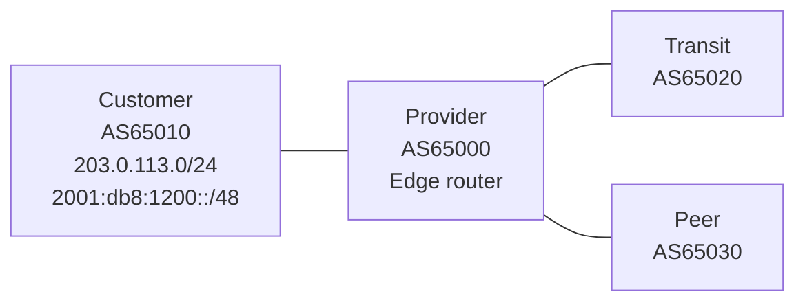

# Prefix filtering: kiểm soát các tuyến mạng được học và quảng bá

Một doanh nghiệp kết nối với nhà cung cấp Internet bằng BGP. Doanh nghiệp được phép quảng bá `203.0.113.0/24`, nhưng do lỗi cấu hình, router của họ gửi thêm `0.0.0.0/0` hoặc một dải thuộc mạng khác. Nếu phía nhà cung cấp tin mọi thông tin nhận được, lỗi đó có thể làm thay đổi đường đi của lượng lớn lưu lượng, gây gián đoạn dịch vụ hoặc góp phần tạo nên **route leak**. Ngược lại, nếu doanh nghiệp nhận nhầm những route không mong muốn từ upstream, một phần traffic nội bộ có thể đi sai hướng.

**Prefix filtering** là kỹ thuật đặt chính sách **cho phép hoặc từ chối các tiền tố địa chỉ mạng (network prefixes)** trong quá trình trao đổi hoặc đưa tuyến vào bảng định tuyến. Đặc biệt trong BGP, prefix filtering giúp trả lời:

- Từ một neighbor, chúng ta **chấp nhận học** những mạng nào?
- Chúng ta **được phép quảng bá** những mạng nào ra neighbor ấy?
- Mức độ cụ thể của route, ví dụ `/24`, `/25` hay `/32`, có phù hợp với chính sách không?
- Nếu neighbor gửi bất ngờ một default route, bảng địa chỉ quá rộng hoặc một tuyến thuộc mạng không được ủy quyền thì phải xử lý thế nào?

Trong module **SECURITY_NETWORK_SECURITY**, prefix filtering là một lớp phòng vệ của **Routing security**, bổ sung cho phân đoạn VLAN/VRF, firewall, VPN, IDS/IPS, DNS và giám sát mạng. Nó giới hạn **thông tin định tuyến được tin cậy và lan truyền**, chứ không trực tiếp kiểm tra nội dung HTTP hay xác thực người dùng như WAF/IAM.

Sau bài học, bạn có thể:

1. Đọc IPv4/IPv6 prefix, phân biệt route prefix với địa chỉ host và packet filtering.
2. Diễn giải đúng cơ chế match prefix-list với `ge`, `le`, độ dài prefix và điều kiện `deny`.
3. Thiết kế lọc **inbound/import** và **outbound/export** cho BGP neighbor theo vai trò customer, provider, peer.
4. Hiểu vì sao prefix filtering giúp giảm rủi ro route leak/hijack nhưng **không thay** RPKI origin validation, AS-path policy và xác thực phiên BGP.
5. Thiết kế chính sách có điểm an toàn khi deploy: danh sách prefix được ủy quyền, thay đổi có kiểm soát, giám sát route count, kiểm thử trước/sau và rollback.
6. Phân tích sự cố **mất route**, **mất connectivity**, **bị từ chối route** hoặc **quảng bá nhầm** dựa trên bằng chứng từ RIB, BGP table và route policy.

> **Địa chỉ minh họa:** `192.0.2.0/24`, `198.51.100.0/24`, `203.0.113.0/24` và `2001:db8::/32` là dải dùng cho tài liệu, không phải prefix định tuyến Internet công cộng. Các số AS `65000–65534` trong ví dụ là private ASN. Không dùng các ví dụ này làm cấu hình BGP production.

## 1. Prefix filtering là gì?

Trong routing, **prefix** biểu diễn một tập địa chỉ bằng địa chỉ mạng và số bit prefix. Một route có thể mang tiền tố `10.20.0.0/16`, `203.0.113.0/24` hoặc `2001:db8:1200::/48`. Prefix filtering kiểm tra **route được quảng bá/nhận** có phù hợp với chính sách hay không.

Ví dụ:

```text
Neighbor customer AS65010
    |
    | BGP UPDATE:
    |   203.0.113.0/24      (được đăng ký trong ví dụ)
    |   198.51.100.0/24     (không được ủy quyền)
    |   0.0.0.0/0           (default route ngoài ý định)
    v
Router provider AS65000
    |
    +-- Prefix-list IN:
          ALLOW 203.0.113.0/24
          DENY  những prefix còn lại
```

Với prefix filtering **inbound**, router có thể ngăn route không phù hợp được chấp nhận theo policy tại điểm nhập. Với prefix filtering **outbound**, router hạn chế những route mà nó quảng bá cho neighbor. **Mỗi chiều phải được xem xét riêng**.

### 1.1. Prefix filtering khác packet filtering

| Tiêu chí | Routing prefix filtering | Firewall/packet filtering |
|---|---|---|
| Đối tượng được xét | **Thông tin tuyến**: network prefix trong RIB/BGP UPDATE hoặc route policy | **Gói tin/luồng** mang địa chỉ nguồn–đích, protocol/port, state |
| Mục tiêu | Quyết định route nào được học/quảng bá/sử dụng theo điểm triển khai | Quyết định traffic nào được phép qua một ranh giới |
| Hành động điển hình | Accept/reject route; có thể sửa thuộc tính trong policy | Allow/drop/reject/log packet hoặc session |
| Ví dụ | Chỉ nhận route `203.0.113.0/24` từ customer | Chỉ cho `10.20.10.0/24` vào API TCP/443 |
| Không giải quyết trực tiếp | Ai đang dùng IP, ứng dụng nào được phép đăng nhập | Route giữa các AS có được quảng bá đúng hay không |

Một số thiết bị cho phép dùng cấu trúc prefix-list trong cả policy định tuyến lẫn lọc packet. **Ngữ nghĩa bảo mật phụ thuộc vào nơi gắn policy**; cú pháp trông giống nhau không đồng nghĩa có hiệu lực ở cùng tầng mạng.

### 1.2. Prefix, subnet và route

Giả sử:

```text
10.20.0.0/16       bao phủ địa chỉ từ 10.20.0.0 đến 10.20.255.255
10.20.10.0/24      nằm bên trong 10.20.0.0/16
10.20.10.128/25    nằm bên trong 10.20.10.0/24
10.20.10.50/32     là một prefix host-route IPv4
```

Một prefix được gọi là **more-specific** khi có độ dài prefix lớn hơn và nằm trong phạm vi của prefix rộng hơn, ví dụ `/25` nằm trong `/24`. **Less-specific** ngược lại, ví dụ `/16` bao phủ `/24`.

Trong bảng chuyển tiếp, router thường chọn tuyến theo **Longest Prefix Match** trong số các tuyến có thể sử dụng. Vì thế, nếu route `/25` xuất hiện bên cạnh `/24`, lưu lượng tới địa chỉ trong `/25` có thể đi theo next hop của `/25`, bất kể `/24` vẫn còn tồn tại. Đây là một lý do more-specific advertisement cần được kiểm soát.

**Lọc một `/24` không tự nói gì về `/25`** nếu chưa hiểu cú pháp match và chính sách độ dài cụ thể.

## 2. Những khái niệm định tuyến phải nắm trước khi lọc

### 2.1. Control plane, RIB và FIB

| Thành phần | Vai trò | Câu hỏi vận hành |
|---|---|---|
| **Control plane** | Học, quảng bá và chọn đường qua các giao thức như BGP/OSPF | Neighbor gửi những route nào? |
| **BGP Adj-RIB-In / Received routes** | Các tuyến nhận từ neighbor theo khả năng và cách biểu diễn của nền tảng | Route có tới router chưa, bị import policy từ chối ở đâu? |
| **Loc-RIB / BGP best path** | Các tuyến BGP được xét/chọn theo thuật toán và policy | Route có được chọn best path không? |
| **Global/VRF routing table (RIB)** | Những tuyến được chọn theo giao thức và quản trị, có thể gồm route từ nguồn khác | Prefix có được cài làm route khả dụng? |
| **Forwarding table (FIB)** | Dữ liệu phục vụ chuyển tiếp packet thực tế | Traffic có thể được forward qua next hop nào? |

Tên bảng, vị trí trước/sau policy và khả năng lưu route bị từ chối khác nhau theo router/vendor. Một route **được phép bởi prefix-list** vẫn có thể **không trở thành best path**, không được cài vào FIB hoặc bị một chính sách khác từ chối.

### 2.2. BGP peering và quyền tin cậy

BGP (Border Gateway Protocol) dùng để trao đổi reachability giữa các hệ thống tự trị (**AS**) hoặc trong nội bộ AS. Một eBGP neighbor có thể là:

- **Customer/downstream:** đơn vị kết nối qua mạng của bạn và thường được phép quảng bá những prefix thuộc chính họ hoặc khách hàng được ủy quyền.
- **Upstream/transit provider:** nhà mạng cung cấp khả năng đi tới các vùng Internet khác.
- **Settlement-free/paid peer:** mạng ngang hàng trao đổi một tập route theo thỏa thuận.

Đây là mô tả phổ biến, **không thay hợp đồng và routing policy thực tế**. Có thể tồn tại mô hình nhiều tầng, route server tại IXP, hybrid transit, private peering, customer-of-customer và các ràng buộc kỹ thuật bổ sung.

**BGP neighbor session Established không chứng minh route exchange an toàn.** Một phiên BGP có thể được thiết lập thành công rồi học/quảng bá những prefix không được phép nếu chính sách sai.

### 2.3. Inbound và outbound là tương đối với router đang cấu hình

```text
Customer AS65010                 Provider AS65000                Transit AS65020
      |                                 |                               |
      |--- advertise prefix ---------->|                               |
      |       IN ở provider            |---- advertise ------------->  |
      |                                |        OUT ở provider          |
      |<-- receive routes -------------|<---- receive routes ----------|
      |       OUT ở provider           |         IN ở provider          |
```

Khi đọc policy `in`/`out`, phải hỏi **đang ở router nào, neighbor nào và address family nào?** Policy inbound của nhà cung cấp trên customer-facing neighbor là policy outbound từ góc nhìn customer; hai bên nên phối hợp nhưng **không được dựa vào phía đối tác làm thay phần kiểm soát của mình**.

## 3. Cơ chế match của IP prefix-list

Một prefix-list thường chứa các entry có thứ tự, mỗi entry diễn tả network/prefix được xem xét, khoảng độ dài prefix được chấp nhận và hành động permit/deny.

Ví dụ cú pháp kiểu Cisco IOS/FRRouting:

```text
ip prefix-list PL-EXAMPLE seq 10 permit 10.20.0.0/16
ip prefix-list PL-EXAMPLE seq 20 permit 10.30.0.0/16 ge 24 le 24
ip prefix-list PL-EXAMPLE seq 100 deny 0.0.0.0/0 le 32
```

Giải thích:

1. `seq 10 permit 10.20.0.0/16` chỉ khớp **chính xác** route `10.20.0.0/16` khi không có `ge`/`le`.
2. `seq 20 permit 10.30.0.0/16 ge 24 le 24` khớp những prefix `/24` **nằm trong** `10.30.0.0/16`, không khớp `/16`, `/23` hay `/25`.
3. `seq 100 deny 0.0.0.0/0 le 32` là rule bao phủ toàn bộ IPv4 prefixes trong ví dụ; sau những permit ở trên, những route còn lại bị deny. Nhiều prefix-list có **implicit deny** nếu không khớp entry nào; cần biết semantics của nền tảng.

**Cẩn thận:** nếu đặt rule `deny 0.0.0.0/0 le 32` **đầu tiên** trong danh sách được xử lý theo thứ tự, nó sẽ chặn toàn bộ IPv4 route trước khi tới các allow rule phía dưới.

### 3.1. Base prefix, `ge` và `le`

- **Base prefix** giới hạn vùng địa chỉ mà route candidate phải nằm trong.
- **`ge N`** đặt độ dài prefix **tối thiểu** được chấp nhận.
- **`le M`** đặt độ dài prefix **tối đa** được chấp nhận.
- Số bit prefix phải nằm trong giới hạn của address family (IPv4 `0–32`, IPv6 `0–128`).

Ví dụ:

| Entry | `10.20.0.0/16` | `10.20.10.0/24` | `10.20.10.128/25` | `10.21.10.0/24` |
|---|---|---|---|---|
| `permit 10.20.0.0/16` | Match | Không | Không | Không |
| `permit 10.20.0.0/16 le 24` | Match | Match | Không | Không |
| `permit 10.20.0.0/16 ge 24 le 24` | Không | Match | Không | Không |
| `permit 10.20.0.0/16 ge 24 le 28` | Không | Match | Match | Không |

Tất cả các dòng trên đều phải **thỏa điều kiện thuộc base prefix**; một `/24` nằm ngoài `10.20.0.0/16` không khớp dù có độ dài `/24`.

### 3.2. Exact prefix và more-specifics

Đây là khác biệt rất thường gây lỗi:

```text
permit 203.0.113.0/24
```

Thông thường chỉ cho phép đúng route `203.0.113.0/24`.

```text
permit 203.0.113.0/24 le 25
```

Có thể cho phép route `/24` và các more-specific `/25` bên trong phạm vi `/24`.

Nếu chỉ muốn `/25` bên trong `/24` nhưng **không cho `/24`**, dùng điều kiện độ dài tương ứng:

```text
permit 203.0.113.0/24 ge 25 le 25
```

Độ dài được phép **phải dựa vào danh sách prefix thực sự được ủy quyền**, không mở more-specific chỉ vì kỹ thuật cho phép. Một route `/25` được permit ở router không có nghĩa mọi mạng ngoài Internet sẽ nhận và sử dụng nó; các mạng khác có thể có chính sách chấp nhận độ dài khác.

### 3.3. Catch-all và default route

```text
0.0.0.0/0            # Chỉ prefix default route IPv4 nếu match exact
0.0.0.0/0 le 32      # Có thể khớp toàn bộ IPv4 prefixes
::/0                 # Chỉ default route IPv6 nếu match exact
::/0 le 128          # Có thể khớp toàn bộ IPv6 prefixes
```

Trong prefix-list, entry `deny 0.0.0.0/0` **không đồng nghĩa** `deny toàn bộ IPv4`: nó chỉ deny **route default** nếu không có điều kiện mở rộng. Nhầm `0.0.0.0/0` trong ngữ cảnh **packet ACL** với ngữ nghĩa prefix-list có thể dẫn tới policy không mong muốn.

### 3.4. IPv6 prefix-list

IPv6 cần được kiểm soát riêng theo address family và syntax của vendor:

```text
ipv6 prefix-list PL-CUSTOMER6 seq 10 permit 2001:db8:1200::/48
ipv6 prefix-list PL-CUSTOMER6 seq 100 deny ::/0 le 128
```

Một entry IPv4 không tự bảo vệ các IPv6 NLRI; khi một neighbor dùng cả IPv4 và IPv6, cần triển khai chính sách **cả hai address families**. Ví dụ prefix IPv6 trong bài chỉ dành cho lab/tài liệu và không được phép quảng bá ngoài Internet.

## 4. Hai phía phải có chính sách: import và export

### 4.1. Inbound/import prefix filtering

Với nhà cung cấp nhận route từ customer:

```text
CUSTOMER AS65010 → PROVIDER AS65000
Thông tin được ủy quyền:
    IPv4 203.0.113.0/24
    IPv6 2001:db8:1200::/48

Policy ở provider:
    IN: chỉ accept các prefix được ủy quyền với prefix length cho phép
```

Nếu customer vô tình quảng bá default route hoặc prefix của AS khác, **provider nên từ chối** tại import policy. Nếu customer có downstream riêng, danh sách phải được xây dựng từ quyền ủy quyền và chính sách khách hàng, không đơn giản giả định chỉ một AS được gắn một prefix duy nhất.

### 4.2. Outbound/export prefix filtering

Customer nên **chủ động lọc những route gửi ra**:

```text
CUSTOMER AS65010 → PROVIDER AS65000
Policy ở customer:
    OUT: chỉ gửi 203.0.113.0/24 và 2001:db8:1200::/48
```

Điều này ngăn router customer vô ý quảng bá mạng nội bộ, route nhận từ ISP khác hoặc default route ngoài ý định. **Import và export cùng cần kiểm soát**, vì không thể bảo đảm tất cả neighbor khác sẽ cấu hình đúng.

### 4.3. Export policy theo vai trò neighbor

| Quan hệ | Nguyên tắc thường gặp | Rủi ro nếu không lọc |
|---|---|---|
| Customer → Provider | Chỉ prefix khách hàng được ủy quyền; hạn chế quảng bá route học từ upstream/peer khác | Route leak, nguồn quảng bá không hợp lệ |
| Provider → Customer | Thường cung cấp default route hoặc tập route theo thỏa thuận; route export được kiểm soát | Bị đẩy tuyến không mong muốn, route count quá lớn |
| Peer ↔ Peer | Thường chỉ route thuộc mạng mình và khách hàng của mình theo thỏa thuận | Rò rỉ transit route giữa hai peer |
| Provider → Provider | Không quảng bá route upstream/peer sang một upstream khác trừ khi chính sách transit cho phép | Vi phạm kinh tế định tuyến, route leak quy mô rộng |
| iBGP/VRF nội bộ | Đưa/tái phân phối những route cần thiết tới đúng VRF/site | Chảy tuyến giữa các vùng tin cậy, blackhole |

Đây là **mô hình routing policy phổ biến**, không phải định luật tuyệt đối áp dụng cho mọi mạng. Cần căn cứ hợp đồng transit, loại dịch vụ, thiết kế AS topology và những ngoại lệ được phê duyệt.

## 5. Thiết kế một policy cho mạng giả lập

Xét mô hình:



Provider cần:

1. Chỉ nhận các prefix **được customer ủy quyền** trên session customer-facing.
2. Không để customer đưa vào default route hoặc những route không thuộc danh sách.
3. Xuất sang transit/peer các route được phép xuất theo quan hệ hợp đồng, không biến bất kỳ route vừa học được nào thành route hợp lệ cho Internet.
4. Kiểm soát lượng route bất thường và điều tra khi customer thay đổi prefix.
5. Áp dụng policy IPv4 và IPv6 **độc lập**, theo các address families đang được kích hoạt.

### 5.1. Bảng chính sách trước khi viết lệnh

| Neighbor | Direction | AFI/SAFI | Tập route cho phép | Hành vi route khác |
|---|---|---|---|---|
| Customer AS65010 | IN | IPv4 unicast | Chính xác `203.0.113.0/24` | Deny, ghi nhận bất thường |
| Customer AS65010 | IN | IPv6 unicast | Chính xác `2001:db8:1200::/48` | Deny |
| Customer AS65010 | OUT | IPv4 unicast | Default route **nếu thỏa thuận** và có điều kiện cung cấp đúng | Không quảng bá các route khác |
| Transit AS65020 | OUT | IPv4/IPv6 | Tập prefix hợp lệ được phép transit/export | Deny các route học từ nguồn không được phép |
| Peer AS65030 | OUT | IPv4/IPv6 | Tập prefix thuộc mạng/khách hàng được phép quảng bá tới peer | Không quảng bá những route học từ provider/peer khác |

**Giả định minh họa:** Provider thực sự đã kiểm chứng customer được phép quảng bá hai prefix trên. Trong vận hành thật, bằng chứng có thể gồm hợp đồng, thông tin khách hàng, IRR/route object, ROA/RPKI và xác minh thủ công; một nguồn đơn lẻ không bảo đảm toàn bộ quyền transit.

### 5.2. Prefix allowlist hẹp và được kiểm soát

Khi chưa có nhu cầu more-specific rõ ràng, **exact prefix match** thường dễ hiểu và kiểm toán. Nếu customer cần announce `/24` lẫn `/25`, phải đánh giá:

- Những `/25` nào thực sự thuộc quyền quản lý và cần được quảng bá?
- Nhà mạng/peer khác có chấp nhận độ dài đó không?
- RPKI `maxLength` và IRR route objects có phù hợp không?
- Việc tách route có gây thay đổi longest-prefix-match hoặc không đối xứng traffic không?
- Có cần duy trì aggregate `/24` để giảm rủi ro mất reachability ở những nơi lọc prefix dài không?

**Tránh mặc định mở `le 32` cho một IPv4 aggregate** hoặc `le 128` cho IPv6 aggregate nếu không có nhu cầu cụ thể. Điều đó có thể tạo nhiều route ngoài ý định, tăng bảng định tuyến và mở rộng diện bị tác động.

## 6. Ví dụ cấu hình prefix-list và route-map kiểu FRRouting

Đây là **cấu hình minh họa cho một router thử nghiệm**, dùng cú pháp có nét chung với FRRouting/Cisco-style CLI. Không áp trực tiếp vào production: cú pháp/đặc điểm route filtering khác nhau theo hệ điều hành router, version, peer-group, VRF và address-family. IP/AS trong ví dụ là địa chỉ và số AS dành cho tài liệu.

### 6.1. Danh sách prefix được phép từ customer

```text
ip prefix-list PL-FROM-CUST-V4 seq 10 permit 203.0.113.0/24
ip prefix-list PL-FROM-CUST-V4 seq 100 deny 0.0.0.0/0 le 32

ipv6 prefix-list PL-FROM-CUST-V6 seq 10 permit 2001:db8:1200::/48
ipv6 prefix-list PL-FROM-CUST-V6 seq 100 deny ::/0 le 128
```

Những lệnh `deny all` cuối là **tường minh cho mục đích học**, nhiều prefix-list cũng có implicit deny. Chúng không có ý nghĩa “chặn mọi packet”, mà từ chối **route không match phần allow** khi được dùng làm bộ lọc tuyến.

### 6.2. Route-map inbound theo address family

```text
route-map RM-CUSTOMER4-IN permit 10
 match ip address prefix-list PL-FROM-CUST-V4

route-map RM-CUSTOMER4-IN deny 100

route-map RM-CUSTOMER6-IN permit 10
 match ipv6 address prefix-list PL-FROM-CUST-V6

route-map RM-CUSTOMER6-IN deny 100
```

Ý tưởng:

- Route-map entry `permit 10` chỉ chấp nhận những route match prefix-list tương ứng.
- Các route còn lại bị từ chối bởi entry deny cuối hoặc cơ chế implicit deny theo hệ thống.
- Nếu còn những route-map khác hoặc policy chain khác, phải xem **hiệu lực tổng thể** chứ không suy từ một stanza.

### 6.3. Gắn vào BGP neighbor ở chiều inbound

```text
router bgp 65000
 neighbor 192.0.2.2 remote-as 65010
 neighbor 2001:db8:ffff::2 remote-as 65010
 !
 address-family ipv4 unicast
  neighbor 192.0.2.2 activate
  neighbor 192.0.2.2 route-map RM-CUSTOMER4-IN in
 exit-address-family
 !
 address-family ipv6 unicast
  neighbor 2001:db8:ffff::2 activate
  neighbor 2001:db8:ffff::2 route-map RM-CUSTOMER6-IN in
 exit-address-family
```

Điểm kiểm soát được thể hiện là **provider router AS65000, inbound từ customer AS65010**. Trong mô hình này, hai neighbor địa chỉ IPv4/IPv6 là các phiên minh họa. Một phiên BGP có thể thương lượng nhiều address families; hãy cấu hình theo thiết kế thực tế, không giả định luôn cần hai session vật lý/logical riêng.

Các lệnh trên chỉ minh họa **import filter**, không hoàn chỉnh cho hoạt động Internet:

- Chưa có BGP transport/routing đến neighbor, update-source, TTL, xác thực, route reflector/VRF hay điều kiện thiết lập session tùy môi trường.
- Chưa có route export sang transit/peer hoặc default originate cho customer.
- Chưa áp AS-path/origin validation, max-prefix, logging và giám sát.
- BGP session `Established` không chứng minh prefix xuất hiện trong FIB; cần kiểm tra best-path selection và next hop.

### 6.4. Ví dụ outbound: chỉ xuất đúng tập đã định nghĩa

Ở phía **customer AS65010**, một ý tưởng là:

```text
ip prefix-list PL-MY-EXPORT4 seq 10 permit 203.0.113.0/24
ipv6 prefix-list PL-MY-EXPORT6 seq 10 permit 2001:db8:1200::/48

route-map RM-MY4-OUT permit 10
 match ip address prefix-list PL-MY-EXPORT4

route-map RM-MY6-OUT permit 10
 match ipv6 address prefix-list PL-MY-EXPORT6
```

Sau đó **gắn route-map theo `out`** cho neighbor và address family tương ứng của customer router. Trong cấu hình thực tế, phải xác minh route nguồn đã có trong BGP theo điều kiện originate và policy, đường next hop tồn tại, prefix có được phép quảng bá và có phù hợp RPKI/IRR hay không.

**Một prefix-list `permit` không tự tạo route để quảng bá.** Ví dụ `permit 0.0.0.0/0` chỉ cho phép xuất một default route nếu router thực sự có một default route thích hợp/đã được originate theo điều kiện của nền tảng; nó không bảo đảm default route sẽ xuất hiện.

### 6.5. Vì sao `permit any` ở export là nguy hiểm?

Ví dụ:

```text
ip prefix-list PL-ANY seq 10 permit 0.0.0.0/0 le 32
```

Nếu được sử dụng ở outbound policy không có ràng buộc bổ sung, nó có thể cho phép **mọi IPv4 route mà phần còn lại của BGP export pipeline cho phép**. Khi router có thêm một upstream hoặc nhận nhiều route nội bộ, phạm vi xuất có thể mở rộng ngoài dự kiến. Cần lọc theo prefix được quyền quảng bá, quan hệ neighbor và các thuộc tính BGP phù hợp.

## 7. Cách tránh route leak và prefix hijacking

### 7.1. Route leak

**Route leak** là việc lan truyền thông tin định tuyến theo cách vi phạm chính sách định tuyến mong đợi, ví dụ mạng ở giữa vô tình quảng bá một tập route học từ provider/peer tới provider/peer khác không có quan hệ transit phù hợp.

```text
Provider A ---- Customer/AS trung gian ---- Provider B
                      |
       Nhận route từ Provider A rồi quảng bá ra Provider B
       dù không được phép cung cấp transit theo chính sách
```

**Export filtering** là một lớp bảo vệ quan trọng: AS trung gian không nên xuất các route học từ provider/peer tới neighbor không phù hợp. **Import filtering** của phía nhận cũng hữu ích, nhưng không thể chỉ dựa vào filtering prefix vì một leak có thể chứa nhiều route vốn là prefix hợp lệ trên Internet. Cần bổ sung **AS-path/community/role-aware policy**, kết hợp các cơ chế chống leak như **BGP Roles/OTC (Only-to-Customer)** khi hệ thống hỗ trợ và được triển khai phù hợp.

### 7.2. Prefix hijacking và more-specific hijack

Một prefix hijack xảy ra khi route cho một mạng được quảng bá sai hoặc không được ủy quyền; tùy đường truyền và chính sách nhận, traffic có thể bị chuyển hướng, mất kết nối hoặc chỉ bị ảnh hưởng ở một phần Internet.

Ví dụ:

```text
AS hợp lệ:      203.0.113.0/24  → next hop A
AS không hợp lệ:203.0.113.128/25 → next hop B
```

Vì router thường dùng longest prefix match, `/25` có thể được ưu tiên cho một nửa mạng ở những nơi **chấp nhận route `/25`**. Trên Internet công cộng, nhiều mạng áp chính sách giới hạn độ dài prefix, vì vậy không được khẳng định `/25` chắc chắn được lan truyền toàn cầu.

Prefix filtering theo danh sách ủy quyền và độ dài tối đa có thể ngăn những route sai trong **phạm vi session/policy được triển khai**. Nó không đảm bảo toàn Internet đều có filter chính xác, nên phải kết hợp các biện pháp xác thực nguồn gốc và giám sát.

### 7.3. Aggregation và deaggregation

Một doanh nghiệp sở hữu `203.0.113.0/24` có thể muốn quảng bá aggregate `/24`; trong một số hệ thống, đội vận hành muốn chia more-specific để điều phối lưu lượng. Việc **deaggregation**:

- Tăng số route trong bảng định tuyến.
- Có thể thay đổi đường đi do longest-prefix-match.
- Cần phù hợp chính sách độ dài của ISP/peer.
- Phải đối chiếu ROA `maxLength`, IRR và các giới hạn của hệ thống.
- Có thể không hoạt động toàn Internet nếu prefix bị lọc do quá cụ thể.

Chọn **minimum necessary announcements** để hạn chế độ phức tạp. Nhiều mạng công cộng sử dụng ngưỡng chấp nhận phổ biến như IPv4 `/24` cho nhiều kịch bản và IPv6 `/48` ở một số chính sách, nhưng đây **không phải giới hạn bắt buộc của BGP**; từng provider có chính sách cụ thể và ngoại lệ.

## 8. Prefix filtering khác RPKI/ROV và IRR như thế nào?

### 8.1. Prefix allowlist từ dữ liệu ủy quyền

Prefix filtering trả lời: “**Chính sách nội bộ có cho phép nhận/quảng bá prefix này trên session này không?**” Danh sách chính sách có thể được xây dựng bằng hợp đồng, dữ liệu được chủ sở hữu cung cấp, inventory IPAM và các nguồn xác minh phù hợp.

Nếu allowlist sai hoặc quá cũ, một route hợp lệ có thể bị chặn hoặc một route không được phép có thể lọt vào. Vì thế danh sách cần có owner, nguồn chứng cứ, quy trình cập nhật và giám sát.

### 8.2. RPKI Route Origin Validation

**Resource Public Key Infrastructure (RPKI)** hỗ trợ xác thực quyền quảng bá **origin AS** cho một prefix qua **Route Origin Authorization (ROA)**. Khi router thực hiện **Route Origin Validation (ROV)**, một BGP route có thể được phân loại theo trạng thái phổ biến:

| Trạng thái | Ý nghĩa khái quát |
|---|---|
| **Valid** | Có ROA phù hợp phủ route, với origin AS và độ dài prefix thỏa điều kiện. |
| **Invalid** | Có dữ liệu ROA liên quan nhưng không có ROA nào cho phép kết hợp prefix length/origin AS của route. |
| **NotFound** | Không tìm thấy ROA thích hợp để xác định tính hợp lệ origin theo dữ liệu validation đang có. |

Ví dụ một ROA:

```text
Prefix:      203.0.113.0/24
Origin AS:   65010
MaxLength:   24
```

Trong tình huống giả lập, nếu BGP route origin là AS65010 với `/24`, nó phù hợp về origin và độ dài. Nếu quảng bá `203.0.113.0/25` với origin AS65010, route đó sẽ không được ROA có `MaxLength=24` cho phép, dù `/25` nằm trong `/24`. Nếu `/24` xuất hiện với origin AS khác, nó cũng không khớp ROA ấy, trừ trường hợp có ROA phù hợp khác.

ROV **không xác thực toàn bộ AS_PATH** và không bảo đảm route hợp lệ không bị route leak qua trung gian. Một route `Valid` có thể được truyền tới neighbor **không đúng chính sách kinh tế/quan hệ AS**. RPKI cũng không thay ACL/firewall.

### 8.3. IRR route objects

**Internet Routing Registry (IRR)** có thể cung cấp dữ liệu `route`/`route6`, AS-SET và thông tin policy để xây dựng prefix filters. Một số nhà mạng dùng IRR làm nguồn tạo allowlist khách hàng.

Hạn chế cần nhận biết:

- Dữ liệu IRR có thể thiếu, stale, không đồng nhất giữa registry.
- Cơ chế xác minh quyền của dữ liệu khác nhau theo nguồn.
- Một AS-SET có thể chứa nhiều thành viên, phát triển lớn và chứa entry không mong đợi.
- Một route object không phải bằng chứng mật mã rằng route hiện tại có origin đúng.

**Không tự động coi mọi prefix do một AS-SET trả ra là được phép** mà không có quy trình xác minh owner, phạm vi và nguồn dữ liệu tin cậy.

### 8.4. Kết hợp nhiều lớp để xác minh

```text
Customer sends BGP route
           |
           v
Session/neighbor identity & route exchange controls
           |
           v
Prefix allowlist + prefix length + neighbor role
           |
           v
RPKI/ROV + AS_PATH/community/OTC policy (khi hỗ trợ)
           |
           v
Route selection & next-hop reachability
           |
           v
Monitoring and incident response
```

Đây là **pipeline logic**, thứ tự thực thi và chính sách deny cụ thể phụ thuộc nền tảng. Không suy rằng một router luôn kiểm tra RPKI sau prefix-list theo đúng thứ tự sơ đồ.

## 9. Bogon filtering, martian prefixes và default route

### 9.1. Những loại prefix cần đặc biệt chú ý

Trên một số **Internet-facing eBGP sessions**, nhiều mạng chủ động từ chối các route thuộc dải không dùng cho định tuyến công cộng hoặc không phù hợp với vị trí của neighbor, ví dụ một số dải private, link-local, loopback, documentation và prefix được dành riêng.

| Ví dụ IPv4/IPv6 | Mục đích chung | Lưu ý về filtering |
|---|---|---|
| `10.0.0.0/8`, `172.16.0.0/12`, `192.168.0.0/16` | IPv4 private | Không nên quảng bá ra Internet công cộng theo thiết kế thông thường; có thể **hợp lệ bên trong mạng/VPN/VRF riêng**. |
| `127.0.0.0/8` | IPv4 loopback | Không phải route Internet public thông thường. |
| `169.254.0.0/16` | IPv4 link-local | Không dành cho routing giữa mạng thông thường. |
| `192.0.2.0/24`, `198.51.100.0/24`, `203.0.113.0/24` | Documentation IPv4 | Chỉ dùng trong ví dụ, không quảng bá Internet. |
| `2001:db8::/32` | Documentation IPv6 | Chỉ dùng trong ví dụ, không quảng bá Internet. |
| `fc00::/7` | IPv6 Unique Local Address | Có thể dùng trong mạng riêng/VRF; không phải prefix Internet công cộng. |
| `fe80::/10` | IPv6 link-local | Không dùng làm prefix Internet. |
| `0.0.0.0/0`, `::/0` | Default route | Có thể hợp lệ theo hợp đồng/thiết kế; phải quyết định rõ chiều và neighbor. |

**Bogon list không phải tập hợp hằng số bất biến.** Trạng thái phân bổ địa chỉ thay đổi; phải duy trì từ nguồn registry và policy đáng tin, phân biệt **unallocated**, **reserved**, **special-purpose** và **private**. Một prefix private là bất thường nếu nhận từ public transit nhưng có thể rất bình thường trong VRF doanh nghiệp.

### 9.2. Default route có thể hữu ích nhưng phải được phép rõ

Một customer có thể cố ý nhận default `0.0.0.0/0` từ ISP thay vì full Internet routes. Nhưng một ISP **không nên mặc nhiên chấp nhận default từ bất kỳ customer nào**, vì điều đó có thể đưa traffic vào nơi không dự kiến.

Khi cho phép default route, xác định:

- Neighbor và address-family nào được phép quảng bá/nhận.
- Route default do ai originate, có điều kiện health/reachability hay không.
- Có nhiều default path, preference và failover rule nào.
- Khi default route mất, hệ thống có tiếp tục còn đường dự phòng không.
- Logging và cảnh báo khi default bất ngờ xuất hiện hoặc biến mất.

## 10. Prefix filtering trong mạng nội bộ, OSPF và redistribution

Prefix filtering không chỉ dùng cho eBGP Internet. Nó còn có thể giới hạn tuyến **giữa VRF**, khi **redistribute** từ static/connected vào routing protocol hoặc trong những tình huống route import/export khác.

### 10.1. Redistribution và những rủi ro

Giả sử một router có:

```text
Connected:  10.20.10.0/24 (CORP)
Connected:  10.20.20.0/24 (GUEST)
Connected:  10.20.50.0/24 (MGMT)
Static:     0.0.0.0/0     (upstream)
```

Nếu dùng `redistribute connected` hoặc `redistribute static` mà không có chính sách đúng, router có thể vô tình quảng bá mạng GUEST, MGMT hoặc default route sang miền định tuyến không nên biết các tuyến đó. Một route-map/prefix filter ở điểm redistribute có thể giới hạn các prefix được đưa vào giao thức.

**Không lấy route được quảng bá làm bằng chứng rằng lưu lượng thực tế được phép.** Một route tới vùng MGMT trong RIB làm tăng reachability ở control plane, nhưng firewall/ACL vẫn có thể chặn packet; ngược lại quảng bá nhầm route đã là lỗi thiết kế dù hiện tại firewall chưa bị vượt qua.

### 10.2. OSPF có điểm đặc thù quan trọng

OSPF là **link-state routing protocol**. Trong một area, các router thường cần cơ sở dữ liệu link-state nhất quán để tính SPF. Vì vậy, một cấu hình “lọc OSPF route từ từng neighbor” **không hoạt động giống eBGP inbound prefix filtering**.

Tùy nền tảng:

- Có thể lọc route **khi đưa vào local routing table** mà không ngăn một LSA lan trong area.
- Có thể kiểm soát **route redistribution** tại ASBR hoặc **summary/inter-area routes** tại ABR theo cơ chế hỗ trợ.
- Có thể dùng summarization, stub/NSSA area và thiết kế topology để giới hạn một số dạng thông tin định tuyến.

Nếu mục tiêu là **không quảng bá một prefix qua ranh giới area/VRF**, phải xác định đúng **điểm ABR/ASBR/VRF import/export**, loại LSA và hành vi của implementation. Đừng giả định `distribute-list in` trên OSPF sẽ ngăn neighbor khác nhìn thấy LSA đã được flood.

### 10.3. VRF và route leaking có kiểm soát

VRF tách routing tables. Khi cần chia sẻ một số dịch vụ như DNS hoặc monitoring giữa VRF, có thể dùng route-target import/export, route policies và các cơ chế leak route phù hợp.

Một prefix filter ở **điểm import/export** giúp giới hạn các mạng có thể xuất hiện bên kia ranh giới VRF. Tuy nhiên:

- Route leaking không tự cho phép toàn bộ packet nếu firewall chặn.
- Một rule firewall không tự tạo route nếu VRF không có đường.
- Một prefix được phép import vẫn có thể mất route do next-hop, policy ưu tiên hoặc RIB/FIB mismatch.

## 11. Prefix filtering không thay uRPF và chống giả mạo địa chỉ nguồn

Một số người nhầm **prefix filtering ở BGP** với lọc nguồn packet. Hai vấn đề khác nhau:

1. BGP prefix filtering hỏi “có tin route `X/Y` do neighbor quảng bá không?”.
2. **Source address validation** hỏi “packet đi vào interface này có **source IP** hợp lệ theo topology/policy không?”.

Các biện pháp chống IP spoofing gồm **ingress ACL theo source**, **uRPF (Unicast Reverse Path Forwarding)** khi phù hợp, hoặc các cơ chế kiểu BCP 38/84. uRPF thường kiểm tra reverse path/source reachability theo chế độ strict/loose hoặc biến thể sản phẩm:

- **Strict uRPF** có thể hiệu quả ở nơi đường về tương ứng interface nhận, nhưng có nguy cơ drop traffic hợp lệ trong môi trường **asymmetric routing**.
- **Loose uRPF** kiểm tra tồn tại route khả dụng tới nguồn theo tiêu chí thiết bị, nhưng có thể kém hiệu quả hơn strict và không nên xem là bảo đảm chống spoofing tuyệt đối.
- **ACL theo nguồn** có thể phù hợp customer edge khi biết rõ dải IP được cấp, nhưng phải duy trì khi topology/assignment thay đổi.

**Không kết luận đã chống giả mạo nguồn chỉ vì inbound BGP prefix-list rất chặt.** Một neighbor có thể gửi packet với source IP giả trên data plane mà không cần gửi một BGP route sai tương ứng.

## 12. Vận hành an toàn: thay đổi filter mà không làm mất kết nối

Thay prefix-list ở edge router có thể ảnh hưởng reachability của nhiều hệ thống. Trong môi trường có nhiều session, việc cập nhật chính sách không đồng bộ còn có thể tạo đường đi bất đối xứng hoặc làm route “rụng” giữa các site.

### 12.1. Quy trình thay đổi

1. **Xác định neighbor, AS, AFI/SAFI, VRF và chiều** cần cập nhật.
2. **Xác minh nguồn prefix ủy quyền**: owner, hợp đồng, IPAM, IRR/ROA và các ngoại lệ có kiểm soát.
3. **Đọc policy hiệu lực trước thay đổi**: prefix-list, route-map/route-policy, peer-group và các rule có thể che lẫn nhau.
4. **Ước lượng tác động:** route count hiện tại, prefix quan trọng, default route, more-specific, expected reachability và dependency.
5. **Kiểm tra cấu hình trên môi trường thử nghiệm** hoặc tính năng dry-run/preview được vendor hỗ trợ, không dùng câu lệnh chưa chắc ngữ nghĩa trên production.
6. **Triển khai có rollback và out-of-band management**; có kế hoạch khôi phục nếu router không còn route tới hệ thống quản trị.
7. **Làm mới/áp policy theo thủ tục vendor hỗ trợ**, quan sát route changes và traffic; route-refresh/soft reset có hành vi khác nhau tùy nền tảng.
8. **So trước/sau** các tập prefix received/accepted/advertised, RIB/FIB, route count và chất lượng dịch vụ.
9. **Theo dõi sau thay đổi**: sự xuất hiện của route bất ngờ, BGP flaps, prefix withdrawals, latency và lưu lượng lệch tuyến.
10. **Ghi audit**: ai thay, lý do, ticket, danh sách prefix, thời điểm, log và kết quả rollback nếu có.

### 12.2. Biện pháp phòng ngừa bổ trợ

| Biện pháp | Giúp bảo vệ | Không thay thế được |
|---|---|---|
| **Prefix allowlist** | Route được nhận/xuất theo tập ủy quyền | Kiểm chứng toàn bộ AS path và packet source |
| **Prefix length policy** | More-specific ngoài ý định, route explosion | Quyền origin AS |
| **RPKI ROV** | Route origin không hợp lệ theo ROA | Route leak có origin hợp lệ |
| **IRR policy** | Tham chiếu dữ liệu prefix/AS do nhà mạng/khách hàng khai báo | Xác thực mật mã và kiểm tra vận hành liên tục |
| **AS-path/role/community policy** | Kiểm soát đường đi và ranh giới quan hệ BGP | Chất lượng dữ liệu gốc về prefix |
| **Max-prefix** | Giới hạn số route từ neighbor khi tăng bất thường | Chính sách route nào thực sự được phép |
| **BGP session protection** | Giảm nguy cơ session giả/thiết lập trái phép theo thiết kế | Đúng sai của route đã được neighbor hợp lệ quảng bá |
| **uRPF/source ACL** | Giảm IP spoofing trên data plane | Route leak/hijack trên control plane |
| **Monitoring / route collectors** | Phát hiện quảng bá lạ và vấn đề reachability | Chính sách từ chối route tự động |

**Max-prefix không phải “thuốc chữa” route leak**: ngưỡng quá thấp có thể khiến session bị đóng hoặc bị bảo vệ theo cách làm mất toàn bộ route hợp lệ; ngưỡng quá cao có thể không giúp phát hiện kịp thời. Chọn ngưỡng theo role, lịch sử và khả năng dự phòng, đồng thời hiểu hành động của vendor khi vượt ngưỡng.

## 13. Quan sát và kiểm chứng prefix filtering

### 13.1. Bốn câu hỏi khác nhau

Khi một prefix không có trong bảng định tuyến, cần tách:

1. **Neighbor có gửi route không?**
2. **Inbound policy có chấp nhận route không?**
3. **BGP có chọn nó là best path và next hop có thể reach được không?**
4. **Route có được cài vào RIB/FIB và có được phép xuất cho neighbor khác không?**

Đừng chỉ đọc một lệnh `show ip route` rồi kết luận customer không quảng bá route. Nó có thể đã được nhận nhưng bị filter, không phải best path, có next hop không hợp lệ hoặc thua route từ nguồn khác.

### 13.2. Lệnh kiểm tra thường gặp trong FRRouting

Ví dụ dưới đây được viết theo **phong cách FRRouting/vtysh**, tên command thực tế có thể thay đổi theo version:

```text
show bgp summary
show bgp ipv4 unicast summary
show bgp ipv6 unicast summary

show bgp ipv4 unicast 203.0.113.0/24
show bgp ipv6 unicast 2001:db8:1200::/48

show ip prefix-list
show ipv6 prefix-list
show route-map

show bgp ipv4 unicast neighbors 192.0.2.2 advertised-routes
show ip route
show ipv6 route
```

Các lệnh hiển thị **received routes** hoặc route bị policy từ chối có thể cần cấu hình/lưu Adj-RIB-In, route-refresh hoặc quyền phù hợp; không phải router nào cũng hiển thị được bản gốc của mọi UPDATE đã bị lọc. Kết quả `advertised-routes` phải được diễn giải cùng policy và trạng thái phiên/AFI-SAFI.

Với Cisco IOS, Junos, IOS XR, Arista EOS hoặc các sản phẩm khác, cú pháp tương tự về **mục tiêu kiểm tra** nhưng không nhất thiết cùng lệnh. Cần dùng tài liệu vendor/version đang triển khai để tránh làm sai thay đổi production.

### 13.3. Mẫu bằng chứng cho một prefix bị drop

| Trường | Ví dụ minh họa |
|---|---|
| Thời điểm | `2026-11-28T08:30:00Z` |
| Neighbor | Customer AS65010, `192.0.2.2` |
| AFI/SAFI | IPv4 unicast |
| Prefix | `198.51.100.0/24` |
| Nhận được? | Có BGP UPDATE theo log/collector |
| Policy | `RM-CUSTOMER4-IN`, `PL-FROM-CUST-V4` |
| Kết quả | Deny — không nằm trong authorized allowlist |
| RPKI state | Chưa xác minh, không suy từ prefix-list |
| Tác động | Prefix không được import qua session này |
| Hành động | Đối chiếu owner/contract, liên hệ customer nếu là thay đổi hợp lệ |

Một route bị từ chối **có thể là một thay đổi hợp lệ chưa được cập nhật vào allowlist**, không nhất thiết là hành vi ác ý. Đội vận hành nên ghi nhận nguồn bằng chứng và quy trình phê duyệt thay vì tự động thêm permit cho mọi route đang bị drop.

### 13.4. BGP update telemetry và giám sát

Có thể dùng các nguồn như:

- Router logs và telemetry: session state, route count, updates/withdrawals, policy counters khi được hỗ trợ.
- BGP monitoring/BMP hoặc route collectors ở vị trí phù hợp: những prefix được quan sát, trạng thái trước/sau policy theo khả năng cung cấp dữ liệu.
- RPKI validation/ROA state từ hệ thống được quản lý.
- IRR/route registry và inventory ủy quyền để đối chiếu thay đổi.
- Network flow/NDR, DNS, ứng dụng và synthetic monitoring để thấy **tác động đến traffic** chứ không chỉ biến động route.

Một alert “route count giảm” không chứng minh mất toàn bộ Internet; có thể là withdrawal theo thiết kế, aggregation hoặc một neighbor chuyển sang default-only. Cần so với trạng thái mong đợi và ảnh hưởng thực tế.

## 14. Troubleshooting: khi filter chặn đúng hoặc chặn nhầm

### 14.1. Một customer thông báo prefix mới nhưng Internet không tới

**Dấu hiệu:** Customer mới được cấp prefix khác hoặc mở rộng mạng; BGP session vẫn Established nhưng provider không thấy route trong bảng accepted.

**Giả thuyết:** Customer chưa quảng bá, import prefix-list chưa cập nhật, prefix length không được phép, RPKI invalid, policy neighbor sai AFI/SAFI hoặc next hop không reach.

**Kiểm chứng:** Xem prefix **outbound phía customer**, UPDATE nhận ở provider nếu có dữ liệu, policy match, RPKI state, best path và bảng route. Chỉ cập nhật allowlist khi đã xác nhận quyền sử dụng prefix và các điều kiện liên quan; không đổi ngay thành `permit any`.

### 14.2. Route leak do thiếu outbound filter

**Dấu hiệu:** Router AS trung gian vừa thêm một ISP, BGP export tới peer bắt đầu chứa hàng loạt route học từ ISP trước.

**Giả thuyết:** Policy export bị thiếu, peer-group áp nhầm hoặc route-map cho phép toàn bộ BGP table.

**Kiểm chứng:** Kiểm tra advertised-routes, AS_PATH, communities/role policy và thay đổi gần đây. Giảm phạm vi export theo thỏa thuận, kiểm tra tác động và phối hợp với neighbor/IR team nếu đã ảnh hưởng bên ngoài.

### 14.3. Chặn nhầm default route của customer

**Dấu hiệu:** Customer trước đây nhận default từ ISP; sau khi thay outbound prefix-list của ISP, customer mất đường Internet dù BGP session vẫn Established.

**Giả thuyết:** `0.0.0.0/0` không được export, route không được originate theo điều kiện, hoặc khách có policy inbound chặn default.

**Kiểm chứng:** Outbound policy và advertised-routes của ISP, received routes tại customer, `0.0.0.0/0` trong RIB, next-hop reachability. Chỉ thêm allow cho default khi phù hợp hợp đồng và có đường dự phòng/rollback.

### 14.4. Route có trong BGP nhưng không có trong routing table

**Dấu hiệu:** `show bgp` hiển thị route, nhưng `show ip route` không có tuyến tương ứng.

**Giả thuyết:** Route không phải best path, next hop unreachable, có route được ưu tiên từ nguồn khác, chính sách cài route hoặc trạng thái RIB/FIB hạn chế.

**Kiểm chứng:** BGP attributes, best path, next hop, route selection, table theo VRF, hardware forwarding. Nếu inbound prefix-list đã permit route thì không nên tiếp tục sửa filter một cách mù quáng.

### 14.5. IPv4 ổn, IPv6 không có route

**Dấu hiệu:** Customer IPv4 route được nhận, IPv6 prefix hợp lệ lại mất sau triển khai.

**Giả thuyết:** Chưa activate IPv6 unicast AFI/SAFI, thiếu IPv6 prefix-list/route-map, session IPv6 chưa hoạt động, next hop IPv6 lỗi hoặc RPKI/length policy khác.

**Kiểm chứng:** Neighbor AFI/SAFI, IPv6 prefix-list, received/accepted/advertised IPv6 routes, ICMPv6 reachability và next hop theo topology. Không suy rằng IPv4 permit kéo theo IPv6.

### 14.6. More-specific route biến mất ở một số mạng

**Dấu hiệu:** `/24` vẫn reach được nhưng prefix `/25` phục vụ traffic engineering chỉ có mặt ở vài route collectors.

**Giả thuyết:** Một số peer/provider lọc route quá cụ thể, chính sách `le`, max-prefix, ROA `maxLength` hoặc IRR chưa phù hợp.

**Kiểm chứng:** Tra quyết định tại từng neighbor, RPKI origin validation, prefix length policy và quan sát trên nhiều collectors. Không coi việc một upstream accept `/25` là chứng cứ mọi AS trên Internet đều thấy route.

### 14.7. OSPF route vẫn xuất hiện trong LSDB dù đã filter

**Dấu hiệu:** Router cấu hình distribute-list nhưng LSA liên quan vẫn xuất hiện ở một số thiết bị cùng area.

**Giải thích:** OSPF duy trì link-state database bằng flooding; local routing-table filtering không nhất thiết chặn LSA distribution. Cần xác định mục tiêu là **không cài route tại một router** hay **không để thông tin đi qua ABR/ASBR**, rồi chọn đúng tính năng/điểm áp dụng.

### 14.8. Bảng tổng hợp

| Triệu chứng | Cần kiểm tra | Tránh suy luận sai |
|---|---|---|
Neighbor Established, không thấy route | Received routes, import filter, AFI/SAFI, origin | BGP Established không có nghĩa route đã được nhận. |
| Route received nhưng chưa accepted | Prefix-list/route-map, length policy, ROV | Không tự allow all khi chưa xác minh quyền. |
| Route accepted nhưng không có FIB | Best path, next-hop, VRF, RIB install | Không quy mọi lỗi reachability cho prefix-list. |
| Prefix được quảng bá ra peer sai | Export policy, peer-group, community/role | Import filter không sửa export nhầm. |
| Chỉ lỗi IPv6 | IPv6 AFI/SAFI, next hop, IPv6 prefix filter | IPv4 policy không bảo vệ IPv6. |
| Route collector không thấy more-specific | Remote policy, maxLength, filtering prefix quá dài | Một kết quả collector không đại diện toàn Internet. |
| Mất Internet sau thay policy | Default route, route-count, next-hop, traffic path | Giữ đường rollback/out-of-band khi thay đổi. |

## 15. Kiểm thử và triển khai trong lab

### 15.1. Mô hình bài tập

Trong lab có ba router giả lập:

```text
R1 / Customer AS65010
       |
       | eBGP (IPv4 và/hoặc IPv6)
       |
R2 / Provider AS65000
       |
       | eBGP
       |
R3 / Transit AS65020
```

Mục tiêu là để R2 **chỉ import một prefix được ủy quyền từ R1**, không cho R1 truyền default route hoặc một prefix khác. Đây là tình huống thực hành trên router giả lập/được phép, **không được quảng bá các dải tài liệu ra Internet thật**.

### 15.2. Bài test có kỳ vọng rõ ràng

| Trường hợp | Route R1 quảng bá | Kỳ vọng của R2 |
|---|---|---|
| Positive test | `203.0.113.0/24` | Permit, sau đó xét BGP best-path/next-hop. |
| Unexpected prefix | `198.51.100.0/24` | Deny inbound theo allowlist. |
| Default route | `0.0.0.0/0` | Deny inbound trên customer session. |
| Unexpected more-specific | `203.0.113.128/25` | Deny nếu chính sách chỉ permit exact `/24`. |
| IPv6 positive test | `2001:db8:1200::/48` | Permit khi AFI/SAFI và filter IPv6 hoạt động. |
| IPv6 unexpected | `2001:db8:1201::/48` | Deny theo IPv6 allowlist. |

Điều cần chứng minh: **route không được phép không trở thành route được R2 chấp nhận qua session thử nghiệm**, và prefix được phép có thể tiếp tục được xử lý theo BGP. Việc một route được permit không tự khẳng định traffic đến endpoint đã thành công.

### 15.3. Trình tự kiểm chứng an toàn

1. Xác nhận topology, ASN, link addresses, AFI/SAFI, routing reachability của neighbor.
2. Ghi trạng thái BGP ban đầu và tập received/accepted/advertised routes trước khi bật filter.
3. Cấu hình prefix-list/route-map chính xác trên R2, kiểm tra thứ tự và implicit deny.
4. Gắn policy `in` đúng neighbor và address family; áp dụng theo thủ tục router hỗ trợ.
5. Quảng bá từng prefix thử nghiệm từ R1 **trong lab**; kiểm tra permit/deny mong đợi tại R2.
6. Kiểm tra outbound policy từ R2 sang R3; chỉ cho phép những route thực sự được phép xuất theo vai trò.
7. Đối chiếu BGP best path, route tables, next hops; thực hiện phép thử reachability khi có data-plane lab phù hợp.
8. Thử một thay đổi prefix hợp lệ có phê duyệt: cập nhật allowlist và quan sát hội tụ.
9. Khôi phục trạng thái ban đầu, ghi kết quả và điều chỉnh runbook.

### 15.4. Mẫu biên bản

```text
Test case: BGP customer import filter
Observed router: R2 / AS65000
Neighbor: R1 / AS65010
Address family: IPv4 unicast
Filter: PL-FROM-CUST-V4 via RM-CUSTOMER4-IN in

Expected permitted: 203.0.113.0/24
Expected rejected : 198.51.100.0/24, 0.0.0.0/0, 203.0.113.128/25

Evidence:
  - Before/after BGP route observations
  - Prefix-list/route-map configuration
  - Relevant policy counters/logs where supported
  - Route RIB/FIB and next-hop information for permitted route

Result: PASS / FAIL / INCONCLUSIVE
Reviewer: ...
```

Nếu không có cách quan sát chính xác route bị từ chối, ghi **INCONCLUSIVE** cho phần chưa có bằng chứng thay vì tự tuyên bố kiểm thử thành công.

## 16. Tình huống phỏng vấn và suy luận

**Câu 1.** Một prefix-list chỉ có `permit 10.20.0.0/16`. Route `10.20.10.0/24` có match không?

**Gợi ý:** Không trong ngữ nghĩa exact prefix-list thông thường. Muốn cho `/24` bên trong `/16` cần rule có `ge 24 le 24` hoặc liệt kê những `/24` cụ thể được ủy quyền.

**Câu 2.** Khác biệt giữa `deny 0.0.0.0/0` và `deny 0.0.0.0/0 le 32` trong IPv4 prefix-list?

**Gợi ý:** Entry đầu chỉ deny **default prefix chính xác**; entry sau có thể deny mọi IPv4 prefix. Đây là route prefix matching, không phải một firewall rule cho packet.

**Câu 3.** Vì sao một ISP nên có cả inbound prefix filter với customer và yêu cầu customer dùng outbound filter?

**Gợi ý:** Defense in depth. Customer chủ động không làm rò route, ISP không tin mọi advertisement. Mỗi bên kiểm soát phần routing của mình, giảm rủi ro lỗi cấu hình hoặc thông tin sai.

**Câu 4.** RPKI cho route trạng thái `Valid`. Có thể chắc chắn route không phải route leak không?

**Gợi ý:** Không. ROV kiểm tra **origin AS/độ dài prefix** theo ROA, không chứng thực toàn bộ đường AS_PATH hoặc quan hệ giữa các neighbor. Cần export policy và các cơ chế chống leak khác.

**Câu 5.** Router đã permit một route từ customer nhưng không thấy trong FIB. Cần điều tra ở đâu?

**Gợi ý:** BGP best-path, next-hop reachability, lựa chọn RIB, route từ protocol khác, VRF và khả năng cài FIB — không mặc định prefix-list đang chặn.

**Câu 6.** Một ứng dụng trong VLAN khách bị chặn vào database. Có phải prefix filtering BGP đã bảo vệ ứng dụng không?

**Gợi ý:** Có thể là ACL/firewall/network policy đang chặn packet. Prefix filtering điều khiển **tuyến**, không trực tiếp xác thực ứng dụng hay lọc TCP theo port. Cần biết điểm enforce thực tế.

**Câu 7.** Chặn IPv4 `0.0.0.0/0 le 32` ở import BGP có bảo vệ IPv6 không?

**Gợi ý:** Không. IPv6 cần prefix-list và chính sách trong IPv6 address family riêng.

**Câu 8.** Vì sao prefix-list cho OSPF không nhất thiết ngăn LSA lan trong một area?

**Gợi ý:** OSPF là link-state; local RIB filtering có thể chỉ ảnh hưởng route install, trong khi LSDB vẫn flood. Muốn giới hạn quảng bá inter-area/external, phải dùng cơ chế đúng tại ABR/ASBR/redistribution theo triển khai.

**Câu 9.** uRPF có thay được import filter BGP không?

**Gợi ý:** Không. uRPF kiểm tra **source IP packet trên data plane** dựa theo reverse path/policy; BGP import filter kiểm tra route advertisements trên control plane.

**Câu 10.** Khách hàng muốn thêm một `/25` vào Internet nhưng ROA chỉ cho `/24`. Bạn làm gì?

**Gợi ý:** Xác minh quyền quản lý prefix, khả năng chấp nhận more-specific của upstream/Internet, RPKI maxLength và IRR/policy. Không đơn giản nới `le 32`; phải cập nhật cả hồ sơ ủy quyền và xác minh reachability sau deploy.

## 17. Checklist prefix filtering trong routing security

- [ ] Đã xác định router/VRF, neighbor, remote AS, AFI/SAFI và chiều policy `in`/`out`.
- [ ] Danh sách prefix nguồn được ủy quyền có owner, bằng chứng, ngày cập nhật và quy trình phê duyệt.
- [ ] Prefix-list dùng exact match khi phù hợp; `ge`/`le` có giới hạn tối thiểu cần thiết.
- [ ] Không nhầm `0.0.0.0/0` exact với catch-all `0.0.0.0/0 le 32`, và tương tự với IPv6.
- [ ] Có inbound import filter trên các quan hệ phù hợp, nhất là customer-facing neighbor.
- [ ] Có outbound export filter theo quan hệ customer/provider/peer, không vô tình cung cấp transit.
- [ ] Có cơ chế kiểm soát default route, aggregation và more-specific routes theo thỏa thuận.
- [ ] IPv4 và IPv6 được bảo vệ bằng policy riêng theo address family thực sự kích hoạt.
- [ ] Bogon/special-use prefix policy phù hợp môi trường public/private; dữ liệu được cập nhật, không áp blind vào VPN/VRF nội bộ.
- [ ] RPKI/ROV, IRR, AS-path/community và BGP role/OTC được xem xét khi nền tảng hỗ trợ.
- [ ] Có giám sát route count/max-prefix, session health, route updates/withdrawals và hoạt động bất thường.
- [ ] Kiểm tra prefix accepted/advertised, BGP best path, RIB/FIB và next-hop; không đánh đồng route permit với reachability.
- [ ] Phân biệt routing prefix filtering với source-address validation, uRPF và firewall/ACL.
- [ ] Với OSPF, redistribution và VRF, đã áp filter tại đúng ABR/ASBR/import-export boundary thay vì giả định giống eBGP.
- [ ] Thay đổi được review, có staged rollout, out-of-band management, kiểm chứng trước/sau và rollback.
- [ ] Có kịch bản lab cho route hợp lệ, route không được ủy quyền, default route, more-specific và IPv6.
- [ ] Log/cảnh báo được liên kết với thay đổi hạ tầng, IPAM, RPKI và các chỉ số dịch vụ để xử lý sự cố.

**Ghi nhớ:** **Prefix filtering kiểm soát niềm tin đối với thông tin định tuyến**: một router nên học và quảng bá **đúng những prefix mà neighbor được quyền trao đổi**, với độ dài prefix phù hợp và theo đúng quan hệ mạng. Nó giảm nguy cơ route leak, prefix hijack và lỗi điều hành, nhưng không phải giải pháp đơn độc. Một kiến trúc routing an toàn cần phối hợp **import/export policy, kiểm chứng origin, bảo vệ phiên BGP, giám sát, xác thực nguồn packet, phân đoạn và firewall**, đồng thời luôn kiểm tra kết quả trên cả control plane lẫn data plane.
