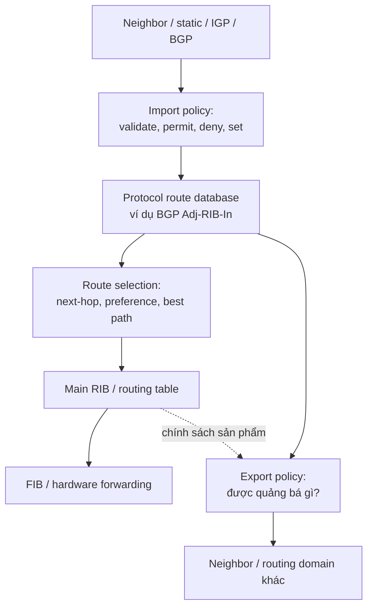
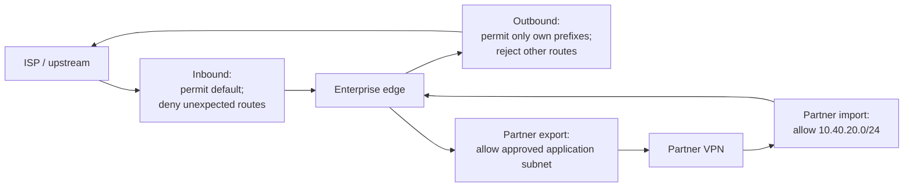
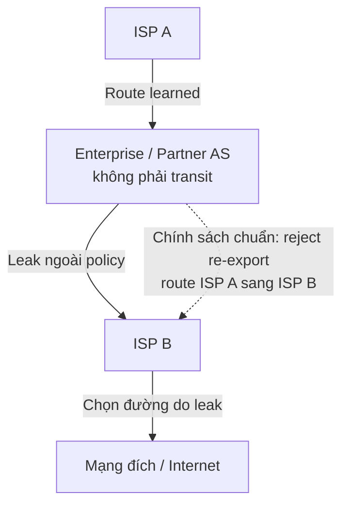
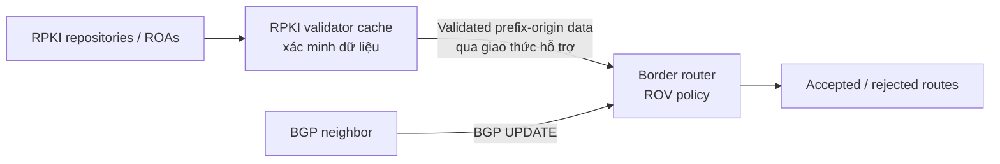

# Routing policy trong bảo mật định tuyến mạng

**Routing policy** (chính sách định tuyến) là tập hợp các quy tắc quyết định **tuyến nào được học, chấp nhận, ưu tiên, phân phối, quảng bá, tổng hợp hoặc từ chối** giữa các router, miền định tuyến và mạng khác nhau. Trong lĩnh vực **routing security**, chính sách không chỉ nhằm tìm đường có thể đi được; nó còn kiểm soát **mức độ tin cậy của thông tin tuyến và phạm vi lan truyền của thông tin đó**.

Một tuyến xuất hiện trong bảng định tuyến không đồng nghĩa tuyến đó được tổ chức phê duyệt. Chẳng hạn, router biên của doanh nghiệp có thể nhận một prefix từ đối tác; nếu chấp nhận và quảng bá lại không đúng chính sách, mạng có thể bị chuyển hướng, gián đoạn hoặc vô tình trở thành trung gian đưa lưu lượng Internet qua một đường không được thiết kế.

Trong mô-đun **SECURITY_NETWORK_SECURITY**, routing policy bổ sung cho **firewall, phân đoạn mạng, VPN, IDS/IPS, giám sát lưu lượng, threat modeling và hạ tầng cloud**. Firewall quyết định có cho phép một luồng qua điểm thực thi hay không; routing policy quyết định thông tin reachability nào được tin và đường đi nào sẽ được hình thành. **Cần cả hai** để thiết kế mạng an toàn, có thể vận hành và kiểm toán.

Bài học cung cấp mô hình khái niệm, quy tắc thiết kế, ví dụ trung lập với nhà sản xuất, cách đọc bằng chứng, kịch bản triển khai và checklist kiểm thử. Những địa chỉ IP và ASN trong ví dụ là **dữ liệu tài liệu/lab**, không phải cấu hình production có thể triển khai nguyên trạng.

## 1. Mục tiêu học tập

Sau bài học, người học có thể:

1. Phân biệt **routing protocol**, **routing policy**, **route filtering** và **packet filtering**.
2. Giải thích sự khác nhau giữa **RIB, FIB, route được nhận, route được chọn và route thực sự được quảng bá**.
3. Thiết kế chính sách **import/inbound** và **export/outbound** theo ranh giới tin cậy.
4. Áp dụng tư duy **least privilege**, prefix allowlist, giới hạn prefix-length và route aggregation.
5. Hiểu các thuộc tính BGP thường dùng như **LOCAL_PREF, AS_PATH, MED và communities** mà không coi chúng là bảo đảm tuyệt đối về đường đi.
6. Giải thích route leak, prefix hijack, RPKI Route Origin Validation (ROV) và giới hạn từng biện pháp.
7. Kiểm soát **route redistribution** giữa OSPF/IS-IS/BGP/static và các miền VRF, cloud, VPN.
8. Thu thập log/counter, kiểm thử thay đổi, rollback và ứng phó sự cố routing policy.

## 2. Routing policy là gì và không phải là gì?

Một routing protocol như **BGP, OSPF hoặc IS-IS** quy định cách thiết bị trao đổi hay tính toán reachability. **Routing policy** quy định thông tin nào được phép đi vào/ra một miền, thông tin nào được ưu tiên và điều kiện nào khiến tuyến bị từ chối.

| Lớp | Câu hỏi trọng tâm | Ví dụ |
| --- | --- | --- |
| **Routing protocol** | Router học và cập nhật thông tin tuyến bằng cách nào? | BGP UPDATE, OSPF LSA, IS-IS LSP |
| **Routing policy** | Tuyến nào được nhận, quảng bá, sửa thuộc tính hoặc loại bỏ? | Chỉ nhận default route từ ISP; chỉ quảng bá prefix được cấp |
| **Route selection** | Trong các tuyến có sẵn, tuyến nào được ưu tiên theo quy tắc chọn đường? | BGP best path, route preference/administrative distance |
| **Forwarding** | Packet thực tế được chuyển tới next hop nào? | FIB/CEF/hardware forwarding |
| **Security ACL/firewall** | Luồng được chuyển tiếp có được phép đi qua ranh giới không? | Deny guest → management TCP/443 |

**Không nhầm route filtering với traffic filtering.** Một router có thể từ chối học route tới mạng X nhưng vẫn có default route dẫn gói tới X theo cách khác. Ngược lại, tuyến có thể tồn tại trong FIB nhưng firewall chặn traffic vì chính sách truy cập.

### 2.1. Một ví dụ đơn giản

Doanh nghiệp kết nối ISP và đối tác qua VPN:

- **ISP:** doanh nghiệp chỉ cần nhận **default route 0.0.0.0/0**.
- **Đối tác VPN:** chỉ cần học mạng ứng dụng đối tác **10.40.20.0/24** theo hợp đồng.
- **Mạng nội bộ quản trị:** **10.10.90.0/24** không được đưa vào bảng tuyến đối tác nếu không có nhu cầu được phê duyệt.
- **Mạng khách:** cần đường Internet nhưng không được lan truyền route quản trị nội bộ.

Routing policy ở mỗi ranh giới trả lời **có học và quảng bá các prefix này không**. Firewall và hệ thống xác thực tiếp tục quyết định **ai có thể dùng những đường đó để kết nối**.

## 3. RIB, FIB và hành trình của một route

**RIB (Routing Information Base)** lưu các tuyến mà router biết/đánh giá theo thuật toán và policy. **FIB (Forwarding Information Base)** là thông tin chuyển tiếp đã được chọn và triển khai vào data plane. Tên bảng, pipeline và trạng thái cụ thể phụ thuộc hệ điều hành mạng.



*Sơ đồ đơn giản hóa: một số router áp inbound policy trước khi lưu thông tin tuyến; BGP Adj-RIB-Out, quy trình xuất khẩu, route selection và cách quản lý các RIB có thể khác nhau. Không dùng sơ đồ để suy ra thứ tự xử lý cố định của mọi hãng.*

Một route được **nhận** từ neighbor chưa chắc:

- Được **import policy chấp nhận**.
- Có next hop **reachable**.
- Được chọn làm **best path** trong BGP.
- Được cài vào **main RIB** khi có route từ giao thức khác ưu tiên hơn.
- Có mặt trong **FIB** khi có lỗi tài nguyên hoặc forwarding.
- Được **export policy cho phép quảng bá** sang neighbor khác.

Khi điều tra, phải gọi đúng trạng thái: **received**, **accepted**, **best**, **installed** hoặc **advertised**. Nhìn mỗi bảng route chính có thể bỏ qua nguyên nhân route bị từ chối sớm.

### 3.1. Longest-prefix match

Khi chuyển tiếp gói IP, router thường chọn route **có prefix khớp dài nhất** trong các tuyến forwarding đủ điều kiện.

Ví dụ FIB chứa:

```text
0.0.0.0/0       -> ISP
10.40.0.0/16    -> VPN-Partner
10.40.20.0/24   -> Internal-Firewall
```

Packet đến **10.40.20.25** sẽ khớp **10.40.20.0/24** dài hơn /16 và /0. Vì thế một prefix **more specific** sai có thể làm thay đổi đường đi dù route tổng hợp hợp lệ vẫn tồn tại. Đây là lý do kiểm soát **độ dài prefix** quan trọng trong routing policy.

## 4. Inbound policy và outbound policy

### 4.1. Import/inbound: ta nhận và tin route nào?

Import policy xử lý thông tin route do một nguồn bên ngoài gửi đến. Nó thường xem xét:

- Peer/neighbor và **quan hệ tin cậy** (ISP, customer, partner, route reflector, route server, iBGP, IGP).
- Prefix và **prefix-length**.
- Next hop, origin AS và dữ liệu xác thực nếu áp dụng.
- AS_PATH, community và các route attributes.
- Các ràng buộc về route tag hoặc VRF.
- Khả năng reachability của next hop và trạng thái session.

**Ví dụ:** stub enterprise chỉ muốn nhận default IPv4 từ ISP. Rule inbound chỉ permit **0.0.0.0/0 chính xác**, reject những prefix khác. Nếu sau này tổ chức cần full Internet table, phải thay thiết kế, capacity và chính sách một cách có chủ đích.

### 4.2. Export/outbound: ta được phép công bố route nào?

Export policy quyết định **những mạng mình được quảng bá cho peer**. Đây là ranh giới quan trọng chống **route leak** và vô tình trở thành transit.

Đối với một enterprise không phải transit provider:

- ISP chỉ nên nhận những prefix public doanh nghiệp **có thẩm quyền quảng bá**.
- Đối tác chỉ nên nhận các subnet nội bộ **được hợp đồng và chính sách cho phép**.
- Guest, management, private cloud hoặc VPN network không tự động trở thành tuyến công bố ra Internet.
- Default route không nên quảng bá cho mọi neighbor nếu có thể biến doanh nghiệp thành đường trung chuyển.
- Route được **redistribute** vào BGP phải tiếp tục đi qua export policy.

### 4.3. Hai chiều không đối xứng



Chính sách cần được xây dựng riêng theo **từng hướng**, không suy rằng “route đã được phép nhận” thì được phép quảng bá tiếp.

## 5. Prefix-list, route-map và nguyên tắc match/action

Một routing policy thường có hai khối logic:

- **Match:** prefix, mask length, ASN, community, tag, next hop, route type hoặc nguồn.
- **Action:** accept/deny, set preference, set community, set metric, sửa next hop, aggregate hoặc các hành động được sản phẩm hỗ trợ.

Tên gọi có thể là **prefix-list**, **route-map**, **route policy**, **policy statement**, **routing filter** hoặc cấu hình tương đương. Cú pháp/ordering khác nhau giữa nền tảng.

### 5.1. Exact match và more-specific

Giả sử mạng private **10.20.0.0/16**:

| Điều kiện | Những tuyến ví dụ có thể khớp | Những tuyến không khớp |
| --- | --- | --- |
| Exact **10.20.0.0/16** | 10.20.0.0/16 | 10.20.1.0/24 |
| **10.20.0.0/16** với độ dài /16–/24 | 10.20.0.0/16, 10.20.1.0/24 | 10.20.1.0/25, 10.21.0.0/16 |
| Exact **0.0.0.0/0** | Chỉ default IPv4 | Mọi prefix cụ thể hơn |
| Exact **::/0** | Chỉ default IPv6 | Mọi route IPv6 more specific |

Trong nhiều sản phẩm có cú pháp **ge/le**, chẳng hạn điều kiện /16 đến /24, nhưng phải đọc **ngữ nghĩa chính xác và logic include** của thiết bị. Rule **0.0.0.0/0 le 32** theo cách hiểu phổ biến có thể khớp **tất cả prefix IPv4**, hoàn toàn khác **0.0.0.0/0 exact**. Đây là lỗi cấu hình có thể phá mục đích “chỉ cho phép default”.

### 5.2. Pseudopolicy: nhận default và từ chối phần còn lại

```yaml
# CHỈ là mô tả ý định; không phải cấu hình router cụ thể.
policy_id: ISP-IN-DEFAULT-ONLY
direction: import
peer_role: isp
address_family: ipv4-unicast
rules:
  - sequence: 10
    match:
      prefix: 0.0.0.0/0
      prefix_length: exact
    action: accept
  - sequence: 100
    match: any
    action: reject
owner: network-routing-team
change_ticket: NET-2026-010
```

Cấu hình thực tế phải xác minh **implicit deny, thứ tự rule, match nhiều điều kiện là AND hay OR, và hành vi khi không khớp**. Một sản phẩm có default reject, sản phẩm khác có default permit ở một điểm cấu hình nhất định; không được dựa vào giả định.

### 5.3. Thiết kế least privilege

1. **Khai báo rõ** nguồn tuyến và mục đích.
2. **Permit** đúng prefix/prefix-length được phê duyệt.
3. **Reject** mặc định những tuyến ngoài phạm vi.
4. **Ghi nhận** những route bị từ chối khi nền tảng hỗ trợ, tránh log quá mức làm mất hiệu năng.
5. **Kiểm thử** route có phạm vi gần giống nhưng không được phép, nhất là more-specific.
6. **Rà soát** rule không còn owner, temporary exception hoặc biểu thức match quá rộng.

## 6. Import từ ISP, customer và partner không giống nhau

**Vai trò của neighbor** làm thay đổi chính sách được chấp nhận.

| Peer role | Những route thường mong đợi | Điều kiện phòng vệ |
| --- | --- | --- |
| **ISP → enterprise stub** | Default-only hoặc danh sách route cụ thể theo hợp đồng | Chọn đúng mô hình; giới hạn prefix count và reject bất thường |
| **Customer → ISP** | Prefix mà customer được phép công bố | Prefix/ASN authorization, IRR/RPKI khi phù hợp, max-prefix |
| **Partner VPN → enterprise** | Chỉ subnet phục vụ tích hợp | Allowlist theo hợp đồng, VRF, không mặc định thành transit |
| **iBGP nội bộ** | Route theo kiến trúc nội bộ và route reflection | Kiểm soát tenant/VRF/next-hop, tránh lan truyền không mong muốn |
| **Route server / peering fabric** | Route theo chính sách peering công bố | Policy riêng cho route-server, không giả định giống eBGP ISP trực tiếp |
| **Cloud BGP VPN/Interconnect** | Prefix từ VPC/VNet hoặc on-prem theo cấu hình propagation | Kiểm soát route advertisement, overlap và route table associations |

**Không tồn tại một prefix-list chung cho mọi quan hệ BGP.** Ví dụ bỏ tất cả địa chỉ private **RFC 1918** khi nhận từ Internet public là hợp lý ở nhiều ranh giới, nhưng nếu áp ngay cho BGP trong private VPN, bạn có thể cắt toàn bộ tuyến hợp lệ của đối tác.

### 6.1. Maximum prefixes

**Maximum-prefix limit** giới hạn số route nhận từ một neighbor hoặc family; giúp phát hiện khi peer vô tình gửi lượng lớn tuyến và bảo vệ tài nguyên.

Cần xác định:

- Số route bình thường và biên độ tăng hợp lý.
- Hành vi khi vượt giới hạn: **log, cảnh báo, ngừng session hoặc chế độ cảnh báo trước**, tùy sản phẩm.
- Ngưỡng khác nhau cho default-only, full table và đối tác có vài subnet.
- Khả năng tự phục hồi và mức gián đoạn nếu session bị đóng.
- Tác động của route aggregation/deaggregation hợp lệ.

Không đặt ngưỡng thấp cho full Internet table rồi ngạc nhiên vì BGP session tự ngắt; cũng không để ngưỡng vô hạn đối với neighbor chỉ dự kiến gửi một vài route.

## 7. Export policy và phòng chống route leak

**Route leak** xảy ra khi route được quảng bá **vượt ra ngoài phạm vi định tuyến dự định**, dẫn tới các AS hoặc mạng chọn đường không đúng quan hệ kinh doanh/kỹ thuật. Một enterprise có thể vô tình chuyển tiếp route học từ ISP A sang ISP B, khiến traffic đi qua hệ thống không được thiết kế làm transit.

### 7.1. Mô hình route leak



Sơ đồ chỉ mô tả quan hệ đường đi ở mức ý tưởng. Một route leak thực tế có thể liên quan nhiều AS, quan hệ provider/customer/peer và tiêu chí chọn đường của từng mạng.

### 7.2. Nguyên tắc chống leak tại enterprise edge

- Chỉ export **prefix do tổ chức được quyền công bố** cho upstream Internet, trừ trường hợp làm transit được thiết kế riêng.
- Không re-advertise **full routing table**, default route, private overlay routes hoặc route của ISP khác theo cách không được thỏa thuận.
- Đặt **outbound prefix allowlist** cho từng eBGP peer.
- Xác nhận route xuất đi sau khi áp filter, không chỉ xem route có trong local RIB.
- Cân nhắc **BGP communities** và đặc biệt **BGP Roles/OTC (Only to Customer)** theo khả năng tiêu chuẩn/sản phẩm để giảm một số loại leak giữa AS; không coi là giải pháp phổ quát cho mọi neighbor.
- Duy trì hồ sơ prefix ownership, hợp đồng/ủy quyền, thông tin IRR/RPKI và quy trình thay đổi.

### 7.3. Rủi ro khi redistribute quá rộng

Một lệnh “redistribute connected/static/IGP into BGP” không có lọc có thể quảng bá **management subnet, loopback, private interconnect hoặc default route** ngoài ý muốn.

Routing policy phải giới hạn ngay tại **điểm redistribution** và tiếp tục dùng **export policy ở neighbor** như lớp kiểm soát thứ hai.

## 8. Prefix hijack và more-specific hijack

**BGP prefix hijack** là tình huống một hệ thống tự trị quảng bá thông tin tuyến cho prefix mà nó không có thẩm quyền theo cách làm thay đổi định tuyến. Có thể do lỗi cấu hình hoặc hành vi có chủ đích.

Hai hình thức quan trọng để phân tích:

- **Origin hijack:** một AS không được phép quảng bá prefix như chính mình là origin.
- **More-specific announcement:** một prefix con được công bố; do **longest-prefix match**, nhiều router có thể chọn đường đến prefix con thay vì prefix tổng hợp.

**Không phải mọi more-specific đều xấu.** Doanh nghiệp có thể chủ động quảng bá deaggregate theo chính sách mạng và giới hạn upstream, nhưng phải có thẩm quyền và kế hoạch điều phối.

### 8.1. Biện pháp giảm rủi ro

| Biện pháp | Hỗ trợ | Không đảm bảo |
| --- | --- | --- |
| Prefix allowlist ở neighbor | Giới hạn những prefix peer được phép quảng bá/nhận | Độ đúng nếu danh sách sai hoặc quá rộng |
| RPKI ROV | Xác minh origin AS so với ROA và prefix-length khi có dữ liệu | Xác minh toàn bộ AS_PATH hoặc quan hệ kinh doanh |
| IRR-based filtering | Thêm dữ liệu khai báo route/route6 và AS-set | Dữ liệu có thể cũ, thiếu hoặc không được xác thực mạnh |
| Max-prefix | Giới hạn bùng nổ số lượng tuyến | Ngăn một hijack chỉ có một prefix |
| BGP monitoring / route collectors | Cảnh báo thay đổi origin, more-specific và đường đi | Tự động ngăn mọi mạng Internet chấp nhận route |
| Export control | Ngăn doanh nghiệp tự công bố nhầm | Chặn hoàn toàn sai cấu hình ở tổ chức bên ngoài |

RPKI và IRR là **nguồn hỗ trợ đánh giá tính hợp lệ**, không thay thế quy trình xác minh quyền sở hữu prefix, phối hợp nhà cung cấp và quan sát thực tế.

## 9. RPKI Route Origin Validation trong routing policy

**Resource Public Key Infrastructure (RPKI)** cung cấp cơ chế công bố **Route Origin Authorization (ROA)**. Một ROA cho biết **AS nào được phép là origin** cho một IP prefix trong phạm vi độ dài tối đa được cấu hình, dựa trên chuỗi chứng nhận tài nguyên IP.

Khi BGP router thực hiện **Route Origin Validation (ROV)**, thông tin về origin AS và prefix của một route có thể được đối chiếu với dữ liệu ROA để phân loại.

### 9.1. Valid, Invalid và NotFound

| Trạng thái ROV | Diễn giải khái quát | Cách ứng xử chính sách |
| --- | --- | --- |
| **Valid** | Prefix và origin AS phù hợp ít nhất một ROA có thể áp dụng, gồm điều kiện maxLength | Có thể được xem xét tiếp qua các policy khác |
| **Invalid** | Có ROA áp dụng cho prefix nhưng route không phù hợp origin AS hoặc giới hạn prefix-length | Thường là ứng viên mạnh để **reject**, theo policy/phạm vi |
| **NotFound** | Không tìm thấy ROA bao phủ để đưa ra kết luận valid/invalid | **Không đồng nghĩa độc hại**; xử lý theo chính sách và giám sát |

Cách đánh giá cần tuân các quy tắc ROV và dữ liệu RPKI thực tế. Không được diễn giải **Valid = route an toàn tuyệt đối** hoặc **NotFound = route xấu**.

### 9.2. Vai trò của maxLength

Giả sử **chỉ trong lab** có ROA cho **203.0.113.0/24**, origin **AS64512**, maxLength **/24**. Một tuyến **203.0.113.0/24** với origin đúng có thể được đánh giá Valid; một more-specific **203.0.113.0/25** không được ROA này cho phép về độ dài. Nếu có ROA áp dụng nhưng route không phù hợp giới hạn, kết quả là Invalid theo logic validation.

**203.0.113.0/24 là dải dành cho tài liệu và AS64512 là ASN private dành cho ví dụ**: không thể dùng để quảng bá Internet thực. Trong production, ROA cần dựa trên prefix/ASN do tổ chức thật sự được cấp quyền.

**Đặt maxLength quá rộng** có thể cho phép những more-specific mà tổ chức không muốn ủy quyền; đặt quá chặt so với deaggregation hợp lệ gây **RPKI Invalid**. Quy trình thay đổi ROA và thay đổi route advertisement phải được đồng bộ.

### 9.3. Hệ thống triển khai RPKI

Một cách triển khai phổ biến:



Router thường nhận dữ liệu xác thực prefix-origin từ **RPKI validator/cache** qua cơ chế được hỗ trợ (ví dụ RTR). Cần thiết kế **độ tin cậy, thời gian sống và tính sẵn sàng** của cache/validator. Nếu validator mất dữ liệu hoặc đường kết nối lỗi, chính sách phải chỉ rõ điều gì xảy ra thay vì giả định tất cả route tự động bị chặn hoặc vẫn được xác minh.

### 9.4. Giới hạn quan trọng

- ROV chỉ đánh giá **origin AS** và độ dài prefix, **không xác thực toàn bộ AS_PATH**.
- Một route có ROV Valid vẫn có thể đi qua đường leak/đường không mong muốn.
- Nhiều prefix hợp lệ chưa có ROA và rơi vào **NotFound**.
- ROA sai, stale hoặc key rollover lỗi có thể gây mất reachability nếu reject Invalid.
- RPKI có thể giúp phát hiện/giảm một số kiểu hijack nhưng không thay thế neighbor import/export filtering và giám sát.

## 10. Các thuộc tính BGP thường dùng trong policy

Routing policy không chỉ permit hoặc reject; nó có thể **điều chỉnh ưu tiên đường** trong những giới hạn được giao thức và sản phẩm hỗ trợ.

| Thuộc tính | Ý nghĩa khái quát | Lưu ý về an toàn |
| --- | --- | --- |
| **LOCAL_PREF** | Trong AS, giá trị cao hơn thường được ưu tiên hơn theo tiêu chí chọn đường BGP | Tác động egress nội bộ; không ép Internet chọn inbound path |
| **AS_PATH** | Chuỗi AS trên đường quảng bá; có thể dùng làm policy và loop prevention | Không phải chứng thực mật mã toàn đường; policy/bestpath tùy triển khai |
| **MED** | Gợi ý cho AS lân cận về điểm vào được ưu tiên; thường giá trị thấp hơn được ưu tiên khi được so sánh | Provider có thể bỏ qua; so sánh tùy quy tắc và quan hệ AS |
| **COMMUNITY** | Thẻ gắn route phục vụ hành động/nhóm chính sách | Ý nghĩa phụ thuộc thỏa thuận, không tự là chứng thực nguồn |
| **LARGE COMMUNITY** | Community dạng ba giá trị 32 bit, hữu ích phân biệt AS/nhóm chính sách | Cần có mapping và kiểm soát ai được đặt/đọc |
| **NEXT_HOP** | Địa chỉ router kế tiếp cho route BGP | Sai next hop có thể khiến route không được cài hoặc traffic đi lệch |
| **WEIGHT / vendor-specific** | Ưu tiên cục bộ của một số hệ điều hành mạng | Không phải thuộc tính BGP chuẩn được quảng bá giữa các AS |

Các thuộc tính có thể tương tác trong **BGP best-path algorithm**. Không nên truyền đạt rằng chỉ **AS_PATH ngắn nhất** quyết định mọi route; local preference, eligibility, nguồn, metric và các bước khác được đánh giá theo thứ tự mà **sản phẩm thực tế** áp dụng.

### 10.1. Outbound traffic engineering

Doanh nghiệp có hai ISP và muốn ưu tiên ISP A cho phần lớn lưu lượng đi ra. Có thể thiết kế inbound policy **LOCAL_PREF cao hơn cho route học từ ISP A**. Cần kiểm thử:

- Route có next hop reachable không?
- Khi ISP A lỗi, đường tới ISP B có thực sự được chọn?
- Có ứng dụng/đích nào phải đi qua ISP B vì quyền, hợp đồng hoặc tối ưu độ trễ?
- Return path có bất đối xứng làm stateful firewall/NAT thất bại không?
- Có cần điều chỉnh theo VRF hoặc subnet thay vì toàn AS không?

### 10.2. Inbound traffic engineering

Để ảnh hưởng **đường người khác chọn vào doanh nghiệp**, có thể dùng MED, AS_PATH prepending hoặc provider-defined communities khi được hỗ trợ, nhưng **không có bảo đảm tất cả AS bên ngoài sẽ nghe theo**.

Đối với yêu cầu bảo mật, phải ưu tiên **chính sách quảng bá prefix và khả năng phục hồi**, không tin những kỹ thuật gợi ý đường đi là cơ chế cưỡng chế chính sách truy cập.

## 11. BGP communities và chính sách theo quan hệ

**BGP community** giúp gắn metadata lên route để các policy nhận dạng, phân loại hoặc áp hành động thống nhất.

Ví dụ doanh nghiệp gắn nhãn:

- **Route thuộc mạng khách hàng**.
- **Route chỉ dùng trong mạng nội bộ**.
- **Route thuộc một khu vực hoặc nhóm dịch vụ**.
- **Route mà ISP được yêu cầu hạn chế quảng bá** theo thỏa thuận.

### 11.1. Tại sao phải kiểm soát community?

Một community chỉ là giá trị trong thông tin định tuyến, **không tự xác thực ai có quyền đặt nó**. Nếu import policy chấp nhận mọi community từ nguồn không đáng tin và gán chúng quyền cao, một neighbor có thể vô tình hoặc cố ý gây tác động không mong muốn.

Nguyên tắc:

1. Định nghĩa **danh sách community tin cậy theo peer role**.
2. **Strip/normalize** những thẻ không được phép tại ingress khi phù hợp.
3. Chỉ gán community có ảnh hưởng nhạy cảm ở policy do tổ chức kiểm soát.
4. Tài liệu hóa ý nghĩa của community với nhà cung cấp/đối tác.
5. Kiểm tra export policy để không lan truyền community nội bộ trái thiết kế.
6. Không giả định tên community mang cùng ý nghĩa trên mọi thiết bị/provider.

**NO_EXPORT** là community chuẩn có mục đích hạn chế quảng bá ra ngoài theo quy tắc BGP, nhưng mức hiệu lực còn phụ thuộc việc neighbor thực thi chuẩn và thiết kế. Với ranh giới bắt buộc, **outbound prefix allowlist** vẫn cần thiết; đừng chỉ dựa vào một thẻ route.

## 12. Chính sách bảo mật cho OSPF và IS-IS

BGP thường có import/export policy rõ theo neighbor. **IGP như OSPF/IS-IS** hoạt động khác: các router trong một miền/area trao đổi trạng thái liên kết và tính toán đường đi.

### 12.1. Lưu ý về khả năng lọc trong IGP

Với **OSPF**, không thể đơn giản gắn một inbound prefix-list vào mọi interface rồi nghĩ rằng mình đã lọc được toàn bộ **intra-area LSA flooding** theo cùng cách BGP import. Các router trong cùng area cần có cơ sở dữ liệu trạng thái liên kết nhất quán. Việc giới hạn **inter-area routes tại ABR**, **external routes tại ASBR**, kiểu area và redistribution có cơ chế riêng.

Với **IS-IS**, routing policy có thể liên quan ranh giới **L1/L2**, redistribution và prefix advertisement theo tính năng sản phẩm; không phải mọi thiết bị hỗ trợ cùng một cách kiểm soát.

| Biện pháp | Vai trò |
| --- | --- |
| **Xác thực adjacency** | Giảm nguy cơ thiết lập neighbor/nhận thông tin routing trái phép khi hỗ trợ và cấu hình đúng |
| **Passive interface** | Tránh hình thành adjacency ở interface không cần chạy routing protocol |
| **Giới hạn nơi chạy IGP** | Không kích hoạt OSPF/IS-IS trên mạng khách hoặc vùng chưa tin cậy |
| **Area/level design** | Kiểm soát phạm vi thông tin và tính phức tạp của topology |
| **Redistribution filter** | Chặn mạng nội bộ không được phép đi vào miền khác |
| **Route tagging** | Đánh dấu nguồn route để hạn chế vòng lặp redistribution, theo policy được thiết kế |
| **Monitoring adjacency/LSDB** | Phát hiện neighbor lạ, topology drift và thay đổi chi phí bất thường |

### 12.2. Không chỉ sửa cost để “cấm đường”

OSPF cost hoặc IS-IS metric ảnh hưởng ưu tiên đường **trong miền định tuyến**, không phải một security ACL. Một route có metric cao vẫn có thể được dùng nếu không còn lựa chọn khác. Nếu một subnet không được phép tiếp cận dịch vụ quản trị, phải dùng **segmentation, firewall/ACL và authorization**; điều chỉnh metric không đủ để bảo đảm không truy cập.

## 13. Route redistribution: điểm dễ phát sinh route leak và loop

**Route redistribution** đưa tuyến từ một nguồn vào một giao thức hoặc routing domain khác, ví dụ:

- Static → OSPF.
- OSPF → BGP.
- BGP → OSPF.
- Connected → BGP.
- Routes giữa VRF hoặc các miền riêng, nếu có cơ chế leak được thiết kế.

Redistribution là điểm rủi ro cao vì một quy tắc quá rộng có thể khiến **default route, loopback, management VLAN hoặc route nhận từ đối tác** được truyền đến miền không mong muốn.

### 13.1. Nguyên tắc kiểm soát

1. Liệt kê **prefix cần trao đổi**, owner, chiều và mục đích.
2. Giới hạn theo **route source/type, prefix, tag hoặc community** khi khả dụng.
3. Dùng **route tag** để tránh đưa tuyến quay về nguồn khi có redistribution hai chiều; phải hiểu giới hạn của tag theo từng giao thức.
4. Tránh redistribution hai chiều rộng không có kế hoạch loop prevention.
5. Cân nhắc summarization và default route có chủ đích thay vì đưa mọi subnet.
6. Kiểm tra route được **đưa vào RIB/FIB và quảng bá** theo đúng chiều.
7. Giữ **firewall controls** để phân quyền traffic qua ranh giới.

### 13.2. Ví dụ sai và cách thiết kế lại

**Sai về ý định:** “Redistribute tất cả route OSPF vào BGP cho ISP để ISP biết cách vào mạng doanh nghiệp.”

Hệ quả có thể là các tuyến **10.10.90.0/24 (management)**, **10.20.30.0/24 (IoT)**, **loopback router** hoặc default route vô tình đi tới một neighbor không cần biết.

**Đúng về chính sách:** “Chỉ export prefix public mà doanh nghiệp có quyền công bố; thông tin OSPF/connected phải qua allowlist và policy của từng peer”. Với đối tác VPN, chỉ export subnet cụ thể đã được phê duyệt, không toàn bộ topology nội bộ.

## 14. Default route, summarization và more-specific control

**Default route** có phạm vi rất rộng. **Route summarization** gom những mạng con dưới một prefix lớn hơn. Cả hai giảm số tuyến nhưng có thể che khuất các đường đi hoặc vùng không mong muốn.

### 14.1. Default route

Một router chi nhánh chỉ cần đường về hub có thể nhận default route. Nhưng nếu hub quảng bá default vào VLAN hoặc VRF không được phép ra ngoài, nó có thể tạo **đường truyền lưu lượng không theo thiết kế**.

Cần ghi:

- Ai được phép **originate** default.
- Khi nào default được công bố (ví dụ phụ thuộc uplink thực sự khỏe).
- Phạm vi VRF/IGP area/BGP peer nào được nhận.
- Điều kiện failover/withdraw.
- Các route more-specific có vô tình vượt qua nguyên tắc chặn đường không.

### 14.2. Summarization

Tổng hợp **10.20.0.0/16** có thể làm giảm nhiều route /24. Nhưng việc công bố summary không chứng minh **mọi subnet bên trong /16** đều reachable hoặc được phép truy cập.

Nếu có những dải **reserved, unused, blackhole hoặc management**, cần xác định:

- Summary được tạo ở đâu và có route tới các subnet thật không.
- Traffic đến phần không tồn tại của summary xử lý ra sao.
- Có route more-specific từ nguồn khác làm đổi hướng không.
- Những mạng nào được firewall/NAC bảo vệ bất kể quảng bá summary.

**Đừng dùng sự ngắn gọn của routing table làm lý do giảm mức kiểm soát phân đoạn.**

## 15. Routing policy giữa VRF, VPN và mạng phân đoạn

**VRF (Virtual Routing and Forwarding)** tách các bảng định tuyến logic. Một doanh nghiệp có thể tạo VRF **corporate**, **guest**, **management** và **partner**. Nếu không thiết kế route leaking, các bảng này có phạm vi reachability tách biệt.

### 15.1. Route leaking giữa VRF

Một số dịch vụ chung có thể cần truy cập từ nhiều VRF. Ví dụ guest có quyền truy cập DNS resolver công cộng được doanh nghiệp kiểm soát, nhưng không được truy cập hệ thống quản trị.

Thay vì “leak toàn bộ route”:

- Chỉ trao đổi **prefix dịch vụ cần thiết**.
- Giới hạn chiều/quy mô route và next hop.
- Dùng **firewall hoặc service policy** kiểm soát traffic ở ranh giới.
- Xác minh đường quay về và stateful inspection.
- Giám sát route target/import-export policy nếu triển khai **MPLS VPN/EVPN**; cú pháp và ngữ nghĩa khác giữa nền tảng.
- Đảm bảo không tạo **route feedback loop** giữa VRF, static và BGP.

Một route được leak vào VRF chỉ tăng reachability, không phải quyền truy cập.

### 15.2. VPN site-to-site

Một kết nối VPN/IPsec an toàn về **mã hóa và xác thực tunnel** không tự xác nhận mọi **route advertisement** đi qua BGP trong tunnel là được phép. Đối tác có thể phát một prefix không có trong hợp đồng do sai cấu hình.

Vì vậy, cần **import/export filtering tại BGP neighbor trong tunnel**, cùng allowlist subnet ở firewall, giám sát tunnel/route và xác định tác động của failover.

## 16. Routing policy trong cloud và hybrid network

Cloud cung cấp các thành phần như **VPC/VNet route table, virtual router, Transit Gateway, hub-and-spoke, VPN/Direct Connect/Interconnect** và cơ chế quảng bá route riêng của nhà cung cấp.

Không nên giả định routing policy on-prem có cùng cú pháp hoặc mức ảnh hưởng trên cloud. Một số cloud route table là **forwarding policy tĩnh**, trong khi hybrid BGP peer có thêm import/export và propagation.

| Tình huống | Rủi ro | Kiểm soát |
| --- | --- | --- |
| On-prem quảng bá quá rộng vào cloud | Cloud học đường tới mạng nhạy cảm hoặc địa chỉ không mong muốn | Filter BGP, route tables, segmentation |
| Cloud propagate default vào mọi subnet | Workload có thể ra ngoài sai egress path | Route table association và kiểm soát egress |
| Subnet VPC/VNet overlap với on-prem/partner | Traffic gửi nhầm next hop hoặc không route được | IPAM, chuẩn hóa CIDR, NAT/renumber có kiểm soát |
| VRF/VPC peering truyền route ngoài phạm vi | Tăng blast radius giữa tenant/workload | Route table isolation, policy theo attachment |
| Direct private circuit mất, VPN failover | Route ưu tiên thay đổi, dễ bất đối xứng | Metric/local preference, health, failover test |
| Cloud security group được cấu hình đúng nhưng route sai | Kết nối không đến đích hoặc đi đường ngoài dự kiến | Kiểm tra cả FIB/route table, SG/NACL và flow log |

**Cloud route table không thay thế security group/network ACL và ngược lại.** Route quyết định đường tới đích; các kiểm soát packet và danh tính quyết định luồng có được phép.

### 16.1. Chuyển tuyến giữa primary private link và backup VPN

Doanh nghiệp có private link primary và VPN backup tới cloud. Một policy có thể ưu tiên private link cho đường đi bình thường, giảm ưu tiên hoặc rút route khi health cho thấy đường chính không khả dụng.

Điều cần kiểm tra:

1. Next hop và route tại **cả on-prem và cloud** sau failover.
2. Firewall state/NAT khi traffic quay về một đường khác.
3. Prefix nào thực sự được advertise qua backup.
4. BGP session còn up nhưng đường application có thực sự hoạt động không.
5. Cloud route quota và thời gian hội tụ.
6. Log/SIEM có theo dõi **route changes + application latency** cùng timeline không.

Không dùng chỉ trạng thái “BGP established” làm bằng chứng dịch vụ end-to-end đã khỏe.

## 17. IPv4 và IPv6 cần chính sách riêng

Một enterprise có thể bảo vệ tốt IPv4 nhưng vô tình **không lọc IPv6 routes**, đặc biệt nếu IPv6 được bật sau khi thiết kế ban đầu hoàn tất.

Những điểm khác biệt quan trọng:

- **0.0.0.0/0** là default IPv4, còn **::/0** là default IPv6.
- Prefix-list của IPv4 không tự áp cho IPv6 address family.
- RPKI ROA, origin validation và bộ lọc phải xét đúng **AFI/SAFI**.
- Route aggregation, global/public prefix, ULA, link-local và multicast IPv6 có cách dùng khác IPv4.
- Trên mạng IPv6, **Neighbor Discovery/ICMPv6** là thành phần quan trọng; không dùng packet ACL bừa bãi để “khóa đường”.
- MP-BGP có thể chở nhiều address family; policy của IPv4 unicast không tự bảo vệ IPv6 unicast, VPNv4/v6 hay EVPN.

Một checklist triển khai phải xác nhận **từng address family thực tế được bật** và những route được gửi/nhận trên mỗi neighbor.

## 18. Bảo vệ routing control plane và neighbor trust

Prefix filtering là phần trọng tâm routing policy, nhưng còn phải bảo vệ **kênh tạo và duy trì quan hệ định tuyến**.

| Kiểm soát | Mục đích | Giới hạn |
| --- | --- | --- |
| **Neighbor authorization** | Chỉ thiết lập adjacency/session với peer được phê duyệt | Cần cấu hình interface, source, ASN và network |
| **BGP TCP authentication** | Giảm nguy cơ một số kết nối/session trái phép khi sản phẩm hỗ trợ | Phụ thuộc TCP MD5/TCP-AO, key lifecycle và tính tương thích |
| **GTSM / TTL security** | Giảm một số nguy cơ từ gói BGP không đến từ hop dự kiến | Không chứng thực dữ liệu route bên trong phiên |
| **OSPF/IS-IS authentication** | Bảo vệ trao đổi routing theo khả năng giao thức và thiết bị | Phải quản lý key và phạm vi adjacency |
| **Control Plane Policing (CoPP)** | Bảo vệ CPU router khỏi lượng packet điều khiển bất thường | Ngưỡng sai có thể gây mất BGP/OSPF/BFD |
| **Management access control** | Giới hạn SSH/API/SNMP/telemetry tới vùng quản trị | Cần MFA/RBAC, lưu log và quản trị secret |
| **BFD** | Hỗ trợ phát hiện một số lỗi đường nhanh khi được triển khai | Không tự xác thực route; cấu hình quá nhạy có thể tạo flap |
| **RPKI/IRR filters** | Kiểm tra thẩm quyền quảng bá ở mức dữ liệu prefix | Không thay bảo vệ neighbor/control plane |

**CoPP phải cho phép routing traffic thiết yếu**, ví dụ BGP/IGP/BFD theo thiết kế. Một ACL chặn TCP/179 hoặc một giới hạn control-plane quá thấp có thể gây mất toàn bộ BGP adjacency khi tải bình thường tăng.

## 19. Thiết kế chính sách thay đổi có kiểm soát

Routing policy có **blast radius** lớn: một thay đổi dòng filter có thể làm mất tuyến của hàng nghìn ứng dụng hoặc phát tán route ra Internet. Quy trình tốt phải tách **ý định**, **triển khai** và **bằng chứng nghiệm thu**.

### 19.1. Mẫu hồ sơ chính sách

```yaml
# Pseudopolicy thuộc phạm vi thiết kế, không dùng trực tiếp trên router.
policy_id: EDGE-EXPORT-OWN-PREFIXES
owner: network-security
peer_role: upstream-isp
peer_group: internet-transit
address_family: ipv4-unicast
direction: export
approved_origins:
  source: ipam-and-routing-registry
  verification: change-approved
controls:
  allow_only_approved_prefixes: true
  reject_unexpected_default_route: true
  reject_internal_private_routes: true
  reject_unapproved_more_specifics: true
  maximum_prefixes: based-on-reviewed-capacity
logging:
  track_policy_version: true
  monitor_advertised_prefixes: true
validation:
  expected_advertised_routes: approved-prefix-inventory
  negative_test: private-and-unapproved-prefixes-never-exported
rollback:
  artifact: previous-reviewed-config
  trigger: unexpected-advertisement-or-reachability-loss
```

Đây là mẫu **intent model**, không phải schema YANG, câu lệnh route-map hoặc cấu hình BGP hợp lệ trên sản phẩm cụ thể. Kiểm tra những nơi route public được quảng bá bằng **prefix thật do tổ chức được cấp**, không lấy 192.0.2.0/24, 198.51.100.0/24 hoặc 203.0.113.0/24 để announce lên Internet.

### 19.2. Các bước trước và sau thay đổi

1. Xác định **neighbor, AFI/SAFI, VRF, chiều import/export, danh sách prefix, thuộc tính sẽ đổi**.
2. Ghi baseline: session status, received/accepted/advertised routes, RIB/FIB, forwarding test và service SLO.
3. So sánh rule mới với prefix inventory, RPKI/IRR, hợp đồng và route dependencies.
4. Thử **positive/negative matches** ở lab hoặc công cụ policy test hỗ trợ; kiểm tra prefix gần giống và more-specific.
5. Xác minh cú pháp và **cơ chế route refresh/soft reconfiguration** của sản phẩm trước khi áp, tránh reset neighbor không cần thiết.
6. Triển khai theo peer/cụm nhỏ với cửa sổ thay đổi và người giám sát.
7. So sánh post-change received/accepted/advertised, next hop, FIB, route count, reachability và flow của ứng dụng.
8. Nếu khác kỳ vọng, **rollback** cấu hình đã thẩm định và xác minh hồi phục; ghi timeline.

Không nên chạy các lệnh **clear bgp hard reset** chỉ để áp filter khi nền tảng hỗ trợ cơ chế cập nhật mềm an toàn hơn. Tác động của route refresh/soft clear và khả năng replay route khác nhau theo sản phẩm.

## 20. Thu thập bằng chứng khi route bất thường

### 20.1. Nguồn dữ liệu quan trọng

| Nguồn | Dữ liệu cần xem | Câu hỏi |
| --- | --- | --- |
| **BGP neighbor/session** | Up/down, AFI/SAFI, ASN, accepted/received prefix count, notifications | Session có hoạt động và nhận đúng nhóm route không? |
| **Inbound policy log/counter** | Prefix bị permit/deny, lý do, policy version | Route bị từ chối ở bước nào? |
| **BGP route table** | Prefix, origin, AS_PATH, next hop, MED, LOCAL_PREF, communities, best | Route nào tồn tại và được chọn? |
| **RIB/FIB** | Installed route, next hop, interface, preference | Traffic thực tế sẽ được chuyển đi đâu? |
| **Outbound advertised routes** | Prefix và attributes theo neighbor | Có leak hoặc route thiếu không? |
| **RPKI validator** | VRP data age, ROA, Valid/Invalid/NotFound, cache status | ROV có dữ liệu đáng tin và còn cập nhật? |
| **IGP LSDB/adjacency** | Area, neighbor, LSA/LSP, metric, route type | Có topology hoặc redistribution sai? |
| **Cloud route tables/flow logs** | Propagation, attachment, accepted/rejected traffic | Cloud nhận route và chuyển traffic ra sao? |
| **Firewall/NGFW/VPN** | Session, policy action, NAT, tunnel, HA state | Có điểm chặn luồng sau khi route đã đúng không? |
| **Application telemetry** | Timeout, latency, HTTP errors, SLO | Người dùng thật bị ảnh hưởng như thế nào? |

### 20.2. Những lệnh đọc chỉ số minh họa

Trên thiết bị chạy FRRouting hoặc nền tảng có CLI tương tự, lệnh có thể gồm:

```text
show bgp summary
show bgp ipv4 unicast
show bgp ipv6 unicast
show bgp ipv4 unicast neighbors <PEER-IP> routes
show bgp ipv4 unicast neighbors <PEER-IP> advertised-routes
show ip route
show ipv6 route
```

Đây chỉ là **ví dụ giao diện quan sát**, không bảo đảm đúng trên mọi phiên bản/hãng, và một số lệnh cần bật tính năng lưu Adj-RIB-In hoặc có đủ quyền để hiển thị thông tin. Không chạy các lệnh sửa route/neighbor khi mục đích mới là điều tra.

Trên máy Linux được phép quản trị, có thể quan sát bảng định tuyến mà không thay đổi cấu hình:

```bash
ip -4 route show
ip -6 route show
ip rule show

# Quan sát đường mà host sẽ chọn cho một đích tài liệu
ip route get 192.0.2.10
```

Lệnh **ip route get** cho biết quyết định routing trên host theo trạng thái hiện thời, không chứng minh mọi firewall/VPN/cloud hop trên đường đều hoạt động. Nếu dùng VRF hoặc policy routing theo source/mark, cần xét đúng context.

### 20.3. Phân biệt lời báo “không có route” với “không có quyền”

- **Không có route:** FIB thiếu đường thích hợp và không có default hợp lệ, hoặc next hop không reachable.
- **Route bị reject:** tồn tại từ peer nhưng import filter chặn.
- **Route không được quảng bá:** export filter không permit hoặc route không đủ điều kiện công bố.
- **Route có nhưng không phải best:** lựa chọn giao thức/thuộc tính khác quyết định đường.
- **Route có và cài FIB, nhưng traffic thất bại:** có thể do firewall, NAT, asymmetry, MTU, tunnel, endpoint hoặc ứng dụng.

Không sửa firewall chỉ vì ứng dụng timeout khi thực tế BGP route đã bị withdraw; cũng không mở rộng BGP policy nếu route đúng mà ứng dụng trả **HTTP 403**.

## 21. Các tình huống điều tra điển hình

### 21.1. Case A — Đối tác quảng bá nhầm default route

**Bối cảnh:** doanh nghiệp chỉ dự kiến nhận **10.40.20.0/24** từ đối tác qua VPN, nhưng log BGP cho thấy đối tác bắt đầu gửi **0.0.0.0/0**.

**Rủi ro:** nếu import policy quá rộng, một số traffic có thể đi ra qua VPN đối tác thay vì ISP theo thiết kế; không được cho phép mặc định.

**Cách đánh giá:** xem Adj-RIB-In hoặc route nhận được (nếu có), policy decision, route best, FIB và thay đổi thời điểm. Kiểm tra các quy tắc static/IGP/default khác để biết default mới có thực sự được cài hay không.

**Kiểm soát:** inbound prefix allowlist chỉ permit route hợp đồng; reject default. Gửi thông báo đối tác để sửa export policy; không chỉ tăng administrative distance như cách “che lỗi”.

**Nghiệm thu:** route đối tác hợp lệ vẫn đi qua VPN, default từ đối tác không được cài/lan truyền, người dùng Internet vẫn đi đúng ISP.

### 21.2. Case B — RPKI Invalid sau thay đổi prefix

**Bối cảnh:** một tổ chức chuyển quảng bá từ prefix tổng hợp sang các more-specific phục vụ thiết kế dual-homing; một số upstream bắt đầu reject các tuyến mới.

**Giả thuyết:** ROA maxLength hoặc origin AS không cho phép những announcement mới, dẫn tới **RPKI Invalid**. Cũng có thể là filter prefix length hoặc IRR chưa cập nhật.

**Điều tra:** đối chiếu prefix thật, origin AS, ROA hiện hành, ROV status tại provider (khi có thể), advertised route và timeline thay đổi. Kiểm tra tình trạng dữ liệu RPKI validator, không kết luận chỉ từ một bảng trạng thái đơn lẻ.

**Khắc phục:** đồng bộ **ủy quyền ROA và chính sách quảng bá hợp lệ**, rồi xác minh trạng thái route; tránh đơn giản hóa bằng cách **tắt ROV toàn mạng** vì một lỗi ROA.

### 21.3. Case C — Redistribution khiến management route lộ vào đối tác

**Bối cảnh:** kỹ sư triển khai OSPF → BGP redistribution trên router kết nối đối tác, sau đó policy giám sát thấy mạng **10.10.90.0/24** trong danh sách advertised routes.

**Rủi ro:** đối tác có thể biết đường tới management subnet ngoài phạm vi thỏa thuận. Firewall có thể vẫn chặn traffic nhưng **routing policy đã sai**.

**Khắc phục:** kiểm tra redistribution source/filter và outbound policy. Chặn đúng tại cả hai nơi; ghi rollback, kiểm tra route withdraw và rà soát thiết bị đối tác nếu cần.

**Nghiệm thu:** only approved application prefixes được quảng bá; management route vắng mặt ở Adj-RIB-Out và monitoring, firewall vẫn deny traffic ngoài quyền.

### 21.4. Case D — Failover cloud VPN gây bất đối xứng

**Bối cảnh:** private link bị gián đoạn, BGP qua backup VPN lên nhưng ứng dụng vẫn timeout.

**Dấu hiệu:** on-prem có route qua VPN, nhưng cloud còn đường quay về qua private link hoặc một firewall stateful chỉ nhìn một chiều.

**Điều tra:** RIB/FIB hai đầu, next hop, cloud propagation, tunnel status, security group, NAT và firewall session. Kiểm tra đường quay về và thử một giao dịch ứng dụng có trace.

**Khắc phục:** điều chỉnh chính sách failover/health và route preference đúng ở **cả hai chiều**; đảm bảo security policy đi cùng đường dữ liệu. Không dùng “BGP Established” làm tiêu chí duy nhất.

### 21.5. Case E — OSPF adjacency ổn nhưng subnet mới không reachable

**Bối cảnh:** một subnet mới không xuất hiện tại vùng khác sau khi triển khai VLAN và cấu hình route redistribution.

**Khả năng:** subnet chưa được quảng bá, ABR/ASBR policy chặn, route summary chưa phù hợp, next hop sai, route tag chống loop hoặc zone firewall deny.

**Điều tra:** kiểm tra route source ở router đầu tiên, thông tin OSPF/IS-IS theo đúng loại tuyến, RIB/FIB ở từng biên và route được redistribute. Xác minh **chính sách có thể thực thi tại đúng vị trí** thay vì cố chặn intra-area LSA bằng một filter không được sản phẩm hỗ trợ.

## 22. Runbook ứng phó route leak/hijack hoặc policy change sai

### Bước 1 — Xác định tác động và thời gian

- Prefix/ASN/VRF/AFI-SAFI nào bất thường?
- Dịch vụ và nhóm người dùng nào bị gián đoạn?
- Thời điểm bắt đầu có trùng config change, peer flap, RPKI update hoặc cloud failover?
- Có nguy cơ **traffic đi qua mạng không được phê duyệt** không?

### Bước 2 — Thu thập bằng chứng trước khi thay đổi rộng

- Neighbor state, route counters, RIB/FIB và advertised routes.
- Policy ID/version, commit diff, người phê duyệt.
- RPKI origin validation, IRR, prefix ownership nếu là public BGP.
- Flow/firewall/VPN logs và ứng dụng bị ảnh hưởng.
- Dữ liệu monitor/BGP route collector từ nguồn phù hợp khi có.

### Bước 3 — Cô lập đúng ranh giới

- Nếu route không được phép từ peer: điều chỉnh **inbound policy** để reject nó.
- Nếu đang quảng bá nhầm: chỉnh **export policy**, xác minh route đã được withdraw.
- Nếu redistribution sai: khôi phục/siết **redistribution filter**.
- Nếu route origin bị bên ngoài quảng bá trái phép: phối hợp upstream/operator, RPKI/ROA và quy trình xử lý mạng liên tổ chức.
- Nếu sự cố do RPKI ROA sai: sửa dữ liệu ủy quyền theo quy trình, không bỏ mặc ảnh hưởng validation.
- Nếu cloud route sai: sửa association/propagation và next hop đúng nơi quản trị.

### Bước 4 — Xác minh phục hồi

- Route không mong muốn đã **không còn được accepted/installed/advertised** ở vị trí liên quan?
- Route hợp lệ vẫn hiện diện và ổn định?
- Cả đường đi và đường về có đúng không?
- Firewall/NGFW/VPN có thực thi theo thiết kế?
- Tỷ lệ kết nối thành công, latency và ứng dụng có phục hồi SLO?
- Có phát sinh đường leak khác hoặc default route không mong muốn khi failover?

### Bước 5 — Hậu kiểm

Ghi timeline, nguyên nhân, bằng chứng, thời điểm policy tác động, thời gian hội tụ, thiệt hại và hành động phòng ngừa. Cập nhật **prefix inventory, negative tests, owner/approval, policy-as-code review và cảnh báo tuyến**.

**Tránh xóa hàng loạt BGP neighbor/route hoặc reset toàn bộ session nếu chưa xác định điểm lỗi và ảnh hưởng**. Những hành động này có thể tạo outage lớn hơn sự cố ban đầu.

## 23. Kiểm thử routing policy bằng positive và negative test

Một bộ test tốt không chỉ chứng minh tuyến được mong muốn hoạt động, mà còn chứng minh tuyến **không được phép** không lan truyền.

| ID | Điều kiện kiểm thử trong lab/được phép | Kết quả mong đợi |
| --- | --- | --- |
| **T01** | ISP gửi default IPv4 cho enterprise stub | Import policy accept đúng 0.0.0.0/0 |
| **T02** | ISP gửi prefix ngoài hợp đồng | Bị reject theo policy |
| **T03** | Partner gửi 10.40.20.0/24 | Được chấp nhận trong VRF và điều kiện cho phép |
| **T04** | Partner gửi default 0.0.0.0/0 | Bị reject; không thay egress |
| **T05** | Nội bộ có management subnet 10.10.90.0/24 | Không được export tới partner/Internet |
| **T06** | Route được chấp nhận nhưng next hop không reachable | Không được xem là đường forwarding hoạt động |
| **T07** | Prefix more-specific ngoài allowlist | Reject ngay cả khi nằm trong aggregate |
| **T08** | Route RPKI Invalid trong lab | ROV policy áp action được duyệt |
| **T09** | Prefix không có ROA, trạng thái NotFound | Xử lý theo policy; không tự quy kết malicious |
| **T10** | IPv6 neighbor gửi ::/0 ngoài dự kiến | IPv6 import policy từ chối |
| **T11** | Redistribute OSPF route vào BGP | Chỉ prefix và tag đã cho phép được xuất |
| **T12** | Failover primary ↔ backup trong lab | Route/FIB cả hai chiều đổi đúng, ứng dụng hoạt động |
| **T13** | Route đã được chọn nhưng firewall deny luồng | Không mở rộng routing policy để vượt qua ACL |
| **T14** | Peer gửi số lượng route vượt ngưỡng thử nghiệm | Cảnh báo/giảm tải theo cơ chế đã kiểm thử, không gây outage bất ngờ |
| **T15** | Đổi chính sách community từ peer không tin cậy | Không tự nhận quyền ưu tiên hoặc export nhạy cảm |
| **T16** | Rollback một policy đã triển khai | Route count, best/installed/advertised và SLO trở lại baseline |

Kiểm thử route bất thường hoặc prefix leak phải diễn ra trên **lab/staging hoặc domain/neighbor đã được cho phép**; không quảng bá prefix tài liệu hoặc prefix không sở hữu ra Internet thực.

## 24. Những sai lầm thường gặp

| Hiểu sai | Hậu quả | Cách làm đúng |
| --- | --- | --- |
| “Có route nghĩa là có quyền truy cập” | Route tăng reachability, không kiểm tra người dùng | Dùng firewall, segmentation và AuthZ |
| “Nhận route thì có thể quảng bá lại” | Route leak, transit ngoài ý muốn | Import và export policy riêng |
| “0.0.0.0/0 le 32 là chỉ default” | Có thể match mọi prefix IPv4 | Dùng exact prefix-length và kiểm thử |
| “Tăng metric là đã cấm đường” | Route vẫn có thể được chọn khi không còn lựa chọn khác | Reject route đúng policy; ACL nếu cần chặn packet |
| “BGP session up nghĩa là dịch vụ khỏe” | Route chưa cài FIB, next hop sai hoặc return path lỗi | Kiểm tra RIB/FIB và end-to-end |
| “RPKI Valid là không thể hijack” | Origin hợp lệ không xác thực toàn bộ AS_PATH | Kết hợp filtering, monitoring và nguồn thẩm quyền |
| “RPKI NotFound là malicious” | Nhiều prefix chưa có ROA | Đánh giá theo policy/rủi ro riêng |
| “Chỉ cần reject Invalid mà không quản ROA” | ROA lỗi có thể gây outage | Đồng bộ vận hành RPKI và quảng bá |
| “BGP community tự ngăn mọi leak” | Community phụ thuộc peer và chính sách thực thi | Outbound prefix allowlist, kiểm thử |
| “Áp prefix filter vào OSPF intra-area như BGP” | Có thể không kiểm soát LSA flooding như mong muốn | Dùng đúng ranh giới ABR/ASBR/redistribution |
| “Redistribute connected all là vô hại” | Lộ management, private link và subnet không mong muốn | Lọc cụ thể trước và sau redistribution |
| “IPv4 filter bảo vệ cả IPv6” | IPv6 route leak ngoài giám sát | Policy riêng từng AFI/SAFI |
| “Route table cloud là firewall” | Packet vẫn cần SG/NACL/ACL/identity controls | Kiểm soát cả routing và security |
| “Hai ISP bảo đảm failover tự hoạt động” | Có thể sai reverse path/NAT/health | Thử failover toàn chuỗi |
| “Clear BGP toàn bộ là cách áp filter an toàn” | Có thể gây mất reachability diện rộng | Dùng change plan, route refresh/soft reconfig khi phù hợp |
| “Chỉ đo ping là đủ” | ICMP có thể bị filter và không phản ánh application | RIB/FIB, session, DNS/TLS/app telemetry |

## 25. Checklist thiết kế và vận hành routing policy

- [ ] Có danh mục ASN, neighbor, VRF, AFI/SAFI, prefix và chủ sở hữu.
- [ ] Mỗi quan hệ ISP/customer/partner/iBGP/cloud có vai trò và ranh giới tin cậy rõ.
- [ ] Inbound policy chỉ nhận route được phép, có điều kiện prefix-length cụ thể.
- [ ] Outbound policy chỉ công bố prefix được ủy quyền; không leak internal/default không mong muốn.
- [ ] Các route more-specific được kiểm soát, không chỉ đối chiếu aggregate.
- [ ] Có policy khác nhau cho default-only, full table, đối tác private và transit nếu được phép.
- [ ] Max-prefix và cảnh báo prefix count đặt theo baseline/capacity thật.
- [ ] RPKI ROV được thiết kế, vận hành validator và xử lý Invalid/NotFound rõ.
- [ ] ROA origin/maxLength và cấu hình BGP export được đồng bộ khi có thay đổi.
- [ ] Không coi RPKI, IRR hoặc BGP community là bằng chứng xác thực đầy đủ AS_PATH.
- [ ] Có chuẩn sử dụng LOCAL_PREF, MED, AS_PATH và next hop, có test failover.
- [ ] Community được lọc/chuẩn hóa tại ranh giới không đáng tin; ý nghĩa đã tài liệu hóa.
- [ ] OSPF/IS-IS dùng adjacency authentication, passive interface và area/level design phù hợp.
- [ ] Redistribution có prefix/tag filter, phòng loop và kiểm tra route leak.
- [ ] Không có leak VRF/route target/private subnet ngoài scope được duyệt.
- [ ] Cloud/hybrid VPN và route table propagation được rà soát cho cả chiều đi lẫn về.
- [ ] IPv6 và các address family hoạt động đều có policy/filter tương ứng.
- [ ] Routing control plane, management plane và neighbor sessions được bảo vệ phù hợp.
- [ ] Có baseline received/accepted/best/installed/advertised routes và policy version.
- [ ] Flow, firewall, VPN, SIEM và application telemetry có thể ghép theo thời gian.
- [ ] Có test âm tính cho route không được phép, đặc biệt default/more-specific/management.
- [ ] Thay đổi policy có review, simulated diff, maintenance window và rollback.
- [ ] Không dùng hard reset neighbor nếu không cần hoặc chưa có đánh giá tác động.
- [ ] Có runbook xử lý route leak/hijack, RPKI invalid, next-hop lỗi và cloud failover.
- [ ] Các temporary exceptions được kiểm toán, có owner và thời hạn.
- [ ] Tất cả bài test chỉ thực hiện trong phạm vi mạng/prefix/ASN được phép kiểm tra.

## 26. Tổng kết

**Routing policy** là lớp kiểm soát **thông tin reachability và hành vi lựa chọn/quảng bá tuyến**, không phải quy tắc cho phép ứng dụng hay packet đơn lẻ. Bảo mật định tuyến đòi hỏi chính sách **import và export riêng**, **prefix allowlist + prefix-length constraints**, quản lý route redistribution/VRF, bảo vệ neighbor và giám sát route đã nhận, chọn, cài vào FIB và quảng bá.

Trong BGP, **route leak, prefix hijack, origin validation và traffic engineering** phải được xử lý theo đúng vai trò peer và giới hạn của công nghệ. **RPKI ROV** giảm một số rủi ro sai origin nhưng không xác thực toàn bộ AS_PATH; **communities, LOCAL_PREF và MED** hỗ trợ điều khiển đường đi nhưng không thay thế kiểm soát prefix và firewall. Với IGP, cloud và hybrid network, phải hiểu đúng điểm route được học, lọc và lan truyền.

Một kiến trúc mạng an toàn kết hợp **routing policy + segmentation + firewall/NGFW + VPN + DNS + IDS/IPS/NDR + cloud IAM và observability**. Chất lượng policy không được đánh giá chỉ bằng số route “đúng”, mà còn bằng **khả năng từ chối tuyến không được phép, giữ kết nối hợp lệ khi failover và giải thích mọi thay đổi bằng dữ liệu kiểm chứng được**.
