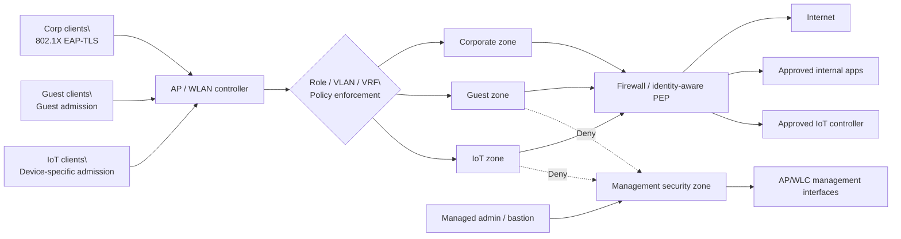
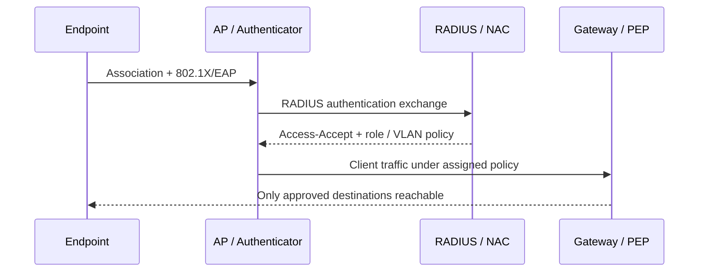
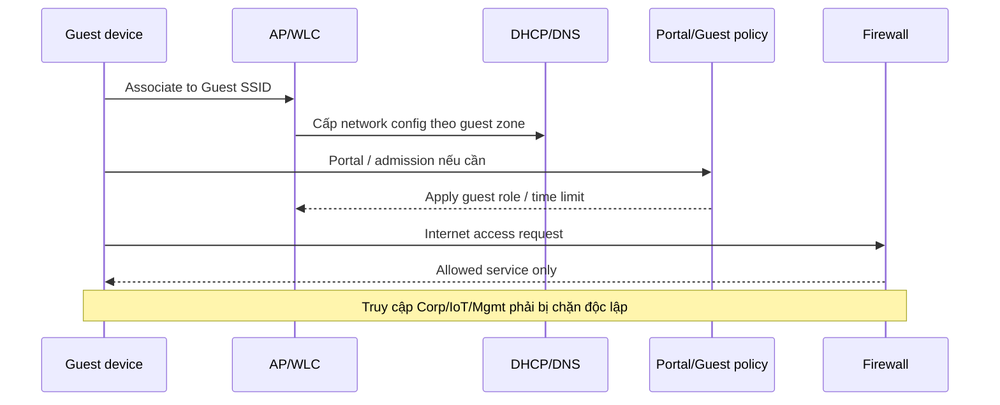

# SSID và network separation trong bảo mật mạng không dây

## Mục tiêu học tập

Sau khi học xong bài, bạn có thể:

1. Giải thích **SSID, BSSID, ESS, WLAN profile, VLAN, subnet, VRF, security zone** và phân biệt vai trò của từng khái niệm trong thiết kế Wi-Fi.
2. Chứng minh vì sao **tạo nhiều SSID chưa đồng nghĩa với tách mạng an toàn**, và vì sao **một SSID vẫn có thể phục vụ nhiều nhóm quyền** thông qua danh tính, VLAN động hoặc role-based policy.
3. Thiết kế các vùng **corporate, guest, BYOD, IoT, operations và management** có quy tắc truy cập rõ ràng, áp dụng **default deny** ở đúng ranh giới.
4. Phân tích đường đi của traffic trong mô hình **local bridging** và **centralized/tunneled forwarding**, từ access point (AP) đến switch, controller, firewall, DNS/DHCP và Internet.
5. Chọn cơ chế xác thực/mã hóa phù hợp như **WPA2/WPA3-Personal, WPA2/WPA3-Enterprise, 802.1X/EAP-TLS, OWE**, và nêu giới hạn của captive portal, PSK và MAC-based authorization.
6. Kiểm thử **client isolation, inter-SSID isolation, IPv4/IPv6, mDNS/multicast, roaming, rogue AP và đường bypass**, đồng thời biết cách khắc phục lỗi khi các phân vùng vô tình thông nhau.
7. Xây dựng ma trận kiểm thử và quy trình vận hành thay đổi SSID/VLAN/firewall, có logging, giới hạn tác động, rollback và bảo vệ kênh quản trị.

## 1. SSID là gì và vì sao cần network separation?

**SSID (Service Set Identifier)** là tên nhận diện một mạng Wi-Fi theo chuẩn IEEE 802.11, được cấu hình trên hạ tầng AP/WLAN. Người dùng thường thấy SSID dưới dạng tên mạng khi kết nối, ví dụ `Corp-WiFi` hay `Guest-WiFi`.

**Network separation** là cách tách các nhóm thiết bị hoặc luồng traffic thành những **miền có chính sách truy cập khác nhau**, sao cho lưu lượng chỉ đi qua ranh giới khi có lý do nghiệp vụ và được điểm thực thi chính sách cho phép.

Một thiết kế doanh nghiệp có thể cần:

- Laptop quản lý của nhân viên được truy cập các ứng dụng nội bộ phù hợp với role.
- Khách đến văn phòng chỉ được truy cập Internet và portal, không thấy máy chủ nội bộ.
- Thiết bị IoT như camera, cảm biến, bảng hiển thị chỉ tới bộ điều khiển, DNS, NTP hoặc dịch vụ vendor đã duyệt.
- BYOD không được quản lý có quyền thấp hơn thiết bị corporately managed.
- Admin được truy cập giao diện quản trị Wi-Fi controller/AP qua mạng quản trị riêng.
- Thiết bị Wi-Fi trong hai vùng dù dùng chung hệ thống AP vẫn không được tự ý truy cập chéo.

Trong module `SECURITY_NETWORK_SECURITY`, chủ đề này kết nối **wireless security** với **segmentation, firewall, VPN/ZTNA, IDS/IPS, network access control, DNS protection, cloud network** và mô hình hóa rủi ro. Wi-Fi là một **đường vào mạng**; chính sách mạng và ứng dụng mới quyết định thiết bị được đến đâu.

> **Nguyên tắc cốt lõi:** SSID là **nhãn nhận diện WLAN**, không phải mặc định một **security boundary**. Ranh giới thực sự nằm ở việc gắn client vào đúng role/VLAN/zone và thực thi access policy trên AP, switch, controller, firewall, gateway hoặc endpoint.

### 1.1. Khái niệm cần phân biệt

| Thuật ngữ | Ý nghĩa | Nhầm lẫn thường gặp |
|---|---|---|
| **SSID** | Tên của WLAN được client dùng để chọn mạng | “Hai SSID khác tên chắc chắn không thông nhau” |
| **BSSID** | Định danh một Basic Service Set, thường là địa chỉ MAC của giao diện radio ảo của AP | Đồng nhất BSSID với một AP vật lý duy nhất trong mọi tình huống |
| **ESS** | Tập các BSS có cấu hình để cung cấp dịch vụ WLAN liên thông/roaming | Cho rằng mỗi AP bắt buộc có SSID riêng |
| **WLAN/SSID profile** | Cấu hình SSID, bảo mật, chính sách client và forwarding trên controller/AP | Cho rằng SSID text tự quyết định VLAN |
| **VLAN (802.1Q)** | Broadcast domain lớp 2 được gắn tag trên đường trunk khi áp dụng | Cho rằng chỉ tách VLAN là cấm truy cập lớp 3 |
| **Subnet** | Phạm vi địa chỉ IP và routing | Cho rằng hai subnet tự động bị firewall chặn |
| **VRF** | Miền bảng định tuyến tách biệt | Cho rằng mọi route leak đều bị cấm mặc định trên mọi triển khai |
| **Security zone** | Nhóm interface/tài nguyên có cùng lớp chính sách tại PEP | Luôn có quan hệ một-một với SSID hoặc VLAN |
| **PDP/PEP** | Điểm quyết định và điểm thực thi quyền truy cập | Cho rằng một rule ở RADIUS tự chặn được mọi traffic |
| **Client isolation** | Giới hạn giao tiếp trực tiếp giữa các station tùy phạm vi triển khai | Cho rằng nó thay thế firewall giữa zone |
| **Captive portal** | Trang/quy trình onboarding hoặc xác nhận điều kiện truy cập | Cho rằng portal tự tạo mã hóa Wi-Fi mạnh và cô lập L2 |

SSID có thể được quảng bá bởi nhiều AP để tạo vùng phủ và roaming; cùng một AP cũng có thể phát nhiều SSID. Một SSID có thể map tĩnh tới một VLAN hoặc có cơ chế **dynamic VLAN/role assignment** tùy platform, RADIUS và cấu hình controller.

## 2. Nhìn đúng cấu trúc mạng Wi-Fi

### 2.1. SSID, AP và BSSID

```text
                 WLAN / SSID: Corp-WiFi
                /                        \
           AP tầng 1                 AP tầng 2
           BSSID A                   BSSID B
                \                        /
                   Wireless LAN / ESS
                          |
               Access / distribution
                          |
               Policy + segmentation
```

- SSID không nhất thiết xác định một **đường vật lý riêng**.
- BSSID khác nhau có thể thuộc cùng SSID hoặc AP khác nhau; roaming có thể đổi BSSID nhưng vẫn giữ danh tính và quyền.
- Các AP có thể dùng uplink trunk hoặc tunnel traffic về controller, tùy mô hình.
- Một WLAN có thể tạo các phiên người dùng với những **VLAN/role khác nhau** khi policy cho phép.

**Không sử dụng “hide SSID” như biện pháp bảo mật.** SSID không được quảng bá rõ có thể vẫn lộ qua hành vi kết nối/quản lý và gây bất tiện cho client; biện pháp chính vẫn là xác thực mạnh và network policy.

### 2.2. L2, L3 và lớp ứng dụng

Network separation có thể xuất hiện ở nhiều lớp:

1. **L2:** VLAN, client isolation, port admission, bridge filtering.
2. **L3/L4:** routing/VRF, security group, firewall/ACL, host firewall và stateful inspection.
3. **L7/identity:** application authorization, proxy, ZTNA, service identity, conditional access.
4. **Operations:** logging, NAC posture, quản lý cấu hình, cập nhật phần mềm và incident response.

Nếu tạo `Guest-WiFi` trên VLAN 30 và `Corp-WiFi` trên VLAN 10, nhưng router cấp route `any-any` giữa hai subnet, **guest vẫn có thể kết nối tới host corporate**. Phân đoạn an toàn phải được **đo qua kết quả packet/flow thực tế**.

### 2.3. Tách mạng Wi-Fi không đồng nghĩa tách sóng radio

Các SSID trên cùng radio chia sẻ **airtime** và nhiễu trên kênh. Tách VLAN/firewall làm rõ quyền truy cập nhưng không tự tạo phổ radio độc lập, không loại bỏ mọi nguy cơ **jamming/DoS ở tầng vô tuyến** và không bảo đảm hiệu năng tách biệt.

Khi cần phân lập nghiêm ngặt về rủi ro và năng lực, còn phải xem **thiết bị AP, firmware, radio, uplink, switch, nguồn điện, controller và failure domain**.

## 3. Kiến trúc mẫu: corporate, guest, BYOD, IoT và management

Giả sử một tòa nhà có các nhóm client:

| Nhóm | SSID hiển thị, ví dụ | Vai trò truy cập | Kỳ vọng bảo mật |
|---|---|---|---|
| **Corporate managed** | `Corp-WiFi` | Laptop quản lý, máy công ty | 802.1X/chứng thư và quyền theo ứng dụng |
| **Guest** | `Guest-WiFi` | Khách bên ngoài | Internet-only, hạn chế east-west, không vào tài nguyên nội bộ |
| **BYOD** | `BYOD-WiFi` hoặc role trên SSID chung | Điện thoại/laptop cá nhân | Quyền hạn hẹp tới app được duyệt, không coi là managed |
| **IoT** | `IoT-WiFi` hoặc role riêng | Camera, sensor, thiết bị chuyên dụng | Chỉ đến controller/DNS/NTP/endpoint đã duyệt |
| **Operations/admin** | Không nhất thiết có SSID riêng | Thiết bị IT được xác thực | Bastion/ZTNA vào các tài nguyên quản trị cụ thể |
| **AP/controller management** | **Không phát SSID admin chỉ vì có mạng quản trị** | Interface quản trị AP/WLC | Management VRF/VLAN/zone riêng, chỉ admin entry được đến |

Có thể dùng **ít SSID hơn** nếu role-based access đủ mạnh, hoặc dùng SSID riêng nếu onboarding/khả năng hỗ trợ client khác nhau. Mục tiêu là **mô hình quyền đúng và dễ vận hành**, không phải tạo càng nhiều SSID càng tốt.

### 3.1. Sơ đồ tách quyền



Các đường từ security zone tới firewall chỉ là **đường có thể được đánh giá**; không có nghĩa tất cả traffic được phép sang mọi đích. Trong thực tế, một số phân đoạn có gateway ngay trên switch L3, AP/WLC hoặc cloud gateway; điểm thực thi phải được chỉ rõ.

### 3.2. Địa chỉ minh họa cho một site

Dùng các dải **chỉ dành cho tài liệu**:

```text
Corporate VLAN 10 / VRF CORP:   192.0.2.0/26
Guest     VLAN 30 / VRF GUEST:  192.0.2.64/26
IoT       VLAN 40 / VRF IOT:    192.0.2.128/26
Management VLAN 90 / VRF MGMT:  198.51.100.0/26
Shared operations services:     203.0.113.0/26
```

Đây không phải dải triển khai production. Khi xây mạng thật, quản lý IP qua **IPAM**, định nghĩa route, DHCP scopes, IPv6 prefixes, DNS resolvers và vùng an ninh thống nhất.

**Một VLAN không bắt buộc có một subnet duy nhất trong mọi thiết kế**, và một SSID không bắt buộc có một VLAN duy nhất. Tuy nhiên, giữ cấu trúc rõ ràng sẽ giúp dễ kiểm toán và xử lý sự cố.

## 4. Phân đoạn bắt đầu từ mô hình tin cậy và tài sản

### 4.1. Mỗi nhóm client khác nhau ở điểm nào?

**Corporate managed** thường có MDM/EDR, certificate và chính sách cập nhật. Nhưng điều này **không có nghĩa** mọi máy managed đều được admin vào mạng lõi.

**Guest** thường là client không quản lý; chính sách nên chặn mạng nội bộ, chỉ cho phép các dịch vụ cần thiết để nhận IP/đăng nhập portal/ra Internet.

**BYOD** có thể có danh tính nhân viên nhưng không có chứng cứ posture tương đương laptop công ty. Authentication của người dùng **không tự nâng mức tin cậy thiết bị**.

**IoT** có thể thiếu 802.1X hoặc không hỗ trợ chuẩn mã hóa mới. Khi đó cần cân nhắc phương án onboarding có kiểm soát, credential riêng, segment riêng và chính sách allowlist, không mở rộng quyền chỉ để thiết bị kết nối được.

**Management** bao gồm WLC/AP admin UI/API, SSH/HTTPS/SNMP, monitoring, config backup, firmware, AAA và OOB khi có; phải tách khỏi data plane của người dùng.

### 4.2. Luồng hợp lệ phải được mô tả trước khi viết rule

Với mỗi nhóm, ghi:

- **Nguồn:** client role, VLAN, IP range, identity, posture, SSID và site.
- **Đích:** IP/FQDN/service, role, zone và owner.
- **Mục đích:** onboarding, DNS, NTP, proxy, ứng dụng nội bộ, controller IoT.
- **Giao thức/port:** cần thật sự dùng; xét IPv4 và IPv6.
- **Chiều khởi tạo:** stateful return traffic khác với việc mở chiều ngược chủ động.
- **Điều kiện:** tài khoản/chứng thư, giờ truy cập, device compliance, TTL của grant nếu có.
- **Bằng chứng:** firewall/NAC logs, policy ID, change ticket và cách xác minh.
- **Khôi phục:** nếu chặn nhầm, rollback như thế nào và ai được phê duyệt.

**Không dùng mỗi danh sách cổng** để kết luận ứng dụng được bảo vệ; ví dụ TCP/443 có thể là website công cộng hoặc API quản trị rất nhạy cảm.

## 5. SSID-to-VLAN mapping: tĩnh và động

### 5.1. Ánh xạ tĩnh

Trong mô hình đơn giản:

```text
SSID Corp-WiFi  -> VLAN 10 -> CORP zone
SSID Guest-WiFi -> VLAN 30 -> GUEST zone
SSID IoT-WiFi   -> VLAN 40 -> IOT zone
AP management   -> VLAN 90 -> MGMT zone
```

Đây là **quy hoạch logic**. Phải kiểm tra AP profile, switch trunk/local bridge, controller tunnel, gateway, firewall và DHCP phù hợp. Nếu VLAN 30 bị phép route sang VLAN 10 không qua firewall đúng chính sách, sơ đồ trên **không tạo cô lập thực tế**.

**VLAN native/untagged** trên AP uplink, allowed VLAN list và dynamic trunk negotiation phải được quản trị cẩn thận. Một uplink cho phép quá nhiều VLAN không cần thiết hoặc sai native VLAN có thể khiến client đi vào zone ngoài dự kiến.

### 5.2. Ánh xạ động qua 802.1X/RADIUS

Một SSID `Enterprise-WiFi` có thể cho nhiều role:



Ví dụ:

- Laptop managed có EAP-TLS identity hợp lệ và posture đạt chuẩn → `CORP_MANAGED` role, VLAN 10.
- Nhân viên dùng BYOD → `BYOD` role, VLAN 20 hoặc policy có quyền thấp.
- Thiết bị không nhận dạng được → onboarding/guest role; **không tự trở thành corporate**.
- Device có quyền bị thu hồi → NAC có thể reauthorize, thay role hoặc disconnect theo khả năng thiết bị.

Trong một số triển khai, RADIUS có thể cấp **Tunnel-Type, Tunnel-Medium-Type, Tunnel-Private-Group-ID** (tham khảo RFC 3580). Cách áp role, VLAN hoặc ACL thực tế thay đổi theo nhà sản xuất và tính năng.

**RADIUS Access-Accept không tự tạo tường lửa giữa hai VLAN.** Authenticator/controller và các PEP downstream phải thực thi đúng. Cần xác minh role/vlan **thực tế của session**, không chỉ đọc response AAA.

### 5.3. Quyền ở mức role có thể hiệu quả hơn nhiều SSID

Nếu một tổ chức có hàng nghìn thiết bị và nhiều nhóm quyền, tạo một SSID cho mỗi nhóm dễ làm:

- Rối việc onboarding và quản lý credential.
- Tăng beacon/probe/management overhead trên radio; mức tăng tùy radio, tốc độ cơ bản và cấu hình.
- Khó chọn SSID đúng cho nhân viên và thiết bị khách.
- Dễ phát sinh SSID cũ cấu hình yếu hoặc không còn owner.
- Tăng số ngoại lệ khi cần mapping VLAN hoặc đổi policy.

**Không có con số tối ưu SSID chung cho mọi mạng.** Cần tính theo site survey, công suất AP, mức sử dụng airtime, số BSSID, loại client/IoT, nhu cầu roaming và yêu cầu nghiệp vụ.

## 6. Chọn bảo mật WLAN cho từng nhóm

### 6.1. So sánh cơ chế truy cập

| Cơ chế | Điểm mạnh | Giới hạn và lưu ý |
|---|---|---|
| **WPA2-Personal (PSK)** | Dễ triển khai cho nhóm nhỏ, có mã hóa khi thiết lập đúng | Shared secret dễ lan truyền, thu hồi theo từng thiết bị khó |
| **WPA3-Personal (SAE)** | Cơ chế xác thực bằng mật khẩu cải tiến so với WPA2-PSK | Cần client/AP hỗ trợ và cấu hình đúng; vẫn cần quản lý credential |
| **WPA2-Enterprise (802.1X/EAP)** | Danh tính theo user/device, hỗ trợ AAA và policy động | EAP/certificate/AAA phải được triển khai an toàn |
| **WPA3-Enterprise** | Hệ thống xác thực doanh nghiệp WPA3 với mức bảo vệ yêu cầu cao hơn | Cần xác minh profile hỗ trợ, PMF, thiết bị/client/AAA tương thích |
| **OWE / Enhanced Open** | Mã hóa liên kết không dây trên mạng mở hỗ trợ OWE | **Không xác thực danh tính AP/đối tượng truy cập như Enterprise**; không thay thế captive portal/NAC |
| **Open Wi-Fi + captive portal** | Onboarding khách dễ hơn trong một số trường hợp | Wi-Fi association không có bảo vệ mã hóa liên kết như WPA2/WPA3; portal không bù được mọi rủi ro |
| **PPSK/DPSK/MPSK theo vendor** | Credential khác nhau theo thiết bị/nhóm trên một SSID | Tính năng và cách gán VLAN/role phụ thuộc nền tảng, cần quản lý vòng đời |

**Ưu tiên EAP-TLS** cho thiết bị corporate hỗ trợ cấp phát chứng thư đáng tin. Người dùng phải kiểm tra **chứng thư server xác thực** theo chính sách; nếu client cho phép kết nối tới server AAA giả, cơ chế mạnh có thể bị giảm hiệu quả.

**WPA3 và Protected Management Frames (PMF):** WPA3 đặt yêu cầu về PMF trong các chế độ liên quan; cần kiểm tra khả năng tương thích của client. PMF bảo vệ **một số management frame**, không làm biến mất mọi nguy cơ từ rogue AP, gây nhiễu radio hoặc client lỗi.

### 6.2. WPA2/WPA3 transition mode và thiết bị cũ

Trong giai đoạn nâng cấp, SSID có thể bật chế độ tương thích WPA2/WPA3 tùy sản phẩm. Rủi ro nằm ở **client cũ, chính sách downgrade/transition, PMF, credential dùng chung và cấu hình chọn chế độ**.

Khuyến nghị:

1. Kiểm kê chipset/OS của client, thiết bị IoT và khả năng PMF.
2. Thử trong lab theo nhóm thiết bị thật, nhất là roaming và reconnect.
3. Tránh kéo dài cấu hình tương thích yếu chỉ vì một nhóm client lỗi thời; ưu tiên phân vùng riêng với policy hẹp hoặc nâng cấp.
4. Ghi mục tiêu ngừng dùng cơ chế cũ và người sở hữu ngoại lệ.
5. Giám sát phương thức kết nối thực tế; đừng suy “SSID đã bật WPA3” là mọi phiên đều đang dùng WPA3.

### 6.3. Credential và quản trị khóa

- Không dùng một shared PSK cho toàn bộ văn phòng nếu có lựa chọn cấp danh tính riêng.
- Credential của guest, IoT và corporate phải có phạm vi, owner và quy trình rotate/thu hồi phù hợp.
- Không in mật khẩu Wi-Fi quản trị trên tài liệu công khai hoặc tái dùng cùng mật khẩu cho admin.
- Tắt WPS hoặc những phương thức onboarding yếu không cần thiết.
- Cấu hình chứng thư server AAA và lifecycle của CA, thiết bị được quản lý, hết hạn/thu hồi chứng thư.
- Giới hạn quyền truy cập RADIUS/NAC, sử dụng kênh bảo vệ phù hợp và giám sát mất AAA.

**Mã hóa không thay thế phân quyền.** Hai client cùng SSID có thể đều kết nối an toàn ở tầng radio nhưng vẫn không được phép truy cập tài nguyên của nhau.

## 7. Client isolation và inter-SSID isolation khác nhau

### 7.1. Intra-SSID client isolation

**Client isolation** (còn gọi là AP isolation hoặc peer isolation tùy sản phẩm) ngăn hoặc hạn chế một client Wi-Fi giao tiếp trực tiếp với client khác trong phạm vi mà AP/controller có thể kiểm soát.

Hữu ích cho:

- Guest Wi-Fi: giảm khả năng truy cập máy khách bên cạnh.
- Một số IoT/thiết bị khu vực công cộng: hạn chế peer-to-peer không cần thiết.
- Mạng lớp học/hội nghị hoặc mạng đa người thuê có cùng SSID.

Giới hạn quan trọng:

- Một số sản phẩm chỉ cô lập **client trên cùng AP/BSS**, không mặc định cô lập **giữa các AP**.
- Traffic đi qua switch/router, uplink có thể **đi vòng** nếu policy L2/L3 không áp ở đúng nơi.
- Ethernet client trong cùng VLAN hoặc host ở subnet khác có thể vẫn truy cập được.
- Broadcast/multicast, ARP/ND, DHCP có thể được xử lý khác nhau; cần kiểm tra cụ thể.
- MDM, AirPlay/casting, printer discovery có thể ngừng hoạt động nếu các client không được phép thấy nhau.

**Không coi checkbox “client isolation: enabled” là bằng chứng kết thúc kiểm thử.** Kiểm tra cả **cùng AP, khác AP, cùng SSID, khác SSID và wired host**.

### 7.2. Inter-SSID isolation

Mục tiêu là ngăn các client của một WLAN/role truy cập zone khác **trừ khi có rule rõ ràng**.

Ví dụ:

```text
Guest-WiFi -> Guest VLAN -> Firewall -> Internet: ALLOW theo policy
Guest-WiFi -> Corp VLAN: DENY
Guest-WiFi -> IoT VLAN: DENY
Guest-WiFi -> AP/WLC management: DENY
Corp-WiFi  -> IoT controller service: ALLOW cho nhóm đủ quyền
IoT-WiFi   -> Controller + DNS/NTP: ALLOW, đích khác DENY
```

Nếu hai SSID map **cùng VLAN**, một số thiết bị có thể cho chúng giao tiếp L2 trực tiếp; nếu muốn hạn chế phải thêm **role-based ACL/client isolation** tương ứng. Nếu khác VLAN nhưng gateway route tự do, cần **firewall/ACL** ở giữa.

## 8. AP local bridging và centralized/tunneled forwarding

Một nguyên nhân gây sai segmentation là **không xác định đường dữ liệu thật**.

### 8.1. Local bridging

```text
Wi-Fi client
    |
AP / WLAN policy
    |
AP Ethernet uplink
    |
Switch trunk (VLAN 10/30/40 theo mapping)
    |
Switch L3 / Firewall / Gateway
    |
Internal services hoặc Internet
```

Trong chế độ này, client traffic có thể được **bridge trực tiếp** từ AP vào VLAN tại site. Cần kiểm tra:

- Allowed VLANs và native VLAN trên AP uplink.
- Local bridging ở từng SSID có thực sự gắn tag đúng không.
- Default gateway và firewall nằm ở đâu; có inter-VLAN routing trực tiếp bypass firewall không.
- DHCP relay/scope và DNS policy theo zone.
- AP management có dùng interface/VLAN riêng hay bị chia sẻ với data traffic.
- Mỗi chi nhánh có cấu hình tương đương không.

### 8.2. Centralized forwarding/tunnel

```text
Wi-Fi client --> AP ===== tunnel =====> WLC / central gateway
                                           |
                                   Role / VLAN / firewall
                                           |
                                   Network / Internet
```

Một số hạ tầng dùng **CAPWAP hoặc cơ chế tunnel của vendor**, và có thể hỗ trợ traffic local breakout theo cấu hình.

Cần xác minh:

- Tunnel được bảo vệ và có đủ công suất/độ trễ cho ứng dụng không.
- Policy nằm trên AP, gateway, controller hay cả hai.
- Chi nhánh khi mất controller/WAN sẽ **drop traffic, giữ local forwarding hay dùng fallback**?
- Traffic guest có bị hairpin qua trụ sở khiến chất lượng dịch vụ giảm không?
- Khi thay controller/HA node, role, ACL, VLAN, NAT và session state còn đúng không?

**Control plane của WLAN không đồng nhất data plane.** Controller có thể quản lý AP từ xa nhưng client traffic vẫn local bridge; ngược lại, tunnel forwarding có thể đưa traffic tới gateway tập trung. Phải đọc cấu hình thực tế và đo packet path.

### 8.3. Hybrid và cloud-managed WLAN

Wi-Fi cloud-managed không có nghĩa dữ liệu người dùng luôn chạy qua cloud. Cloud service có thể chủ yếu cung cấp **management/policy**, còn traffic đi ra gateway tại site. Một số dịch vụ lại có secure access gateway/tunnel riêng.

Vì thế, với mỗi site ghi rõ: **policy decision**, **policy enforcement**, **tunnel termination**, **data path** và **fallback mode**. Không suy từ nhãn “cloud WLAN” rằng guest isolation đã được áp đầy đủ.

## 9. Ví dụ ma trận truy cập giữa các vùng

Giả sử các tài nguyên mẫu trong địa chỉ tài liệu:

- DNS resolver `203.0.113.10`.
- NTP server `203.0.113.11`.
- Corporate app gateway `203.0.113.20`.
- IoT controller `203.0.113.30`.
- WLC management `198.51.100.10`.
- Bastion `198.51.100.20`.

| Source role | Destination | Dịch vụ | Kết quả mặc định |
|---|---|---|---|
| Guest | DHCP/RA trong guest zone | Cấp cấu hình IP/IPv6 phù hợp | **Allow cần thiết** |
| Guest | Guest DNS resolver đã duyệt | UDP/TCP 53, hoặc dịch vụ DNS đã định | **Allow** |
| Guest | Internet | Web/traffic theo acceptable-use policy | **Allow có điều kiện** |
| Guest | Corporate subnet/app | Bất kỳ | **Deny** |
| Guest | IoT subnet | Bất kỳ | **Deny** |
| Guest | WLC/AP management | HTTPS/SSH/SNMP và cổng khác | **Deny** |
| Guest ↔ Guest | Peer-to-peer | Bất kỳ theo policy khách | **Deny/isolate** theo phạm vi đã kiểm thử |
| Corporate managed | App gateway | TCP 443 | **Allow theo identity/role** |
| Corporate managed | IoT controller | Đích/port được duyệt | **Allow có điều kiện**, không mở cả IoT subnet |
| Corporate managed | Management | Trực tiếp | **Deny**, quản trị qua bastion nếu được cấp quyền |
| BYOD | Approved SaaS/portal | HTTPS và DNS cần thiết | **Allow có điều kiện** |
| BYOD | Sensitive production subnet | Bất kỳ | **Deny** trừ khi qua ZTNA/app gateway |
| IoT | DNS/NTP, IoT controller | Chỉ protocol/port cần | **Allow theo allowlist** |
| IoT | User endpoints / management | Bất kỳ | **Deny** |
| Bastion / authorized admin | WLC/AP management | HTTPS/SSH theo profile | **Allow + AAA/MFA/audit** |
| Internet | Wi-Fi management interface | Bất kỳ | **Deny** |

**Đây là chính sách minh họa**, không phải danh sách port hoàn chỉnh cho từng sản phẩm. Ví dụ, DHCPv4 thường dùng UDP/67–68; DHCPv6 dùng UDP/546–547; IPv6 cần RA/ND/ICMPv6 hợp lệ. Rule phải cân nhắc trạng thái, hướng khởi tạo và chức năng của các giao thức đó.

### 9.1. Tránh rule “guest → Internet allow” quá rộng

“Internet” nên được định nghĩa bằng **security zones, routing và policy**, không đơn giản là “mọi IP không thuộc RFC 1918”.

Các phạm vi địa chỉ đặc biệt khác có thể được dùng trong nội bộ hoặc hạ tầng (ví dụ IPv4 link-local `169.254.0.0/16`, shared address space `100.64.0.0/10`, IPv6 ULA `fc00::/7`). **Không nên xây bảo vệ chỉ bằng chặn ba dải RFC 1918**; cần kiểm soát đích qua **zone, route, firewall, DNS policy và danh mục mạng thuộc tổ chức**.

Ngược lại, không được chặn **toàn bộ ICMPv6** để “làm sạch” guest traffic: điều đó có thể phá Neighbor Discovery, Router Advertisement và Path MTU Discovery, gây lỗi IPv6. Cần kiểm soát **loại thông điệp** ở vị trí phù hợp.

### 9.2. Ví dụ policy dạng YAML giả lập

```yaml
# PSEUDOCODE: Không phải cấu hình có thể áp dụng trực tiếp cho thiết bị.
policy_id: wifi-network-separation-v1
default_interzone: deny
zones:
  - CORP
  - BYOD
  - GUEST
  - IOT
  - MGMT
  - INTERNET
services:
  - DHCPV4
  - DHCPV6
  - DNS
  - NTP
  - HTTPS

allows:
  - from: GUEST
    to: INTERNET
    service: APPROVED_INTERNET_EGRESS
    note: "Giới hạn theo acceptable-use và DNS/security policy"
  - from: GUEST
    to: GUEST_DNS_RESOLVER
    service: DNS
  - from: CORP_MANAGED
    to: APPROVED_CORP_APPS
    service: HTTPS
    condition: "device_compliant_and_authorized"
  - from: IOT
    to: APPROVED_IOT_CONTROLLER
    service: VENDOR_APPROVED_PROTOCOL
  - from: IOT
    to: OPS_DNS_AND_NTP
    service: DNS_NTP
  - from: APPROVED_BASTION
    to: WLAN_MANAGEMENT_INTERFACES
    service: ADMIN_HTTPS_SSH
    condition: "active_pam_session"

explicit_denies:
  - from: GUEST
    to: CORP
  - from: GUEST
    to: IOT
  - from: GUEST
    to: MGMT
  - from: IOT
    to: MGMT
  - from: BYOD
    to: MGMT
```

Một firewall L3/L4 **không tự hiểu** `device_compliant_and_authorized` hoặc `active_pam_session`. Những điều kiện này cần tích hợp IAM/NAC/ZTNA/PAM hoặc điểm thực thi có ngữ cảnh danh tính đáng tin. `APPROVED_INTERNET_EGRESS` cũng phải được hiện thực thành policy cụ thể chứ không phải một quy tắc mặc định mở mọi luồng.

## 10. Guest Wi-Fi: Internet-only và client isolation

### 10.1. Luồng onboarding khách



**Captive portal không phải cơ chế mã hóa WLAN** và không bảo đảm một guest không thể thấy traffic L2 của guest khác. Dùng WPA/OWE theo thiết kế và **client isolation** phù hợp; cân nhắc riêng guest policy trước khi portal hoàn tất.

### 10.2. Walled garden và quyền tối thiểu trước portal

Một guest captive portal có thể cần truy cập:

- DHCP/RA/ND để có cấu hình mạng.
- DNS resolver được chỉ định.
- Portal, redirect và tài nguyên cần thiết để xác thực/chấp thuận điều khoản.
- IdP/certificate validation endpoints cần thiết theo triển khai.
- NTP nếu phương thức xác thực/bảo mật đòi hỏi đồng bộ thời gian.

Chỉ allow những luồng tối thiểu cho onboarding, không mở access tới corporate server để portal hoạt động. Khi portal không có, các luồng lên Internet vẫn phải được đánh giá bởi firewall/security gateway.

### 10.3. Guest network vẫn cần phòng vệ

Một mạng guest Internet-only vẫn có thể bị lạm dụng để spam, truy cập nội dung độc hại hoặc phát lưu lượng bất thường. Cần có chính sách chấp nhận sử dụng, rate limit, threat monitoring, client isolation, DNS security và kiểm soát lưu lượng outbound phù hợp. Phân đoạn giúp **hạn chế phạm vi ảnh hưởng**, không biến guest thành vùng vô hại tuyệt đối.

## 11. IoT, BYOD và những ngoại lệ khó

### 11.1. IoT thiếu 802.1X

Camera, TV, máy in, đồng hồ thông minh, cảm biến hoặc thiết bị cũ có thể chỉ hỗ trợ WPA2-PSK. Khi đó:

- Đặt trong **IoT zone** thay vì corporate subnet.
- Ưu tiên **credential riêng/nhóm nhỏ** khi sản phẩm hỗ trợ PPSK/DPSK; hạn chế PSK dùng chung toàn tổ chức.
- Gắn owner, model, phiên bản firmware, vị trí, danh sách đích/truy cập cần thiết.
- Định nghĩa allowlist tới controller, DNS/NTP và cloud endpoint theo nhu cầu thật.
- Giới hạn lateral movement giữa các thiết bị IoT, kiểm tra multicast và mDNS.
- Theo dõi inventory, rogue device, cập nhật firmware và loại bỏ thiết bị hết vòng đời.

**MAB dựa trên MAC** có thể là cách nhận diện tương thích nhưng MAC không phải bí mật. Đừng coi MAB như xác thực chứng thư.

### 11.2. BYOD có tài khoản nhân viên

Một nhân viên đăng nhập thành công không chứng minh laptop cá nhân đã đáp ứng hardening/EDR/disk encryption của máy corporate. BYOD nên dùng **app-specific access/ZTNA** hoặc role ít đặc quyền hơn, thay vì route thẳng vào mạng nội bộ chỉ vì cùng tài khoản.

NAC policy có thể xét:

- User role và MFA/SSO.
- Certificate/device posture khi có quyền và có cơ chế tin cậy.
- Network location và loại thiết bị.
- Quyền ứng dụng cần thiết, không mở cả subnet.
- Thời hạn session/reauthorization và trạng thái thu hồi.

## 12. Multicast, mDNS và service discovery vượt ranh giới

Một thiết kế an toàn có thể gây lỗi trải nghiệm như **không tìm thấy máy in, TV/casting hoặc thiết bị họp** sau khi tách VLAN.

### 12.1. Vì sao mDNS khó vượt VLAN?

**mDNS** dùng **UDP/5353** trong phạm vi link-local multicast theo thiết kế. Thiết bị thường tìm dịch vụ qua **DNS-SD** trên mDNS. Giao tiếp link-local này **không tự động được route** giữa hai VLAN.

Vì vậy, khi máy corporate ở VLAN 10 và printer ở VLAN 40, client có thể không tìm thấy printer dù firewall đã cho phép TCP/631 hoặc cổng in cụ thể.

**Không nên giải quyết bằng mở any-any giữa hai VLAN.** Thay vào đó:

- Dùng **mDNS/Bonjour gateway/proxy** có kiểm soát nếu thiết bị hỗ trợ.
- Chỉ quảng bá các **service types và thiết bị** được phê duyệt.
- Cho phép luồng **thực sự sử dụng dịch vụ** qua firewall theo nguồn/đích/port cần thiết.
- Kiểm tra đường đi phản hồi, IPv4/IPv6, multicast/broadcast và tình trạng client isolation.
- Có owner, approval và audit cho mỗi ngoại lệ dịch vụ.

### 12.2. Các vấn đề phụ thuộc L2/L3 khác

| Vấn đề | Triệu chứng | Hướng xử lý |
|---|---|---|
| mDNS/DNS-SD không qua VLAN | Máy không tìm thấy printer/casting | Selective gateway + access policy |
| SSDP/UPnP discovery | Thiết bị không xuất hiện trong ứng dụng | Rà soát multicast scope, không mở bừa từ guest |
| DHCP relay sai | Client kết nối SSID nhưng không có IP | Kiểm tra VLAN, relay, server scope, Option 82 |
| DNS split-horizon | Corp và guest nhận câu trả lời khác | Resolver/view đúng zone và DNS policy |
| IPv6 RA từ nguồn sai | Client nhận gateway/prefix lạ | RA Guard và kiểm tra router hợp lệ |
| DHCPv6 server không được duyệt | Client nhận thông số sai | DHCPv6-Shield/chính sách relay |
| Multicast storm hoặc mDNS quá nhiều | Tăng airtime hoặc thiết bị lag | Rate control, multicast-to-unicast theo sản phẩm, IGMP/MLD policy |
| AP/client isolation quá rộng | Corporate device không truy cập printer | Cho phép ngoại lệ rõ ràng hoặc qua gateway, không tắt toàn bộ segmentation |

**Cảnh báo:** IGMP snooping và MLD snooping giúp quản lý multicast trong miền L2 nhưng **không thay thế policy authorization**, và cấu hình sai có thể làm mất luồng cần thiết.

## 13. IPv4, IPv6 và DNS: kiểm thử đồng đều

### 13.1. Chỉ viết firewall IPv4 là chưa đủ

Client Wi-Fi thường dual-stack. Nếu Guest VLAN bị chặn IPv4 tới corporate nhưng có IPv6 route không được lọc, **phân đoạn đã bị bypass**.

Cần kiểm kê:

- IPv4 subnet, gateway, DHCPv4 scope, NAT và firewall.
- IPv6 prefix, Router Advertisement, DHCPv6 nếu dùng, default route, NDP/ICMPv6.
- Các IPv6 Unique Local Addresses (ULA) và Global Unicast trong nội bộ.
- Firewall policy tương đương theo zone, hoặc lý do được ghi nếu hai stack khác nhau.
- IPv6 DNS AAAA records, DoH/DoT, service discovery và link-local traffic.
- Overlay/VPN, cloud peering, AP management và các đường có thể bypass.

Không sử dụng chiến lược **“tắt ICMPv6 hết”**: Neighbor Discovery và Path MTU Discovery là các thành phần thiết yếu. Sử dụng chính sách ICMPv6 có kiểm soát theo chức năng và nguồn đúng.

### 13.2. DNS là quyền truy cập gián tiếp quan trọng

Nếu Guest dùng DNS resolver corporate chứa các bản ghi nội bộ, điều này có thể làm lộ thông tin tên miền hoặc tạo tuyến đi vòng qua policy. Nên cân nhắc:

- Resolver riêng/view thích hợp cho Guest và IoT.
- Chặn hoặc kiểm soát truy vấn nội bộ nhạy cảm theo chính sách.
- Bảo vệ DNS recursive resolver khỏi client không thuộc phạm vi.
- Ghi DNS logs có bảo vệ quyền riêng tư, theo phạm vi cần thiết.
- Giám sát client đổi sang resolver ngoài chính sách khi có yêu cầu bắt buộc đi qua protective DNS.

**Biết tên/IP không đồng nghĩa truy cập được đích**, nhưng DNS policy vẫn là một lớp bảo vệ hỗ trợ firewall và điều tra.

## 14. Quản trị AP/controller phải tách khỏi mạng client

Các interface quản trị của AP, controller, switch uplink và cloud management có quyền thay SSID, PSK, VLAN mapping, ACL và route. Nếu guest hoặc IoT truy cập được chúng, một sự cố nhỏ có thể biến thành **chiếm quyền mạng rộng**.

### 14.1. Kiến trúc quản trị khuyến nghị

```text
Managed admin endpoint
      |
IdP / MFA / ZTNA or managed VPN
      |
Bastion / privileged access gateway
      |
Management firewall / ACL
      |
AP/WLC/switch management interfaces

Guest / BYOD / IoT / Internet ---------X--------->
                      (không có admin path trực tiếp)
```

Biện pháp:

- Management IP/VRF/VLAN riêng, không lẫn vào các dải data client.
- Chỉ cho admin entry được truy cập Web UI/API/SSH/SNMP quản trị đúng thiết bị.
- Xác thực mạnh, AAA/RBAC theo vai trò, MFA ở điểm vào thích hợp.
- Ghi audit login, thay policy, thay SSID/PSK, firmware, tạo tài khoản admin, thay VLAN.
- TLS/certificate hợp lệ, cập nhật firmware và tắt dịch vụ quản trị không cần thiết.
- Backup cấu hình, phiên bản policy và đường khôi phục OOB/console nếu phù hợp.
- Cloud controller/API cần IAM least privilege, MFA và audit độc lập với firewall tại site.

**Không xây một “Admin-WiFi” dùng mật khẩu chung mà từ đó mọi thiết bị được vào controller.** Quyền admin phải dựa trên danh tính, thiết bị, session và điểm thực thi tin cậy.

### 14.2. Bảo vệ RADIUS/NAC/PKI và đường vận hành

AP/WLC có thể cần đến **RADIUS/AAA, DNS, NTP, certificate/CRL/OCSP, syslog, telemetry, firmware repository** và cloud management. Khi tách management zone, phải **cho phép có giới hạn các luồng phụ thuộc thực sự cần thiết**. Chặn tất cả egress quản trị có thể khiến xác thực 802.1X hoặc đồng bộ thời gian lỗi.

### 14.3. Fallback khi AAA/controller mất liên lạc

Một số giải pháp có chế độ offline/last-known-role hoặc fallback VLAN. Cần biết:

- Client đang kết nối có tiếp tục phiên không?
- Client mới không xác thực được có bị **deny** hay bị đưa vào **onboarding/remediation**?
- Có tình trạng **unknown client nhận corporate VLAN** chỉ vì AAA lỗi không?
- Role cache có TTL/reauthorization và cơ chế revoke không?
- Khi site switch sang local breakout, firewall/ACL có còn đúng không?

**Fail-open/fail-closed** ở đây cần gắn với **failure mode và loại traffic**. HA giúp duy trì xác thực/kiểm soát; không nên coi mất AAA là lý do mở thẳng toàn bộ zone.

## 15. Mối đe dọa đối với SSID và đường phân đoạn

| Mối đe dọa hoặc lỗi | Ảnh hưởng | Phòng vệ/kiểm thử |
|---|---|---|
| **Rogue AP/evil twin SSID** | Client có thể bị dụ kết nối hoặc cung cấp thông tin nhạy cảm | EAP server-cert validation, WLAN inventory, WIDS/WIPS, user training |
| **SSID spoofing** | Tên SSID có thể bị bắt chước; client chọn nhầm mạng | Không tin tên SSID; xác thực AP/AAA đúng chuẩn và certificate |
| **PSK chia sẻ quá rộng** | Một bí mật bị lộ làm nhiều thiết bị bị ảnh hưởng | WPA-Enterprise hoặc credential riêng, rotation và scope |
| **Client isolation chỉ trên một AP** | Client từ AP khác vẫn thấy nhau | Test liên AP và áp gateway/L2 policy thích hợp |
| **Inter-VLAN routing mở** | Guest tới Corporate dù khác SSID/VLAN | L3 firewall default deny, negative tests |
| **SSID map nhầm VLAN/role** | Client được quyền cao hơn mong muốn | Session attribute readback, DHCP/route/PEP checks |
| **AP uplink trunk quá rộng** | VLAN không cần thiết có mặt trên access edge | Allowed VLAN list, native VLAN review, port hardening |
| **IPv6 bỏ sót** | Guest đi tới corporate qua IPv6 | IPv6 firewall parity, RA/ND tests |
| **Rogue DHCP/RA** | Client nhận gateway/DNS ngoài dự kiến | DHCP snooping, RA Guard/DHCPv6-Shield theo tính năng |
| **MAC spoofing/MAB abuse** | Client giả MAC để vào IoT/corporate | MAB quyền hẹp, certificate/802.1X khi hỗ trợ |
| **Cloud controller bị chiếm** | Thay đổi cấu hình hàng loạt SSID/VLAN | IAM least privilege, MFA, audit, change review |
| **Guest captive portal bypass** | Client truy cập ngoài phạm vi trước portal | Walled garden rõ, pre/post policy test |
| **Multicast gateway quá mở** | Discovery hoặc access từ zone khác | Allow service/device cụ thể, kiểm tra actual traffic |
| **AP/WLC management lộ ra guest** | Nguy cơ kiểm soát hạ tầng Wi-Fi | Management VRF, access ACL, bastion/MFA |
| **Controller/AAA lỗi và fallback mở** | Unknown client nhận quyền corporate | Fail-closed hoặc role hạn chế, HA và kiểm thử lỗi |

### 15.1. Evil twin không bị chặn chỉ bằng SSID naming

Kẻ khác có thể phát SSID trùng tên Wi-Fi công ty. Việc client hiển thị `Corp-WiFi` **không bảo đảm** nó đang nối đúng hạ tầng. Với enterprise Wi-Fi, kiểm tra **chứng thư server EAP, CA/hostname tin cậy** và cấu hình supplicant là then chốt. Thiết bị thiếu khả năng xác thực server đúng có nguy cơ bị dẫn vào mạng giả.

**WIDS/WIPS** có thể hỗ trợ nhận diện AP lạ theo chính sách, nhưng việc phát hiện qua radio có phạm vi/false positive và phải cân nhắc tuân thủ quy định. Không coi một SSID trùng ngoài tòa nhà là bằng chứng AP độc hại mà chưa xác minh.

### 15.2. Network isolation không thay thế endpoint security

Ngay cả corporate WLAN có xác thực tốt, laptop đã bị xâm nhập vẫn có thể cố truy cập các dịch vụ mà role được phép. Cần kết hợp **host firewall, EDR, patching, ứng dụng least privilege, IDS/IPS, DNS security, logging và phân đoạn sâu**. SSID/role chỉ là một thành phần trong nhiều lớp phòng vệ.

## 16. Quy trình triển khai an toàn

### Bước 1 — Inventory và mục tiêu nghiệp vụ

Ghi:

- AP model/firmware, controller/cloud management, radio bands, SSID/BSSID, site và owner.
- Loại client: managed laptop, BYOD, guest, IoT/OT, hệ thống cần roaming, thiết bị cũ.
- Các ứng dụng, dịch vụ DNS/DHCP/NTP, printers/casting và kết nối đến cloud.
- Khả năng WPA3, PMF, EAP-TLS và client isolation của từng nhóm.
- Kết nối uplink AP, switch trunk, controller tunnel/local breakout và gateway/firewall.
- Cấu hình hiện tại, số client, đường management và phương án rollback.

### Bước 2 — Phân nhóm mức tin cậy

Vẽ các zone **Corp, Guest, BYOD, IoT, Mgmt** và xác định cụ thể từng **invariant** cần giữ, ví dụ:

- Guest **không bao giờ** có đường IP trực tiếp tới corporate/management.
- IoT chỉ đi tới controller và vài dịch vụ hệ thống được chỉ định.
- AP management chỉ đến từ bastion/admin entry và các dịch vụ vận hành đã duyệt.
- Endpoint corporate chưa đạt posture không có quyền vào ứng dụng nhạy cảm.
- Các đường IPv6/overlay/local-breakout cũng phải bảo vệ tương đương.

### Bước 3 — Chọn SSID, credential và policy

- Quyết định static VLAN mapping hay role-based dynamic assignment.
- Thiết lập EAP-TLS/certificate lifecycle cho corporate, guest admission phù hợp, IoT credentials tối thiểu.
- Áp mapping VLAN/role, default-deny interzone và client isolation theo phạm vi.
- Tạo rule cho DNS/DHCP/RA/ND/NTP, ứng dụng và discovery cần thiết.
- Kiểm tra cloud-managed AP/API và management zone, gồm routing/AAA/logging.

### Bước 4 — Staged rollout với rollback

1. Sao lưu cấu hình và ghi change ticket, owner, tác động dự kiến.
2. Thử một AP/site nhỏ, nhiều loại client, cả Android/iOS/Windows/macOS/IoT nếu có trong phạm vi.
3. Kiểm tra **xác thực đúng**, role/VLAN/IP/subnet/gateway và policy theo session.
4. Thử **truy cập được những gì cần** và **không truy cập được những gì bị cấm**.
5. Kiểm tra roaming, client isolation liên AP, local/central forwarding, IPv6 và mDNS.
6. Thử mất RADIUS/controller/uplink theo **lab hoặc lịch được phê duyệt**, có quyền khôi phục OOB.
7. Đối chiếu logs, capacity, airtime, helpdesk incidents và user experience.
8. Mở rộng theo site/tầng; không bật hàng loạt trước khi nghiệm thu từng nhóm.
9. Gỡ SSID/PSK cũ theo kế hoạch, bảo đảm đã chuyển client hợp lệ.

**Không tắt một SSID đang phục vụ thiết bị vận hành trọng yếu chỉ vì mục tiêu giảm số SSID.** Cần kế hoạch thay đổi theo vòng đời phần cứng và ứng dụng.

## 17. Lab minh họa: kiểm thử separation không gây hại

Bài thực hành chỉ thực hiện trên **môi trường lab được cấp quyền**, không truy cập các mạng/thiết bị ngoài phạm vi. Nếu chưa có hạ tầng AP/WLC lab, có thể làm phần policy offline ở mục 17.3.

### 17.1. Topology và cấu hình giả định

```text
Client A: Corp-WiFi      -> CORP role -> VLAN 10
Client B: Guest-WiFi     -> GUEST role -> VLAN 30
Client C: IoT-WiFi       -> IOT role -> VLAN 40
Client D: Guest-WiFi     -> GUEST role -> VLAN 30 (AP khác)

Demo app:               203.0.113.20:443
IoT controller:          203.0.113.30:443
Management UI:           198.51.100.10:443
Internet test endpoint:  do lab owner cung cấp
```

Các IP `203.0.113.0/24` và `198.51.100.0/24` là **dải tài liệu**, không phải endpoint Internet dùng được. Trong lab thật, thiết lập service listener và route tương ứng hoặc thay bằng IP thuộc lab.

### 17.2. Các kiểm tra thực hành

Trước tiên xác nhận client đã ở đúng SSID/role và nhận đúng địa chỉ:

```bash
# Linux client trong lab: xem địa chỉ và default route
ip -br addr
ip route
ip -6 route

# Chỉ trên những service đích thuộc lab được cấp phép:
nc -vz -w 3 203.0.113.20 443
nc -vz -w 3 198.51.100.10 443

# DNS resolver lab, nếu đã được cấu hình:
dig @203.0.113.10 app.lab.example.test A
dig @203.0.113.10 app.lab.example.test AAAA
```

Lệnh `nc` giúp kiểm tra handshake TCP, **không tự chứng minh** user được authorization ở ứng dụng. Lỗi timeout/refused có thể do listener tắt, DNS/route sai hoặc host down, **không mặc định do firewall deny**. Cần xem firewall/PEP logs và service health.

Kiểm tra **IPv6** tương ứng khi lab dual-stack, đồng thời xem RA/ND và client isolation giữa **hai guest trên cùng AP và khác AP**. Không chạy quét toàn mạng; thử những đích/port cụ thể đã được phép.

### 17.3. Lab offline: xét một policy matrix bằng Python

Đoạn mã mô phỏng **quyết định policy theo zone và dịch vụ**, không mở socket, không thay firewall:

```python
# Pseudocode có thể chạy offline, mục đích kiểm tra chính sách logic.
ALLOWS = {
    ("GUEST", "INTERNET", "HTTPS"),
    ("GUEST", "GUEST_DNS", "DNS"),
    ("CORP", "CORP_APP", "HTTPS"),
    ("CORP", "INTERNET", "HTTPS"),
    ("BYOD", "INTERNET", "HTTPS"),
    ("IOT", "IOT_CONTROLLER", "HTTPS"),
    ("IOT", "OPS_DNS", "DNS"),
    ("IOT", "OPS_NTP", "NTP"),
    ("ADMIN_BASTION", "MGMT", "HTTPS")
}

def decision(source_zone, destination_zone, service):
    # Nếu không khớp allowlist -> deny.
    return "ALLOW" if (source_zone, destination_zone, service) in ALLOWS else "DENY"

tests = [
    ("GUEST", "INTERNET", "HTTPS", "ALLOW"),
    ("GUEST", "CORP_APP", "HTTPS", "DENY"),
    ("GUEST", "MGMT", "HTTPS", "DENY"),
    ("GUEST", "IOT_CONTROLLER", "HTTPS", "DENY"),
    ("CORP", "CORP_APP", "HTTPS", "ALLOW"),
    ("CORP", "MGMT", "HTTPS", "DENY"),
    ("BYOD", "CORP_APP", "HTTPS", "DENY"),
    ("IOT", "IOT_CONTROLLER", "HTTPS", "ALLOW"),
    ("IOT", "INTERNET", "HTTPS", "DENY"),
    ("ADMIN_BASTION", "MGMT", "HTTPS", "ALLOW")
]

for source, dest, service, expected in tests:
    observed = decision(source, dest, service)
    assert observed == expected, (source, dest, service, observed, expected)
    print(f"{source:14s} -> {dest:15s} {service:6s}: {observed}")
```

Đây **không phải firewall implementation thực tế**: thiếu session state, CIDR resolution, route, NAT, DHCP/ICMPv6, user identity, PKI, DNS và application authorization. Mục đích của bảng là kiểm tra **ý định least privilege**, sau đó phải nghiệm thu tại điểm thực thi thật bằng traffic hợp lệ.

### 17.4. Ma trận nghiệm thu

| Test | Đường thử | Kỳ vọng |
|---|---|---|
| Corp authentication | Managed laptop → Corp-WiFi, EAP-TLS đúng | Được xác thực và gán đúng role |
| Guest admission | Guest → Guest-WiFi | Chỉ nhận guest profile, không tự vào corporate |
| Guest Internet | Guest → Internet endpoint đã duyệt | Allow qua policy và DNS theo zone |
| Guest → Corp | Guest → Corp application/IP | **Deny** có bằng chứng PEP |
| Guest → Management | Guest → AP/WLC admin UI | **Deny** trên IPv4 và IPv6 |
| Guest intra-AP isolation | Hai client cùng AP/SSID guest | Không được peer access theo chính sách |
| Guest inter-AP isolation | Hai client ở AP khác nhau nhưng cùng guest SSID | Không được peer access theo chính sách |
| Corp → Management | Client corporate thông thường → WLC | Deny trực tiếp; admin đi qua bastion |
| IoT limited egress | IoT → controller/DNS/NTP đúng | Allow chính xác những luồng đã duyệt |
| IoT lateral | IoT → corporate/guest/IoT peer không cần thiết | Deny |
| BYOD restricted | BYOD → app nhạy cảm không qua ZTNA | Deny hoặc redirect theo policy |
| Dynamic VLAN | Cùng SSID, device identity khác nhau | Đúng VLAN/role sau RADIUS accept |
| Captive portal | Guest trước/sau portal | Pre-auth walled garden, post-auth policy đúng |
| Rogue DHCP/RA protections | Lab traffic mô phỏng/cấu hình test hợp lệ | Nguồn không được ủy quyền không cấp cấu hình |
| Roaming | Client chuyển AP | Session/role vẫn đúng, không lọt sang VLAN khác |
| Controller/AAA outage | Mô phỏng trong lab theo runbook | Không cấp quyền cao ngoài dự kiến |
| IPv6 interzone | Guest IPv6 → Corp IPv6 | Deny như IPv4 |
| mDNS/printing | Corp → printer service được duyệt | Discovery và app access chỉ khi đã cho phép |
| NAT/routing/guest breakout | Site branch → corporate qua route khác | Không có đường bypass |
| Restore/change rollback | Revert policy trong lab | Access đúng trở lại, logs và rule version nhất quán |

**Một test thất bại** không đủ để kết luận chính sách đã chặn: có thể endpoint đích không lắng nghe. Cần phối hợp **positive path + negative path + policy logs + route/packet observation**.

## 18. Gỡ lỗi khi hai SSID bị thông nhau

Giả sử người dùng `Guest-WiFi` truy cập được `https://wlc-admin` hoặc ứng dụng corporate.

Trình tự kiểm tra:

1. **Xác nhận đúng session:** SSID, BSSID, AP, danh tính client, địa chỉ, VLAN, role và thời điểm.
2. Kiểm tra **802.1X/RADIUS Access-Accept** hoặc policy guest: client có bị gán nhầm role/VLAN không?
3. Xem **local vs tunneled forwarding**; traffic có về gateway được bảo vệ không?
4. Đối chiếu **AP uplink trunk**, native VLAN, allowed VLANs, switch port và VLAN tagging.
5. Kiểm tra **L3 gateway**, route table, VRF route leaking, firewall/ACL và security groups.
6. Xác minh **NAT, VPN, proxy, dual-homed host, IP forwarding** có tạo đường bypass không.
7. Thử đồng thời **IPv4/IPv6**, API admin trên IP/hostname khác và các interface loopback.
8. Kiểm tra **stateful session** đang tồn tại từ trước thay đổi policy.
9. Dùng PEP logs và capture/counters theo quyền được cấp để chứng minh packet match rule nào.
10. Sửa rule theo nguyên tắc **ít thay đổi nhất**, nghiệm thu lại case positive/negative và ghi change.

**Không khắc phục bằng cách mở `any-any` để “Wi-Fi dùng được”**. Nếu cần exception tạm thời, giới hạn nguồn, đích, dịch vụ, thời hạn và người phê duyệt.

### 18.1. Khi client ở đúng SSID nhưng không nhận IP

- VLAN mapping sai hoặc AP uplink không cho VLAN tương ứng.
- DHCP relay, scope, DHCP snooping trusted ports hoặc firewall DHCP bị sai.
- Client nhận VLAN động nhưng chưa có gateway/DHCP scope cho VLAN đó.
- Controller tunnel/local breakout khác dự kiến.
- DHCPv6/SLAAC/RA thiếu hoặc không đúng khi IPv6.
- Captive portal chưa đến giai đoạn cấp quyền network đúng; phải phân biệt kết nối radio với truy cập IP.

**Đừng kết luận Wi-Fi mã hóa lỗi** nếu association/EAP đã thành công mà DHCP/gateway sai. Kiểm tra theo từng lớp.

### 18.2. Khi thiết bị in/casting không hoạt động

- Xác minh thiết bị thật sự có route và firewall cho **traffic ứng dụng**.
- Kiểm tra mDNS/SSDP discovery và service gateway, client isolation, multicast policy.
- Không tắt toàn bộ guest isolation chỉ để một thiết bị tìm thấy printer.
- Tạo ngoại lệ theo **service/printer/client group** có owner và test quyền.

## 19. Giám sát và đánh giá hiệu quả network separation

### 19.1. Nguồn log hữu ích

| Nguồn | Sự kiện nên ghi |
|---|---|
| AP/WLC | Association, re-association, SSID, BSSID, auth method, VLAN/role, disconnect reason |
| RADIUS/NAC | Access-Accept/Reject, device/user identity, NAS/AP, assigned role, posture, CoA |
| Firewall/PEP | Zone, source/dest IP/port, policy ID, allow/deny, NAT mapping, session timestamps |
| Switch | AP uplink VLAN/trunk, port status, link errors, MAC movement, snooping/RA guard |
| DHCPv4/v6/RA | Scope/prefix, lease/event, relay, source, suspicious DHCP/RA |
| DNS | Resolver/view, query logs trong phạm vi được phép, protective DNS actions |
| WIDS/WIPS | Rogue AP/SSID conflict, RF events có mức tin cậy và phương pháp xác minh |
| MDM/EDR | Managed state, chứng thư, posture và endpoint events |
| Cloud WLAN controller | Admin login/change policy, template/version, firmware upgrade |
| Application | Tỷ lệ truy cập thành công, lỗi auth và latency sau đổi mạng |

### 19.2. Chỉ số vận hành

- **Client assigned correctly:** tỷ lệ client được gắn role/VLAN như policy dự kiến.
- **Unauthorized interzone reachability:** số đường từ guest/IoT/BYOD tới corp/mgmt vẫn truy cập được khi kiểm thử.
- **802.1X/auth success + reason:** phân nhóm lỗi chứng thư, EAP, RADIUS, device posture.
- **Guest isolation test pass rate:** cả intra-AP và inter-AP.
- **IPv6 parity:** tỷ lệ policy/negative tests đạt với cả IPv4 và IPv6.
- **SSID count/airtime impact:** số SSID theo radio/site, beacon overhead và tình trạng roaming.
- **Stale SSIDs/PSKs:** những mạng/credential không còn owner hoặc vượt thời hạn review.
- **Exception age:** policy mở tạm nhưng chưa đóng.
- **AP/WLC management exposure:** endpoint quản trị có thể truy cập từ guest/Internet.
- **Telemetry coverage:** AP/controller/RADIUS/firewall/DNS có đầy đủ log và đồng bộ UTC.
- **Change-related incidents:** sự cố DHCP, roaming, mDNS hoặc thiết bị IoT sau deploy.

Đừng chỉ đo số client đăng nhập thành công; mạng có thể hoạt động tốt về mặt kết nối nhưng **phân đoạn sai hoàn toàn**.

### 19.3. Bảo vệ dữ liệu liên quan người dùng

SSID, MAC, BSSID, AP, IP, account và thời gian kết nối có thể cho biết **vị trí và hành vi** của người dùng. Chỉ thu thập cần thiết cho an ninh/vận hành, giới hạn truy cập theo vai trò, bảo vệ kênh log, áp retention và kiểm tra tính toàn vẹn phù hợp. Private MAC là cơ chế hỗ trợ quyền riêng tư; không nên tùy tiện bỏ qua chỉ để theo dõi cá nhân.

## 20. Những lỗi thiết kế và suy luận thường gặp

| Lỗi hoặc quan niệm sai | Hậu quả | Cách đúng |
|---|---|---|
| **“SSID khác nhau = đã cách ly”** | Hai SSID vẫn ở cùng VLAN hoặc được route tự do | Kiểm tra mapping thực tế và firewall policy |
| **“VLAN khác nhau = không truy cập được”** | Inter-VLAN routing mở cho mọi nguồn | Default-deny interzone, chỉ allow service cần |
| **“Ẩn SSID là bảo mật”** | SSID không phải bí mật; không thay auth | WPA/802.1X và segmentation |
| **“WPA3 là đủ, không cần firewall”** | Mã hóa link khác phân quyền tài nguyên | Kết hợp WPA3 với NAC/RBAC/firewall |
| **“Captive portal mã hóa guest Wi-Fi”** | Portal không tự bảo vệ radio link | OWE/WPA phù hợp và portal riêng |
| **“Client isolation chặn mọi peer ở mọi nơi”** | Vendor có thể chỉ chặn cùng AP | Test liên AP, wired peer, L2/L3 path |
| **“Một user có 802.1X là trusted endpoint”** | BYOD không có posture | Đánh giá user + device, role hạn chế |
| **“MAB xác thực mạnh thiết bị IoT”** | MAC có thể giả mạo | Segment hẹp, owner, credential riêng |
| **“Guest Internet chỉ cần block RFC1918”** | Bỏ qua mạng nội bộ ở dải khác/IPv6 | Zone/routing policy và dual-stack test |
| **“Chặn hết ICMPv6 an toàn hơn”** | Hỏng RA/ND/PMTUD, ứng dụng lỗi | Lọc chọn lọc theo chức năng |
| **“Mất RADIUS thì cấp corporate tạm”** | Mở quyền khi thiếu xác thực | Fail-closed/limited fallback được duyệt |
| **“Cloud-managed WLAN nghĩa là data ở cloud”** | Đặt firewall sai điểm | Xác minh local/tunneled data path |
| **“Cho mDNS qua hai VLAN là đã có quyền in”** | Discovery khác traffic ứng dụng | Selective gateway + firewall ứng dụng |
| **“SSID càng nhiều càng an toàn”** | Tăng overhead/vận hành, rủi ro lệch policy | Ít SSID hợp lý, role-based khi khả thi |
| **“Guest không cần DNS security”** | Guest có thể bị lạm dụng và sinh traffic nguy hiểm | Protective DNS, outbound policy, monitoring |
| **“Rule áp trong controller là đã thành công”** | PEP trên AP/gateway có thể chưa cập nhật | Readback session role, packet/flow tests |
| **“Chỉ kiểm thử ping là đủ”** | ICMP không đại diện HTTPS/SSH/mDNS và cả chiều traffic | Kiểm thử đúng giao thức, ứng dụng, IPv4/IPv6 |
| **“AP admin có mật khẩu nên guest truy cập cũng được”** | Management plane bị phơi bày rộng | Mgmt zone, bastion/MFA, access ACL |

## 21. Bài tập và đáp án

**Bài 1 — Hai SSID nhưng một VLAN.** Công ty có `Corp-WiFi` và `Guest-WiFi`, cùng map vào VLAN 20. Guest truy cập máy nhân viên cùng subnet. Tách mạng đã đạt chưa?

**Đáp án:** **Chưa**. SSID khác tên nhưng L2/zone vẫn dùng chung. Cần tách role/VLAN/PEP hoặc áp ACL thích hợp, client isolation và nghiệm thu liên AP, rồi kiểm tra interzone firewall.

**Bài 2 — VLAN khác nhưng router cho phép mọi traffic.** Guest ở VLAN 30, Corp ở VLAN 10. Router cho phép route hai chiều không lọc. Có an toàn không?

**Đáp án:** **Không**. VLAN tách broadcast domain chứ không tự chặn IP routing. Phải có firewall/ACL và default-deny đúng ranh giới.

**Bài 3 — Một SSID, nhiều role.** Hai laptop kết nối `Enterprise-WiFi`, dùng EAP-TLS; máy A được gán corporate role, máy B gán BYOD role. Có cần tạo SSID riêng mới thực hiện được không?

**Đáp án:** Không bắt buộc. Hạ tầng hỗ trợ dynamic VLAN/role assignment có thể áp quyền khác nhau trên cùng SSID. Cần xác minh **policy thực thi tại PEP** và đường đi sau RADIUS.

**Bài 4 — Captive portal và bảo vệ liên kết.** Guest sử dụng SSID open có captive portal. Portal có bảo đảm encryption của toàn bộ Wi-Fi không?

**Đáp án:** **Không**. Captive portal phục vụ onboarding/truy cập theo ứng dụng; cần OWE hoặc WPA phù hợp để mã hóa kết nối radio khi hỗ trợ. HTTPS của ứng dụng vẫn quan trọng.

**Bài 5 — Printer không được tìm thấy.** Sau khi tách IoT VLAN, laptop corporate không tìm thấy máy in. Mở any-any giữa VLAN có phải giải pháp tốt?

**Đáp án:** Không. Có thể cần **mDNS/DNS-SD gateway selective** và rule cho đúng dịch vụ in. Phải giữ cô lập IoT không liên quan.

**Bài 6 — Guest IPv6 bypass.** Firewall đã deny IPv4 Guest → Corp nhưng không kiểm soát IPv6. Guest kết nối được IPv6 corporate. Sai ở đâu?

**Đáp án:** Network separation thiếu **dual-stack policy parity**. Cần rà IPv6 prefixes, RA, routing, firewall rules và test tương ứng; không chặn bừa toàn ICMPv6.

**Bài 7 — Client isolation.** Hai khách cùng SSID nhưng ở AP khác nhau vẫn kết nối được. Vì sao?

**Đáp án:** Tính năng isolation có thể chỉ áp trong một BSS/AP. Cần xem platform docs, controller/bridge path, L2 policy và kiểm thử liên AP.

**Bài 8 — Rogue AP giả tên Wi-Fi công ty.** Một AP lạ phát đúng SSID `Corp-WiFi`. Chỉ cần tên SSID trùng là client đã được xác thực an toàn?

**Đáp án:** Không. SSID chỉ là tên. Corporate EAP-TLS phải xác thực server với CA/hostname đúng và có chính sách thiết bị, WIDS/WIPS nếu phù hợp.

**Bài 9 — IoT không hỗ trợ 802.1X.** Camera chỉ hỗ trợ WPA2-PSK. Có nên đưa nó vào corporate subnet để dùng cùng Wi-Fi không?

**Đáp án:** Không nên. Dùng IoT zone với PSK/PPSK thích hợp, allowlist tới controller và DNS/NTP, cập nhật firmware, owner và giám sát; cân nhắc thay thiết bị nếu rủi ro không chấp nhận được.

**Bài 10 — Controller outage.** Mất RADIUS, hệ thống gán mọi client chưa xác thực vào Corp VLAN để duy trì Internet. Rủi ro?

**Đáp án:** Đây là **mở rộng đặc quyền khi thiếu quyết định xác thực**. Nên dùng HA AAA, cache/fallback role có giới hạn, onboarding hoặc fail-closed theo đánh giá rủi ro; kiểm thử new/existing sessions.

**Bài 11 — Branch local breakout.** Chính sách ở WLC trung tâm chặn Guest → Corp, nhưng một site bridge guest vào switch local và route nội bộ không qua firewall. Bảo vệ có hiệu lực không?

**Đáp án:** **Không** ở tuyến bypass đó. Phải kiểm tra data path thực tế, đặt firewall/ACL ở gateway branch hoặc chuyển traffic qua PEP phù hợp.

**Bài 12 — SSID quá nhiều.** Một văn phòng tạo 25 SSID để tách từng phòng ban. Có bảo đảm an toàn hơn 4 SSID với role-based NAC không?

**Đáp án:** Không. Nhiều SSID có thể tăng overhead/khó vận hành. Thiết kế theo risk, thiết bị và policy; role-based access trên ít SSID có thể phù hợp hơn khi triển khai đúng.

**Bài 13 — Guest vẫn vào được WLC admin.** Guest có DNS hợp lệ và IP guest, nhưng `TCP/443` đến WLC thành công. Bước điều tra đầu tiên?

**Đáp án:** Xác minh session guest/VLAN, data path, IP quản trị WLC, route/ACL và PEP logs. Đảm bảo **management zone deny guest**, đồng thời kiểm tra các interface và IPv6.

**Bài 14 — Roaming.** Nhân viên di chuyển giữa hai AP, role bị đổi sang guest tạm thời. Có thể chỉ là lỗi RF không?

**Đáp án:** Có thể do roaming/auth/session policy, VLAN mapping, RADIUS reauthentication hoặc controller failover. Cần đối chiếu WLC/RADIUS/session logs, không chỉ nhìn RSSI.

## 22. Checklist nghiệm thu SSID và network separation

- [ ] Xác định **mỗi SSID dùng cho đối tượng nào**, owner và thời hạn duy trì.
- [ ] Có sơ đồ AP/radio, uplink, controller, local/tunneled forwarding và điểm firewall/PEP.
- [ ] Ghi mapping SSID ↔ role/VLAN/VRF/security zone; có cả trường hợp dynamic assignment.
- [ ] Chọn WPA2/WPA3/802.1X/OWE phù hợp với nhóm client và yêu cầu bảo mật; tắt cấu hình lỗi thời khi có thể.
- [ ] Corporate có EAP server certificate validation, lifecycle chứng thư và RBAC/AAA phù hợp.
- [ ] Guest/BYOD/IoT không mặc định được route vào corporate/management zone.
- [ ] IoT có inventory, owner, credential scope và allowlist dịch vụ cần thiết.
- [ ] Management AP/WLC có vùng riêng, bastion/AAA/MFA và log thay đổi cấu hình.
- [ ] Inter-VLAN routing/VRF route leak/firewall đã được kiểm tra end-to-end.
- [ ] IPv4 **và IPv6** có policy được nghiệm thu; RA/ND/DHCP không bị chặn sai.
- [ ] Client isolation được thử cùng AP, khác AP, wired peer và các đường gateway bypass.
- [ ] Captive portal có pre/post policy, walled garden và expiry hợp lý.
- [ ] DNS/mDNS/SSDP/printer/casting được cho phép chọn lọc; không mở any-any vì discovery.
- [ ] AP uplink allowed VLAN/native VLAN, tunnel mode và local breakout được quản lý.
- [ ] Có giám sát rogue AP, SSID spoof, RADIUS failure và posture/role changes.
- [ ] Mọi exception có owner, lý do, thời hạn, phương án rollback và logs.
- [ ] Kiểm thử positive/negative cho từng zone và site, kể cả roaming và HA/failure mode.
- [ ] Đo airtime overhead, số SSID/BSSID và ảnh hưởng tới thiết bị cũ.
- [ ] Telemetry có nguồn, event time UTC, độ phủ, retention và kiểm soát truy cập phù hợp.
- [ ] Có quy trình xử lý firmware/PSK rotation, thay CA, onboarding IoT và loại bỏ SSID cũ.
- [ ] Hoàn thành tài liệu chính sách, runbook sự cố và cập nhật IPAM/CMDB.

## 23. Tài liệu tham khảo

- [NIST SP 800-153 — Guidelines for Securing Wireless Local Area Networks](https://csrc.nist.gov/pubs/sp/800/153/final): bảo vệ kiến trúc WLAN, thiết bị AP/client, cấu hình và vận hành.
- [NIST SP 800-97 — Establishing Wireless Robust Security Networks: A Guide to IEEE 802.11i](https://csrc.nist.gov/pubs/sp/800/97/final): cơ sở bảo mật WLAN dựa trên 802.11i.
- [NIST SP 800-207 — Zero Trust Architecture](https://csrc.nist.gov/pubs/sp/800/207/final): không coi vị trí/SSID nội bộ là bảo đảm tin cậy; thực thi quyền theo tài nguyên.
- [NIST SP 800-53 Rev. 5 — Security and Privacy Controls](https://csrc.nist.gov/pubs/sp/800/53/r5/upd1/final): nhóm kiểm soát truy cập, ranh giới, không dây, xác thực và audit.
- **IEEE 802.11:** bộ tiêu chuẩn WLAN, bao gồm cấu trúc SSID/BSSID và những cơ chế bảo mật không dây liên quan.
- **IEEE 802.1X:** kiểm soát truy cập mạng theo cổng và quy trình xác thực EAP với hệ thống AAA.
- **IEEE 802.1Q:** VLAN tagging và các chức năng cầu nối/segment của mạng Ethernet.
- [RFC 3580 — IEEE 802.1X RADIUS Usage Guidelines](https://www.rfc-editor.org/rfc/rfc3580): thông tin RADIUS áp dụng trong điều khiển truy cập theo 802.1X.
- [RFC 5176 — Dynamic Authorization Extensions to RADIUS](https://www.rfc-editor.org/rfc/rfc5176): thay đổi quyền hoặc disconnect phiên theo chức năng triển khai.
- [RFC 9190 — EAP-TLS 1.3](https://www.rfc-editor.org/rfc/rfc9190): cơ chế EAP-TLS với TLS 1.3.
- [RFC 2131 — Dynamic Host Configuration Protocol](https://www.rfc-editor.org/rfc/rfc2131): DHCPv4, lease và cấu hình IPv4.
- [RFC 8415 — DHCPv6](https://www.rfc-editor.org/rfc/rfc8415): DHCPv6, relay, các loại cấp phát và thông điệp.
- [RFC 4861 — Neighbor Discovery for IPv6](https://www.rfc-editor.org/rfc/rfc4861), [RFC 4862 — IPv6 Stateless Address Autoconfiguration](https://www.rfc-editor.org/rfc/rfc4862): RA/ND và SLAAC.
- [RFC 6762 — Multicast DNS](https://www.rfc-editor.org/rfc/rfc6762), [RFC 6763 — DNS-Based Service Discovery](https://www.rfc-editor.org/rfc/rfc6763): mDNS và DNS-SD trong discovery giữa các thiết bị.
- [RFC 6105 — IPv6 Router Advertisement Guard](https://www.rfc-editor.org/rfc/rfc6105), [RFC 7113 — RA-Guard Implementation Advice](https://www.rfc-editor.org/rfc/rfc7113), [RFC 7610 — DHCPv6-Shield](https://www.rfc-editor.org/rfc/rfc7610): bảo vệ hạ tầng IPv6 khỏi các nguồn RA/DHCPv6 không được ủy quyền.
- [Wi-Fi Alliance — Security](https://www.wi-fi.org/discover-wi-fi/security): thông tin về WPA3, Enhanced Open/OWE và bảo mật theo chương trình Wi-Fi CERTIFIED.

**Ghi nhớ:** **SSID cho biết client chọn WLAN nào; network separation quyết định client được truy cập tài nguyên nào.** Để phân tách Wi-Fi an toàn cần đồng thời **xác thực phù hợp, gán role/VLAN đúng, ranh giới routing/firewall có default deny, client isolation được kiểm thử, kiểm soát IPv4/IPv6 và đường quản trị riêng**. Đánh giá phải dựa vào **luồng traffic thật**, không chỉ tên SSID hoặc checkbox trong controller.
