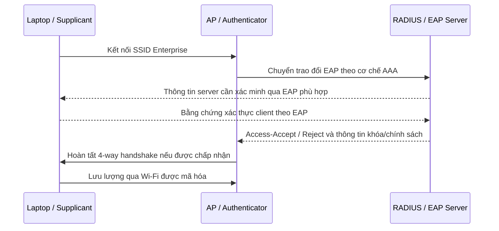
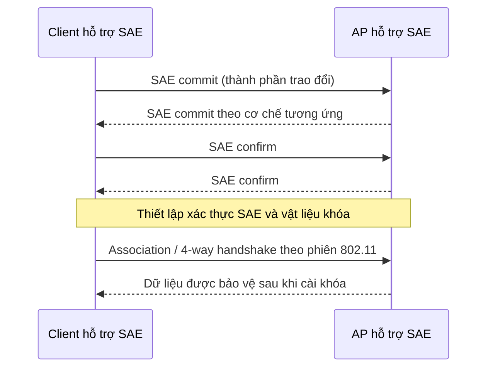
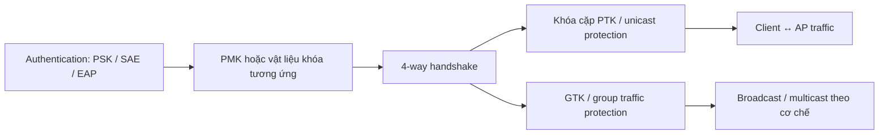
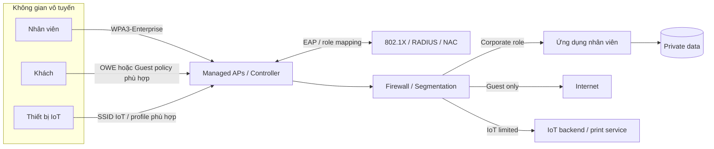

# WPA2 và WPA3: bảo vệ kết nối Wi-Fi bằng xác thực, mã hóa và phân đoạn mạng

## 1. Vì sao phải hiểu WPA2 và WPA3?

**Wi-Fi Protected Access 2 (WPA2)** và **Wi-Fi Protected Access 3 (WPA3)** là các thế hệ cơ chế bảo mật dành cho mạng Wi-Fi, quy định các phương pháp xác thực, thiết lập khóa và bảo vệ trao đổi dữ liệu qua đường vô tuyến. Chúng giúp giảm nguy cơ người ở gần bắt trộm lưu lượng, truy cập trái phép vào mạng hoặc giả mạo một số thông điệp điều khiển. Tuy nhiên, mức độ bảo vệ phụ thuộc **chế độ Personal/Enterprise, cấu hình AP và client, cách xác thực, chính sách quản trị và các lớp phòng vệ phía sau Wi-Fi**.

Hãy tưởng tượng một văn phòng có:

- SSID `Corp` phục vụ laptop nhân viên, truy cập hệ thống nội bộ.
- SSID `Guest` cho khách, chỉ dùng Internet.
- SSID `IoT` cho máy in, TV phòng họp và cảm biến.

Nếu tất cả các thiết bị đều dùng một mật khẩu Wi-Fi chia sẻ và được đưa vào cùng VLAN, một thiết bị bị lộ mật khẩu có thể có đường mạng tới nhiều tài sản khác. Nâng từ WPA2 lên WPA3 có thể cải thiện **xác thực và bảo vệ kết nối vô tuyến**, nhưng **không tự tạo ra phân đoạn Guest/IoT/Production**, không thay thế firewall, NAC, VPN/ZTNA, IDS/IPS hoặc quyền ứng dụng.

> **Nguyên lý xuyên suốt:** WPA2/WPA3 chủ yếu bảo vệ **liên kết vô tuyến giữa thiết bị và điểm truy cập**. Sau khi thiết bị đã vào mạng, **NAC, identity, VLAN/role, firewall, TLS/mTLS và application authorization** mới quyết định thiết bị được phép truy cập tài nguyên nào.

### Mục tiêu học tập

Sau bài này, người học có thể:

1. Phân biệt WPA2-Personal, WPA2-Enterprise, WPA3-Personal, WPA3-Enterprise và mạng mở dùng **Enhanced Open (OWE)**.
2. Giải thích ở mức kiến trúc **PSK, SAE, 802.1X/EAP, 4-way handshake, khóa phiên và PMF**.
3. Biết điểm mạnh, điểm yếu và giới hạn của WPA3 so với WPA2 mà không mặc định WPA3 loại bỏ mọi nguy cơ.
4. Thiết kế Wi-Fi doanh nghiệp có xác thực, phân đoạn, giám sát và tương thích thiết bị phù hợp.
5. Lập kế hoạch chuyển đổi và kiểm thử an toàn trước khi tắt WPA2 hoặc thay đổi SSID.

## 2. Những thành phần trong một kết nối Wi-Fi

| Thành phần | Chức năng | Ghi chú bảo mật |
|---|---|---|
| **Station (STA)** | laptop, điện thoại, IoT client sử dụng Wi-Fi | cần xác thực AP/chính sách, cập nhật driver và hệ điều hành |
| **Access Point (AP)** | cung cấp BSS và kết nối client vào hệ thống phân phối | có thể quản lý bởi controller/cloud; phải bảo vệ quyền cấu hình |
| **SSID** | tên mạng được quảng bá/cấu hình | tên có thể trùng với mạng khác; **không phải bằng chứng danh tính AP** |
| **BSSID** | định danh vô tuyến gắn với một BSS, thường thể hiện dưới dạng MAC | có thể bị giả mạo; không nên dùng một mình để tin AP |
| **Authentication server / RADIUS** | tiếp nhận yêu cầu xác thực 802.1X/EAP của Enterprise | phải bảo vệ kênh và xác thực danh tính server |
| **Authenticator** | AP hoặc hệ thống mạng điều khiển quyền truy cập | áp dụng quyết định EAP/802.1X, vai trò/VLAN/ACL khi hỗ trợ |
| **Controller / cloud management** | quản lý AP, policy, chứng chỉ, roaming và telemetry | là control plane quan trọng; bảo vệ MFA/RBAC và audit |
| **DHCP/DNS/IPAM** | cấp địa chỉ, phân giải tên và quản lý IP | IP được cấp **không** thay thế user/device identity |
| **Firewall / segmentation** | hạn chế luồng giữa các vùng và đến dịch vụ nội bộ | cần sau khi người dùng đã truy cập Wi-Fi thành công |

Trong chuẩn 802.11, quá trình **khám phá AP, xác thực và association ở tầng liên kết** khác với việc **xác thực danh tính người dùng hay chứng chỉ Enterprise**. Đặc biệt, các thuật ngữ “open system authentication” ở bước 802.11 không có nghĩa ứng dụng phía sau đã xác thực người dùng.

### 2.1. Các mốc của một phiên kết nối


Trên thực tế **SAE authentication** có các bước gắn với quá trình xác thực 802.11 và diễn ra trước association hoàn tất; EAP/802.1X diễn ra theo quy trình Enterprise sau bước kết nối lớp 2 phù hợp. Sơ đồ chỉ thể hiện **những giai đoạn logic**, không phải thứ tự message chi tiết giống nhau cho mọi chế độ.

## 3. WPA2-Personal: mật khẩu chung và khóa PSK

**WPA2-Personal** thường dùng cơ chế **Pre-Shared Key (PSK)**. Người quản trị cấu hình một passphrase Wi-Fi; các thiết bị được cung cấp passphrase đó dùng nó và thông tin SSID để tạo vật liệu khóa phù hợp. Với kiểu passphrase phổ biến, WPA2-PSK dùng hàm dẫn xuất khóa dựa trên PBKDF2-HMAC-SHA1 theo đặc tả để tạo PSK dài 256 bit.

Điểm quan trọng:

- **SSID và passphrase liên quan tới việc tạo PSK** theo quy trình được chuẩn hóa. Việc đổi SSID có thể khiến khóa dẫn xuất khác, nhưng không thay thế nhu cầu mật khẩu mạnh.
- Nhiều thiết bị có thể cùng biết **mật khẩu Wi-Fi dùng chung**; thu hồi quyền của một thiết bị có thể đòi hỏi đổi mật khẩu cho những thiết bị khác nếu không có cơ chế tách quyền.
- Mỗi client vẫn dùng các **khóa phiên riêng** sau quá trình thiết lập khóa thích hợp. Chia sẻ passphrase không có nghĩa mọi unicast frame của mọi client luôn được mã hóa bằng cùng một khóa phiên.
- Một người biết mật khẩu chung có thể tham gia mạng nếu các kiểm soát khác không ngăn; WPA2-PSK không tự ràng buộc quyền vào danh tính nhân viên cụ thể.

### 3.1. Điểm yếu quan trọng của passphrase yếu

Trong WPA2-Personal, dữ liệu xác thực từ quá trình bắt tay được quan sát hợp lệ có thể tạo điều kiện cho **đoán mật khẩu ngoại tuyến** nếu passphrase yếu. Điều này khác với việc phải thử mỗi ứng viên bằng cách đăng nhập lại với AP.

Vì thế, **mật khẩu dài, ngẫu nhiên và không tái sử dụng** rất quan trọng. Không dùng tên công ty, số điện thoại, địa chỉ hay một mẫu dễ đoán làm mật khẩu Wi-Fi; đổi mật khẩu khi có căn cứ bị lộ, thiết bị ngoài ý muốn được cấp quyền hoặc khi lifecycle yêu cầu.

Không nên suy luận rằng việc dùng WPA2-Personal đồng nghĩa một mạng đã bị xâm nhập: với cấu hình và mật khẩu tốt, WPA2-CCMP vẫn là cơ chế bảo vệ được sử dụng rộng rãi cho nhiều môi trường. Quyết định nâng cấp phải xem **mức rủi ro, hỗ trợ WPA3 của thiết bị và phương án chuyển đổi**.

### 3.2. PSK và identity

Với một SSID chung, bản thân việc biết passphrase **không chứng minh**:

- Thiết bị thuộc tổ chức.
- Người dùng đang sử dụng thiết bị là nhân viên hợp lệ.
- Thiết bị đạt yêu cầu MDM/EDR/patch.
- Người dùng có quyền truy cập database, intranet hoặc quản trị hệ thống.

Đó là lý do mạng doanh nghiệp nhạy cảm thường dùng **WPA2/WPA3-Enterprise với 802.1X**, phân đoạn và định danh thiết bị/người dùng; hoặc bổ sung cơ chế identity-aware ở lớp truy cập nếu không thể triển khai Enterprise đồng loạt.

## 4. WPA2-Enterprise: 802.1X, EAP và danh tính riêng

**WPA2-Enterprise** dùng khung **IEEE 802.1X** kết hợp các phương thức **EAP** và thường có **RADIUS** để xác thực thiết bị/người dùng theo chính sách tổ chức. Thay vì một mật khẩu Wi-Fi chung cho toàn SSID, thiết bị có thể sử dụng chứng chỉ hoặc credential cá nhân tùy phương thức EAP được chọn.

Các vai trò:

1. **Supplicant:** phần mềm 802.1X trên laptop hoặc thiết bị.
2. **Authenticator:** AP/controller hoặc thiết bị mạng điều khiển kết nối.
3. **Authentication server:** hệ thống RADIUS/EAP xác minh credential và trả quyết định.



Sơ đồ chỉ thể hiện quan hệ logic: EAP được encapsulate qua AP/RADIUS, không phải client có đường IP trực tiếp tới RADIUS trong mọi giai đoạn. Các bước thực tế phụ thuộc **EAP method, hệ điều hành, cách cấu hình 802.1X và AAA deployment**.

### 4.1. EAP-TLS và kiểm tra certificate

**EAP-TLS** sử dụng TLS và chứng chỉ theo cấu hình; với mô hình xác thực lẫn nhau phổ biến, cả server và client được xác minh bằng chứng chỉ số. Điều này giúp giảm phụ thuộc vào mật khẩu Wi-Fi chia sẻ, nhưng hiệu lực bảo mật yêu cầu:

- Cài **CA/trust anchors** được phép và ràng buộc **danh tính máy chủ EAP/RADIUS được mong đợi**.
- Không khuyến khích người dùng chọn “accept any certificate” hoặc tắt kiểm tra chứng chỉ server.
- Cấp, lưu, xoay vòng, thu hồi certificate và private key theo vòng đời thiết bị.
- Dùng MDM/PKI hoặc enrollment được kiểm soát để tránh sao chép credential sang thiết bị không phù hợp.
- Thiết kế các nhóm quyền theo user/device và posture, không chỉ “certificate còn hạn”.

Các phương thức dựa trên password bên trong tunnel EAP, như một số cấu hình PEAP, có những đặc tính/rủi ro khác với EAP-TLS và cần review riêng. **Mọi cấu hình mang nhãn “Enterprise” không tự động có mức xác thực, chống phishing và khả năng quản lý khóa như nhau.**

### 4.2. RADIUS không thay thế application authorization

RADIUS có thể trả kết quả xác thực và một số thuộc tính role/VLAN/ACL theo cơ chế hỗ trợ. Sau khi client được vào VLAN nhân viên, ứng dụng vẫn phải xác thực/ủy quyền các thao tác cụ thể.

Một nhân viên đã xác thực EAP-TLS không mặc nhiên có quyền vào database Production. Thiết kế nên kết hợp **dynamic VLAN/role, firewall, VPN/ZTNA, ứng dụng IdP và audit**.

### 4.3. Bảo vệ kênh AAA và private infrastructure

802.1X/EAP không đồng nghĩa mọi thông điệp giữa AP và RADIUS được mã hóa end-to-end bởi RADIUS truyền thống. Phải xét **network segmentation giữa thiết bị xác thực và AAA**, secret/chính sách RADIUS, khả năng sử dụng **RADIUS over TLS (RadSec)** nếu được hỗ trợ, HA, nguồn thời gian và giám sát sự kiện thất bại.

Nếu AAA không khả dụng, tổ chức phải quyết định **fail-open/fail-closed hoặc VLAN hạn chế** theo yêu cầu kinh doanh; không nên vô điều kiện cấp quyền mạng nội bộ nhạy cảm cho client chưa xác thực.

## 5. WPA3-Personal: SAE thay PSK handshake truyền thống

**WPA3-Personal** thay cơ chế xác thực dựa trên PSK kiểu WPA2-Personal bằng **Simultaneous Authentication of Equals (SAE)**, một cơ chế trao đổi khóa có xác thực bằng mật khẩu theo họ **Password-Authenticated Key Exchange (PAKE)**.

Hai thiết bị biết cùng một mật khẩu dùng SAE để chứng minh khả năng sở hữu bí mật và tạo vật liệu khóa phiên, mà không cần truyền trực tiếp mật khẩu qua sóng vô tuyến. Thiết kế SAE giúp giảm khả năng **đoán mật khẩu ngoại tuyến chỉ từ một bản ghi bắt tay** so với WPA2-PSK, và hỗ trợ **forward secrecy** của vật liệu khóa phiên theo giả định và cách triển khai phù hợp.

### 5.1. So sánh cốt lõi PSK và SAE

| Tiêu chí | WPA2-Personal / PSK | WPA3-Personal / SAE |
|---|---|---|
| Cách dựa vào mật khẩu | PSK dẫn xuất từ passphrase/SSID hoặc cấu hình trực tiếp theo chuẩn | mật khẩu được dùng trong trao đổi SAE có xác thực |
| Nguy cơ đoán mật khẩu ngoại tuyến từ trao đổi bắt tay | là mối lo khi passphrase yếu | giảm đáng kể loại nguy cơ này trong SAE đúng triển khai |
| Forward secrecy | không có cùng thuộc tính như SAE đối với PSK lâu dài bị tiết lộ | SAE được thiết kế cung cấp forward secrecy của phiên |
| Một mật khẩu dùng chung | có thể có | **vẫn có thể có**; SAE không tự cấp identity từng người |
| Thiết bị cũ | hỗ trợ rộng | cần client/AP có hỗ trợ WPA3-SAE |
| PMF | có thể hỗ trợ hoặc được yêu cầu theo cấu hình/chứng nhận cụ thể | **bắt buộc trong chế độ WPA3-Personal** |
| Chất lượng mật khẩu | rất quan trọng | vẫn rất quan trọng, đặc biệt với chia sẻ/lộ mật khẩu |

**Không kết luận “SAE cho phép đặt mật khẩu yếu”.** Dù trao đổi SAE khắc phục một số hạn chế của PSK, mật khẩu dễ đoán hoặc bị chia sẻ vẫn ảnh hưởng tới an ninh truy cập. Một người **biết mật khẩu** có thể là thành viên hợp lệ ở tầng Wi-Fi, trừ khi chính sách cấp quyền có thêm lớp xác thực.

### 5.2. SAE không phải xác thực thiết bị bằng certificate

WPA3-Personal mặc định vẫn dựa trên **mật khẩu**. Nó không tự:

- Cấp một định danh không thể giả mạo cho từng người.
- Chứng minh thiết bị được quản lý và đáp ứng compliance.
- Cấp/tước quyền theo user khi tất cả dùng cùng mật khẩu.
- Thay thế 802.1X/EAP-TLS ở môi trường đòi hỏi identity riêng.

Các triển khai có thể bổ sung **mật khẩu riêng theo thiết bị/người dùng** (*PPSK/DPSK*, khả năng phụ thuộc nhà cung cấp), DPP/SAE-PK hoặc các chính sách khác, nhưng phải đánh giá **tính năng thật và bằng chứng xác thực**, không suy từ nhãn WPA3.

## 6. SAE hoạt động theo ý tưởng nào?

Không cần nắm các phép toán elliptic-curve chi tiết để thiết kế kiến trúc Wi-Fi; cần hiểu **vật liệu khóa phiên không đơn giản là bản sao cố định của mật khẩu**.

Ở mức khái niệm:



Thứ tự chi tiết của các frame có thể khác theo state machine, anti-clogging token, tính năng H2E/SAE-PK và triển khai thực tế; **không dùng sơ đồ để tự xây một implementation mật mã**.

### 6.1. Tại sao SAE giúp chống offline dictionary attack?

Với WPA2-PSK, một transcript bắt tay được quan sát có thể cung cấp dữ liệu để kiểm tra ứng viên mật khẩu **không cần tiếp tục tương tác với AP**. SAE được thiết kế sao cho transcript của một phiên được ghi lại **không cung cấp cùng phép kiểm tra độc lập cho từng ứng viên mật khẩu**. Điều này cải thiện bảo vệ khi các phương án khác bằng nhau.

Tuy vậy, các nguy cơ khác vẫn tồn tại:

- Người dùng tự tiết lộ mật khẩu hoặc đặt mật khẩu yếu.
- Thiết bị bị nhiễm mã độc làm lộ credential trước/sau khi kết nối.
- Cấu hình chuyển tiếp cho phép client rơi về WPA2-PSK.
- Implementations có lỗi xử lý thuật toán/side-channel, cần vá firmware/driver.
- Dịch vụ và ứng dụng phía sau Wi-Fi có lỗ hổng khác.

### 6.2. SAE H2E và cập nhật thiết bị

**Hash-to-Element (H2E)** là một phương pháp tạo phần tử liên quan mật khẩu trong SAE được chuẩn hóa để cải thiện tính chất triển khai, trong đó có các lưu ý về an toàn xử lý bí mật so với một số cách cũ. Mức hỗ trợ/tính bắt buộc khác nhau giữa chương trình chứng nhận, băng tần, phiên bản AP/client và cấu hình.

Khi lựa chọn thiết bị, ưu tiên **firmware được duy trì**, khả năng cập nhật, tương thích WPA3-SAE và các cải tiến SAE mà sản phẩm hỗ trợ; kiểm tra tương thích thực tế trước khi bắt buộc một chế độ cụ thể cho toàn mạng.

## 7. 4-way handshake, PMK, PTK và GTK: khóa nào bảo vệ gì?

Sau giai đoạn xác thực và có vật liệu khóa ban đầu, một cơ chế thiết lập khóa như **4-way handshake** giúp AP và client chứng minh họ sở hữu **Pairwise Master Key (PMK)** tương ứng và dẫn xuất/cài khóa dành cho lưu lượng dữ liệu.

### 7.1. Các thuật ngữ cơ bản

| Thuật ngữ | Vai trò khái niệm | Điều cần nhớ |
|---|---|---|
| **PMK** | vật liệu khóa cấp cao dùng làm đầu vào cho quy trình bắt tay | nguồn PMK khác nhau giữa PSK, SAE và 802.1X/EAP |
| **PTK** | bộ khóa cặp cho một liên kết/phiên tương ứng | hỗ trợ bảo vệ lưu lượng unicast phù hợp |
| **GTK** | khóa nhóm dùng cho broadcast/multicast theo cơ chế được hỗ trợ | AP quản lý/cập nhật; không giống PTK của một client |
| **Nonce** | giá trị dùng một lần trong quá trình thiết lập khóa | tính duy nhất và xử lý đúng giúp chống tái sử dụng không phù hợp |
| **EAPOL-Key frames** | trao đổi điều khiển thiết lập khóa | phải xác minh tính toàn vẹn và trạng thái đúng |
| **Replay counter / packet number** | giúp nhận diện tái phát hoặc lỗi thứ tự trong phạm vi bảo vệ | phải được implementation xử lý chính xác |

Lưu ý: các chi tiết cấu trúc PTK/GTK, thứ tự message và thuật toán khác nhau theo cipher suite, phiên bản chuẩn và tính năng roaming.

### 7.2. Sơ đồ khái niệm



WPA2 và WPA3 đều có **giai đoạn thiết lập khóa dữ liệu**; khác biệt quan trọng ở cơ chế **xác thực/thiết lập PMK** của các profile, suite bắt buộc, quản lý frame và khả năng bảo mật khác.

### 7.3. Vì sao bản vá client/AP quan trọng?

Các sự cố lịch sử như **KRACK (key reinstallation)** cho thấy lỗi **triển khai state machine/khóa** có thể làm suy yếu bảo vệ ngay cả khi thuật toán mã hóa cơ bản vẫn mạnh. Do đó:

- Cập nhật AP firmware, controller, Wi-Fi driver và OS.
- Theo dõi thông báo bảo mật theo model/chipset/phiên bản.
- Kiểm thử roaming, reconnect, sleep/wake và chuyển băng tần sau cập nhật.
- Không tuyên bố cấu hình “WPA2 AES” hoặc “WPA3 SAE” tự chứng minh mọi client không có lỗi triển khai.

## 8. Mã hóa dữ liệu: CCMP, GCMP và các lựa chọn cũ

WPA2/WPA3 là **bộ profile bảo mật**, không phải một thuật toán duy nhất. Trong đường dữ liệu Wi-Fi:

- **CCMP** sử dụng AES theo chế độ phù hợp để bảo vệ tính bí mật/toàn vẹn frame; cấu hình **WPA2-AES/CCMP** là lựa chọn nền tảng quen thuộc cho WPA2.
- **GCMP** là một cipher suite khác dựa trên AES-GCM, được dùng theo profile/năng lực thiết bị.
- **TKIP** gắn với chế độ cũ, không phù hợp mục tiêu bảo vệ hiện đại; cần loại bỏ thay vì giữ để “tương thích” nếu không có lý do kiểm soát rất đặc biệt.
- **WEP** là cơ chế lỗi thời, không nên vận hành trên mạng tin cậy.

### 8.1. Không nhầm “AES” với toàn bộ bảo mật Wi-Fi

Một AP có thể hiển thị tên tùy theo nhà cung cấp như “WPA2-PSK AES”, “WPA2/WPA3-Personal”, “WPA3-SAE”, “WPA3-Enterprise 192-bit”. Nhãn giao diện **không cho biết đầy đủ**:

1. Có cho phép fallback sang WPA2/PSK không?
2. PMF là required/optional/disabled đối với từng nhóm client?
3. Chế độ Enterprise dùng phương pháp EAP nào và client có xác minh server certificate không?
4. Có hỗ trợ 6 GHz, H2E, 802.11r và cipher phù hợp không?
5. Các thiết bị thực sự **thương lượng AKM/cipher nào** khi kết nối?

Đánh giá chính sách cần đọc thông tin **negotiated security** tại AP/controller và log client, không chỉ tên của SSID.

## 9. PMF (802.11w) bảo vệ quản lý phiên ở mức nào?

**Protected Management Frames (PMF)**, liên quan đến **IEEE 802.11w**, bảo vệ **một tập các robust management frames** sau khi có cơ sở khóa phù hợp, nhằm giảm khả năng giả mạo/hủy kết nối thông qua những frame đã được bảo vệ.

Trong vận hành, PMF có các trạng thái thường được nhà cung cấp trình bày:

- **Disabled:** không yêu cầu cơ chế PMF ở cấu hình đó.
- **Capable / Optional:** AP hỗ trợ nhưng một số client có thể kết nối mà không dùng PMF.
- **Required:** client phải hỗ trợ PMF để tham gia profile/SSID đó.

**WPA3 yêu cầu PMF** trong profile bảo mật WPA3 tương ứng. Với WPA2, PMF có thể được hỗ trợ và có thể yêu cầu theo chính sách/khả năng thiết bị, nhưng nhiều triển khai cũ không bắt buộc.

### 9.1. PMF không bảo vệ mọi frame vô tuyến

PMF **không mã hóa mọi beacon, probe, thông điệp tìm mạng hoặc quản lý trước association**. Nó cũng không chặn tuyệt đối:

- Gây nhiễu sóng RF hoặc bão hòa kênh.
- AP giả mạo ở giai đoạn client còn đang tìm mạng.
- Lỗi firmware/driver và tấn công vào hệ thống quản trị.
- Người dùng tự kết nối mạng giả và nhập credential vào trang phishing.

Chính sách bảo mật không nên quảng bá PMF như giải pháp “chống mọi deauthentication/DoS”. Cần dùng **WIDS/WIPS, RF monitoring và quy trình xác minh AP** để bổ sung phát hiện.

### 9.2. Bài toán tương thích

Khi bật **PMF required** trên SSID cũ, những thiết bị không hỗ trợ có thể **không kết nối được**. Doanh nghiệp cần kiểm kê model/driver, cập nhật firmware, thử nghiệm trước và cân nhắc tách SSID Legacy/IoT vào vùng ít quyền thay vì hạ yêu cầu của mạng doanh nghiệp chính.

## 10. WPA3-Enterprise và chế độ 192-bit

**WPA3-Enterprise** tiếp tục dựa trên **802.1X/EAP** và các cơ chế thiết lập khóa, không phải “SAE cho mọi Enterprise”. Thiết kế hướng tới xác thực bằng danh tính và quản trị chính sách tập trung, phù hợp các môi trường cần kiểm soát truy cập người dùng/thiết bị.

**WPA3-Enterprise 192-bit security mode** là một profile bảo mật mạnh hơn, đặt yêu cầu bộ thuật toán, kích thước khóa và cách sử dụng EAP/cipher suite theo chương trình chứng nhận tương ứng. Nó **không đồng nghĩa mọi mạng WPA3-Enterprise tự hoạt động ở mức bảo mật 192 bit**.

| Profile | Phương thức nhận dạng chính | Trường hợp phù hợp |
|---|---|---|
| WPA2-Enterprise | 802.1X/EAP theo phương thức tổ chức chọn | mạng doanh nghiệp có client cũ nhưng được quản trị an toàn |
| WPA3-Enterprise tiêu chuẩn | 802.1X/EAP với những yêu cầu WPA3 liên quan | doanh nghiệp có thiết bị và AP hỗ trợ đầy đủ |
| WPA3-Enterprise 192-bit | 802.1X/EAP và bộ mật mã/phương thức đáp ứng profile 192-bit | môi trường yêu cầu mức mật mã/chính sách cao, thiết bị đồng bộ |

### 10.1. Điều kiện triển khai thực tế

Trước khi chọn 192-bit mode, phải kiểm tra:

- AP/controller và **toàn bộ loại client** có hỗ trợ profile/cipher tương ứng không.
- Hệ thống PKI, chứng chỉ, CA, EAP/TLS, RADIUS và phần mềm supplicant có đáp ứng bộ mật mã bắt buộc không.
- Năng lực roaming, troubleshooting, lifecycle certificate và tính sẵn sàng của AAA.
- Yêu cầu pháp lý/quy định hoặc tiêu chuẩn nội bộ có thật sự cần profile này không.
- Kế hoạch thay thế thiết bị cũ và tránh tạo mạng “khẩn cấp” có kiểm soát yếu.

**Tên WPA3-Enterprise không đủ chứng minh một triển khai đạt 192-bit mode**; phải xác minh negotiated settings và tài liệu kỹ thuật/chứng nhận của sản phẩm.

## 11. Bảng so sánh tổng thể WPA2 và WPA3

| Nội dung | WPA2-Personal | WPA3-Personal | WPA2-Enterprise | WPA3-Enterprise |
|---|---|---|---|---|
| Xác thực phổ biến | PSK | SAE | 802.1X/EAP | 802.1X/EAP |
| Mật khẩu chung | thường có | có thể có | không bắt buộc, tùy EAP | không bắt buộc, tùy EAP |
| Kháng offline dictionary từ handshake Personal | hạn chế khi passphrase yếu | mạnh hơn nhờ SAE | không đánh giá như PSK Personal | không đánh giá như PSK Personal |
| PMF | hỗ trợ tùy profile/cấu hình | bắt buộc với WPA3 | tùy yêu cầu/cấu hình | yêu cầu của profile WPA3 |
| Danh tính riêng cho user/device | không tự có | không tự có | có thể thông qua EAP | có thể thông qua EAP |
| Cipher suite và mức bảo vệ | CCMP là lựa chọn nền tảng; tránh TKIP | theo bộ suite WPA3 được hỗ trợ | phụ thuộc cấu hình/certification | có thể dùng profile 192-bit riêng |
| Thiết bị legacy | hỗ trợ rộng | cần client WPA3 | cần client 802.1X phù hợp | cần client hỗ trợ WPA3 Enterprise |
| Thu hồi một người | thường đổi shared secret hoặc tách PPSK | tương tự nếu shared password | thu hồi account/cert theo policy | thu hồi account/cert theo policy |
| Phân đoạn tài nguyên phía sau | cần thêm VLAN/firewall/NAC | cần thêm VLAN/firewall/NAC | gán role/VLAN và firewall theo policy | tương tự, có thể dùng posture/identity |

**Lựa chọn triển khai:** với thiết bị quản lý tập trung và hạ tầng phù hợp, nên ưu tiên **WPA3-Enterprise với EAP-TLS được cấu hình đúng** cho môi trường nhạy cảm; với mạng gia đình/nhỏ, **WPA3-Personal/SAE** thường là hướng nâng cấp phù hợp. Khi còn thiết bị legacy, có thể dùng **WPA2-AES/CCMP + cấu hình tốt và mạng hạn chế riêng** trong giai đoạn chuyển đổi có kiểm soát.

Không có profile Wi-Fi nào tự bảo vệ ứng dụng khỏi SQL injection, lộ token, lỗi authorization hay malware trên client.

## 12. WPA2/WPA3 Transition Mode: lợi ích và đánh đổi

Để hỗ trợ thiết bị cũ, một số AP cho phép **WPA2/WPA3-Personal transition mode**, cùng SSID chấp nhận cả **PSK** và **SAE** theo những tùy chọn mà client/AP có thể thương lượng.

### 12.1. Vì sao hữu ích?

- Cho thiết bị mới kết nối bằng SAE trong khi thiết bị cũ còn dùng PSK.
- Giảm gián đoạn đột ngột khi thay toàn bộ fleet thiết bị.
- Có thể tổ chức migration từng đợt mà không phải đổi tên SSID ngay lập tức.

### 12.2. Giới hạn bảo mật

Một SSID transition không đảm bảo **mọi client** đang dùng WPA3. Thiết bị cũ vẫn có thể chọn WPA2; client mới có thể rơi về chế độ khác tùy cấu hình, hành vi lựa chọn mạng và hỗ trợ bảo vệ downgrade của thiết bị.

Ngoài ra, khi **cùng mật khẩu** được dùng cho cả hai cơ chế, sự hiện diện của WPA2-PSK có thể giữ lại **bề mặt đoán mật khẩu ngoại tuyến tương ứng với các phiên WPA2**, làm mất một phần lợi ích SAE trên mạng hỗn hợp.

**Không tuyên bố transition mode tương đương WPA3-only.** Cần theo dõi client thực kết nối theo AKM/cipher, xem PMF của từng client và có ngày kết thúc chuyển đổi.

### 12.3. Phương án tốt hơn với legacy IoT

Nếu thiết bị IoT không hỗ trợ WPA3/PMF và chưa thể thay, có thể:

1. Dùng SSID riêng cho legacy/IoT theo **WPA2-CCMP** với passphrase mạnh hoặc cơ chế cấp secret riêng nếu sản phẩm hỗ trợ.
2. Đưa thiết bị vào VLAN/role giới hạn; chỉ cho kết nối tới dịch vụ thực cần.
3. Chặn lateral movement không cần thiết và giảm egress ra Internet.
4. Đánh dấu owner, risk acceptance và thời điểm thay thế thiết bị.
5. Giữ SSID doanh nghiệp chính ở WPA3-only/Enterprise nếu khả thi.

Không để yêu cầu của một thiết bị cũ kéo **toàn bộ mạng nhân viên** xuống chế độ bảo vệ thấp hơn.

## 13. Wi-Fi 6 GHz, Wi-Fi 6E/7 và Enhanced Open

Với **Wi-Fi 6E và các triển khai Wi-Fi dùng băng 6 GHz** theo chương trình chứng nhận liên quan, yêu cầu bảo mật thường chặt hơn các băng tần cũ: sử dụng **WPA3 hoặc Enhanced Open (OWE)** và PMF theo profile; **WPA2/WPA3 transition mode không dùng cho hoạt động 6 GHz** theo yêu cầu phù hợp.

Đây là khác biệt về **profile bảo mật trên băng tần**, không phải chỉ về tốc độ Wi-Fi. Phải kiểm tra thiết bị/AP, yêu cầu quốc gia/regulatory domain, chương trình chứng nhận, phiên bản firmware và những chế độ thực hỗ trợ.

### 13.1. Enhanced Open — OWE là gì?

**Opportunistic Wireless Encryption (OWE)**, gắn với **Enhanced Open**, cung cấp **mã hóa dữ liệu ở liên kết Wi-Fi mà không cần mật khẩu dùng chung** trong mô hình mạng mở hỗ trợ. OWE có thể giúp giảm khả năng người nghe thụ động trên sóng vô tuyến đọc lưu lượng của một phiên.

Nhưng OWE **không xác thực danh tính của AP giống Enterprise/EAP-TLS**, và không chứng minh rằng mạng public thuộc khách sạn/công ty nào. Nó **không tự ngăn evil twin** hoặc phishing qua captive portal; client vẫn cần HTTPS/TLS đúng, cảnh giác với mạng không tin cậy và chính sách VPN/ZTNA khi phù hợp.

| Chế độ | Mã hóa link Wi-Fi | Xác thực danh tính mạng/người dùng | Ghi chú |
|---|---|---|---|
| Open truyền thống | không có bảo vệ link tương ứng | không qua WPA | cần HTTPS/TLS; dữ liệu không được mã hóa có thể lộ ở link |
| OWE / Enhanced Open | có mã hóa link theo OWE | không phải xác thực Enterprise và không dựa mật khẩu chung | bảo vệ khỏi một số nghe lén thụ động, vẫn cần xác minh mạng |
| WPA3-Personal / SAE | có | dựa trên mật khẩu SAE | không định danh từng user nếu dùng shared password |
| WPA3-Enterprise | có | dựa trên EAP/802.1X | phù hợp mạng quản trị tập trung |

### 13.2. Captive portal không thay WPA

Captive portal chủ yếu phục vụ **chấp nhận điều khoản, truy cập khách hoặc bước xác thực ở tầng ứng dụng**. Một mạng Wi-Fi “open + trang đăng nhập” không mặc nhiên mã hóa lưu lượng link 802.11 trước khi portal hoàn tất, trừ khi có cơ chế như OWE hoặc lớp bảo vệ khác.

Portal còn có thể bị giả mạo; người dùng không nên nhập thông tin đăng nhập doanh nghiệp vào trang không xác minh được nguồn gốc.

## 14. Các rủi ro vẫn tồn tại với WPA2 và WPA3

| Nhóm rủi ro | Tác động tiềm năng | Điểm phòng vệ cần có |
|---|---|---|
| **Evil twin / rogue AP** | client kết nối tới AP không được tổ chức quản lý, bị lừa cung cấp dữ liệu | kiểm tra server identity ở Enterprise, WIDS/WIPS, thiết lập profile SSID an toàn |
| **Phishing qua captive portal** | người dùng nhập credential vào trang giả | giáo dục, MFA, TLS, không tin portal không rõ nguồn |
| **Shared password leakage** | đối tượng ngoài ý muốn tham gia SSID Personal | password mạnh, vòng đời secret, tách user/device khi có thể |
| **WPA2-PSK offline guessing** | passphrase yếu bị phơi lộ nếu transcript được quan sát | nâng lên SAE khi có thể, mật khẩu tốt, loại bỏ transition sau migration |
| **SAE implementation flaws** | side-channel/logic/cấu hình sai có thể giảm bảo vệ | cập nhật firmware/driver và cấu hình SAE hiện đại được hỗ trợ |
| **Management-frame spoofing** | gián đoạn một số phiên hoặc gây nhiễu truy cập | PMF, kiểm thử kết nối, RF/WIDS; không thể ngăn mọi jamming |
| **Rogue DHCP/ARP spoofing ở LAN** | định tuyến hoặc địa chỉ sai trong vùng kết nối | DHCP Snooping, DAI, NAC, phân đoạn; WPA không thay thế |
| **Lateral movement** | một thiết bị đã kết nối có thể truy cập thiết bị khác | firewall, client isolation phù hợp, role/VLAN/microsegmentation |
| **Compromised user/device** | quyền hợp lệ bị sử dụng sai | EDR/MDM, MFA ở ứng dụng, least privilege và SIEM |
| **RF jamming/interference** | giảm availability dù mã hóa mạnh | quy hoạch RF, giám sát kênh, dự phòng và ứng phó hiện trường |
| **Unauthorized AP configuration change** | chuyển sang WPA2/TKIP hoặc mở SSID ngoài ý muốn | RBAC/MFA, audit control plane, configuration drift monitoring |

### 14.1. Evil twin và kiểm tra danh tính AP

Một AP giả có thể quảng bá **SSID trùng tên**. SSID và BSSID nhìn thấy bằng sóng vô tuyến không phải chứng cứ mật mã rằng AP thuộc tổ chức. Trong Enterprise, cơ chế bảo vệ quan trọng là **supplicant xác minh danh tính authentication server và certificate chain** đúng policy. Nếu người dùng được phép bỏ qua cảnh báo certificate, mô hình xác thực có thể bị suy yếu.

Trong Personal, client tin vào mật khẩu chia sẻ; SAE giúp bảo vệ quá trình xác thực theo thiết kế nhưng **không tự cấp danh tính tổ chức của AP theo tên miền hay chứng chỉ**. Cần quản lý profile mạng, đào tạo người dùng và giám sát AP trái phép.

### 14.2. Không nhầm deauthentication với mọi kiểu DoS

PMF bảo vệ robust management frames trong những điều kiện đã thương lượng, nhưng **không thể ngăn gây nhiễu vật lý ở radio frequency, nhiễu kênh, mất điện AP hoặc nghẽn Internet uplink**. Phòng vệ availability còn cần phân tích RF, năng lực AP/controller, ISP, QoS, giám sát và kế hoạch xử lý sự cố.

## 15. Thiết kế Wi-Fi doanh nghiệp: từ SSID tới phân đoạn và danh tính

Một mạng có cấu hình mật mã tốt vẫn có thể **mở quá rộng quyền nội bộ**. Thiết kế nên bắt đầu từ **trust boundary** và tài sản:



**Quan trọng:** sơ đồ là **thiết kế logic**, không có nghĩa một AP tự động tạo ba đường vật lý tách biệt. Cấu hình thực tế có thể dùng VLAN, dynamic ACL, tunneling tới controller, SDN hoặc gateway firewall. Cần xác minh nơi traffic **đi qua và được thực thi chính sách**.

### 15.1. Mạng nhân viên

Nên cân nhắc **WPA3-Enterprise**, EAP-TLS, PMF theo profile, MDM, NAC role và per-user/device policy nếu thiết bị hỗ trợ. Các ứng dụng nhạy cảm vẫn yêu cầu **IdP/MFA và AuthZ**. Mạng điều khiển AP/controller/RADIUS nên được quản trị qua đường riêng có least privilege.

### 15.2. Mạng khách

Đưa khách vào vùng chỉ có quyền tối thiểu để truy cập Internet và các dịch vụ khách được cho phép. **Client isolation** trên AP có thể giảm một số kết nối trực tiếp client↔client nhưng không tự chặn mọi đường đến subnet nội bộ nếu routing/firewall sai. Cần kiểm tra IPv4/IPv6, DNS, captive portal, quảng bá dịch vụ và local breakout.

OWE/Enhanced Open hoặc profile WPA phù hợp có thể tăng bảo vệ link; **không dùng mật khẩu guest như bằng chứng một người là nhân viên**.

### 15.3. Mạng IoT

Thiết bị IoT/OT có khả năng WPA3 và 802.1X không đồng nhất; có thể cần SSID riêng. Với nhóm legacy:

- Dùng **WPA2-CCMP** khi còn được phép và thiết bị chưa hỗ trợ SAE.
- Cân nhắc per-device PSK/MAB như cơ chế bổ sung nhưng hiểu điểm yếu của MAC identity.
- Chỉ cho egress tới controller, broker, DNS/NTP hoặc cloud endpoints có owner và mục đích rõ.
- Chặn lateral movement, quản lý firmware và rà soát vòng đời thay thế.
- Không dùng chung credential IoT với mạng nhân viên hoặc quyền quản trị.

### 15.4. Kết nối vào mạng không phải quyền vào Production

Dù client được chứng minh bằng EAP-TLS, một device certificate **không tự cấp** quyền đọc database. Network access được xác thực là **điều kiện đầu vào**; các tài nguyên nhạy cảm vẫn áp dụng **firewall, ZTNA, mTLS, application RBAC/ABAC và audit**.

## 16. WPA2/WPA3 và các lớp bảo mật mạng khác

| Lớp bảo vệ | Phạm vi | Vì sao vẫn cần sau WPA3? |
|---|---|---|
| **WPA2/WPA3** | xác thực/link encryption và bảo vệ một số frame 802.11 | không cấp quyền nghiệp vụ hay bảo vệ toàn tuyến Internet |
| **802.1X/NAC** | danh tính thiết bị/user và policy truy cập mạng | tách được role/người dùng, posture và vòng đời credential |
| **DHCP/IPAM** | cấp IP/lease, quản lý subnet và lịch sử | IP có thể đổi, tái cấp hoặc chia sẻ; không là identity duy nhất |
| **Firewall/segmentation** | cho phép/chặn luồng giữa zone/VLAN/host | ngăn Guest/IoT tới tài nguyên không cần dù đã vào SSID |
| **DNS security** | kiểm soát phân giải tên, DNS logging, chống domain độc hại | client Wi-Fi được mã hóa vẫn có thể truy vấn domain nguy hiểm |
| **VPN/ZTNA** | xác thực/ủy quyền truy cập ứng dụng hoặc đường từ xa | thêm ngữ cảnh và bảo vệ vượt khỏi liên kết AP↔client |
| **TLS/mTLS** | bảo mật kết nối ứng dụng/service qua nhiều hop | WPA bảo vệ **một liên kết vô tuyến**, không đảm bảo toàn bộ đường ứng dụng |
| **WAF** | kiểm tra HTTP ở điểm phù hợp | ứng dụng Wi-Fi vẫn có thể gặp SQLi, XSS và abuse API |
| **IDS/IPS/WIDS/WIPS** | phát hiện/thực thi theo mạng và RF | phát hiện AP trái phép, kết nối bất thường, xâm nhập sau khi có Wi-Fi |
| **EDR/MDM** | tình trạng endpoint, phát hiện process/malware | WPA3 không ngăn malware chạy trên một laptop có credential hợp lệ |

**Wi-Fi security là phòng vệ nhiều lớp.** Không nên chỉ đổi tên SSID thành “Corp-WPA3” rồi coi mạng đạt Zero Trust.

## 17. Onboarding và quản trị credential Wi-Fi

### 17.1. Với Personal

Nên:

1. Tạo passphrase **dài và khó đoán**, tránh dùng lại với tài khoản ứng dụng.
2. Phân phối credential qua kênh nội bộ phù hợp; không đặt trên bảng công khai cho mạng có quyền cao.
3. Tách khách/IoT/nhân viên thay vì dùng một mật khẩu cho toàn bộ.
4. Khi có sự cố lộ password, đánh giá phạm vi, đổi credential có kế hoạch và kiểm tra các client chưa cập nhật.
5. Với sản phẩm hỗ trợ, đánh giá **per-device/per-user PSK** để thu hồi hẹp hơn; xác minh thật sự cơ chế phân tách quyền và khả năng tự động hóa.

### 17.2. Với Enterprise

Nên:

- Dùng hệ thống cấp phát certificate có kiểm soát (MDM/PKI), profile EAP được quản lý.
- Bắt buộc client **xác minh tên máy chủ EAP và CA hợp lệ**.
- Không để người dùng tự bấm bỏ qua lỗi certificate; có quy trình hỗ trợ khi cert đổi.
- Gắn chứng chỉ và danh tính với owner, expiry, revocation/offboarding.
- Audit RADIUS events, role/VLAN assignment và thay đổi policy.
- Kiểm tra xử lý khi user rời tổ chức hoặc device mất quyền, không chỉ đổi IP.

### 17.3. Wi-Fi Easy Connect / DPP và WPS

**Device Provisioning Protocol (DPP)**, thường được giới thiệu trong hệ sinh thái Wi-Fi Easy Connect, hỗ trợ quy trình onboarding thiết bị theo cơ chế được chuẩn hóa. Mức triển khai khác nhau theo OS, chipset và AP.

**WPS PIN** và một số cách onboarding cũ có bề mặt rủi ro riêng; nên **vô hiệu hóa WPS PIN khi không cần** và chọn phương án provisioning an toàn được sản phẩm hỗ trợ. Không khẳng định mọi thiết bị mang nhãn WPA3 đều hỗ trợ một quy trình DPP giống nhau.

## 18. Roaming, 802.11r và sự cân bằng bảo mật – trải nghiệm

Người dùng chuyển giữa các AP trong văn phòng có thể yêu cầu **roaming nhanh** để cuộc gọi và ứng dụng không bị đứt. Cơ chế như **802.11r Fast BSS Transition (FT)** có thể tối ưu quá trình chuyển AP theo cấu hình và năng lực client.

Nhưng việc sử dụng FT cần xem:

- AP và client hỗ trợ **đúng kết hợp FT với WPA2/WPA3/Enterprise/PMF** không?
- Vùng mobility domain và hệ thống quản lý khóa được đặt đúng phạm vi không?
- Cấu hình RADIUS/NAC có giữ được role và audit trong quá trình roaming không?
- Client có lỗi reconnect, DHCP reacquire, VoIP jitter hay mất truy cập sau chuyển AP không?
- Firmware và controller đã có bản vá cho những vấn đề roaming/key-management liên quan chưa?

**Không mặc định 802.11r luôn làm yếu bảo mật hay luôn phải bật cho mọi SSID.** Đây là tính năng có lợi cho trải nghiệm trong điều kiện cấu hình đúng, nhưng cần được thử với từng nhóm thiết bị. Kiểm thử roaming phải bao gồm **WPA3-SAE/Enterprise, PMF, 2.4/5/6 GHz và failover controller** theo môi trường thực.

### 18.1. Một người dùng, nhiều phiên và địa chỉ IP

Thiết bị có thể giữ IP khi roaming trong cùng mạng hoặc đổi IP khi chuyển VLAN/SSID/subnet. DHCP lease, MAC randomization, VPN và IPv6 temporary addresses có thể làm thay đổi thông tin SOC nhìn thấy. Vì vậy log nên gắn với **user/device credential, session, AP, BSSID, VLAN/role, thời điểm và địa chỉ** thay vì lấy IP hoặc MAC làm identity duy nhất.

## 19. WIDS/WIPS, log và giám sát RF

**Wireless Intrusion Detection/Prevention System (WIDS/WIPS)** quan sát sự kiện ở không gian vô tuyến và trong hệ thống WLAN, bổ sung cho firewall và IDS/IPS mạng có dây.

### 19.1. Nguồn telemetry cần ghép

| Nguồn | Thông tin có thể cung cấp | Giới hạn |
|---|---|---|
| AP/controller | SSID/BSSID, negotiated AKM/cipher, PMF, client connect/disconnect, RSSI/channel | khác nhau theo vendor và chính sách retention |
| RADIUS/NAC | authenticated principal, method EAP, reason failure, role/VLAN, accounting session | không ghi mọi hành động ứng dụng |
| WIDS/WIPS | rogue/neighbor AP signals, RF anomaly, một số bất thường management frame | khó phân biệt AP hàng xóm hợp lệ; cần phân loại theo vị trí/owner |
| Switch/firewall/flow logs | luồng IP, accept/deny, bps/pps, subnet | không tự định danh người dùng, thường không thấy dữ liệu 802.11 |
| DNS/proxy/WAF | hostname, request, traffic policy, HTTP events | phụ thuộc TLS termination, log và quyền riêng tư |
| Endpoint/MDM | device identity, posture, OS/driver, sự kiện kết nối | không phải thiết bị khách/IoT nào cũng có agent |
| SIEM/identity | tương quan session, user, device, application events | phụ thuộc đồng bộ thời gian và chất lượng dữ liệu nguồn |

### 19.2. Cảnh báo thực tế nên xem

- SSID doanh nghiệp đột nhiên quảng bá AP không nằm trong inventory.
- Client bị chuyển từ WPA3/SAE về WPA2-PSK trong thời gian có thay đổi policy không được phê duyệt.
- Tăng nhiều lỗi xác thực EAP/certificate trên cùng SSID, AP hoặc một nhóm máy.
- Thiết bị từng dùng EAP-TLS nay chỉ kết nối mạng cá nhân/guest trong khu vực quan trọng.
- AP/controller thay đổi PMF, cipher, WPS/SSID hoặc VLAN ngoài lịch triển khai.
- Nhiều đợt disconnect/roaming failure bất thường; cần phân biệt tấn công, nhiễu RF và lỗi thiết bị.
- DHCP/NAC cấp role bất thường cho IoT hoặc client chưa đủ điều kiện.
- Một client ở guest network cố truy cập mạng quản trị hoặc database.

Các tín hiệu trên **không tự chứng minh một sự cố tấn công**. Một AP của hàng xóm có thể có SSID trùng; roaming failure cũng có thể đến từ RF interference, driver hoặc cấu hình mới. Cần ghép **vị trí, RF, inventory, certificate, policy drift và change ticket**.

### 19.3. Giới hạn của NIDS với WPA2/WPA3

Một NIDS trên mạng có dây **sau AP/controller** có thể nhìn thấy traffic Ethernet/IP đã được AP chuyển tiếp, nhưng không quan sát đầy đủ **management frames vô tuyến**. Ngược lại, RF sensor có thể thấy beacon và thông số 802.11 mà **không đọc được payload được mã hóa** của client.

Do đó cần đặt sensor theo **mục tiêu**: WIDS/WIPS cho AP/khung vô tuyến, NIDS/flow cho lateral movement trên LAN, WAF cho HTTP và endpoint logs cho tiến trình của máy người dùng.

## 20. Threat modeling mạng Wi-Fi WPA2/WPA3

Khi thiết kế mạng mới, hãy liệt kê **tài sản, trust boundary, con đường vào, danh tính và hành động có thể xảy ra**. WPA3 chỉ là một trong các điều kiện.

### 20.1. STRIDE ở mạng không dây

| STRIDE | Giả thuyết rủi ro | Kiểm soát liên quan |
|---|---|---|
| **Spoofing** | AP giả, người dùng/thiết bị cố mạo danh | EAP server certificate validation, EAP-TLS, WIDS, MDM |
| **Tampering** | cấu hình AP/controller hoặc RADIUS policy bị sửa | RBAC/MFA quản trị, change approval, config audit |
| **Repudiation** | không truy được thiết bị/người dùng từ sự kiện Wi-Fi | RADIUS accounting, session ID, đồng bộ thời gian, ứng dụng audit |
| **Information Disclosure** | nghe lén traffic trong mạng mở hoặc bị dẫn sang AP giả | WPA3/OWE, TLS/mTLS, đào tạo và cấu hình client |
| **Denial of Service** | nhiễu RF, bão hòa AP, nhiều disconnect hoặc lỗi AAA | RF capacity, PMF trong phạm vi hỗ trợ, HA, rate control |
| **Elevation of Privilege** | thiết bị Guest/IoT vào được mạng quản trị | VLAN/ACL/firewall, NAC role và application AuthZ |

### 20.2. Ví dụ phân tích đường truy cập

```text
Guest user
   |
   | connect to Guest SSID (OWE hoặc một profile phù hợp)
   v
Guest VLAN / guest role
   |
   | network firewall: Internet allowed
   | internal admin segment denied
   v
Internet services

Employee with managed device + EAP-TLS
   |
   v
Employee VLAN / role
   |
   | allow only necessary internal apps
   v
Identity-aware application gateway
   |
   | application authorization
   v
Business application
```

Một kết nối Wi-Fi được xác thực chỉ xác nhận quyền **tham gia mạng ở mức policy hiện hành**; không được nâng nó thành quyền cao hơn ở application hoặc database.

### 20.3. Vùng ảnh hưởng của shared infrastructure

AP controller, RADIUS/IdP, DHCP, DNS và hệ thống quản lý cấu hình có thể phục vụ **nhiều SSID và VLAN**. Nếu một control plane bị xâm nhập, cả ba mạng Guest/Corp/IoT có thể bị ảnh hưởng dù luồng dữ liệu được phân đoạn. Cần bảo vệ **management plane** bằng MFA, network restrictions, phân quyền, backup, HA và log độc lập.

## 21. Chuyển đổi từ WPA2 sang WPA3 có kiểm soát

### Bước 1 — Kiểm kê tình trạng thực

Lập bảng theo từng SSID, AP, băng tần, firmware, client model/OS/driver, cách cấp credential, phương thức EAP, PMF, cipher và dịch vụ phụ thuộc:

```yaml
# Mẫu tài liệu, không phải cấu hình cho AP của nhà cung cấp
ssid: Corp
current_security: WPA2-Enterprise
target_security: WPA3-Enterprise
authentication:
  method: EAP-TLS
  identity_provider: managed-radius-cluster
pmf_target: required
client_fleet:
  total: 800
  wpa3_supported_confirmed: 710
  needs_validation_or_upgrade: 90
business_owner: workplace-it
security_owner: network-security
migration_mode: staged
acceptance_tests:
  - authenticated-client-connects
  - unauthorized-client-denied
  - certificate-validation-enforced
  - roaming-and-voice
  - expected-vlan-and-firewall-policy
  - ipv4-and-ipv6-connectivity
rollback_plan: approved-change-procedure
```

Các con số là **giả định**. Với các thiết bị không hỗ trợ WPA3, cần có đường thay thế phù hợp và hạn chế quyền, không để thiết bị mất kết nối khi chưa có kế hoạch.

### Bước 2 — Phân nhóm thiết bị và xác định đích

- **Corp managed:** ưu tiên Enterprise/EAP-TLS và policy có identity.
- **Home/small office:** ưu tiên WPA3-Personal/SAE khi tương thích.
- **Guest:** OWE hoặc profile phù hợp với captive portal và phân đoạn, bảo đảm người dùng không hiểu nhầm mạng mở là đã xác thực AP.
- **Legacy/IoT:** tách mạng, giữ WPA2-CCMP có thời hạn khi cần, bổ sung kiểm soát network.
- **6 GHz:** tuân thủ yêu cầu profile WPA3/Enhanced Open/PMF phù hợp của thiết bị và băng tần.

### Bước 3 — Dựng môi trường thử nghiệm

Kiểm tra các client đại diện: Windows, macOS, Linux, iOS/Android, VoIP handset, máy in, camera, IoT, thiết bị công nghiệp. Dùng **AP/controller, firmware và AAA** tương đương Production.

Các trường hợp cần thử gồm:

1. Kết nối ban đầu, reconnect sau sleep và đổi mật khẩu/cert.
2. PMF required, WPA3 AKM negotiation và cipher thực.
3. Roaming giữa AP/băng tần và kết nối 802.11r nếu sử dụng.
4. DNS/DHCP, IPv4/IPv6, VPN và ứng dụng quan trọng.
5. RADIUS/IdP failover, certificate expiry/revocation và sự cố controller.
6. Guest/IoT segmentation, policy denial, tốc độ và chất lượng cuộc gọi.

### Bước 4 — Triển khai dần và quan sát

Ưu tiên SSID/lab/pilot nhóm nhỏ, có **chỉ số thành công kết nối, authentication failure, roaming latency, helpdesk tickets, negotiated WPA2/WPA3 profile và incident count**. Nếu triển khai transition mode, ghi **ngày hết hạn** và tỷ lệ client còn dùng WPA2.

### Bước 5 — Enforce mục tiêu và thu hồi ngoại lệ

Khi client đã sẵn sàng, chuyển SSID phù hợp sang **WPA3-only/PMF required**, giữ VLAN legacy riêng nếu thật sự cần. Thu hồi shared secrets cũ, kiểm tra quyền certificate/AAA, báo thay đổi cho người dùng và theo dõi sự cố. Rollback phải có **chủ sở hữu và điều kiện kích hoạt**, không mở rộng mạng kém bảo vệ vô thời hạn.

## 22. Kiểm thử bảo mật và vận hành không xâm nhập

Mục tiêu test là **xác nhận hành vi bảo vệ** trên AP/client do tổ chức quản lý, không phải giả AP, gây nhiễu RF hay chiếm credential của mạng khác.

### 22.1. Ma trận chấp nhận

| Kịch bản hợp lệ/không hợp lệ | Kỳ vọng | Bằng chứng |
|---|---|---|
| Thiết bị managed hỗ trợ WPA3 vào Corp | xác thực và dùng AKM/cipher/PMF theo policy | AP/controller log + client security details |
| Thiết bị không có identity Enterprise phù hợp | không được vào mạng Corp | EAP/RADIUS reject/deny log |
| Client cố bỏ qua xác minh certificate server | profile quản trị không cho phép kết nối sai tin cậy | MDM policy + EAP failure trên lab |
| Client WPA2-only tới SSID WPA3-only | không kết nối thành công | negotiated capability/error logs |
| Client IoT legacy vào VLAN IoT | chỉ tới dịch vụ đã cho phép | DHCP/NAC/firewall logs + ứng dụng |
| Khách vào Guest, thử tài nguyên quản trị được phép kiểm tra | bị network/application policy từ chối | firewall deny và test result |
| Tắt/mất RADIUS node trong thử nghiệm | HA/fallback tuân theo thiết kế | AAA/session/controller telemetry |
| Roaming giữa AP có hỗ trợ | duy trì kết nối và quyền theo SLO | roam event, packet loss, application metrics |
| Bật PMF required cho một nhóm test | client không tương thích bị phát hiện trước rollout rộng | client inventory + association logs |
| Đổi firmware hoặc policy cipher | không có downgrade ngoài ý muốn | config diff + association security inventory |

### 22.2. Những chỉ số nên theo dõi

- **WPA3-capable client coverage:** số/tỷ lệ thiết bị hỗ trợ và đang kết nối bằng WPA3.
- **WPA2 legacy backlog:** số thiết bị còn cần WPA2, có owner và kế hoạch thay.
- **PMF enforcement:** tỉ lệ phiên đúng yêu cầu PMF theo từng SSID.
- **Enterprise auth success/failure:** kết quả EAP theo nguyên nhân, OS/model, AP.
- **Certificate lifecycle:** cert sắp hết hạn, lỗi trust chain, không xác minh server.
- **Roaming quality:** thời gian chuyển AP, độ trễ, tỉ lệ mất phiên, tác động VoIP.
- **Rogue/unknown AP findings:** tín hiệu thực sự cần điều tra và mức false positive.
- **Segmentation test pass rate:** Guest/IoT bị chặn khỏi tài nguyên nội bộ không được phép.
- **Security policy drift:** SSID/cipher/PMF/AAA/VLAN khác source of truth.
- **End-user SLO:** xác thực thành công, DNS/DHCP, latency và trải nghiệm ứng dụng.

**Một tỉ lệ “client dùng WPA3 = 100%” không chứng minh mạng an toàn nếu** RADIUS client bỏ qua certificate, Guest VLAN có route tới Production hoặc tài khoản quản trị AP không có MFA.

### 22.3. Lệnh quan sát trạng thái client được cấp quyền

Ví dụ chỉ đọc trên thiết bị do tổ chức quản lý; output phụ thuộc hệ điều hành và driver:

```bash
# Linux: xem trạng thái liên kết không dây, nếu iw và driver hỗ trợ
iw dev wlan0 link

# NetworkManager: liệt kê kết nối đang được quản lý
nmcli -f GENERAL,IP4,IP6 device show wlan0
```

```powershell
# Windows: thông tin kết nối Wi-Fi hiện tại
netsh wlan show interfaces

# Liệt kê profile Wi-Fi lưu cục bộ (không hiển thị mật khẩu)
netsh wlan show profiles
```

Đổi `wlan0` theo tên interface thực. Công cụ người dùng có thể không hiển thị tất cả negotiated PMF/AKM; cần **AP/controller logs hoặc công cụ quản trị phù hợp** để kiểm tra chính sách hiệu lực. Không sử dụng lệnh xuất khóa/mật khẩu hoặc thao tác thay đổi cấu hình để minh họa một kiểm tra chỉ đọc.

## 23. Tình huống thực hành: nâng cấp Wi-Fi cho văn phòng nhiều thiết bị

### 23.1. Bối cảnh

Doanh nghiệp có 350 nhân viên, 25 AP, mạng khách và 110 thiết bị IoT. Hạ tầng hiện dùng:

- `Corp`: WPA2-Enterprise, EAP-TLS cho laptop; một số thiết bị cũ chưa hỗ trợ WPA3.
- `Guest`: Open + captive portal.
- `IoT`: WPA2-Personal dùng mật khẩu chung; máy in và camera kết nối đến dịch vụ nội bộ.
- Một vài thiết bị ở chi nhánh hỗ trợ Wi-Fi 6E và dự kiến dùng băng 6 GHz.

Mục tiêu: tăng bảo vệ đường vô tuyến và xác thực, **không phá hoạt động hợp lệ** và không cho khách/IoT đi sang vùng quản trị.

### 23.2. Phân tích phương án

| Vùng | Mục tiêu | Hướng triển khai |
|---|---|---|
 Corp | xác thực thiết bị/người dùng, giảm rủi ro cấu hình cũ | xác minh EAP-TLS certificate, nâng WPA3-Enterprise/PMF theo fleet, giữ app AuthZ |
 Guest | mã hóa link khi khả thi và tách khỏi nội bộ | đánh giá OWE/Enhanced Open hoặc profile khác theo client/portal, enforce Guest VLAN/firewall |
 IoT | bảo đảm thiết bị hoạt động, giảm quyền lan truyền | giữ WPA2-CCMP có thời hạn trên SSID riêng; tách role, hạn chế đích, thay thiết bị dần |
 6 GHz | đáp ứng yêu cầu băng tần | WPA3 hoặc OWE profile được hỗ trợ, PMF, không dùng WPA2 transition trên 6 GHz |

### 23.3. Threat model và bằng chứng

**Rủi ro A — Guest đến nội bộ:** không phải do WPA2/WPA3 tự cho phép, mà do ACL/VLAN/gateway. Bằng chứng cần là route/policy hiệu lực và kiểm thử kết nối bị deny theo phạm vi được phép.

**Rủi ro B — Evil twin Enterprise:** client profile không xác minh server certificate đúng. Biện pháp là MDM profile EAP-TLS có ràng buộc CA/tên server và test reject với máy chủ không phù hợp trong lab được quản lý; không thử thu credential của người dùng thật.

**Rủi ro C — IoT dùng mật khẩu chung:** lộ secret có thể làm tăng số thiết bị được vào SSID. Biện pháp là thay password có kiểm soát, cô lập VLAN và giới hạn quyền; dài hạn nâng cấp thiết bị hỗ trợ bảo mật hiện đại.

**Rủi ro D — lỗi roaming sau PMF required:** các client cũ bị ngắt khi chuyển AP. Cần pilot, đo SLO, cập nhật driver và quyết định tách SSID legacy với quyền thấp.

### 23.4. Quyết định có thể kiểm chứng

Một rollout chỉ nên được coi là hoàn thành khi:

1. Thiết bị Corp tương thích được xác nhận dùng **đúng Enterprise WPA3 profile và PMF**.
2. Client không được ủy quyền không thể vào mạng Corp, kể cả khi biết tên SSID.
3. Guest và IoT không đến được subnet/tài nguyên nhạy cảm ngoài policy.
4. Người dùng hợp lệ vẫn đạt SLO kết nối, roaming và ứng dụng.
5. Ngoại lệ WPA2 có owner, mục đích, hạn review và lộ trình thay thiết bị.
6. Có logs để ghép **principal ↔ thiết bị ↔ AP ↔ mạng ↔ ứng dụng** theo thời gian.

## 24. Những hiểu lầm phổ biến

1. **“WPA3 bảo vệ cả Internet session.”** WPA3 bảo vệ liên kết Wi-Fi; dữ liệu đi tiếp cần TLS/mTLS/VPN hoặc biện pháp phù hợp.
2. **“WPA3-Personal tự xác định người dùng.”** SAE dựa trên mật khẩu, không cấp identity riêng theo employee nếu dùng chung.
3. **“Có WPA2-AES là không cần cập nhật firmware.”** Lỗi triển khai khóa/driver vẫn có thể tồn tại.
4. **“PMF ngăn mọi deauth hoặc jamming.”** Chỉ bảo vệ những management frames theo phạm vi và thời điểm áp dụng.
5. **“WPA2/WPA3 transition an toàn như WPA3-only.”** Các client WPA2 có thể giữ lại rủi ro riêng của PSK.
6. **“WPA3-Enterprise luôn có 192-bit security.”** 192-bit là profile riêng có yêu cầu bộ mật mã.
7. **“OWE xác minh AP thuộc khách sạn/doanh nghiệp.”** OWE giúp mã hóa link nhưng không xác thực AP theo mô hình Enterprise.
8. **“Captive portal thay được mã hóa Wi-Fi.”** Portal là lớp ứng dụng; open Wi-Fi thường không bảo vệ link.
9. **“SSID/BSSID trùng profile đã lưu thì chắc chắn là AP thật.”** Tên và địa chỉ phát sóng có thể bị giả mạo.
10. **“Chỉ cần MAC allowlist để chống rogue device.”** MAC có thể spoof/randomize; cần NAC/802.1X và policy.
11. **“Mạng IoT đã đặt WPA2 nên có thể mở toàn LAN.”** Credential link không thay segmentation.
12. **“Bật PMF required không ảnh hưởng client cũ.”** Client không hỗ trợ có thể không kết nối được.
13. **“Một WPA3 connection có nghĩa user được phép vào database.”** Database/API vẫn cần AuthN/AuthZ.
14. **“WIDS thấy nhiều SSID trùng là bằng chứng tấn công.”** Có thể là AP láng giềng hoặc thiết bị hợp lệ, cần đối chiếu inventory và RF.
15. **“Mạng 6 GHz cho phép giữ WPA2 transition để tương thích.”** Chế độ 6 GHz theo profile an ninh hiện đại không dùng WPA2 transition tương tự băng cũ.
16. **“Để tăng bảo mật có thể bỏ kiểm tra EAP server cert cho dễ kết nối.”** Điều này phá giả định tin cậy rất quan trọng của Enterprise.

## 25. Câu hỏi tự kiểm tra và bài tập

**Câu 1.** So sánh WPA2-Personal/PSK và WPA3-Personal/SAE: khác nhau ở đâu về quá trình xác thực bằng mật khẩu và khả năng chống đoán mật khẩu ngoại tuyến?

**Câu 2.** Nếu một SSID WPA3-Personal dùng một mật khẩu cho toàn bộ công ty, nó có biết nhân viên nào vừa kết nối không? Làm sao tách quyền theo người/thiết bị?

**Câu 3.** Mô tả vai trò của supplicant, authenticator, RADIUS và EAP-TLS trong WPA2/WPA3-Enterprise. Vì sao cần xác minh **server certificate** trên client?

**Câu 4.** Giải thích PMK, PTK, GTK và ý nghĩa của 4-way handshake mà không nhầm WPA3-SAE là chính cơ chế mã hóa data frames.

**Câu 5.** PMF bảo vệ loại management frame nào ở mức khái niệm? Vì sao nó không thể ngăn RF jamming hoặc mọi tín hiệu trước association?

**Câu 6.** Vì sao không nên nhầm WPA3-Enterprise tiêu chuẩn với WPA3-Enterprise 192-bit? Những thành phần nào cần được xác minh khi chuyển mode?

**Câu 7.** Nêu rủi ro của transition mode khi cùng mật khẩu được dùng cho cả WPA2-PSK và WPA3-SAE. Thiết kế lộ trình thoát transition.

**Câu 8.** So sánh mạng Open, OWE/Enhanced Open và WPA3-Personal. Cơ chế nào xác thực được người dùng cụ thể?

**Câu 9.** Mạng khách dùng OWE nhưng Guest VLAN có route đến database. Vấn đề nằm ở đâu và lớp bảo vệ nào phải thực thi?

**Câu 10.** Khi 50 thiết bị IoT chưa hỗ trợ WPA3, hãy nêu phương án chuyển đổi thực tế không làm giảm bảo vệ của mạng nhân viên.

**Câu 11.** Một laptop liên tục bị lỗi kết nối sau khi bật PMF required. Cần thu log nào và kiểm tra những thuộc tính tương thích nào trước khi thay đổi policy?

**Câu 12.** Một client đã kết nối WPA3 nhưng website không dùng HTTPS. WPA3 có bảo vệ toàn bộ dữ liệu tới Internet server không? Giải thích ranh giới bảo vệ.

**Bài tập A — thiết kế mạng:** vẽ sơ đồ cho văn phòng có Corp, Guest, IoT, controller, RADIUS, DHCP/DNS, firewall, Internet và private API. Chọn profile WPA2/WPA3/OWE phù hợp; ghi trust boundary, role/VLAN, đường cho phép và log cần thu.

**Bài tập B — migration plan:** lập bảng kiểm kê AP/client, khả năng WPA3/PMF, Enterprise EAP method và băng 2.4/5/6 GHz. Tạo test matrix `valid client / invalid credential / revoked cert / legacy client / roaming / controller outage` cùng tiêu chí chấp nhận và rollback.

**Bài tập C — threat modeling:** dùng STRIDE cho một mạng Wi-Fi có PSK dùng chung và IoT; xác định ít nhất năm threat, điều kiện cần, tác động, khả năng phát hiện và biện pháp ở Wi-Fi, NAC, mạng hoặc ứng dụng.

**Bài tập D — phân tích telemetry:** thiết kế schema gồm `timestamp, AP ID, SSID, BSSID, client device ID, EAP principal, AKM/cipher, PMF negotiated, VLAN/role, DHCP lease, request ID`. Giải thích cách phân biệt sự kiện roaming hợp lệ với dấu hiệu thay đổi profile ngoài ý muốn mà không dựa duy nhất vào MAC/IP.

## 26. Tổng kết

**WPA2 và WPA3** bảo vệ kết nối không dây nhưng khác nhau về cơ chế xác thực, yêu cầu quản lý frame và những profile bảo mật. **WPA2-Personal** thường sử dụng PSK, còn **WPA3-Personal** sử dụng SAE nhằm giảm hạn chế của handshake PSK đối với mật khẩu yếu và hỗ trợ forward secrecy. **WPA2/WPA3-Enterprise** dựa trên 802.1X/EAP và có thể gắn với danh tính, chứng chỉ, RADIUS và NAC; **WPA3-Enterprise 192-bit** là một chế độ riêng cần hỗ trợ mật mã phù hợp. **PMF** là yêu cầu quan trọng trong WPA3, nhưng không chống mọi nhiễu RF hoặc hình thức giả mạo trước association.

Thiết kế mạng an toàn cần kiểm kê thiết bị, chọn **WPA3-only khi khả thi**, kiểm soát transition/legacy, xác minh **EAP server certificate**, bảo vệ AP/controller/AAA, đặt **Guest/IoT/Corp vào những vùng và quyền khác nhau**, đồng thời dùng **firewall, DNS security, VPN/ZTNA, IDS/IPS/WIDS, TLS và application authorization**. Hiệu quả phải được kiểm chứng qua **negotiated security, SLO kết nối, chính sách truy cập, log và threat model**, không chỉ tên SSID hay logo WPA3 trên thiết bị.

**Tài liệu tham khảo để học sâu:** tài liệu Wi-Fi Alliance về *WPA3* và *Wi-Fi Enhanced Open*; IEEE 802.11 (bao gồm những yêu cầu RSN/802.11w liên quan); IEEE 802.1X; RFC 5216 (*EAP-TLS*); RFC 9190 (*EAP-TLS 1.3*); RFC 3748 (*Extensible Authentication Protocol*); RFC 8110 (*Opportunistic Wireless Encryption*); NIST SP 800-153 (*Guidelines for Securing Wireless Local Area Networks (WLANs)*); NIST SP 800-207 (*Zero Trust Architecture*); tài liệu kỹ thuật/chứng nhận của AP, controller, supplicant và RADIUS được triển khai.
