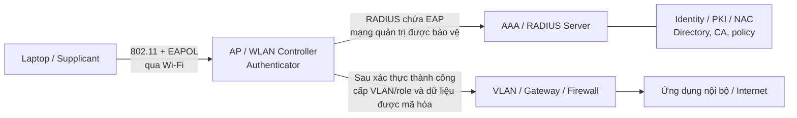
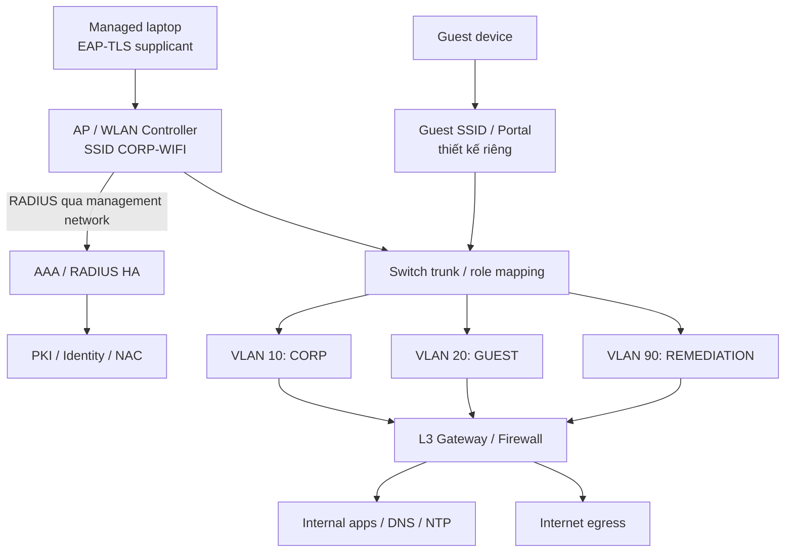
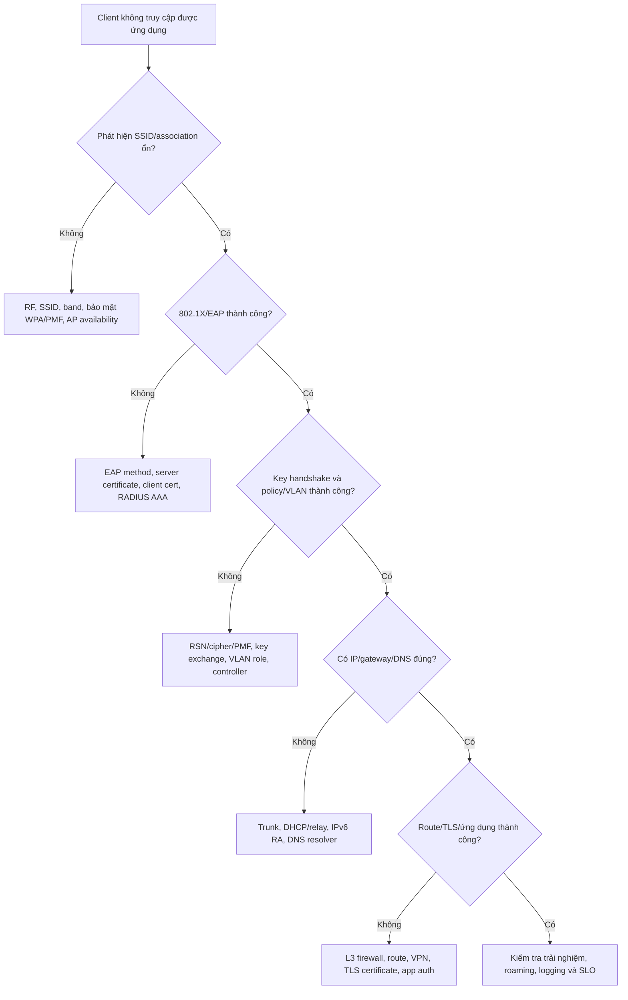

# Enterprise authentication: xác thực Wi-Fi doanh nghiệp bằng 802.1X, EAP và RADIUS

Một công ty có hàng trăm laptop, điện thoại và thiết bị chuyên dụng. Nếu mọi nhân viên cùng sử dụng một mật khẩu Wi-Fi, khi một người rời tổ chức hoặc mật khẩu bị lộ, đội vận hành phải thay khóa trên rất nhiều thiết bị. Cùng lúc, một người dùng hợp lệ chưa chắc được phép truy cập mạng quản trị, còn máy khách của nhà thầu phải được giới hạn vào những dịch vụ được phê duyệt.

**Enterprise authentication** trong bảo mật mạng không dây giải quyết việc **xác minh danh tính khi thiết bị gia nhập mạng**, kết hợp cơ chế cấp quyền và thiết lập khóa phiên. Trên Wi-Fi doanh nghiệp, kiến trúc phổ biến là **WPA2-Enterprise hoặc WPA3-Enterprise sử dụng 802.1X/EAP với máy chủ xác thực RADIUS**. Thay vì chia sẻ một mật khẩu chung, từng người dùng hoặc thiết bị có thể dùng chứng chỉ, danh tính và chính sách riêng.

Đây là một phần của chương **Wireless security**, thuộc module **SECURITY_NETWORK_SECURITY**. Lớp xác thực Wi-Fi cần phối hợp với phân đoạn VLAN, firewall, VPN, IDS/IPS, DNS protection, giám sát, quản trị endpoint và hạ tầng cloud. Việc 802.1X báo thành công **không đồng nghĩa** thiết bị được quyền truy cập mọi tài nguyên hoặc ứng dụng đã được bảo vệ.

Sau bài học, bạn có thể:

- Phân biệt WPA-Personal/PSK với WPA2/WPA3-Enterprise và hiểu vai trò của 802.1X, EAP, RADIUS.
- Mô tả đường đi **supplicant → authenticator/AP → authentication server**, EAPOL/RADIUS và bước thiết lập khóa bảo vệ dữ liệu.
- Đánh giá EAP-TLS, PEAP, EAP-TTLS và các phương thức EAP khác theo yêu cầu xác thực và rủi ro.
- Thiết kế trust store, CA, chứng chỉ máy chủ RADIUS và chứng chỉ client; giải thích vì sao **xác minh server certificate là bắt buộc**.
- Gắn authentication với authorization: dynamic VLAN, role-based policy, ACL, Network Access Control (NAC) và chính sách thiết bị.
- Phân tích rủi ro evil twin, credential harvesting, rogue AP, lộ private key, RADIUS misconfiguration và lỗi khi roaming.
- Điều tra lỗi **association, EAP, RADIUS, four-way handshake, DHCP, DNS, routing, TLS/ứng dụng** theo từng lớp.
- Xây dựng kế hoạch thử nghiệm, triển khai, giám sát, xử lý vòng đời chứng chỉ và phục hồi dịch vụ.

## 1. Tại sao Wi-Fi doanh nghiệp cần cơ chế xác thực riêng?

Wi-Fi là môi trường truyền dẫn vô tuyến: thiết bị trong vùng phủ có thể phát hiện SSID và thử kết nối mà không cần cắm dây vào switch. Do đó, mạng cần trả lời đồng thời các câu hỏi:

1. **Authentication:** đây là người dùng hoặc thiết bị nào, có bằng chứng danh tính hợp lệ không?
2. **Authorization:** sau khi xác thực, đối tượng đó được kết nối vào phân đoạn và dịch vụ nào?
3. **Accounting:** hệ thống cần ghi lại phiên truy cập nào, vào thời điểm nào, qua AP nào, và kết thúc ra sao?
4. **Confidentiality/integrity:** lưu lượng trên liên kết vô tuyến được thiết lập khóa và bảo vệ như thế nào?
5. **Lifecycle:** khi nhân viên nghỉ việc, mất máy, hết hạn chứng chỉ hoặc đổi quyền, làm sao thu hồi hoặc thay đổi quyền truy cập?

Ba ý đầu thường được gọi là **AAA — Authentication, Authorization, Accounting**. Hai ý sau yêu cầu các cơ chế WPA/RSN, quản lý khóa, PKI, NAC và vận hành thiết bị.

### 1.1. WPA-Personal và WPA-Enterprise

| Đặc điểm | Wi-Fi Personal | Wi-Fi Enterprise |
|---|---|---|
| Cơ chế điển hình | WPA2-Personal/PSK hoặc WPA3-Personal/SAE | WPA2/WPA3-Enterprise với 802.1X/EAP |
| Danh tính truy cập | Thường dựa trên khóa/mật khẩu mạng được chia sẻ hoặc thông tin tương đương | Có thể gắn với tài khoản người dùng, chứng chỉ thiết bị và chính sách tập trung |
| Thu hồi một thiết bị | Khó nếu chỉ dùng chung một PSK | Có thể vô hiệu hóa tài khoản/chứng chỉ/quyền của thiết bị đó |
| Quản trị số lượng lớn | Đơn giản ban đầu, khó khi nhân sự và thiết bị thay đổi | Cần hạ tầng AAA/PKI nhưng quản trị chi tiết hơn |
| Cấp quyền theo vai trò | Không phải khả năng cốt lõi của shared PSK | Có thể trả VLAN/role/ACL phù hợp qua RADIUS/NAC |
| Điểm cần bảo vệ | PSK hoặc mật khẩu, AP, cấu hình bảo mật | Chứng chỉ/khóa, RADIUS/IdP, policy, supplicant và đường mạng |

**WPA3-Personal với SAE không giống WPA3-Enterprise.** SAE cải thiện cơ chế xác thực dựa trên mật khẩu dùng chung trong mô hình Personal, còn Enterprise sử dụng cơ chế 802.1X/EAP và dịch vụ AAA.

Một số vendor hỗ trợ **PPSK/MPSK** (khóa Personal riêng theo thiết bị) hoặc cơ chế quản lý định danh riêng. Những tính năng đó có thể phù hợp một số môi trường IoT, nhưng không mặc nhiên tương đương 802.1X/EAP về xác thực và bảo đảm danh tính.

### 1.2. Wi-Fi Enterprise không phải chỉ là một lựa chọn trong danh sách SSID

Một SSID được đặt tên `CORP-WIFI` hoặc bật tùy chọn `WPA2-Enterprise` chưa chứng minh hệ thống an toàn. Cần kiểm tra **AP/controller, RADIUS server, EAP method, certificate validation trên client, authorization policy, key management, VLAN, firewall và monitoring**.

Nếu người dùng có thể bỏ qua xác thực chứng chỉ máy chủ RADIUS chỉ bằng một nút “Continue”, mạng có thể bị thiết bị giả mạo lợi dụng để thu thập thông tin hoặc buộc client vào một quá trình xác thực không an toàn.

## 2. Kiến trúc 802.1X: ba vai trò và các kênh giao tiếp

**IEEE 802.1X** là cơ chế port-based network access control. Trên Wi-Fi doanh nghiệp, ba thành phần cơ bản:

- **Supplicant:** phần mềm trên laptop/điện thoại/thiết bị, sử dụng một EAP method để chứng minh danh tính.
- **Authenticator:** AP hoặc WLAN controller/NAS điều khiển việc cho phép thiết bị sử dụng mạng; chuyển tiếp thông điệp xác thực.
- **Authentication server:** thường là RADIUS server kiểm tra danh tính/chứng chỉ và chính sách; có thể tích hợp directory, IdP, PKI, NAC.



Ở bước gia nhập mạng:

1. Client phát hiện SSID, đánh giá các chế độ bảo mật AP công bố và thực hiện thủ tục association phù hợp.
2. Supplicant và authenticator trao đổi các thông điệp **EAP over LAN (EAPOL)** qua liên kết mạng.
3. Authenticator đóng vai trò chuyển tiếp EAP tới RADIUS; AP thường **không tự giữ mật khẩu hoặc chứng chỉ của mọi người dùng** để đối chiếu như một user directory.
4. RADIUS xử lý quá trình EAP theo cấu hình, kiểm tra thông tin xác thực/chứng chỉ, có thể liên hệ các hệ thống identity.
5. Nếu xác thực và chính sách phù hợp, RADIUS trả kết quả chấp nhận kèm những thuộc tính authorization thích hợp.
6. Client và AP hoàn tất quá trình thiết lập khóa liên kết; sau đó client mới có đường truyền dữ liệu được bảo vệ và có thể nhận cấu hình IP.

**Thuật ngữ “802.11 authentication” không đồng nghĩa toàn bộ “802.1X/EAP authentication”.** Một client có thể đã hoàn thành một bước association nhưng chưa được phép truyền dữ liệu thông thường vì quá trình EAP hoặc key establishment chưa hoàn tất.

### 2.1. EAPOL và RADIUS nằm trên những đoạn nào?

| Thành phần giao tiếp | Giao thức | Điều cần biết |
|---|---|---|
| Client ↔ AP | EAPOL (EtherType `0x888e` trong mô hình Ethernet tương ứng) | Trao đổi thông điệp 802.1X/EAP, không phải giao thức DHCP hay HTTP. |
| AP/controller ↔ AAA server | RADIUS, thường UDP `1812` cho authentication | Chuyển thông tin EAP và kết quả AAA; có thể có cơ chế vận chuyển an toàn khác nếu hỗ trợ. |
| AP/controller ↔ AAA accounting | RADIUS Accounting, thường UDP `1813` | Ghi start/stop/interim update theo khả năng và cấu hình. |
| Controller/NAS ↔ AAA dynamic authorization | CoA/Disconnect-Request, thường UDP `3799` trong triển khai hỗ trợ | Có thể điều chỉnh/thu hồi quyền sau khi client đã kết nối. |
| Client ↔ network resources | IPv4/IPv6, DHCP/SLAAC, DNS, TCP/UDP/TLS... | Chỉ hoạt động như mong đợi sau khi quyền mạng, VLAN và routing đã đúng. |

Port có thể thay đổi theo thiết bị hoặc chính sách; một số hệ thống còn dùng cổng RADIUS cũ hoặc RADIUS over TLS/TCP. Phải kiểm tra **port và transport thật** thay vì mở mọi RADIUS port trên toàn mạng.

### 2.2. Chuỗi xác thực 802.1X/EAP rút gọn

```mermaid
sequenceDiagram
    participant C as Supplicant
    participant A as AP / Authenticator
    participant R as RADIUS / AAA
    participant N as VLAN / Network
    C->>A: Association theo bảo mật SSID
    A->>C: EAP-Request/Identity
    C->>A: EAP-Response/Identity
    A->>R: RADIUS Access-Request (EAP-Message)
    R-->>A: Access-Challenge (EAP-Message)
    A-->>C: EAP challenge
    C->>A: EAP response và trao đổi phương thức EAP
    A->>R: Chuyển tiếp EAP response
    Note over C,R: Có thể có nhiều vòng EAP; với EAP-TLS diễn ra TLS handshake
    R-->>A: Access-Accept + key material / attributes nếu thành công
    A-->>C: EAP-Success
    C->>A: Thiết lập khóa liên kết (ví dụ four-way handshake)
    A-->>C: Hoàn tất khóa bảo vệ dữ liệu
    A->>N: Cho client vào VLAN/role đã được policy cấp
    C->>N: DHCPv4, IPv6 RA/SLAAC/DHCPv6, traffic ứng dụng
```

Sơ đồ mang tính logic: thứ tự báo hiệu cụ thể, đặc biệt việc trao EAP-Success, key handshake, gắn VLAN và accounting, khác nhau theo EAP method/WPA/driver/controller; trong thực tế các thao tác cấp quyền/khóa không nhất thiết diễn ra đúng một thứ tự tuần tự đơn giản như các dòng minh họa.

## 3. EAP là giao thức khung; phương thức EAP quyết định cách xác thực

**Extensible Authentication Protocol (EAP)** quy định khung trao đổi thông điệp xác thực và cho phép nhiều **EAP methods**. 802.1X sử dụng EAP, còn RADIUS có thể vận chuyển các bản tin EAP giữa authenticator và authentication server.

EAP **không phải một mật khẩu, thuật toán mã hóa Wi-Fi hay một giao thức TLS cố định**. Những thuộc tính bảo mật quan trọng đến từ phương thức EAP được chọn và cách client/server kiểm tra danh tính.

### 3.1. So sánh các phương thức thường gặp

| Phương thức | Cách xác thực điển hình | Điểm mạnh | Rủi ro/giới hạn |
|---|---|---|---|
| **EAP-TLS** | TLS với chứng chỉ máy chủ và chứng chỉ client | Xác thực dựa trên PKI, tránh truyền mật khẩu người dùng trong một số mô hình, phù hợp thiết bị quản lý tập trung | Đòi hỏi CA, cấp/thu hồi chứng chỉ, bảo vệ khóa riêng, tương thích supplicant |
| **PEAP**, ví dụ PEAP + MSCHAPv2 | TLS tunnel xác minh server; xác thực password bên trong | Có thể tích hợp tài khoản hiện hữu; thiết bị hỗ trợ rộng trong một số môi trường | Nếu client không xác minh server certificate, nguy cơ evil twin/credential theft; MSCHAPv2 có rủi ro riêng |
| **EAP-TTLS** | TLS tunnel đến server, phương thức inner như PAP trong tunnel | Linh hoạt với hệ thống password/identity | Phải xác minh server/tunnel, kiểm tra hỗ trợ client và bảo vệ inner credentials |
| **TEAP** | Tunnel EAP có thể hỗ trợ kết hợp/chaining các danh tính theo khả năng | Có thể liên kết thông tin xác thực máy và người dùng với chính sách | Hỗ trợ và cách cấu hình tùy hệ điều hành/RADIUS/NAC |
| Các EAP method khác | Phụ thuộc method và nền tảng | Đáp ứng các hệ thống chuyên biệt | Không tự giả định mọi method có mutual authentication hoặc key derivation phù hợp |

**Đối với mạng doanh nghiệp quản lý thiết bị, EAP-TLS thường là lựa chọn đáng ưu tiên** khi có năng lực PKI và provisioning. Tuy nhiên lựa chọn cuối cùng phải dựa trên khả năng thiết bị, yêu cầu danh tính người dùng/thiết bị, quản trị chứng chỉ, compliance và môi trường đang triển khai.

### 3.2. Vì sao cần cẩn trọng với xác thực bằng mật khẩu?

Trong PEAP/EAP-TTLS, TLS tunnel có thể bảo vệ credentials khi được triển khai đúng, nhưng **client phải biết đang kết nối tới đúng authentication server**. Nếu client tin bất kỳ certificate nào hoặc chỉ bấm bỏ qua cảnh báo, một AP giả có thể dụ thiết bị kết nối tới một hệ thống xác thực không đáng tin.

Đối với cấu hình dùng mật khẩu:

- Bật xác minh CA và **tên máy chủ RADIUS được phép**, không chấp nhận certificate bất kỳ.
- Dùng profile Wi-Fi do MDM/GPO/hệ thống quản lý cấp, thay vì yêu cầu người dùng tự chọn method và bấm bỏ qua certificate warning.
- Có MFA hoặc kiểm soát identity khác ở những lớp phù hợp; MFA của hệ thống ứng dụng **không tự thay** cấu hình EAP an toàn.
- Tránh những EAP method/inner method cũ, không được hỗ trợ an toàn theo chính sách tổ chức.

**Một SSID có chữ “Enterprise” không bảo đảm credentials an toàn nếu supplicant không xác minh server.**

## 4. EAP-TLS: chứng chỉ, danh tính và thiết lập niềm tin

EAP-TLS sử dụng TLS để xác thực **authentication server** và **client** bằng chứng chỉ trong cơ chế phương thức EAP. Nó phù hợp với những tổ chức có thể cấp chứng chỉ cho laptop/thiết bị và quản lý vòng đời bằng MDM/PKI.

### 4.1. Hai loại chứng chỉ và chủ thể phải xác minh

| Chứng chỉ | Ai trình diện? | Ai phải xác minh? | Mục đích |
|---|---|---|---|
| **RADIUS/EAP server certificate** | AAA server hoặc thành phần xử lý EAP | Supplicant/client | Chứng minh client đang nói chuyện với **máy chủ xác thực được phép**. |
| **Client certificate** | Supplicant/người dùng/thiết bị | AAA/EAP server | Chứng minh client nắm khóa riêng tương ứng với danh tính được cấp. |

Máy khách không chỉ kiểm tra “certificate được ký bởi CA nào đó”. Cần đối chiếu **CA tin cậy đúng mục đích, tên RADIUS server được cho phép, thời hạn, key usage/EKU, revocation theo chính sách và các ràng buộc certificate** mà client thực sự hỗ trợ.

Với client certificate, AAA server cần kiểm tra chain, policy phát hành, key usage/EKU thích hợp, trạng thái thu hồi theo cơ chế triển khai và **mapping tới identity thực tế**. Một certificate hợp lệ về mặt mật mã nhưng thuộc nhầm thiết bị/tenant không nên mặc nhiên được quyền vào mạng.

### 4.2. Một luồng EAP-TLS điển hình

```text
Client (supplicant)       AP / authenticator       RADIUS/EAP server
        |                         |                        |
        |----- EAP identity ----->|---- Access-Request --->|
        |<---- EAP-TLS request ---|<--- Access-Challenge --|
        |                                                 |
        |  <==== TLS handshake, certificate exchange ====> |
        |  Client validates server cert/name and CA        |
        |  Server validates client cert, chain and policy  |
        |                                                 |
        |<------ EAP success -----|<--- Access-Accept ----|
        |---- 802.11 key establishment with AP ---------->|
        |                                                 |
        |        Allowed VLAN/role -> DHCP/DNS/traffic     |
```

AP thường **chuyển tiếp** thông điệp EAP giữa supplicant và RADIUS. Nó không cần giải mã và kiểm tra mọi thành phần của phiên EAP-TLS như AAA server. Việc trao keying material liên quan EAP/RSN phải được bảo vệ theo kiến trúc AAA và cơ chế WPA tương ứng.

### 4.3. Xác minh chứng chỉ RADIUS trên client là điểm sống còn

Một profile sai có thể cấu hình:

```text
SSID:              CORP-WIFI
EAP method:        EAP-TLS hoặc PEAP
Trusted CA:        Bất kỳ CA / không xác minh
Server name check: Tắt
```

**Không sử dụng cấu hình trên.** Với profile đúng, client cần biết **những tên AAA server nào được phép**, CA nào được tin và hành vi khi certificate không hợp lệ. Nếu AAA certificate đổi bất ngờ, client phải **từ chối hoặc cảnh báo theo policy**, thay vì âm thầm chấp nhận.

Các yếu tố cần kiểm tra:

1. Certificate chain dẫn tới CA được tổ chức cho phép.
2. SAN/DNS name của server tương ứng với danh sách RADIUS server được phê duyệt (theo cách client hỗ trợ).
3. Certificate còn hạn, chữ ký/thuật toán phù hợp và không bị thu hồi theo chính sách.
4. TLS version và EAP method được supplicant/AAA hỗ trợ tương thích.
5. Client certificate và private key được bảo vệ, không thể xuất trái phép từ kho khóa khi có cơ chế hỗ trợ.

**Xác minh hostname trong TLS của EAP server và hostname trong URL ứng dụng là hai kiểm tra khác nhau.** Việc browser truy cập HTTPS an toàn không bảo đảm Wi-Fi EAP đã xác minh đúng server.

### 4.4. User certificate hay machine certificate?

| Phương án | Danh tính chứng minh | Lợi ích | Điểm cần cân nhắc |
|---|---|---|---|
| **Machine/device EAP-TLS** | Thiết bị được quản lý | Có thể kết nối trước đăng nhập, phù hợp cập nhật/policy máy | Không chứng minh người đang sử dụng thiết bị; cần bảo vệ máy và khóa riêng |
| **User EAP-TLS** | Tài khoản/người dùng có chứng chỉ | Phân quyền gắn với cá nhân | Trải nghiệm đăng nhập, vòng đời user cert, dùng chung thiết bị |
| **Chaining/multi-stage identity** | Kết hợp máy và người dùng khi hệ thống hỗ trợ | Phân quyền dựa trên cả compliance máy và người dùng | Phức tạp hơn; đòi hỏi supplicant, AAA và NAC tương thích |

Một máy đã xác thực bằng chứng chỉ thiết bị vẫn có thể đang có tài khoản không được phép sử dụng. Quyền truy cập ứng dụng nhạy cảm vẫn phải do **IAM/app authorization** thực thi.

## 5. WPA2-Enterprise, WPA3-Enterprise và khóa bảo vệ liên kết

802.1X/EAP giải quyết chứng minh danh tính và cung cấp cơ sở thiết lập khóa, trong khi họ cơ chế **WPA/RSN** tổ chức cách bảo vệ dữ liệu trên liên kết Wi-Fi. Hai vấn đề liên quan nhưng không hoàn toàn giống nhau.

### 5.1. Sau EAP thành công còn bước four-way handshake

Đối với kiến trúc WPA2-Enterprise thông thường, quá trình EAP tạo **keying material** để supplicant và authenticator sử dụng cơ sở khóa như **PMK (Pairwise Master Key)**. Sau đó, four-way handshake giúp hai bên kiểm chứng cùng có PMK và thiết lập những khóa phiên phù hợp như PTK; group key/GTK được phân phối theo cơ chế hỗ trợ.

```text
802.1X/EAP success → keying material → PMK
                                     |
                         AP <------> Client
                            four-way handshake
                                     |
                           PTK/GTK và bảo vệ data
                                     |
                           DHCP/IPv6 và ứng dụng
```

Các chi tiết **key hierarchy và handshake thay đổi** theo WPA2, WPA3, mode bảo mật và khả năng triển khai. Không suy rằng một handshake mô tả khái quát trên đây là nguyên văn mọi bước của WPA3-Enterprise 192-bit mode.

Nếu EAP đã báo thành công nhưng **key handshake thất bại**, client có thể bị ngắt hoặc chưa gửi được dữ liệu IP. Cần phân tích riêng **authentication failure** với **key establishment/RSN failure**.

### 5.2. WPA2-Enterprise và WPA3-Enterprise

| Thuộc tính | WPA2-Enterprise | WPA3-Enterprise |
|---|---|---|
| Cơ chế xác thực doanh nghiệp | 802.1X/EAP | 802.1X/EAP |
| Bảo vệ dữ liệu | RSN với các cipher suites được hỗ trợ; AES-CCMP phổ biến | Các yêu cầu và cipher suites WPA3 theo mode/certification |
| Protected Management Frames (PMF) | Có thể được hỗ trợ/yêu cầu tùy cấu hình, client và AP | PMF được yêu cầu trong chế độ WPA3 phù hợp |
| EAP method | Phụ thuộc client và AAA | Phụ thuộc mode WPA3, tiêu chuẩn và khả năng tương thích |
| Vận hành | Tương thích thiết bị cũ hơn; cần hardening EAP/cert và cipher | Bảo mật mạnh hơn theo chế độ được hỗ trợ; đòi hỏi inventory client/firmware |

**WPA3-Enterprise 192-bit security mode** là chế độ cụ thể với yêu cầu mật mã/thuật toán và chứng chỉ nghiêm ngặt hơn; **không đồng nghĩa** mọi mạng bật tùy chọn “WPA3-Enterprise” đều tự động chạy 192-bit mode. Phải xác minh tiêu chuẩn và cấu hình của AP/controller, AAA và supplicant, bao gồm cipher suite, EAP method, PMF và PKI.

Một triển khai WPA2-Enterprise với EAP-TLS và xác minh certificate tốt có thể là lựa chọn an toàn trong giai đoạn di chuyển nếu thiết bị chưa hỗ trợ đầy đủ WPA3; vẫn cần quản lý rủi ro và kế hoạch nâng cấp. **Đừng bật transition mode mà không đánh giá cơ chế downgrade và quyền truy cập của thiết bị legacy.**

### 5.3. PMF bảo vệ điều gì?

**Protected Management Frames** theo 802.11w/RSN bảo vệ một số **robust management frames** sau khi có ngữ cảnh bảo mật phù hợp, giúp giảm một số kiểu giả mạo management frame như deauthentication/disassociation trong phạm vi mà PMF bảo vệ.

PMF **không mã hóa mọi frame quản lý**, không chặn nhiễu sóng/jamming và không đảm bảo AP không thể bị làm nghẽn bởi lưu lượng vô tuyến. Nó là lớp phòng vệ bổ sung, không thay cho phát hiện rogue AP, bảo vệ chứng chỉ hay thiết kế RF.

## 6. RADIUS và AAA: ai quyết định quyền sau xác thực?

RADIUS thường nhận thông điệp xác thực do AP/controller chuyển tiếp, kiểm tra EAP với identity service và trả kết quả:

- **Access-Request:** AP/NAS gửi thông tin phiên và EAP-Message tới AAA.
- **Access-Challenge:** server yêu cầu trao đổi thêm EAP, có thể diễn ra nhiều lần.
- **Access-Accept:** AAA chấp nhận và có thể gửi thuộc tính quyền/VLAN, thông tin cần cho key establishment.
- **Access-Reject:** yêu cầu bị từ chối; controller không nên xem một response lỗi là mặc định được quyền.
- **Accounting-Request/Response:** bản ghi phiên theo cấu hình, có thể gồm start/stop/interim.

**Access-Accept không có nghĩa client được vào mọi VLAN**. Chính sách AAA nên liên kết danh tính với device posture/role, độ tin cậy, địa điểm, thời điểm và quyền được phê duyệt.

### 6.1. RADIUS shared secret không phải cơ chế bảo mật toàn diện

RADIUS qua UDP truyền thống sử dụng shared secret cho một số chức năng xác thực/bảo vệ thuộc tính theo giao thức. **Không được coi toàn bộ RADIUS traffic mặc nhiên được mã hóa và xác thực đầu-cuối mạnh chỉ vì đã đặt shared secret.** Mức độ bảo vệ phụ thuộc phiên bản/transport, cấu hình, đường mạng và đặc điểm từng loại thuộc tính.

Các thực hành nên có:

1. Giới hạn AP/controller nào được phép trở thành **RADIUS client/NAS**.
2. Dùng shared secret mạnh, riêng theo thiết bị/nhóm có kiểm soát khi phù hợp; lưu trong kho bí mật và luân chuyển.
3. Bảo vệ đường AP/controller–RADIUS qua mạng quản trị riêng, ACL/firewall, VPN hoặc **RADIUS over TLS (RadSec)** nếu hệ thống hỗ trợ.
4. Với RadSec, phải có chứng chỉ/PKI và policy xác minh server/client tương ứng, không chỉ “bật TCP”.
5. Không log shared secret, client private key, password hoặc toàn bộ EAP payload có thể chứa dữ liệu nhạy cảm.
6. Giới hạn và audit các chức năng **Change of Authorization (CoA)**, không để một bên không tin cậy yêu cầu thay đổi phiên Wi-Fi.

### 6.2. RADIUS và directory/IdP không phải một dịch vụ duy nhất

RADIUS server có thể tự thực hiện EAP-TLS và kiểm tra certificate, sau đó tra LDAP/Active Directory hoặc một nguồn identity/PKI khác để áp policy. Một số giải pháp cloud NAC/IdP có mô hình tích hợp khác.

**Ứng dụng quản lý người dùng** có MFA hay chính sách mật khẩu mạnh không đảm bảo Wi-Fi được xác thực an toàn nếu RADIUS–supplicant vẫn chấp nhận certificate sai hoặc sử dụng inner EAP method không phù hợp. Phải kiểm tra toàn bộ đường từ thiết bị tới AAA server.

### 6.3. RADIUS server dự phòng

Thiết kế doanh nghiệp nên có:

- Ít nhất hai AAA endpoints hoặc cơ chế HA tương đương theo SLA.
- DNS/IP, route và firewall để AP/controller có thể tiếp cận AAA.
- Time synchronization đủ cho certificate validity, log correlation và chính sách.
- CA/trust store đồng nhất, cấu hình EAP method và role mapping không mâu thuẫn giữa các node.
- Timeout/retry/failover của controller có giới hạn; theo dõi độ trễ RADIUS và tỷ lệ Reject/Timeout.

RADIUS node dự phòng có thể **trả các policy khác nhau** nếu cấu hình lệch; kết quả là một client lúc vào VLAN 10, lúc vào VLAN cách ly. HA chỉ có ý nghĩa khi chức năng và chính sách được kiểm thử đồng nhất.

## 7. Authorization: dynamic VLAN, role và Network Access Control

Sau xác thực, tổ chức có thể dùng **RADIUS authorization attributes** để gán VLAN, role, danh sách ACL hoặc chính sách khác theo khả năng AP/controller.

Ví dụ logic:

```text
EAP-TLS client authentication
           |
           v
AAA/NAC xác định:
  device certificate = hợp lệ
  device posture     = compliant
  user role          = employee
           |
           v
Access-Accept + policy:
  role = EMPLOYEE
  VLAN = 10
           |
           v
AP/Controller áp VLAN 10 và kết nối traffic tới gateway/firewall
```

Các điều kiện *posture compliant* hoặc *user role* chỉ có hiệu lực nếu có **nguồn dữ liệu, policy và tích hợp được cấu hình thực sự**. Một EAP-TLS certificate hợp lệ tự nó không cung cấp kết quả kiểm tra malware, patch level hoặc tài khoản đăng nhập của người đang sử dụng.

### 7.1. Thuộc tính VLAN thường được dùng

Các RADIUS attributes chuẩn thường dùng trong mô hình VLAN assignment:

| Attribute | Giá trị logic minh họa | Mục đích |
|---|---|---|
| `Tunnel-Type` | `VLAN` | Thể hiện loại tunnel/assignment được yêu cầu. |
| `Tunnel-Medium-Type` | `IEEE-802` | Chỉ môi trường liên quan Ethernet/802. |
| `Tunnel-Private-Group-ID` | `"10"` | VLAN ID theo biểu diễn chuỗi của thuộc tính. |
| `Filter-Id` hoặc vendor-specific attributes | `EMPLOYEE-ACL` | Yêu cầu/đánh dấu chính sách theo khả năng sản phẩm. |

Đây là **minh họa**, không phải payload cấu hình có thể copy cho mọi AP/NAC. Một số nền tảng hỗ trợ downloadable ACL, role ID, Security Group Tag hoặc policy động thông qua thuộc tính riêng của vendor.

### 7.2. Dynamic VLAN vẫn cần hạ tầng lớp 2/lớp 3

Nếu AAA trả `VLAN=30` nhưng trunk giữa AP và switch **không cho VLAN 30 đi qua**, thiết bị có thể:

- Xác thực 802.1X thành công.
- Hoàn tất trao đổi khóa Wi-Fi.
- Nhưng không nhận DHCP, không liên lạc được gateway hoặc bị cô lập ngoài dự kiến.

Vì vậy phải kiểm tra **SSID ↔ WLAN policy ↔ dynamic VLAN ↔ AP uplink/trunk ↔ switch ↔ DHCP/relay ↔ router/firewall**. VLAN khác nhau chia miền lớp 2; truy cập xuyên VLAN còn phụ thuộc route và firewall policy.

### 7.3. Thiết kế theo role thay vì chỉ theo SSID

| Đối tượng | Xác thực đề xuất | Phân đoạn minh họa | Quyền truy cập |
|---|---|---|---|
| Laptop nhân viên quản lý | EAP-TLS với certificate thiết bị phù hợp | `VLAN 10 - CORP` | DNS/NTP, Internet, các dịch vụ nghiệp vụ được cấp quyền |
| Thiết bị nhà thầu được quản lý | EAP-TLS theo danh tính và policy nhà thầu | `VLAN 20 - CONTRACTOR` | Chỉ các ứng dụng dự án được phê duyệt |
| BYOD đáp ứng điều kiện | EAP method và onboarding được phê duyệt | `VLAN 30 - BYOD` | Truy cập giới hạn, ưu tiên ứng dụng qua gateway an toàn |
| Thiết bị vi phạm compliance | NAC policy/quarantine theo cơ chế hỗ trợ | `VLAN 90 - REMEDIATION` | Chỉ dịch vụ cần để sửa và xác minh trạng thái |
| IoT không hỗ trợ 802.1X | Thiết kế ngoại lệ riêng, không giả định EAP-TLS khả dụng | `VLAN 40 - IOT` | Chỉ dịch vụ điều khiển/giám sát cần thiết, anti-spoofing |

Địa chỉ VLAN và policy trong bảng là **ví dụ**. Không nên chỉ dựa vào MAC address của IoT làm danh tính có bảo đảm; nếu thiết bị không hỗ trợ 802.1X, cần đánh giá rủi ro, phân đoạn và phương pháp cấp quyền bổ sung.

## 8. Kiến trúc tham chiếu: từ Wi-Fi tới tài nguyên doanh nghiệp

Giả sử công ty có một SSID quản lý `CORP-WIFI` và một SSID dành cho khách `GUEST-WIFI`. Mục tiêu:

- Nhân viên/thiết bị có certificate hợp lệ được 802.1X/EAP-TLS và gán role phù hợp.
- Khách không được dùng cùng danh tính/cơ chế như nhân viên nếu chưa được phê duyệt.
- RADIUS và WLAN management không được truy cập từ guest network.
- Sau xác thực, traffic vẫn đi qua phân đoạn mạng và policy truy cập ứng dụng.



**Sơ đồ là kiến trúc logic, không phải sơ đồ frame forwarding cụ thể của mọi controller.** Một hệ thống có thể local bridge tại AP hoặc tunnel dữ liệu về controller; VLAN tagging và vị trí firewall thực tế thay đổi theo triển khai.

### 8.1. Ma trận tối thiểu

| Nguồn | Đích | Chính sách ví dụ | Lưu ý |
|---|---|---|---|
| AP/controller management | RADIUS AAA | Allow đúng authentication/accounting/CoA transport cần dùng | Giới hạn source/destination, bảo vệ đường AAA |
| CORP clients | Internal DNS/NTP | Allow dịch vụ cần thiết | Đảm bảo DNS path, IPv6 NDP/RA đúng |
| CORP clients | Business API | Allow HTTPS tới endpoint được cấp quyền | API vẫn phải kiểm tra AuthN/AuthZ |
| CONTRACTOR/BYOD | Database/MGMT | Deny theo mặc định | Ngoại lệ theo quy trình được phê duyệt |
| GUEST clients | CORP/MGMT/AAA | Deny | Cần firewall policy và client isolation nếu áp dụng |
| REMEDIATION | Update/MDM/NAC service | Allow giới hạn | Không cho truy cập production rộng |
| MGMT admin | AP/controller/AAA | Allow từ VPN/bastion được cấp quyền | Xác thực mạnh và audit quản trị |

Nếu traffic giữa hai vùng được định tuyến trên switch L3 trước khi tới firewall mong muốn, firewall đó **không nhìn thấy và không tự chặn** những kết nối này. Cần xác định đúng enforcement point, giống mọi thiết kế segmentation.

### 8.2. DHCP/DNS sau xác thực

Một lỗi điển hình: RADIUS trả `Access-Accept`, client thấy “Connected”, nhưng không có Internet. Nguyên nhân có thể là:

- Dynamic VLAN không nằm trong allowed VLANs trên uplink.
- DHCP scope/relay hoặc server không hoạt động.
- IPv6 RA/DHCPv6 và ICMPv6 bị chặn.
- DNS resolver sai hoặc traffic tới resolver bị firewall chặn.
- Default route/ACL hoặc proxy sai.

**Không cần và không nên tắt 802.1X** chỉ để xử lý lỗi DHCP sau khi auth đã thành công; phải điều tra đúng tầng.

## 9. Triển khai EAP-TLS: PKI, provisioning và vòng đời thiết bị

Để dùng EAP-TLS quy mô lớn, tổ chức cần vận hành **Public Key Infrastructure (PKI)** hoặc dịch vụ chứng chỉ có quản trị. Đây không chỉ là bước tạo certificate lúc đầu, mà còn là toàn bộ vòng đời danh tính.

### 9.1. Thành phần cần có

1. **CA/trust model:** CA phát hành server và client certificates theo phạm vi/chuỗi tin cậy được quản lý.
2. **Registration/enrollment:** xác định ai/thiết bị nào được cấp certificate, kiểm tra quyền trước khi cấp.
3. **Key generation/storage:** private key được tạo/lưu trong TPM/Secure Enclave/OS keystore hoặc kho bí mật phù hợp; giảm khả năng bị sao chép.
4. **Profile deployment:** phân phối SSID, EAP method, CA certificate, server name, lựa chọn client cert và chính sách PMF/RSN bằng MDM/GPO hoặc công cụ tin cậy.
5. **Renewal:** tự động gia hạn trước khi hết hạn, không làm đồng loạt ngắt kết nối khi roll over.
6. **Revocation/disable:** cơ chế thu hồi chứng chỉ, ngắt quyền truy cập và xử lý thiết bị mất/nhân viên nghỉ.
7. **Audit:** lưu kết quả cấp/thu hồi và mapping certificate → asset/user theo thời gian, giới hạn quyền xem thông tin.

### 9.2. Server certificate và client certificate khác vai trò

| Thuộc tính | Server certificate (AAA/EAP) | Client certificate |
|---|---|---|
| Ai dùng private key? | AAA server | Thiết bị/supplicant |
| Tên/định danh cần ràng buộc | RADIUS server name(s) được client phê duyệt | Device/user ID phù hợp chính sách mapping |
| Extended Key Usage thường gặp | `serverAuth` theo khả năng/profile | `clientAuth` theo khả năng/profile |
| Ai kiểm tra? | Client/supplicant | AAA/RADIUS |
| Khi hết hạn hoặc bị thu hồi | Nhiều client có thể không auth được | Thiết bị hoặc user liên quan không auth được |

Các profile X.509/EKU và cơ chế kiểm tra phải tương thích với EAP method và nền tảng thực tế. **Chỉ có CN trông đúng không đủ** nếu client/server không kiểm tra SAN/name, chain hoặc policy theo cấu hình đã được thiết lập.

### 9.3. Quy trình onboarding thiết bị minh họa

```text
Thiết bị vào MDM / asset inventory
          |
          v
Xác minh quyền sở hữu và compliance tối thiểu
          |
          v
Enroll client certificate + giữ private key an toàn
          |
          v
MDM cài profile CORP-WIFI:
  EAP-TLS, trusted CA, allowed RADIUS server names
          |
          v
Client kết nối và kiểm tra chứng chỉ server
          |
          v
AAA kiểm tra certificate client + role policy
          |
          v
Gán VLAN/role, thiết lập khóa, nhận IP và kiểm thử quyền
```

Không nên yêu cầu nhân viên tự tải certificate private key qua email hoặc gửi khóa lên ticket. Với thiết bị không hỗ trợ MDM/TPM, cần đánh giá giải pháp enrollment và bảo vệ khóa tương ứng.

### 9.4. Thu hồi không có nghĩa mọi phiên lập tức bị cắt

Khi user hoặc device bị thu hồi:

- AAA có thể từ chối **phiên xác thực mới** theo trạng thái account/cert hiện tại.
- Một phiên Wi-Fi **đang hoạt động** có thể tiếp tục tới khi session được reauthenticate, hết hạn hoặc bị disconnect theo cơ chế sản phẩm.
- Có thể dùng CoA/Disconnect-Request hoặc chính sách controller để hạn chế phiên đang sống khi hỗ trợ.
- Certificate revocation checking (CRL/OCSP) có hành vi và xử lý outage khác nhau theo cấu hình; cần kiểm thử trường hợp không truy cập được nguồn trạng thái thu hồi.

Thiết kế phải có **thời gian thu hồi mục tiêu** và cách kiểm chứng thực tế, không chỉ xóa một certificate record rồi kết luận máy đã bị đuổi khỏi mạng.

## 10. Ví dụ cấu hình supplicant và cách kiểm tra

Ví dụ dưới đây dành cho **Linux `wpa_supplicant` hỗ trợ EAP-TLS**, minh họa việc chọn CA, tên RADIUS server và client certificate. **Đây không phải profile WPA3-Enterprise đầy đủ**; những tham số chọn RSN/cipher/PMF, phương thức cất khóa và tên interface phải dựa vào AP/controller/OS đang dùng.

```ini
# Nội dung minh họa một network block trong wpa_supplicant.conf.
# File chứa đường dẫn khóa riêng cần được giới hạn quyền đọc.
network={
    ssid="CORP-WIFI"
    key_mgmt=WPA-EAP
    eap=TLS
    identity="device-042@corp.example.test"

    # CA cụ thể được phép phát hành chứng chỉ RADIUS.
    ca_cert="/etc/wifi/corp-radius-ca.pem"
    # Ràng buộc tên server được chấp nhận theo khả năng supplicant.
    domain_match="radius.corp.example.test"

    client_cert="/etc/wifi/device-042.crt"
    private_key="/etc/wifi/device-042.key"
}
```

**Những giới hạn quan trọng:**

- `key_mgmt=WPA-EAP` trong ví dụ mô tả cấu hình kiểu WPA2-Enterprise/EAP thông dụng; **không tự kích hoạt** mọi yêu cầu WPA3-Enterprise. Phải xác minh mode được negotiated trên client/AP và cấu hình WPA3 phù hợp nếu cần.
- `domain_match` cần được supplicant phiên bản đang chạy hỗ trợ và xác thực đúng tên trong certificate; với những hệ thống dùng `domain_suffix_match` hoặc cơ chế khác, phải kiểm tra semantic để không vô tình tin phạm vi quá rộng.
- `identity` chỉ là định danh logic trong EAP; server phải map tới chứng chỉ/danh tính hợp lệ, không tin bất kỳ chuỗi identity tự khai nào.
- `client_cert` và `private_key` trong bài là đường dẫn minh họa. Trong hệ thống thật nên ưu tiên kho khóa phần cứng/OS và enrollment có quản lý, không lưu private key dùng chung trong repository.
- Không thêm lựa chọn **bỏ xác minh certificate/CA** chỉ vì kết nối đang lỗi. Cần sửa chính xác trust chain, server name hoặc đồng hồ hệ thống.
- Không tự chạy cấu hình lên máy production đang quản trị từ xa nếu chưa có phương án kết nối dự phòng.

### 10.1. Quan sát phía client Linux

```bash
# Nếu dùng NetworkManager, xem trạng thái Wi-Fi và kết nối.
nmcli device status
nmcli connection show --active

# Xem liên kết Wi-Fi khi công cụ iw có sẵn.
iw dev wlan0 link

# Xem địa chỉ và route sau khi đã xác thực.
ip -br address
ip route
ip -6 route

# Xem sự kiện mạng (nếu service tương ứng được dùng).
journalctl -u NetworkManager --since "30 minutes ago"
journalctl -u wpa_supplicant --since "30 minutes ago"
```

`wlan0` có thể mang tên khác; môi trường dùng NetworkManager, iwd, wpa_supplicant độc lập hay một stack khác cũng sẽ có lệnh/log khác. Không mong chờ mọi hệ thống đều có cả hai services `NetworkManager` và `wpa_supplicant` đang hoạt động.

### 10.2. Quan sát trên Windows

```powershell
# Trạng thái Wi-Fi và profile ở mức cấu hình, không chỉnh sửa.
netsh wlan show interfaces
netsh wlan show profiles

# Một số event WLAN AutoConfig gần đây khi log được bật.
Get-WinEvent -LogName 'Microsoft-Windows-WLAN-AutoConfig/Operational' -MaxEvents 20

# Kiểm tra IP, gateway, DNS sau khi kết nối.
Get-NetIPConfiguration
Get-DnsClientServerAddress
```

Windows có thể quản lý profile 802.1X qua Group Policy, MDM và chứng chỉ trong certificate store. **Không khuyến nghị xóa profile/reinstall CA** như bước đầu khi chưa xác định sự cố vì có thể làm mất dữ liệu điều tra hoặc khiến thiết bị bị khóa khỏi mạng.

### 10.3. Kiểm chứng certificate của AAA trên hệ thống quản lý

Với một certificate file **có quyền đọc**, lệnh minh họa:

```bash
openssl x509 -in radius-server.crt \
  -noout -subject -issuer -dates -ext subjectAltName
```

Lệnh cho biết thông tin trong certificate file, **không tự chứng minh** supplicant đang nhìn thấy đúng certificate đó, chain được tin, private key khớp, hoặc server đã vượt qua policy. Cần đối chiếu cùng RADIUS logs, client TLS validation và certificate profile thực tế.

## 11. Roaming, reauthentication và các cơ chế hỗ trợ

Trong văn phòng lớn, một laptop có thể di chuyển từ AP tầng 1 sang AP tầng 2 mà vẫn dùng cùng SSID. **Roaming** là quá trình chuyển kết nối giữa các BSS/AP; yêu cầu trải nghiệm tốt có thể khiến hệ thống dùng caching hoặc các cơ chế fast transition phù hợp.

| Cơ chế | Chức năng chính | Không nên nhầm |
|---|---|---|
| **802.11r Fast BSS Transition (FT)** | Hỗ trợ roaming nhanh bằng cơ chế liên quan khóa/transition | Không phải bỏ qua mọi bước bảo mật để “vào Wi-Fi không cần xác thực”. |
| **802.11k** | Hỗ trợ thông tin neighbor/radio measurements | Không phải cơ chế certificate authentication. |
| **802.11v** | Hỗ trợ quản lý/chỉ dẫn BSS transition theo khả năng client | Không đảm bảo client luôn tuân theo khuyến nghị AP. |
| **PMKSA caching** và cơ chế cache liên quan | Giảm nhu cầu lặp lại một số thao tác khi reconnect/roam theo điều kiện | Không thay revocation, authorization và chính sách lifetime. |
| **Periodic reauthentication/session timeout** | Có thể yêu cầu kiểm tra lại danh tính/quyền | Không nên mặc định một cấu hình timeout tốt cho mọi thiết bị/giao thức. |

Với VoWiFi/real-time calls, roaming chậm có thể gây mất tiếng hoặc gián đoạn ứng dụng. Nhưng bật FT không đúng hỗ trợ client/controller có thể gây lỗi association hoặc key handshake. Cần thử trên các nhóm thiết bị và firmware thực tế, đo **roam latency, auth failures và packet loss**, không chỉ nhìn RSSI.

Nếu client sau roaming được chuyển sang VLAN mới mà thiết kế không duy trì đường IP hợp lệ, kết nối tầng ứng dụng có thể ngắt dù EAP thành công. Phải xét **mobility domain, L2/L3 roaming, policy continuity, DHCP/IPv6 và phiên ứng dụng**.

## 12. Threat modeling cho enterprise wireless authentication

Hệ thống bảo vệ nhiều thành phần: sóng vô tuyến, thiết bị đầu cuối, CA, AAA, AP/controller, switching/uplink, DNS/DHCP và các ứng dụng sau khi xác thực. Mô hình hóa mối đe dọa theo nơi có khả năng bị giả mạo hoặc cấu hình sai.

| Mối đe dọa | Điều kiện/ảnh hưởng | Phòng vệ cần kiểm tra |
|---|---|---|
| **Evil twin / rogue AP** | AP giả dùng SSID tương tự để dụ client kết nối | Supplicant xác minh certificate và tên RADIUS, MDM profile, WIDS/WIPS theo policy |
| **Credential harvesting** | PEAP/TTLS client bỏ qua certificate verification hoặc inner method yếu | Ràng buộc CA/server names, ưu tiên EAP-TLS, training và thiết lập qua MDM |
| **Private key của client bị lộ** | Đối tượng khác dùng certificate/key như một thiết bị hợp lệ | TPM/Secure Enclave/OS keystore, quyền truy cập, thu hồi và quản lý vòng đời |
| **RADIUS server/secret bị lộ** | AAA bị giả mạo hoặc policy/thuộc tính bị can thiệp theo bối cảnh | Bảo vệ management plane, RadSec khi hỗ trợ, unique secrets, RBAC/audit |
| **RADIUS policy mở quá rộng** | Client hợp lệ được đưa nhầm vào VLAN quản trị | Least privilege, role mapping, review, test negative/positive |
| **Trunk/VLAN sai** | Client được xác thực nhưng dữ liệu rơi vào vùng không mong muốn hoặc mất DHCP | Đồng bộ allowed VLANs, switch ACL, DHCP relay và audit đường đi |
| **Thiết bị không được quản lý dùng tài khoản hợp lệ** | Chỉ xác thực user, không ràng buộc posture/device | Device EAP-TLS, NAC/MDM, policy gắn compliance |
| **Replay/fake management frames** | Có thể gây ngắt kết nối hoặc tác động Wi-Fi nếu thiếu bảo vệ | PMF ở chế độ tương thích, cập nhật firmware, giám sát RF |
| **Jamming/DoS lớp vô tuyến** | Dịch vụ Wi-Fi không sẵn sàng dù credential vẫn an toàn | RF design, monitoring, HA, phương án ứng phó; PMF không chống jamming |
| **RADIUS không sẵn sàng** | Client mới không auth được, người dùng mất truy cập | AAA HA, kiểm thử failover, đồng nhất certificate/policy, runbook |
| **Thu hồi chậm** | Máy bị mất vẫn giữ một phiên hoặc credential chưa hết hiệu lực | CoA/Disconnect, CRL/OCSP policy, session timeout và asset response |
| **MAC spoofing** | Gán quyền theo MAC bị vượt qua hoặc inventory sai | Không dùng MAC làm xác thực mạnh, 802.1X cert và NAC |
| **Bỏ lọt IPv6** | Wi-Fi auth đúng nhưng route/firewall IPv6 quá rộng | IPv6 RA/DHCPv6, ICMPv6 và L3 policy riêng |

### 12.1. Evil twin là vấn đề xác minh identity của AAA

Đặt SSID giống mạng công ty không tự làm một rogue AP có chứng chỉ RADIUS được tin cậy. Nếu supplicant **xác minh đúng CA và server name** và dùng EAP method an toàn, đối tượng giả khó hoàn tất xác thực như AAA hợp lệ.

Ngược lại, nếu người dùng được phép bỏ qua cảnh báo chứng chỉ hoặc profile không ràng buộc tên server, kẻ tấn công có thể tạo môi trường giả khiến một số phương thức EAP kém an toàn phơi lộ thông tin xác thực. **Hướng phòng vệ ưu tiên là client profile được quản lý**, không chỉ tìm và tắt AP giả trong môi trường RF.

### 12.2. Phân biệt PMF, mã hóa và xác thực

- **802.1X/EAP:** xác thực danh tính và tạo cơ sở khóa.
- **WPA/RSN encryption:** bảo vệ frame dữ liệu trên liên kết Wi-Fi.
- **PMF:** bảo vệ một số robust management frames.
- **TLS/mTLS ứng dụng:** bảo vệ kết nối đến API và/hoặc xác thực service trên đường end-to-end tương ứng.
- **Firewall/NAC:** kiểm soát tài nguyên nào client được truy cập sau khi có kết nối.

Không có một cơ chế đơn lẻ thay hết các cơ chế còn lại. **Một laptop xác thực EAP-TLS thành công vẫn cần TLS và authorization khi gọi API nội bộ.**

## 13. Phương pháp điều tra: xác định bước đầu tiên thất bại

Khi người dùng nói “Wi-Fi không vào được”, hãy tách thành các trạng thái có thể kiểm chứng:



### 13.1. Bảng triệu chứng theo lớp

| Triệu chứng | Điểm điều tra ưu tiên | Bằng chứng cần có |
|---|---|---|
Không thấy SSID | RF/AP/SSID availability | AP status, radio/channel, thiết bị và độ phủ |
| Thấy SSID nhưng không association | WPA/RSN/PMF/client compatibility | AP association log, negotiated security capabilities |
| “Cannot validate server certificate” | Trust CA, tên RADIUS server, certificate expiry, clock | Supplicant EAP/TLS logs, cert SAN/chain, allowed server names |
| EAP-TLS bị Reject | Certificate client, identity mapping, CA/revocation, NAC policy | RADIUS reject reason, issuer/serial, asset/role |
| RADIUS timeout | Reachability/AAA server, transport, shared secret/trust | AP/controller logs, RADIUS ports, network flow, HA state |
| EAP Success rồi disconnect | Four-way handshake, RSN/PMF hoặc controller policy | EAPOL/key messages, AP logs, supplicant state |
| Connected nhưng IP `169.254.x.x` | DHCPv4 chưa hoàn tất hoặc client fallback link-local | VLAN assignment, DHCP Discover/Offer, relay, scope |
| IP thuộc subnet sai | Dynamic VLAN/RADIUS role hoặc DHCP/SSID mapping sai | Access-Accept attributes, AP VLAN, DHCP server identifier |
| IP đúng nhưng không có Internet | DNS, gateway, route, ACL/firewall, proxy | IP/mask, DNS response, traceroute, policy logs |
| Chỉ một AP/zone bị lỗi | AP uplink, trunk, AAA connectivity, RF | AP name/BSSID, VLAN allowed, controller event |
| Sau roaming cuộc gọi bị ngắt | FT/PMK cache/mobility, L2/L3 policy continuity | Roam timeline, key/auth logs, IP change, loss/latency |
| Chỉ thiết bị cũ không kết nối | WPA3/PMF/EAP method/cipher support | Client driver/OS, negotiated RSN, supported EAP |

**Một RADIUS `Access-Accept` không chứng minh DHCP hoặc Internet hoạt động.** **Một DHCP lease hợp lệ cũng không chứng minh người dùng đã được cấp quyền vào ứng dụng.**

### 13.2. Phân biệt lỗi xác thực và lỗi chứng chỉ

Giả sử laptop báo `EAP-TLS authentication failed`. Có thể:

1. Client không tin **RADIUS server certificate** (đúng hành vi khi CA/tên không phù hợp).
2. Client không có **client certificate** hoặc không truy cập được private key.
3. Server từ chối certificate client vì hết hạn, sai CA, revocation hoặc policy mapping.
4. Client và server không thương lượng được TLS/EAP method.
5. RADIUS không nhận được các thông điệp cần thiết vì network/timeout.

Không sửa bằng cách “disable validate certificate” hoặc bật một EAP method yếu tùy tiện. Thu **reason codes phía supplicant và RADIUS** để xác định bước nào không thành công.

### 13.3. Quan sát EAPOL và RADIUS tại điểm đúng

Ví dụ capture trên thiết bị được phép, interface phù hợp:

```bash
# EAPOL tại liên kết hỗ trợ hiển thị loại frame này.
# Tên interface chỉ minh họa; việc thấy EAPOL phụ thuộc nơi capture.
sudo tcpdump -eni wlan0 'ether proto 0x888e'

# Tại management link giữa authenticator và RADIUS server:
sudo tcpdump -ni mgmt0 '(udp port 1812 or udp port 1813)'
```

**Lưu ý:**

- AP/controller có thể tunnel hoặc proxy trao đổi EAP, nên capture tại một interface không nhất thiết thấy toàn bộ các messages ở dạng dự kiến.
- Với RadSec, RADIUS chạy trong TLS/TCP; filter chỉ UDP `1812/1813` sẽ không nhìn thấy trao đổi ấy.
- 802.11 capture, monitor mode, driver và encryption state ảnh hưởng dữ liệu có thể quan sát.
- EAP-TLS có dữ liệu handshake nhạy cảm; packet capture hoặc RADIUS logs cần được bảo vệ theo chính sách.
- Một packet EAPOL nhìn thấy ở client không chứng minh AAA server đã nhận EAP-Message; phải đối chiếu AP/controller/RADIUS logs.

### 13.4. Những log nên tương quan

| Hệ thống | Trường hữu ích | Điều không được suy diễn |
|---|---|---|
| Supplicant/client | SSID/BSSID, EAP method, certificate error, state, timestamp | Thông báo UI “Connected” không đồng nghĩa mọi lớp thành công |
| AP/controller | Association, EAP/RSN result, RADIUS server, VLAN/role, disconnect reason | Association không phải ứng dụng được cấp quyền |
| RADIUS | Username/outer identity phù hợp, client certificate result, Accept/Reject, policy ID, AAA node | `Access-Accept` không chứng minh gateway/route hoạt động |
| DHCP/IPv6 services | Lease, client ID, VLAN, RA/DHCPv6, DNS/gateway | Lease hiện tại không gắn chắc IP với user trong quá khứ |
| Firewall/NDR/IDS | Source/destination, flow, deny/allow, anomaly | IP có thể bị tái cấp hoặc qua NAT; flow không xác thực user |
| MDM/PKI | Enrollment, cert serial/expiry/revocation, device compliance | Inventory record không chứng minh thiết bị đang an toàn ở thời điểm hiện tại |

Trong thực tế **Calling-Station-Id** ở RADIUS có thể chứa MAC client và **Called-Station-Id** có thể chứa AP/BSSID/SSID theo format vendor. MAC randomization, thay adapter hoặc thiết bị dùng chung có thể làm thông tin thay đổi; cần ghép thêm certificate serial/asset identity và **timestamp đúng thời điểm sự kiện**.

## 14. Vận hành quy mô lớn và giám sát chất lượng xác thực

Hệ thống 802.1X/RADIUS nằm trên đường quan trọng: nếu AAA lỗi, số lượng lớn client mới có thể không truy cập mạng. Các chỉ số cần đo gồm:

| Nhóm chỉ số | Câu hỏi |
|---|---|
| EAP auth success/reject/timeout | Phần trăm client xác thực thành công theo SSID/AP/EAP method/AAA node? |
| TLS/certificate errors | Có CA, hostname, certificate expiry, CRL/OCSP lỗi hoặc time skew không? |
| RADIUS server latency | Authentication có chậm và timeout khi tải cao không? |
| Retry và failover | AP có chuyển đúng sang AAA dự phòng không, chính sách giữa các node có đồng nhất không? |
| Unauthorized VLAN assignment | Có client nào được đưa vào role/VLAN ngoài kỳ vọng? |
| Key handshake failures | EAP thành công nhưng four-way handshake lỗi ở nhóm client/firmware nào? |
| DHCP/DNS post-auth failure | Có bao nhiêu thiết bị xác thực được nhưng không nhận IP/dịch vụ nền? |
| Roaming interruption | Khi chuyển AP, auth/FT latency và packet loss có ảnh hưởng ứng dụng thời gian thực? |
| Certificates expiring | Bao nhiêu chứng chỉ server/client sắp hết hạn? Tỷ lệ renew thành công? |
| Policy changes / CoA | Ai thay policy hoặc phát lệnh disconnect; kết quả/rollback là gì? |

### 14.1. Alert dựa trên ngữ cảnh thay vì chỉ một con số

Ví dụ **RADIUS Reject tăng đột ngột ở một AP** có thể do profile mới bị lỗi, sự cố radio, một nhóm thiết bị vừa hết hạn certificate hoặc hành vi không được phép. Cần phân nhóm theo **SSID, AP/controller, EAP method, reason code, certificate issuer, AAA node, thời gian deploy và loại thiết bị**.

Không tự coi mọi Reject là tấn công brute force; cũng không tự coi nhiều Access-Accept là tốt nếu policy bị cấu hình mở. Các chỉ số phải được gắn với kết quả **kết nối đúng role**.

### 14.2. Cập nhật RADIUS certificate mà không làm gián đoạn

1. Kiểm kê tên AAA endpoints, certificate SAN, CA, ngày hết hạn, tất cả supplicant profiles/MDM.
2. Phát hành certificate mới đúng tên và profile; chuẩn bị trust chain được phép.
3. Nếu đổi CA, lên kế hoạch **giai đoạn cùng tin cậy CA cũ và mới** khi phù hợp với chính sách, không bỏ xác minh.
4. Thử EAP-TLS/PEAP đúng nhóm client, OS, AP/controller và AAA node trong staging/canary.
5. Triển khai theo từng nhóm, theo dõi Reject/certificate errors và xác nhận policy VLAN.
6. Kiểm tra failover AAA và roaming; tránh tất cả node cùng dùng certificate cũ đã hết hạn.
7. Thu hồi/tắt trust cũ theo lịch đã kiểm chứng, bảo đảm có phương án khôi phục quản trị.

Một server certificate hết hạn có thể khiến **hàng nghìn client cùng ngừng auth**; đây là rủi ro vận hành khác với việc một client certificate riêng lẻ hết hạn.

## 15. Kế hoạch triển khai có kiểm chứng

Đối với mạng đang dùng shared PSK, nên triển khai Enterprise theo từng nhóm thay vì chuyển toàn tổ chức trong một bước.

### 15.1. Các giai đoạn thực hiện

1. **Inventory:** danh sách thiết bị, OS/driver, Wi-Fi chipset, hỗ trợ EAP-TLS/WPA3/PMF, thiết bị IoT/legacy.
2. **Identity & PKI:** chọn method, certificate enrollment, thiết kế CA, server names, trust distribution và revocation.
3. **AAA/NAC:** dựng RADIUS HA, policy role/VLAN/ACL, accounting, management ACL và audit.
4. **WLAN design:** kiểm tra SSID, AP/controller security mode, RSN/PMF, roaming, VLAN trunk, firewall và DHCP/IPv6.
5. **Pilot:** một nhóm laptop quản lý, nhiều OS/firmware, nhiều AP và một vùng ít rủi ro.
6. **Positive/negative tests:** thử user/device hợp lệ và không hợp lệ, certificate sai/hết hạn, policy role sai, AAA node down, trunk VLAN thiếu.
7. **MDM rollout:** đẩy profile có CA và server names được ràng buộc, không yêu cầu người dùng bỏ qua cảnh báo.
8. **Quan sát:** đo auth failure, RADIUS timeout, key handshake, DHCP sau auth, kết nối ứng dụng và roaming.
9. **Chuyển đổi có kiểm soát:** loại bỏ shared PSK cũ theo kế hoạch; giữ đường quản trị dự phòng.
10. **Vận hành dài hạn:** rotation, revocation, threat monitoring, review policy, kiểm tra HA và incident playbooks.

### 15.2. Ma trận kiểm thử tối thiểu

| Kịch bản | Kết quả mong đợi | Bằng chứng |
|---|---|---|
| Thiết bị EAP-TLS hợp lệ | Accept, vào role/VLAN đã định | Client/EAP logs, RADIUS Accept + attributes, AP VLAN |
| Client không tin RADIUS CA/tên | Từ chối server certificate | Supplicant TLS validation event |
| Client certificate không hợp lệ | Reject, không có quyền vào CORP | AAA reject reason, mapping certificate |
| Client hợp lệ nhưng policy là Contractor | Chỉ vào VLAN/role Contractor | RADIUS attributes, firewall deny tới vùng nhạy cảm |
| RADIUS node chính không sẵn sàng | Client có thể auth qua node dự phòng theo thiết kế và deadline | AP failover logs, AAA node logs |
| VLAN động thiếu trên uplink trong lab | Authentication có thể thành công, DHCP/IP thất bại theo đường thử | AAA Accept, AP mapping, trunk/DHCP capture |
| Roam giữa hai AP | Không có ngắt kết nối nghiêm trọng so với mục tiêu ứng dụng | Roam event, latency, key/auth state |
| Certificate bị thu hồi | Auth mới bị từ chối theo revocation policy, session cũ xử lý theo mục tiêu đã thiết kế | PKI/AAA logs và CoA/session status |
| IPv6 hoạt động | Nhận RA/default route và tuân thủ firewall IPv6 | Interface config, RA/NDP, policy logs |

**Không chạy negative test gây mất mạng trên production** nếu chưa có kế hoạch thay đổi được ủy quyền, thiết bị thử nghiệm riêng và rollback. Đối với thử nghiệm evil twin, chỉ sử dụng lab cô lập và dữ liệu/chứng chỉ giả lập được phép.

## 16. Các tình huống điều tra thực tế

### Tình huống A: Nhân viên kết nối được Wi-Fi giả nhưng đăng nhập hệ thống thất bại

**Quan sát:** Thiết bị được phép “không xác minh certificate” trong profile PEAP, tự kết nối vào SSID có tên giống mạng công ty ở khu vực công cộng.

**Vấn đề:** Tên SSID không xác thực danh tính AP/AAA. Nếu client bỏ qua CA/server name verification, có nguy cơ kết nối tới hệ thống xác thực do đối tượng khác kiểm soát.

**Khắc phục:** Thu hồi/đổi thông tin xác thực nếu nghi lộ; điều tra endpoint và log identity; cấp lại profile từ MDM với EAP method được phê duyệt, tin cậy CA và ràng buộc server names. Không giải quyết bằng cách chỉ đổi tên SSID.

### Tình huống B: Laptop EAP-TLS chỉ bị lỗi sau khi đổi certificate RADIUS

**Quan sát:** Laptop A vẫn vào mạng, laptop B báo certificate name mismatch; AP/RADIUS vẫn hoạt động với một số client.

**Giả thuyết:** Server certificate mới có SAN không khớp allowed server names của nhóm B, hoặc một AAA node vẫn trình diện certificate cũ.

**Kiểm chứng:** So profile MDM, CA, SAN, thời hạn và RADIUS node thực tế mà mỗi client sử dụng. Sửa trust/naming/deployment; không tắt kiểm tra certificate.

### Tình huống C: Authentication thành công nhưng không có IP

**Quan sát:** RADIUS trả `Access-Accept` kèm `VLAN=30`; supplicant báo đã hoàn tất EAP, nhưng client nhận IPv4 link-local `169.254.x.x`.

**Giả thuyết:** VLAN 30 bị thiếu trên AP uplink, relay/DHCP scope VLAN 30 sai hoặc firewall/port policy chặn DHCP.

**Kiểm chứng:** Xem AP/controller assigned VLAN, trunk allowed list, DHCP Discover/Offer, server identifier và lease. Chỉ sửa đúng đường dữ liệu hậu xác thực.

### Tình huống D: Một nhân viên hợp lệ được đưa nhầm vào VLAN quản trị

**Quan sát:** AAA Access-Accept áp role quản trị dù user không thuộc nhóm được cấp quyền.

**Giả thuyết:** Policy group matching sai thứ tự, identity mapping lỗi, certificate thuộc nhóm cũ hoặc AAA HA node lệch cấu hình.

**Kiểm chứng:** Kiểm tra RADIUS policy ID, user/device identity, directory groups, thứ tự/ưu tiên rule, từng AAA node và VLAN/ACL thực tế. Thu hồi quyền sai theo quy trình, rồi thử **negative authorization** cho các nhóm khác.

### Tình huống E: Laptop xác thực được nhưng roaming chậm làm gián đoạn cuộc gọi

**Quan sát:** Lúc chuyển tầng, AP association thay đổi và RADIUS/EAP lại chạy đầy đủ mỗi lần; cuộc gọi bị mất âm thanh.

**Giả thuyết:** FT/PMKSA caching không hoạt động hoặc không tương thích; cũng có thể RF quality, client roaming algorithm, VLAN mobility hoặc DHCP ảnh hưởng.

**Kiểm chứng:** Đo timeline roam, EAP/RSN messages, RSSI, packet loss và IP continuity. Không bật 802.11r đại trà khi chưa kiểm thử trên client legacy.

### Tình huống F: Nhiều thiết bị bắt đầu EAP Reject vào nửa đêm

**Quan sát:** RADIUS Accept giảm mạnh, lỗi “certificate expired/not yet valid” tăng trên nhiều AP.

**Giả thuyết:** AAA server certificate hết hạn, client certificates cùng chu kỳ hết hạn, hệ thống thời gian sai hoặc PKI revocation dependency gặp vấn đề.

**Kiểm chứng:** Phân loại lỗi server certificate vs client certificate, kiểm tra UTC/time sync, trust chain và HA node. Khôi phục bằng chứng chỉ/cấu hình hợp lệ theo quy trình, không bỏ TLS validation.

### Tình huống G: AP mới chỉ hoạt động với mạng Guest

**Quan sát:** Guest SSID truy cập Internet bình thường; CORP-WIFI với 802.1X luôn timeout.

**Giả thuyết:** AP chưa được đăng ký đúng RADIUS client/NAS, sai source IP/shared secret, thiếu route/firewall tới AAA hoặc policy AAA chưa nhận biết AP.

**Kiểm chứng:** Xem AP management IP, AAA client inventory, Access-Request có tới server không, log invalid authenticator/shared secret, transport và policy áp cho NAS. **Guest hoạt động không chứng minh AAA path hoạt động.**

### Tình huống H: Thiết bị cũ không vào được SSID sau khi bật WPA3-Enterprise

**Quan sát:** Thiết bị mới dùng được, máy quét mã vạch cũ không association hoặc key handshake thất bại.

**Giả thuyết:** Client không hỗ trợ mode WPA3, PMF bắt buộc, cipher/AKM hoặc TLS/EAP method được triển khai.

**Kiểm chứng:** Inventory OS/driver, RSN/AKM negotiation, AP/controller logs và firmware. Nếu cần giữ thiết bị legacy, tách SSID/segment theo chính sách rủi ro và kế hoạch thay thế, không hạ toàn bộ mạng xuống cấu hình yếu.

## 17. Những hiểu lầm phổ biến

| Nhận định | Điều cần hiểu đúng |
|---|---|
| “SSID bí mật là đủ an toàn.” | SSID không phải phương thức xác thực mạnh; tên SSID có thể bị biết hoặc giả mạo. |
| “WPA2-Enterprise là một mật khẩu dùng chung.” | Enterprise thường dùng 802.1X/EAP và AAA, khác Personal/PSK. |
| “EAP-TLS không cần xác minh chứng chỉ server vì đã có client cert.” | Client vẫn phải xác minh **RADIUS server**; nếu không, có nguy cơ nói chuyện với bên giả mạo. |
| “RADIUS Access-Accept có nghĩa Internet hoạt động.” | Còn four-way handshake, VLAN, DHCP/IPv6, DNS, routing, firewall và ứng dụng. |
| “Gán VLAN động là bảo vệ mọi truy cập.” | VLAN phân đoạn lớp 2; cần ACL/firewall và authN/authZ tại ứng dụng. |
| “MAC address là thiết bị được xác thực.” | MAC có thể đổi/giả mạo, đặc biệt khi có randomization. |
| “Có shared secret RADIUS là toàn bộ traffic đã mã hóa.” | RADIUS transport truyền thống có những giới hạn; cần bảo vệ network path, cân nhắc RadSec. |
| “WPA3-Enterprise luôn là 192-bit mode.” | WPA3-Enterprise có mode/yêu cầu tương ứng; cần kiểm tra khả năng hỗ trợ thực tế. |
| “PMF ngăn được jamming.” | PMF chỉ bảo vệ một số management frames; không loại bỏ nhiễu/phá sóng. |
| “802.11r làm Wi-Fi bỏ xác thực.” | Fast Transition có cơ chế khóa và điều kiện an toàn riêng; không phải mở mạng. |
| “Thu hồi certificate sẽ ngắt mọi phiên ngay lập tức.” | Cần xét phiên đang sống, reauth và CoA/Disconnect nếu hỗ trợ. |
| “Client vào được Wi-Fi nghĩa là máy sạch.” | EAP xác thực danh tính; compliance cần tín hiệu NAC/MDM/EDR và policy riêng. |

## 18. Bài tập và câu hỏi ôn tập

### Bài 1. Vì sao chứng chỉ RADIUS quan trọng?

Một laptop có certificate EAP-TLS hợp lệ nhưng profile Wi-Fi không ràng buộc CA/tên AAA server. Rủi ro chính là gì?

**Gợi ý:** Client không xác minh được danh tính máy chủ đang thực hiện EAP. Cần tin CA được phê duyệt và kiểm tra đúng tên RADIUS server; client certificate đơn độc không đủ chống evil twin.

### Bài 2. EAP thành công nhưng DHCP lỗi

Client được RADIUS gán `VLAN 30`, nhưng không có IPv4. Nêu ít nhất bốn điểm cần kiểm tra.

**Gợi ý:** RADIUS Access-Accept attributes, AP/controller VLAN assignment, trunk allowed VLANs, DHCP scope/relay, gateway, UDP traffic/policy và DHCP log.

### Bài 3. WPA3 và PMF

Một kỹ sư tuyên bố “bật WPA3-Enterprise 192-bit” nhưng tất cả thiết bị đều dùng lại profile WPA2-Enterprise cũ và không thấy PMF. Có thể khẳng định hệ thống ở 192-bit mode không?

**Gợi ý:** Không. Phải kiểm tra negotiated AKM/cipher suite, PMF, EAP/TLS/certificate requirements và chứng nhận/khả năng của client/AP/controller.

### Bài 4. User và device identity

Laptop xác thực bằng machine EAP-TLS, sau đó một tài khoản khách đăng nhập OS. Khả năng người đó truy cập dữ liệu nội bộ cần được quyết định ở đâu?

**Gợi ý:** Machine certificate chứng minh thiết bị; quyền người dùng cần hệ thống identity, NAC policy phù hợp và authorization ở ứng dụng, không dựa duy nhất vào IP/VLAN.

### Bài 5. AAA dự phòng

Hai RADIUS servers đều hoạt động nhưng client luân phiên được đưa vào VLAN 10 và VLAN 90. Vì sao?

**Gợi ý:** Chính sách role, CA trust, certificate mapping, attribute hoặc group membership có thể lệch giữa hai nodes. Cần so từng Access-Accept và policy ID.

### Bài 6. RADIUS CoA và thu hồi

Một thiết bị bị đánh dấu không compliant nhưng vẫn đang kết nối Wi-Fi. Xóa certificate trong hệ thống enrollment có đủ để ngắt phiên ngay không?

**Gợi ý:** Chưa chắc. Cần kiểm tra thời gian/điều kiện reauthentication, revocation status, CoA/Disconnect và hiệu lực ACL trên phiên đang hoạt động.

### Bài 7. Captive portal và 802.1X

Guest Wi-Fi dùng captive portal và cấp IP trước khi hiện trang đăng nhập. Có thể nói đây là EAP-TLS enterprise authentication không?

**Gợi ý:** Không mặc nhiên. Captive portal là cơ chế ứng dụng/web access flow; 802.1X/EAP và WPA-Enterprise có các bước xác thực/khóa khác. Cần kiểm tra SSID security mode thực tế.

### Bài 8. Khả năng giám sát

SIEM thấy nhiều RADIUS Reject với cùng tên SSID nhưng từ nhiều BSSID. Bạn sẽ tương quan những gì trước khi khẳng định có tấn công?

**Gợi ý:** EAP method, TLS reason code, AAA node, certificate expiry/CA, thiết bị/OS, RADIUS client identity, thời gian deploy, roaming, RF và hoạt động identity bất thường.

### Bài 9. Network segmentation

Một nhà thầu có EAP-TLS certificate hợp lệ và được cấp VLAN Contractor. Nhà thầu vẫn truy cập được IP của database. Có phải EAP-TLS yếu?

**Gợi ý:** Không nhất thiết. EAP-TLS xác thực danh tính; kiểm soát traffic giữa VLAN/role cần firewall/ACL và authZ ở database/API. Kiểm tra đúng đường L3 và rule.

### Bài 10. Thay máy hoặc thay khóa

Thiết bị được cấp certificate mới nhưng RADIUS vẫn từ chối. Những yếu tố nào có thể khác nhau?

**Gợi ý:** CA/issuer, clientAuth EKU, identity mapping, tên certificate, revocation, private key, đồng hồ, policy NAC/MDM hoặc cấu hình server khác node. Cần evidence từ supplicant và AAA logs.

## 19. Checklist triển khai enterprise authentication an toàn

- [ ] Có inventory SSID, AP/controller, client OS/driver và khả năng WPA2/WPA3/PMF/EAP.
- [ ] Đã xác định rõ mô hình supplicant → authenticator → RADIUS/AAA, đường transport và nguồn identity.
- [ ] EAP method được chọn theo rủi ro và khả năng quản trị; ưu tiên EAP-TLS cho thiết bị quản lý khi phù hợp.
- [ ] Supplicant profile **bắt buộc xác minh CA và allowed RADIUS server names**; không cho phép bỏ qua certificate warning tùy tiện.
- [ ] Client certificate có identity mapping, PKI enrollment, storage bảo mật, revocation và renewal có kiểm chứng.
- [ ] Server certificate của mọi AAA node đúng SAN/EKU/CA/expiry và có kế hoạch rotation không gây gián đoạn.
- [ ] RADIUS management plane được phân đoạn; AP/NAS được allowlist, dùng shared secrets mạnh và/hoặc RadSec theo khả năng.
- [ ] AAA HA/failover được thử với policy và trust store đồng nhất, không chỉ kiểm tra port đang mở.
- [ ] WPA/RSN negotiated mode, cipher, PMF, four-way handshake được xác minh trên client/AP thực tế.
- [ ] Authorization gắn với role/device/user/posture theo nguồn dữ liệu được cấp quyền, không chỉ dựa MAC hay SSID.
- [ ] Dynamic VLAN/ACL và AP uplink/trunk, DHCP/relay, IPv6 RA, DNS, routing/firewall được kiểm tra end-to-end.
- [ ] Guest/BYOD/IoT/remediation nằm trong các vùng được kiểm soát, không thể tùy ý tới MGMT/AAA/database.
- [ ] Roaming/802.11r/k/v và PMK caching được kiểm thử với thiết bị cũ, ứng dụng thời gian thực và policy continuity.
- [ ] Có log association, EAP/TLS, AAA, key handshake, VLAN, DHCP, firewall và request ứng dụng với timestamp nhất quán.
- [ ] Có phát hiện rogue AP/evil twin và đánh giá rủi ro credential harvesting, cert/key theft, fake RADIUS.
- [ ] Thu hồi identity được xác minh cả phiên mới và phiên đang hoạt động; CoA/Disconnect được kiểm soát/audit.
- [ ] Có alert về certificate expiry, RADIUS Reject/Timeout, lỗi key handshake, sai VLAN, auth latency và AAA failover.
- [ ] Đã chạy positive và negative tests trong phạm vi được phép, có pilot/canary, quản trị dự phòng và rollback.
- [ ] Không nhầm kết nối Wi-Fi thành công với quyền truy cập ứng dụng; giữ AuthN/AuthZ, TLS/mTLS và firewall riêng.

**Ghi nhớ:** Enterprise authentication không chỉ là bật `WPA2-Enterprise` hay `WPA3-Enterprise` trên AP. Cốt lõi là **danh tính được xác minh hai chiều qua EAP**, đặc biệt kiểm tra chứng chỉ AAA, **khóa Wi-Fi được thiết lập đúng**, và **quyền mạng sau xác thực được cấp tối thiểu theo vai trò**. Khi kết hợp PKI/MDM, RADIUS HA, NAC, VLAN/firewall, IDS/IPS và giám sát, Wi-Fi doanh nghiệp có thể vừa mở rộng thuận tiện vừa giảm rủi ro từ mật khẩu dùng chung, thiết bị giả mạo và sai phạm phân đoạn.
