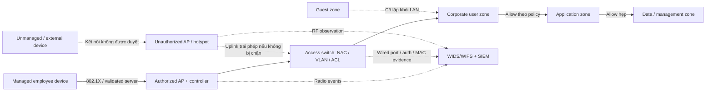
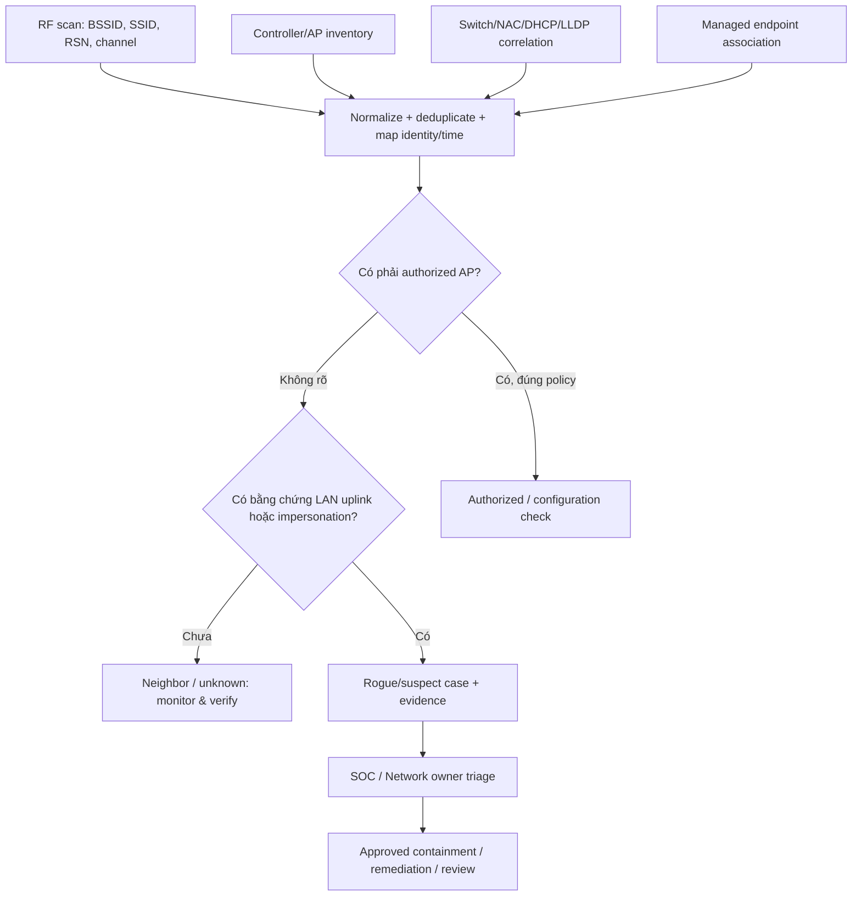
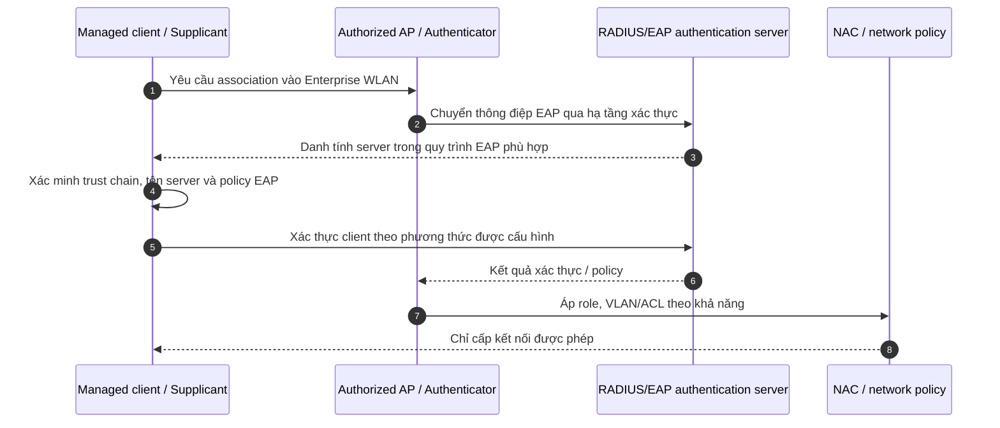

# Rogue access point

> **Học phần:** `SECURITY_NETWORK_SECURITY`  
> **Chương:** Wireless security  
> **Chủ đề:** Nhận diện, đánh giá và xử lý **rogue access point (rogue AP)** trong mạng không dây, phân biệt thiết bị phát sóng chưa được phê duyệt với điểm truy cập giả mạo (*evil twin*), kết hợp WIDS/WIPS, NAC, 802.1X, phân đoạn, firewall và giám sát an ninh.

## Mục tiêu học tập

Sau bài này, người học có thể:

1. Giải thích **rogue AP**, **evil twin**, **neighbor AP**, hotspot cá nhân và **unauthorized bridge**, tránh xem tất cả SSID lạ là tấn công.
2. Phân biệt **SSID, BSSID, ESS, radio/channel, association** và những thuộc tính cấu hình bảo mật mà bộ giám sát có thể quan sát.
3. Phác họa các đường rủi ro: AP ngoài kiểm soát cắm vào LAN, giả mạo SSID để thu hút client, bridge giữa Wi-Fi và VLAN nội bộ, captive portal không đáng tin.
4. Hiểu cách phát hiện dựa trên **wireless telemetry, inventory, controller, switch/NAC, DHCP, LLDP, firewall và endpoint**; tách tín hiệu với bằng chứng.
5. Áp dụng phòng vệ như **WPA3/WPA2-Enterprise, 802.1X/EAP-TLS, xác minh chứng chỉ server, PMF khi phù hợp, device management và zero-trust access**.
6. Xây dựng quy trình **phân loại severity, false positive, containment hợp lệ, thu thập bằng chứng và phục hồi**, không gây can nhiễu sóng cho mạng khác.
7. Viết quy tắc giám sát và kiểm thử trong lab có quyền, sử dụng **mô phỏng log, AP được cấp và quan sát thụ động**, không cần tạo mạng giả mạo nhắm người dùng thật.

## 1. Rogue access point là gì?

**Access point (AP)** là thiết bị hoặc phần mềm cung cấp kết nối Wi-Fi cho các station/client, thường nối WLAN với một mạng có dây hay hạ tầng khác. **Rogue access point** trong quản trị an ninh là AP **không được tổ chức phê duyệt**, hoạt động trong phạm vi ảnh hưởng hoặc liên quan tới tài nguyên của tổ chức theo cách vi phạm chính sách.

Một rogue AP có thể là:

- Một router Wi-Fi cá nhân được nhân viên cắm vào cổng LAN doanh nghiệp để có Wi-Fi tiện lợi.
- Một hotspot/soft AP bật trên laptop hoặc thiết bị di động, tạo đường truy cập mà chính sách quản trị chưa đánh giá.
- Một AP bị cấu hình nhầm, nằm ngoài hệ thống controller/inventory dù cắm vào hạ tầng nội bộ.
- Một thiết bị giả mạo tên mạng doanh nghiệp để khiến client kết nối.
- Một AP do đối tượng bên ngoài triển khai ở khu vực lân cận, **nếu** có bằng chứng nó chủ động giả mạo hoặc can thiệp vào mạng tổ chức.

**Rogue không đồng nghĩa malicious.** Nhân viên có thể cắm AP vì tiện ích mà không có ý định tấn công, nhưng thiết bị vẫn mở ra đường truy cập ngoài kiểm soát. Ngược lại, một AP phát sóng gần văn phòng thuộc doanh nghiệp khác, dù trùng hoặc giống tên SSID, **không mặc nhiên** là rogue thuộc tổ chức.

### Kết quả bảo vệ mong muốn

Một thiết bị Wi-Fi hoặc AP chỉ được xem là **được tổ chức quản lý** khi có hồ sơ phê duyệt, trách nhiệm vận hành, cấu hình bảo mật, kết nối và định danh phù hợp. Mục tiêu không phải loại bỏ mọi sóng Wi-Fi lân cận, mà là:

- Không cho một AP chưa phê duyệt nối trực tiếp vào **trusted LAN**.
- Ngăn thiết bị người dùng tự động tin một AP giả mạo chỉ vì SSID quen thuộc.
- Phát hiện các đường **bridge, NAT, VPN hoặc routing** phá vỡ phân đoạn.
- Giảm khả năng credential/phiên truy cập bị lộ khi người dùng gặp mạng giả mạo.
- Có đủ bằng chứng để xử lý mà không nhầm với AP của hàng xóm hoặc thiết bị hợp lệ chưa cập nhật inventory.

## 2. Phân biệt rogue AP, evil twin và các tình huống tương tự

| Thuật ngữ | Đặc điểm | Có phải tấn công không? | Câu hỏi xác minh |
|---|---|---|---|
| **Authorized AP** | AP được inventory/controller quản lý, đúng vai trò và uplink | Không; có thể vẫn cấu hình lỗi | Serial, device identity, controller và switchport có khớp? |
| **Rogue AP on wired LAN** | AP không được duyệt nhưng có đường kết nối vào mạng doanh nghiệp | Vi phạm kiểm soát, có thể vô ý hoặc có chủ đích | Uplink nằm trên port/VLAN nào? |
| **Evil twin** | AP cố **mạo danh mạng hợp lệ** (ví dụ SSID và các đặc tính bề ngoài) để thu hút client | Thường là tình huống tấn công giả mạo | Có hành vi impersonation và bằng chứng client bị ảnh hưởng? |
| **Neighbor AP** | AP của tổ chức hoặc cá nhân khác trong vùng phủ sóng | Không tự là rogue | Có liên quan hạ tầng nội bộ hoặc hoạt động giả mạo? |
| **Personal hotspot** | Điện thoại/laptop phát Wi-Fi riêng | Tùy policy và có bridge hay không | Có nối mạng quản lý hay truyền traffic giữa hai mạng? |
| **Soft AP / ad-hoc** | Tính năng chia sẻ mạng hoặc peer-to-peer từ endpoint | Có thể hợp lệ hoặc vi phạm policy | Endpoint được quản lý, có authorization không? |
| **Misconfigured AP** | AP hợp lệ nhưng sai VLAN, authentication, firmware hoặc controller policy | Sự cố bảo mật/vận hành, không nhất thiết rogue | Ai sở hữu AP và lệch cấu hình nào? |
| **Rogue DHCP / gateway** | Máy phát DHCP hoặc định tuyến trái phép trên LAN | Liên quan nhưng **không nhất thiết là Wi-Fi AP** | Đây là vấn đề L2/L3 hay thực sự có radio Wi-Fi? |
| **Captive portal giả mạo** | Trang yêu cầu đăng nhập xuất hiện ở điểm mạng không đáng tin | Có thể là phishing; portal cũng có thể hợp lệ | Server, TLS, domain, phương thức xác thực và chính sách? |

**SSID giống nhau không đủ phân loại evil twin.** Nhiều AP hợp lệ trong cùng hệ thống có thể dùng chung SSID để roaming. Hai tổ chức khác nhau cũng có thể vô tình dùng SSID giống nhau. Để xác nhận giả mạo cần **ngữ cảnh và bằng chứng bổ sung**, không chỉ một trường text.

## 3. Kiến thức Wi-Fi nền tảng cho việc phát hiện

Một số khái niệm 802.11 thường thấy trong báo cáo WIDS/WIPS:

| Khái niệm | Ý nghĩa | Hạn chế khi dùng phát hiện |
|---|---|---|
| **SSID** | Tên logic mạng Wi-Fi được công bố hoặc cấu hình cho client | Không phải identity mật mã của AP; có thể trùng và đổi |
| **BSSID** | Định danh của một basic service set, thường liên hệ MAC của radio/virtual AP | Có thể bị giả mạo; AP đa radio/đa SSID có nhiều BSSID |
| **ESS** | Tập các BSS phục vụ cùng mạng logic, thường hỗ trợ roaming | Nhiều BSSID chung SSID có thể hoàn toàn hợp lệ |
| **Beacon/probe response** | Frame quảng bá thông tin mạng và khả năng kết nối | Thuộc tính trước khi xác thực không tự chứng minh tính chính danh |
| **RSN/security capabilities** | Thông tin các bộ mã hóa/authentication được AP công bố | Cần đối chiếu policy và kết quả bắt tay/xác thực thực tế |
| **Channel/band** | Tần số/kênh AP phát, như các băng 2,4/5/6 GHz theo thiết bị/quy định | AP có thể đổi kênh hợp lệ; nhiễu và giới hạn scan gây thiếu dữ liệu |
| **RSSI** | Chỉ báo cường độ tín hiệu nhận ở sensor | Không phải khoảng cách chính xác và không đủ để định vị người |
| **Association** | Trạng thái client liên kết vào AP | Association không chứng minh user đã xác thực mạng hay có quyền LAN |
| **802.1X/EAP** | Cơ chế xác thực truy cập ở Wi-Fi Enterprise | Phải kiểm tra danh tính server/chứng chỉ và chính sách supplicant |
| **PMF/802.11w** | Bảo vệ một số management frame phù hợp sau thiết lập bảo mật | Không biến SSID/BSSID thành danh tính chống giả mạo tuyệt đối |

### BSSID không phải khóa tin cậy tuyệt đối

Trong doanh nghiệp, nhiều BSSID khác nhau có thể được tạo từ AP đa radio, multiple BSS hoặc các cấu trúc virtual BSSID. BSSID quan trọng để **đối chiếu inventory**, nhưng không đủ để khẳng định “chính chủ” vì trường nhận dạng này có thể thay đổi hoặc bị bắt chước.

**Danh tính mạnh** nên đến từ đăng ký thiết bị/controller, certificate, 802.1X/EAP-TLS, xác thực server và chính sách thiết bị, chứ không chỉ từ SSID hay MAC.

## 4. Các đường rủi ro trong kiến trúc mạng doanh nghiệp

### 4.1 Rogue AP cắm trực tiếp vào LAN

Một AP không được phê duyệt có thể nối từ Wi-Fi vào switchport vốn cấp cho máy nhân viên. Nếu port có quyền vào user/production VLAN hoặc được phép truy cập management/data, AP trở thành **đường vào mới** mà đội quản trị không kiểm soát.

Rủi ro có thể gồm:

- Thiết bị ngoài tổ chức kết nối tới AP để nhận IP thuộc LAN hoặc tới tài nguyên nội bộ.
- Không áp chuẩn enterprise authentication, posture, certificate và logging.
- Tạo DHCP/NAT/bridge gây thay đổi đường đi hoặc tranh chấp dịch vụ.
- Lưu lượng đi **vòng** qua guest isolation hoặc firewall thiết kế cho Wi-Fi doanh nghiệp.
- Thiết bị không được vá, sử dụng mật khẩu chia sẻ yếu hoặc cấu hình quản trị mặc định.

Tác động tùy chính sách switch, 802.1X/MAB, VLAN, ACL, firewall, quyền ứng dụng và cách AP hoạt động. Một AP cắm vào cổng không có uplink hoặc VLAN guest cô lập có mức rủi ro khác AP nối được vào server VLAN.

### 4.2 Evil twin mạo danh SSID

Một mạng giả mạo có thể được đặt tên giống WLAN doanh nghiệp hoặc một hotspot phổ biến để khiến thiết bị/người dùng nhầm mạng. Nguy cơ thực tế phụ thuộc phương thức kết nối, xác thực server, captive portal, cấu hình auto-join, TLS và nhận thức người dùng.

**Chỉ kết nối Wi-Fi giả mạo không tự cho phép đọc mọi nội dung HTTPS.** HTTPS và xác thực ứng dụng vẫn bảo vệ dữ liệu khi được xác minh đúng; ngược lại, cảnh báo chứng chỉ bị bỏ qua, portal giả hoặc kết nối không bảo mật có thể tạo cơ hội lừa đảo và chuyển hướng.

### 4.3 Endpoint làm cầu nối không được duyệt

Một laptop đồng thời kết nối LAN/VPN và Wi-Fi hotspot, hoặc một thiết bị dùng NAT/Internet Connection Sharing, có thể trở thành đường giữa hai mạng không nên liên thông. Điều đó có thể phá vỡ ranh giới trust zone dù không có một AP vật lý riêng.

### Sơ đồ các ranh giới cần bảo vệ



Sơ đồ có tính khái niệm. Trong hệ thực, controller có thể quản lý AP qua tunnel, bridge ở access layer hoặc central switching; các đường giao tiếp cần được xác minh theo topology thực tế.

## 5. Threat modeling: tài sản, đối tượng và trust boundary

### Những tài sản cần bảo vệ

- **Wi-Fi identity:** hồ sơ SSID, cấu hình EAP, server CA và người dùng/thiết bị được phép.
- **Wired network:** VLAN, switchport, routing, NAC role và segmentation policy.
- **Dữ liệu:** thông tin trao đổi qua WLAN, token phiên, tài liệu doanh nghiệp và dữ liệu khách hàng.
- **Control plane:** WLAN controller, cloud-managed console, RADIUS, certificate authority, MDM.
- **Availability:** khả năng kết nối ổn định của người dùng, IoT/OT, khách và dịch vụ khẩn cấp.
- **Telemetry:** inventory AP, RF events, switch log, DHCP, EDR và SIEM.

### Các điểm chuyển trust boundary

| Ranh giới | Câu hỏi bảo mật | Biện pháp chính |
|---|---|---|
| Client → AP | Client có xác minh đúng mạng/server? | Cấu hình WPA-Enterprise, server cert validation, EAP-TLS |
| AP → switch/uplink | Thiết bị cắm vào port có được cho phép? | 802.1X/MAB có policy, port ACL, managed inventory |
| Wireless guest → corporate | Khách có được đi tới app/data/admin không? | Guest VLAN, firewall, client isolation, NAC |
| VPN/remote → internal | Có đường bridge hoặc split tunnel không được duyệt? | Endpoint policy, device posture, VPN/ZTNA, segmentation |
| Controller/RADIUS → AP | AP và server quản lý có đúng danh tính/cấu hình? | Device identity, RBAC, TLS, certificate lifecycle |
| Detection → response | Alert rogue có đủ bằng chứng để xử lý? | Correlation RF+wired, owner review, SOP, audit |

**Không đồng nhất khả năng đến được mạng với quyền ứng dụng.** Một rogue AP có thể làm tăng reachability, nhưng người dùng vẫn cần xác thực và authorization để truy xuất API/DB. Tránh nhảy từ “phát hiện SSID lạ” đến kết luận “dữ liệu đã bị đánh cắp”.

## 6. Phân loại theo vị trí và mức độ liên quan

Một hệ giám sát Wi-Fi có thể thấy nhiều mạng ngoài tầm quản lý. Cần đặt nhãn tách biệt:

1. **Authorized/managed:** Có inventory và controller state, đúng uplink/chứng thực, role và cấu hình.
2. **Authorized-but-misconfigured:** Sở hữu hợp lệ nhưng sai policy (ví dụ chỉ mở WPA2-Personal khi quy định cần Enterprise).
3. **Unauthorized-on-corporate-wired:** AP chưa phê duyệt, có bằng chứng uplink tới hạ tầng có dây thuộc tổ chức.
4. **Suspected impersonation:** SSID/RSN/BSSID hoặc behavior bất thường giống WLAN doanh nghiệp; còn cần bằng chứng xác nhận.
5. **External neighbor:** Mạng ngoài vùng quản lý, không có chứng cứ can thiệp.
6. **Unknown/insufficient evidence:** Không đủ dữ liệu để kết luận, cần bổ sung kiểm tra.

**Phân loại hai chiều:** một AP có thể vừa “unknown inventory” vừa “có dấu hiệu impostor” nhưng chưa thấy wired uplink. Nên giữ trường riêng cho `authorization_state`, `radio_classification`, `wired_correlation` và `incident_severity` thay vì gộp vào một nhãn “rogue” mơ hồ.

### Không suy chủ sở hữu từ RSSI

RSSI ở một sensor bị ảnh hưởng bởi anten, vật cản, multipath, công suất phát, kênh và di chuyển thiết bị. Mức tín hiệu mạnh **không chứng minh AP nằm trong văn phòng**. Khi cần xác minh vật lý, phối hợp nhân sự có thẩm quyền và hồ sơ tài sản, không tự xác định vị trí cá nhân dựa trên một phép đo vô tuyến.

## 7. Danh mục AP và source of truth

**Inventory** là điều kiện đầu tiên để phân biệt AP được duyệt với AP lạ.

### Các trường nên quản lý

| Trường | Công dụng |
|---|---|
| AP asset ID / serial | Danh tính vật lý, vòng đời thiết bị |
| Manufacturer/model/firmware | Theo dõi khả năng bảo mật và cập nhật |
| Controller/cloud tenant | Đơn vị quản lý AP |
| Management certificate / device identity | Đối chiếu thiết bị với controller khi hỗ trợ |
| BSSID list theo radio/SSID | So sánh các BSS đang phát |
| SSID, security profile, auth method | Xác minh cấu hình, WPA-Enterprise/PMF |
| Radio band/channel/config | Phát hiện lệch chính sách không cần thiết |
| Switch ID, port, VLAN, uplink topology | Xác minh AP nào nối vào mạng có dây |
| Location/owner (mức phù hợp) | Phục vụ vận hành và xử lý sự cố |
| Approved maintenance/change window | Giảm false positive khi thay AP/channel/firmware |
| Status/retire date | Tránh danh sách cũ gây phân loại sai |

**Danh sách BSSID tĩnh sẽ lỗi thời** khi thay thiết bị, thêm virtual SSID, thay radio hoặc sửa cấu hình. Đồng bộ inventory với controller có kiểm tra, nhưng không tự xóa mọi AP không còn thấy radio ngay lập tức; cần trạng thái lifecycle.

### Đặc biệt với cloud-managed Wi-Fi

Controller cloud thường có danh mục AP, alarm và policy. Cần giới hạn **RBAC/MFA, API token và quyền chỉnh SSID**, vì chiếm được tài khoản quản trị có thể làm giả cấu hình được đánh dấu “authorized” ngay trong hệ thống.

## 8. Wireless IDS/WIPS phát hiện rogue AP như thế nào?

**WIDS (Wireless Intrusion Detection System)** thu thập và phân tích sự kiện 802.11 để tạo cảnh báo. **WIPS (Wireless Intrusion Prevention System)** có thêm cơ chế ngăn chặn theo sản phẩm và chính sách; việc thực thi active containment phải được đánh giá pháp lý, tần số vô tuyến, rủi ro ảnh hưởng người khác và thẩm quyền.

### Vị trí thu thập

- AP được quản lý có thể dành thời gian scan hoặc dùng radio riêng để quan sát các BSSID lân cận.
- Dedicated RF sensor có thể theo dõi channel/band trong vùng được phép.
- WLAN controller tổng hợp danh sách neighbor và client association events.
- Switch/NAC/DHCP/LLDP cung cấp bằng chứng uplink có dây.
- Endpoint/EDR cung cấp SSID/BSSID đã kết nối và trạng thái profile, khi agent hỗ trợ.

**Một sensor không nhìn thấy toàn bộ phổ/tất cả tầng của hệ thống.** Nếu AP và sensor hoạt động ở band/channel khác, hoặc có thời gian scan không đủ, dữ liệu có thể thiếu. Khi đánh giá, ghi độ phủ của các band 2,4/5/6 GHz, AP density, client roaming và topology.

### RF detection khác wired correlation

| Loại bằng chứng | Khẳng định có thể hỗ trợ | Hạn chế |
|---|---|---|
| RF thấy BSSID/SSID chưa có inventory | Một BSS chưa xác định có mặt trong vùng nghe | Không biết có nối vào LAN tổ chức không |
| Controller không quản lý BSSID | Không phải BSSID hiện được controller sở hữu | Có thể là neighbor hoặc AP được cấp nhưng chưa đồng bộ |
| Switch CAM/MAC table + port | Có MAC hoạt động ở một uplink cụ thể | MAC có thể giả, MAC của AP không nhất thiết trùng BSSID |
| LLDP/CDP/device telemetry | Gợi ý loại thiết bị và cổng kết nối | Có thể thiếu, không phải attestation mật mã |
| DHCP/DNS/ARP/flow | Thiết bị phát sinh traffic trên mạng tổ chức | Cần ghép danh tính/đường đi và thời điểm |
| Endpoint association event | Client đã kết nối tới BSSID/SSID nào | Chưa chứng minh có đánh cắp credential |
| NAC auth/port policy | Port hoặc device được phê duyệt theo rule nào | Policy có thể sai hoặc fallback/MAB quá rộng |
| Physical asset verification | Có thiết bị thực và owner rõ | Cần quy trình, không tự ý can thiệp mạng bên thứ ba |

**Mức tin cậy cao hơn thường cần ít nhất hai loại bằng chứng độc lập**: ví dụ RF unknown + wired port mapping + asset-owner xác nhận không phê duyệt. Tùy rủi ro, một tín hiệu đáng tin từ switch/NAC cũng có thể đủ để ưu tiên điều tra, nhưng không nên tuyên bố đã xác định thiết bị vật lý chỉ dựa vào BSSID.

## 9. Pipeline phát hiện và đánh giá false positive



### Nguồn gây false positive

- AP của doanh nghiệp kế bên phát SSID giống hoặc gần giống mạng tổ chức.
- AP chính thức vừa được thay, chưa đồng bộ vào inventory hoặc dùng BSSID mới sau cập nhật.
- AP ảo/mesh/repeater trong kiến trúc hợp lệ có BSSID và uplink không giống kỳ vọng.
- Thiết bị làm việc từ xa phát Wi-Fi/hotspot **không nối vào corporate LAN**.
- Sự kiện scan bị trùng hoặc packet loss tạo ảnh hưởng tới tần suất xuất hiện.
- Controller migration, firmware update làm thay đổi trường nhận dạng.
- Sensor nhận BSSID mạnh nhưng thiết bị thật đặt ngoài phạm vi quản lý.
- Tính năng private MAC/randomized MAC ở **client** làm mapping MAC dễ lệch.

**False negative** cũng có thể xảy ra: AP ở vùng sóng sensor không phủ, thiết bị chỉ bật ngắn, nằm ở band không được scan, dùng đường uplink khác, hoặc luồng thông qua endpoint soft AP mà inventory không quan sát.

## 10. Các dấu hiệu đáng điều tra

Một rule phát hiện rogue AP không nên chỉ là “SSID mới”. Nên kết hợp:

| Dấu hiệu | Vì sao đáng xem | Cần xác minh |
|---|---|---|
| BSSID chưa được duyệt nhưng phát SSID nội bộ | Có thể là AP mới, sai inventory hoặc giả mạo | Controller, serial/owner, security profile |
| SSID doanh nghiệp với security mode yếu khác baseline | Có thể gây nhầm lẫn và downgrade cấu hình client | RSN/AKM, auth method, client auto-join |
| Một client quản lý kết nối tới BSSID ngoài danh sách | Có khả năng association vào AP không được quản lý | Endpoint profile, BSSID history, user context |
| MAC/port lạ được switch học và phát sinh lưu lượng kiểu AP | Có thể có uplink chưa phê duyệt | CAM table, NAC authentication, DHCP, port owner |
| WLAN doanh nghiệp xuất hiện trên kênh/band khác policy | AP sai cấu hình hoặc giả mạo | Change window, RF inventory, model |
| DHCP/gateway khác kỳ vọng sau khi client kết nối Wi-Fi | Có đường mạng/bridge không đúng thiết kế | DHCP/route logs, VLAN, AP/controller |
| Client nhận captive portal khác hợp đồng | Có thể là phishing hoặc gateway mới | URL, TLS certificate, owner, policy |
| Số client chuyển sang BSSID unknown tăng | Có ảnh hưởng thực tới thiết bị doanh nghiệp | Wireless association logs và EDR |
| Thay đổi AP security profile không có ticket | Có thể là lỗi vận hành hoặc thay đổi trái phép | Controller audit, IAM, configuration diff |
| Bất thường lặp ở địa điểm/sensor cụ thể | Cần triage theo thời gian và phạm vi | Coverage, neighboring networks, RF environment |

Một BSSID ngoài inventory có thể là thiết bị mới của doanh nghiệp được cấp nhưng chưa cập nhật; một SSID quen thuộc **không chắc** được phát bởi AP chính thức. Vì vậy cả **allowlist** và **threat indicators** đều phải được bổ sung bằng xác minh nguồn.

## 11. Authentication: WPA2/WPA3 và 802.1X có vai trò gì?

Wi-Fi bảo vệ đường truy cập bằng nhiều chế độ với mức bảo đảm khác nhau. Không nên chỉ xem “có biểu tượng ổ khóa” là bảo vệ đủ.

| Chế độ | Bảo vệ chính | Rủi ro/giới hạn đáng nhớ |
|---|---|---|
| **Open Wi-Fi** | Không có xác thực và mã hóa dữ liệu lớp liên kết theo cách open truyền thống | Không chứng thực AP; traffic ứng dụng phải được TLS bảo vệ |
| **Enhanced Open / OWE** | Mã hóa liên kết cho open WLAN theo khả năng triển khai | Không cung cấp xác thực AP và người dùng ở mức Enterprise |
| **WPA2-Personal (PSK)** | Sử dụng mật khẩu chia sẻ của WLAN | Chia sẻ mật khẩu rộng, vòng đời/thu hồi khó, không xác thực server Enterprise |
| **WPA3-Personal (SAE)** | Xác thực bằng SAE và bảo mật phiên mạnh hơn so với PSK truyền thống | Không tự chứng minh AP thuộc tổ chức; vẫn phải quản lý mật khẩu/profile |
| **WPA2-Enterprise / 802.1X** | EAP/RADIUS và chính sách danh tính người dùng/thiết bị | Chọn EAP yếu/cấu hình client bỏ qua xác thực server có thể tạo lỗ hổng |
| **WPA3-Enterprise** | Chế độ Enterprise với yêu cầu khả năng bảo mật mạnh hơn theo profile | Hỗ trợ và yêu cầu cụ thể phụ thuộc thiết bị/certification; client vẫn cần trust đúng |

### Đừng đánh đồng encryption với identity

Một AP trái phép có thể công bố cùng tên SSID và thiết lập kết nối mã hóa riêng với client. **Mã hóa liên kết không tự chứng minh đó là AP quản lý**. Với Enterprise, client phải xác thực đúng **authentication server**, chính sách EAP và chứng chỉ/định danh server; điều này giảm nguy cơ đánh cắp thông tin xác thực do cấu hình sai.

### 802.1X và RADIUS

Trong WLAN Enterprise, có ba vai trò khái niệm:

- **Supplicant:** thiết bị/client yêu cầu truy cập.
- **Authenticator:** AP hoặc WLAN controller kiểm soát việc cấp đường truy cập.
- **Authentication server:** RADIUS/EAP backend đánh giá xác thực và policy.



Sơ đồ lược bỏ nhiều bản tin trung gian và trao đổi khóa; không phải trace EAP thực tế. Quan trọng nhất là **client từ chối server identity không hợp lệ** trước khi gửi thông tin có thể bị lạm dụng theo EAP profile.

## 12. EAP-TLS và xác minh chứng chỉ server

**EAP-TLS** dùng chứng chỉ trong quy trình xác thực TLS tương hỗ khi cấu hình đúng. Đây là lựa chọn thường được khuyến khích cho môi trường thiết bị quản lý vì có thể cấp/thu hồi credential từng thiết bị hoặc user, không phải dùng chung một bí mật WLAN.

Các yêu cầu triển khai:

1. **PKI quản trị tốt:** phát chứng chỉ hợp lệ, xác định principal và thu hồi/đổi chứng chỉ.
2. **Client profile được quản lý:** kiểm tra CA được tin, **tên server** và loại EAP được cấp phép.
3. **Không bỏ qua cảnh báo certificate:** người dùng không được tự xác nhận một RADIUS server lạ chỉ để kết nối nhanh.
4. **Identity mapping:** chứng chỉ và NAC role ánh xạ đúng thiết bị, user, nhóm và policy.
5. **Bảo vệ khóa riêng:** keystore/TPM hoặc secure element nếu thiết bị hỗ trợ, backup/revocation thích hợp.
6. **Quản lý vòng đời:** hết hạn, thay CA, server migration và hỗ trợ thiết bị không tương thích.
7. **Phân đoạn sau xác thực:** VLAN/ACL, user role, VPN/ZTNA/IAM và authorization ứng dụng tiếp tục bảo vệ tài nguyên.

**Không phải mọi phương thức EAP đều tương đương.** PEAP hoặc EAP-TTLS có các yêu cầu xác minh chứng chỉ server và thuộc tính credential khác EAP-TLS. Việc bật “802.1X” nhưng cho client chấp nhận tùy ý certificate có thể làm suy yếu khả năng chống AP giả mạo.

### Ví dụ policy supplicant (mô tả, không phải cấu hình thiết bị thực)

```yaml
wifiProfile:
  ssid: "Corp-Managed"
  expectedAuthentication: "WPA-Enterprise"
  eapMethod: "EAP-TLS"
  trustedServerCA: "Enterprise-RADIUS-CA"
  expectedRadiusServerNames:
    - "radius1.internal.example"
    - "radius2.internal.example"
  allowUserToOverrideCertificateErrors: false
  autoJoin: true
  requireManagedDeviceIdentity: true
  postAuthAccess:
    nacRole: "managed-employee"
    segmentationPolicy: "least-privilege"
```

Ví dụ là **policy hướng dẫn**, không phải schema chuẩn của MDM/supplicant, và các tên miền là minh họa. Phần mềm thực có cách cấu hình CA/server name/EAP method riêng; phải kiểm thử profile trên từng nhóm hệ điều hành và supplicant.

### Phát hiện certificate warnings có ý nghĩa gì?

Nếu nhiều endpoint bỗng ghi log **server certificate mismatch** khi cố kết nối vào SSID doanh nghiệp, đây là tín hiệu cần xem vì có thể do AP giả mạo hoặc RADIUS server cấu hình sai. Không tự kết luận là evil twin; điều tra đồng thời **lịch thay chứng chỉ, cấu hình MDM, tên server và sự kiện RF**.

## 13. PMF, bảo vệ management frame và giới hạn

**Protected Management Frames (PMF)**, gắn với IEEE 802.11w và các cơ chế bảo vệ trong 802.11 hiện đại, bảo vệ một số **robust management frames** sau khi các bên đã thiết lập ngữ cảnh bảo mật phù hợp. Điều này góp phần giảm rủi ro giả mạo hoặc sửa một số frame quản trị.

PMF **không**:

- Chứng minh một SSID đang phát thuộc doanh nghiệp.
- Mã hóa mọi beacon/probe response trước khi client xác thực.
- Ngăn hoàn toàn việc can nhiễu vô tuyến hoặc mọi hình thức gây gián đoạn mạng.
- Thay thế kiểm tra chứng chỉ RADIUS, device identity hay network segmentation.

Trên các profile WPA3, PMF có yêu cầu theo chứng nhận/chế độ tương ứng. Khi thiết kế mạng hỗn hợp WPA2/WPA3, cần xác minh **chế độ transition**, thiết bị cũ và khả năng downgrade của client thay vì chỉ bật một checkbox.

**Không thực hiện active containment bằng các frame ngắt kết nối vào mạng lân cận** chỉ vì phát hiện một SSID giống doanh nghiệp. Cơ chế can thiệp vô tuyến có thể ảnh hưởng mạng hợp pháp, bị hạn chế pháp lý hoặc gây gián đoạn dịch vụ. Bài này tập trung vào nhận diện, policy và xử lý được phê duyệt.

## 14. NAC, switchport và phòng vệ trước AP tự cắm vào LAN

Một AP giả mạo trên RF chỉ trở thành đường vào nội bộ trực tiếp khi có **đường uplink và quyền mạng** tương ứng. Bảo vệ switch access layer vì vậy là lớp quan trọng.

### Các biện pháp thường dùng

| Cơ chế | Vai trò | Hạn chế |
|---|---|---|
| **Wired 802.1X/NAC** | Xác thực thiết bị hoặc user trước khi cấp port/network role | Cần xác định policy fallback và ngoại lệ cho thiết bị không hỗ trợ |
| **MAB (MAC Authentication Bypass)** | Cấp truy cập dựa MAC cho thiết bị legacy theo policy | MAC dễ bị giả; không phải xác thực mạnh |
| **Port ACL/dynamic ACL** | Giới hạn luồng từ cổng access cụ thể | Cần quản lý policy, VLAN và return path |
| **Port security** | Giới hạn số/loại địa chỉ MAC và hành vi được phép | Không đủ để xác minh toàn bộ danh tính; một AP NAT có thể che client |
| **DHCP snooping** | Xác định cổng DHCP tin cậy, hạn chế server DHCP trái phép | Không thay thế 802.1X hoặc kiểm soát bridge |
| **Dynamic ARP Inspection** | Giảm một số hình thức giả mạo ARP khi kết hợp binding đáng tin | Phụ thuộc topology/DHCP bindings và IPv4 |
| **IPv6 RA Guard / ND inspection** | Hạn chế một số router advertisement hoặc ND không được phép | Phụ thuộc sản phẩm/khả năng, không thay thế IPv6 ACL |
| **VLAN/VRF segmentation** | Cô lập guest/IoT/user/management theo role | Routing mở rộng vẫn có thể tạo đường bypass |
| **Firewall/egress policy** | Giới hạn ứng dụng và đích reachable kể cả khi LAN nối được | Không tự phát hiện AP có radio và vị trí vật lý |

**Port security không đồng nghĩa chặn mọi rogue AP.** Thiết bị NAT chỉ có thể lộ MAC uplink của nó, còn client nằm phía sau; số MAC học trên switch có thể không đủ để nhận ra AP. Cần phối hợp **wired NAC, inventory, port analytics và RF detection**.

### Guest Wi-Fi và thiết bị IoT

- Tách guest với corporate/management và chỉ cho phép dịch vụ thực sự cần; không cho khách đi vào user VLAN vì dùng cùng tòa nhà.
- Với IoT/OT, dùng vai trò thiết bị và cổng riêng có hạn chế; loại thiết bị không hỗ trợ 802.1X có thể cần exception quản trị **hẹp**, ghi owner và ngày review.
- Giữ **quản trị AP/controller** trong management zone, giới hạn từ bastion/admin có MFA, RBAC và audit.

## 15. Device management và chính sách tự động kết nối

Nhiều sự cố liên quan evil twin bắt đầu từ **client Wi-Fi profile**, không phải router.

### Kiểm soát trên thiết bị được quản lý

- Phát WLAN profile qua MDM/endpoint management, định nghĩa SSID, phương thức EAP, CA, tên server và policy certificate.
- Chỉ bật **auto-join** cho profile có cấu hình bảo đảm danh tính thích hợp; tránh tự kết nối tới open SSID chung có tên quen thuộc khi policy không cho phép.
- Xóa hoặc hạn chế profile mạng không còn được phê duyệt theo quy định, có lưu ý nhu cầu làm việc của user.
- Giám sát tình trạng **joined BSSID/SSID/security mode** khi hệ điều hành cung cấp và tổ chức được phép thu thập.
- Bắt buộc cập nhật OS, driver, supplicant và firmware để khắc phục lỗi Wi-Fi đã được công bố.
- Dùng endpoint firewall, VPN/ZTNA và xác thực ứng dụng để giảm tác động ngay cả khi endpoint dùng mạng không đáng tin.

### Captive portal và việc nhập credential

Một captive portal thường chỉ là cổng điều kiện sử dụng Internet cho guest. **Không nên yêu cầu người dùng nhập mật khẩu doanh nghiệp vào portal lạ** để “xác minh Wi-Fi” nếu quy trình chính thức dùng Enterprise EAP-TLS/SSO ở vị trí đã được xác thực. Với portal hợp pháp, phải có URL, domain, TLS và owner được công bố rõ ràng.

**Phân biệt cổng Wi-Fi và trang web HTTPS:** HTTPS đúng chứng chỉ của một domain không tự chứng minh AP thuộc tổ chức, nhưng nó giúp bảo vệ kết nối tới dịch vụ thật khi client không bỏ qua cảnh báo. Chính sách Wi-Fi nên bổ sung thay vì thay thế các lớp xác thực ứng dụng.

## 16. Ảnh hưởng của roaming, mesh và nhiều băng tần

Một mạng doanh nghiệp có thể phát cùng SSID qua hàng trăm BSSID và nhiều băng. Điều đó là bình thường khi:

- Client roaming giữa AP theo yêu cầu vùng phủ sóng.
- AP sử dụng nhiều radio hoặc nhiều virtual interface.
- Controller cấu hình các chức năng roaming như 802.11k/v/r khi thiết bị hỗ trợ.
- Mạng 6 GHz có yêu cầu bảo mật và cơ chế discovery khác các band khác theo profile.
- AP mesh hoặc extender được quản lý có đường backhaul không giống uplink Ethernet của AP thông thường.

**Không coi BSSID mới = evil twin.** Khi cần phân biệt, đối chiếu serial/controller, enterprise security capabilities, client authentication results, inventory update và wired uplink.

Cần kiểm thử cấu hình WPA3/PMF và roaming thực trên các nhóm thiết bị được hỗ trợ. Những tính năng giúp roaming nhanh **không tự thay thế kiểm tra danh tính AP/RADIUS**. Khi thay controller hoặc triển khai SSID mới, đánh giá ảnh hưởng detection để tránh hàng loạt false positive.

## 17. Thiết kế severity và confidence

Một cảnh báo “AP unknown” thường chưa đủ để tạo incident Critical. Nên tách:

- **Detection confidence:** mức chắc chắn AP thực không được duyệt hoặc có hành vi mạo danh.
- **Incident severity:** nguy cơ/tác động dựa trên quyền uplink, số client, tài sản, thông tin xác thực và ảnh hưởng dịch vụ.
- **Response priority:** công việc nào cần xử lý trước, theo quy trình SOC.

### Ma trận minh họa

| Tình huống | Confidence sơ bộ | Severity gợi ý để triage | Lý do |
|---|---|---|---|
| AP hàng xóm có SSID giống tên phổ biến | Thấp về giả mạo | Informational/Low | Chưa có wired correlation hoặc client ảnh hưởng |
| BSSID mới trên AP vừa thay có ticket | Cao về authorized | Informational | Inventory drift, cần đồng bộ |
| AP lạ có bằng chứng switchport vào guest VLAN | Cao về unauthorized | Medium | Vi phạm policy nhưng vẫn cô lập LAN nhạy cảm |
| AP lạ nối được user VLAN, không có owner | Cao về rogue wired | High | Có đường vào cần điều tra và cô lập |
| SSID nội bộ bị bắt chước, endpoint liên tục báo server cert mismatch | Trung bình về giả mạo; cần correlation | High tùy số client/tác động | Rủi ro lừa client, còn chưa biết credential có lộ không |
| Có audit cho thấy tài khoản bị lộ qua trang giả cùng thời điểm và truy cập trái phép | Cao nếu liên kết bằng chứng vững | High/Critical theo tác động | Tác động/identity compromise đã được xác minh |
| RF sensor thấy AP unknown nhưng không có uplink/association evidence | Thấp | Low/Investigate | Không đủ điều kiện kết luận |

**Ví dụ không phải SLA/rule chung.** Nếu management VLAN có dữ liệu nhạy cảm và một AP không được duyệt có quyền đi vào đó, severity cần tăng theo impact. Nếu client đã được bảo vệ bởi EAP-TLS và không kết nối tới AP lạ, vẫn cần rà soát tín hiệu, nhưng không được suy rằng thông tin đăng nhập đã bị lộ.

## 18. Schema log và correlation cho WIDS/WIPS

### Các trường nên giữ

| Trường | Mục đích |
|---|---|
| `event_time`, timezone, sensor ID | Xác định đúng lúc và độ phủ RF |
| `bssid`, `ssid`, band, channel | Nhận diện BSS quan sát |
| `security_mode`, AKM/RSN, PMF mode | So sánh security profile kỳ vọng |
| `controller_inventory_match` | AP có thuộc danh mục quản lý không? |
| `wired_evidence`, switch ID/port/VLAN | AP có liên hệ hạ tầng nội bộ không? |
| `client_association_count` | Có thiết bị kết nối vào BSSID này hay không, nếu telemetry hỗ trợ |
| `nac_identity`, device/asset ID | Nối đúng thiết bị với auth event |
| `detection_type`, rule ID, confidence | Biết vì sao alert được tạo |
| `severity`, disposition, case ID | Theo dõi triage và quyết định |
| `response_action`, approver, change ID | Audit can thiệp và rollback |
| Evidence references | Đối chiếu RF, controller, switch và endpoint mà không dump dữ liệu không cần |

### JSON event giả định

```json
{
  "eventTime": "2026-11-28T11:10:00Z",
  "sensorId": "wids-floor-demo-01",
  "ssid": "Corp-Managed",
  "bssid": "02:00:00:00:05:13",
  "band": "5GHz",
  "channel": 36,
  "securityMode": "WPA2-Personal",
  "expectedSecurityMode": "WPA-Enterprise",
  "controllerInventoryMatch": false,
  "wiredCorrelation": "unresolved",
  "observedClientAssociations": 0,
  "detectionType": "corporate-ssid-security-profile-mismatch",
  "confidence": "medium",
  "status": "needs-triage",
  "policyAction": "monitor-only"
}
```

Dữ liệu là **giả lập**, địa chỉ MAC ở đây dùng local-admin bit để minh họa và không phải IOC thực. Không kết luận rogue wired khi `wiredCorrelation=unresolved`. Sự kiện cần được so sánh với hồ sơ SSID, controller, endpoint và switch có liên quan.

### Không nên thu thập quá mức

SSID và BSSID có thể chỉ ra địa điểm, thói quen di chuyển và thiết bị quanh tổ chức. Đặt mục đích, quyền truy cập, thời hạn retention và audit rõ; tránh lưu **payload người dùng, thông tin xác thực hoặc vị trí suy đoán của cá nhân** không cần cho mục đích bảo mật.

## 19. Một rule phát hiện minh họa

Thiết kế rule dựa trên **kết hợp** hồ sơ SSID, dữ liệu inventory và bằng chứng wired. Ví dụ trung lập nhà cung cấp:

```yaml
ruleId: WIFI-ROGUE-AP-005
owner: wireless-security-team
scope:
  managedSsids:
    - "Corp-Managed"
  sensorSites:
    - "site-demo"
inputs:
  - rfObservation
  - controllerInventory
  - nacSwitchTelemetry
  - endpointAssociation
conditions:
  suspicious:
    - "ssid_matches_managed_profile"
    - "bssid_not_in_authorized_inventory"
    - "security_profile_mismatch_or_unexplained_change"
  elevateWhen:
    - "wired_uplink_to_corporate_network_confirmed"
    - "managed_endpoint_association_confirmed"
    - "radius_server_cert_mismatch_correlated"
actions:
  initial: "create-investigation-signal"
  automaticRfContainment: false
  requireHumanApprovalForNetworkPortIsolation: true
  preserveEvidence: true
review:
  inventorySyncRequired: true
  changeWindowExceptionExpiry: "required"
```

**Không phải policy nạp trực tiếp vào WIPS, Cisco/Aruba/Juniper hoặc cloud controller.** Cú pháp, khả năng lấy thông tin 802.11, thuật toán RF classification và action khác nhau theo sản phẩm.

### Mã giả correlation

```text
onRfObservation(ap):
    normalize SSID/BSSID/security profile and sensor time
    find inventory candidates from controller and approved asset records
    if strong managed-device identity and configuration match:
        classify as authorized, or misconfigured if policy differs
        return

    evidence = correlate_with_switch_port_nac_dhcp_and_endpoint(ap, time_window)

    if confirmed_unapproved_corporate_wired_uplink(evidence):
        create rogue-wired case with bounded severity and owner
    else if managed_ssid_imitation_and_client_impact_evidence(ap, evidence):
        create impersonation-suspected case
    else:
        classify external-neighbor-or-unknown; request more evidence

    preserve raw observations, inventory version and reason
    never perform active RF containment solely from a text SSID match
```

**Lưu ý về thuật toán:** Một BSSID **không luôn trùng MAC uplink** của AP. Correlation phải sử dụng thông tin controller/thiết bị, vendor behavior, đường port và bằng chứng đủ tin cậy; không dùng so khớp MAC một-một như quy tắc tuyệt đối.

## 20. Playbook điều tra rogue access point

### Bước 1 — Xác nhận dữ liệu và phạm vi

- Nhận alert WIDS/WIPS, xem sensor nào, timestamp, SSID/BSSID, RSN/security profile, số client và rule ID.
- Xác định sensor đang thu band/channel nào; kiểm tra duplicate, out-of-date inventory hoặc controller migration.
- Phân biệt AP chưa đăng ký với AP hợp lệ có cấu hình vừa thay đổi.

### Bước 2 — Xác định liên quan tới mạng có dây

- Kiểm tra switchport/NAC, controller, DHCP, LLDP và flow đúng thời điểm.
- Xác nhận có **physical/wired uplink** thuộc tổ chức không, đi qua VLAN/VRF/ACL nào.
- Xem port được cấp cho người/thiết bị nào, ticket thay đổi hoặc exception có còn hiệu lực không.
- Không chỉ dựa vào việc thấy cùng OUI/MAC gần giống; MAC có thể bị thay đổi và BSSID khác wired MAC.

### Bước 3 — Điều tra client bị ảnh hưởng

- Kiểm tra các thiết bị quản lý đã **associate** tới BSSID nào.
- Với Enterprise Wi-Fi, đối chiếu EAP/RADIUS success/failure, **certificate validation errors** và client profile.
- Xác minh portal/domain nếu có dấu hiệu người dùng gặp trang đăng nhập lạ.
- Chỉ khi có bằng chứng phù hợp mới mở rộng điều tra credential/phiên bị lộ và hành vi sau sự kiện.

### Bước 4 — Đánh giá severity, confidence và tác động

- AP đã cấp đường tới user/data/management hay chỉ guest?
- Có client bị chuyển sang SSID/BSSID lạ không?
- Có hành vi xác thực bất thường hoặc kết nối HTTPS bị thay đổi không?
- Có tác động dịch vụ do nhiễu, xung đột DHCP, sai VLAN hoặc phản ứng tự động trước đó không?
- Có sự kiện vận hành hợp lệ giải thích dữ liệu không?

### Bước 5 — Containment có thẩm quyền

**Ưu tiên biện pháp ít ảnh hưởng và kiểm chứng được:**

- Với rogue AP **đã xác minh nối vào switch của tổ chức**, có thể cô lập **switchport/VLAN/role** theo SOP và approval; chuẩn bị rollback cho thiết bị có thể bị ảnh hưởng.
- Với AP hợp lệ nhưng misconfigured, sửa SSID/security profile/controller/firmware và ghi change.
- Với endpoint soft AP bị cấm, xử lý qua **MDM/endpoint policy** hoặc owner theo quy trình.
- Với suspected evil twin ngoài hạ tầng, tăng cường **device profile/certificate validation**, thông báo người dùng phù hợp, giám sát và phối hợp đơn vị có thẩm quyền nếu cần.
- **Không tự thực hiện deauthentication/jamming/active RF containment** đối với mạng lân cận. Các biện pháp can thiệp vô tuyến có thể vi phạm quy định và ảnh hưởng kết nối hợp pháp.

### Bước 6 — Phục hồi và hậu kiểm

- Xác nhận WLAN hợp lệ và thiết bị người dùng kết nối đúng EAP server, SSID/profile.
- Kiểm tra DHCP/DNS/firewall/segmentation trở về trạng thái dự kiến.
- Xác minh port isolation/ACL không gây mất dịch vụ trọng yếu.
- Lưu evidence, owner, rule version, incident timeline và khuyến nghị phòng ngừa.
- Đồng bộ inventory, sửa ngoại lệ lâu ngày và kiểm tra lại các khu vực/sensor có khoảng mù.

## 21. Case study: AP cá nhân ở phòng họp

**Bối cảnh giả lập:** Một nhân viên mang bộ phát Wi-Fi cá nhân tới phòng họp, cắm vào port Ethernet để chia sẻ kết nối cho nhiều thiết bị. WIDS phát hiện SSID `Meeting-Guest` mới ở gần, switch có lưu lượng trên một port vốn dành cho máy trạm. Bộ phận IT chưa cấp AP này.

### Đánh giá ban đầu

- SSID mới + RF chưa có inventory **chưa đủ** kết luận có đường vào mạng.
- Switch/NAC và DHCP có thể xác nhận port thuộc user VLAN hoặc guest VLAN.
- Nếu AP dùng NAT, switch có thể chỉ thấy một MAC và một IP; không suy ra không có client phía sau.
- Nhân viên có thể không có ý định xấu nhưng cấu hình vẫn vi phạm quy trình phê duyệt thiết bị.

### Nhánh A — Cổng được cách ly

Port chỉ vào **guest/quarantine VLAN**, NAC không cấp đường tới application, data hoặc management, và không có hành vi mạo danh SSID doanh nghiệp.

**Xử lý:** Xác minh owner, thu hồi/cô lập thiết bị theo chính sách, cập nhật quy trình cung cấp Wi-Fi khách. Severity thường thấp hơn một AP có quyền nội bộ, nhưng cần xử lý vi phạm để ngăn lặp lại.

### Nhánh B — Cổng mở rộng vào LAN

Port được cấu hình vào user VLAN rộng, AP cho client bên ngoài vào mạng không qua 802.1X và không có log danh tính.

**Xử lý:** Ưu tiên điều tra, xác nhận luồng từ AP tới subnet nhạy cảm, cô lập uplink đúng thẩm quyền và rà soát policy port/NAC/segmentation. Không tuyên bố dữ liệu bị đánh cắp nếu chỉ có bằng chứng reachability.

### Bài học kiến trúc

Vấn đề không chỉ là “thấy AP lạ”. Root cause có thể là **port chưa có NAC, quyền VLAN rộng, thiếu inventory và không phân biệt client người dùng với thiết bị phát mạng**. Phòng vệ lâu dài nên giải quyết những yếu tố đó thay vì phụ thuộc hoàn toàn vào một chữ ký RF.

## 22. Case study: SSID giống doanh nghiệp nhưng không có uplink

**Bối cảnh giả lập:** WIDS thấy một BSSID lạ công bố SSID `Corp-Managed` nhưng dùng cơ chế authentication không khớp baseline. Không có switchport hay controller asset tương ứng. Một số thiết bị quản lý báo cảnh báo chứng chỉ RADIUS không hợp lệ khi thử kết nối WLAN có tên này.

### Nhận định kỹ thuật

- Tín hiệu đủ để **điều tra nghi ngờ giả mạo SSID**.
- Chưa biết AP nằm trong hay ngoài cơ sở; RF RSSI không đủ xác định.
- Chưa biết có ai hoàn tất xác thực, nhập credential hoặc bị chuyển hướng.
- Nếu endpoint được cấu hình kiểm tra CA/server đúng và **từ chối certificate mismatch**, đây là kiểm soát đang phát huy tác dụng.

### Hành động hợp lý

1. Kiểm tra change window của RADIUS/certificate, controller migration và SSID configuration.
2. Đối chiếu client EAP logs và security profile, xem server certificate mismatch có đồng nhất với BSSID/time không.
3. Rà soát chứng cứ RF, endpoint association và các dấu hiệu portal bất thường theo quyền.
4. Không yêu cầu user bỏ qua cảnh báo chứng chỉ để “khôi phục Wi-Fi”.
5. Đảm bảo profile MDM ép kiểm tra CA/server name; thu hồi credential nếu có **bằng chứng** lộ.
6. Phối hợp bộ phận phù hợp nếu có dấu hiệu AP ngoài khu vực tổ chức, tránh can thiệp vô tuyến không được phép.

**Kết luận có giới hạn:** Có thể đánh dấu *suspected evil twin* với confidence thích hợp; chỉ nâng thành incident credential compromise nếu có bằng chứng xác thực và truy cập trái phép liên quan.

## 23. Kiểm thử phòng vệ trong lab có quyền

Bài thực hành này **không yêu cầu dựng AP giả mạo hoặc thu hút thiết bị thật**. Dùng **log tổng hợp**, lab SSID riêng được cấp và thiết bị test đã đồng ý.

### Đầu vào mẫu

```csv
time,sensor,ssid,bssid,security,inventory,wired,client_associations
2026-11-28T11:00:00Z,sensor-demo,Corp-Managed,02:00:00:00:00:01,WPA-Enterprise,authorized,approved-uplink,12
2026-11-28T11:01:00Z,sensor-demo,Corp-Managed,02:00:00:00:00:02,WPA2-Personal,unknown,unresolved,0
2026-11-28T11:02:00Z,sensor-demo,Neighbor-WiFi,02:00:00:00:00:03,WPA3-Personal,external,none,0
2026-11-28T11:03:00Z,sensor-demo,Lab-Test-AP,02:00:00:00:00:04,WPA-Enterprise,approved-test,isolated-lab,1
```

**Yêu cầu phân loại:**

- Dòng 1: authorized nếu inventory/controller/cấu hình nhất quán.
- Dòng 2: **suspected impersonation/unknown**, cần correlation, không tự kết luận uplink nội bộ hoặc credential theft.
- Dòng 3: neighbor external, monitor theo policy nhưng không tự cô lập.
- Dòng 4: AP thử nghiệm có ticket, chỉ dùng trong lab, không nhầm thành rogue thực.

### Gherkin: test logic detection và response

```gherkin
Feature: Detect unauthorized wireless access points safely

  Scenario: Authorized AP is not misclassified
    Given an AP has a trusted inventory record and controller identity
    And its SSID, security profile and uplink match approved policy
    When wireless detections are correlated
    Then it is classified authorized
    And no rogue-AP incident is opened solely for its BSSID

  Scenario: Unknown BSSID without wired evidence stays unconfirmed
    Given a sensor observes an unknown BSSID near a site
    And no trusted wired or endpoint correlation exists
    When the detection engine evaluates it
    Then it remains unknown or external-neighbor candidate
    And its presence alone does not trigger active RF containment

  Scenario: Unauthorized AP on corporate wired access is prioritized
    Given an unapproved AP is confirmed on a corporate switchport
    And the port reaches a protected user zone
    When the case is enriched
    Then it is classified unauthorized-on-corporate-wired
    And the SOC receives the evidence and a response recommendation
    And port isolation requires the documented approval

  Scenario: Enterprise client refuses an untrusted RADIUS server
    Given a managed client expects the approved EAP server identity
    When a lab server presents an untrusted server identity
    Then the client refuses authentication
    And the certificate validation error is recorded
    And users are not instructed to ignore the error

  Scenario: Personal hotspot in an isolated guest lab is evaluated fairly
    Given a permitted test hotspot uses an isolated guest segment
    And a documented test window exists
    When its RF observations are ingested
    Then it is classified with the approved lab context
    And it is not escalated as a corporate wired compromise

  Scenario: Inventory drift generates a reconciliation action
    Given an approved AP receives a replacement radio with a new BSSID
    And the controller proves its managed identity and change ticket
    When the system notices a BSSID not in the old list
    Then the authorized inventory is reconciled
    And the event remains auditable
```

### Kiểm tra không xâm nhập

Trên endpoint **được phép** quản trị và có công cụ tương ứng, có thể kiểm tra profile Wi-Fi đã lưu và kết nối hiện tại qua giao diện quản trị OS/MDM. Những thao tác **quan sát thụ động hoặc đọc cấu hình** không cần phát gói can thiệp tới AP khác.

Ví dụ lệnh Linux dành cho máy thử nghiệm đã cài NetworkManager:

```bash
# Xem các connection profile, không thay đổi cấu hình.
nmcli connection show

# Xem trạng thái thiết bị và kết nối hiện tại.
nmcli device status

# Xem thông tin radio/AP do NetworkManager đã biết.
# Danh sách có thể phụ thuộc quyền, driver và dữ liệu scan hiện có.
nmcli -f IN-USE,SSID,BSSID,SECURITY,CHAN,SIGNAL device wifi list
```

Lệnh trên chỉ để minh họa observability trên thiết bị được ủy quyền; không quét chủ động bằng cách gửi frame can thiệp, không thu thập credential, không thử kết nối vào mạng bên ngoài không được phép.

## 24. Xử lý sự cố và các dấu hiệu mơ hồ

| Triệu chứng | Nguyên nhân có thể | Kiểm tra ưu tiên |
|---|---|---|
| SSID doanh nghiệp xuất hiện với BSSID mới | AP thay mới, multi-radio hoặc AP mạo danh | Inventory/controller, ticket, RSN và uplink |
| WIDS thấy rogue nhưng switch không tìm thấy port | Neighbor ngoài LAN, đường uplink khác hoặc correlation thiếu | Sensor coverage, controller, topology, endpoint event |
| WIDS báo ở nhiều sensor với RSSI khác nhau | Một AP được nghe ở nhiều vị trí | Dedupe theo BSSID/time, không suy ra nhiều AP |
| Client báo Wi-Fi certificate error | RADIUS CA/name đổi hoặc suspected evil twin | EAP profile, RADIUS change, server cert validation |
| Guest truy cập được internal subnet | Sai guest isolation, VLAN, ACL, routing hoặc hotspot bridge | Route, firewall, NAC, port config |
| Switch chỉ thấy một MAC dù nhiều thiết bị dùng Wi-Fi cá nhân | AP NAT hoặc proxy/MAC behavior | NAC/port/flow và asset verification |
| BSSID authorized nhưng security profile thay đổi | Cấu hình bị đổi hoặc controller update | Config audit, change ticket, policy |
| Chỉ band 6 GHz phát hiện sai hoặc bỏ sót | Sensor/driver không thu băng đó, scan cadence | Radio capability, regulatory setting, coverage |
| Có nhiều RF alerts nhưng không client bị ảnh hưởng | Neighbor/false positive hoặc attempts chưa thành công | Endpoint association, auth logs, impact |
| AP được cách ly nhưng user vẫn mất mạng | Cô lập nhầm uplink, switchport chia sẻ dịch vụ | Rollback, topology, change window, owner |
| WIPS nói “contained” nhưng client vẫn kết nối | Action chỉ ở điểm quan sát, luồng đi đường khác hoặc thiết bị không bị kiểm soát | Mode, scope, telemetry, legal policy |
| MDM profile không kết nối sau thay certificate | Trust chain/tên server/EAP method mismatch | PKI rollover, profile, client OS support |

**Triage theo tuyến nguyên nhân:** `RF observation → inventory/controller → wired port/NAC → client association/EAP → IP/DHCP/route → firewall/flow → app auth/audit`. Không bỏ qua quyền ứng dụng khi đánh giá tác động.

## 25. STRIDE cho rogue AP và evil twin

| Nhóm STRIDE | Tình huống | Kiểm soát |
|---|---|---|
| **Spoofing** | AP giả mạo SSID hoặc client bỏ qua xác minh server | Managed EAP-TLS profile, CA/server validation, identity assurance |
| **Tampering** | Controller/AP policy hoặc switch VLAN bị sửa trái phép | RBAC/MFA, signed change, config audit |
| **Repudiation** | Không biết ai cắm AP, thay cấu hình hoặc cô lập port | Switch/NAC logs, owner, ticket, response audit |
| **Information Disclosure** | Client gửi credential vào portal giả hoặc kết nối ngoài ý muốn | TLS, EAP identity check, phishing-resistant auth, data policy |
| **Denial of Service** | Phản ứng tự động hoặc can nhiễu làm gián đoạn Wi-Fi | Bảo vệ availability, tránh active RF containment tùy tiện |
| **Elevation of Privilege** | AP nối vào VLAN rộng, tạo reachability tới admin; lỗi authz tiếp theo bị khai thác | NAC, segmentation, IAM, least privilege, host firewall |

### Threat statement mẫu

> Một switchport ở khu vực họp cho phép thiết bị không xác thực truy cập user VLAN. Nếu AP cá nhân được nối vào cổng và phát WLAN không được tổ chức quản lý, client ngoài doanh nghiệp có thể nhận đường mạng không qua enterprise WLAN/NAC; điều này làm tăng khả năng tiếp cận tài sản nội bộ. Giảm thiểu bằng wired 802.1X, port ACL/guest isolation, WIDS+wired correlation, và kiểm tra quyền ở từng dịch vụ.

**Không coi khả năng tiếp cận là bằng chứng leo thang quyền thành công.** Lỗ hổng authorization và hậu quả dữ liệu phải được xác minh riêng.

## 26. Những hiểu nhầm phổ biến

**“SSID giống doanh nghiệp thì đó chắc chắn là evil twin.”** Không. Nhiều BSSID hợp lệ chung SSID; AP ngoài tổ chức cũng có thể vô tình trùng tên.

**“BSSID/MAC nằm trong allowlist thì AP chắc chắn chính hãng.”** Không. MAC có thể bị giả và AP đa radio có nhiều BSSID. Cần xác thực thiết bị/controller và inventory.

**“Rogue AP phải do hacker cài.”** Không. Thiết bị nhân viên tự ý cắm vẫn là rogue theo policy nếu tạo đường truy cập chưa duyệt.

**“WIDS thấy rogue tức nó đã nối vào corporate LAN.”** Không. WIDS có thể chỉ nghe thấy RF từ mạng hàng xóm. Cần wired correlation hoặc xác minh khác.

**“Bật WPA3-Personal sẽ tự xác minh danh tính AP của doanh nghiệp.”** Không. SAE tăng bảo mật Personal nhưng không mang bảo đảm EAP server identity của Enterprise profile.

**“802.1X là đủ dù client bỏ qua certificate warning.”** Sai. Xác minh danh tính authentication server và CA là điểm rất quan trọng của thiết kế Enterprise an toàn.

**“PMF chặn mọi evil twin và mọi kiểu can nhiễu.”** Không. PMF bảo vệ một số management frames theo trạng thái bảo mật, không chứng thực beacon/SSID theo cách tuyệt đối hoặc ngăn RF jamming.

**“Client đã vào rogue Wi-Fi nghĩa là HTTPS credential đã bị đánh cắp.”** Không. Cần chứng cứ về portal/phishing, TLS validation, traffic và hành động sau đó.

**“Port security một MAC sẽ loại bỏ rogue AP.”** Không chắc. AP NAT có thể che nhiều client phía sau một MAC uplink.

**“Tự động ngắt kết nối mọi AP chưa đăng ký là an toàn.”** Không. Có nguy cơ can thiệp mạng khác, gây gián đoạn và vi phạm quy định. Ưu tiên xác minh và containment qua hạ tầng có quyền sở hữu.

**“Vùng khách và user cùng dùng Wi-Fi thì không cần firewall.”** Không. SSID/SSID mapping phải phối hợp VLAN/VRF/ACL và quyền ứng dụng; một đường route mở có thể phá cô lập.

## 27. Checklist phòng vệ rogue access point

- [ ] Có inventory AP, controller, BSSID/radio, SSID, security profile, uplink, owner, firmware và change history.
- [ ] WIDS/WIPS có khả năng quan sát band/channel cần thiết; sensor coverage và khoảng mù được tài liệu hóa.
- [ ] Phân biệt authorized, misconfigured, unauthorized wired AP, suspected impersonation, neighbor và unknown.
- [ ] Không xem SSID/BSSID/RSSI đơn lẻ là bằng chứng AP được sở hữu hoặc có dây vào corporate LAN.
- [ ] Có correlation WIDS với controller, switch CAM/LLDP, NAC/802.1X, DHCP, VPN và endpoint association.
- [ ] Wired access port được bảo vệ bằng NAC/802.1X/ACL hoặc phương án tương đương; MAB exception có owner/expiry.
- [ ] Guest, IoT, user, data và management tách theo zone; routing và firewall không mở rộng bất thường.
- [ ] AP và WLAN controller nằm trong management plane, có RBAC/MFA, audit và bảo vệ API/credential.
- [ ] Enterprise WLAN dùng profile xác thực phù hợp, ưu tiên EAP-TLS cho managed device khi khả thi.
- [ ] Client xác minh **CA, tên RADIUS server và EAP method**, không cho bỏ qua lỗi chứng chỉ tùy tiện.
- [ ] WPA2/WPA3/PMF và transition/roaming được kiểm thử trên các nhóm thiết bị thật.
- [ ] Endpoint auto-join/profile và việc bật soft AP/hotspot được quản lý theo chính sách rõ ràng.
- [ ] Captive portal chính thức có thông tin domain/URL được công bố; không yêu cầu credential nội bộ qua portal lạ.
- [ ] Severity và confidence gắn với wired reachability, client impact, asset criticality và bằng chứng độc lập.
- [ ] RF logs được thu ở mức cần thiết, bảo vệ dữ liệu cá nhân, kiểm soát quyền truy cập và retention.
- [ ] Containment qua switchport/controller/endpoint chỉ thực hiện trong phạm vi tổ chức và theo quyền hạn.
- [ ] Không dùng active RF disruption/deauth/jamming vào mạng lân cận khi chưa được phép và đánh giá pháp lý.
- [ ] Có playbook điều tra, ticket, owner, rollback và post-incident review.
- [ ] Bộ test có negative/positive cases, inventory drift, EAP validation, unknown neighbor và guest isolation.
- [ ] Định kỳ rà soát rogue AP incident, false positives/negatives, sensor health và các exception không còn cần.

## Kết luận

**Rogue access point** là bài toán **quản trị quyền được tham gia mạng**, chứ không đơn giản là tìm SSID lạ rồi chặn. AP chưa phê duyệt có thể tạo đường từ Wi-Fi tới mạng có dây ngoài phân đoạn; một AP giả mạo có thể khiến client nhầm kết nối nếu thiết bị không xác minh đúng danh tính mạng và authentication server. Để bảo vệ hiệu quả cần phối hợp **WIDS/WIPS, inventory và wired correlation, NAC/802.1X, EAP-TLS cùng xác minh chứng chỉ, WPA3/PMF theo khả năng, client management, VLAN/VRF/firewall và log điều tra**.

Điều quan trọng là phân biệt **dấu hiệu quan sát** với **tác động đã xác nhận**, tránh chặn nhầm mạng hợp lệ và không can thiệp vô tuyến ngoài thẩm quyền. Thiết kế tốt giúp giảm đường truy cập trái phép mà vẫn bảo đảm khả năng kết nối ổn định của người dùng doanh nghiệp và khách.

**Tài liệu đọc thêm:** NIST SP 800-153 (*Guidelines for Securing Wireless Local Area Networks*); IEEE 802.11 về WLAN và các cơ chế quản lý/bảo vệ frame; IEEE 802.1X về xác thực truy cập mạng; RFC 5216 về EAP-TLS (và các cập nhật liên quan); tài liệu bảo mật WPA2/WPA3 của Wi-Fi Alliance; CIS Controls về Network Infrastructure Management, Access Control Management và Network Monitoring and Defense. Khi triển khai thực tế, cần đối chiếu hành vi WIDS/WIPS, driver, controller, MDM, chứng chỉ và quy định quản lý tần số theo môi trường của tổ chức.
