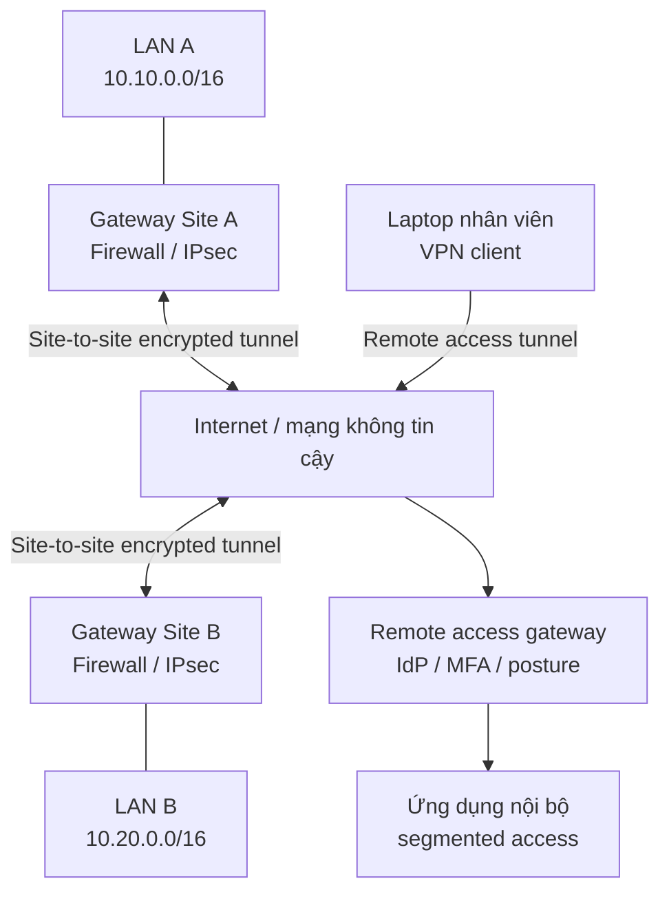
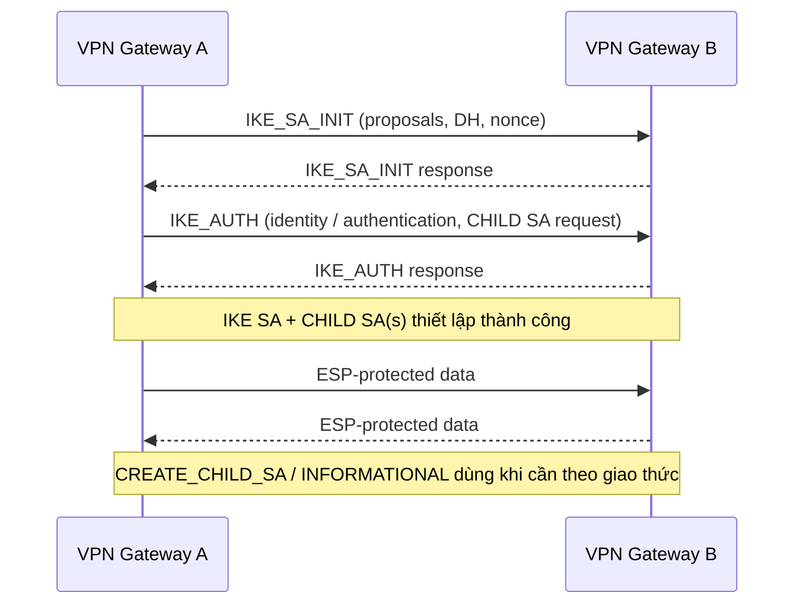
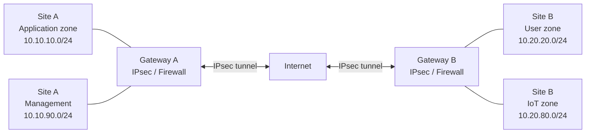
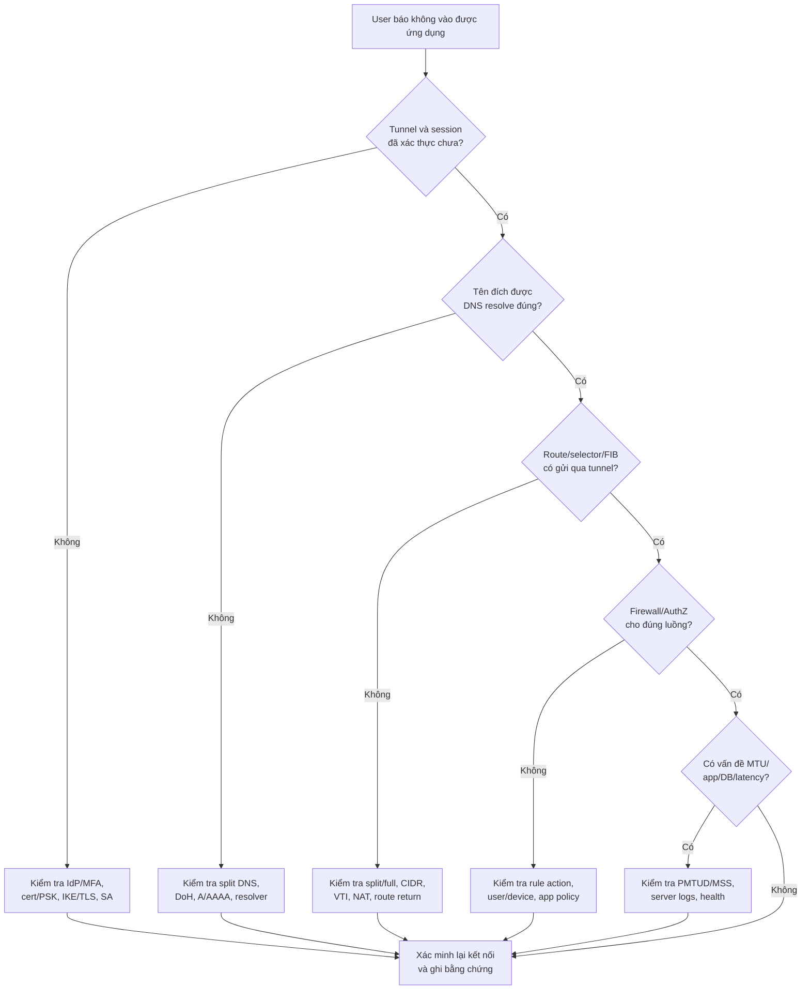

# VPN site-to-site và remote access trong kiến trúc bảo mật mạng

**Virtual Private Network (VPN)** tạo một kênh truyền được bảo vệ giữa các điểm kết nối qua hạ tầng mạng không hoàn toàn đáng tin cậy, thường là Internet. Các công nghệ VPN có thể cung cấp **mã hóa, bảo vệ toàn vẹn, xác thực peer và/hoặc kiểm soát truy cập**, tùy giao thức và cách triển khai. Hai mô hình thường gặp là **site-to-site VPN** — nối hai mạng hoặc nhiều site — và **remote access VPN** — cho người dùng/thiết bị từ xa vào tài nguyên được cấp quyền.

Phân biệt hai mô hình rất quan trọng: một tunnel site-to-site xác thực **gateway với gateway**, còn remote access thường đòi hỏi xác thực **người dùng và thiết bị cụ thể**. Trong cả hai, việc tunnel thiết lập thành công **không đồng nghĩa** mọi tài nguyên phía trong đều được phép truy cập, endpoint đã an toàn, hay dữ liệu tiếp tục được mã hóa sau khi ra khỏi tunnel.

Đây là một phần của mô-đun **SECURITY_NETWORK_SECURITY**, nơi VPN được nghiên cứu cùng firewall/NGFW, phân đoạn mạng, IDS/IPS, xác thực kết nối, bảo vệ DNS, giám sát xâm nhập và kiến trúc mạng hybrid/cloud. Bài học đi từ nguyên lý đến triển khai, vận hành, theo dõi, kiểm thử và ứng phó sự cố, ưu tiên những cấu hình có thể giải thích và xác minh được.

## 1. Mục tiêu học tập

Sau bài học, người học có thể:

1. So sánh **site-to-site VPN** với **remote access VPN** theo điểm cuối tunnel, danh tính, routing, quy mô và ranh giới tin cậy.
2. Giải thích **data plane/control plane**, IPsec ESP, IKEv2 và khác biệt giữa **policy-based** với **route-based VPN**.
3. Phân biệt **IPsec/IKEv2**, các VPN dựa trên **TLS** và **WireGuard** mà không đánh đồng tính năng bảo mật và mô hình triển khai.
4. Thiết kế **authentication, MFA, authorization, device posture**, phân đoạn và logging cho người dùng từ xa.
5. Hiểu **full tunnel, split tunnel, DNS resolution, IPv4/IPv6**, overlapping CIDR, MTU/MSS và những lỗi định tuyến thường gặp.
6. Triển khai nguyên tắc **least privilege, defense in depth và Zero Trust** trên hạ tầng VPN.
7. Đọc log, phân biệt lỗi **handshake, authentication, route, DNS, firewall, MTU, application** và có runbook khôi phục.
8. Viết ma trận nghiệm thu cả **luồng được cho phép** lẫn **luồng phải bị từ chối**.

## 2. VPN giải quyết vấn đề gì?

Khi hai hệ thống truyền dữ liệu qua Internet, bên ngoài có thể quan sát metadata mạng, tác động đường đi hoặc tìm cách can thiệp traffic nếu ứng dụng/giao thức không tự bảo vệ đúng. VPN tạo một **tunnel logic** giữa các endpoint để bảo vệ phần lưu lượng được chọn theo giao thức và chính sách.

Một VPN được cấu hình tốt có thể giúp:

- Bảo vệ **bí mật và toàn vẹn** của dữ liệu trong phạm vi tunnel được mã hóa.
- Xác thực hai đầu tunnel hoặc peer theo cơ chế được hỗ trợ.
- Cho mạng chi nhánh truy cập dịch vụ trung tâm mà không phải công bố mọi dịch vụ ra Internet.
- Cho nhân viên làm việc từ xa kết nối tới mạng hoặc ứng dụng được phân quyền.
- Tập trung việc áp policy, giám sát và quản lý kết nối.

Nhưng VPN **không tự giải quyết**:

- Máy tính từ xa bị nhiễm phần mềm độc hại hoặc thiết bị không được cập nhật.
- Người dùng có credential hợp lệ nhưng **không có quyền** truy cập dữ liệu cụ thể.
- Thiếu phân đoạn giữa các VLAN/tenant hoặc mạng của đối tác.
- Dịch vụ nội bộ có lỗi SQLi, XSS, broken access control hoặc bí mật bị lộ.
- Luồng dữ liệu ngoài tunnel, lưu lượng sau khi thoát tunnel và routing không đúng.
- Trộm session, lừa đảo, rò rỉ dữ liệu bởi tài khoản được cấp quyền quá rộng.

**VPN bảo vệ một đường truyền và tạo điểm kiểm soát truy cập; ứng dụng vẫn phải xác thực, phân quyền và xử lý dữ liệu an toàn.**

## 3. Site-to-site VPN và remote access VPN: so sánh trực tiếp

| Tiêu chí | **Site-to-site VPN** | **Remote access VPN** |
| --- | --- | --- |
| Mục tiêu | Nối mạng chi nhánh, data center, cloud, đối tác | Cấp truy cập cho người dùng/thiết bị từ xa |
| Điểm cuối tunnel | Gateway/router/firewall ở từng site | Client VPN hoặc trình duyệt/agent và VPN gateway |
| Định danh cốt lõi | Peer/gateway, đôi khi gắn tổ chức/tunnel | User, device, session và gateway |
| Địa chỉ phía trong | Các subnet/VRF/prefix hai phía | IP cấp cho client, DNS và tuyến nội bộ được push |
| Phương thức xác thực | Chứng chỉ hoặc PSK theo thiết kế, tùy giao thức | MFA, SSO/IdP, chứng chỉ thiết bị, posture theo khả năng |
| Kiểm soát route | Static route, BGP/OSPF hoặc selector của tunnel | Full tunnel hoặc split tunnel, client routing/policy |
| Khả năng truy cập | Theo mạng được công bố và firewall policy | Theo user/group/device/app và network policy |
| Vấn đề thường gặp | CIDR overlap, route asymmetry, tunnel failover | MFA, DNS leak, thiết bị lạ, route split/full, client OS |
| Phạm vi tin cậy | Giữa các miền/site có đường tunnel | Từ endpoint ít tin cậy tới tài nguyên doanh nghiệp |
| Đo lường | Tunnel health, SA, BGP, traffic, reachability | Login success, posture, route, DNS, app access, user impact |

### 3.1. Hai kiến trúc mẫu



Sơ đồ gom nhiều luồng vào một biểu tượng Internet để minh họa. Thực tế cần phân biệt các **tunnel endpoints, kết nối routing, ACL/firewall, NAT, bảo vệ IdP, HA và đường return path**.

### 3.2. Một gateway có thể phục vụ cả hai mô hình

Một NGFW hoặc VPN appliance có thể đồng thời kết nối:

- Site-to-site tới data center và cloud.
- Remote access của nhân viên.
- Tunnel đối tác/nhà cung cấp dịch vụ.

Điều này thuận tiện nhưng tạo **shared-resource risk**: CPU mã hóa, bảng session, public IP, route table và cổng quản trị có thể bị tranh chấp. Cần phân tách **policy, vùng mạng, định danh, quota/giám sát**; tránh suy rằng các kết nối VPN giống nhau đều đáng tin như nhau.

## 4. Khái niệm nền tảng: tunnel, encapsulation và encryption

**Tunneling/encapsulation** bao gói một đơn vị dữ liệu bên trong một giao thức khác để vận chuyển qua mạng trung gian. **Encryption** bảo vệ nội dung theo thuật toán và khóa; hai khái niệm khác nhau.

Ví dụ một gói IP nội bộ đi qua IPsec tunnel mode:

```text
[Outer IP: VPN Gateway A -> VPN Gateway B]
[ESP header | Encrypted/authenticated inner IP packet | ESP trailer/tag]
                          |
                          v
[Inner IP: Host A -> Host B]
[Original transport payload, e.g. TCP/TLS/application data]
```

Cấu trúc ESP chính xác phụ thuộc mode, thuật toán và tùy chọn; sơ đồ không biểu diễn đầy đủ SPI/sequence number/padding/IV, NAT traversal hay trường hợp ESP được bọc trong UDP.

Một mạng site-to-site có thể vận chuyển nhiều IP nội bộ qua cùng một tunnel logic. Remote access VPN có thể cấp virtual interface/IP cho thiết bị hoặc cung cấp kết nối ứng dụng theo cổng/proxy, tùy loại sản phẩm.

### 4.1. Control plane và data plane

| Thành phần | Công việc | Ví dụ |
| --- | --- | --- |
| **Control plane** | Thiết lập peer, xác thực, thương lượng tham số/khóa, policy, route | IKEv2, BGP qua tunnel, client provisioning |
| **Data plane** | Xử lý gói được phép, mã hóa/giải mã, chống replay, chuyển tiếp | IPsec ESP, WireGuard transport, TLS VPN tunnel |
| **Management plane** | Định nghĩa policy, lifecycle chứng chỉ/khóa, audit | VPN controller, firewall manager, IdP integration |
| **Observation plane** | Theo dõi trạng thái, lưu lượng, lỗi và bảo mật | VPN gateway logs, SIEM, flow logs, endpoint telemetry |

Một tunnel có thể **control plane còn “up” nhưng data plane bị hỏng** do route, selector, MTU, firewall hoặc đường quay về. Do đó “IKE established” không đủ chứng minh ứng dụng hoạt động.

## 5. IPsec: công nghệ phổ biến cho site-to-site và remote access

**IPsec** là họ cơ chế bảo vệ dữ liệu ở lớp IP. Hai thành phần cần phân biệt:

- **IKEv2 (Internet Key Exchange version 2):** thương lượng các Security Associations (SA), xác thực peer và thiết lập/đổi khóa theo cơ chế chuẩn.
- **ESP (Encapsulating Security Payload):** bảo vệ traffic data, thường dùng để mã hóa và xác thực/tăng toàn vẹn khi cấu hình các thuật toán phù hợp.

**AH (Authentication Header)** cũng thuộc họ IPsec nhưng không mã hóa dữ liệu, ít phổ biến trong các triển khai VPN hiện đại và gặp giới hạn tương thích NAT. Khi nói “IPsec VPN” trong vận hành, cần kiểm tra cụ thể **ESP và IKE** được sử dụng ra sao, không cho rằng mọi cấu hình IPsec đều có cùng tính chất.

### 5.1. IKE SA và CHILD SA

Một cách hiểu thực tế:

- **IKE SA** bảo vệ trao đổi điều khiển IKE giữa hai peer.
- **CHILD SA** chứa tham số bảo vệ traffic bằng ESP, gồm thuật toán, khóa, thông số traffic selection và các thuộc tính liên quan.
- **Rekey/reauthentication** diễn ra theo lifetime, chính sách và khả năng tương thích; chúng không nhất thiết có cùng thời điểm.
- Có thể có nhiều CHILD SA phụ thuộc số mạng/traffic selector và phương thức triển khai.



Đây là sơ đồ mức logic, không phải transcript đầy đủ. Việc gói tin đi qua NAT, thay đổi địa chỉ hoặc dùng các extension IKEv2 phụ thuộc thực tế.

### 5.2. Các cổng/giao thức cần biết

| Thành phần | Thường gặp | Ghi chú |
| --- | --- | --- |
| IKE | UDP **500** | Thiết lập và quản lý IKE |
| NAT Traversal (NAT-T) | UDP **4500** | ESP có thể được encapsulate trong UDP khi NAT-T được sử dụng |
| ESP | IP protocol **50** | **Không phải TCP/UDP port 50** |
| AH | IP protocol **51** | Không phải UDP/TCP port 51 |
| DNS/IdP/PKI | Phụ thuộc thiết kế | Cần cho cấp chứng chỉ, xác thực, tra tên hoặc trạng thái tin cậy |

**Không mở toàn bộ traffic vào mạng nội bộ chỉ vì đã mở UDP 500/4500 tới gateway.** Cần phân biệt **kết nối điều khiển VPN đến gateway** với **lưu lượng bên trong tunnel đã được giải mã** và áp firewall policy cho luồng bên trong.

### 5.3. NAT traversal và bất đối xứng

Khi peer nằm sau NAT, IPsec cần xử lý việc NAT làm thay đổi địa chỉ/cổng ngoài. **NAT-T** hỗ trợ đưa ESP trong UDP khi thích hợp, nhưng các thiết bị NAT, firewall, timeout UDP, ISP, CGNAT và route vẫn có thể gây lỗi.

Ví dụ hai peer xác thực thành công nhưng traffic ứng dụng chết sau một khoảng idle: cần kiểm tra **NAT mapping lifetime, DPD, rekey, route và firewall session** thay vì kết luận ngay rằng mã hóa sai.

## 6. Security Associations, selectors và route-based/policy-based IPsec

Nhiều sản phẩm IPsec có hai mô hình cấu hình:

### 6.1. Policy-based VPN

Traffic được chọn bởi **traffic selectors / encryption domains** gắn với policy: ví dụ **10.10.0.0/16 ↔ 10.20.0.0/16**. Hai peer cần có lựa chọn và chính sách tương thích; cách xử lý các cặp subnet, CHILD SAs và các selector rộng/hẹp có thể khác theo sản phẩm.

**Ưu điểm:** thích hợp với cặp subnet tương đối cố định và hệ thống legacy.

**Giới hạn:** thêm/xóa subnet hoặc kết nối nhiều bên có thể khiến danh sách selector phức tạp; dễ có sự cố "Phase 1 up, Phase 2/CHILD SA không khớp" nếu hai đầu không đồng bộ.

### 6.2. Route-based VPN

Thiết bị sử dụng **virtual tunnel interface (VTI)** hoặc giao diện tunnel tương đương. Tuyến được gửi vào tunnel theo routing table/static route/dynamic routing, rồi traffic được IPsec bảo vệ theo cấu hình của platform.

**Ưu điểm:** phù hợp nhiều subnet, kết nối hybrid/cloud, BGP qua tunnel, policy có thể thay đổi theo route.

**Giới hạn:** có interface tunnel không tự bảo đảm subnet nào cũng được phép. **Routing, IPsec SA/selector, NAT và firewall** vẫn phải nhất quán.

| Chủ đề | Policy-based | Route-based |
| --- | --- | --- |
| Cách xác định traffic | Selector và security policy | Route tới tunnel interface + IPsec policy |
| Thay đổi số subnet | Có thể cần chỉnh cặp selector | Thường thuận tiện điều chỉnh route |
| Dynamic routing | Phụ thuộc nền tảng, có thể phức tạp | Thường phù hợp nếu sản phẩm hỗ trợ |
| Quan sát sự cố | Selector/SA matching và policy | Tunnel interface, route, SA, firewall |
| Security boundary | Selector và policy | Route **không thay thế ACL/firewall** |

### 6.3. Những câu hỏi phải thống nhất giữa hai bên

1. Outer IP/peer identity của mỗi gateway là gì?
2. Dùng PSK, certificate hay hình thức xác thực nào?
3. IKEv2 và các crypto proposals nào được hỗ trợ hai bên?
4. Inner subnet/traffic selectors nào được phép?
5. Routing tới từng inner prefix đi đường nào?
6. NAT exemption hay translation có được dùng không?
7. Firewall cho phép ứng dụng nào sau khi giải mã?
8. Child SA lifetime, rekey, DPD/keepalive và failover được cấu hình ra sao?
9. Có địa chỉ IPv4/IPv6 hoặc CIDR trùng nhau không?
10. Ai có quyền thay cấu hình và tiêu chí rollback là gì?

## 7. TLS-based VPN và WireGuard: không nên đánh đồng với IPsec

Ngoài IPsec/IKEv2, các mô hình remote access còn dùng VPN dựa trên **TLS** hoặc giao thức khác.

### 7.1. VPN dựa trên TLS

Một số giải pháp dùng **TLS** làm kênh bảo vệ và hỗ trợ:

- **Client tunnel:** agent tạo virtual network interface hoặc proxy để chuyển nhiều traffic.
- **Clientless portal:** người dùng truy cập một số ứng dụng web/đích cụ thể qua portal hoặc reverse proxy; không nhất thiết có truy cập IP mọi subnet.
- **Application-specific access:** mở các phiên tới ứng dụng được kiểm soát thay vì đưa thiết bị vào toàn mạng.

Nhãn **“SSL VPN”** thường là tên thương mại/lịch sử; nhiều sản phẩm hiện đại thực tế dùng TLS thay cho SSL cũ. Cần xem **phiên bản TLS, cách xác thực, chế độ client, transport TCP/UDP và khả năng phân quyền** của sản phẩm.

### 7.2. WireGuard

**WireGuard** là một giao thức VPN riêng, không phải một cấu hình IPsec hoặc một biến thể TLS VPN. Nó dùng mô hình **public-key peers**, thiết lập kết nối theo cách đặc thù và ánh xạ **AllowedIPs** cho peer.

Điểm quan trọng:

- Public key được dùng nhận diện peer ở lớp giao thức, nhưng **không tự cung cấp MFA, SSO hay lifecycle người dùng**.
- **AllowedIPs** có vai trò liên quan tới lựa chọn địa chỉ/route và ràng buộc peer; cần hiểu hành vi ở từng implementation.
- Quản lý provisioning, thu hồi peer, phân quyền resource, posture và auditing cần công cụ/quy trình bổ sung khi quy mô lớn.
- Các tham số giao thức mật mã không được tùy tiện “thay bằng cipher yếu hơn”; cần cập nhật implementation và quản lý khóa đúng.

### 7.3. Bảng chọn giao thức/mô hình

| Mô hình/công nghệ | Thường phù hợp | Điểm cần thiết kế |
| --- | --- | --- |
| **IPsec IKEv2 site-to-site** | Chi nhánh ↔ data center, cloud ↔ on-prem | Selector/VTI, peer trust, routing, NAT-T, HA |
| **IKEv2 remote access** | Client được quản trị, tích hợp VPN hệ điều hành | User/device auth, certificate/MFA, route push, client support |
| **TLS VPN tunnel** | Người dùng từ xa, nhiều OS, chính sách gateway | SSO/MFA, client posture, split tunnel, proxy/DNS |
| **Clientless TLS portal** | Truy cập một nhóm ứng dụng web/ứng dụng được hỗ trợ | App compatibility, per-app AuthZ, cookie/session isolation |
| **WireGuard** | Các đường point-to-point/site/remote với công cụ quản lý phù hợp | Public-key lifecycle, AllowedIPs, identity integration |
| **ZTNA / per-app access** | Truy cập dịch vụ theo identity/context, không cần mở toàn mạng | IdP, device posture, application connector, policy và observability |

**Cách lựa chọn không chỉ theo thuật toán mã hóa.** Năng lực tích hợp IdP/MFA, vận hành khóa, endpoint support, route, phân đoạn và giám sát thường quyết định độ an toàn thực tế.

## 8. VPN site-to-site: thiết kế từ ranh giới tin cậy

Giả sử một doanh nghiệp có:

- **Site A:** subnet ứng dụng **10.10.10.0/24**, quản trị **10.10.90.0/24**.
- **Site B:** subnet làm việc **10.20.20.0/24**, thiết bị IoT **10.20.80.0/24**.
- **VPN:** kết nối site A ↔ site B qua Internet.
- **Mục tiêu:** người dùng Site B truy cập hệ thống ứng dụng ở Site A, nhưng IoT/guest không truy cập management.



**Không vì tất cả subnet đều nằm sau gateway VPN mà mặc nhiên cho phép đi qua tunnel.** Thiết kế cần tách routing và traffic authorization.

### 8.1. Ma trận luồng

| Source | Destination | Ví dụ dịch vụ | Quyết định |
| --- | --- | --- | --- |
| Site B User **10.20.20.0/24** | Site A App **10.10.10.0/24** | HTTPS tới app đã phê duyệt | Allow có kiểm soát |
| Site B IoT **10.20.80.0/24** | Site A Management **10.10.90.0/24** | SSH/RDP/management | Deny |
| Site B User | Site A Management | Quản trị tùy ý | Deny, trừ người dùng được phân quyền theo đường quản trị riêng |
| Site A App | Site B User | Kết nối hồi đáp đã được stateful firewall cho phép | Chỉ theo phiên/dịch vụ hợp lệ |
| Site B Guest | Site A mọi subnet | Nội bộ | Deny |

Ma trận phải được thể hiện trong **firewall/ACL/segmentation**; route hoặc selector IPsec chỉ là một phần. Khi hệ thống dùng stateful firewall, cần xét **đường trở về đối xứng và session tracking**.

### 8.2. Bảo vệ đối tác và bên thứ ba

Một tunnel B2B thường chỉ xác nhận **gateway của tổ chức đối tác**, không cho biết từng user/device trong mạng đối tác có đáng tin. Nên:

- Chỉ quảng bá/cho phép **prefix và service cụ thể**.
- Đặt đối tác trong zone/VRF riêng, tránh route leak.
- Yêu cầu ứng dụng **authentication và authorization** độc lập.
- Ghi hợp đồng và owner của luồng kết nối, thời hạn/điều kiện thu hồi.
- Giám sát những dịch vụ bị truy cập, không chỉ trạng thái tunnel.
- Xem lại cấu hình khi đối tác đổi mạng, NAT hoặc bị sự cố bảo mật.

## 9. Remote access VPN: danh tính người dùng và thiết bị

Remote access thường đưa một **endpoint nằm ngoài mạng công ty** vào phạm vi có thể liên lạc với tài nguyên nội bộ. Đó có thể là laptop ở nhà, thiết bị di động hoặc máy được quản trị bởi nhà thầu.

Một phiên truy cập nên xét ít nhất:

- **User identity:** người dùng là ai, đã xác thực thế nào, thuộc nhóm/role nào?
- **Device identity:** máy có chứng chỉ/được quản lý không?
- **Device posture:** hệ điều hành cập nhật, mã hóa đĩa, EDR, cấu hình bảo mật theo policy?
- **Session context:** vị trí/rủi ro đăng nhập, thời gian, phát hiện bất thường và vòng đời phiên.
- **Resource authorization:** người dùng này được truy cập ứng dụng/subnet nào, bằng giao thức gì?
- **Continuous monitoring:** khi user bị disable hoặc device mất tuân thủ, truy cập còn tiếp tục đến lúc nào?

### 9.1. MFA và SSO/IdP

**MFA (Multi-Factor Authentication)** giúp giảm rủi ro khi chỉ một mật khẩu bị lộ, nhưng vẫn phải dùng hình thức xác thực phù hợp và quản lý phiên đúng. Với giải pháp tích hợp **SAML/OIDC hoặc IdP**, cần xác định:

- VPN gateway tin **IdP nào, audience/client ID nào** và xác thực assertion/token thế nào.
- MFA có áp đúng group/trường hợp đặc biệt không; có “legacy fallback” bỏ qua MFA không?
- Token assertion có hạn dùng, chống replay, kiểm tra issuer/audience/signature và đồng bộ giờ không?
- Khi user mất quyền, nhóm thay đổi hoặc tài khoản bị khóa, **VPN session hiện hữu** được xử lý ra sao?
- Quy trình break-glass và admin access có được bảo vệ và giám sát không?

**SSO không tự bằng MFA**, và **MFA không thay thế resource-level authorization** tại ứng dụng. Cần đặc biệt chú ý các client/giao thức không hỗ trợ IdP hiện đại hoặc các endpoint legacy.

### 9.2. Chứng chỉ thiết bị và PSK

Đối với IPsec gateway và một số remote access clients, xác thực bằng **certificate** cho phép gắn danh tính với public key và quản lý vòng đời thông qua PKI.

So sánh ở mức vận hành:

| Cơ chế | Lợi ích | Hạn chế |
| --- | --- | --- |
| **Pre-shared key (PSK)** | Đơn giản với số lượng peer nhỏ | Khó xoay vòng khi chia sẻ nhiều người; nếu lộ ảnh hưởng nhiều kết nối |
| **Certificate-based authentication** | Danh tính peer cụ thể, vòng đời/cấp-thu hồi quản lý được | Cần CA/PKI, trust chain, renewal, revocation và bảo vệ private key |
| **User password + MFA** | Kiểm soát danh tính người dùng với yếu tố bổ sung | Phải có IdP và session policy an toàn |
| **Device certificate + user MFA** | Kết hợp thiết bị và người dùng | Cần tích hợp chính sách, quản lý thiết bị, khôi phục mất máy |

**Không đưa private key, PSK hoặc token vào log, ticket, file chia sẻ và mẫu cấu hình đào tạo.** Ưu tiên lưu khóa trong keystore/TPM/HSM khi thích hợp.

### 9.3. Authorization sau khi VPN kết nối

Nhân viên thuộc nhóm **Sales** có thể chỉ được truy cập CRM, trong khi **SRE** cần một số hệ thống giám sát. Nếu cả hai dùng chung pool VPN nhưng firewall chỉ cho phép “VPN subnet → Internal ANY”, hiệu quả phân quyền thấp.

Cần map **identity/group/device posture → network zone/policy → application resource**, kết hợp xác thực tại app. IP được cấp cho client không tự chứng minh người hiện sở hữu nó, đặc biệt qua thời gian/HA/NAT.

## 10. Full tunnel và split tunnel

**Full tunnel** và **split tunnel** mô tả **lưu lượng nào từ remote access client được đưa vào tunnel**.

### 10.1. Full tunnel

Với full tunnel, phần lớn hoặc toàn bộ lưu lượng mạng của client được định tuyến qua VPN gateway theo thiết kế, bao gồm Internet egress nếu policy yêu cầu. Doanh nghiệp có thể áp DNS/filtering/logging tập trung.

Ưu điểm: kiểm soát egress tập trung, dễ áp một số chính sách Internet và hạn chế đường truy cập trực tiếp ngoài kiểm soát.

Hạn chế:

- Tăng băng thông/CPU/tải proxy tại trung tâm.
- Tạo đường vòng, latency và rủi ro bottleneck.
- Kết nối khách sạn/captive portal, giao tiếp thiết bị local có thể cần ngoại lệ hợp lý.
- **Không bảo đảm mọi loại traffic đều đi qua tunnel**: phải xác minh cả IPv4/IPv6, interface, ứng dụng, proxy và failover.

### 10.2. Split tunnel

Với split tunnel, chỉ các prefix, domain/ứng dụng hoặc luồng được chỉ định mới đi qua VPN; các luồng khác đi Internet local.

Ưu điểm: giảm tải VPN, tối ưu đường tới SaaS/video meeting/CDN khi doanh nghiệp không cần hairpin qua trung tâm.

Hạn chế:

- Endpoint đồng thời kết nối mạng ngoài và tài nguyên nội bộ, tạo yêu cầu bảo vệ endpoint tốt hơn.
- DNS và routing có thể không nhất quán, gây rò rỉ tên nội bộ hoặc kết nối sai đích.
- Có thể có traffic bị bỏ ngoài policy nếu cấu hình route, IPv6, resolver, app-specific proxy sai.
- Giám sát ở trung tâm sẽ không thấy mọi lưu lượng Internet của thiết bị.

### 10.3. Bảng so sánh

| Tiêu chí | Full tunnel | Split tunnel |
| --- | --- | --- |
| Đường Internet | Thường qua VPN egress | Có thể đi local |
| Tải gateway | Cao hơn nếu toàn bộ traffic đi tunnel | Thấp hơn trong nhiều tình huống |
| Visibility trung tâm | Cao hơn trong phạm vi tunnel | Chỉ thấy traffic được route qua VPN |
| Hiệu năng SaaS/video | Có thể gặp hairpin | Thường giảm hairpin nếu cấu hình đúng |
| DNS | Cần đảm bảo resolver/search domain và IPv6 đúng | Cần giải quyết **split DNS/NRPT** phù hợp |
| Endpoint security | Vẫn bắt buộc | Đặc biệt quan trọng do hoạt động ở nhiều mạng |
| Phạm vi quyền nội bộ | Do ACL/AuthZ quyết định, **không do full/split tự quyết** | Cũng cần ACL/AuthZ |

Không có lựa chọn “luôn an toàn nhất” cho mọi doanh nghiệp. Cần dựa trên **mức độ rủi ro, policy dữ liệu, khả năng quan sát, băng thông, thiết bị quản lý và ứng dụng cần truy cập**.

### 10.4. Split DNS và định tuyến theo tên miền

Một ứng dụng nội bộ có thể có hostname **crm.corp.example.net** chỉ phân giải qua DNS doanh nghiệp. Nếu remote client gửi query ra resolver công cộng, nó có thể nhận NXDOMAIN, IP không mong muốn hoặc để lộ tên nội bộ qua query logs bên ngoài.

Thiết kế cần xác định:

- Resolver nào xử lý domain nội bộ, domain public và private cloud zones.
- VPN client push DNS, search suffix hoặc Name Resolution Policy Table (NRPT) ở Windows nếu giải pháp dùng.
- DoH/DoT được client/app bật có tuân policy doanh nghiệp không.
- Cả **A và AAAA** có được phân giải/route đúng không.
- Khi VPN rớt, thiết bị có tiếp tục dùng resolver/tuyến cũ sai không.
- DNS query qua tunnel có giới hạn quyền và logging phù hợp không.

**DNS hoạt động không đồng nghĩa đường tới IP đã phân giải đi đúng tunnel.** Kiểm tra cả DNS answer và route/next hop.

## 11. IPv4, IPv6 và rò rỉ ngoài tunnel

Một thiết kế VPN được kiểm thử trên IPv4 có thể bỏ sót **IPv6**, khiến client tiếp tục đi Internet bằng IPv6 ngoài tunnel dù IPv4 đã được định tuyến qua VPN.

Các điểm cần kiểm tra:

1. VPN client có hỗ trợ **IPv6 tunneling/IPv6 routes** không?
2. Nếu full tunnel, **::/0** và các cơ chế route/policy IPv6 có đi theo thiết kế không?
3. Nếu split tunnel, các prefix IPv6 của tài nguyên nội bộ có được định tuyến đúng không?
4. DNS AAAA trả về địa chỉ mà client có khả năng kết nối không?
5. Firewall/ACL/NGFW có rule **IPv6** tương đương khi cần không?
6. Thiết bị có nhiều interface với route metric khác nhau không?
7. Các ứng dụng dùng **Happy Eyeballs** có thể chọn IPv6 khác đường dự kiến không?

**Không mặc định tắt IPv6 toàn hệ thống là giải pháp an ninh.** Đó là thay đổi kiến trúc có thể gây lỗi ứng dụng, và cần phương án được phê duyệt. Mục tiêu là **policy đầy đủ cho cả hai giao thức**.

### 11.1. Kill switch và kết nối khi VPN rớt

Một số remote access clients có tính năng **kill switch/always-on**: hạn chế lưu lượng ngoài tunnel khi VPN không có kết nối, theo policy. Khả năng thực thi thay đổi theo OS, đặc quyền client, interface, captive portal và cách quản trị.

Kiểm thử cần chứng minh:

- Khi VPN rớt bất ngờ, các luồng nhạy cảm có bị ngăn theo thiết kế không?
- Có cần ngoại lệ truy cập IdP, DHCP/DNS để tái thiết lập VPN không?
- Khi thiết bị sleep/wake hoặc đổi Wi-Fi, route và DNS được phục hồi không?
- IPv6 có được kiểm soát tương đương IPv4 không?
- App có tái sử dụng session không an toàn sau thay đổi đường không?

Không xem nhãn “always-on” trong giao diện như bằng chứng kỹ thuật đủ; cần **test đường đi và logs**.

## 12. Routing trong site-to-site: static route và dynamic route

Kết nối hai mạng qua VPN cần **đường đi lẫn đường về**. Routing quyết định packet được gửi đến tunnel interface/next hop nào, còn IPsec quyết định những packet nào được bảo vệ theo SA/policy.

### 12.1. Static routes

Hợp lý khi có ít subnet và topology ổn định. Ví dụ ở Site A:

```text
Destination 10.20.20.0/24 -> VPN-Tunnel-B
Destination 10.20.80.0/24 -> no route / blocked by policy (if not approved)
```

Đây là sơ đồ routing intent, không phải câu lệnh để dán vào router. Routing ở Site B và firewall phải có cấu hình tương thích; nếu thiếu đường về, gói có thể vào được Site B nhưng response đi sai hướng.

### 12.2. Dynamic routing trên tunnel

Một số hệ thống site-to-site dùng **BGP** (phổ biến với cloud/hybrid), OSPF hoặc giao thức khác qua VTI/overlay.

Cần thiết kế:

- Neighbor/ASN và ranh giới tin cậy.
- **Inbound/outbound prefix filters**, không tự học mọi route từ đối tác.
- **Local preference, MED, metrics** theo mô hình failover.
- Max-prefix, route withdrawal, BFD/DPD khi phù hợp.
- Kiểm tra next-hop reachability và FIB của cả hai phía.
- Bảo vệ routing neighbor/session theo khả năng.
- Không tự quảng bá management/default/guest prefixes ngoài scope.

**BGP Established chỉ cho biết quan hệ BGP đang hoạt động**, không xác nhận CHILD SA, firewall policy, MTU, application authentication hoặc đường quay về đều đúng.

## 13. CIDR overlap, NAT và tên miền trong kết nối nhiều mạng

### 13.1. Subnet trùng nhau

Ví dụ Site A và Site B đều dùng **10.10.0.0/16**. Một host ở Site A muốn truy cập **10.10.20.15** tại Site B có thể coi đó là IP nằm trong mạng local hoặc trùng với tài sản nội bộ.

Hệ quả:

- Route mơ hồ và sai next hop.
- IPsec selectors/child SA không khớp kỳ vọng.
- DNS trả IP không truy cập được từ phía còn lại.
- Firewall log khó gắn địa chỉ vào đúng site.
- Hệ thống monitoring bị nhầm asset.

Các chiến lược nên xem xét:

1. **Renumbering/IPAM** về lâu dài, có kế hoạch dịch chuyển.
2. **Translated subnet/NAT qua tunnel** khi phải tích hợp ngắn hạn, có bảng mapping rõ.
3. **VRF/segmentation** để tách các miền định tuyến và chọn điểm kết nối thích hợp.
4. **Ứng dụng qua proxy/API** thay vì mở kết nối IP trực tiếp nếu dịch vụ hỗ trợ.
5. **DNS view** phù hợp với địa chỉ được dịch và nguồn truy vấn.

Không tự cho rằng đổi destination NAT ở một phía đủ: phải xét **return path, source NAT, logs, selectors, ACL và tên miền** cùng nhau.

### 13.2. NAT exemption

Trong nhiều thiết kế site-to-site, các mạng nội bộ trao đổi qua tunnel **không nên bị SNAT như traffic ra Internet thông thường**. Thiết bị có thể dùng policy NAT bypass/exemption hoặc điều kiện riêng.

Nếu NAT được áp không đúng:

- Source/destination có thể không khớp traffic selector.
- Firewall phía xa không nhận ra mạng nguồn mong đợi.
- Return route gửi packet tới địa chỉ dịch không đúng.
- Log ghi IP không tương ứng inventory.

Trong trường hợp **overlapping CIDR**, NAT lại có thể là chủ đích; điều quan trọng là **thiết kế mapping nhất quán** chứ không phải “mọi VPN đều tắt NAT”.

## 14. MTU, MSS, fragmentation và hiệu năng

VPN encapsulation thêm overhead vào packet: outer IP, ESP, UDP encapsulation khi dùng NAT-T, TLS/WireGuard header hoặc các field khác. Nếu packet ban đầu gần MTU của đường, gói sau encapsulation có thể vượt **Path MTU**.

### 14.1. Triệu chứng điển hình

- VPN bắt tay và ping nhỏ thành công, nhưng website tải chậm hoặc một số request lớn timeout.
- Truyền file hoặc ứng dụng TCP bị treo khi kích thước dữ liệu tăng.
- Một chiều truyền ổn, chiều còn lại gặp packet loss.
- Chỉ lỗi khi đi qua mạng di động, LTE, PPPoE hoặc đường có tunnel lồng nhau.
- ICMP **Fragmentation Needed** (IPv4) hoặc **Packet Too Big** (IPv6) bị lọc sai làm hỏng PMTUD.

### 14.2. Phòng vệ và xử lý đúng

- Đo **đường end-to-end** với phương pháp phù hợp, không suy MTU chỉ từ loại VPN.
- Điều chỉnh **tunnel interface MTU** hoặc **TCP MSS clamping** có kiểm thử khi sản phẩm hỗ trợ.
- Cho phép ICMP/ICMPv6 cần thiết để PMTUD hoạt động an toàn; không chặn tất cả ICMP.
- Phân biệt IPv4 fragmentation với IPv6, vì router IPv6 không tự phân mảnh packet như IPv4.
- Xem CPU, crypto throughput, số connections/s, packet drops và offload của gateway.
- Đảm bảo thay đổi MTU không tạo tác động xấu lên voice/video, UDP hoặc ứng dụng khác.

**Một cấu hình MSS chung không bảo đảm đúng trên mọi hạ tầng** vì overhead phụ thuộc mode, NAT-T, địa chỉ IPv4/IPv6, giao thức và đường underlay.

## 15. Thiết kế mã hóa và vòng đời khóa

Mức an toàn của VPN không chỉ là “có AES” hoặc “có TLS”; phải xét toàn bộ **protocol version, key exchange, peer authentication, integrity, replay protection, thuật toán AEAD, certificate validation và key lifecycle**.

### 15.1. Nguyên tắc crypto hiện đại

- Ưu tiên giao thức/phiên bản được duy trì và **crypto suites được tổ chức phê duyệt**.
- Với IPsec/IKEv2, sử dụng key exchange và cơ chế xác thực mạnh, cân nhắc **PFS** khi yêu cầu.
- Các thuật toán AEAD hiện đại như **AES-GCM** hoặc **ChaCha20-Poly1305** được sử dụng trong những ngữ cảnh/protocol hỗ trợ phù hợp.
- Tránh **DES, 3DES, RC4, MD5 dùng làm lựa chọn mới yếu**, các biến thể cũ không còn được chấp thuận và cấu hình fallback yếu không cần thiết.
- Xác minh **peer identity** (certificate subject/SAN, expected identity, CA chain/trust), không chỉ xem tunnel bắt tay được.
- Bảo vệ private key, PSK và secrets, hạn chế quyền truy cập cấu hình.
- Có quy trình **rekey/renew/rotation, revocation và xử lý certificate expiration**.

Không lấy tên thuật toán đơn lẻ làm kết luận. Một cipher mạnh không cứu được trường hợp **PSK dùng chung bị lộ, trust store sai hoặc gateway chấp nhận sai peer**.

### 15.2. Rekey và dead peer detection

Một số vấn đề vận hành:

- CHILD SA hết hạn và rekey thất bại gây mất traffic dù IKE SA còn tồn tại.
- Peer mất đường nhưng tunnel health hiển thị chậm cập nhật nếu cơ chế keepalive/DPD chưa phát hiện.
- NAT state timeout khiến traffic idling bị ngắt.
- Chênh lệch đồng hồ hoặc certificate expiration ảnh hưởng xác thực.
- HA failover thay peer endpoint làm trạng thái SA/route thay đổi.

Cần thiết kế **lifetime, DPD, keepalive, reauthentication và failover** theo tính năng thực của sản phẩm. Không tùy tiện đặt timeout thấp chỉ để “phát hiện nhanh” khi có thể gây reconnect liên tục trên mạng di động không ổn định.

## 16. Least privilege, segmentation và Zero Trust

VPN truyền thống thường được mô tả như “vào được VPN là ở trong mạng doanh nghiệp”. Mô hình này dễ gây **lateral movement** nếu thiết bị từ xa bị xâm nhập hoặc tài khoản có quyền quá rộng.

### 16.1. Phân đoạn cho remote access

Một chính sách có thể gồm:

| Identity / device | Nguồn truy cập | Tài nguyên được phép | Điều kiện |
| --- | --- | --- | --- |
| Nhân viên Sales, managed | VPN pool Sales | CRM HTTPS | MFA, device posture, session TTL |
| SRE, managed | VPN pool Admin/SRE | Monitoring và quản trị đã phê duyệt | MFA mạnh, PAM/JIT nếu áp dụng |
| Contractor | VPN pool Partner | Một ứng dụng cụ thể | Thời hạn hợp đồng, role, giới hạn giờ |
| BYOD không managed | Remote access | Portal web ít nhạy cảm nếu policy cho phép | Không cấp truy cập IP toàn mạng |
| Unknown device | Kết nối không đáng tin | Không cho vào tài nguyên nội bộ | Deny, hướng dẫn đăng ký thiết bị |

Đây là **ví dụ chính sách**, không phải bảo đảm sản phẩm hỗ trợ mọi loại điều kiện. **Role, device posture, subnet và ứng dụng** có thể được thực thi tại nhiều điểm khác nhau: IdP, VPN gateway, firewall, NAC, ZTNA broker và ứng dụng.

### 16.2. VPN khác Zero Trust Network Access (ZTNA)

**ZTNA** hướng tới cấp truy cập theo **identity, device/context và từng ứng dụng/resource**, thay vì mặc nhiên cấp khả năng đi tới cả mạng sau khi vào tunnel.

| Câu hỏi | VPN truyền thống thường gặp | Mô hình ZTNA/per-app |
| --- | --- | --- |
| Cấp mạng hay ứng dụng? | Thường cấp network reachability theo route/ACL | Có thể cấp truy cập theo application |
| Danh tính nào quyết định? | User/cert/địa chỉ VPN, tùy tích hợp | User/device/context và policy ở broker/connector |
| Quét ngang/lateral movement | Cần kiểm soát bằng segmentation/firewall | Giảm phạm vi trực tiếp khi thực thi đúng |
| Tương thích giao thức tùy ý | Site-to-site/network VPN có lợi thế | Phụ thuộc app và phương án connector |
| Phụ thuộc trust ở endpoint | Có | Vẫn có; không miễn trừ malware |
| Thay thế firewall/AuthZ? | Không | Cũng không |

**ZTNA không phải thuật toán mã hóa** và không tự thay thế site-to-site cho mọi kiểu workload. Hai mô hình có thể cùng tồn tại; nhiều sản phẩm VPN hiện đại đã hỗ trợ identity-aware policy rất chi tiết.

## 17. Thiết kế HA, capacity và DDoS cho VPN gateway

VPN gateway có thể là điểm tập trung lưu lượng của hàng nghìn client hoặc nhiều site. Thiết kế cần xét:

- Số **concurrent tunnels/users/peers**.
- IKE/TLS handshake hoặc new sessions/s.
- Crypto throughput khi bật kiểm tra firewall/IPS/WAF liên quan.
- CPU khi rekey hàng loạt hoặc sau outage.
- Băng thông Internet, Pps, packet loss, latency.
- License/user limits và quota của nền tảng.
- Session/SA synchronization khi HA, khả năng failover.
- Certificate/IdP/DNS/OCSP/CRL dependencies khi cần.
- Đường public tới VPN gateway, upstream DDoS controls và vùng quản trị riêng.

**Tính sẵn sàng của VPN không chỉ đo “gateway còn bật”.** Nếu IdP lỗi, DNS không trả tên nội bộ hoặc BGP routes biến mất, remote user vẫn có thể không hoàn thành công việc.

### 17.1. Site-to-site primary/backup

Mô hình phổ biến:

- Primary: private link hoặc IPsec tunnel qua ISP A.
- Backup: IPsec tunnel qua ISP B.
- Routing: static routes có health hoặc BGP với policy phù hợp.
- Firewall: stateful sessions, NAT và route return path phải thích ứng.

Khi primary lỗi, phải xác minh **withdraw/route selection**, CHILD SA, đường trả về, firewall NAT state và ứng dụng. Không coi BGP Established hoặc tunnel “green” là bằng chứng end-to-end đã khỏe.

### 17.2. Remote access HA

Hai gateway trong một cluster có thể chia sẻ:

- Public entrypoint/DNS.
- User/session capacity.
- Certificate/policy và phiên bản cấu hình.
- Đường tới IdP, device posture service, DNS và ứng dụng.
- Cơ chế session persistence/khả năng reconnect khi failover.

Một số sản phẩm **không** chuyển toàn bộ phiên mã hóa đang hoạt động nguyên vẹn qua node khác; client có thể cần reconnect. Tiêu chí thực tế là thời gian phục hồi, xác thực lại an toàn và khả năng hoàn thành tác vụ sau failover, không tự đòi zero packet loss.

## 18. VPN trên cloud và hybrid network

Cloud VPN kết nối on-prem với cloud VPC/VNet, hoặc các môi trường cloud với nhau. Các thành phần thường gồm **VPN gateway, virtual route tables, security groups/NACLs, transit/hub-and-spoke, BGP, firewall service và hệ thống IAM**.

### 18.1. Những ranh giới cần kiểm soát

| Ranh giới | Rủi ro | Phòng vệ |
| --- | --- | --- |
| Public VPN gateway | DDoS, dò dịch vụ, xác thực yếu | Protocol/crypto hardening, MFA hoặc certificate, upstream controls |
| Tunnel ↔ cloud subnet | Route rộng hơn yêu cầu | Prefix allowlist, route table segmentation |
| Cloud ↔ on-prem return path | Bất đối xứng/NAT | Kiểm thử FIB cả hai phía, flow logs |
| Workload ↔ workload | Lateral movement dù site-to-site hoạt động | SG/NACL/firewall và service identity |
| Cloud IAM quản trị VPN | Thay cấu hình/route trái phép | Least privilege, MFA, audit, IaC review |
| Shared services/Transit Hub | Transit ngoài ý muốn | Attachment association/propagation policy |
| SaaS/Internet egress | Hairpin, cost, leak | Split/full tunnel và egress design rõ |

**Một tunnel mã hóa giữa hai cloud không khiến toàn bộ mạng phía sau trở thành một miền tin cậy.** Tách tenant, subnet, workload identity và policy ứng dụng vẫn là điều kiện nền tảng.

### 18.2. Transit không mặc định có khi có nhiều tunnel

Ví dụ Site A ↔ Cloud, Site B ↔ Cloud. Điều này **không tự bảo đảm** Site A có thể nói chuyện Site B qua cloud. Cần xem cloud route table, hub transit support, security policy và return path. Nếu không định cho hai site giao tiếp, cấu hình nên ngăn **transitive routing ngoài ý muốn**.

## 19. Quan sát VPN: những bằng chứng cần lưu

### 19.1. Log gateway và endpoint

| Trường | Giá trị điều tra | Cần tránh |
| --- | --- | --- |
| Timestamp + timezone | Đồng bộ timeline client/gateway/IdP/firewall | Đồng hồ sai dẫn đến suy luận sai |
| Tunnel/session ID | Ghép log qua các giai đoạn | Session ID có thể thay khi reconnect |
| Peer/gateway identity | Ai xác thực với ai | Không ghi private key/PSK |
| User/device identity | Authorization và scope | Không lưu token/PII quá mức |
| Protocol/crypto proposals | Biết IKEv2/TLS/cipher được thương lượng | Không lộ key material |
| IKE SA / CHILD SA state | Phân biệt control/data plane | Đừng dùng “up” thay bằng data test |
| Traffic selectors / assigned IP | Kiểm tra mạng được phép | IP không phải identity mạnh |
| Route/DNS policy version | Xác định thay đổi | Không bỏ qua split/IPv6 |
| AuthN/MFA/posture decision | Tại sao session được cấp/bị từ chối | Không lưu mật khẩu, OTP |
| Firewall policy action | Luồng có được cho phép sau giải mã? | Không nhầm route với ACL |
| Bytes/packets/drop/latency | Đánh giá tunnel có vận chuyển data | Counter có thể chỉ một chiều |
| Logout/revocation events | Session có thực sự bị thu hồi? | Không suy từ user bị disable |

**Không lưu raw payload, credential, session cookie hoặc certificate private key trong log.** Với thông tin như username, IP nội bộ và device ID, áp kiểm soát truy cập và thời gian lưu phù hợp.

### 19.2. Mẫu event JSON giả định

```json
{
  "event_time": "2026-11-28T02:25:00Z",
  "event_id": "vpn-demo-001",
  "vpn_type": "remote-access",
  "protocol": "ikev2-ipsec",
  "gateway": "vpn.example.net",
  "user": "user-redacted",
  "device_id": "managed-device-023",
  "authn": "success",
  "mfa": "verified",
  "posture": "compliant",
  "assigned_ip": "10.250.10.23",
  "route_policy": "sales-apps-only",
  "dns_policy": "corporate-split-dns",
  "child_sa": "established",
  "resource_policy": "crm-https",
  "action": "allow-tunnel",
  "note": "Dữ liệu ví dụ; không phải cấu trúc log của sản phẩm cụ thể"
}
```

Ngay cả khi event ghi **action=allow-tunnel**, cần thêm log ứng dụng/firewall để chứng minh một request đến CRM đã được phép theo **tài nguyên và người dùng cụ thể**.

## 20. Chẩn đoán: VPN kết nối nhưng không truy cập được ứng dụng

Một quy trình tốt tách các tầng thay vì thay tất cả cấu hình cùng lúc.



### 20.1. Lỗi thường gặp theo giai đoạn

| Triệu chứng | Khả năng | Cần xác minh |
| --- | --- | --- |
| VPN không bắt tay | Peer unreachable, blocked UDP/500/4500 hoặc TLS port, NAT/firewall | Upstream route, gateway logs, NAT-T |
| IKE negotiation thất bại | Crypto proposal/identity/certificate mismatch | IKE logs, proposal, peer identity, clock |
| IKE up nhưng không có data | CHILD SA/selector, ESP/UDP4500, NAT hoặc route sai | SA counters và policy hai đầu |
| User login thành công nhưng không có resource | Group mapping, posture, firewall/AuthZ deny | IdP, session, resource policy |
| Web bằng IP được nhưng tên không được | Split DNS hoặc bản ghi A/AAAA sai | Client resolver, query path, route đến DNS |
| Ping được nhưng upload thất bại | PMTUD/MSS, packet size hoặc app behavior | MTU/ICMP, packet loss, app logs |
| Chỉ lỗi khi qua VPN | Route overlap, proxy, firewall rule hoặc latency | Route metrics, NAT, app session |
| Chỉ lỗi một chiều | Return route hoặc stateful firewall asymmetry | FIB cả hai đầu, flow logs |
| Mất sau idle | NAT timeout, DPD, rekey hoặc client sleep | Gateway/client event timeline |
| Sau đổi VPN gateway thì lỗi | Policy/cert/DNS/route HA không đồng nhất | Config diff, session/SA, rollback |

Đừng kết luận “VPN không hoạt động” chỉ vì **ping** bị chặn: nhiều mạng chặn ICMP nhưng cho phép HTTPS. Cần kiểm thử **giao thức và ứng dụng được phê duyệt**.

## 21. Lệnh kiểm tra chỉ đọc và giới hạn sử dụng

Chỉ thực hiện trên **thiết bị/tài khoản và đường mạng được phép quản trị**. Đây là ví dụ quan sát để phục vụ điều tra, không tự thay đổi IPsec proposal hoặc firewall.

### 21.1. Linux client

```bash
# Xem route IPv4/IPv6 và policy routing
ip -4 route show
ip -6 route show
ip rule show

# Quan sát interface/tunnel, packet/drop counters
ip -br address
ip -s link show

# DNS resolver nếu dùng systemd-resolved
resolvectl status

# Quyết định route cho một địa chỉ nội bộ minh họa
ip route get 10.10.10.20

# Nếu máy dùng NetworkManager, liệt kê trạng thái kết nối
nmcli connection show --active
```

Các lệnh trên **không bảo đảm xác minh tunnel có mã hóa**; chúng cho thấy routing/interface và một phần network status. Đối với WireGuard, strongSwan, OpenVPN hoặc sản phẩm khác cần xem trạng thái theo ứng dụng và log được phép, tránh lộ private keys, usernames hoặc endpoints nhạy cảm.

### 21.2. Windows PowerShell

```powershell
# Profile VPN của người dùng hiện tại (nếu dùng Windows built-in VPN)
Get-VpnConnection

# IP, route và DNS
Get-NetIPConfiguration
Get-NetRoute -AddressFamily IPv4
Get-NetRoute -AddressFamily IPv6
Get-DnsClientServerAddress

# Truy vấn một tên miền thuộc quyền quản trị
Resolve-DnsName -Name "crm.corp.example.net"

# Kiểm tra kết nối TCP ứng dụng được phép
Test-NetConnection -ComputerName "crm.corp.example.net" -Port 443
```

**Get-VpnConnection** chỉ có ý nghĩa với các profile quản lý qua API VPN của Windows; không chắc hiển thị đầy đủ tunnel của client bên thứ ba. **Test-NetConnection** thành công cho TCP port không chứng minh user đã được application authorization.

### 21.3. Gateway/NGFW

Những đầu mục cần đọc từ dashboard/CLI sản phẩm:

- IKE SA, CHILD SA, peer identity và nguyên nhân thương lượng thất bại.
- Địa chỉ peer trong/ngoài NAT, NAT-T, UDP 500/4500, ESP drops.
- Bytes/packets mã hóa/giải mã theo chiều.
- Traffic selectors, tunnel interface, route và firewall hits.
- AuthN/MFA/group/posture và assigned IP của remote user.
- DPD/rekey events, certificate expiry, HA state và license capacity.

**Tên lệnh khác nhau theo hãng**, vì vậy không áp một đoạn cấu hình ví dụ lên production. Khi lấy evidence, chỉ trích xuất metadata đủ điều tra và che secrets.

## 22. Thiết kế vận hành và quản lý vòng đời truy cập

### 22.1. Provisioning

1. Nhận yêu cầu với owner, mục đích, tài nguyên và thời hạn.
2. Xác minh thiết bị được quản lý, user/group và cấp xác thực phù hợp.
3. Cấp profile/certificate/peer config theo kênh an toàn.
4. Áp route/DNS/firewall và resource policy ở scope nhỏ nhất.
5. Test xác thực, truy cập hợp lệ và truy cập bị từ chối.
6. Ghi audit ID, policy version, người duyệt và thời điểm.

### 22.2. Thay đổi

Khi nhân viên đổi bộ phận, đối tác đổi IP hoặc cloud thêm subnet, cần đánh giá:

- User/group/posture và quyền truy cập mới.
- Prefix/selector/BGP route và policy NAT.
- DNS A/AAAA/search domain, split DNS.
- Số concurrent users và capacity.
- Chứng chỉ/PSK/lifecycle của peer.
- Route lệch sang vùng không được phép.
- Bằng chứng đã kiểm thử và phương án rollback.

### 22.3. Offboarding

Khi người dùng nghỉ việc hoặc dự án kết thúc:

- Disable/revoke user/group access ở IdP, VPN và ứng dụng liên quan.
- Thu hồi/rotate certificate/keys, xóa peer hoặc profile khi cần.
- Kết thúc active sessions theo khả năng của nền tảng; **vô hiệu hóa tài khoản không phải lúc nào cũng làm mọi phiên hiện tại biến mất ngay**.
- Thu hồi route/ACL/third-party access không còn cần thiết.
- Kiểm tra thiết bị, IP pool assignment, lịch sử log và ticket hoàn tất.
- Test một user/peer đã bị thu hồi **không thể kết nối lại**.

## 23. Bốn tình huống vận hành

### 23.1. Case A — Site-to-site báo "up" nhưng một subnet không chạy

**Bối cảnh:** Site B truy cập được ứng dụng tại **10.10.10.0/24** nhưng không truy cập được mạng quản lý **10.10.90.0/24**.

**Không nên vội sửa:** Có thể đây là **kết quả bảo mật mong đợi** vì policy không cho mạng Site B truy cập quản trị.

**Điều tra:** xác minh nhu cầu được phê duyệt, selector/route, firewall deny rule và app authorization. Nếu subnet management không thuộc phạm vi kết nối, không cần “fix” bằng cách mở thêm đường.

**Kết luận:** tunnel hoạt động, segment policy có thể đang thực thi chính xác. Nếu nghiệp vụ mới cần truy cập, thiết kế đường quản trị riêng được xác thực và giám sát.

### 23.2. Case B — Người dùng remote access đăng nhập được, nhưng DNS không đúng

**Bối cảnh:** laptop nhân viên kết nối VPN có MFA thành công; truy cập địa chỉ IP dịch vụ trong tunnel được, nhưng **crm.corp.example.net** trả NXDOMAIN.

**Giả thuyết:** split DNS chưa được đẩy đúng, browser/OS dùng resolver public hoặc VPN client không cài DNS policy.

**Bằng chứng:** log assigned IP, route table, resolver theo interface, query A/AAAA, DoH/NRPT policy, DNS server logs và endpoint logs.

**Khắc phục:** sửa chính sách DNS và route tới resolver, thử lại với user được phép; không thay credential hoặc tắt TLS verification.

### 23.3. Case C — Tunnel giữa hai site có IP subnet overlap

**Bối cảnh:** hai site đều dùng **10.10.0.0/16**. Tunnel IKE/CHILD SA thiết lập nhưng kết nối tới một app phía đối tác đi nhầm server.

**Nguyên nhân có thể:** client/router ưu tiên địa chỉ local trùng đích, route selectors không phân biệt được vùng hoặc NAT mapping chưa đầy đủ.

**Khắc phục:** thiết kế lại IPAM/renumbering hoặc dùng NAT mapping có kiểm soát, route/VRF và DNS view phù hợp. Đối chiếu 5-tuple và return path trước/sau. Không “khắc phục” bằng mở toàn bộ firewall.

### 23.4. Case D — Sau khi thay chứng chỉ, nhiều kết nối remote access thất bại

**Bối cảnh:** người dùng báo IKEv2/TLS handshake thất bại sau một lần gia hạn chứng chỉ VPN gateway.

**Bằng chứng cần xem:** certificate chain, SAN/hostname, EKU nếu phù hợp, thời gian hiệu lực, trust store client, tình trạng CRL/OCSP, gateway identity, phiên bản client và logs.

**Khắc phục:** khôi phục certificate/chain đúng hoặc cập nhật trust theo quy trình PKI, rồi kiểm tra MFA, session và route. **Không tắt xác minh chứng chỉ hoặc yêu cầu người dùng bỏ qua cảnh báo** để làm kết nối hoạt động.

## 24. Ma trận kiểm thử site-to-site và remote access

| Test ID | Phạm vi | Thử nghiệm có phép | Kết quả mong đợi |
| --- | --- | --- | --- |
| **T01** | Site-to-site | Gateway hai đầu IKEv2/ESP khởi tạo tunnel | Peer identity, IKE/CHILD SA đúng policy |
| **T02** | Site-to-site | Client Site B truy cập app được phê duyệt ở Site A | Cho phép đúng dịch vụ, return traffic hợp lệ |
| **T03** | Site-to-site | IoT/guest thử quản trị qua tunnel trong lab | Deny theo segmentation, ghi policy action |
| **T04** | Site-to-site | Prefix không thuộc selector hoặc BGP allowlist | Không được tự động nhận/quảng bá/truy cập |
| **T05** | Site-to-site | Mô phỏng đường chính lỗi trong lab | Backup route/tunnel hoạt động, SLO phục hồi |
| **T06** | Site-to-site | Thử idle/rekey hợp lệ | SA renewal và data plane ổn định |
| **T07** | Remote access | Managed user login với MFA | Nhận phiên/route theo role |
| **T08** | Remote access | User không thuộc nhóm được phép | Không được cấp tài nguyên nhạy cảm |
| **T09** | Remote access | Device không compliant trong lab | Block/quarantine theo chính sách |
| **T10** | Remote access | User thay đổi group hoặc tài khoản bị thu hồi | Phiên và reconnect bị xử lý đúng vòng đời |
| **T11** | Split tunnel | Truy cập app nội bộ và dịch vụ Internet ngoài | Route đúng từng loại, không leak tên nội bộ ngoài policy |
| **T12** | Full tunnel | Traffic IPv4/IPv6 và DNS theo thiết kế | Không phát sinh đường bypass ngoài chính sách |
| **T13** | Both | Tên nội bộ có A/AAAA và split DNS | Resolve và route đúng, TLS xác thực đúng hostname |
| **T14** | Both | Gói lớn qua VPN trong lab | PMTUD/MSS không gây black-hole MTU |
| **T15** | Both | Trường hợp CIDR overlap được phê duyệt | NAT/VRF/route/selector và return path nhất quán |
| **T16** | Both | Policy rollback sau một thay đổi thử nghiệm | Config và connectivity trở về baseline |
| **T17** | Both | Gateway HA failover theo kịch bản có kiểm soát | Reconnect/session, logging và dịch vụ phục hồi |
| **T18** | Both | Dịch vụ nội bộ trả HTTP 403 dù tunnel up | Kết luận đúng là AuthZ/app deny, không mở rộng VPN một cách vô căn cứ |

**Các test âm tính chỉ thực hiện trên hệ thống và danh tính được phép**, không dùng tài khoản của người khác, không tạo tải phá hoại và không tác động production nếu chưa có phê duyệt vận hành.

## 25. Checklist xây dựng VPN an toàn

- [ ] Biết chính xác nhu cầu: site-to-site, remote access tunnel, portal hay per-app access.
- [ ] Có sơ đồ nguồn/đích, owner, data classification và ranh giới tin cậy.
- [ ] Xác định giao thức và phiên bản được phép: IPsec/IKEv2, TLS VPN, WireGuard hoặc mô hình khác.
- [ ] Peer identity, trust chain, key/certificate lifecycle và secret storage được quản lý.
- [ ] Không sử dụng crypto yếu hoặc cấu hình fallback không được phê duyệt.
- [ ] Site-to-site có selector/prefix list và import/export routing policy theo đúng phạm vi.
- [ ] Route-based/policy-based VPN được cấu hình tương thích, có test CHILD SA và FIB.
- [ ] Có định tuyến cả chiều đi và chiều về, NAT exemption/translation nếu cần.
- [ ] CIDR overlap được phát hiện trước triển khai, có giải pháp có kiểm thử.
- [ ] Firewall phân đoạn traffic sau giải mã; không cho VPN zone truy cập all nội bộ.
- [ ] Remote user được xác thực bằng IdP/MFA, device auth/posture theo mức rủi ro.
- [ ] Quyền truy cập theo user/group/role/resource, không chỉ IP được cấp.
- [ ] Full/split tunnel và DNS được mô tả, kiểm thử IPv4/IPv6 và DoH/DoT nếu có.
- [ ] Đường khi VPN rớt/always-on/kill switch được kiểm chứng nếu thuộc yêu cầu.
- [ ] Tunnel MTU/MSS/PMTUD được đánh giá theo underlay và app thực tế.
- [ ] VPN gateway có HA, capacity, chống DDoS, log và kế hoạch khôi phục.
- [ ] IdP, PKI, DNS, cloud IAM và các thành phần phụ thuộc có owner/alert riêng.
- [ ] Public VPN gateway và management interface được tách và bảo vệ theo least privilege.
- [ ] Có giám sát SA/handshake, login failures, resource access, routing/NAT và latency.
- [ ] Không ghi mật khẩu, OTP, PSK, private keys, token hoặc raw PII vào log.
- [ ] Có playbook cho auth fail, IKE fail, tunnel up/no traffic, DNS, MTU và HA.
- [ ] Quy trình thay đổi có peer/prefix inventory, approval, test cả allow/deny và rollback.
- [ ] Khi offboarding đã thu hồi user, keys/certs, active sessions và rule không còn dùng.
- [ ] Có kiểm thử ứng dụng đầu cuối, không chỉ dashboard báo tunnel “up”.
- [ ] Mỗi test hoặc thay đổi chỉ áp trên tài sản và phạm vi đã được cho phép.

## 26. Tổng kết

**VPN site-to-site** bảo vệ đường kết nối **giữa các mạng/gateway**; **remote access VPN** hỗ trợ **người dùng và thiết bị từ xa** truy cập tài nguyên được cấp quyền. Hai mô hình có thể dùng IPsec/IKEv2 hoặc công nghệ khác, nhưng khác nhau về danh tính, route, độ tin cậy của endpoint, vận hành và khả năng giới hạn quyền.

Thiết kế thành công phải hiểu **tunnel và encryption, IKE SA/CHILD SA, traffic selectors, route-based/policy-based VPN, NAT, full/split tunneling, DNS, IPv6, MTU/MSS, MFA/IdP, device posture và firewall segmentation**. Trạng thái tunnel "connected" chỉ là một tín hiệu kỹ thuật; **mục tiêu kiểm chứng là đúng đối tượng nhận đúng quyền, đúng luồng được mã hóa/chuyển tiếp và luồng không được phép bị chặn**.

Trong mạng doanh nghiệp và cloud hybrid, VPN luôn cần phối hợp với **firewall/NGFW, NAC/identity, DNS security, routing policy, IDS/IPS, giám sát đa nguồn và bảo mật ứng dụng**. Phòng vệ nhiều lớp, quản lý vòng đời khóa/phiên, test dương tính/âm tính và runbook có rollback giúp duy trì **bảo mật, khả dụng và khả năng giải thích sự cố**, thay vì chỉ tạo ra một đường hầm hoạt động.
