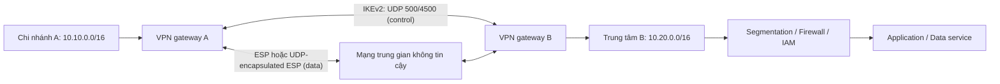
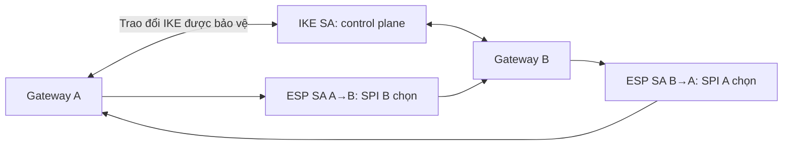
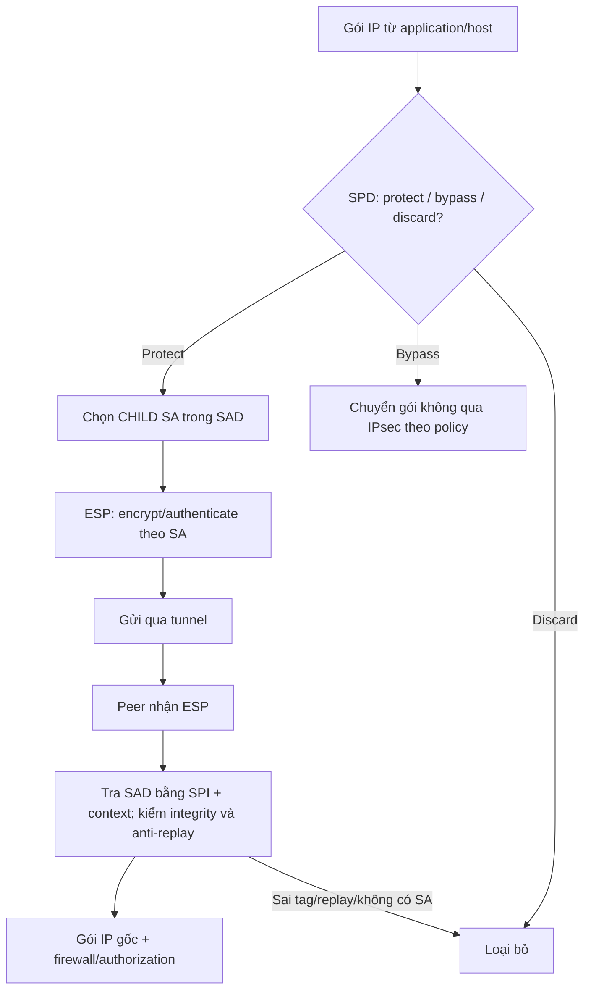
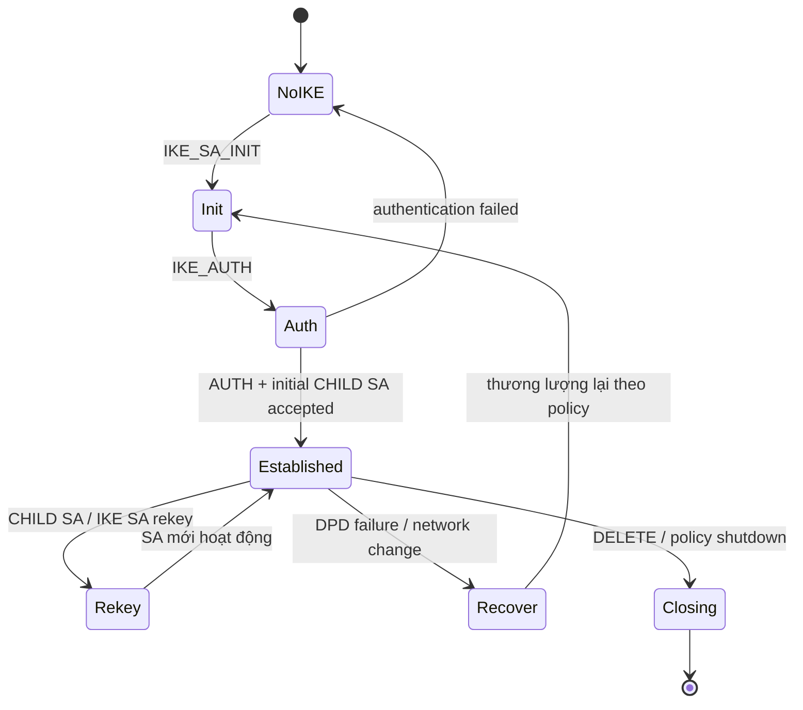
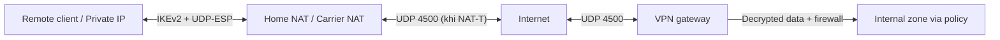

# IKE negotiation và security association

> **Học phần:** `SECURITY_NETWORK_SECURITY`  
> **Chương:** VPN và truy cập từ xa  
> **Trọng tâm:** Cơ chế thương lượng khóa và chính sách trong **IKEv2 (Internet Key Exchange version 2)**, cách tạo và duy trì **IKE SA** và **IPsec CHILD SA**, cùng những yếu tố bảo mật, vận hành và xử lý sự cố cho VPN site-to-site, VPN người dùng từ xa, mạng lai và hạ tầng đám mây.

## Mục tiêu học tập

Sau khi học, người đọc có thể:

1. Phân biệt **IKE**, **IPsec**, **IKE SA**, **CHILD SA**, **SPI**, **SPD**, **SAD**, **traffic selector** và **proposal**.
2. Mô tả trình tự IKEv2: `IKE_SA_INIT`, `IKE_AUTH`, `CREATE_CHILD_SA` và `INFORMATIONAL`.
3. Giải thích vai trò của **Diffie–Hellman**, nonce, PRF, mã hóa, integrity/AEAD, xác thực thiết bị/người dùng và việc sinh khóa cho ESP.
4. Phân tích các biến thể xác thực PSK, chứng chỉ số và EAP cho remote-access VPN; không nhầm kết nối IKE thành quyền truy cập ứng dụng.
5. Thiết kế cấu hình policy ở mức khái niệm cho gateway, client, site-to-site, split tunnel/full tunnel, VPN cloud và phân đoạn mạng.
6. Nhận diện và xử lý các lỗi phổ biến như proposal mismatch, lỗi chứng chỉ, traffic selector mismatch, NAT-T, MTU, route, firewall và rekey.
7. Xây dựng kiểm thử, giám sát và phản ứng với sự cố IKE/IPsec bằng dữ liệu được phép, không ghi lộ khóa hay thông tin đăng nhập.

## 1. IKE và IPsec giải quyết vấn đề gì?

**IPsec** là nhóm cơ chế bảo vệ lưu lượng ở lớp IP, thường sử dụng **Encapsulating Security Payload (ESP)** để cung cấp tính bí mật và bảo vệ tính toàn vẹn/xác thực gói theo cấu hình. **IKE** là giao thức dùng để **xác thực các thực thể ngang hàng, thương lượng tham số bảo mật và thiết lập/duy trì các khóa/SA** mà IPsec sử dụng.

Một ví dụ:

- Chi nhánh A và trung tâm dữ liệu B cần truyền dữ liệu qua một mạng không tin cậy.
- Hai gateway dùng **IKEv2** để xác thực lẫn nhau, thống nhất thuật toán và tạo **IKE SA**.
- Qua kênh IKE đã được bảo vệ, hai bên tạo **CHILD SA** với khóa cho lưu lượng ESP.
- Gói IP phù hợp policy đi qua SA và được **mã hóa/kiểm tra tính toàn vẹn**; gói không phù hợp policy không tự động được cấp quyền chỉ vì tunnel tồn tại.

**IKE không phải giao thức chở toàn bộ lưu lượng nghiệp vụ.** IKE là **control plane của IPsec**, còn ESP thường là **data plane** vận chuyển gói ứng dụng theo SA đã được tạo.

### Các thuật ngữ cốt lõi

| Thuật ngữ | Ý nghĩa | Lưu ý bảo mật |
|---|---|---|
| **IKEv2 peer** | Bên khởi tạo (*initiator*) hoặc đáp ứng (*responder*) của phiên IKE | Địa chỉ IP peer không thay thế xác thực danh tính |
| **IKE SA** | Quan hệ bảo mật logic bảo vệ các bản tin điều khiển IKEv2 sau bước thiết lập ban đầu | Có khóa và SPI riêng, khác với IPsec/CHILD SA |
| **CHILD SA** | Quan hệ bảo mật chứa tham số để bảo vệ traffic IPsec/ESP (hoặc AH nếu sử dụng) | Với ESP, các SA một chiều thường được tạo theo **cặp hướng** |
| **SPI** | Security Parameter Index, định danh SA trong ngữ cảnh giao thức | IKE SPI và ESP SPI **không cùng định dạng/vai trò** |
| **Proposal** | Bộ thuật toán/thuộc tính bảo mật mà peer đề xuất | Chỉ chọn giao điểm nằm trong policy an toàn |
| **Traffic selectors** | Mô tả loại traffic được bảo vệ bởi CHILD SA, thường theo địa chỉ, protocol và cổng | Không thay thế firewall hoặc authorization |
| **SPD** | Security Policy Database, xác định lưu lượng phải protect/bypass/discard | Cần kiểm soát cả chiều vào và ra |
| **SAD** | Security Association Database, chứa SA hiện có và thông số xử lý | Theo dõi trạng thái, SPI, khóa và anti-replay mà không xuất secret |
| **PAD** | Peer Authorization Database theo kiến trúc IPsec, hỗ trợ liên hệ danh tính peer với quyền/policy | Peer xác thực đúng vẫn cần được giới hạn prefix/traffic |
| **Rekey** | Tạo khóa/SA thay thế trước khi khóa hoặc SA cũ hết hiệu lực | Hai phía có thể đồng thời yêu cầu rekey; cần xử lý race |
| **DPD/liveness** | Kiểm tra tính sống của peer bằng cơ chế IKEv2 | Peer còn sống không có nghĩa data plane hoạt động |

## 2. Nhìn kiến trúc từ gateway đến ứng dụng



Sơ đồ minh họa logic: gói ESP đi trên **đường mạng trung gian** giữa hai gateway, không đi qua một luồng IKE riêng mang nội dung ứng dụng. Tùy NAT/firewall, ESP có thể chạy trực tiếp bằng IP protocol 50 hoặc được đóng gói qua UDP 4500 (*NAT traversal*).

### Ba lớp phải kiểm chứng độc lập

1. **IKE control plane:** Peer có trao đổi bản tin đúng, xác thực thành công và tạo IKE SA không?
2. **IPsec data plane:** Có CHILD SA/ESP cho đúng traffic; bộ đếm packet/byte, anti-replay, route và MTU hoạt động không?
3. **Quyền truy cập:** Firewall, ACL, NAC, service account, identity, API/DB authorization có cho phép lưu lượng và hành động đó không?

Ví dụ, trạng thái “IKE SA established” **không chứng minh** client có thể kết nối database. Có thể chưa có CHILD SA, CHILD SA chứa sai selectors, route chưa dẫn vào tunnel hoặc database từ chối truy cập theo quyền.

## 3. IKEv2 so với IKEv1 và lựa chọn phạm vi bài học

Bài học tập trung vào **IKEv2**, được đặc tả trong RFC 7296 và các cập nhật liên quan. IKEv1 có cấu trúc khác (Main/Aggressive Mode, Quick Mode) và nhiều thiết bị cũ vẫn có cấu hình tên “Phase 1/Phase 2”.

| Góc nhìn | IKEv1 (mô hình truyền thống) | IKEv2 |
|---|---|---|
| Thiết lập ban đầu | Phase 1 với Main/Aggressive Mode | `IKE_SA_INIT` và `IKE_AUTH` |
| Thương lượng IPsec SA | Quick Mode của Phase 2 | CHILD SA ban đầu trong IKE_AUTH, sau đó `CREATE_CHILD_SA` |
| Rekey và tạo CHILD SA | Theo cơ chế IKEv1 | `CREATE_CHILD_SA` theo IKEv2 |
| Kiểm tra sống, delete, thông báo | Cơ chế IKEv1/vendor khác nhau | `INFORMATIONAL` và cơ chế IKEv2 liên quan |
| NAT, mobility, fragmentation | Khả năng tùy phiên bản/extension | Có chuẩn mở rộng và triển khai IKEv2 phù hợp |
| Yêu cầu triển khai mới | Tránh phụ thuộc thiết kế cũ nếu có lựa chọn an toàn | Ưu tiên khi hai phía cùng hỗ trợ và tương thích |

**Đừng ánh xạ máy móc:** “IKEv2 Phase 1 = chỉ một message” hoặc “IKEv2 Phase 2 = luôn CREATE_CHILD_SA” đều không chính xác. IKEv2 có thể tạo **CHILD SA đầu tiên ngay trong IKE_AUTH**; `CREATE_CHILD_SA` được dùng để thêm hoặc rekey SA sau đó.

## 4. Bốn loại exchange của IKEv2

| Exchange | Mục đích | Điểm quan trọng |
|---|---|---|
| **IKE_SA_INIT** | Thỏa thuận thuật toán IKE, trao đổi Diffie–Hellman và nonce; có thể xử lý thông báo/cookie | Chưa hoàn tất xác thực peer; dữ liệu ban đầu chưa nằm trong kênh đã xác thực |
| **IKE_AUTH** | Xác thực danh tính peer, hoàn tất IKE SA và thường thương lượng CHILD SA ban đầu | Payload được bảo vệ bằng khóa sinh sau IKE_SA_INIT; EAP có thể làm tăng số lượt trao đổi |
| **CREATE_CHILD_SA** | Tạo thêm CHILD SA, rekey CHILD SA hoặc rekey IKE SA theo trường hợp | Dùng SA điều khiển đã được xác thực; có thể trao đổi DH mới khi yêu cầu |
| **INFORMATIONAL** | Thông báo trạng thái, delete SA, liveness và các trao đổi điều khiển khác | Không phải mọi INFORMATIONAL đều là “lỗi” hoặc “keepalive cố định” |

### Trình tự chuẩn tối giản với xác thực phù hợp

```mermaid
sequenceDiagram
    autonumber
    participant I as Initiator
    participant R as Responder
    I->>R: IKE_SA_INIT request: SAi1, KEi, Ni
    R-->>I: IKE_SA_INIT response: SAr1, KEr, Nr
    Note over I,R: Hai bên tính khóa bảo vệ IKE; chưa xác thực danh tính xong
    I->>R: IKE_AUTH request: IDi, AUTH, SAi2, TSi, TSr (encrypted)
    R-->>I: IKE_AUTH response: IDr, AUTH, SAr2, TSi, TSr (encrypted)
    Note over I,R: IKE SA được xác thực và CHILD SA đầu tiên đã được tạo nếu thương lượng thành công
    I->>R: CREATE_CHILD_SA: tạo thêm hoặc rekey (khi cần)
    R-->>I: CREATE_CHILD_SA response
    I->>R: INFORMATIONAL: liveness / Delete / Notify (khi cần)
    R-->>I: INFORMATIONAL response
```

**Sơ đồ là một *happy path* giản lược**, không phải mọi triển khai đều có đúng sáu bản tin. Trong thực tế có thể xảy ra `COOKIE`, `INVALID_KE_PAYLOAD`, thông báo lỗi, certificate chain, nhiều lượt IKE_AUTH do EAP, các extension hoặc thương lượng selectors khác. **Hai cặp request/response đầu** là trình tự cơ bản trong trường hợp không cần các vòng bổ sung.

## 5. IKE_SA_INIT: thuật toán, nonce và Diffie–Hellman

Mục đích của `IKE_SA_INIT` là tạo cơ sở mật mã để bảo vệ IKE traffic về sau.

### Các payload thường gặp

| Payload | Vai trò |
|---|---|
| `SAi1` / `SAr1` | Đề xuất và chọn **IKE SA transform**: encryption, PRF, integrity khi phù hợp và DH group |
| `KEi` / `KEr` | Giá trị trao đổi khóa Diffie–Hellman tương ứng nhóm được lựa chọn |
| `Ni` / `Nr` | Nonce của bên khởi tạo/đáp ứng, góp phần tạo key material mới |
| `NAT_DETECTION_SOURCE_IP` / `NAT_DETECTION_DESTINATION_IP` | Hỗ trợ phát hiện NAT theo cơ chế IKEv2 |
| `COOKIE` hoặc notification khác | Hỗ trợ giảm một số dạng DoS/tình trạng khớp proposal hoặc DH khi được dùng |

**Không gửi khóa bí mật Diffie–Hellman qua mạng.** Hai phía trao đổi **giá trị công khai**, dùng private secret của mình để tính cùng shared secret. Kẻ quan sát không có private value đúng sẽ không dễ suy ra shared secret nếu thuật toán, tham số và triển khai an toàn.

### Tạo khóa IKE ở mức khái niệm

Sau khi thống nhất DH và nonce, hai phía tính **SKEYSEED** rồi dẫn xuất các khóa bảo vệ IKE SA qua một hàm PRF/PRF+ theo đặc tả. Những khóa chức năng gồm:

- Khóa để tạo **key material cho CHILD SA**;
- Khóa dùng kiểm tra và xác thực thông tin liên quan tới IKE;
- Khóa mã hóa/kiểm tra integrity IKE theo hai chiều.

Các tên trường theo RFC như `SK_d`, `SK_ai`, `SK_ar`, `SK_ei`, `SK_er`, `SK_pi`, `SK_pr` có vai trò khác nhau. Việc dùng **AEAD** làm thay đổi cách thể hiện integrity transform so với thuật toán không-AEAD; không nên cố tự xây key derivation bằng công thức rút gọn hoặc ghép chuỗi nonce trong code ứng dụng.

### Bảo đảm và giới hạn

- DH tạo cơ sở bí mật phiên; kết quả ban đầu **chưa xác thực** đối tác.
- Một attacker trên đường có thể gửi packet rác/đổi thông số hoặc làm gián đoạn trước xác thực; IKE_AUTH ràng buộc transcript và danh tính để ngăn MITM khi cấu hình đúng.
- Không tự xem một nhóm DH đã có sẵn trên router là đủ mạnh; chọn nhóm/thuật toán theo chính sách và hỗ trợ của cả hai phía.
- Khóa mạnh không thay thế **xác minh danh tính**, segmentation hay bảo vệ private key/PSK.

## 6. IKE_AUTH: xác minh peer và CHILD SA ban đầu

Trong `IKE_AUTH`, các bên dùng khóa vừa dẫn xuất để **mã hóa/bảo vệ các payload theo IKEv2**, truyền thông tin danh tính và bằng chứng xác thực. Những payload có thể gồm:

- `IDi` và `IDr`: thông tin định danh initiator/responder;
- `AUTH`: bằng chứng xác thực dựa trên phương thức đã thỏa thuận;
- `CERT`/`CERTREQ` khi dùng chứng chỉ;
- `SAi2`/`SAr2`: proposal cho **CHILD SA** đầu tiên;
- `TSi`/`TSr`: traffic selectors được đề nghị/chấp nhận;
- Configuration payload như cấp địa chỉ nội bộ cho remote-access client nếu được sử dụng;
- EAP payload và nhiều lượt request/response bổ sung với profile EAP phù hợp.

**Các payload mang danh tính không nên được hiểu là đã xác thực ngay khi nhìn thấy chúng.** Chỉ sau khi kiểm tra `AUTH`, chứng chỉ/EAP và ràng buộc transcript thành công, bên nhận mới tin vào danh tính peer theo chính sách.

### IKE identity khác IP address

Một peer có thể kết nối từ IP công cộng thay đổi do DHCP, roaming hoặc NAT. `IDi/IDr` có thể là FQDN, địa chỉ hoặc dạng danh tính được hỗ trợ. Người quản trị phải định nghĩa **expected peer identity** và mối liên hệ với chứng chỉ/PSK/PAD.

Không nên “chấp nhận mọi certificate từ một CA” nếu policy yêu cầu một gateway/nhóm thiết bị cụ thể. Xác minh chain, thời hạn, mục đích sử dụng, tên/danh tính và trạng thái thu hồi theo cơ chế sản phẩm hỗ trợ.

### Tại sao IKE_AUTH quan trọng?

Hai phía có thể tính khóa cùng dựa vào DH, nhưng nếu không có xác thực **đối tác nào cũng có thể cố tham gia một cuộc thương lượng mới**. IKE_AUTH làm việc với danh tính, chứng chỉ, PSK hoặc EAP để tránh tin nhầm peer. Một kết quả xác thực thành công là điều kiện **để tạo tunnel đáng tin**, không phải quyền truy cập vô hạn vào mọi subnet nội bộ.

## 7. IKE SA và CHILD SA: hai lớp bảo mật khác nhau

Một điểm nhầm lẫn phổ biến là gọi tất cả kết quả IKE là “một SA”. Trong IKEv2 có **IKE SA** bảo vệ control plane và một hoặc nhiều **CHILD SA** để bảo vệ IP traffic.

| Thuộc tính | **IKE SA** | **CHILD SA / IPsec SA** |
|---|---|---|
| Mục đích | Bảo vệ trao đổi IKEv2 sau khi khởi tạo | Bảo vệ gói ESP/AH được chọn bởi policy |
| Định danh | Cặp IKE SPIs 64-bit dùng trên IKEv2 header | Mỗi SA IPsec một chiều thường có ESP/AH SPI 32-bit |
| Thuật toán | IKE encryption/integrity/PRF/DH theo policy | ESP/AH transforms, keys, replay protection |
| Đối tượng traffic | Control-plane requests/responses | TCP/UDP/ICMP và traffic IP được chọn |
| Số lượng | Một IKE SA có thể điều phối nhiều CHILD SAs | Có thể khác selectors, peer/route hoặc mục đích |
| Vòng đời | Rekey/delete riêng, ràng buộc các CHILD SAs do nó quản lý | Rekey/delete riêng, đôi khi xảy ra thường xuyên hơn |
| Quan sát | IKE peer state, IKE SPI, AUTH, message IDs | Inbound/outbound ESP SPI, byte/packet counters, anti-replay |

### Hướng đi của SA

IPsec SA về mặt xử lý ESP/AH được mô hình hóa **một chiều**. Một tunnel song hướng thường cần **một SA chiều A → B và một SA chiều B → A**, với SPIs và khóa tương ứng, được IKEv2 tạo như một **cặp**.



Mỗi bên **chọn SPI cho chiều inbound mà mình sẽ nhận** và truyền thông tin thích hợp cho peer. Vì vậy hai chiều dữ liệu thường có SPI **khác nhau**. Một số giao diện quản trị hiện “tunnel up” dù chỉ một chiều có packet; kiểm tra riêng **inbound/outbound counters**.

### SA không thay ứng dụng phân quyền

Khi tunnel A↔B đã lên, nó có thể vận chuyển traffic giữa hai subnet nếu SPD, selectors, route và firewall cho phép. Nhưng ứng dụng vẫn cần **TLS/mTLS ở tầng ứng dụng khi phù hợp, authentication, IAM/RBAC và kiểm tra dữ liệu**. IPsec không tự bảo đảm mỗi user phía chi nhánh được phép thao tác mọi tài nguyên trung tâm.

## 8. ESP, AH, tunnel mode và transport mode

IKEv2 có thể tạo CHILD SA cho IPsec protocol tương ứng. Trong VPN doanh nghiệp hiện đại, **ESP** thường là lựa chọn chính.

| Thành phần | Khả năng | Ghi chú |
|---|---|---|
| **ESP (IP protocol 50)** | Bảo vệ payload theo encryption và integrity/AEAD phù hợp; có anti-replay khi được bật | Có thể chạy trực tiếp trên IP hoặc được bọc qua UDP 4500 khi NAT-T |
| **AH (IP protocol 51)** | Xác thực/integrity các phần IP header/payload theo thiết kế, không cung cấp encryption payload | Kém phù hợp với NAT; ít dùng cho remote-access VPN phổ biến |
| **Tunnel mode** | Bọc gói IP gốc trong một gói IP bảo vệ khác | Phổ biến cho site-to-site, gateway và nhiều remote-access VPN |
| **Transport mode** | Bảo vệ payload ở mức host-to-host trong khi giữ outer IP header | Phù hợp một số trường hợp host-to-host; không thay thế mọi nhu cầu tunnel |
| **Anti-replay** | Nhận biết/loại một số gói có sequence number lặp hoặc quá cũ | Cửa sổ và trạng thái được duy trì trên SA nhận, cần xét reorder |

**Không mặc định “IPsec = giao thức TCP 500”.** IKEv2 thường dùng **UDP 500** (và **UDP 4500** với NAT traversal), còn ESP trực tiếp là **IP protocol 50**, không phải “TCP/UDP port 50”. Khi có UDP encapsulation, các gói ESP được bọc trong UDP 4500.

### Tính bí mật và tính toàn vẹn

Với ESP và AEAD như AES-GCM, một transform có thể cung cấp đồng thời **encryption và integrity/authenticity** của dữ liệu theo thiết kế. Với mô hình encryption + integrity riêng như AES-CBC cùng cơ chế integrity thích hợp, phải có cấu hình tương thích và an toàn.

**Không tự ghép thuật toán từ tài liệu thành code mật mã.** Dùng implementation IPsec/IKEv2 được duy trì và cấu hình theo chính sách chính thức của tổ chức.

## 9. Các proposal và quá trình chọn thuật toán

Trước khi thương lượng, mỗi peer có danh sách thuật toán được chấp nhận. Bên đáp ứng lựa chọn tổ hợp thỏa policy và đặc tả IKEv2.

### IKE SA proposal

Thường gồm:

- Encryption algorithm;
- Integrity algorithm khi kiểu mã hóa yêu cầu riêng;
- PRF;
- Diffie–Hellman group.

### CHILD SA / ESP proposal

Thường gồm:

- ESP encryption/AEAD và integrity transform tương ứng;
- các thông số chính sách khác theo sản phẩm;
- ESN (Extended Sequence Numbers) khi được thương lượng và cần;
- DH khi tạo/rekey CHILD SA theo trường hợp có trao đổi DH.

**Không nhầm IKE proposal với ESP proposal.** IKE SA có thể thương lượng thành công, sau đó CHILD SA thất bại vì hai phía **không có giao điểm transform ESP**.

### Policy giả lập

```yaml
ikePolicy:
  protocolVersion: "IKEv2"
  allowedProposals:
    - encryption: "AES-256-GCM"
      prf: "PRF_HMAC_SHA2_256"
      dhGroup: "approved-ecdh-group"
  rejectDeprecatedAlgorithms: true
  peerAuthentication: "certificate-with-identity-validation"
childSaPolicy:
  protocol: "ESP"
  mode: "tunnel"
  allowedProposals:
    - encryption: "AES-256-GCM"
      integrity: "integrated-aead"
  antiReplay: true
  rekey:
    enabled: true
    dhGroupForChildRekey: "approved-ecdh-group"
  trafficSelectors: "approved-local-remote-prefixes"
```

**Đây là policy hướng dẫn, không phải cấu hình nạp trực tiếp vào strongSwan, Cisco, Fortinet, Windows, cloud VPN hay một sản phẩm cụ thể.** Tên thuật toán, mức độ hỗ trợ, lifetime và cách mô tả “PFS” có thể khác. Nếu peer hỗ trợ AES-GCM, cần kiểm tra cách implementation xử lý integrity transform để **không cấu hình nhầm** một transform riêng không phù hợp.

### Nguyên tắc chọn mật mã

- Ưu tiên thuật toán hiện đại, được tổ chức và tiêu chuẩn áp dụng cho phép; tránh legacy cipher/hash/DH yếu.
- Chọn **giao điểm đủ mạnh** giữa hai phía; không hạ xuống thuật toán kém an toàn chỉ để tunnel “lên”.
- Quản lý vòng đời nâng cấp firmware/OS và khả năng tương thích.
- Giám sát mọi trường hợp thương lượng chọn proposal khác policy mong đợi.
- Xem xét yêu cầu tuân thủ, phần cứng tăng tốc, hiệu năng và độ bền khóa.
- Đảm bảo **peer authentication** chặt chẽ; proposal tốt không bảo vệ được nếu thiết bị tin nhầm peer.

## 10. Sinh khóa cho CHILD SA và Perfect Forward Secrecy

**Perfect Forward Secrecy (PFS)** nói về việc lộ khóa dài hạn không cho phép suy ra khóa phiên trước đó khi giao thức và nhóm DH/ephemeral secret được triển khai đúng, trong các giả định bảo mật phù hợp.

### Điểm tinh tế trong IKEv2

- **IKE_SA_INIT** dùng DH tạo shared secret cho IKE SA ban đầu; kết hợp nonce và KDF.
- **CHILD SA đầu tiên** thường được tạo trong IKE_AUTH và dùng key material dẫn xuất từ `SK_d` và nonce theo cơ chế đặc tả. Exchange IKE_AUTH ban đầu **không có cặp DH riêng cho CHILD SA**.
- **CREATE_CHILD_SA** dùng để tạo thêm/rekey CHILD SA; có thể mang trao đổi `KE` mới để đưa shared DH mới vào key derivation theo policy.
- **IKE SA rekey** cũng dùng CREATE_CHILD_SA với trao đổi DH mới theo cơ chế tương ứng.

Do đó, dòng cấu hình vendor “enable PFS for Phase 2” thường phản ánh **DH ở lần rekey/tạo CHILD SA sau**, không nên diễn giải rằng mọi CHILD SA trong IKE_AUTH có một DH riêng. Đồng thời, **khóa CHILD SA đầu tiên vẫn dựa trên IKE SA được tạo với DH**.

### Lợi ích của rekey

Rekey giới hạn thời gian sử dụng một bộ khóa và đáp ứng các điều kiện về lifetime/khối lượng dữ liệu của implementation. Rekey phải được thực hiện **trước khi SA cũ mất hiệu lực** để tránh gián đoạn; trong giai đoạn chuyển, hai thế hệ SA có thể cùng tồn tại ngắn hạn.

### Không nên tự suy ra PFS từ một dòng log

Log “CHILD_SA established” không đủ chứng minh thuật toán, nhóm DH của lần rekey hoặc ràng buộc thời hạn đã đúng. Cần xem proposal thực sự đã chọn, exchange tạo SA, key lifetime và policy tương ứng, **không cần xuất khóa bí mật**.

## 11. Traffic selectors: xác định traffic nào được tunnel bảo vệ

Một **CHILD SA** có các traffic selectors (thường gọi `TSi` và `TSr`) mô tả loại gói được bảo vệ theo góc nhìn initiator/responder, có thể bao gồm:

- Prefix/range IP nguồn và đích, IPv4/IPv6;
- giao thức transport như TCP/UDP hoặc “any”;
- khoảng cổng nếu policy sử dụng;
- giới hạn dựa trên mode và nền tảng.

Ví dụ site-to-site:

| Thuộc tính | Gateway A | Gateway B |
|---|---|---|
| Mạng nội bộ | `10.10.0.0/16` | `10.20.0.0/16` |
| Remote protected subnet | `10.20.0.0/16` | `10.10.0.0/16` |
| IKE peer public address | Theo uplink của A | Theo uplink của B |
| ESP CHILD SA | Gói A↔B theo policy | Bộ policy tương ứng ở B |

Đây là ví dụ địa chỉ riêng. Trong triển khai route-based VPN, selectors có thể rộng và route/interface/tunnel policy được dùng để định hướng traffic; **không vì vậy bỏ qua firewall/segmentation**.

### Narrowing

IKEv2 cho phép responder **thu hẹp (narrow)** traffic selectors được yêu cầu để chúng phù hợp quyền/policy. Nếu initiator yêu cầu bảo vệ `0.0.0.0/0` nhưng responder chỉ cho phép một prefix cụ thể, kết quả có thể là bộ selectors được thu hẹp hoặc thương lượng thất bại tùy chính sách và khả năng thiết bị.

**Không giả định responder có thể mở rộng** quyền sang nhiều traffic hơn client đã yêu cầu; việc thỏa thuận selectors phải tuân thủ IKEv2 và policy. Nếu phía client và gateway không chấp nhận kết quả narrowing, thấy lỗi như `TS_UNACCEPTABLE` ở thiết bị có thể là tín hiệu cần kiểm tra.

### Các lỗi security thường gặp

- Selectors quá rộng làm VPN mở đường tới management/data zone không cần thiết.
- Một phía đổi prefix mà phía còn lại chưa cập nhật.
- NAT địa chỉ nội bộ tạo địa chỉ quan sát khác với cấu hình selectors/đường định tuyến.
- Route-based VPN có đường route qua tunnel nhưng firewall phía sau vẫn deny.
- IPv4 thành công, IPv6 đi Internet trực tiếp vì chưa có v6 policy/tunnel.
- Nhiều cặp selectors được cấu hình khác semantics giữa hai vendor.

**Kết luận:** selectors nói traffic nào được **IPsec bảo vệ**, còn authorization nói ai được phép truy cập **ứng dụng và dữ liệu**.

## 12. SPD, SAD và xử lý một gói dữ liệu

**Security Policy Database (SPD)** quy định traffic nào phải:

1. **PROTECT** qua IPsec;
2. **BYPASS** không qua IPsec theo policy;
3. **DISCARD** vì không được phép.

**Security Association Database (SAD)** chứa các SA đang hoạt động để thiết bị xử lý gói ESP/AH theo SPI và thông số tương ứng.



Một số implementation kết hợp SPD với kernel policy/xfrm, route-based VTI hoặc accelerator. Tên thành phần hiển thị có thể khác. Nhưng **ngữ nghĩa quan trọng** vẫn là lựa chọn lưu lượng theo policy và xử lý bằng SA đã thương lượng.

### Kiểm tra hai chiều

Nếu gateway A báo outbound ESP tăng nhưng gateway B không báo inbound thành công, có thể do:

- Chặn ESP/UDP 4500 trên đường;
- IP/port thay đổi bởi NAT;
- SPI không trùng/lỗi SA đã xóa;
- integrity/anti-replay thất bại;
- MTU/fragmentation;
- đường trả lời đi qua gateway khác.

Nếu cả hai chiều có ESP counters tăng nhưng API vẫn lỗi, hãy kiểm tra **route nội bộ, firewall, DNS, application auth và trạng thái service**, không mở rộng tất cả selectors ngay lập tức.

## 13. CREATE_CHILD_SA: thêm tunnel con và rekey

Một IKE SA đã xác thực có thể dùng `CREATE_CHILD_SA` để:

- Tạo thêm CHILD SA cho traffic/chính sách khác;
- rekey một CHILD SA đang tồn tại;
- rekey chính IKE SA theo cơ chế của IKEv2.

### Minh họa rekey CHILD SA

```mermaid
sequenceDiagram
    autonumber
    participant A as Initiator / Gateway A
    participant B as Responder / Gateway B
    Note over A,B: IKE SA đã được xác thực; CHILD SA cũ còn hoạt động
    A->>B: CREATE_CHILD_SA request: SA, Ni, optional KE, REKEY_SA
    B-->>A: CREATE_CHILD_SA response: SA, Nr, optional KE
    Note over A,B: Hai phía có khóa và SPI của CHILD SA mới
    A->>B: INFORMATIONAL / Delete SA cũ theo quy trình
    B-->>A: Ack / delete completion
    Note over A,B: Data traffic chuyển sang SA mới; tránh mất gói do lệch thời điểm
```

Đây là trình tự **khái niệm**. Thực tế có thể có simultaneous rekey, retry, packet reordering và các bước xóa SA khác nhau. Protocol cung cấp cơ chế xử lý; thiết bị vẫn phải duy trì state đồng bộ.

### Rekey khác reauthentication

- **Rekey:** thay khóa/SA bằng exchange thích hợp, thường vẫn dựa vào IKE SA đã xác thực hoặc tạo IKE SA kế nhiệm.
- **Reauthentication:** thực hiện lại xác thực peer/user theo policy/implementation, có thể cần tạo một IKE SA mới qua quy trình ban đầu.

Không nên đồng nhất “rekey lifetime 1 giờ” với “bắt user nhập lại MFA mỗi giờ”. Session lifetime, authentication policy và SA key lifetime là những giá trị vận hành khác nhau.

## 14. INFORMATIONAL, liveness, DPD và xóa SA

Exchange `INFORMATIONAL` cho phép các peer trao đổi thông báo điều khiển đã bảo vệ bằng IKE SA, ví dụ:

- Xóa IKE SA hoặc CHILD SA;
- các NOTIFY phù hợp;
- kiểm tra peer còn phản hồi hay không;
- trao đổi thông tin khác khi extension sử dụng.

Trong IKEv2, liveness có thể được kiểm tra bằng request/response trống được bảo vệ hoặc thông qua các trao đổi IKE khác; nhiều giao diện vẫn dùng tên **DPD (Dead Peer Detection)** theo thói quen. Cơ chế và thời điểm gửi heartbeat phụ thuộc cấu hình và implementation.

### Liveness không phải kiểm tra mọi lớp

| Tín hiệu | Có thể nói | Không thể nói |
|---|---|---|
| IKE peer trả lời | Control plane tới peer còn hoạt động | Database đích đang phục vụ |
| CHILD SA có mặt | Có SA được thương lượng | Mọi prefix và route đang đúng |
| ESP bytes tăng | Có traffic qua ESP SA | API/user có quyền ứng dụng |
| ICMP ping thành công | Có ít nhất một đường data packet tương ứng | Mọi TCP port/MTU hoạt động |
| Không có log lỗi | Chưa ghi nhận trong nguồn quan sát hiện có | Mạng an toàn hoặc log đầy đủ |

Tránh cấu hình **DPD quá nhạy** trên đường di động/VPN roaming khiến tunnel flap, hoặc quá chậm làm trạng thái chết tồn tại lâu. Cần chọn theo đường truyền, thiết bị và SLO đã đo.

## 15. Vòng đời SA: lifetime, overlap và xử lý mất kết nối

Một tunnel vận hành có thể trải qua các trạng thái:



Đây là **state machine học tập**, không phải state names thật của mọi IKE daemon. Sau thương lượng IKE_AUTH có thể chỉ IKE SA được tạo hoặc CHILD SA gặp lỗi tùy tình huống; đừng dùng trạng thái “Established” của một GUI làm bằng chứng duy nhất.

### Các quyết định vận hành

- **IKE SA lifetime** và **CHILD SA lifetime** cần theo hướng dẫn sản phẩm, chính sách và peer agreement.
- Rekey trước khi hard lifetime kết thúc để có thời gian hoàn thành.
- Quản lý rollover, jitter và những tình huống cả hai phía rekey cùng lúc.
- Xử lý SA **orphan/stale** khi peer đổi IP hoặc restart.
- Khi rekey thất bại, ghi log rõ **IKE SA hay CHILD SA**, proposal hay transport/timeout.
- Cân nhắc khả năng giữ kết nối khi user roaming, mất Wi-Fi hoặc đổi mạng.
- Không xuất khóa bí mật hoặc private key vào log chỉ để đối chiếu phiên.

**Thay đổi một chiều**: Nếu một bên giảm lifetime hoặc đổi thuật toán mà bên kia chưa hỗ trợ, tunnel có thể hoạt động tạm thời rồi lỗi đúng thời điểm rekey. Vì vậy phải kiểm tra **sau ít nhất một chu kỳ rekey trong lab/canary** khi có thay đổi mật mã.

## 16. NAT traversal: UDP 500, UDP 4500 và ESP

NAT thường thay đổi địa chỉ IP nguồn/đích và có thể thay cổng transport. IPsec ESP nguyên thủy không có TCP/UDP port để NAT truyền thống ánh xạ phiên dễ dàng trong mọi trường hợp. **NAT traversal (NAT-T)** hỗ trợ đóng gói ESP qua UDP 4500 khi phù hợp.

### Diễn tiến khái niệm

1. IKEv2 có thể bắt đầu bằng **UDP 500**, tùy kiến trúc và thiết bị.
2. Hai bên trao đổi thông tin hỗ trợ phát hiện NAT trong `IKE_SA_INIT`.
3. Khi NAT được phát hiện hoặc policy yêu cầu, kết nối có thể dùng **UDP 4500**.
4. IKEv2 và UDP-encapsulated ESP có cơ chế **phân biệt payload** trên UDP 4500; không phải tất cả gói UDP 4500 là ESP.
5. NAT mappings, keepalive và chính sách firewall phải cho phép các phiên còn hoạt động theo thiết kế.



### Firewall policy mẫu ở mức khái niệm

| Đường cần xem | Protocol/port | Khi nào |
|---|---|---|
| Peer ↔ VPN gateway | **UDP 500** | IKEv2 initial negotiation trong thiết kế dùng UDP 500 |
| Peer ↔ VPN gateway | **UDP 4500** | NAT-T và những triển khai sử dụng UDP 4500 |
| Peer ↔ VPN gateway | **IP protocol 50 (ESP)** | ESP trực tiếp khi không dùng UDP encapsulation |
| Peer ↔ VPN gateway | **IP protocol 51 (AH)** | Chỉ trong thiết kế dùng AH |
| Client → ứng dụng nội bộ | TCP/UDP/ICMP theo nghiệp vụ | Chỉ sau giải mã IPsec, chịu ACL/firewall riêng |

**Không nên mở Any/Any** chỉ vì IKE không thành công. Đảm bảo peer identity, source scope, routing, NAT rules và protocol cụ thể. “Port 500” là **UDP**, không phải TCP 500.

### NAT-T không sửa mọi lỗi

- UDP 4500 có thể bị chặn bởi firewall của nhà mạng/doanh nghiệp.
- NAT mapping có thể hết hạn nếu không có lưu lượng/keepalive tương thích.
- CGNAT/multiple NAT có thể ảnh hưởng khả năng kết nối.
- MTU nhỏ hơn do IPsec/UDP overhead có thể gây vấn đề gói lớn.
- Peer đổi IP nhưng chính sách identity/route không được cập nhật.
- Một số đường có IPsec passthrough/NAT behavior riêng, cần kiểm tra nền tảng.

**Một IKE SA hoạt động trên UDP 4500 không bảo đảm ESP packets được chuyển qua NAT đúng.** Cần nhìn dữ liệu ESP packet/byte và route hai chiều.

## 17. Mobility, MOBIKE và remote-access client

Người dùng di động có thể chuyển từ Wi-Fi văn phòng sang mạng di động hoặc Wi-Fi gia đình, khiến IP và NAT mapping thay đổi. Extension **MOBIKE** cho IKEv2 hỗ trợ thay đổi địa chỉ của IKE/IPsec SA theo cơ chế được đặc tả nếu cả hai phía hỗ trợ và cấu hình phù hợp.

### Những điểm cần kiểm tra

- Client và gateway có thực sự hỗ trợ MOBIKE không?
- Peer identity và authentication còn đúng sau đổi IP?
- Các tunnel/route selectors có được cập nhật không?
- VPN DNS settings, private routes, split tunnel policies có theo phiên mới không?
- Endpoint có áp firewall và kill switch/always-on phù hợp khi tunnel tạm mất không?
- Sự kiện đổi mạng có làm DPD/reauth gây mất phiên ứng dụng không?

**MOBIKE không tự cấp quyền** để client đổi thành một principal khác hoặc truy cập thêm subnet. Nó là tính năng hỗ trợ duy trì đường kết nối khi địa chỉ mạng thay đổi; authorization vẫn dựa vào xác thực và chính sách.

### Tình huống remote client bị mất tunnel ngắn

Một nhân viên đang làm việc qua Wi-Fi mất sóng rồi chuyển LTE. Nếu client/gateway hỗ trợ mobility và route policy đúng, có thể duy trì đường bảo vệ hoặc thương lượng lại nhanh. Nếu không hỗ trợ, client cần tạo phiên IKE mới. Cả hai trường hợp đều phải đo **thời gian mất kết nối và data-path recovery**, không chỉ số lần ghi log “SA up”.

## 18. Xác thực: PSK, certificate và EAP

### 18.1 Pre-shared key (PSK)

PSK là bí mật được các bên chia sẻ từ trước. Có thể hữu ích trong một số môi trường nhỏ/thiết bị legacy được quản trị, nhưng:

- PSK yếu, dùng chung rộng hoặc nằm trong file cấu hình dễ bị lộ.
- Không dễ thu hồi riêng từng thiết bị nếu nhiều peer dùng cùng PSK.
- Có thể nhầm peer nếu policy match dựa trên IP rộng và PSK tái sử dụng.
- Thay PSK cần quy trình rollover có phối hợp.

**Chọn PSK mạnh, ngẫu nhiên, phân biệt theo peer khi phù hợp**, lưu trong secret management, hạn chế quyền và không đưa vào log/ticket. Không coi “PSK đúng” là đủ nếu policy vẫn cho phép selectors quá rộng.

### 18.2 Chứng chỉ số

Certificate-based authentication giúp quản lý danh tính gateway/client theo PKI. Các bước cần đúng:

- Trust chain/CA và intermediate chain;
- tên/identity mong đợi của peer so với chứng chỉ và cấu hình IKE ID;
- thời hạn, key usage/EKU và chính sách xác minh nếu áp dụng;
- trạng thái thu hồi theo quy trình;
- bảo vệ private key trong HSM/TPM hoặc key store thích hợp;
- cập nhật trước hết hạn, thử rollover ở cả hai phía.

**Một certificate ký bởi CA đáng tin chưa đủ** nếu xác minh sai danh tính cụ thể. Ví dụ gateway muốn kết nối tới đối tác A thì không nên mặc nhiên chấp nhận certificate của đối tác B chỉ vì hai bên cùng được CA tổ chức cấp.

### 18.3 EAP trong remote access

IKEv2 có thể sử dụng **Extensible Authentication Protocol (EAP)** để xác thực người dùng/client theo profile. EAP có thể kéo dài `IKE_AUTH` qua nhiều request/response. Việc xác thực server và cách bảo vệ credentials phụ thuộc **EAP method, certificate validation và chính sách client**.

Không suy rằng “EAP = luôn có TLS bảo vệ server và MFA”. Chẳng hạn, **EAP-TLS** là một phương thức EAP dựa trên TLS và chứng chỉ, nhưng khả năng hỗ trợ trong IKEv2, lựa chọn profile cũng như cách xác minh server/client phải được kiểm tra theo sản phẩm. Một số phương thức khác cần cấu hình trust riêng; MFA là yếu tố ngoài hoặc tích hợp với IdP/RADIUS. Để có bảo mật tốt:

- Chọn EAP method phù hợp, xác thực server nghiêm ngặt;
- kết hợp MFA khi rủi ro yêu cầu và sản phẩm hỗ trợ;
- gắn quyền VPN với user/device posture và nhóm tài nguyên;
- đặt thời hạn phiên, token lifetime, cơ chế thu hồi/khóa tài khoản;
- giữ audit về authentication **không chứa password/OTP/private keys**.

### Bảng lựa chọn minh họa

| Phương thức | Tình huống | Rủi ro chính |
|---|---|---|
| PSK riêng từng gateway | Site-to-site nhỏ, thiết bị ít | Phân phối/rotation và lộ secret |
| Certificate cho gateway | Site-to-site cần danh tính rõ | Quản trị PKI, revocation và naming |
| Certificate client + policy thiết bị | Remote access managed endpoint | Phát hành/thu hồi thiết bị, ràng buộc user |
| EAP + xác thực server đúng + MFA theo triển khai | Remote access người dùng | EAP method, credential flow, identity mapping |
| Mixed auth theo vendor | Một số cloud/network service | Phải xác minh tương thích và security guarantee |

## 19. Site-to-site VPN: policy và phân đoạn hai đầu

Một kết nối site-to-site đáng tin thường cần:

1. Định nghĩa **địa chỉ gateway peer** và expected IKE identity.
2. Định nghĩa thuật toán IKE/ESP phù hợp và phương thức xác thực.
3. Xác định **subnet được phép** trao đổi theo yêu cầu nghiệp vụ.
4. Chọn policy-based hoặc route-based phù hợp topology.
5. Định nghĩa route, NAT exemption/translation nếu cần, firewall và IDS/IPS.
6. Kiểm tra cả **hướng đi và hướng về**.
7. Giám sát SA lifetime, rekey, ESP packet counters, NAT-T và health.

### Ma trận traffic mẫu

| Nguồn | Đích | Cơ chế | Quyết định |
|---|---|---|---|
| `10.10.40.0/24` app A | `10.20.50.0/24` DB B | ESP qua VPN, firewall TCP 5432, DB auth | Allow có điều kiện |
| `10.10.10.0/24` user A | `10.20.80.0/24` management B | Không có nhu cầu nghiệp vụ | Deny |
| Monitoring A | Collector B | ESP + policy port/identity cụ thể | Allow hẹp |
| Guest Wi-Fi A | Bất kỳ management/data B | Không thuộc trust relationship | Deny |
| Các subnet khác | Data center B | Không có rule | Default deny trong vùng policy |

**Một route tới `10.20.0.0/16` không có nghĩa tất cả VLAN trong dải đó phải được cho phép.** Với route-based VPN, route tới VTI chỉ là quyết định forwarding; firewall/segmentation tiếp tục cần deny các luồng ngoài ma trận.

### Policy-based và route-based

| Tiêu chí | Policy-based IPsec | Route-based IPsec / VTI |
|---|---|---|
| Cách hướng traffic | Theo selectors/SPD và rule tương ứng | Route chuyển traffic vào tunnel interface, cùng security policy |
| Quản lý nhiều subnet | Có thể cần nhiều selector/rule | Có thể linh hoạt hơn với routing động |
| Quan sát | Nhìn cặp selectors/SA và policy | Nhìn interface, route, SA và firewall |
| Lỗi thường gặp | Selector không khớp, NAT/crypto policy | Route sai, interface ACL, selector rộng hoặc ngầm định |
| Bảo mật | Phải giới hạn theo đúng subnet/port/identity | Route **không thay thế** quyền truy cập và selectors |

Không có lựa chọn nào mặc định “an toàn hơn trong mọi trường hợp”. Kết quả phụ thuộc quyền quản trị, routing, firewall, policy và cách implementation.

## 20. Remote-access VPN: full tunnel, split tunnel và DNS

Một user VPN sau xác thực có thể được cấp một **virtual IP** hoặc mạng route nội bộ. IKEv2 configuration payload có thể truyền thông tin cấu hình như địa chỉ nội bộ/DNS theo khả năng client/gateway.

### Full tunnel

- Đường mạng ra ngoài theo policy được hướng vào VPN gateway.
- Doanh nghiệp có thể áp egress security, proxy/DNS policy tập trung.
- Tăng tải bandwidth/latency cho gateway; cần capacity và đường HA.
- Không bảo đảm tất cả traffic được bảo vệ nếu thiết bị/client có ngoại lệ IPv6, application bypass hoặc tunnel drop.

### Split tunnel

- Chỉ route cho tài nguyên nội bộ đi qua VPN; các mạng khác dùng đường trực tiếp.
- Giảm tải và cải thiện hiệu năng cho user.
- Đặt ra nhu cầu **endpoint firewall, secure DNS, device posture và policy ứng dụng** rõ ràng hơn.
- Phải kiểm tra địa chỉ nội bộ overlap với mạng nhà, route priority, IPv4/IPv6 và DNS split-horizon.

### DNS khi dùng IKEv2 VPN

Nếu client nhận DNS resolver nội bộ qua VPN nhưng OS/browser tiếp tục dùng resolver công cộng ngoài policy, một số tên miền nội bộ có thể không phân giải hoặc làm lộ metadata truy vấn. Các chức năng như DoH, DoT, DoQ, split DNS và hệ điều hành có thể thay đổi đường đi.

**Đừng suy rằng CHILD SA đã lên = mọi DNS query vào tunnel.** Kiểm tra route, resolver thực và profile trên endpoint.

### Phân đoạn sau kết nối

VPN là **đường vận chuyển** đã xác thực, không phải mạng “tin cậy mặc định”. Nên dùng authorization theo user/device/role, per-app access, NAC/ZTNA khi phù hợp, chặn truy cập management không có nghiệp vụ và theo dõi hoạt động sau đăng nhập.

## 21. Rekey, NAT-T và policy trong cloud/hybrid

Hạ tầng cloud thường tích hợp VPN gateway managed service, BGP route exchange, tunnel redundancy và telemetry; nhưng khả năng IKE/IPsec khác nhau theo nhà cung cấp.

### Các điểm tương thích cần kiểm tra

| Thành phần | Câu hỏi thiết kế |
|---|---|
| **IKE version** | Hai bên cùng hỗ trợ IKEv2 và extension cần thiết? |
| **Proposal IKE/ESP** | Thuật toán, DH group, PRF, AEAD, PFS ở lần rekey có giao điểm đủ mạnh? |
| **Peer identity** | IP/ID/certificate/PSK được ánh xạ đúng, có hỗ trợ IP động? |
| **Traffic selectors** | Route-based/cloud tunnel dùng selectors nào; có hỗ trợ narrowing? |
| **BGP** | Route advertisement có được cài vào route table và filter đúng VRF/VPC/VNet? |
| **NAT-T** | UDP 500/4500, NAT mapping và path firewall có cho phép? |
| **ESP MTU** | Path MTU, fragmentation, MSS và các tunnel overhead có được tính? |
| **Failover** | Hai tunnel hoạt động thế nào, có giữ session state và route symmetry? |
| **Logging** | Managed service cung cấp IKE/Child SA logs, DPD/rekey events ở mức nào? |
| **IAM/security group** | Một tunnel up không tự cấp quyền từ workload tới data/management |

### Cloud VPN + BGP không đồng nghĩa “cho tất cả”

Một cloud VPN có thể thương lượng IKE/ESP tốt, học route chính xác nhưng access đến VM/DB vẫn bị security group, NACL, host firewall hoặc IAM chặn. Ngược lại, một route leak sai sau peering có thể tạo đường bypass firewall dự kiến; cần quản lý **routing security và segmentation cùng nhau**.

### HA và rekey

Khi dùng gateway HA hoặc nhiều đường VPN, kiểm tra:

- Đường data plane đang chọn tunnel nào?
- SA state có đồng bộ giữa HA nodes không, hay phải thương lượng lại sau failover?
- Route preference/BGP convergence có làm traffic bất đối xứng?
- Rekey đồng thời trên các đường có ảnh hưởng session ứng dụng không?
- Nếu NAT IP/peer IP thay, identity/cert vẫn match không?

## 22. MTU, MSS và fragmentation của IKE/IPsec

ESP tunnel thêm IP header, ESP header/trailer, authentication tag và có thể UDP encapsulation. Do đó **kích thước gói thực trên đường truyền tăng** so với gói IP gốc.

### Hai vấn đề khác nhau

1. **IKE message fragmentation:** Bản tin IKE_AUTH có chain chứng chỉ lớn có thể vượt giới hạn path MTU. IKEv2 fragmentation (RFC 7383) cho phép phân mảnh ở tầng IKE khi được hỗ trợ, tránh phụ thuộc vào IP fragmentation không ổn định.
2. **Data packet MTU/MSS:** Gói TCP/UDP ứng dụng có thể vượt MTU còn lại sau ESP/NAT-T overhead. Cần PMTUD, MSS clamping hoặc điều chỉnh MTU ở vị trí thích hợp.

### Triệu chứng thường thấy

| Triệu chứng | Phân tích khả dĩ |
|---|---|
| IKE_SA_INIT qua, IKE_AUTH bị timeout khi gửi certificate | IKE_AUTH lớn, IP fragmentation bị chặn, thiếu IKE fragmentation hoặc lỗi cert |
| Small ping thành công, HTTPS tải lớn bị treo | Path MTU/PMTUD, TCP MSS, ESP overhead hoặc application problem |
| Tunnel lên nhưng chỉ một số website lỗi | MTU, DNS/split route, protocol/port policy, proxy hoặc IPv6 |
| ESP counters inbound tăng nhưng packets bị drop | Anti-replay/integrity, PMTU, kernel policy hoặc firewall |
| Mọi kết nối lỗi ngay sau rekey | SA/SPIs không đồng bộ, proposal/rekey state hoặc đường NAT thay |

**Không chỉ tăng MTU một cách mù quáng.** Xác định underlay MTU, encapsulation, đường NAT, ICMP cần thiết cho PMTUD và ứng dụng chịu ảnh hưởng. Fragmentation ở IKE control plane không tự giải quyết data plane ESP MTU.

## 23. Security posture và threat modeling cho IKE/IPsec

### Những mối đe dọa cần đặt câu hỏi

| Nhóm | Tình huống | Kiểm soát |
|---|---|---|
| **Spoofing** | Client/gateway giả danh peer hoặc xác thực sai chứng chỉ | IKE AUTH, expected ID, PKI/PSK policy, MFA khi phù hợp |
| **Tampering** | Proposal, route, selectors, firewall hoặc profile bị sửa trái phép | IAM/RBAC, signed change, config diff, policy review |
| **Repudiation** | Không biết ai tạo/tắt VPN hoặc đổi key | Audit user/admin, change ticket và log điều khiển |
| **Information Disclosure** | PSK/private key lộ, split DNS leak, route mở quá rộng | Secret management, segmentation, endpoint protection |
| **Denial of Service** | Flood handshake, CPU exhaustion, rekey storms, link loss | IKE cookie/DoS controls, rate policies, HA, monitoring |
| **Elevation of Privilege** | VPN user được route/quyền quản trị không đúng role | PAD/authorization, NAC/ZTNA, firewall, IAM, PAM |

### Các lưu ý quan trọng

- **Cookie chống DoS** trong IKEv2 giúp responder hạn chế dùng tài nguyên trước khi xác minh initiator có thể nhận packet tại địa chỉ khai báo, nhưng **không thay thế** scrubbing/rate limiting hoặc phòng chống DDoS mọi tầng.
- **Anti-replay ESP** giúp giảm replay trong cửa sổ xử lý SA; nó không giải quyết kẻ tấn công có credential hợp lệ hay lạm dụng ứng dụng.
- **PFS/ephemeral DH** giảm một số hậu quả của lộ khóa dài hạn nhưng không bảo đảm trước endpoint bị chiếm đang có plaintext.
- **Chứng chỉ CA tin cậy** chưa đủ nếu không ràng buộc danh tính mong đợi của peer.
- **TLS trên ứng dụng** vẫn hữu ích cho kiểm soát identity và bảo vệ end-to-end độc lập với gateway VPN.
- **VPN account bị chiếm** có thể được xác thực IKE/EAP như user hợp lệ; cần MFA, device compliance, detection và least privilege.
- **NAT/firewall thay đường** có thể làm sensor IDS/IPS không còn nhìn thấy traffic sau khi giải mã; thiết kế điểm quan sát ở gateway/zone phù hợp.

### Threat statement mẫu

> Một gateway remote-access IKEv2 xác thực người dùng nhưng cấp selectors và route bao phủ toàn bộ management/data network, không có authorization theo role sau kết nối. Nếu một tài khoản hợp lệ bị chiếm, kẻ tấn công có thể tiếp cận nhiều dịch vụ ngoài nhu cầu. Giảm thiểu bằng expected server identity, MFA/device policy, split access theo role, firewall/segmentation, giám sát và kiểm thử negative flows.

## 24. Log và giám sát IKE/CHILD SA

### Những nguồn thông tin nên kết hợp

| Nguồn | Dữ liệu có ích | Giới hạn |
|---|---|---|
| **IKE daemon/gateway** | Exchange type, message ID, peer ID, negotiation outcome, notify code | Không mặc định có toàn bộ packet data |
| **IPsec SAD/ESP counters** | SPI, byte/packet in/out, anti-replay/integrity drops | Không chứng minh authorization ứng dụng |
| **Firewall/network flow** | UDP 500/4500, ESP 50, allow/deny, NAT mapping | ESP mã hóa không cho thấy HTTP payload |
| **RADIUS/IdP/PKI** | Authentication, certificate status, user/group, MFA outcome | Cần tránh log secret/PII không cần |
| **Routing/BGP** | Prefix qua tunnel, route change, failover | Route tồn tại không chứng minh data plane thành công |
| **DNS/Proxy** | Truy vấn DNS nội bộ, truy cập ứng dụng qua VPN | Có thể thiếu do split tunnel/cache/DoH |
| **Endpoint/EDR/MDM** | Device posture, client VPN state, profile, process | Không có trên tất cả thiết bị |
| **IDS/IPS/SIEM** | Alert sau decrypt/ở security zone, tương quan timeline | Vị trí sensor quyết định điều gì nhìn thấy |

### Schema event giả định

```json
{
  "time": "2026-11-28T11:20:00Z",
  "gateway": "vpn-gw-demo-01",
  "ikeVersion": "IKEv2",
  "peerIdentity": "branch-a.example.test",
  "exchange": "IKE_AUTH",
  "event": "CHILD_SA_ESTABLISHED",
  "ikeSaId": "ike-session-demo-003",
  "childSaId": "child-demo-03",
  "selectedEspProposal": "AES-GCM (approved profile)",
  "trafficSelectors": {
    "local": "10.20.50.0/24",
    "remote": "10.10.40.0/24"
  },
  "natTraversal": true,
  "sourceIp": "198.51.100.10",
  "destinationIp": "203.0.113.20",
  "action": "allow-policy",
  "traceId": "vpn-trace-demo-003"
}
```

Đây là **dữ liệu mô phỏng**, không phải schema của sản phẩm. Địa chỉ `198.51.100.0/24` và `203.0.113.0/24` dành cho tài liệu. Những trường như `selectedEspProposal`, `childSaId` và `natTraversal` chỉ có nếu gateway thật cung cấp. Không đưa **PSK, private key, nonce nhạy cảm, session key, OTP hoặc payload người dùng** vào log tập trung.

### Chỉ số vận hành

- IKE negotiation success/failure theo peer và loại exchange;
- tỷ lệ lỗi xác thực/expired certificate và reason;
- CHILD SA creation/rekey success, tuổi SA;
- ESP bytes/packets in/out, replay/integrity failures;
- IKE retransmissions, DPD failures, peer flapping;
- NAT-T usage, UDP 500/4500 drops;
- route/selector mismatches, tunnels không có data traffic;
- virtual IP pool exhaustion, concurrent user sessions, MFA errors;
- độ trễ ứng dụng và trải nghiệm user qua VPN;
- gateway CPU/crypto utilization, packet loss và availability.

**Chỉ số “tunnel up” chưa đủ.** Ưu tiên đo **khả năng truy cập dịch vụ cần thiết và số request hợp lệ thành công**.

## 25. Chẩn đoán theo từng giai đoạn thương lượng

Khi VPN không hoạt động, xác định **thất bại ở giai đoạn nào** trước khi thay cấu hình.

| Triệu chứng | Nguyên nhân khả dĩ | Hướng khoanh vùng |
|---|---|---|
| Không có phản hồi IKE_SA_INIT | Sai IP/route, UDP 500/4500 bị chặn, peer offline, DoS controls | Firewall/flow, DNS, gateway listener, NAT |
| `NO_PROPOSAL_CHOSEN` hoặc tương đương | Không có giao điểm IKE/ESP transforms | So sánh proposal thực tế từng exchange |
| `INVALID_KE_PAYLOAD` | DH group được đề nghị không phù hợp với chọn lựa responder | Xem nhóm DH được hỗ trợ, policy và retry |
| IKE_SA_INIT OK, IKE_AUTH fail | ID, certificate, PSK, EAP, trust chain, clock hoặc auth policy | Authentication logs, expected ID, CA/revocation |
| Cert expired/identity mismatch | Quản lý PKI/ID chưa đồng bộ | Kiểm tra thời gian, SAN, danh tính, rollover |
| IKE SA lên nhưng CHILD SA không lên | ESP proposal/TS/policy không khớp | CHILD SA logs, selectors, mode, PFS |
| `TS_UNACCEPTABLE` | Selectors không phù hợp policy hoặc narrowing | So sánh local/remote prefix, protocol và NAT |
| CHILD SA lên nhưng không có outbound ESP | SPD/route không chọn tunnel, không có traffic | Route, policy, application test |
| Outbound ESP tăng, inbound bằng 0 | NAT/firewall, peer route, SPI/anti-replay, return path | Underlay flow, UDP4500/ESP50, peer counters |
| ESP hai chiều có bytes nhưng TCP lỗi | Firewall nội bộ, MTU/MSS, DNS, app auth | Packet/flow, app logs, route/return |
| Chỉ lỗi sau thời gian định kỳ | Rekey lifetime, concurrent rekey, stale state, NAT mapping | Timeline CREATE_CHILD_SA, key policy |
| Chỉ lỗi trên Wi-Fi/mobile | NAT-T, MOBIKE, captive portal, split DNS | Endpoint profile, network switch, transport |
| Site-to-site qua nhưng client không có quyền DB | Firewall/IAM/DB auth không cho phép | Phân biệt network reachability và authorization |
| IPv4 chạy, IPv6 không | SPD/routes/selectors v6, firewall v6, DNS AAAA | Dual-stack traffic và client config |
| VPN mới làm mất Internet | Default route/full tunnel/proxy/DNS | Route table và DNS resolver sau kết nối |

**Lưu ý:** Các tên Notify có thể xuất hiện trong log dưới dạng mã số hoặc chuỗi khác nhau theo vendor. Không khắc phục bằng cách bật proposal yếu, tắt certificate verification hoặc mở `0.0.0.0/0` không kiểm soát để “cho tunnel lên”.

### Quy trình chẩn đoán có thứ tự

1. **Transport:** peer có reachability? UDP 500/4500, ESP direct/NAT-T, route, NAT mapping.
2. **IKE_SA_INIT:** hai phía có chọn cùng IKE transform, DH và nonce exchange hoàn tất?
3. **IKE_AUTH:** ID, PSK/certificate/EAP, chain/trust, policy có đúng?
4. **CHILD SA:** ESP transform, traffic selectors, keying và trạng thái outbound/inbound SPIs.
5. **Route/SPD/SAD:** gói có được chọn vào SA; next hop và chính sách có đúng?
6. **Data plane:** ESP counters, anti-replay, drops, PMTU/MSS, return path.
7. **Security zone/application:** firewall, DNS, auth/RBAC và service health.
8. **Vòng đời:** rekey, roaming, DPD, failover và dấu hiệu sau thay đổi.

## 26. Case study: site-to-site “IKE up, ứng dụng down”

**Bối cảnh giả lập:** Hai gateway A và B đã tạo IKE SA thành công. Trang quản trị báo VPN connected, nhưng API ở `10.20.40.10` không thể truy cập từ server `10.10.30.10`.

### Dữ liệu có sẵn

```text
Gateway A:
  IKE SA: ESTABLISHED
  CHILD SA: INSTALLED
  selectors: 10.10.10.0/24 <-> 10.20.40.0/24
  outbound ESP packets: 0

Application:
  source host: 10.10.30.10
  destination: 10.20.40.10
  protocol: TCP 443
  result: timeout
```

**Phân tích:**

- IKE SA đang established chỉ chứng minh control plane đã thương lượng/xác thực.
- CHILD SA có selector local `10.10.10.0/24`, trong khi source thực là `10.10.30.10`. Nếu không có translation hoặc policy khác, traffic không khớp SA.
- Outbound ESP bằng 0 nhất quán với khả năng traffic chưa được đưa vào tunnel.
- Tuy vậy vẫn cần kiểm tra source IP sau NAT, route và SPD trước khi chốt root cause.

**Biện pháp hợp lý:** Đối chiếu ma trận luồng được phê duyệt. Nếu source `10.10.30.0/24` thực sự được quyền vào service B, thay policy/selectors/route theo change ticket **ở cả hai phía** và kiểm tra firewall/authorization; nếu không được phê duyệt, giữ deny thay vì mở rộng dải tùy tiện.

### Kịch bản thứ hai: ESP có bytes nhưng API trả 403

Nếu ESP packet counters hai chiều tăng và API đáp `HTTP 403`, đây là dấu hiệu transport mạng có thể đã thông nhưng **application authorization từ chối**. Không nên nới IPsec selectors hoặc tắt IPS khi lý do là user/service không có quyền.

## 27. Case study: VPN người dùng từ xa lỗi khi đổi Wi-Fi

**Bối cảnh giả lập:** Client dùng IKEv2 EAP qua đường mạng Wi-Fi có NAT. Khi chuyển sang LTE, VPN bị gián đoạn và một số ứng dụng nội bộ không kết nối lại.

| Dấu hiệu | Giả thuyết cần kiểm tra |
|---|---|
| IKE peer IP thay | MOBIKE/reauth có được hỗ trợ và bật không? |
| UDP 4500 bị chặn sau chuyển mạng | Carrier/firewall/NAT path khác |
| IKE SA up nhưng CHILD SA cũ còn tồn tại | Rekey/SA cleanup, SPIs hoặc route chưa cập nhật |
| DNS nội bộ không phân giải | Split DNS/virtual IP/config payload chưa được áp |
| Không thể tới subnet nội bộ | Route/selector không khớp, tunnel policy lỗi |
| Chỉ upload lớn bị treo | Path MTU/NAT-T overhead, PMTUD/MSS |
| MFA prompt lặp liên tục | Session/reauth policy, clock/IdP hoặc certificate issue |

**Quy trình phân tích:** Liên kết client log (không ghi secret), gateway IKE events, UDP flow, IP/route/DNS trước–sau chuyển mạng, ESP counters và xác thực ứng dụng. Đánh giá xem sự cố chỉ thuộc mạng mới hay còn là chính sách endpoint.

**Biện pháp phòng vệ:** Duy trì client profile có expected gateway identity và server cert validation; không hướng dẫn user bỏ qua lỗi chứng chỉ hoặc chuyển sang VPN không mã hóa. Cân bằng availability với chính sách khóa phiên và route khi mất tunnel.

## 28. Lab mô phỏng IKEv2 và kiểm thử policy

**Phạm vi:** Chỉ sử dụng máy ảo, gateway kiểm thử hoặc log tổng hợp trong môi trường được cấp quyền. Không cần chặn traffic người dùng thật hoặc kiểm thử tràn gói lên gateway public.

### Bản ghi các bước dự kiến

```yaml
scenarioId: IKEV2-SITE-TO-SITE-LAB-003
initiator:
  identity: "gw-a.example.test"
  protectedSubnet: "10.10.30.0/24"
responder:
  identity: "gw-b.example.test"
  protectedSubnet: "10.20.40.0/24"
ike:
  version: 2
  authentication: "lab-certificates-with-expected-peer-id"
  proposal: "approved-IKEv2-profile"
childSa:
  protocol: ESP
  mode: tunnel
  proposal: "approved-ESP-AEAD-profile"
  trafficSelectors:
    initiator: "10.10.30.0/24"
    responder: "10.20.40.0/24"
  antiReplay: true
expected:
  ikeSaEstablished: true
  initialChildSaEstablished: true
  inboundAndOutboundEspCounters: "increase-on-authorized-traffic"
  unauthorizedManagementTraffic: "deny"
  rekeyWorks: true
  secretsNeverLogged: true
```

Mẫu YAML là **mục tiêu kiểm thử**, không phải lệnh hoặc file cấu hình của sản phẩm.

### Gherkin — kiểm tra hành vi bảo mật

```gherkin
Feature: IKEv2 negotiation establishes only authorized IPsec access

  Scenario: A trusted peer negotiates IKE and initial CHILD SA
    Given both lab gateways trust each other's expected identities
    And they share at least one approved IKE and ESP proposal
    And traffic selectors are authorized by policy
    When the initiator performs IKE_SA_INIT and IKE_AUTH
    Then the peer authentication succeeds
    And an IKE SA and an initial CHILD SA are established
    And ESP uses the selected approved transforms

  Scenario: Mismatched authentication identity does not create trusted access
    Given the responder expects an authorized peer identity
    When a lab peer presents a certificate with a different identity
    Then IKE authentication is rejected
    And no protected internal access is granted
    And the decision is auditable without exposing private keys

  Scenario: No safe proposal intersection blocks negotiation
    Given the initiator and responder have no common approved IKE transform
    When IKE_SA_INIT negotiation occurs
    Then the IKE SA is not established
    And neither side silently falls back to deprecated algorithms

  Scenario: Traffic selectors cannot expand beyond authorized networks
    Given the responder only authorizes one protected application subnet
    When an initiator requests an unauthorized management subnet
    Then the CHILD SA selectors are rejected or narrowed according to policy
    And firewall rules continue to deny management traffic

  Scenario: Rekey replaces a CHILD SA without losing evidence
    Given a CHILD SA is established with the configured lifetime
    When a rekey is completed in the isolated lab
    Then new ESP security associations and SPIs are installed
    And old associations are removed according to protocol behavior
    And authorized traffic remains observable through SA counters

  Scenario: Losing UDP 4500 exposes the transport dependency
    Given NAT traversal is in use between the lab peers
    When a controlled network emulator denies UDP 4500
    Then the data path or IKE operation fails as expected for that topology
    And monitoring records a transport failure rather than an authentication claim

  Scenario: A successful VPN does not bypass database authorization
    Given a trusted IKEv2 tunnel passes authorized application traffic
    And a service account lacks permission for the requested database resource
    When the service attempts the action
    Then the database denies the unauthorized action
    And the VPN remains limited to its network security purpose
```

### Lệnh quan sát trên Linux, chỉ đọc trạng thái

Những lệnh sau là **ví dụ trên host thử nghiệm có quyền quản trị** và có IPsec stack tương ứng. Không phải mọi kernel, container hoặc VPN client đều phơi bày cùng bảng dữ liệu.

```bash
# Kiểm tra địa chỉ, route và policy routing (chỉ đọc).
ip address show
ip route show
ip -6 route show
ip rule show

# Quan sát kernel XFRM/IPsec SA và policy nếu có quyền phù hợp.
# Đầu ra có thể chứa thông tin nhạy cảm; không chia sẻ bản dump thô.
ip xfrm state
ip xfrm policy

# Thống kê interface và các socket UDP (nếu công cụ được cài).
ip -s link show
ss -uan
```

**Cảnh báo bảo mật:** Một số công cụ trạng thái `ip xfrm state` có thể hiển thị **key material** hoặc tham số mật mã nhạy cảm, tùy kernel/quyền/công cụ. Chỉ dùng trong lab được phép, bảo vệ terminal và **redact mọi khóa/secret trước khi đưa vào ticket/log**. Ưu tiên lệnh status của VPN daemon với mức redaction phù hợp khi có.

### Tiêu chí đạt của lab

- IKE_SA_INIT và IKE_AUTH thành công chỉ với proposal và peer identity được cấp phép.
- CHILD SA ban đầu đúng selectors, ESP proposal và SPD.
- Outbound/inbound ESP counters tăng cho luồng thử nghiệm được phép.
- Luồng không được phép vẫn bị chặn bởi network/firewall hoặc application authorization.
- Rekey diễn ra ổn định; có log trạng thái không chứa secret.
- NAT-T, IPv6, DNS và route được kiểm thử theo topology có thật trong lab.
- Không có bypass qua đường Internet trực tiếp khi policy yêu cầu full tunnel.

## 29. Những hiểu nhầm thường gặp

**“IKE SA established là VPN đã truyền được mọi traffic.”** Không. Cần CHILD SA, SPD/SAD, route, ESP data path và firewall/ứng dụng.

**“IKEv2 luôn có một Phase 2 riêng chạy sau khi Phase 1 kết thúc.”** Không chính xác theo IKEv2. CHILD SA đầu tiên thường được thương lượng trong `IKE_AUTH`; `CREATE_CHILD_SA` dùng để thêm/rekey về sau.

**“IKEv2 chạy TCP 500, còn ESP dùng UDP 50.”** Sai. IKE thường dùng UDP 500/4500; ESP trực tiếp là **IP protocol 50**, không phải UDP port 50.

**“IKE_AUTH chỉ là gửi username/password.”** Không. Có nhiều phương thức như PSK, certificate và EAP; xác thực phải ràng buộc peer identity và transcript bảo mật.

**“Chứng chỉ đã được CA ký thì chấp nhận mọi gateway.”** Không. Phải đối chiếu expected peer identity và certificate policy.

**“AES-256 là đủ, không cần xác thực peer.”** Sai. Thuật toán mã hóa mạnh không ngăn MITM nếu peer authentication được cấu hình yếu hoặc sai.

**“PFS nghĩa mỗi CHILD SA đều có DH riêng trong IKE_AUTH.”** Không. CHILD SA đầu tiên dùng key material từ IKE SA đã thiết lập với DH; CREATE_CHILD_SA có thể dùng DH mới theo policy khi rekey/tạo SA sau.

**“IKEv2 bảo vệ khỏi mọi replay và mất gói.”** Không. IKE có message ID/retransmission, ESP có sequence/anti-replay theo SA; mất gói, reordering, SA state, MTU và transport vẫn có thể gây lỗi.

**“NAT-T chỉ cần bật ở một gateway.”** Không luôn đúng. Hai phía và đường NAT/firewall phải hỗ trợ hành vi tương thích; UDP 4500 còn phải được cho phép qua mạng.

**“Tunnel up nghĩa DNS trong VPN tự đi đúng.”** Không. DNS resolver, split DNS, route, DoH/DoT và OS policy có thể khác kỳ vọng.

**“ESP packet counters tăng nghĩa request ứng dụng được cấp quyền.”** Không. Data plane thành công không đồng nghĩa application authorization.

**“Tăng traffic selectors thành 0.0.0.0/0 để sửa lỗi luôn là an toàn.”** Không. Có thể mở đường tới mạng quản trị và tạo bypass; cần kiểm tra chính sách được phê duyệt.

**“DPD thành công nghĩa mọi subnet reachable.”** Không. DPD chỉ hỗ trợ xác minh peer liveness ở IKE control plane.

**“Nếu rekey lỗi, chỉ cần kéo dài lifetime vô hạn.”** Không. Cần sửa tương thích, xác thực state, logs, thiết bị và key policy; lifetime vô hạn làm tăng rủi ro và không bảo đảm uptime.

## 30. Checklist triển khai và vận hành IKEv2/SA

- [ ] Đã xác định rõ mục tiêu VPN (site-to-site, remote access, cloud/hybrid) và các zone/tài sản được phép truy cập.
- [ ] Dùng IKEv2 khi tương thích và policy hỗ trợ; không trộn lẫn cú pháp “Phase 1/2” với thực thể IKEv2.
- [ ] Có inventory peer gateway, expected IKE identity, owner, DNS/certificate/PSK và vòng đời credential.
- [ ] IKE proposals và ESP proposals được quản lý riêng, ưu tiên thuật toán mạnh theo chính sách.
- [ ] Xác thực certificate chain, tên/danh tính peer, revocation và quản lý private key/PSK an toàn.
- [ ] EAP/MFA cho remote-access được kiểm chứng theo profile; user không được bỏ qua cảnh báo chứng chỉ.
- [ ] IKE_SA_INIT, IKE_AUTH, CHILD SA creation, CREATE_CHILD_SA và INFORMATIONAL được quan sát đúng loại.
- [ ] SPD/SAD/traffic selectors và route có phạm vi tối thiểu; không mở management/data theo mặc định.
- [ ] Site-to-site kiểm thử cả hướng đi/hướng về, IPv4/IPv6, NAT exemption và firewall policy.
- [ ] Remote-access split/full tunnel, virtual IP, DNS, IPv6/DoH và endpoint firewall đúng thiết kế.
- [ ] UDP 500/4500, ESP protocol 50 (và AH khi dùng) qua các đường firewall/NAT đúng phạm vi.
- [ ] NAT-T/MOBIKE được kiểm chứng trên Wi-Fi, mạng di động và các topology có IP động.
- [ ] Rà soát MTU/MSS, PMTUD, IKE fragmentation và ESP tunnel overhead.
- [ ] IKE SA và CHILD SA lifetimes/rekey tương thích; kiểm thử cả thay khóa và failover.
- [ ] Log có peer ID, exchange, đề xuất được chọn, trạng thái SA, ESP counters và Notify, nhưng không chứa secret.
- [ ] Có monitoring DPD, retransmission, certificate expiration, rekey failure và anti-replay/integrity drops.
- [ ] Định nghĩa hành động khi gateway/validator/IdP bị lỗi, tránh cấu hình fail-open trái policy.
- [ ] Dùng segmentation, firewall, NAC/ZTNA, IAM và ứng dụng authorization **sau** khi tunnel được xác thực.
- [ ] IDS/IPS/NDR đặt đúng điểm quan sát được lưu lượng giải mã hoặc metadata cần thiết.
- [ ] Có source of truth cho route/selector/peer policy và change ticket, canary, rollback.
- [ ] Kiểm thử Gherkin/negative cases: peer ID sai, weak proposal, selector không được phép, UDP 4500 mất, rekey và authz DB.
- [ ] Sau mỗi thay đổi, đối chiếu IKE SA, CHILD SA, RIB/FIB, SPD/SAD, ESP counters và business service success.
- [ ] SOC/Network team có playbook điều tra tách **transport → IKE → CHILD SA → data plane → application**.
- [ ] Audit sự kiện đăng nhập VPN, cấu hình, revoked credentials và xử lý sự cố; giới hạn retention theo chính sách.

## Kết luận

**IKE negotiation** tạo nên **quan hệ bảo mật đã được xác thực** để hai peer trao đổi khóa và chính sách IPsec một cách an toàn. Trong IKEv2, `IKE_SA_INIT` chuẩn bị cơ sở mật mã, `IKE_AUTH` xác thực đối tác và thường tạo CHILD SA đầu tiên, `CREATE_CHILD_SA` hỗ trợ thêm hoặc rekey SA, còn `INFORMATIONAL` phục vụ các trao đổi quản lý và liveness. **IKE SA bảo vệ control plane; CHILD SA/ESP bảo vệ data plane**, nhưng quyền truy cập ứng dụng vẫn phải được kiểm soát riêng.

Đối với VPN trong kiến trúc mạng an toàn, chất lượng bảo mật không chỉ nằm ở thuật toán mạnh. Cần đồng thời quản lý **peer identity, PKI/EAP/PSK, selectors, SPD/SAD, NAT-T, MTU, routing, phân đoạn, firewall, endpoint security, logging và rekey**. Việc kiểm tra theo từng lớp giúp xác định đúng nơi lỗi, tránh nới policy quá rộng khi tunnel không hoạt động và tăng độ tin cậy cho các dịch vụ truy cập từ xa.

**Tài liệu đọc thêm:** RFC 7296 (*Internet Key Exchange Protocol Version 2 – IKEv2*); RFC 4301 (*Security Architecture for the Internet Protocol*); RFC 4303 (*IP Encapsulating Security Payload – ESP*); RFC 4302 (*IP Authentication Header*); RFC 3948 (*UDP Encapsulation of IPsec ESP Packets*); RFC 7383 (*IKEv2 Message Fragmentation*); RFC 4555 (*IKEv2 Mobility and Multihoming – MOBIKE*); RFC 8247 (*IKEv2 Algorithm Implementation Requirements and Usage Guidance*); NIST SP 800-77 Rev. 1 (*Guide to IPsec VPNs*) và tài liệu chính thức của IKE/IPsec implementation đang sử dụng. Khi triển khai, cần kiểm tra hỗ trợ thuật toán, EAP/cert/identity, SPIs, rekey và log field theo phiên bản sản phẩm thực tế.
