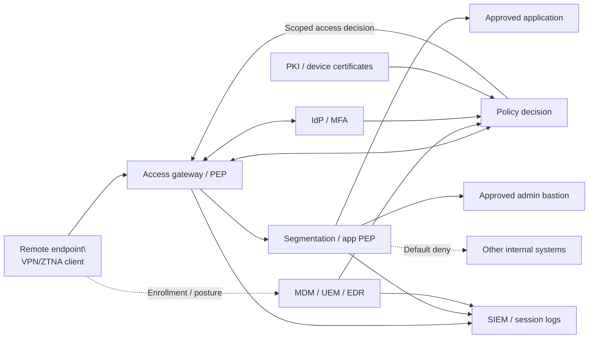
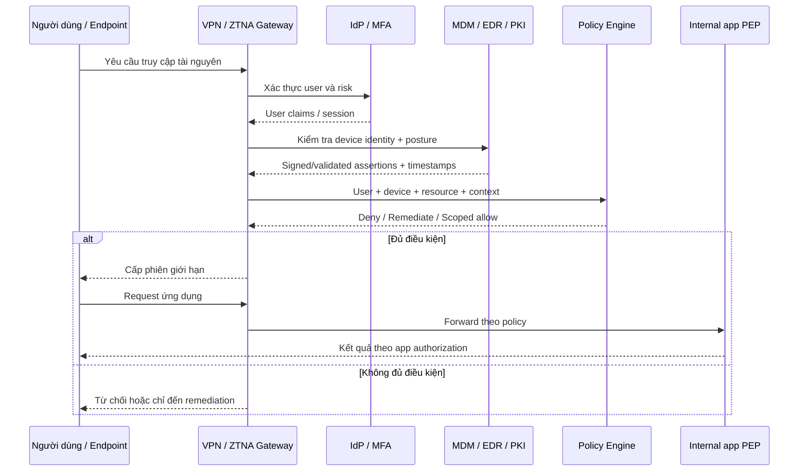
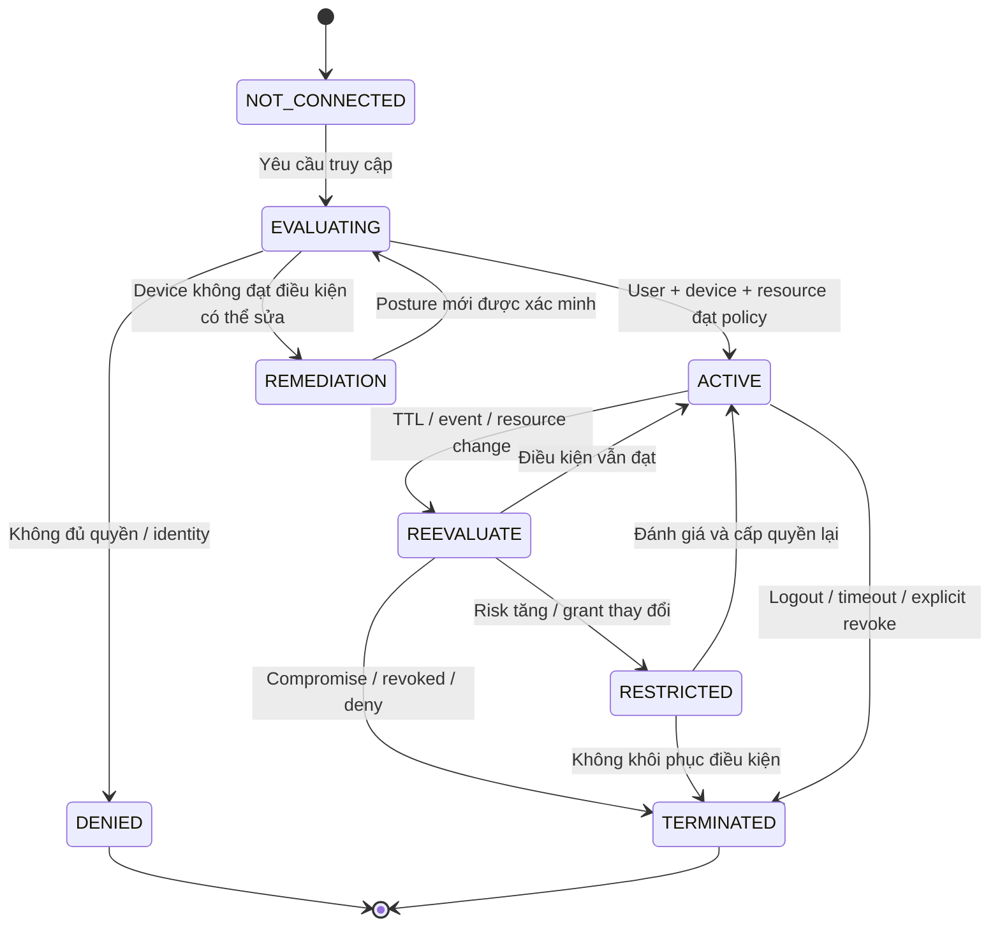

# Kiểm soát thiết bị khi kết nối từ xa qua VPN và ZTNA

## Mục tiêu học tập

Sau bài học này, bạn có thể:

1. Phân biệt **xác thực người dùng**, **nhận diện thiết bị**, **đánh giá trạng thái bảo mật thiết bị (device posture)** và **phân quyền truy cập tài nguyên** trong một phiên kết nối từ xa.
2. Giải thích vì sao **MFA thành công hoặc VPN kết nối thành công không có nghĩa thiết bị an toàn**, và vì sao thiết bị công ty cũng không được mặc định có toàn quyền mạng nội bộ.
3. Thiết kế quy trình kiểm tra **trước kết nối**, khi thiết lập phiên và **liên tục trong phiên** bằng IdP, MDM/UEM, EDR, PKI, VPN/ZTNA gateway, NAC và các điểm thực thi chính sách.
4. Xây dựng chính sách khác nhau cho **thiết bị được quản lý, BYOD, nhà thầu, thiết bị tạm thời và thiết bị mất tuân thủ**, có ngoại lệ giới hạn rõ ràng.
5. Xử lý những rủi ro của **split tunneling, full tunneling, DNS/IPv6, local LAN, roaming, mạng Wi-Fi không tin cậy, NAT và mất kết nối với dịch vụ kiểm tra posture**.
6. Đề xuất cơ chế **cấp phát, gia hạn, thu hồi chứng thư thiết bị, quản lý vòng đời enrollment**, giới hạn đặc quyền, logging và phản ứng khi thiết bị bị mất hoặc nghi xâm nhập.
7. Thực hiện **bài lab ra quyết định truy cập hoàn toàn ngoại tuyến** và lập ma trận kiểm thử có cả tình huống được phép, bị từ chối, trạng thái cũ, sự cố và thu hồi phiên.

## 1. Bài toán: ai đang kết nối, từ thiết bị nào, để làm gì?

Một nhân viên dùng laptop ở nhà để kết nối vào ứng dụng nội bộ. Hệ thống xác thực đúng tài khoản và MFA, nhưng laptop có thể:

- Chưa cập nhật bản vá quan trọng hoặc đã tắt firewall.
- Bị phần mềm độc hại kiểm soát, dù người dùng vẫn đăng nhập thật.
- Là máy cá nhân chưa được tổ chức quản lý.
- Dùng chứng thư/cấu hình VPN đã được sao chép hoặc bị lộ.
- Đang kết nối qua Wi-Fi công cộng hoặc một mạng có cấu hình DNS/route không đáng tin.
- Từ lâu không báo trạng thái về EDR/MDM nhưng vẫn còn phiên VPN hoạt động.

**Kiểm soát thiết bị khi kết nối từ xa** là quá trình xác định **thiết bị nào đang xin truy cập, mức độ tin cậy và tuân thủ của thiết bị tại thời điểm nào, và nó chỉ được đến tài nguyên nào trong bao lâu**.

Trong module `SECURITY_NETWORK_SECURITY`, đây là lớp bảo vệ kết hợp **VPN, xác thực kết nối, segmentation, firewall, IDS/IPS, bảo vệ DNS, wireless security và các tài nguyên cloud**. Mục tiêu không chỉ là tạo đường hầm mã hóa, mà còn **giữ ranh giới bảo mật** khi endpoint nằm ngoài mạng doanh nghiệp.

> **Nguyên tắc:** Không cấp quyền chỉ vì kết nối đến từ “một IP VPN” hay “một tài khoản có MFA”. Quyết định cần xét đồng thời **người dùng, thiết bị, ngữ cảnh phiên và tài nguyên đích**, rồi được thực thi và kiểm chứng tại điểm truy cập phù hợp.

### 1.1. Những khái niệm thường bị đánh đồng

| Khái niệm | Câu hỏi được trả lời | Điều chưa thể suy ra |
|---|---|---|
| **User authentication** | Ai đang chứng minh quyền dùng tài khoản? | Thiết bị đã đủ an toàn hay chưa |
| **Device identity** | Thiết bị/khóa/chứng thư nào được nhận diện? | Hệ điều hành không bị xâm nhập |
| **Enrollment/management** | Thiết bị có nằm trong phạm vi MDM/UEM quản lý không? | Thiết bị hiện vẫn tuân thủ mọi yêu cầu |
| **Device posture/compliance** | Tại một mốc thời gian, tín hiệu nào đạt yêu cầu? | Tình trạng sẽ luôn đúng trong mọi phút của phiên |
| **MFA** | Có thêm bằng chứng xác thực người dùng? | Người dùng không bị lừa hoặc phiên không bị chiếm |
| **VPN tunnel established** | Client/gateway đã thiết lập đường truyền bảo vệ? | Client được vào toàn bộ subnet nội bộ |
| **Authorization** | Ai/thiết bị nào được thực hiện hành động nào trên tài nguyên? | Kết nối đến IP/port tương đương quyền trong ứng dụng |
| **Segmentation** | Luồng nào có thể qua ranh giới mạng? | Mọi yêu cầu ứng dụng đều hợp lệ |
| **Continuous access evaluation** | Có xem xét lại điều kiện khi phiên đang mở? | Mọi hành động sẽ bị thu hồi tức thời nếu thiếu enforcement |
| **ZTNA** | Truy cập theo danh tính và tài nguyên qua điểm thực thi | Thiết bị mặc nhiên an toàn nếu đang dùng ZTNA |

## 2. Mô hình tin cậy của truy cập từ xa

### 2.1. Các thành phần

- **Endpoint:** laptop, điện thoại hoặc thiết bị truy cập; có thể là managed, BYOD hay thiết bị của đối tác.
- **VPN client / ZTNA agent / browser:** phần mềm thiết lập phiên hoặc yêu cầu đến tài nguyên được bảo vệ.
- **Identity Provider (IdP):** xác thực người dùng và hỗ trợ các yêu cầu như MFA, rủi ro đăng nhập, điều kiện phiên.
- **MDM/UEM:** quản lý thiết bị, cấu hình, kiểm tra tuân thủ, cấp/chặn quyền và vòng đời enrollment.
- **EDR/XDR hoặc endpoint security:** giám sát bảo mật endpoint, cảnh báo và có thể cung cấp trạng thái rủi ro/quarantine.
- **PKI/CA:** cấp phát và quản lý chứng thư, khóa, thời hạn, trạng thái thu hồi cho thiết bị hay dịch vụ.
- **Policy Decision Point (PDP):** kết hợp các tín hiệu để quyết định cho phép, từ chối, yêu cầu xác minh hoặc giới hạn quyền.
- **Policy Enforcement Point (PEP):** VPN concentrator, ZTNA connector/gateway, firewall, proxy hoặc application gateway thực thi quyết định.
- **AAA/RADIUS/TACACS+ tùy kiến trúc:** phục vụ xác thực, cấp quyền và accounting cho các thành phần tương ứng; không phải mọi sản phẩm VPN đều dùng cùng giao thức.
- **SIEM/SOC/asset inventory:** lưu telemetry, đối chiếu phiên và kiểm tra việc thực thi, phục vụ điều tra/ứng phó.

### 2.2. Sơ đồ luồng tin cậy



Luồng **quyết định chính sách** không nhất thiết chạy qua tất cả mũi tên mỗi lần packet đi qua. Một số nền tảng dùng token/claims có hạn, dữ liệu cache hoặc tín hiệu đẩy bất đồng bộ. Cần biết **ai thực thi và ở thời điểm nào** chứ không chỉ vẽ danh sách dịch vụ.

### 2.3. Security invariant cần giữ

Ví dụ một doanh nghiệp đặt các bất biến:

1. **Chỉ thiết bị managed, compliant, có chứng thư hợp lệ** mới được vào đường quản trị nhạy cảm; còn người dùng phải có vai trò được cấp và MFA phù hợp.
2. **BYOD không được route trực tiếp** tới mạng máy chủ/management; chỉ được dùng ứng dụng được duyệt qua browser/ZTNA/VDI.
3. **Guest/contractor** được cấp quyền theo hợp đồng, tài nguyên, thời hạn và người phê duyệt; không mặc nhiên có quyền ngang nhân viên.
4. **Khi không thể chứng minh điều kiện thiết yếu**, không cấp thêm đặc quyền cao; các trường hợp fallback phải có phạm vi và thời hạn.
5. **Khi thiết bị mất tin cậy**, việc thu hồi cần tác động lên phiên mạng và phiên ứng dụng tương ứng, không chỉ ghi trạng thái “blocked” trong MDM.

## 3. Phân loại thiết bị trước khi cấp quyền

### 3.1. Các nhóm thông dụng

| Nhóm thiết bị | Ví dụ | Dữ liệu xác minh | Hướng kiểm soát |
|---|---|---|---|
| **Corporate managed** | Laptop công ty có MDM/EDR | Asset ID, chứng thư, enrollment, posture | Cho các ứng dụng phù hợp vai trò; không mở mọi subnet |
| **Corporate managed nhưng non-compliant** | Laptop lỗi patch hoặc EDR không khỏe | MDM/EDR report, policy version, last check | Deny/limited remediation; chỉ khôi phục khi đạt điều kiện |
| **BYOD** | Laptop/điện thoại cá nhân | User identity, app session, tùy chọn đăng ký thiết bị | Browser/ZTNA/VDI hoặc app allowlist với quyền hẹp |
| **Contractor/vendor** | Máy của đơn vị đối tác | Sponsor, chứng thư/điều kiện hợp đồng, account expiry | JIT/least privilege, brokered access, ghi audit |
| **Privileged admin** | Máy quản trị chuyên dụng | Managed + attestation/EDR + strong MFA + admin role | Bastion/PAM, chỉ đến tài sản đúng scope |
| **Temporary/incident device** | Máy thay thế trong sự cố | Phê duyệt ngoại lệ, kiểm tra thủ công, hạn dùng | Mạng/vùng hoặc ứng dụng hạn chế, giám sát tăng cường |
| **Unknown/unmanaged** | Endpoint không có danh tính thiết bị xác minh được | Thiếu enrollment/chứng thư và owner | Deny nội bộ hoặc đưa vào onboarding |
| **Headless/automation** | Máy dịch vụ cần remote support | Workload/device identity, service account, giới hạn thời gian | Kênh hỗ trợ chuyên dụng, không dùng VPN account dùng chung |

Không nên đưa toàn bộ các nhóm vào cùng một `vpn-users` với quyền truy cập RFC1918 mặc định. Quyền phải gắn với **resource**, không chỉ với việc có thể kết nối đến gateway.

### 3.2. Managed không đồng nghĩa trusted vĩnh viễn

Một máy có MDM vẫn có thể bị mất, bị cài phần mềm không mong muốn hoặc chỉ mới gửi telemetry cách đây nhiều ngày. Nên lưu:

- `device_id` hoặc `asset_id` do quản lý cấp.
- `enrollment_status` và chủ sở hữu.
- `compliance_state` và **thời điểm đánh giá**.
- `edr_health/risk` và thời điểm gửi dữ liệu.
- `certificate_status`, serial và validity.
- `policy_version` đã áp.
- `last_seen_at`, nguồn tin, chất lượng dữ liệu và vùng truy cập đang được cấp.

**“Không nhận được kết quả” không được tự dịch thành “compliant”**. Hệ thống cần một trạng thái riêng như `UNKNOWN`, `STALE` hoặc `UNAVAILABLE`.

## 4. Device identity: biết thiết bị nào đang kết nối

### 4.1. Định danh thiết bị không dựa mỗi IP hoặc hostname

Một địa chỉ IP VPN có thể bị tái cấp; một máy có nhiều interface hoặc tunnel. Hostname dễ bị đổi; MAC ở Wi-Fi có thể randomize hoặc giả mạo. Vì vậy, **IP/MAC/hostname hữu ích để quan sát và hỗ trợ correlation, nhưng không phải bằng chứng xác thực mạnh**.

Tín hiệu đáng tin hơn khi được triển khai đúng:

- **Chứng thư client** riêng cho thiết bị, do CA tin cậy cấp và được gateway kiểm tra.
- **Khóa riêng bảo vệ bằng phần cứng** (TPM/Secure Enclave/secure element) khi nền tảng hỗ trợ, giảm khả năng trích xuất.
- **MDM/UEM device ID** có nguồn phát và quy trình enrollment đáng tin.
- **Hardware-backed key attestation** khi sản phẩm/threat model yêu cầu và hỗ trợ, với verification đúng chuỗi tin cậy.
- **EDR/asset identity** được nối với trạng thái endpoint và phiên xác thực.
- **Cloud instance/workload identity** cho workload thay vì dùng MAC/IP tạm thời.

**Device certificate chứng minh quyền sở hữu khóa theo chính sách PKI**, không chứng minh thiết bị không bị mã độc điều khiển. Attestation cũng phản ánh các thuộc tính cụ thể ở một thời điểm, không bảo đảm mọi phần mềm/phiên luôn sạch.

### 4.2. Vòng đời chứng thư thiết bị

1. **Enroll:** asset được duyệt, gắn người quản lý và loại thiết bị.
2. **Generate key:** tạo khóa trên thiết bị hoặc module bảo mật theo quy trình, hạn chế xuất private key.
3. **Issue:** CA cấp chứng thư với identity, purpose, validity và scope thích hợp.
4. **Distribute/configure:** client được cấu hình để sử dụng chứng thư đúng gateway/SSID/ứng dụng.
5. **Verify:** gateway kiểm tra đường chứng thư, hiệu lực thời gian, mục đích sử dụng, danh tính, trạng thái thu hồi theo chính sách.
6. **Rotate/renew:** gia hạn trước hết hạn, thay khóa định kỳ hoặc sau thay đổi rủi ro.
7. **Revoke:** mất thiết bị, đổi chủ, compromise hoặc nghỉ việc thì thu hồi theo playbook.
8. **Retire:** xóa enrollment/quyền, xử lý cấu hình cũ, cập nhật inventory và lưu audit cần thiết.

Cơ chế **CRL/OCSP** có thể hỗ trợ kiểm tra thu hồi tùy sản phẩm. Tuy nhiên, **thu hồi chứng thư không tự cắt mọi session hiện hữu ngay lập tức** nếu phiên đã được cấp token/tunnel và gateway chưa revalidate. Quy trình incident phải bao gồm **đóng session tại PEP**, thu hồi token và kiểm tra kết quả.

### 4.3. Chứng thư người dùng khác chứng thư thiết bị

Một hệ thống có thể yêu cầu:

- User có tài khoản IdP phù hợp và MFA.
- Device có chứng thư được cấp bởi PKI doanh nghiệp.
- Device posture còn hiệu lực.
- User/role được cấp tài nguyên mục tiêu.

Nếu chỉ có một client certificate có thể sao chép cho nhiều người hoặc nhiều máy, hệ thống khó phân biệt thiết bị. Nếu dùng **user certificate**, đừng nhầm đó với việc đã nhận dạng thiết bị theo asset ID. Cần định nghĩa **subject/claims, mapping và enrollment authority** cho từng loại.

## 5. Những tín hiệu posture thường được kiểm tra

Posture là **tập điều kiện kỹ thuật cần đạt theo rủi ro**, không phải một cờ “antivirus installed”.

| Tín hiệu | Cách diễn giải | Giới hạn |
|---|---|---|
| **OS version/build** | Có nằm trong danh sách hệ điều hành còn hỗ trợ | Version có thể được báo sai khi không có nguồn tin cậy |
| **Security patches** | Có đạt mốc cập nhật theo chính sách | Không thể từ một số patch suy hệ thống không lỗ hổng |
| **EDR installed/healthy** | Agent chạy và có heartbeat/telemetry phù hợp | Agent hiện diện không chứng minh host không bị xâm nhập |
| **EDR risk state** | Sự kiện/đánh giá rủi ro hiện tại | Có độ trễ và false positive; cần phân cấp xử lý |
| **Disk encryption** | Bảo vệ dữ liệu khi thiết bị mất/cướp | Không bảo vệ endpoint đang mở khóa bị chiếm |
| **Local firewall** | Tường lửa máy đang bật và dùng policy đúng | Có thể bị ghi đè; không thay thế segmentation |
| **Secure Boot / measured boot** | Tín hiệu boot integrity khi hỗ trợ | Mỗi nền tảng có cơ chế và phạm vi kiểm chứng khác |
| **Screen lock / idle timeout** | Giảm rủi ro truy cập tại chỗ | Không chống malware hoặc session hijack |
| **MDM compliance/enrollment** | Thiết bị thuộc quản lý và đạt bộ rule | Cần kiểm tra tuổi kết quả và version policy |
| **Jailbreak/root/debug status** | Dấu hiệu thiết bị mobile bị thay đổi trust boundary | Có false negative, tùy năng lực agent |
| **Endpoint certificate validity** | Khóa/chứng thư còn đủ điều kiện dùng để xác thực | Không bảo đảm thiết bị đang khỏe |
| **Device risk/asset lifecycle** | Mất thiết bị, retired, suspicious login, compromised | Phụ thuộc cập nhật sự kiện từ nguồn có thẩm quyền |

Không dùng một bảng posture giống hệt cho mọi môi trường. Máy quản trị quyền cao có thể cần điều kiện chặt hơn laptop chỉ đọc cổng thông tin; BYOD có thể cần đường truy cập **không yêu cầu agent giám sát toàn bộ máy cá nhân**.

### 5.1. Tính mới (freshness) của posture

Một bản ghi `compliant=true` từ 14 ngày trước không đủ để cho phép phiên nhạy cảm hôm nay.

Ví dụ policy giả định:

```text
Device-managed access:
  MDM compliance phải được đánh giá trong 8 giờ gần nhất.
  EDR heartbeat tối đa 30 phút tuổi.
  Certificate còn hạn và không bị đánh dấu revoked.
  User sign-in risk nằm trong ngưỡng cho phép.

Privileged access:
  Yêu cầu posture tươi hơn và revalidation khi bắt đầu thao tác đặc quyền.
```

**8 giờ/30 phút là số liệu minh họa**, không phải thời hạn chuẩn hóa chung. Ngưỡng phải chọn theo **rủi ro, khả năng telemetry, độ ổn định mạng và tác động vận hành**.

### 5.2. Không có tín hiệu là một trạng thái riêng

```text
PASS       : nhận được tín hiệu đáng tin, đủ mới và đáp ứng policy.
FAIL       : nhận được tín hiệu đáng tin, không đáp ứng policy.
UNKNOWN    : không đủ bằng chứng.
STALE      : bằng chứng quá cũ.
UNAVAILABLE: dịch vụ lấy tín hiệu không hoạt động hoặc kết nối lỗi.
```

**UNKNOWN/STALE/UNAVAILABLE không được tự động chuyển thành PASS.** Cần chính sách fallback rõ ràng: deny với tài nguyên nhạy cảm, chỉ cấp quyền sửa lỗi ở vùng remediation hoặc dùng grace period có giới hạn cho phiên đã xác thực khi thực sự được phê duyệt.

## 6. Quy trình ra quyết định trước khi kết nối

### 6.1. Luồng đề xuất



Sơ đồ mô tả **luồng logic**, không bắt buộc mỗi implementation thực hiện một API call MDM/EDR trên mỗi yêu cầu. Claims/tokens/caches phải có **integrity, thời hạn, scope và quy tắc revalidation** phù hợp.

### 6.2. Những bước không thể bỏ qua

1. Xác định **tài nguyên được xin**, không chỉ “kết nối vào công ty”.
2. Xác thực user bằng IdP và MFA phù hợp với rủi ro; ưu tiên cơ chế chống phishing khi khả thi.
3. Xác minh device identity bằng chứng thư hoặc phương pháp đáng tin được tổ chức cấp.
4. Lấy posture từ nguồn được phê duyệt và kiểm tra **timestamp/policy version**.
5. Kết hợp role người dùng, loại thiết bị, rủi ro phiên, ứng dụng đích và ngữ cảnh.
6. Ra quyết định **deny, allow có scope, yêu cầu remediation hoặc step-up authentication**.
7. Thiết lập tunnel/token/session có thời hạn, áp route/ACL/app policy đúng scope.
8. Log policy decision, PEP action và đường tương quan với user/device/session.
9. Theo dõi trạng thái sau khi kết nối, xử lý sự kiện mất compliant và thu hồi.

**Lưu ý:** MFA bằng OTP/push thông thường có thể bị phishing hoặc mệt mỏi vì thông báo; phương thức chống phishing như chứng thực gắn với origin (ví dụ FIDO2/WebAuthn đúng cấu hình) giúp giảm một số rủi ro. Nhưng vẫn phải kiểm soát **thiết bị** và **phiên ứng dụng**.

## 7. VPN và ZTNA kiểm soát thiết bị theo cách nào?

### 7.1. VPN mạng so với truy cập ứng dụng

| Thuộc tính | Network VPN | Application-based ZTNA / app gateway |
|---|---|---|
| **Phạm vi kết nối** | Có thể cấp route đến các dải mạng/zone được chọn | Thường giới hạn theo ứng dụng/tài nguyên cụ thể |
| **Điểm thực thi** | VPN concentrator + firewall/ACL + ứng dụng | Gateway/connector/proxy + policy identity/app |
| **Xác thực** | Client/cert, user IdP/AAA, MFA tùy sản phẩm | IdP, device context, broker/session tùy nền tảng |
| **Posture** | Có thể là pre-login/post-login assessment hoặc tích hợp NAC | Có thể đánh giá tại app access và liên tục theo policy |
| **Rủi ro chính** | Split routing/ACL sai mở lateral movement | Bypass connector, connector privilege hoặc ứng dụng tự cấp quyền quá rộng |
| **Quản trị phiên** | Tunnel timeout, rekey, disconnect, route/NAT/state | Token/session TTL, reauthorization, application logout |
| **Không tự bảo đảm** | VPN encryption ≠ endpoint healthy | ZTNA label ≠ least privilege đã được thực thi |

Cả hai có thể đáp ứng kiến trúc an toàn khi thiết kế đúng. **Không có sản phẩm hoặc tên công nghệ nào tự biến một endpoint thành thiết bị đáng tin**.

### 7.2. Những giao thức VPN có thể gặp

- **IKEv2/IPsec:** cơ chế đàm phán và bảo vệ lưu lượng IP; việc dùng chứng thư, EAP, gateway/route và cấu hình endpoint phụ thuộc triển khai.
- **TLS-based remote access VPN:** thường dùng TLS cho kênh điều khiển/transport theo sản phẩm; cần kiểm tra xác thực server, client, cipher và policy phiên.
- **WireGuard-based VPN:** sử dụng public-key identity/peer configuration; kiểm soát user, MDM/posture, MFA và authorization thường nằm ở **lớp orchestration/gateway bổ sung**, không mặc định có chỉ nhờ WireGuard.
- **Browser-based access / reverse proxy:** có thể không cấp route tới toàn bộ mạng nhưng vẫn cần kiểm soát user/device/session/app authorization.
- **VDI/remote desktop broker:** ứng dụng chạy trên môi trường quản lý, dữ liệu có thể ít được tải trực tiếp xuống BYOD; vẫn cần chính sách clipboard, file transfer, printing, session recording và broker security.

**Dùng đường hầm mã hóa không giải quyết tự động mọi vấn đề client malware, đánh cắp phiên, quyền ứng dụng hoặc rủi ro từ mạng nội bộ.**

### 7.3. Chứng thư server phải được xác thực

Client phải tin **đúng máy chủ/gateway**, không chỉ “TLS có khóa”. Cần xác minh tên, CA, thời hạn và cấu hình bảo vệ chống kết nối sai endpoint; không khuyến khích người dùng bấm bỏ qua cảnh báo chứng thư để tiếp tục VPN.

Nếu môi trường dùng profile VPN được phân phối bằng MDM, profile nên được **ký/quản lý**, ngăn người dùng âm thầm chuyển sang gateway lạ, nhưng phải có quy trình thay đổi và rollback khi chứng thư server/CA được xoay vòng.

## 8. Quyết định quyền theo người dùng, thiết bị và tài nguyên

### 8.1. Ma trận mẫu

| User/role | Thiết bị và posture | Tài nguyên được xin | Quyết định gợi ý |
|---|---|---|---|
| Employee | Managed + compliant + cert hợp lệ | Cổng thông tin nội bộ | Allow theo session có hạn |
| Employee | Managed + compliant | Ứng dụng tài chính nhạy cảm | Allow khi role đủ quyền và MFA/step-up phù hợp |
| Employee | Managed nhưng EDR high-risk | Cổng nội bộ | Deny hoặc chỉ remediation theo chính sách |
| Employee | BYOD/unmanaged | SaaS công ty được hỗ trợ BYOD | App/browser access có điều kiện |
| Employee | BYOD/unmanaged | Database production trực tiếp | Deny |
| Contractor | Managed được phê duyệt + sponsor còn hạn | App trong phạm vi hợp đồng | Allow theo app và thời hạn |
| Contractor | Managed nhưng sponsor đã hết hạn | App hợp đồng | Deny và đóng session |
| Admin | Privileged managed + compliant + MFA mạnh | Bastion/PAM | Allow theo ticket/role/JIT |
| Admin | Privileged managed | SSH trực tiếp mọi server | Deny; đi qua bastion/PEP theo scope |
| Any | Chứng thư thiết bị revoked | Nội bộ | Deny, revoke session khi có thể |
| Any | Không lấy được posture mới | App nhạy cảm | Deny/step-up/remediation tùy mức tin cậy |
| Incident responder | Thiết bị emergency đã phê duyệt | Công cụ khôi phục được chỉ định | Tạm cấp scope nhỏ, giám sát tăng, hết hạn tự động |

Đây là **mô hình nghiệp vụ**; decision engine cần được biến thành policy có thể thực thi. Không áp tất cả user cùng một rule `allow 10.0.0.0/8` vì đã qua MFA.

### 8.2. Quy tắc chính sách ở dạng pseudocode

```yaml
# PSEUDOCODE - KHÔNG phải cấu hình trực tiếp cho thiết bị VPN.
policy_id: remote-device-access-v1
default_action: DENY

device_states:
  - MANAGED_COMPLIANT
  - MANAGED_NONCOMPLIANT
  - UNMANAGED
  - UNKNOWN
  - STALE

rules:
  - id: employee-approved-app
    when:
      user_role: employee
      device_state: MANAGED_COMPLIANT
      certificate_status: valid
      user_mfa: verified
      resource: approved_employee_apps
    action: ALLOW_SCOPED
    session_max_minutes: 120

  - id: privileged-bastion
    when:
      user_role: privileged_admin
      device_state: MANAGED_COMPLIANT
      certificate_status: valid
      phishing_resistant_mfa: verified
      pam_grant: active
      resource: admin_bastion
    action: ALLOW_SCOPED
    session_max_minutes: 30

  - id: byod-saas
    when:
      user_role: employee
      device_state: UNMANAGED
      resource: approved_browser_saas
      user_mfa: verified
    action: ALLOW_APP_ONLY
    session_max_minutes: 60

  - id: remediation
    when:
      device_state: MANAGED_NONCOMPLIANT
      resource: remediation_portal
    action: ALLOW_REMEDIATION_ONLY

  - id: compromised-or-revoked
    when:
      any_device_risk_high: true
    action: DENY_AND_TERMINATE

logging:
  capture_user_device_session_resource: true
  record_policy_version: true
  record_decision_and_enforcement: true
```

Các field như `any_device_risk_high` hay `pam_grant` chỉ là **ngữ nghĩa minh họa**. Phải xác minh sản phẩm VPN/ZTNA thực sự nhận được tín hiệu, không cho phép spoof dữ liệu client và có thể áp lại policy trong phiên.

## 9. Pre-connect và continuous posture

### 9.1. Kiểm tra một lần là chưa đủ

Một phiên VPN có thể kéo dài nhiều giờ. Trong thời gian đó:

- EDR báo malware sau khi kết nối.
- Người dùng tắt local firewall hoặc thay cấu hình thiết bị.
- MDM chuyển từ compliant sang non-compliant.
- Chứng thư bị thu hồi hoặc tài khoản bị khóa.
- Người dùng chuyển sang mạng không tin cậy, IP thay đổi hoặc thiết bị bị mất.
- Admin grant hết thời hạn hoặc quyền truy cập ứng dụng bị thu hồi.

Nếu posture chỉ được đọc một lần tại login, **quyền có thể sống lâu hơn điều kiện cho phép**.

### 9.2. Mô hình đánh giá liên tục



Không phải mọi sản phẩm đều hỗ trợ thay đổi quyền **ngay giữa phiên**. Có nền tảng chỉ đánh giá lại khi reauthentication, reconnect hoặc hết token. Khi thiết kế phải ghi **thời gian phát hiện**, **thời gian ra quyết định** và **thời gian PEP thực sự chặn luồng**.

### 9.3. Một số trigger hữu ích

- **Định kỳ:** posture TTL, session TTL, token renewal, thiết bị check-in.
- **Sự kiện an ninh:** EDR high severity, device lost, credential compromise, cert revocation, user disabled.
- **Sự kiện vận hành:** MDM unenrolled, OS end of support, agent unhealthy, CA policy change.
- **Ngữ cảnh:** nguồn truy cập bất thường, thiết bị đổi định danh, truy cập app có dữ liệu nhạy cảm, step-up JIT.
- **Policy update:** admin thay rule, sponsor rút quyền, change ticket hết hạn.

Đặt ngưỡng để tránh flapping: một lần heartbeat trễ vài giây không nhất thiết phải ngắt toàn bộ phiên nếu risk thấp. Nhưng **thiết bị đã bị xác nhận compromise** không nên được tiếp tục dùng quyền cao chỉ vì đang trong grace period.

## 10. Full tunnel, split tunnel và local traffic

### 10.1. Khái niệm

**Full tunnel:** phần lớn traffic được client đưa qua VPN gateway theo cấu hình route/chính sách. Mục tiêu thường là áp egress policy tập trung, nhưng có chi phí băng thông/độ trễ và nguy cơ tạo bottleneck.

**Split tunnel:** một tập đích được định tuyến qua VPN, các đích khác đi thẳng qua mạng cục bộ/Internet. Có thể tăng hiệu năng nhưng cần phân tích bảo mật của đường direct và khả năng tạo **bridge** giữa các miền mạng.

```text
Full tunnel (minh họa):
Endpoint ---> VPN tunnel ---> Corporate gateway ---> Apps / Internet

Split tunnel (minh họa):
Endpoint ---> VPN tunnel ---> Approved internal apps
         \-> Local Internet ---> Public services
```

**“Full” không có nghĩa mọi byte sẽ được bảo vệ** trong mọi hệ điều hành: có thể có traffic trước khi tunnel kết nối, ngoại lệ route, captive portal, mạng local, IPv6 hoặc DNS path khác. Phải kiểm thử theo client OS, VPN profile và route thực tế.

### 10.2. So sánh rủi ro

| Vấn đề | Full tunnel | Split tunnel |
|---|---|---|
| **Corporate egress inspection** | Có thể tập trung hơn nếu toàn bộ traffic thực sự đi qua gateway | Phải bổ sung endpoint/web/DNS protection cho đường direct |
| **Băng thông gateway** | Tải lớn hơn, nhất là video/cloud SaaS | Giảm backhaul cho một số lưu lượng |
| **Latency** | Có thể tăng nếu đi vòng về trụ sở | Thường tốt hơn cho dịch vụ cloud gần client |
| **DNS policy** | Dễ tập trung nếu ép resolver đúng và chặn bypass | Cần kiểm soát split DNS, DoH/DoT và resolver route |
| **Lateral movement risk** | Vẫn có nếu VPN cấp subnet rộng | Có thể tăng nếu endpoint có đường local và internal cùng lúc |
| **Availability** | Gateway outage ảnh hưởng nhiều traffic | Một số dịch vụ ngoài VPN có thể tiếp tục |
| **Privacy/BYOD** | Có thể thu nhiều dữ liệu cá nhân hơn mức cần thiết | Dễ giới hạn traffic công việc theo ứng dụng/đích |

**Không tuyên bố split tunnel luôn không an toàn hoặc full tunnel luôn tốt hơn.** Lựa chọn phụ thuộc threat model, loại thiết bị, khả năng endpoint security, tài nguyên và chính sách tổ chức.

### 10.3. IPv6, DNS và tuyến bypass

Với remote client dual-stack:

- Client có thể nhận **IPv4 route qua VPN** nhưng IPv6 đi thẳng Internet.
- DNS query có thể dùng **resolver hệ điều hành, browser DoH, DNS trong tunnel hoặc local resolver** tùy cấu hình.
- Các dải **RFC1918 không bao phủ tất cả mạng doanh nghiệp**, bao gồm IPv6 ULA, cloud private networks, shared address space hoặc địa chỉ đã NAT.
- DNS split-horizon có thể trả các địa chỉ khác nhau cho cùng FQDN tùy resolver.
- Các tuyến qua **proxy, cloud tunnel, Wi-Fi, mobile hotspot, virtual adapters** và mạng gia đình cần được xét.
- **Local LAN access** có thể cần cho máy in hoặc captive portal nhưng cũng là đường cần kiểm soát khi phiên VPN đang mở.

Một thiết bị có thể có **nhiều interface/upstream**. Cần kiểm tra routing table và giao diện thực, không chỉ nhìn nút “VPN connected”.

### 10.4. Kill switch và xử lý mất tunnel

Một số client có tính năng **kill switch** hoặc always-on VPN để hạn chế traffic khi tunnel ngắt. Tính năng này có thể có ngoại lệ (captive portal, onboarding, DNS, mạng quản lý) và hành vi tùy hệ điều hành.

Câu hỏi quan trọng:

1. Khi VPN drop, app nhạy cảm có còn truy cập được trực tiếp?
2. Khi đổi Wi-Fi sang mobile network, những session nào tự kết nối lại?
3. Kill switch có áp cho **IPv4 và IPv6** không?
4. Các route tới internal IP có bị xóa hoặc còn tồn tại lỗi thời không?
5. DNS resolver có đổi về local, làm rò tên miền nội bộ hoặc mất phân giải không?
6. Khi VPN reconnect, client có buộc **reauthenticate/re-evaluate posture** không?

Không bật kill switch trên hàng loạt BYOD hoặc thiết bị phục vụ tình huống khẩn cấp mà chưa kiểm tra ảnh hưởng. Cần hướng dẫn khôi phục, ngoại lệ tối thiểu và đường hỗ trợ nếu thiết bị mất toàn bộ truy cập mạng.

## 11. Segmentation sau khi VPN kết nối

### 11.1. VPN pool không phải một trust zone duy nhất

Nhiều VPN concentrator cấp IP từ các pool tập trung. Nếu mọi remote user cùng pool và firewall cho phép pool đó tới toàn bộ nội bộ, bất kỳ thiết bị được cho kết nối VPN cũng có **lateral movement surface lớn**.

Phân vùng theo:

- User/device role: employee, contractor, admin, BYOD.
- Managed/compliance state và các tín hiệu risk.
- Tài nguyên: SaaS, web app, database, bastion, management interface.
- Khung thời gian và session grant.
- Site/project/tenant/VRF/VPN profile.
- Điều kiện ứng dụng và workload identity.

**Mỗi loại có thể dùng pool, group policy, VLAN/VRF, identity-aware firewall hoặc ZTNA connector khác nhau**, không nhất thiết cần một concentrator riêng.

### 11.2. Ví dụ ma trận kết nối

Giả sử các IP **dành cho tài liệu** trong lab:

```text
VPN managed clients:    192.0.2.0/26
VPN contractor clients: 192.0.2.64/26
VPN remediation clients:192.0.2.128/26
Approved web app:       198.51.100.20:443
Admin bastion:          198.51.100.30:443
Database service:       203.0.113.20:5432
Remediation portal:     203.0.113.30:443
```

| Source identity/zone | Destination | Service | Kỳ vọng |
|---|---|---|---|
| Managed employee compliant | Approved web app | HTTPS/443 | Allow theo user role |
| Managed employee compliant | Admin bastion | HTTPS/443 | Deny nếu không có admin/JIT role |
| Managed employee compliant | Database trực tiếp | TCP/5432 | Deny trừ service account/đường đặc biệt |
| Contractor approved | Assigned app | Đích/port được phê duyệt | Allow có thời hạn |
| Contractor approved | Other internal subnets | Any | Deny |
| BYOD | Approved browser SaaS | HTTPS qua policy ứng dụng | Allow app-only, không có full LAN route |
| BYOD | Database và management | Any | Deny |
| Non-compliant managed | Remediation portal | HTTPS/443 | Allow remediation-only |
| Non-compliant managed | Production app | Any | Deny |
| Privileged admin compliant | Bastion/PAM | HTTPS/443 | Allow khi có strong MFA + JIT grant |
| Privileged admin | Production hosts trực tiếp | SSH/RDP | Deny ngoài kênh quản trị được duyệt |
| Revoked device | Bất kỳ protected resource | Any | Deny, cắt phiên hiện có |

**Trạng thái PEP thực tế** mới có giá trị. Nếu gateway gán group `noncompliant` nhưng firewall vẫn cho pool đó đi vào database, thiết kế không đáp ứng mục tiêu.

## 12. BYOD, nhà thầu và truy cập đặc quyền

### 12.1. BYOD: giảm quyền, không bắt buộc giám sát mọi thứ

Đối với thiết bị cá nhân, doanh nghiệp cần cân nhắc **an ninh và quyền riêng tư**:

- Chỉ truy cập ứng dụng qua browser, ZTNA hoặc managed app khi phù hợp.
- Dùng session/token ngắn, kiểm soát download/copy khi có yêu cầu bảo vệ dữ liệu.
- Áp MFA và các điều kiện tối thiểu; không yêu cầu agent thu thập dữ liệu vượt mục đích đã thông báo.
- Có tùy chọn **VDI/remote app** cho ứng dụng nhạy cảm mà không đưa raw network access xuống thiết bị.
- Giới hạn logging, retention và khả năng remote wipe theo thỏa thuận rõ ràng.
- Khi thiết bị không đủ điều kiện, cung cấp phương án thay thế thay vì bỏ qua security policy.

**Managed app trên BYOD không đồng nghĩa thiết bị đạt tư cách corporate managed**; phải xác định đúng phạm vi kiểm soát dữ liệu và posture nào được xác nhận.

### 12.2. Contractor và third-party access

Thiết kế quyền truy cập theo **đối tác, tài nguyên, thời gian và người bảo trợ**:

1. Tài khoản riêng theo cá nhân, không dùng chung account `vendor`.
2. Sponsor phê duyệt scope và thời gian, có lịch rà soát.
3. MFA phù hợp, device identity hoặc remote session broker tùy mức độ nhạy cảm.
4. Chỉ vào máy/app được chỉ định; quản trị qua bastion/PAM thay vì route cả subnet.
5. Khi hết hợp đồng, tự động hết grant và hủy session, thu hồi token/chứng thư nếu thuộc tổ chức.
6. Audit lệnh/truy cập khi cần và phù hợp chính sách, không ghi thông tin nhạy cảm quá mức.

### 12.3. Privileged access

Với hệ thống sản xuất và management plane, một **admin laptop chuyên dụng** có thể cần:

- Managed, patch/EDR khỏe, certificate/attestation phù hợp.
- Phương thức MFA chống phishing; tách tài khoản admin khỏi tài khoản công việc thường ngày.
- Bastion/PAM/JIT access theo ticket, có giới hạn thời gian.
- Host/app/port allowlist; không cho broad admin network route.
- Session recording hoặc command auditing theo thẩm quyền và luật định.
- OOB/break-glass được bảo vệ cho trường hợp mất VPN/IdP, không biến thành backdoor thường trực.

**Break-glass** là quy trình khẩn cấp có chủ sở hữu, xác thực, cảnh báo và hậu kiểm; không phải một tài khoản không mật khẩu hoặc VPN profile `allow all`.

## 13. Các điều kiện lỗi và hành vi fallback

Thiết kế tốt phải trả lời điều gì xảy ra khi một thành phần không khỏe.

| Failure mode | Rủi ro | Hướng xử lý cần thiết kế |
|---|---|---|
| **IdP/MFA unavailable** | Không thể xác thực user mới, người dùng bị outage | HA và kênh khôi phục được kiểm soát; không mặc định bỏ MFA |
| **MDM API unavailable** | Không lấy được compliance mới | Stale/unknown policy, hạn cache, deny resource nhạy cảm |
| **EDR agent offline** | Không biết endpoint khỏe hay bị tắt agent | Xem last heartbeat và risk; remediation/deny tùy policy |
| **Certificate validation/CRL/OCSP lỗi** | Không xác minh được trạng thái chứng thư | Quy tắc rõ theo độ nhạy; tránh bỏ qua validation âm thầm |
| **VPN gateway/node down** | Phiên ngắt hoặc route failover | HA với cùng policy, session/state handling và route validation |
| **PDP unreachable** | Không lấy decision mới | Fallback local policy/last-known-good có TTL, ưu tiên deny quyền mới cao |
| **Tunnel drops** | Client có thể gửi direct traffic, rò DNS | Kill switch/route clean-up, reconnect/re-evaluate |
| **Policy sync khác giữa node** | Failover có thể mở quyền không mong đợi | Policy parity, version check, không promote node thiếu policy khi có thể |
| **Logging collector down** | Không còn evidence nhưng traffic vẫn chạy | Buffer, health alert, nguồn telemetry độc lập |
| **Clock skew** | Cert/token hết hạn giả, correlation sai | NTP bảo vệ, UTC, kiểm tra drift |
| **Offline device nhiều ngày** | Thông tin posture quá cũ, revoke chưa áp | Re-enrollment/revalidation trước khi cấp quyền |
| **MDM unenrollment** | Thiết bị thoát quản lý nhưng còn session | Event-driven revoke, session teardown tại PEP |

### 13.1. Grace period không phải quyền mặc định

Một sản phẩm có thể giữ **last-known-good posture** cho phiên đang mở trong một khoảng ngắn khi service quản lý bị gián đoạn. Điều này có thể hỗ trợ availability nhưng cần quy tắc:

- Chỉ cho **quyền đã cấp trước đó**, không cấp tài nguyên mới nhạy cảm.
- TTL có giới hạn và được kiểm tra tại PEP.
- Không áp grace cho thiết bị đã **confirmed compromised/revoked**.
- Audit lý do sử dụng cache và thời gian hết hạn.
- Có health alert để kỹ thuật viên biết đang dùng thông tin cũ.
- Khi hết TTL, yêu cầu revalidation hoặc thu hồi quyền.

Một máy **chưa từng chứng minh tuân thủ** không được suy ra compliant từ việc MDM đang lỗi.

### 13.2. Fail-open và fail-closed phải gắn với lưu lượng

Gateway mất liên hệ PDP nhưng tiếp tục xử lý các phiên trước đó trong TTL và deny phiên mới: đây là **fallback hỗn hợp**, không phải fail-open/fail-closed tuyệt đối. Cần nêu riêng **new sessions, existing tunnels, ứng dụng nhạy cảm, user revoked và certificate revoked**.

## 14. Telemetry và bằng chứng về phiên

### 14.1. Cần log những gì?

| Nguồn | Dữ liệu có ích |
|---|---|
| **VPN gateway/ZTNA PEP** | Session ID, user/device mapping, gateway, assigned IP, tunnel start/end, policy, route/allowed apps |
| **IdP/MFA** | Principal, auth method, risk, sign-in time, step-up/challenge, token issuance |
| **MDM/UEM** | Device ID, enrollment, compliance state, evaluated-at, policy version |
| **EDR/XDR** | Agent health, risk, quarantine/containment, last heartbeat, event ID |
| **PKI/CA** | Certificate serial, validity, issuance, revocation event, device mapping |
| **Firewall/NetFlow/IPFIX** | Source/destination IP/port, route/zone, allow/deny, timing, session/NAT metadata |
| **DNS/proxy** | Queries, protected DNS actions, app destinations theo phạm vi được phép |
| **PAM/bastion/app logs** | Tài nguyên đích, user role, authorization, privileged session |
| **CMDB/asset inventory** | Owner, asset lifecycle, permitted access profile, ticket |
| **Gateway/control plane health** | Policy sync, IdP/PDP/MDM connectivity, cache age, HA state, logging gaps |

### 14.2. Một alert mẫu

```json
{
  "event_type": "remote_access.device_posture_rejected",
  "alert_id": "ra-device-20261128-031",
  "observed_at": "2026-11-28T09:20:00Z",
  "session_id": "vpn-lab-sess-031",
  "user_id": "employee-demo",
  "device_id": "device-lab-024",
  "resource_id": "finance-app",
  "decision": "DENY",
  "reason_codes": [
    "EDR_HEARTBEAT_STALE",
    "DEVICE_COMPLIANCE_UNKNOWN"
  ],
  "posture": {
    "mdm_status": "UNKNOWN",
    "evaluated_at": "2026-11-28T07:00:00Z",
    "edr_last_seen_at": "2026-11-28T07:10:00Z"
  },
  "policy_id": "remote-device-access-v1",
  "enforcement": {
    "pep": "ztna-gateway-lab-01",
    "action_verified": true
  },
  "next_step": "Open approved remediation path and request fresh device check-in"
}
```

Đây là dữ liệu **giả lập**. `action_verified=true` chỉ được ghi khi có bằng chứng PEP đã thực hiện, không phải ngay khi PDP gửi lệnh. Token/serial hoặc địa chỉ client trong log không nên bị công khai nếu có thể dùng để tái sử dụng truy cập.

### 14.3. Correlate IP theo thời điểm

Một VPN pool có thể tái sử dụng `192.0.2.42` cho hai phiên ở thời điểm khác nhau. Khi điều tra flow:

```text
2026-11-28 09:00-09:30 UTC:
  192.0.2.42 -> session-A -> device-A -> user-A

2026-11-28 10:00-10:45 UTC:
  192.0.2.42 -> session-B -> device-B -> user-B
```

Không quy cả hai cho một user chỉ vì cùng IP. Cần **VPN assigned-IP history, site/VRF, NAT mapping, session ID, IdP và device identity** theo time window. Đối với ZTNA browser proxy, địa chỉ thấy ở backend có thể là **connector/proxy**, nên backend logs cần identity-aware context hoặc correlation ID.

### 14.4. Bảo vệ quyền riêng tư và dữ liệu thiết bị

Posture và EDR có thể chứa thông tin về phần mềm, vị trí kết nối, tài khoản và hành vi người dùng. Chính sách nên:

- Giới hạn **trường thu thập** theo mục đích bảo mật.
- Tách dữ liệu BYOD cá nhân với hoạt động công việc khi có thể.
- Phân quyền truy cập, mã hóa log, xác thực nguồn và theo dõi thay đổi.
- Quy định retention và cơ chế tiếp cận dữ liệu phù hợp quy định.
- Tránh ghi private key, bearer token, session cookies, passwords, recovery codes vào SIEM.
- Đảm bảo audit của người truy cập log và kiểm tra timestamp UTC/clock skew.

## 15. Threat modeling: những cách kiểm soát thiết bị có thể thất bại

| Tình huống | Nguy cơ | Lớp phòng vệ |
|---|---|---|
| Tài khoản bị phishing | User auth bị sử dụng trái phép | MFA chống phishing, IdP risk, token/session controls |
| Chứng thư thiết bị bị đánh cắp | Mạo danh thiết bị nếu private key có thể xuất | Non-exportable key, revocation, attestation khi phù hợp |
| Endpoint managed bị malware | Tunnel hợp lệ trở thành đường truy cập nội bộ | EDR, device risk, least privilege, app authorization |
| MDM/EDR chỉ báo “healthy” quá cũ | Quyền dựa trên tình trạng không còn đúng | Freshness TTL, continuous evaluation, deny/limited fallback |
| BYOD được cấp route sản xuất | Lateral movement và rò dữ liệu | ZTNA/app-only, VDI, restricted network |
| Split tunnel cấu hình sai | Route/DNS bypass, kết nối hai vùng mạng | Route/IPv6/DNS tests, endpoint firewall, resource scope |
| VPN pool được firewall tin tuyệt đối | Một account có quyền đến nhiều server | Identity-aware ACL, segmentation, bastion |
| Gateway policy sync sai | Failover mở quyền rộng | Version parity, failover tests, separate health alerts |
| Admin dùng profile VPN thường ngày | Token/phiên admin bị phơi rộng | PAM/JIT, dedicated device, privileged access isolation |
| Certificate revoked nhưng session vẫn chạy | Thiết bị mất/compromised còn truy cập | Session termination tại VPN/PEP và app token revoke |
| Unknown device tự khai hostname/OS | Bỏ qua posture bằng claim client-side | Verify assertion từ nguồn tin cậy, signed/nonce-bound khi hỗ trợ |
| Mất log/clock lệch | Khó quy sự cố đúng user/thiết bị | UTC/NTP, centralized logs, health monitoring |
| Mạng công cộng/captive portal giả | User bị lừa nối gateway sai hoặc rò dữ liệu | Server validation, managed VPN profile, user training |
| Contractor access không hết hạn | Quyền tồn tại sau hợp đồng | Sponsor review, grant expiration, automated offboarding |

Một policy tốt đặt **nhiều lớp độc lập** để một lỗi đơn lẻ không biến thành truy cập toàn bộ mạng.

## 16. Onboarding, thay thiết bị và offboarding

### 16.1. Quy trình cấp quyền cho thiết bị mới

1. Xác định loại device và owner (managed laptop, BYOD, contractor, admin, automation).
2. Đăng ký asset và phê duyệt mức truy cập cần, dựa trên role/ứng dụng.
3. Enroll MDM/UEM nếu thuộc phạm vi, cài EDR/endpoint controls và profile firewall.
4. Cấp chứng thư/device credential qua PKI, không gửi private key trong email hoặc chat.
5. Cấu hình client VPN/ZTNA, xác thực server, IdP/MFA và trusted network policy.
6. Kiểm tra OS patch, disk encryption, agent health, certificate và time sync.
7. Chạy **allow/deny tests** cho các tài nguyên đúng scope, kể cả IPv4/IPv6.
8. Ghi baseline posture, session, policy version, owner và điều kiện thu hồi.
9. Chỉ chuyển từ onboarding/remediation sang role thường khi có xác minh thực tế.

### 16.2. Khi người dùng đổi máy hoặc mất thiết bị

- Tài khoản người dùng có thể giữ, nhưng **device identity cũ phải được xử lý riêng**.
- Thu hồi chứng thư/cấu hình và xóa hoặc khóa device enrollment theo chính sách.
- Xác nhận ngắt các phiên VPN/connector đang mở, thu hồi app sessions/tokens liên quan.
- Cập nhật IPAM/CMDB, asset owner, lịch sử thiết bị và log điều tra.
- Với lost device, kích hoạt MDM lock/wipe khi thuộc quyền và chính sách, cảnh báo SOC.
- Không tái sử dụng credential cũ cho máy mới “để đỡ phải cấp lại”.

### 16.3. Exception/JIT access

Ngoại lệ như **thiết bị thay thế chưa có EDR** phải có:

- **Lý do và người phê duyệt**.
- **Resource allowlist** đủ hẹp.
- **Thời hạn kết thúc** tự động.
- **Kiểm soát bù:** browser-only/VDI, chỉ đọc, giám sát phiên, MFA mạnh.
- **Cách thu hồi/rollback**, đánh giá ảnh hưởng.
- **Hậu kiểm** và không chuyển exception tạm thời thành chính sách mặc định.

## 17. Khi thiết bị bị compromise: runbook ứng phó

### Bước A — Xác minh và phân loại

1. Xác định **device ID, user, session ID, gateway, posture timestamp và tài nguyên đã truy cập**.
2. Xác minh tín hiệu EDR/MDM/IdP: cảnh báo thật hay false positive, thiết bị có bị mất hay bị revoke?
3. Xác định mức độ nhạy của ứng dụng và những luồng đang hoạt động.
4. Thu thập evidence và thời gian UTC từ gateway/PEP, IdP, EDR, firewall, DNS, bastion/app logs.
5. Không suy từ IP VPN đơn thuần rằng đã xác định được thiết bị/người dùng.

### Bước B — Ngăn nguy cơ lan rộng

6. Nếu risk xác nhận, **cô lập endpoint** bằng EDR/NAC/MDM theo quyền và runbook.
7. **Terminate VPN/ZTNA session** ở gateway/PEP; xác nhận session/state đã không còn được phép.
8. Thu hồi hoặc khóa **device certificate, user token, refresh token, app session và JIT grant** theo phạm vi phù hợp.
9. Áp deny ở firewall/app PEP để chặn phiên còn treo hoặc tuyến thay thế, có thời hạn/quy trình rõ.
10. Với thiết bị quan trọng, tính đến **khả năng mất kết nối làm gián đoạn thu thập forensic** và phối hợp đội ứng cứu.

### Bước C — Kiểm chứng và khôi phục

11. Thử **new-session deny** cho device đã revoked bằng tài khoản/lab được phép; kiểm tra existing sessions đã ngừng.
12. Đánh giá những phiên, kết nối hoặc tài nguyên đã bị truy cập trong thời gian rủi ro.
13. Remediate/reimage khi cần, cập nhật bản vá, xác minh EDR/MDM, rotate key/cert.
14. Chỉ re-enable khi identity và posture được xác minh lại; không chỉ chờ một nút “compliant”.
15. Ghi timeline, rule/credential đã thay, impact, rollback và bài học phòng ngừa.

**Đóng cửa sổ VPN không tự đồng nghĩa application token đã bị hủy**. Với ứng dụng SaaS hoặc phiên browser đang mở, cần làm rõ quy tắc session/token và cách revoke tại IdP/app.

## 18. Lab an toàn: mô phỏng quyết định truy cập ngoại tuyến

Bài lab dùng **dữ liệu tự tạo**. Không kết nối VPN thật, không quét mạng, không gửi yêu cầu tới gateway và không dùng thông tin đăng nhập thực.

### 18.1. Định nghĩa môi trường lab

Giả sử hệ thống có:

```text
Users:
  alice     : employee
  bob       : contractor
  carol     : privileged_admin

Devices:
  corp-024  : managed, compliant, certificate valid
  corp-025  : managed, EDR stale
  byod-002  : unmanaged
  lost-003  : managed nhưng certificate revoked

Resources:
  employee_portal
  contractor_app
  admin_bastion
  production_db
  remediation_portal
```

Mục đích: so sánh **user role**, **device state**, **MFA**, **tính mới của posture**, **tài nguyên xin truy cập** và **session grant**.

### 18.2. Pseudocode Python chỉ tính quyết định

```python
from datetime import datetime, timedelta, timezone

NOW = datetime(2026, 11, 28, 10, 0, tzinfo=timezone.utc)
MAX_POSTURE_AGE = timedelta(minutes=30)

def decision(user_role, device, resource, mfa_ok, jit_ok=False):
    # Demo offline: danh tính thiết bị và kết quả posture đã được xác minh giả định.
    if device["certificate"] != "VALID":
        return "DENY_CERTIFICATE"

    if not mfa_ok:
        return "DENY_MFA"

    if device["risk"] == "HIGH":
        return "DENY_DEVICE_RISK"

    checked_at = device.get("posture_checked_at")
    fresh = (
        checked_at is not None
        and timedelta(0) <= NOW - checked_at <= MAX_POSTURE_AGE
    )

    if resource == "remediation_portal":
        return "ALLOW_REMEDIATION_ONLY"

    if not device["managed"]:
        if resource == "employee_portal" and user_role == "employee":
            return "ALLOW_BROWSER_ONLY"
        return "DENY_UNMANAGED"

    if not fresh or not device["compliant"]:
        return "DENY_POSTURE"

    if resource == "admin_bastion":
        if user_role == "privileged_admin" and jit_ok:
            return "ALLOW_SCOPED"
        return "DENY_ADMIN_ROLE"

    if user_role == "employee" and resource == "employee_portal":
        return "ALLOW_SCOPED"

    if user_role == "contractor" and resource == "contractor_app":
        return "ALLOW_SCOPED"

    return "DENY_NO_MATCH"

healthy = {
    "certificate": "VALID",
    "risk": "LOW",
    "managed": True,
    "compliant": True,
    "posture_checked_at": NOW - timedelta(minutes=5),
}
stale = {
    "certificate": "VALID",
    "risk": "LOW",
    "managed": True,
    "compliant": True,
    "posture_checked_at": NOW - timedelta(hours=2),
}
byod = {
    "certificate": "VALID",
    "risk": "LOW",
    "managed": False,
    "compliant": False,
    "posture_checked_at": None,
}
revoked = dict(healthy, certificate="REVOKED")

cases = [
    ("employee", healthy, "employee_portal", True, False, "ALLOW_SCOPED"),
    ("employee", stale, "employee_portal", True, False, "DENY_POSTURE"),
    ("employee", byod, "employee_portal", True, False, "ALLOW_BROWSER_ONLY"),
    ("employee", byod, "production_db", True, False, "DENY_UNMANAGED"),
    ("employee", revoked, "employee_portal", True, False, "DENY_CERTIFICATE"),
    ("employee", healthy, "employee_portal", False, False, "DENY_MFA"),
    ("privileged_admin", healthy, "admin_bastion", True, True, "ALLOW_SCOPED"),
    ("privileged_admin", healthy, "admin_bastion", True, False, "DENY_ADMIN_ROLE"),
    ("employee", healthy, "production_db", True, False, "DENY_NO_MATCH"),
]

for role, device, resource, mfa, jit, expected in cases:
    observed = decision(role, device, resource, mfa, jit)
    assert observed == expected, (role, resource, observed, expected)
    print(role, resource, observed)
```

**Giới hạn quan trọng của mô hình:** Trong ví dụ, `device["certificate"]`, `managed` và `posture_checked_at` là dữ liệu **đã được giả định tin cậy**. Trong hệ thống thật, không được tin JSON/flag client tự gửi; phải có xác thực chứng thư/token, nguồn API tin cậy, chống sửa dữ liệu, time sync, revocation và enforcement thực tế.

### 18.3. Bài tập mở rộng trong lab

1. Đổi `posture_checked_at` thành thời gian tương lai: detector cần đánh dấu **clock/data error**, không coi là fresh.
2. Đổi `risk` thành `HIGH`: thử policy có chặn cả user/ứng dụng được phép không.
3. Tạo thiết bị `managed=true` nhưng `compliant=false`: kiểm tra đường chỉ đến remediation.
4. Thêm `contract_expired=true` và rule hạn quyền nhà thầu.
5. Thêm `device_lost=true`: phải deny và mô tả hành động terminate sessions.
6. Thay `employee_portal` bằng ứng dụng finance: yêu cầu managed + fresh + role đủ quyền thay vì browser-only.
7. Mô phỏng PDP unavailable: quyết định có được cấp quyền mới không, hay chỉ giữ phiên cache có TTL?
8. Ghi output `decision + reason + source timestamps + policy version`, không chỉ một boolean.

Những thay đổi này có thể được phân tích trên giấy hoặc trong môi trường chạy Python riêng đã được cấp phép; **bài học không yêu cầu thử đánh sập VPN hoặc tắt EDR trên thiết bị thật**.

## 19. Ma trận nghiệm thu cho VPN device control

| Kịch bản | Điều kiện kiểm thử | Kết quả mong đợi |
|---|---|---|
| Managed + compliant | Cert hợp lệ, MFA, posture mới | Đúng ứng dụng/role được phép; không mở cả mạng |
| Managed non-compliant | Agent báo lỗi bảo mật | Deny app nhạy cảm, có remediation có hạn |
| Unmanaged BYOD | User đúng và MFA | Chỉ app/browser/VDI được phê duyệt |
| Cert revoked | Device đã mất/thu hồi | Deny new connection và terminate existing khi chính sách yêu cầu |
| Cert expired | Validity quá hạn | Không cho VPN/cấp quyền mới bằng cert đó |
| EDR stale | Heartbeat quá TTL | Không tự coi healthy; áp fallback rõ |
| MDM API down | Compliance không lấy được | Deny quyền mới nhạy cảm; cảnh báo telemetry |
| User MFA fail | Device compliant | Deny truy cập, vì device không thay user auth |
| User role denied | Device compliant + MFA OK | Deny app không được cấp |
| Contractor grant hết hạn | Session cũ vẫn hoạt động | Revoke/reauthorize và chặn tài nguyên |
| Admin không có JIT | Privileged account nhưng grant inactive | Deny bastion/privileged operations |
| Privileged device risk HIGH | User/role đúng | Deny, terminate và alert SOC |
| VPN pool segmentation | Corp/contractor cùng gateway | Chỉ route/ACL đúng role, không lateral movement |
| IPv6 routing | VPN profile có IPv4 + IPv6 | Không có đường IPv6 đi vào zone bị cấm |
| Split tunnel | Internet direct, corp qua VPN | Đúng DNS/route policy, không bridge local-to-corp |
| Full tunnel | Mất tunnel/Wi-Fi đổi mạng | Kill switch/fallback theo profile; không bypass nhạy cảm |
| DNS split horizon | Tên internal từ remote endpoint | Resolve qua resolver đúng zone, không lộ dữ liệu ngoài policy |
| Gateway HA failover | Node active mất kết nối | Node khác giữ policy tương đương, không mở route mới |
| App session after VPN revoke | VPN bị cắt, token app còn | Kiểm tra token/session revocation theo threat model |
| Log collector outage | VPN và app hoạt động | Alert mất telemetry, buffer/nguồn độc lập khi có |
| Device retired then reappears | Enrollment cũ bị vô hiệu | Không tự tái cấp quyền |
| Policy rollback | Rule mới gây false positive | Revert có audit; kiểm tra positive và negative cases |

**Test thành công đòi hỏi bằng chứng tại PEP**, không chỉ nhãn quyết định ở IdP/MDM. Một TCP connection timeout cũng có thể vì server down, DNS sai hoặc route lỗi; cần test traffic hợp lệ đến listener khỏe và đọc policy logs.

## 20. Phương pháp kiểm tra cấu hình trên client và gateway

Trong **lab được cấp phép**, trên client Linux có thể quan sát các thông tin không phá hoại:

```bash
# Địa chỉ, giao diện và route hiện có:
ip -br addr
ip route
ip -6 route

# Kiểm tra địa chỉ DNS resolver trên máy sử dụng systemd-resolved:
resolvectl status

# Đúng dịch vụ được phép trong lab:
curl --head --connect-timeout 3 --max-time 6 https://portal.lab.example.test

# Thử đường đến một host lab bị deny theo policy:
nc -vz -w 3 198.51.100.30 443

# Ghi thời gian UTC cho sự kiện/đối chiếu log:
date -u +'%Y-%m-%dT%H:%M:%SZ'
```

Tên `portal.lab.example.test` và địa chỉ ví dụ phải được thiết lập trong **DNS/lab riêng**; không mặc định tồn tại hoặc truy cập được trên Internet.

Đọc kết quả:

- `curl` nhận `401/403` nghĩa là đã đến **lớp HTTP** và bị ứng dụng từ chối; không chứng minh VPN/firewall đã deny packet ở L3/L4.
- `nc` thành công chỉ chứng minh kết nối TCP cơ bản, **không chứng minh tài khoản có quyền ứng dụng**.
- `nc` timeout có thể do firewall, route, listener hoặc upstream; cần PEP logs và packet/flow counters.
- Nếu `ip -6 route` có đường direct IPv6, đánh giá policy thực tế thay vì suy IPv6 đã qua VPN.
- DNS resolver ở máy có thể khác resolver của browser/DoH hoặc từng interface; cần kiểm tra theo sản phẩm và chính sách.
- Tránh các lệnh **disable EDR/firewall, dump credential, quét subnet hoặc phá tunnel production** để thử chính sách.

### 20.1. Kiểm tra phiên mới và phiên cũ

Khi thu hồi device certificate, cần thử tối thiểu:

1. **Phiên VPN mới** của thiết bị đã revoked có bị từ chối không?
2. **Phiên VPN đang mở** có bị terminate đúng thời hạn không?
3. **Token/app session cũ** có còn dùng được tài nguyên được bảo vệ không?
4. **Đường qua proxy/connector khác** có thực thi cùng trạng thái không?
5. **Route và firewall state** đã cập nhật chưa, có conntrack giữ phiên ngoài mong muốn không?
6. **User/device khác hợp lệ** còn truy cập được không?

Nếu chỉ test số 1, không thể khẳng định đã thu hồi hoàn toàn.

## 21. Troubleshooting những trường hợp thường gặp

### 21.1. User xác thực thành công nhưng VPN bị từ chối

Kiểm tra theo thứ tự:

- IdP/MFA success, user account và entitlement.
- Device identity mapping, certificate chain/validity/revocation.
- MDM enrollment/compliance evaluated-at và posture policy version.
- EDR heartbeat/risk, time sync và trạng thái agent.
- Gateway group policy, session limit, network reachability và log reason code.
- Có sự cố PDP/MDM/CA hoặc cache bị quá TTL không.

**Không chữa bằng cách tắt yêu cầu device certificate hoặc bỏ posture cho toàn bộ người dùng.** Nếu cần exception, phải có phạm vi, người duyệt và expiry.

### 21.2. VPN connected nhưng không vào được ứng dụng

Có thể do:

- Không có route đúng destination/VRF hoặc split tunnel sai.
- DNS trả IP không phù hợp từ resolver/view.
- Firewall/PEP chặn role hiện tại hoặc IPv6 route không đúng.
- App authorization từ chối user dù mạng đã kết nối.
- MTU/PMTUD, NAT, proxy, certificate validation hoặc gateway failover.
- Device bị đổi policy giữa phiên và app token chưa được renew.
- Server đích offline hoặc listener không hoạt động.

Đối chiếu **session role, route table, firewall policy ID, app logs, DNS answer và health**. Phân biệt network-layer drop với HTTP `401/403` hoặc TLS handshake error.

### 21.3. Client kết nối được nhưng lưu lượng đi ngoài VPN

Cần xem:

- Split/full tunnel profile được thiết lập đúng chưa.
- Route metrics, VPN interface/virtual adapter, local LAN exceptions và IPv6 routing.
- DNS policy và browser DoH/DoT.
- Per-app VPN routing, platform-specific exclusions hoặc cloud SaaS breakout.
- Có gateway/proxy khác đang phục vụ traffic không.
- Kiểm thử bằng flow logs từ gateway và điểm quan sát được cho phép.

**Một giao diện VPN đang “up” không chứng minh tất cả traffic nhạy cảm thực sự đi qua nó.**

### 21.4. Device bị chặn do posture stale trong lúc mất mạng

Khả năng:

- MDM/EDR agent không check-in vì mất Internet/DNS/PKI.
- Đồng hồ máy lệch khiến timestamp hoặc chứng thư được đánh giá sai.
- Endpoint có proxy/captive portal chưa được phép truy cập dịch vụ xác minh.
- Token posture đã hết hạn và gateway không thể refresh.
- RADIUS/PDP/gateway HA đang dùng policy khác.

Khôi phục qua **remediation path** được giới hạn, không mở truy cập production để cập nhật agent. Sau đó re-evaluate và xác minh rule đúng trở lại.

## 22. Những sai lầm thường gặp

| Sai lầm | Vì sao nguy hiểm | Hướng sửa |
|---|---|---|
| **MFA thành công = thiết bị an toàn** | Tài khoản thật có thể dùng endpoint compromised | Device identity + posture + least privilege |
| **Có client cert = compliant** | Cert chứng minh khóa/identity, không chứng minh patch/EDR | Kết hợp PKI với MDM/EDR |
| **Managed = trusted mãi** | Thiết bị có thể bị mất compliance | Freshness TTL, continuous evaluation |
| **VPN connected = được vào mọi subnet** | Mở lateral movement | Resource/role-based policy, segmentation |
| **Tin hostname/MAC do client khai** | Dễ đổi/giả, IP thay đổi | Verified device ID/cert, correlation theo phiên |
| **Dựa trên posture boolean không timestamp** | Bằng chứng quá cũ | Store evaluated-at, policy version, source |
| **MDM lỗi thì mặc định allow** | Mất điểm quyết định thành mở quyền | Fail-closed/limited fallback có TTL |
| **EDR installed = host không bị xâm nhập** | Agent có thể bị bypass hoặc chưa báo | Risk signals nhiều lớp và ứng phó |
| **Không thu hồi existing sessions** | Thiết bị bị mất vẫn còn quyền | Terminate VPN + app token/session revoke |
| **BYOD nhận full network VPN** | Thiết bị không quản lý vào LAN | Browser/VDI/ZTNA app-only |
| **Contractor dùng chung VPN account** | Không quy được người dùng và khó thu hồi | Named identity, sponsor, JIT expiry |
| **Admin đăng nhập bằng VPN user thường** | Quyền cao không được cách ly | Dedicated privileged path, bastion/PAM |
| **Chỉ kiểm tra IPv4** | IPv6/DNS/overlay bypass policy | Dual-stack/route/DNS negative tests |
| **Split tunnel bị coi luôn sai** | Dẫn đến backhaul quá mức hoặc BYOD monitoring quá rộng | Threat model và egress controls phù hợp |
| **Full tunnel được coi bảo vệ tất cả** | Vẫn có exception, local routes, traffic trước tunnel | Quan sát thực tế route và PEP |
| **Không kiểm tra device lost/offboarding** | Credential cũ tồn tại sau nghỉ việc | Lifecycle, revoke cert/tokens/roles |
| **Quarantine mọi thiết bị có EDR heartbeat trễ** | False positive gây outage | Grace phân tầng và remediation có giới hạn |
| **Log token/private key vào SIEM** | Tạo rủi ro lộ bí mật truy cập | Redaction, RBAC, secure storage |
| **Tin policy decision đã thi hành** | Gateway/firewall chưa cập nhật rule | Readback PEP/session và kiểm tra lưu lượng |
| **Cho route tới management để tiện support** | Phơi management plane trên endpoint yếu | Bastion, JIT, admin role và deny direct |
| **Không có runbook lúc IdP/MDM mất** | Dễ tạo bypass khẩn cấp không kiểm soát | HA, break-glass bảo vệ, staged recovery |
| **Chỉ test luồng allow** | Không phát hiện đường truy cập trái quyền | Positive + negative + existing-session tests |

## 23. Câu hỏi ôn tập và đáp án

**Câu 1 — User đã MFA.** Một nhân viên dùng laptop cá nhân không có EDR, xác thực MFA thành công. Có nên cấp quyền vào toàn bộ VPN subnet corporate?

**Đáp án:** **Không**. MFA xác thực người dùng, không chứng minh thiết bị đáp ứng posture. Dùng BYOD app-only/browser/VDI theo policy; từ chối đường trực tiếp tới mạng nhạy cảm.

**Câu 2 — Device certificate.** Laptop có chứng thư client hợp lệ nhưng EDR báo high-risk. Cho kết nối chỉ vì cert hợp lệ có đúng không?

**Đáp án:** **Không** nếu policy yêu cầu device risk thấp. Chứng thư chứng minh một khía cạnh identity/key; posture/risk là điều kiện riêng. Cần deny/containment và điều tra.

**Câu 3 — Posture stale.** MDM ghi compliant lúc 08:00; bây giờ 16:00, policy chỉ cho dữ liệu tối đa 2 giờ tuổi. Quyết định?

**Đáp án:** Trạng thái **STALE**, không đủ bằng chứng để cấp quyền mới nhạy cảm; yêu cầu check-in/revalidation hoặc remediation theo policy. Không tự coi true vì lần cuối là compliant.

**Câu 4 — Thu hồi thiết bị.** CA đã revoke cert của laptop bị mất, nhưng tunnel cũ vẫn hoạt động. Vì sao và cần làm gì?

**Đáp án:** Gateway có thể đã xác thực ở lúc kết nối và chưa kiểm tra lại. Cần **terminate existing VPN/ZTNA session tại PEP, revoke app tokens/JIT grants, áp deny và kiểm chứng**.

**Câu 5 — Split tunnel.** Một remote employee truy cập SaaS trực tiếp Internet, app nội bộ qua VPN. Đây có mặc định là lỗi bảo mật?

**Đáp án:** Không. Có thể là cấu hình hợp lệ nếu resource scope, endpoint controls, DNS/IPv6, local LAN và egress policy được đánh giá. Cần kiểm thử đường thực.

**Câu 6 — IPv6.** VPN cấp IPv4 corporate route, nhưng laptop có direct IPv6 route tới một tài nguyên IPv6 nội bộ có thể truy cập từ ngoài. Kết luận?

**Đáp án:** Ranh giới bảo mật có thể thiếu IPv6 policy. Cần kiểm tra **IPv6 routing, firewall/PEP và application authorization**, không dựa vào rule IPv4.

**Câu 7 — RADIUS Access-Accept.** VPN nhận user role từ AAA nhưng firewall cho pool VPN truy cập mọi zone. Role-based access có hiệu lực chưa?

**Đáp án:** Chưa. PEP phải thực thi rule theo role/device/resource. Cần kiểm tra gateway ACL, firewall group mapping và thử cả đích bị deny.

**Câu 8 — MDM downtime.** MDM API lỗi trong 20 phút. Có nên chuyển tất cả unknown posture thành compliant để giảm ticket?

**Đáp án:** **Không**. Dùng HA/telemetry, cache có thời hạn cho quyền đã cấp khi phù hợp, deny quyền mới nhạy cảm và cung cấp remediation/break-glass được kiểm soát.

**Câu 9 — Contractor.** Nhà thầu được vào một hệ thống trong 3 ngày. Cấu hình VPN cho phép cả subnet production trong 6 tháng có phù hợp không?

**Đáp án:** Không. Quyền phải theo **đúng ứng dụng/host, thời hạn, sponsor, user identity và điều kiện device**, với log và tự thu hồi.

**Câu 10 — Device ID.** Hai phiên VPN dùng cùng địa chỉ `192.0.2.42` vào hai thời điểm. Có thể coi từ cùng laptop không?

**Đáp án:** Không. IP VPN có thể tái sử dụng. Cần session ID, assigned-IP history, device identity, user claims và timestamp.

**Câu 11 — Browser access.** BYOD chỉ được truy cập web app qua ZTNA. Có cần application authorization nữa không?

**Đáp án:** Có. Gateway giới hạn đường tới ứng dụng nhưng app vẫn phải kiểm tra user role, quyền đối với dữ liệu, session và hành động. ZTNA không thay thế authorization ở ứng dụng.

**Câu 12 — Privileged access.** Admin dùng laptop compliant nhưng không có PAM/JIT grant, cố vào bastion. Quyết định?

**Đáp án:** **Deny** theo chính sách minh họa. Device compliance không cấp đặc quyền; cần admin role, xác thực mạnh và grant đúng tài nguyên/thời gian.

**Câu 13 — Kill switch.** Một client được bật kill switch nhưng DNS vẫn gửi tới resolver bên ngoài khi tunnel chưa lên. Có thể khẳng định không rò dữ liệu không?

**Đáp án:** Không. Cần kiểm thử DNS/IPv4/IPv6 và ngoại lệ trước/trong/sau reconnect, thay vì chỉ tin tên tùy chọn.

**Câu 14 — Incident containment.** EDR cách ly laptop nhưng phiên SaaS còn active trên browser khác. Đã hoàn tất containment chưa?

**Đáp án:** Chưa chắc. Cần xác định phạm vi identity/session và **revoke token, app sessions, device credentials** phù hợp, rồi xác minh hậu quả, không dựa vào một thao tác EDR.

## 24. Checklist thiết kế và nghiệm thu

- [ ] Định nghĩa rõ loại user và device: managed, BYOD, contractor, privileged, temporary và automation.
- [ ] Có danh mục tài nguyên/ứng dụng, owner, dữ liệu nhạy cảm và access roles theo least privilege.
- [ ] Mỗi thiết bị có identifier có nguồn tin cậy và vòng đời enrollment/asset record rõ.
- [ ] PKI/certificate có enrollment, private-key protection, expiry, revocation, renewal và kiểm tra tại gateway.
- [ ] User authentication/MFA phù hợp mức rủi ro; client xác thực đúng server/gateway.
- [ ] MDM/UEM/EDR posture gồm patch, OS support, encryption, firewall, agent health, risk và evaluated-at.
- [ ] Không coi trạng thái **UNKNOWN, STALE, UNAVAILABLE** như compliant mặc định.
- [ ] Policy đánh giá user + device + resource + context; PEP thực thi đúng scope.
- [ ] BYOD/contractor có app-only/VDI hoặc policy hẹp; không có broad internal route mặc định.
- [ ] Privileged access qua bastion/PAM/JIT, có strong MFA và admin device criteria phù hợp.
- [ ] VPN pool/VRF/ACL/firewall/identity-aware segmentation được kiểm tra end-to-end.
- [ ] Split/full tunnel, DNS, IPv4/IPv6, local LAN, mobile roaming, proxy/DoH có test phù hợp.
- [ ] Có session TTL, reauthentication, continuous evaluation hoặc cơ chế thu hồi tương đương.
- [ ] Device lost/compromised/revoked dẫn đến deny **new và existing sessions** theo mục tiêu chính sách.
- [ ] Fallback khi IdP/MDM/EDR/PDP/gateway lỗi có TTL, giới hạn scope và audit.
- [ ] Remediation path hoạt động mà không cần mở quyền vào production.
- [ ] Có nguồn log IdP, VPN, MDM, EDR, PKI, firewall, ứng dụng và correlation ID theo UTC.
- [ ] Privacy/retention/RBAC cho dữ liệu thiết bị và người dùng; không log private key hay access token.
- [ ] Policy version, change ticket, owner, exception expiry và rollback được ghi lại.
- [ ] Test đầy đủ allow, deny, BYOD, non-compliance, stale posture, certificate revoke, user disabled và JIT expiry.
- [ ] Kiểm thử HA/failover, DNS/route sau VPN reconnect và các đường bypass tiềm ẩn trong lab.
- [ ] Hệ thống đo **thực thi tại PEP**, không chỉ nhận quyết định từ IdP/PDP.
- [ ] Có runbook phản ứng endpoint compromised, rút quyền app sessions và khôi phục an toàn.
- [ ] Offboarding xử lý đồng thời user access, device certificates, MDM enrollment, VPN profiles và asset lifecycle.

## 25. Tài liệu tham khảo

- [NIST SP 800-46 Rev. 2 — Guide to Enterprise Telework, Remote Access, and Bring Your Own Device (BYOD) Security](https://csrc.nist.gov/pubs/sp/800/46/r2/final): quản trị an ninh truy cập từ xa, thiết bị cá nhân và môi trường telework.
- [NIST SP 800-207 — Zero Trust Architecture](https://csrc.nist.gov/pubs/sp/800/207/final): quyết định truy cập theo user, thiết bị, tài nguyên, PDP/PEP và không mặc định tin cậy chỉ vì vị trí mạng.
- [NIST SP 800-124 Rev. 2 — Guidelines for Managing the Security of Mobile Devices in the Enterprise](https://csrc.nist.gov/pubs/sp/800/124/r2/final): quản lý thiết bị mobile và những yêu cầu liên quan MDM/UEM.
- [NIST SP 800-77 Rev. 1 — Guide to IPsec VPNs](https://csrc.nist.gov/pubs/sp/800/77/r1/final): giao thức IPsec, kiến trúc, VPN security và triển khai.
- [NIST SP 800-113 — Guide to SSL VPNs](https://csrc.nist.gov/pubs/sp/800/113/final): mô hình SSL/TLS VPN, quản lý gateway/client và các vấn đề an ninh.
- [NIST SP 800-53 Rev. 5 — Security and Privacy Controls](https://csrc.nist.gov/pubs/sp/800/53/r5/upd1/final): các nhóm kiểm soát truy cập, định danh, kiểm toán, hệ thống và truyền thông.
- [RFC 7296 — Internet Key Exchange Protocol Version 2 (IKEv2)](https://www.rfc-editor.org/rfc/rfc7296): đàm phán và xác thực của IPsec VPN.
- [RFC 4301 — Security Architecture for the Internet Protocol](https://www.rfc-editor.org/rfc/rfc4301): các cơ chế và chính sách bảo vệ lưu lượng IP.
- [RFC 8446 — The Transport Layer Security (TLS) Protocol Version 1.3](https://www.rfc-editor.org/rfc/rfc8446): nền tảng TLS cho các giải pháp truy cập dựa trên TLS.
- [RFC 9325 — Recommendations for Secure Use of TLS and DTLS](https://www.rfc-editor.org/rfc/rfc9325): cấu hình TLS/DTLS bảo mật.
- [RFC 5280 — Internet X.509 Public Key Infrastructure Certificate and CRL Profile](https://www.rfc-editor.org/rfc/rfc5280): chứng thư và CRL.
- [RFC 6960 — X.509 Internet PKI Online Certificate Status Protocol (OCSP)](https://www.rfc-editor.org/rfc/rfc6960): kiểm tra trạng thái chứng thư.
- [RFC 5176 — Dynamic Authorization Extensions to RADIUS](https://www.rfc-editor.org/rfc/rfc5176): một cơ chế điều khiển quyền và disconnect session trong triển khai hỗ trợ.
- [RFC 9190 — EAP-TLS 1.3](https://www.rfc-editor.org/rfc/rfc9190): cơ sở EAP-TLS trong các mô hình xác thực liên quan.
- [FIDO Alliance — Passkeys](https://fidoalliance.org/passkeys/): tham khảo nhóm phương thức xác thực chống phishing theo ngữ cảnh triển khai.

**Ghi nhớ:** **Bảo mật truy cập từ xa không kết thúc ở việc VPN đã kết nối.** Một quyết định đáng tin cần xác minh **người dùng, danh tính và posture thiết bị, tài nguyên xin truy cập, độ mới của bằng chứng và trạng thái phiên**; sau đó được thực thi tại **VPN/ZTNA gateway, firewall và ứng dụng**. Quyền phải **tối thiểu, có hạn, giám sát được và có thể thu hồi thực sự**, kể cả khi thiết bị thay đổi trạng thái hoặc dịch vụ kiểm soát gặp lỗi.
