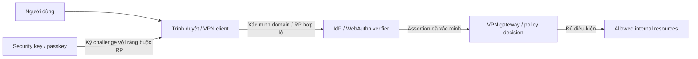
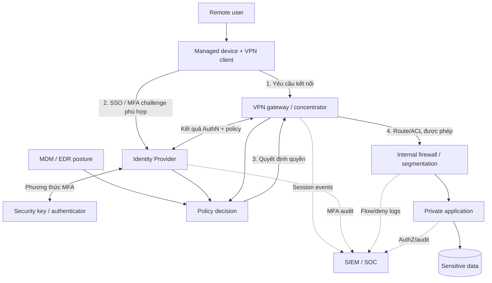
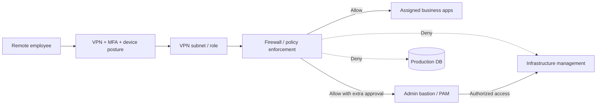

# Xác thực đa yếu tố cho VPN: bảo vệ truy cập từ xa theo danh tính và ngữ cảnh

## 1. Vì sao VPN cần xác thực đa yếu tố?

**Virtual Private Network (VPN)** tạo một đường kết nối được bảo vệ giữa thiết bị người dùng và mạng hoặc dịch vụ ở xa. Đối với doanh nghiệp, VPN thường là một điểm vào nhạy cảm: qua một lần đăng nhập, nhân viên, quản trị viên hoặc đối tác có thể tiếp cận những hệ thống không mở trực tiếp ra Internet.

**Multi-Factor Authentication (MFA)** là cơ chế yêu cầu **bằng chứng xác thực thuộc ít nhất hai loại yếu tố độc lập**, hoặc một phương thức xác thực đa yếu tố được thiết kế đáp ứng yêu cầu tương ứng, nhằm giảm khả năng kẻ xấu chỉ có mật khẩu đã đăng nhập thành công. Trong bối cảnh truy cập từ xa, MFA phải được áp dụng **đúng luồng thiết lập phiên**, được kiểm tra cả khi tái kết nối, gia hạn phiên và truy cập tài nguyên nhạy cảm.

Ví dụ: mật khẩu của nhân viên bị lộ trong một vụ phishing. Nếu VPN chỉ hỏi username/password, kẻ xấu có thể cố gắng đăng nhập từ thiết bị hoặc mạng lạ. Nếu gateway **bắt buộc MFA** thông qua hệ thống danh tính có kiểm soát, mật khẩu bị lộ đơn độc thường chưa đủ để tạo phiên VPN hợp lệ. Nhưng MFA cũng **không phải biện pháp tuyệt đối**: một phiên đã xác thực có thể bị đánh cắp, thiết bị có thể nhiễm mã độc, người dùng có thể phê duyệt yêu cầu push giả hoặc một cơ chế recovery có thể bị lợi dụng.

Mục tiêu của bài học là xây dựng cơ chế **xác thực truy cập VPN có thể kiểm chứng**, phối hợp với **firewall/segmentation, NAC, giám sát IDS/IPS, bảo vệ DNS, TLS, posture của thiết bị và quyền truy cập ở ứng dụng**. Không đánh đồng “VPN đã kết nối” với “được phép dùng mọi hệ thống nội bộ”.

### 1.1. Kết quả cần đạt

Sau bài này, người học có thể:

1. Phân biệt các yếu tố xác thực, **MFA chống phishing** và cơ chế chỉ yêu cầu xác nhận bổ sung.
2. Giải thích đường xác thực VPN qua **Identity Provider (IdP), RADIUS, SAML/OIDC, certificate** và thành phần chính sách.
3. Xây chính sách cho nhóm nhân viên, bên thứ ba, quản trị viên và tài khoản khẩn cấp mà không mở đường bỏ qua MFA.
4. Tách **xác thực vào VPN, ủy quyền mạng và ủy quyền ứng dụng**.
5. Thiết kế monitoring, quy trình rollout, kiểm thử thất bại và ứng phó khi lộ credential hoặc session.

## 2. Authentication, authorization và đường hầm VPN là ba việc khác nhau

Một VPN có thể mã hóa traffic rất tốt nhưng vẫn xác thực người dùng yếu. Ngược lại, một tài khoản có MFA mạnh vẫn có thể được cấp phạm vi mạng **quá rộng** sau khi đăng nhập.

| Thành phần | Câu hỏi nó trả lời | Ví dụ | Điều không tự bảo đảm |
|---|---|---|---|
| **VPN tunnel protection** | Dữ liệu được vận chuyển giữa các endpoint ra sao? | IPsec/IKEv2, TLS-based VPN, WireGuard | không tự chứng minh người đang dùng thiết bị đã qua MFA |
| **Authentication (AuthN)** | Principal nào được xác minh, bằng chứng có đủ mạnh không? | password + FIDO2, EAP-TLS, IdP MFA | không mặc nhiên cho phép truy cập mọi ứng dụng |
| **Authorization (AuthZ)** | Principal được vào vùng/ứng dụng/hành động nào? | nhóm người dùng → route/ACL; RBAC tại API | không thay thế bảo vệ đường truyền |
| **Device trust/posture** | Thiết bị có được quản lý, cập nhật và tuân chính sách không? | certificate của máy, MDM/EDR compliance | không phải danh tính người dùng |
| **Session management** | Phiên xác thực/tunnel còn hợp lệ đến khi nào? | session timeout, token expiry, revocation | không bảo đảm token hoặc thiết bị không bị đánh cắp |
| **Monitoring** | Quyết định nào đã xảy ra và có bất thường không? | IdP event, gateway logs, flow, DNS, EDR | log không tự chặn nếu không có phản ứng/enforcement |

Một kiến trúc vững phải thực thi riêng **điều kiện kết nối**, **danh tính người dùng**, **trạng thái thiết bị**, **quyền vào tài nguyên** và **giới hạn phiên**.

### 2.1. IP nguồn không phải yếu tố xác thực

IP của văn phòng, Wi-Fi nhà riêng, VPN pool hoặc proxy có thể hỗ trợ đánh giá ngữ cảnh nhưng **không phải bằng chứng danh tính riêng**:

- Nhiều người chia sẻ public IP sau NAT/CGNAT.
- Người dùng đổi IP khi di chuyển hoặc khi VPN cấp lại lease.
- Một địa chỉ IP có thể được tái sử dụng cho thiết bị khác.
- Địa chỉ và một số header chuyển tiếp có thể bị trình bày sai tùy vị trí và cách xác minh.

“Đến từ trusted IP” có thể là **điều kiện network policy**, không phải lý do miễn MFA cho truy cập Production. Ngoại lệ theo IP nếu có phải có căn cứ, phạm vi, thời hạn và kiểm soát bổ sung.

## 3. Các yếu tố xác thực và thế nào mới là MFA?

Ba nhóm thường gặp:

| Nhóm | Ý nghĩa | Ví dụ | Ghi chú |
|---|---|---|---|
| **Something you know** | thông tin bí mật mà người dùng biết | mật khẩu, PIN độc lập | hai mật khẩu vẫn chỉ thuộc một loại yếu tố |
| **Something you have** | vật sở hữu hoặc khóa/chứng cứ kiểm soát authenticator | security key, smart card, OTP token, private key bảo vệ trong thiết bị | phải xác minh quyền sở hữu/kiểm soát theo giao thức |
| **Something you are** | đặc điểm sinh trắc được dùng trong quy trình xác thực | vân tay, khuôn mặt | cần bảo vệ chống giả mạo và gắn với authenticator đáng tin |

**MFA không đơn thuần là “hiện hai màn hình”.** Ví dụ:

- Username + password + câu hỏi bí mật: hai câu trả lời thuộc nhóm *knowledge*, không tạo hai yếu tố độc lập theo định nghĩa thông dụng.
- Password + mã TOTP từ authenticator được cấp phát: kết hợp knowledge với possession nếu quy trình thực sự kiểm tra yếu tố thứ hai.
- Một security key FIDO2 với **user verification** bằng PIN/sinh trắc có thể là một **multi-factor cryptographic authenticator**, tùy loại thiết bị và chính sách verifier.
- Device certificate được xác thực + user password có thể tạo hai lớp bằng chứng khác nhau, nhưng cần đánh giá **khóa có thể xuất và sao chép không, credential được cấp cho ai và các bằng chứng có ràng buộc vào cùng phiên/người dùng không**.
- Chỉ yêu cầu người dùng bấm “Continue” sau password, hoặc hỏi thêm một thuộc tính dễ đoán, không phải MFA có giá trị.

**Sinh trắc không được gửi như một “mật khẩu vân tay” dùng lại giữa các dịch vụ.** Trong nhiều cơ chế hiện đại, thao tác sinh trắc/PIN cục bộ **mở khóa authenticator**, sau đó authenticator thực hiện một thao tác mật mã để chứng minh quyền kiểm soát khóa.

### 3.1. Mức độ mạnh khác nhau giữa những phương thức MFA

MFA có thể chống **lộ mật khẩu đơn thuần** nhưng không chống tốt **phishing thời gian thực** nếu kẻ xấu có thể chuyển tiếp thông tin qua website giả. Do đó phải phân biệt:

1. **Có nhiều yếu tố hay không?**
2. **Có chống phishing bằng ràng buộc tên verifier hoặc kênh xác thực hay không?**
3. **Có bảo vệ khóa, enrollment và recovery không?**
4. **Có ràng buộc kết quả MFA với đúng phiên VPN đang được mở không?**

Đánh giá rủi ro nên nhìn cả bốn điểm; một nhãn “MFA enabled” trên dashboard không trả lời đủ.

## 4. So sánh các phương thức MFA dành cho VPN

| Phương thức | Điểm mạnh | Nguy cơ/giới hạn cần hiểu | Hướng áp dụng |
|---|---|---|---|
| **Password + TOTP** | phổ biến, hoạt động được khi authenticator không có mạng | mã có thể bị phishing/relay thời gian thực; cần bảo vệ seed và recovery | mức chuyển tiếp tốt hơn password-only khi chưa thể dùng phishing-resistant |
| **Password + push approval** | trải nghiệm thuận tiện | push fatigue, phê duyệt nhầm, social engineering; phụ thuộc dịch vụ push | dùng số đối chiếu/ngữ cảnh, giới hạn và cảnh báo |
| **Password + SMS/voice OTP** | triển khai đơn giản ở một số tập người dùng | SIM swap, chuyển số, viễn thông/SS7, phishing; khả năng nhận mã và chi phí | phương án hạn chế/risk-accepted, không ưu tiên cho tài khoản đặc quyền |
| **Password + hardware OTP token** | không phụ thuộc ứng dụng điện thoại; quản lý token vật lý | mã OTP vẫn có thể được nhập vào trang giả; mất token cần recovery | người dùng không có smartphone hoặc môi trường đặc biệt |
| **FIDO2/WebAuthn security key** | xác thực mật mã ràng buộc với RP/origin; hỗ trợ chống phishing | cần IdP và VPN flow tương thích; vẫn có session theft hoặc thiết bị bị chiếm | ưu tiên cho quản trị viên và ứng dụng truy cập quan trọng |
| **Passkey qua authenticator có user verification** | trải nghiệm phù hợp và có thể chống phishing khi triển khai chuẩn | khóa có thể hardware-bound hoặc syncable tùy loại; chính sách assurance khác nhau | đánh giá theo loại passkey, IdP và rủi ro |
| **Smart card/PIV + PIN** | khóa mật mã, kiểm soát cấp phát; phù hợp môi trường được quản lý | cần PKI, thiết bị đọc/thành phần tích hợp, quản lý thu hồi | môi trường có quy định hoặc quyền truy cập đặc quyền |
| **Device certificate + user authentication** | thêm sự ràng buộc thiết bị và danh tính | certificate thiết bị không tự là user MFA; phụ thuộc key protection và policy | lớp device trust bổ sung cho user MFA |
| **Risk-based/step-up MFA** | yêu cầu xác thực lại khi rủi ro/đặc quyền tăng | risk signal có thể sai; step-up có thể không áp tới VPN tunnel nếu tích hợp sai | dùng cùng policy bắt buộc và kiểm thử toàn đường |

**Không có phương thức “phù hợp cho tất cả”.** Với truy cập quản trị Production hoặc tài nguyên có tác động cao, nên ưu tiên **phương thức chống phishing** theo khả năng hỗ trợ, đồng thời ràng buộc quyền ở điểm đích. Khi phải chấp nhận TOTP/push/SMS, cần thêm giám sát, ràng buộc phiên, hardening recovery và lộ trình cải tiến.

## 5. Phishing-resistant MFA: FIDO2, WebAuthn và giới hạn

**Phishing-resistant MFA** được thiết kế để làm cho một authenticator không thể dễ dàng tạo bằng chứng hợp lệ cho **một dịch vụ giả mạo tên** mà người dùng bị dẫn tới. Cơ chế tiêu biểu là **WebAuthn/FIDO2** với bằng chứng mật mã ràng buộc tới **Relying Party (RP)** và origin phù hợp; một số cơ chế dùng chứng chỉ khách với ràng buộc kênh cũng có thuộc tính chống phishing trong phạm vi cấu hình.

### 5.1. Vì sao TOTP khác FIDO2?

Trong mô hình TOTP, người dùng đọc một mã ngắn rồi nhập vào màn hình yêu cầu. Nếu trang giả được thiết kế để **chuyển tiếp mã ngay lập tức**, verifier thật có thể nhận đúng mã trong cửa sổ thời gian hiệu lực.

Với WebAuthn, authenticator ký thách thức theo giao thức, có **ràng buộc RP/origin**. Khi client ở một website có origin khác, trình duyệt/authenticator chuẩn không tạo cùng loại assertion hợp lệ cho RP của doanh nghiệp. Đây là điểm cốt lõi của **phishing resistance**, không chỉ vì security key là phần cứng.



Sơ đồ mang tính khái niệm: VPN client thường **ủy quyền một bước SSO tới browser/IdP**; browser thực thi WebAuthn, còn gateway nhận kết quả xác thực qua giao thức tin cậy. Không tự mặc định mọi VPN client hoặc RADIUS plugin đều có hỗ trợ WebAuthn nguyên bản.

### 5.2. Những điều FIDO2 không tự giải quyết

- Một thiết bị đã xác thực có thể nhiễm mã độc, hoặc phiên VPN/SSO đã thiết lập có thể bị lấy cắp.
- Phiên IdP có thể bị quản lý kém, tồn tại quá lâu hoặc thiếu khả năng revocation.
- Tài khoản có thể bị chiếm qua **enrollment/recovery flow yếu** hoặc chuyển đổi yếu tố xác thực không được bảo vệ.
- Một admin có quyền hợp lệ vẫn có thể truy cập tài nguyên ngoài nhu cầu nếu authorization quá rộng.
- Nếu VPN cho phép **luồng đăng nhập phụ không bắt MFA**, phương thức FIDO2 của luồng chính không loại bỏ bypass.

**Phishing-resistant authentication khác với session/token theft resistance.** Cần thiết kế phiên và endpoint security song song, không coi FIDO2 là “không thể bị xâm nhập”.

### 5.3. Passkey đồng bộ và khóa gắn thiết bị

Passkey có thể được lưu trên authenticator vật lý riêng, trong thiết bị hoặc được **đồng bộ** theo hệ sinh thái quản lý credential. Khả năng chống phishing của WebAuthn không tự xác nhận rằng private key **không bao giờ rời một phần cứng**. Với nhóm đặc quyền, tổ chức có thể yêu cầu loại authenticator hoặc thuộc tính **device-bound** theo assurance policy thực tế, có phương án cấp lại và thu hồi rõ ràng.

## 6. OTP và push: thiết kế giảm phishing, push fatigue và chặn nhầm

### 6.1. TOTP

**Time-based One-Time Password (TOTP)** tạo mã theo bí mật dùng chung và mốc thời gian. Vì mã có giá trị trong một cửa sổ ngắn, cơ chế này tốt hơn password-only trước nguy cơ mật khẩu bị lộ; nhưng mã vẫn có thể bị **phishing thời gian thực**.

Biện pháp vận hành:

- Bảo vệ **seed TOTP** trong quá trình enrollment, backup/recovery.
- Đồng bộ thời gian của verifier, đặt cửa sổ chấp nhận và giới hạn thử sai phù hợp.
- Chống replay theo khả năng hệ thống, có rate limit và log thất bại.
- Không để helpdesk “đọc mã” hoặc “tạo mã thay” ngoài quy trình.
- Có kiểm soát khi đổi điện thoại, quên thiết bị hoặc thay authenticator.

### 6.2. Push notification

MFA push có thể dẫn đến **push bombing/fatigue**: kẻ xấu đã biết mật khẩu gửi nhiều yêu cầu, hy vọng người dùng nhấn đồng ý vì mệt mỏi, nhầm lẫn hoặc nghe lời người gọi giả danh hỗ trợ.

Giảm rủi ro:

1. Hiển thị **số đối chiếu (number matching)** hoặc thử thách liên quan login, nếu sản phẩm hỗ trợ.
2. Hiển thị ngữ cảnh có thể kiểm tra: ứng dụng, thiết bị, khoảng vị trí, thời điểm.
3. Giới hạn tần suất challenge, phát hiện số lần từ chối/lặp lại bất thường.
4. Người dùng **chỉ phê duyệt đăng nhập do mình vừa chủ động bắt đầu**.
5. Có nút báo cáo đăng nhập không phải của mình và quy trình phản ứng.

**Number matching làm giảm một số hình thức push fatigue nhưng không tương đương phishing resistance của WebAuthn.** Nếu người dùng đang tương tác với website giả hoặc bị thao túng cung cấp số, rủi ro vẫn còn.

### 6.3. SMS và voice

SMS/voice OTP có thể hữu ích khi người dùng không có lựa chọn khác, nhưng phụ thuộc số điện thoại và nhà mạng, có nguy cơ chuyển SIM, chiếm số, chặn/chuyển tiếp tin nhắn và phishing. Đối với tài khoản đặc quyền, nên xem đây là **phương thức dự phòng có giới hạn**, không phải lựa chọn mặc định khi FIDO2/smart card khả thi.

## 7. Mô hình kiến trúc MFA cho VPN

Một triển khai thường có **bốn đường** riêng:

1. **Data plane:** VPN client ↔ gateway qua IPsec/TLS/tunnel.
2. **Authentication plane:** client hoặc browser ↔ IdP/RADIUS/EAP verifier và authenticator.
3. **Policy/control plane:** identity, device posture, nhóm/role, session policy và hệ thống quản lý VPN.
4. **Observability:** log gateway, IdP, RADIUS, endpoint, firewall, DNS, SIEM/SOC.



Sơ đồ khái niệm này không yêu cầu gateway **truyền thẳng dữ liệu mật khẩu tới IdP**; giao thức và đường tương tác cụ thể phụ thuộc sản phẩm. Trong một số hệ thống, policy engine tích hợp vào VPN gateway; nơi khác nó nằm trong IdP hoặc ZTNA service.

### 7.1. Trình tự xác thực thường gặp

1. Người dùng khởi động VPN client và chọn profile được quản lý.
2. Gateway xác định loại kết nối, thiết bị, chính sách theo nhóm và phương thức xác thực.
3. Nếu dùng SSO, client được điều hướng tới **IdP chính thức** với yêu cầu được bảo vệ.
4. IdP xác minh yếu tố phù hợp (ví dụ WebAuthn); có thể đánh giá thêm posture/rủi ro.
5. Gateway xác minh **kết quả, đối tượng, chữ ký/issuer/audience, thời hạn và trạng thái** theo giao thức tích hợp.
6. Gateway thiết lập phiên/tunnel chỉ khi policy cho phép và áp dụng **route/ACL/role** cần thiết.
7. Tài nguyên phía sau thực hiện **application AuthN/AuthZ** nếu cần, độc lập với quyết định có VPN.
8. Log được liên kết qua **principal, thiết bị, phiên, IP cấp phát và thời điểm** để điều tra.

Nếu bước 5 không xác minh đúng thông điệp IdP, MFA tại IdP có thể không đảm bảo quyết định của VPN gateway đáng tin. Đây là lý do phải kiểm thử **toàn luồng**, không chỉ một trang IdP.

## 8. Tích hợp MFA qua SAML, OIDC, RADIUS và certificate

**Không phải VPN nào cũng hỗ trợ cùng một giao thức xác thực.** Điều quan trọng là vị trí thực thi MFA và cách gateway tin kết quả.

### 8.1. SAML-based VPN SSO

Một số VPN remote-access hỗ trợ **Security Assertion Markup Language (SAML)** để dùng IdP. Người dùng đăng nhập qua browser/embedded browser theo cách được sản phẩm hỗ trợ, IdP áp chính sách MFA rồi phát assertion mà VPN gateway xác minh.

Các điểm cần kiểm tra:

- **IdP issuer, SP entity ID, audience, assertion destination/recipient** phù hợp.
- Chữ ký assertion/response theo yêu cầu của tích hợp, certificate ký còn hợp lệ và được thay đúng quy trình.
- **InResponseTo/RelayState**, thời gian hiệu lực, nonce/request correlation và các ràng buộc chống replay theo giao thức/implementation.
- Quy tắc **NameID/group mapping** không cho một claim tự khai trở thành quyền admin.
- Session IdP và session VPN được quản lý riêng; có cơ chế logout/revocation phù hợp.
- Login qua SAML phải là **đường bắt buộc**, không chỉ một tùy chọn bên cạnh password-only.

### 8.2. OIDC/OAuth-based VPN SSO

Một số sản phẩm tích hợp **OpenID Connect (OIDC)** để xác minh danh tính người dùng. Với ứng dụng native phù hợp, Authorization Code Flow với **PKCE** thường là một phần của thiết kế hiện đại. Gateway/client phải xác minh metadata và token đúng với chức năng của mình.

Những điều cần lưu ý:

- Không coi **OAuth access token** bất kỳ là chứng cứ người dùng đã qua MFA; token có mục đích/audience cụ thể.
- Kiểm tra **issuer, audience, signature, expiry, nonce/state khi áp dụng** và bảo vệ redirect URI.
- Đánh giá claims/phương thức như `amr`/`acr` nếu sản phẩm/IdP sử dụng để truyền ngữ cảnh assurance; **không dựa chỉ vào sự tồn tại của claim** mà thiếu chính sách xác minh.
- Quản lý refresh token, session cookie, quyền truy cập token cache và khả năng thu hồi theo thực tế IdP.
- Dùng OS/browser/API được hỗ trợ; tránh flow lỗi thời hoặc embedded webview phá ràng buộc bảo mật.

**OIDC là lớp danh tính**, không phải “giao thức tunnel VPN”. Một VPN có thể dùng OIDC để xác thực, sau đó dùng TLS/IPsec để bảo vệ kết nối dữ liệu.

### 8.3. RADIUS và MFA

Nhiều VPN gateway hỗ trợ **RADIUS** để xác thực/ủy quyền và kế toán phiên. RADIUS có thể kết nối tới máy chủ AAA hoặc adapter triển khai MFA.

Điểm khác biệt:

- Có gateway hỗ trợ **Access-Challenge** hoặc luồng MFA tương tác; có gateway chỉ chấp nhận credential một lần.
- Một số mô hình sử dụng mã OTP đi kèm password hoặc **out-of-band push** thông qua RADIUS adapter. Phải biết chính xác lúc nào VPN chấp nhận **Access-Accept**.
- Giao thức RADIUS truyền thống có cơ chế bảo vệ riêng nhưng **không mặc nhiên mã hóa toàn bộ thuộc tính trên mọi liên kết**. Cần bảo vệ đường truyền, secret và xem khả năng **RADIUS over TLS/RadSec** hoặc cơ chế tương đương được hỗ trợ.
- Tránh đặt **RADIUS fallback** trả Accept khi adapter MFA không hoạt động.
- RADIUS accounting/session ID, timeout, retry và nhóm role cần được đồng bộ với gateway.

RADIUS không có cùng trải nghiệm browser/WebAuthn như OIDC/SAML trong mọi triển khai. Muốn dùng FIDO2 phishing-resistant qua VPN, cần kiểm tra **tích hợp xác thực thực tế**.

### 8.4. IKEv2/IPsec, EAP và chứng chỉ

Các giao thức như **IKEv2/IPsec** có thể dùng certificate, EAP hoặc những cách xác thực khác theo cấu hình. **Certificate của gateway** giúp client xác minh endpoint, còn **certificate của client/thiết bị** có thể là bằng chứng possession khi khóa được bảo vệ đúng.

Nếu mục tiêu là **MFA người dùng**, cần xác minh hệ thống thực sự dùng **các yếu tố thích hợp** và policy ràng buộc chúng cùng một danh tính/phiên. Chỉ bật **mutual certificate authentication** ở tầng thiết bị không tự chứng minh người ngồi trước máy vừa hoàn tất MFA.

### 8.5. OpenVPN, WireGuard và các VPN khác

| Nhóm VPN | Bảo vệ tunnel | MFA liên quan thế nào? |
|---|---|---|
| **TLS-based remote access** | thiết lập đường hầm bằng TLS hoặc cơ chế liên quan theo sản phẩm | có thể tích hợp SAML/OIDC, RADIUS, certificate hoặc plugin theo tính năng cụ thể |
| **IKEv2/IPsec** | IPsec Security Associations được thương lượng qua IKEv2 | dùng certificate/EAP/AAA hoặc tích hợp vendor; MFA phải được xác minh theo flow |
| **OpenVPN** | TLS/control channel và data channel theo cấu hình | hỗ trợ nhiều kiểu auth/plugin; MFA hiệu lực phụ thuộc cấu hình và phiên bản |
| **WireGuard** | tunnel mật mã dựa trên cặp khóa peer và cấu hình AllowedIPs | giao thức WireGuard **không có bước MFA người dùng tương tác nguyên bản**; cần control plane/SSO, cấp phát/thu hồi peer hoặc gateway bổ sung nếu muốn áp MFA |
| **ZTNA/per-application access** | có thể dùng tunnel hoặc proxy theo ứng dụng | xác thực/step-up theo ứng dụng và identity; không mặc nhiên thay mọi chức năng network VPN |

**Mã hóa tunnel mạnh không đồng nghĩa đã có MFA.** Một cấu hình chỉ biết private key hoặc shared secret có thể rất tốt ở xác thực máy/tunnel, nhưng vẫn cần chính sách bổ sung nếu yêu cầu người dùng phải xác thực đa yếu tố trước khi được cấp quyền.

## 9. Xác thực người dùng, chứng chỉ thiết bị và posture

Nhiều doanh nghiệp muốn hai câu hỏi độc lập:

- **Ai đang sử dụng kết nối?** Người dùng từ IdP đã qua MFA với mức assurance nào?
- **Thiết bị nào đang truy cập?** Đây có phải máy do công ty quản lý, có khóa thiết bị, EDR và cấu hình bảo mật đúng không?

**Device posture** có thể bao gồm phiên bản OS, trạng thái vá lỗi, disk encryption, EDR, MDM, certificate và các chính sách tuân thủ khác. Nhưng posture **không phải yếu tố xác thực người dùng**; nó là điều kiện truy cập/rủi ro bổ sung.

### 9.1. Đánh giá liên kết giữa credential và thiết bị

Một client certificate có thể:

- Gắn với máy tính được cấp phát có TPM/secure key storage, thuận lợi cho xác minh possession.
- Được lưu bằng software private key có thể xuất nếu cấu hình không hạn chế.
- Bị thu hồi/sắp hết hạn hoặc thuộc máy đã offboard.

Không coi “máy có certificate” là bằng chứng thiết bị không nhiễm mã độc. Đánh giá cần kết hợp **key protection, enrollment, certificate revocation, MDM/EDR state và user authentication**.

### 9.2. Thiết bị cá nhân (BYOD)

Nếu BYOD được phép truy cập VPN:

1. Xác định loại dữ liệu và ứng dụng mà BYOD có thể dùng.
2. Quyết định yêu cầu MFA người dùng, container/managed application hoặc posture giới hạn phù hợp.
3. Không đẩy toàn bộ mạng quản trị Production tới thiết bị chưa được kiểm soát.
4. Áp **per-application access**, DLP hoặc hạn chế tải dữ liệu khi chính sách cho phép.
5. Giải thích rõ dữ liệu nào được thu trên thiết bị cá nhân và thời hạn lưu.

Không được dùng khả năng truy cập qua VPN như giấy phép tự động thu thập vô hạn thông tin cá nhân của nhân viên.

## 10. MFA policy: phân cấp theo tài nguyên, người dùng và rủi ro

Một mẫu chính sách:

```yaml
# Ví dụ mô hình policy, KHÔNG phải cú pháp cấu hình của hãng VPN
policy_id: vpn-remote-mfa-001
scope: remote-access
default_action: deny
groups:
  employee:
    require_authentication: true
    require_mfa: true
    preferred_method: phishing-resistant
    allowed_resource_roles:
      - employee-applications
  privileged_admin:
    require_authentication: true
    require_phishing_resistant_mfa: true
    require_managed_device: true
    require_privileged_access_workflow: true
    allowed_resource_roles:
      - approved-admin-targets
  vendor:
    require_authentication: true
    require_mfa: true
    require_active_contract: true
    allowed_resource_roles:
      - vendor-specific-app
exceptions:
  require_owner: true
  require_ticket: true
  require_expiry: true
  require_review: true
session:
  idle_timeout: policy-defined
  max_lifetime: policy-defined
  reauthentication: policy-defined
```

**Không chép trực tiếp mẫu vào sản phẩm.** Nó nêu các yêu cầu cần chuyển thành quy tắc thực trên VPN gateway, IdP, IAM, MDM/NAC và firewall.

### 10.1. MFA cho mọi remote interactive access

Chính sách cần bao phủ **mọi đường interactive remote access tới vùng nhạy cảm**:

- Client VPN chính thức và mọi profile được hỗ trợ.
- Portal web VPN/SSL VPN.
- API hoặc client di động có luồng xác thực riêng.
- Trang quản trị VPN và kênh quản trị từ xa.
- Truy cập bên thứ ba, vendor support và tài khoản tạm.
- Gateway dự phòng, disaster recovery, region khác hoặc profile cũ.

**Không chỉ bật MFA cho một group** rồi bỏ quên local user, legacy auth, đường bypass IdP hoặc gateway backup. Một đường password-only còn mở có thể làm mất lợi ích của thiết kế chính.

### 10.2. Quyền theo danh tính, không chỉ “đã MFA”

User đã MFA thành công vẫn phải thỏa **policy tài nguyên**. Ví dụ:

- Nhân viên văn phòng → ứng dụng nhân sự và hệ thống tài liệu đã được cấp quyền.
- Nhóm vận hành → bastion/PAM và một tập admin targets đã được phê duyệt.
- Đối tác → chỉ API/tài nguyên của dự án liên quan, có hạn ngày.
- Người dùng bị khóa/offboard → không còn quyền truy cập, kể cả còn VPN client/cert.

Trong một mô hình ứng dụng, **MFA là một thuộc tính về assurance tại thời điểm xác thực**, không thay RBAC/ABAC ở mỗi tài nguyên.

## 11. Thời hạn phiên, reauthentication và thu hồi quyền

Một trong những sai lầm phổ biến là “MFA đã xảy ra lúc đăng nhập đầu tiên” rồi cho **VPN tunnel tồn tại vô hạn**.

### 11.1. Phân biệt các loại thời hạn

| Đối tượng | Ý nghĩa | Rủi ro nếu cấu hình sai |
|---|---|---|
| **IdP browser session** | phiên đăng nhập tại IdP | session còn có thể cho reauth không cần thử thách theo policy |
| **MFA assurance freshness** | MFA được chứng minh từ khi nào, bằng phương thức nào | gateway chấp nhận MFA quá cũ hoặc thiếu ngữ cảnh |
| **SAML assertion / OIDC token** | bằng chứng có thời hạn và audience | replay/token misuse nếu verifier xác minh yếu |
| **VPN tunnel session** | kết nối dữ liệu đang được duy trì | có thể còn hoạt động dù token ban đầu đã hết hạn |
| **IPsec SA / TLS session** | trạng thái bảo vệ đường truyền, rekey | rekey mật mã không đồng nghĩa người dùng đã MFA lại |
| **Application session** | quyền đăng nhập riêng vào ứng dụng | có thể không bị thu hồi khi VPN disconnect |

**Rekey tunnel ≠ reauthentication user.** Thay khóa mật mã của tunnel không nhất thiết yêu cầu người dùng chứng minh lại yếu tố thứ hai; quy trình phải quy định **session lifetime, idle timeout, mức rủi ro và khả năng buộc đăng nhập lại**.

### 11.2. Khi nào nên step-up hoặc cắt phiên?

Các trường hợp cần xem xét chính sách:

- Đăng nhập từ thiết bị mới, posture xuống mức không đạt, mất EDR hoặc certificate bị thu hồi.
- Phát hiện hành vi bất thường, nguồn kết nối/địa điểm thay đổi đáng nghi sau khi xác thực.
- User được chuyển sang nhóm quyền cao hoặc bắt đầu phiên quản trị Production.
- User offboard, tài khoản bị vô hiệu hóa hoặc đội SOC xác nhận tài khoản bị xâm nhập.
- Mất thiết bị xác thực, nghi lộ session/cookie/token hoặc IdP phát cảnh báo nghiêm trọng.

Không phải mọi VPN hỗ trợ **Continuous Access Evaluation** hay đóng tunnel tự động ngay khi group membership thay đổi. Phải kiểm thử **thời gian thực thi thực tế** và có đường kill session được phê duyệt; đừng tuyên bố “disable IdP là VPN bị ngắt lập tức” khi chưa xác minh.

### 11.3. Luồng disconnect và ứng dụng

VPN disconnect có thể dừng luồng tới mạng private, nhưng **application session** hoặc token được cấp trước đó có thể vẫn còn hiệu lực ở nơi khác. Nếu sự cố là đánh cắp tài khoản, cần đánh giá **thu hồi IdP session, application tokens, VPN session, certificate và quyền nhóm** theo phạm vi đã xác minh.

## 12. Enrollment, thay thiết bị và khôi phục MFA là điểm tấn công quan trọng

Quy trình MFA có thể bị vượt qua **không phải ở bước đăng nhập**, mà ở bước **đăng ký authenticator mới**, đổi số điện thoại, reset mật khẩu hoặc khôi phục account.

### 12.1. Enrollment an toàn

1. Xác minh người dùng theo **quy trình identity proofing** phù hợp mức độ nhạy cảm.
2. Yêu cầu bằng chứng xác thực đủ mạnh trước khi thêm hoặc thay yếu tố.
3. Ràng buộc authenticator mới với **đúng principal/tenant** và ghi nhận phương thức cấp phát.
4. Thông báo độc lập về việc thêm/xóa authenticator tới người dùng.
5. Giới hạn số authenticator hoặc chính sách theo risk, tránh cho một tài khoản đặc quyền có phương án yếu ngoài dự tính.
6. Thu hồi yếu tố cũ khi mất thiết bị hoặc offboard, bảo đảm thiết bị cũ không thể tiếp tục dùng.
7. Audit các thao tác enrollment, reset, factor downgrade và thay đổi recovery contact.

### 12.2. Recovery cần mạnh tương ứng

Một thiết kế dùng FIDO2 nhưng helpdesk có thể **reset MFA chỉ qua một cuộc gọi chưa xác minh** sẽ có điểm yếu lớn. Recovery cần:

- Xác minh danh tính **ngoài kênh bị nghi xâm nhập**, theo policy có chứng cứ.
- Phê duyệt bổ sung với tài khoản đặc quyền, ví dụ two-person control khi phù hợp.
- **Thời hạn ngắn** và giới hạn phạm vi của quyền tạm.
- Chuyển sang phương thức mạnh sau khi khôi phục; không giữ fallback password-only mãi mãi.
- Log, thông báo người dùng và review các recovery case.

Với password reset, cần xem liệu attacker có thể dùng mật khẩu mới để **vượt MFA hoặc đăng ký thiết bị MFA mới**. Kiểm soát cả chuỗi **reset password → factor enrollment → VPN access**.

### 12.3. Mất điện thoại hoặc security key

Thay vì tạo bypass cho cả nhóm:

- Cung cấp **authenticator dự phòng** đã được cấp trước với mức bảo vệ tương đương.
- Dùng recovery được xác minh và có thể giới hạn truy cập tới hệ thống hỗ trợ/đăng ký.
- Thu hồi credential cũ khi xác nhận mất.
- Đối chiếu thiết bị/identity trước khi cấp lại.

Không coi việc khôi phục MFA là hoạt động helpdesk vô hại; đó là **thay đổi quyền truy cập an ninh**.

## 13. Fail-open, fail-closed và tính sẵn sàng của hệ thống xác thực

VPN thường phụ thuộc **gateway, IdP, RADIUS/AAA, DNS, PKI, MFA service và mạng quản trị**. Nếu một thành phần lỗi, việc xử lý ảnh hưởng trực tiếp tới security và availability.

| Failure scenario | Lựa chọn nguy hiểm | Nguyên tắc phù hợp |
|---|---|---|
| MFA provider không phản hồi | gateway tự cho qua sau password | không bypass MFA đối với luồng yêu cầu MFA; thiết kế HA/recovery được phê duyệt |
| RADIUS timeout | fallback sang local password-only cho mọi user | chỉ cho những kịch bản recovery được hạn chế chặt, có giám sát |
| IdP SSO unavailable | vô hiệu hóa kiểm tra signature hoặc chấp nhận token cũ vô hạn | dùng dự phòng IdP/gateway đã chuẩn bị, kiểm tra freshness |
| Mất DNS tới IdP | chuyển mọi người sang đường VPN mở rộng | khôi phục DNS/route an toàn, có diagnostic và fail behavior rõ |
| Mất kết nối tới PKI/CRL/OCSP | tự coi mọi certificate còn hợp lệ | chính sách kiểm tra/soft-fail/hard-fail theo mức rủi ro và khả năng nền tảng |
| Người dùng không có yếu tố đang dùng | bỏ qua MFA qua IP allowlist | dùng recovery có identity proofing và giới hạn quyền |

**Fail-closed** bảo vệ tốt trước bypass nhưng có thể chặn nhân viên hợp lệ khi IdP lỗi. Vì thế cần **hạ tầng HA, capacity, redundant DNS/network paths, break-glass được kiểm soát, diễn tập và ứng phó**. Không nên chọn bằng cách chỉ cân nhắc một mục tiêu.

### 13.1. Những điểm cần kiểm thử khi HA/failover

- Gateway active/standby hoặc active/active có thực thi **cùng MFA policy** không?
- Chuyển tới RADIUS/IdP dự phòng có thay đổi authentication method hoặc assurance không?
- Trạng thái session đang mở có còn hợp lệ hay bị ngắt không? Khi reconnect có phải MFA lại?
- Đường ra Internet của remote client có còn đến được IdP khi split DNS hoặc VPN mất?
- Certificate ký SAML, IdP metadata, RADIUS secret và clock đồng bộ trên các node không?
- Có phát hiện **bypass do cấu hình drift** giữa region hoặc gateway dự phòng không?

## 14. Tài khoản service, quản trị khẩn cấp và đường truy cập ngoài VPN

### 14.1. Non-human access

Một tác vụ backup, CI/CD hoặc service-to-service không thể luôn phê duyệt push như con người. Thay vì tạo một user VPN chung được **miễn MFA vô thời hạn**, cần:

- Tách **machine/service identities** khỏi tài khoản người dùng.
- Dùng credential phù hợp với máy, ví dụ **mTLS client certificate, workload identity hoặc khóa riêng có vòng đời**.
- Giới hạn quyền ở đích, thời gian, nguồn mạng/endpoint và hành động.
- Quản lý cấp phát/rotation/revocation, giám sát và service owner.
- Cấm sử dụng non-human credential cho interactive admin login nếu không có ngoại lệ được phê duyệt.

**Một non-human identity dùng certificate không đồng nghĩa “user đã qua MFA”.** Đây là **mô hình xác thực khác** và phải kiểm soát riêng.

### 14.2. Break-glass

Tài khoản khẩn cấp phục vụ phục hồi khi IdP/MFA chính gặp sự cố; cần được thiết kế sao cho **không trở thành đường tắt thường ngày**:

1. Có phạm vi quyền tối thiểu để khôi phục dịch vụ, tách khỏi tài khoản sử dụng hằng ngày.
2. Credential được bảo vệ bằng cơ chế lưu giữ/duyệt riêng; tránh phụ thuộc hoàn toàn vào hệ thống đang lỗi.
3. Có **two-person approval** hoặc xác minh ngoài băng khi điều kiện vận hành cho phép.
4. Mỗi lần sử dụng đều có cảnh báo ưu tiên cao, ticket, giám sát phiên và hậu kiểm.
5. Kiểm thử định kỳ bằng diễn tập có kế hoạch, xoay vòng credential theo policy.
6. Không bật trên mọi gateway/ứng dụng ngoài nhu cầu phục hồi thực tế.

### 14.3. Local administrator và console access

Nhiều sự cố xảy ra khi đường VPN chính được bảo vệ bằng IdP MFA nhưng **cổng quản trị local của concentrator** vẫn chỉ có password. Đội an ninh cần bảo vệ riêng:

- Admin GUI/API/SSH của gateway.
- Hypervisor/cloud console vận hành gateway.
- PKI, RADIUS, DNS và IdP admin plane.
- Thiết bị console/out-of-band management.
- Quyền sửa firewall route, nhóm được phép và thiết lập fallback.

MFA cho **remote user** và MFA cho **VPN administrator** là hai bài toán liên quan, cần kiểm thử cả hai.

## 15. Phân đoạn mạng sau VPN: MFA chưa đủ để giới hạn blast radius

Một người dùng đã MFA thành công có thể bị phishing ở ứng dụng, thiết bị nhiễm mã độc hoặc cố truy cập tài nguyên ngoài chức trách. Nếu gateway cấp **route và ACL quá rộng tới gần như toàn bộ các subnet nội bộ**, phạm vi tác động sẽ lớn; đây là vấn đề **ủy quyền mạng**, không phải thuộc tính tự có của full tunnel hoặc split tunnel.



Các lớp kiểm soát:

- **Identity-based groups/roles:** không chỉ cho mọi user cùng một VPN address pool quyền giống nhau.
- **Subnet/zone segmentation:** chỉ cho những luồng cần thiết, chặn mạng quản trị và data plane nhạy cảm.
- **Microsegmentation hoặc per-app ZTNA:** giảm truy cập mạng rộng khi có thể.
- **Privileged Access Management (PAM):** phiên quản trị đi qua jump host/bastion, phê duyệt và audit.
- **Application AuthZ:** quyền từng người/tác vụ/đối tượng, kể cả khi đã vào VPN.
- **DNS security/egress monitoring:** phát hiện kết nối độc hại và hoạt động lateral movement.

**MFA là lớp bảo vệ ở điểm vào, không phải bảo đảm thiết bị không thể trở thành bàn đạp sau khi được kết nối.**

## 16. Full tunnel, split tunnel và vị trí giám sát

### 16.1. Full tunnel

**Full tunnel** thường định tuyến phần lớn hoặc toàn bộ traffic Internet của client qua hạ tầng VPN theo policy. Điều này có thể giúp kiểm soát egress/DNS tại tổ chức nhưng làm tăng:

- Nhu cầu băng thông/pps và năng lực VPN concentrator.
- Phụ thuộc độ trễ tuyến về trung tâm, nguy cơ nghẽn và chi phí.
- Yêu cầu xử lý quyền riêng tư với traffic cá nhân trên thiết bị BYOD.

### 16.2. Split tunnel

**Split tunnel** chỉ đưa một số mạng/ứng dụng qua VPN, còn lưu lượng khác đi trực tiếp ra Internet. Nó có thể giảm tải và cải thiện trải nghiệm, nhưng gây những câu hỏi:

- Luồng tới SaaS/IdP/DNS có được bảo vệ và kiểm soát ở điểm ra phù hợp không?
- Một endpoint đang đồng thời kết nối Internet và vùng nội bộ có thành **đường trung gian** nếu bị xâm nhập không?
- Những subnet, IPv6 routes, local LAN, multicast và DNS suffix đã được định nghĩa đúng chưa?
- Telemetry của ISP, endpoint, secure web gateway/SASE và VPN có bao phủ các đường đi khác nhau không?

**Split tunneling không tự đồng nghĩa không an toàn** và full tunnel cũng không tự động an toàn. Quyết định dựa trên threat model, posture, định tuyến, egress policy, năng lực giám sát và yêu cầu vận hành.

### 16.3. Sensor placement trước và sau VPN

Một IDS ngoài đường VPN thấy **tunnel ciphertext và metadata** theo khả năng giao thức; IDS sau VPN gateway có thể thấy traffic nội bộ được chuyển tiếp, nhưng ứng dụng dùng TLS vẫn mã hóa ở lớp cao hơn. Cần kết hợp:

- IdP/MFA logs để biết **principal và assurance**.
- VPN session logs để biết **tunnel IP, public source IP, gateway và thời điểm**.
- Firewall/flow/IDS để biết **đường traffic sau kết nối**.
- DNS/proxy/app/EDR để có **hostname, tiến trình và hành động** khi được phép.

Một địa chỉ IP ở VPN pool **không phải identity cố định**: nó có thể được cấp lại. Sự kiện phải được ghép theo **session ID + thời gian + gateway + IP/port**.

## 17. Logging: cần chứng minh MFA đã được áp dụng thực sự

Một hệ thống “đã bật MFA” phải có dữ liệu cho thấy:

1. Ai đã đăng nhập?
2. Đến từ thiết bị nào, gateway/ứng dụng nào?
3. Phương thức xác thực nào được thực thi và vào thời điểm nào?
4. MFA thành công hay thất bại; vì sao?
5. Quyền mạng/tài nguyên nào đã được cấp?
6. Phiên tồn tại đến lúc nào, reauth/recovery/revocation ra sao?

### 17.1. Schema log khuyến nghị

| Trường | Ý nghĩa |
|---|---|
| `timestamp_utc` và `event_time` | đồng bộ sự kiện IdP, RADIUS, gateway, firewall, app |
| `principal_id`, `tenant_id` | danh tính ổn định; không chỉ username hiển thị |
| `auth_method`, `mfa_method`, `assurance` | hiểu MFA đã được xác nhận theo cách nào |
| `mfa_result` và `reason_code` | success, reject, timeout, denied push, enrollment issue |
| `device_id`, `posture_state` | ngữ cảnh thiết bị, không nhầm với user identity |
| `vpn_gateway_id`, `vpn_session_id` | liên kết phiên với enforcement point |
| `public_source_ip`, `vpn_assigned_ip` | tra đường traffic theo đúng thời gian |
| `idp_event_id`, `radius_acct_session_id` | correlation giữa auth plane và VPN |
| `access_role`, `policy_revision` | biết điều kiện đã cấp và quyền tương ứng |
| `session_start`, `session_end`, `reauth_time` | kiểm tra lifetime/revocation |
| `request_id`/`trace_id` | liên kết gateway và ứng dụng khi hỗ trợ |

Lưu ý: `amr` hoặc `acr` từ OIDC, AuthnContext trong SAML và các trường vendor khác **không hoàn toàn tương đương**. Một tên trường chỉ có giá trị khi được verifier đánh giá đúng theo policy của tổ chức.

### 17.2. Bảo vệ log

Không ghi hoặc xuất **password, OTP, QR enrollment, seed TOTP, session cookie, bearer token, private key hoặc thông tin xác thực thô** vào log. Giữ những trường cần thiết cho điều tra theo quy trình quyền riêng tư; giới hạn retention và phân quyền xem principal/thiết bị.

## 18. Phát hiện dấu hiệu lạm dụng MFA và VPN

Những tình huống nên có alert:

- Nhiều yêu cầu MFA push bị từ chối hoặc hết hạn, kèm tiếp tục nhập password đúng.
- Một account có đăng nhập thành công từ thiết bị chưa đăng ký hoặc địa điểm/lộ trình bất thường.
- User vừa thay yếu tố MFA hoặc recovery contact rồi có kết nối VPN đầu tiên tới tài nguyên nhạy cảm.
- Group admin được cấp mới, gateway policy đổi sang password-only hoặc disable MFA.
- Bắt đầu phiên VPN sau khi account bị khóa/offboard hoặc sau sự kiện thu hồi token.
- Nhiều IP nguồn xuất hiện với cùng một tài khoản trong khoảng thời gian ngắn; cần phân biệt roaming, mạng di động hoặc proxy hợp lệ.
- Phiên VPN tồn tại quá thời gian chính sách hoặc không bị ngắt sau lệnh revoke.
- Thay đổi cổng AAA, fallback policy hoặc certificate/trust settings ngoài change window.
- Một người dùng chỉ được vào ứng dụng nhân viên lại có lưu lượng tới management segment hoặc database.
- Admin console của gateway đăng nhập từ nguồn không được phê duyệt.

**Các alert là giả thuyết, không phải phán quyết.** Người dùng có thể di chuyển mạng, đổi điện thoại theo kế hoạch hoặc đăng nhập nhiều thiết bị. Cần đối chiếu **user report, ticket, IdP events, endpoint posture và flow logs** trước khi khẳng định xâm nhập.

### 18.1. Ví dụ truy vết một sự kiện

```text
IdP:
  event_id: IDP-102
  principal: user-008
  method: WebAuthn (verified)
  time: 2026-11-28T02:10:00Z

VPN:
  session_id: VPN-202
  idp_event: IDP-102
  gateway: remote-gw-a
  assigned_ip: 10.80.0.54
  start: 2026-11-28T02:10:05Z
  role: employee-apps

Firewall:
  time: 2026-11-28T02:15:01Z
  source_ip: 10.80.0.54
  destination: internal-app
  action: allow

Application:
  subject: user-008
  action: view-assigned-document
  result: authorized
```

Các giá trị là **dữ liệu giả định**. Chúng minh họa cách ghép **IdP → VPN session → network flow → application authorization**. Không thể lấy `10.80.0.54` hôm nay và tự kết luận mọi sự kiện lịch sử thuộc `user-008`.

## 19. Threat modeling MFA cho VPN theo STRIDE

### 19.1. Tài sản và ranh giới tin cậy

Tài sản gồm danh tính nhân viên, credential, authenticator, IdP/RADIUS, VPN gateway, IP pool, các ứng dụng private và hệ thống quản trị. Ranh giới quan trọng:

- Internet/public client ↔ VPN gateway/SSO.
- User/browser ↔ IdP và authenticator.
- Gateway ↔ IdP/RADIUS/PKI.
- Managed/unmanaged device ↔ vùng mạng nội bộ.
- VPN role ↔ ứng dụng/DB/management.
- Admin ↔ control plane của gateway/IdP.

### 19.2. Bảng phân tích mối đe dọa

| STRIDE | Kịch bản | Điểm yếu có điều kiện | Kiểm soát chủ đạo |
|---|---|---|---|
| **Spoofing** | tài khoản VPN bị phishing | password-only hoặc MFA không chống phishing | FIDO2/certificate policy, MFA bắt buộc và recovery mạnh |
| **Spoofing** | push approval bị phê duyệt nhầm | push fatigue và thiếu number matching/context | rate limit, number matching, nâng cấp phishing-resistant |
| **Tampering** | thay cấu hình gateway cho phép bypass | quyền admin yếu, audit/change policy thiếu | admin MFA, RBAC, IaC review, drift detection |
| **Repudiation** | không biết ai dùng một VPN IP | log thiếu session/time/identity | correlation IdP/VPN/flow/app theo thời gian |
| **Information Disclosure** | device có VPN bị truy cập trái phép | tunnel mở rộng, endpoint bị chiếm | segmentation, EDR/MDM, application AuthZ, DLP |
| **Denial of Service** | MFA/IdP outage cản mọi nhân viên làm việc | thiếu HA/recovery/runbook | HA, capacity, break-glass được kiểm soát |
| **Elevation of Privilege** | user đã MFA đi vào database Production | VPN role/ACL quá rộng | least privilege, PAM, firewall và per-app AuthZ |
| **Elevation of Privilege** | khôi phục MFA không xác minh danh tính | helpdesk reset yếu | identity proofing, 2-person approval, audit |

**Điều kiện quan trọng:** có đường truyền từ VPN tới DB không chứng minh người dùng có quyền truy vấn DB. Việc đánh giá phải tách **network reachability, service authentication và object-level authorization**.

### 19.3. Tình huống đánh cắp session

Một thiết bị hợp lệ đã MFA thành công nhưng bị nhiễm malware sau đó có thể có session hoặc token bị lạm dụng. MFA chống phishing **không tự làm sạch thiết bị**. Các lớp bổ sung gồm:

- Harden endpoint, EDR và chính sách thiết bị.
- Giới hạn lifetime, timeout và phạm vi quyền.
- Hỗ trợ token/session binding hoặc proof-of-possession nếu công nghệ cho phép, không mặc định mọi bearer token được bảo vệ như vậy.
- Theo dõi hành vi sau đăng nhập, phát hiện lateral movement và thu hồi phiên.
- Step-up MFA ở tài nguyên đặc quyền, đồng thời bắt buộc authorization tại ứng dụng.

## 20. Quy trình triển khai MFA cho VPN an toàn

### Bước 1 — Kiểm kê toàn bộ đường truy cập

Liệt kê **gateway, region, VPN profile, authentication backends, cổng quản trị, client, service identities, vendor access, legacy path và break-glass**. Cần biết có đường nào không đi qua IdP MFA hay không.

### Bước 2 — Xác định đối tượng và mức assurance

Chia nhóm:

- Nhân viên bình thường.
- Người vận hành Production/quản trị đặc quyền.
- Bên thứ ba/vendor.
- Thiết bị cá nhân/BYOD nếu cho phép.
- Tài khoản máy và emergency recovery.

Với mỗi nhóm, xác định **MFA method, device requirements, resource roles, session lifetimes và recovery conditions**.

### Bước 3 — Thiết kế auth flow và lựa chọn tích hợp

Lựa chọn **SAML/OIDC/RADIUS/EAP/certificate** theo khả năng của VPN gateway/IdP. Xác minh:

1. Luồng đăng nhập chính có thực thi phương thức MFA yêu cầu.
2. Gateway có thể xác minh đúng **issuer, signature, audience, time, identity và assurance** không.
3. Có **password-only fallback** hoặc local account không được quản lý không.
4. Session reauth/revocation thực thi thực tế ra sao.
5. Thiết bị và người dùng có dùng được authenticator yêu cầu không.

### Bước 4 — Chuẩn bị enrollment và recovery

Tổ chức đăng ký authenticator với identity proofing, hướng dẫn người dùng nhận biết yêu cầu giả, cấp authenticator dự phòng và quy trình mất thiết bị. Đặc biệt kiểm tra **factor reset/helpdesk** vì đó có thể là điểm vượt kiểm soát.

### Bước 5 — Pilot và chế độ giám sát

Chọn nhóm đại diện gồm OS/client, remote networks, thiết bị quản lý, BYOD theo policy, quốc gia/vùng hợp lệ và nhóm có yêu cầu accessibility. Dùng log để hiểu **đăng nhập thành công, challenge failure, latency, VPN reconnect và lỗi ứng dụng sau login**.

### Bước 6 — Enforce có canary/rollback

Bắt buộc MFA trên nhóm đầu tiên, theo dõi SLO và nguyên nhân bị chặn. Mở rộng dần tới toàn bộ đường interactive remote access. Cập nhật firewall/role, không để **temporary password-only exception** tồn tại vô thời hạn.

### Bước 7 — Kiểm tra disaster recovery

Diễn tập RADIUS/IdP outage, mất DNS, lỗi certificate, gateway failover, mất authenticator và offboarding. Phải xác nhận **fail behavior** đúng và không mở rộng truy cập trái phép.

### Bước 8 — Chuyển sang vận hành liên tục

Thiết lập owner, chỉ số dashboard, cảnh báo push fatigue/recovery, review quyền vendor, kiểm thử profile dự phòng và kiểm kê exception định kỳ. Mỗi lần update VPN client/gateway/IdP cần regression tests.

## 21. Ma trận kiểm thử MFA và quyền truy cập

Chạy trên **tài khoản, thiết bị, gateway và vùng mạng được tổ chức cấp phép**, không cần tấn công hay thử xâm nhập tài khoản bên thứ ba.

| Test case | Kỳ vọng | Bằng chứng |
|---|---|---|
| User có password đúng và MFA hợp lệ | tạo VPN session với role phù hợp | IdP success + VPN session + role |
| Password đúng nhưng MFA bị từ chối | **không** tạo phiên mới | IdP deny và VPN deny, không có tunnel |
| Password đúng nhưng push hết hạn | không được cho qua bằng timeout/fallback | challenge timeout log |
| User chưa enroll MFA | bị chặn theo policy hoặc vào workflow enroll hạn chế | policy decision + enrollment event |
| User có FIDO2 và trang IdP sai origin | authenticator không cung cấp assertion hợp lệ cho RP thật | thử nghiệm lab dưới quyền quản lý |
| User không có quyền Production | vào VPN theo role được phép nhưng **bị từ chối** ở DB/admin segment | firewall deny/app AuthZ |
| Admin có phương thức yếu ngoài policy | bị yêu cầu phương thức đúng assurance hoặc denied | IdP method/assurance + gateway decision |
| User offboard hoặc revoked | không tạo phiên mới; phiên cũ bị xử lý theo SLA đã kiểm chứng | IdP status, VPN termination, log |
| Gateway dự phòng được kích hoạt | không bỏ qua MFA, giữ resource restrictions | HA test + policy revision |
| RADIUS/IdP outage | hành vi fail theo thiết kế, không tự chuyển password-only | timeout/fallback logs |
| VPN reconnect/rekey | reauthentication/timeout đúng policy, không đánh đồng rekey là MFA | session timeline |
| Vendor hết hạn hợp đồng | không còn remote access | identity lifecycle + firewall policy |
| Account break-glass sử dụng trong diễn tập | chỉ quyền khôi phục, cảnh báo tức thời | ticket, SOC alert, activity audit |
| Client chuyển Wi-Fi sang mạng di động | phiên/reconnect tuân policy, không lấy IP làm identity | client logs + gateway session |
| Attempt sử dụng header/claim sai trust chain | không thể vượt AuthN/AuthZ | xác minh protocol mapping và logs theo môi trường |

Một test thành công cần có **expected result + actual result + log correlation + người xác nhận**. “Không thấy cảnh báo” không chứng minh MFA đã chặn, vì pipeline log có thể bị lỗi.

### 21.1. Mẫu test evidence

```yaml
# Mẫu biên bản kiểm thử, không phải cấu hình production
test_id: VPN-MFA-TC-04
environment: authorized-staging
scenario: valid-password-but-second-factor-rejected
principal: test-user-a
expected:
  vpn_session_created: false
  access_to_private_app: denied
evidence:
  - idp_authentication_event
  - vpn_gateway_session_log
  - firewall_flow_or_deny_event
result: pending-validation
review_owner: security-engineering
```

## 22. Quan sát cấu hình và trạng thái VPN theo cách không xâm nhập

Người học có thể kiểm tra **trạng thái client trên chính máy được cấp quyền**, nhưng lệnh đọc cấu hình **không chứng minh** server đã thực thi MFA đầy đủ.

### 22.1. Windows PowerShell

```powershell
# Liệt kê các VPN profile cấu hình cho người dùng hiện tại
Get-VpnConnection

# Đọc cấu hình mạng và địa chỉ của thiết bị
Get-NetIPConfiguration -Detailed

# Xem bảng định tuyến IPv4/IPv6 hiện hành
Get-NetRoute
```

Các lệnh trên giúp hiểu VPN profile và routing nhưng **không thay thế** kiểm chứng MFA từ IdP/gateway. Một số VPN client của hãng có thể không xuất hiện trong `Get-VpnConnection`.

### 22.2. Linux

```bash
# NetworkManager: các connection đang hoạt động
nmcli -f NAME,TYPE,DEVICE connection show --active

# Xem interface và địa chỉ; không hiển thị bí mật
ip -br address show

# Xem routes sau khi VPN kết nối
ip route show
ip -6 route show
```

**Không in các file cấu hình có private keys, tokens hoặc password** lên màn hình chia sẻ hoặc lưu chúng trong ticket/log. Để xác minh thực thi MFA cần xem **authentication events** và session state ở hệ thống quản trị do tổ chức cho phép.

### 22.3. Kiểm thử hành vi chứ không chỉ cấu hình

Các câu hỏi chính:

- Một account không hoàn tất MFA có tạo session không?
- Một account có MFA nhưng không có quyền admin có truy cập admin subnet không?
- Một client đã kết nối sau khi IdP session bị thu hồi còn được giữ bao lâu?
- Gateway phụ và client cũ có tuân cùng policy không?
- Có thể khôi phục MFA an toàn khi người dùng mất authenticator không?
- Logs có đủ principal/session/time/role để giải thích một event sau VPN không?

## 23. Ứng phó sự cố khi nghi ngờ tài khoản VPN bị xâm nhập

### Giai đoạn A — Triage

1. Nhận diện account, VPN gateway, IdP event, thiết bị, authenticator và các phiên liên quan.
2. Xác nhận có đăng nhập MFA thành công, **phương thức nào**, từ thiết bị nào, tại thời điểm nào.
3. Kiểm tra người dùng có chủ động đăng nhập không, có báo bị push fatigue/phishing/mất key không.
4. Xác định gateway đã cấp **VPN role, IP, route và quyền mạng** nào.
5. Ghép firewall/IDS, DNS, proxy, application audit và EDR để đánh giá hoạt động sau khi kết nối.

### Giai đoạn B — Containment

- Thu hồi hoặc vô hiệu hóa **VPN session và IdP session** liên quan theo thẩm quyền và khả năng sản phẩm.
- Bảo vệ tài khoản, yêu cầu phương thức xác thực mạnh hơn và kiểm tra **MFA enrollment/recovery changes**.
- Thu hồi authenticator hoặc credential bị nghi lộ; xoay vòng secret/certificate khi có căn cứ phù hợp.
- Cô lập hoặc điều tra endpoint nghi bị xâm nhập theo quy trình.
- Hạn chế quyền truy cập/routing tới tài nguyên nhạy cảm nếu cần kiểm soát blast radius.
- Đối với sự cố diện rộng, phối hợp với SRE để tránh cắt toàn bộ người dùng không liên quan mà thiếu đánh giá.

### Giai đoạn C — Phục hồi và hậu kiểm

1. Xác minh user được cấp lại authenticator qua **identity proofing đúng chuẩn nội bộ**.
2. Kiểm tra không còn VPN path password-only, local bypass hoặc gateway thiếu policy.
3. Đánh giá API/ứng dụng và dữ liệu sau truy cập, không dừng ở việc reset password.
4. Kiểm chứng token/session thu hồi thực sự, account admin và nhóm quyền trở về trạng thái hợp lệ.
5. Ghi timeline, root cause, phát hiện thiếu sót và regression tests.
6. Cập nhật giám sát, hướng dẫn người dùng và phương thức MFA nếu bài học sự cố yêu cầu.

### 23.1. Khi bị push fatigue

Một loạt yêu cầu push không mong đợi có thể chứng tỏ **mật khẩu đã bị lộ hoặc đang bị thử nghiệm**. Hướng xử lý nên gồm **từ chối yêu cầu, báo SOC/helpdesk, đánh giá account/session, giới hạn request và thay sang phishing-resistant authentication** khi được hỗ trợ. Không hướng dẫn người dùng “chấp thuận một lần để thông báo biến mất”.

### 23.2. Khi MFA service gián đoạn trên diện rộng

Incident commander phải tách:

- **Sự cố tính sẵn sàng** của IdP/RADIUS/MFA provider.
- **Dấu hiệu tấn công** vào hạ tầng danh tính.
- **Nguy cơ mở bypass** do cấu hình fallback trong thời gian chữa cháy.

Kế hoạch khôi phục ưu tiên HA/backup, thông báo minh bạch và cơ chế break-glass hạn chế. Việc tắt MFA cho tất cả user có thể là sự cố an ninh lớn hơn downtime ban đầu.

## 24. Tình huống thực tế giả định: doanh nghiệp hybrid có VPN cho nhân viên và nhà thầu

### 24.1. Bối cảnh

Doanh nghiệp có 800 nhân viên và 40 nhà thầu; hệ thống gồm VPN gateway tại hai vùng, một IdP cloud, RADIUS adapter cho một nhóm client legacy, ứng dụng HR/private API và hệ thống quản trị Production.

**Hiện trạng:**

- Nhân viên đăng nhập VPN bằng password + push.
- Quản trị viên có tài khoản IdP chung nhưng chưa yêu cầu phishing-resistant MFA.
- Nhà thầu dùng một VPN group quá rộng.
- Một gateway dự phòng còn cho phép local password-only.
- Người dùng tắt/mở VPN nhiều lần trong ngày, policy timeout chưa rõ.

### 24.2. Threat model

| Rủi ro | Điều kiện hiện tại | Hệ quả | Kiểm soát ưu tiên |
|---|---|---|---|
| Lộ mật khẩu nhân viên | push approval có thể phê duyệt nhầm | session VPN giả mạo | number matching/giám sát, nâng dần FIDO2 |
| Chiếm quyền admin | admin không yêu cầu MFA chống phishing | truy cập quản trị trọng yếu | FIDO2/PIV + PAM + managed device |
| Bên thứ ba quá quyền | vendor group vào rộng subnet | tiếp cận dữ liệu không liên quan | role theo hợp đồng + segmentation + expiry |
| Bypass qua DR gateway | local password-only còn mở | vượt kiểm soát MFA của IdP | khóa/tách đường legacy, kiểm thử failover |
| Phiên tồn tại sau offboarding | thiếu session termination workflow | tài khoản cũ vẫn có đường mạng | lifecycle + revoke + kiểm thử thời gian thực thi |

### 24.3. Thiết kế cải thiện

1. **Nhân viên:** MFA bắt buộc qua IdP, ưu tiên FIDO2/WebAuthn; gắn device compliance khi phù hợp.
2. **Admin:** phishing-resistant MFA được enforce ở mọi gateway, dùng PAM, session monitoring, admin VLAN/route hạn chế.
3. **Vendor:** danh tính riêng, hợp đồng/owner, chỉ route/tài nguyên được phê duyệt, quyền có hạn.
4. **Legacy:** đánh giá client cần thay hoặc đưa qua SSO/adapter có MFA thực; không giữ password-only fallback.
5. **Gateway dự phòng:** đồng bộ policy và kiểm thử recovery, không cho fail-open MFA.
6. **Logs:** ghép IdP event ↔ VPN session ↔ firewall flow ↔ API/DB audit.
7. **Recovery:** authenticator dự phòng, identity proofing, kiểm soát break-glass và kiểm thử sau thay đổi.

### 24.4. Chỉ số nghiệm thu

- **100% đường interactive remote access thuộc phạm vi chính sách** đều yêu cầu mức MFA đã định, trừ ngoại lệ đã được duyệt và kiểm soát rõ.
- **0 đường password-only không được phê duyệt** vào Production qua gateway chính/dự phòng.
- Admin thực tế dùng **phương thức phishing-resistant** theo chính sách và log xác minh.
- Vendor không thể tới tài nguyên ngoài role/contract.
- Lệnh revoke/offboard có kết quả thực tế trong **SLA được tổ chức đo và phê duyệt**.
- Khi IdP/RADIUS outage, không phát sinh đường bypass ngoài playbook được kiểm soát.
- Tỷ lệ login thành công của user hợp lệ, helpdesk impact và latency đạt SLO đã định.

Các mục tiêu trên là **tiêu chí thiết kế**, không phải cam kết sẵn có của một sản phẩm VPN cụ thể.

## 25. Các chỉ số hiệu quả và đánh giá định kỳ

| Chỉ số | Mục đích |
|---|---|
| **MFA coverage by access path** | tỷ lệ gateway/profile/portal/admin path thực sự enforce MFA |
| **Phishing-resistant adoption** | tỷ lệ đăng nhập/nhóm đặc quyền dùng FIDO2/PIV hoặc phương thức phù hợp |
| **Weak-factor exceptions** | số ngoại lệ SMS/push/password-only, owner và hạn review |
| **MFA failure/rejection patterns** | phát hiện push fatigue, enrollment issue và lỗi hệ thống |
| **Factor reset/recovery rate** | nhận biết khối lượng hỗ trợ và nguy cơ lạm dụng recovery |
| **Session revocation latency** | đo bao lâu từ revoke tới khi tunnel mất hiệu lực |
| **Gateway policy drift** | số trường hợp gateway dự phòng/client cũ khác chính sách chuẩn |
| **VPN access scope** | số tài nguyên/zone mà từng role tiếp cận được, so với nhu cầu |
| **Managed-device coverage** | mức tuân thủ posture trên từng nhóm truy cập |
| **Authentication availability** | SLO IdP/RADIUS/MFA và tỷ lệ downtime ảnh hưởng đăng nhập |
| **Legitimate login success** | trải nghiệm nhân viên thật, đo theo OS/client/network |
| **Post-auth threat findings** | IDS/EDR/app events ở các phiên đã xác thực |

**Tỷ lệ “đã đăng ký MFA” không phải tỷ lệ “MFA đã thực thi ở mọi phiên”.** Cần phân biệt **enrolled accounts, challenged logins, verified methods, successful sessions, paths bypass và quyền được cấp**.

## 26. Những hiểu lầm phổ biến

1. **“VPN đã mã hóa nên không cần MFA.”** Mã hóa đường hầm và xác thực người dùng là hai lớp khác nhau.
2. **“Hai câu hỏi bí mật là MFA.”** Hai bằng chứng cùng nhóm knowledge không tạo hai yếu tố độc lập.
3. **“IP văn phòng đáng tin nên bỏ MFA được.”** NAT/IP không xác minh user.
4. **“TOTP/push chống phishing ngang FIDO2.”** OTP/push có thể bị chuyển tiếp hoặc thao túng; WebAuthn ràng buộc RP/origin khi triển khai đúng.
5. **“Bật number matching là hết push fatigue/phishing.”** Giảm một số rủi ro nhưng không thay phishing-resistant MFA.
6. **“Password + device certificate luôn là MFA đạt chuẩn.”** Phải đánh giá credential độc lập, bảo vệ khóa và binding với principal/phiên.
7. **“WPA3 ở Wi-Fi nghĩa là VPN đã có MFA.”** Xác thực link Wi-Fi không thay user MFA ở VPN.
8. **“Dùng OIDC/SAML là tự động yêu cầu MFA.”** IdP và gateway phải enforce/verify chính sách đúng.
9. **“WireGuard có key là đã có MFA người dùng.”** Khóa peer xác thực tunnel; không có MFA người dùng tương tác nguyên bản.
10. **“MFA thành công = được truy cập mọi subnet.”** AuthN không thay AuthZ/segmentation.
11. **“MFA chống được mọi tấn công session theft.”** Session token và endpoint vẫn phải bảo vệ.
12. **“Thay khóa IPsec tức là người dùng MFA lại.”** Rekey tunnel khác với user reauthentication.
13. **“Disable tài khoản IdP là mọi VPN session lập tức ngắt.”** Tùy khả năng thực thi của gateway; phải kiểm thử revoke latency.
14. **“Gateway dự phòng có thể password-only trong sự cố.”** Đó có thể là một đường bypass nghiêm trọng.
15. **“Máy có certificate nghĩa là người ngồi máy đã được xác thực.”** Device identity và user identity là các đối tượng khác nhau.
16. **“Chỉ cần giữ MFA push là đủ cho admin Production.”** Nên đánh giá phishing-resistant MFA và PAM.
17. **“Đã bật full tunnel là mọi truy cập đều được kiểm soát.”** Cần policy egress, DNS, segmentation, endpoint và application AuthZ.
18. **“Báo cáo enrolled MFA 100% nghĩa là không có bypass.”** Phải kiểm tra từng gateway/profile/session.
19. **“Helpdesk có thể reset MFA sau cuộc gọi tự khai.”** Recovery phải có identity proofing và audit.
20. **“Không có cảnh báo SIEM nghĩa là chưa có xâm nhập.”** Có thể log thiếu, sensor lỗi hoặc hành vi chưa có detection.

## 27. Câu hỏi tự kiểm tra và bài tập

**Câu 1.** Phân biệt **VPN tunnel confidentiality**, **MFA**, **device posture** và **authorization sau VPN** bằng một kết nối tới API quản trị.

**Câu 2.** Vì sao hai mật khẩu không được coi là hai nhóm yếu tố độc lập? Một passkey với user verification có thể mang ý nghĩa gì?

**Câu 3.** So sánh password + TOTP, password + push/number matching và WebAuthn/FIDO2 về khả năng chống phishing thời gian thực.

**Câu 4.** Chứng chỉ thiết bị được bảo vệ bằng TPM và user password cung cấp những bằng chứng nào? Tại sao vẫn phải kiểm tra danh tính người dùng, credential lifecycle và access policy?

**Câu 5.** Một VPN tích hợp SAML nhưng có local username/password login trên gateway dự phòng. Vì sao đây là rủi ro? Cần kiểm thử gì?

**Câu 6.** Phân biệt phiên IdP, SAML/OIDC token, VPN session, IPsec rekey và phiên ứng dụng. Khi offboard user cần xử lý những lớp nào?

**Câu 7.** Vì sao recovery MFA và enrollment authenticator mới phải có xác minh danh tính tương xứng với mức an ninh của đăng nhập chính?

**Câu 8.** Một người dùng đã qua MFA, được cấp `10.80.0.54` trong pool VPN. Có được phép kết luận mọi kết nối từ IP này trong lịch sử đều thuộc người đó không?

**Câu 9.** Khi IdP/MFA provider lỗi, so sánh fail-open và fail-closed. Đề xuất thiết kế HA/break-glass mà không mở toàn Production.

**Câu 10.** Một máy BYOD bị nhiễm mã độc sau khi user hoàn tất FIDO2. Những biện pháp nào ở endpoint, network và ứng dụng giúp giảm blast radius?

**Câu 11.** WireGuard dùng peer keys. Muốn enforce MFA người dùng khi cấp quyền truy cập, cần bổ sung những thành phần control plane và session lifecycle nào?

**Câu 12.** Nêu ít nhất tám trường log cần để chứng minh một lần đăng nhập VPN đã qua MFA, nhận role đúng và truy cập một ứng dụng private.

**Bài tập A — Kiến trúc:** vẽ một hệ thống VPN remote access có client, gateway, IdP, RADIUS hoặc SAML/OIDC, MFA authenticator, MDM/EDR, firewall, app và SIEM. Ghi rõ trust boundary, đường log, nơi enforcement và bước kiểm tra session.

**Bài tập B — Policy migration:** tổ chức còn VPN password-only cho một số thiết bị cũ. Xây kế hoạch **inventory → phương thức MFA → recovery → pilot → enforce → HA test → deprecate exceptions**, cùng owner, chỉ số và rollback có giới hạn.

**Bài tập C — Test matrix:** xây ít nhất mười test case gồm đúng mật khẩu/sai MFA, push timeout, FIDO2, admin role sai, vendor hết hạn, mất IdP, gateway failover, session revoke, VPN reconnect và BYOD không đạt posture. Với mỗi case ghi expected behavior và log cần đối chiếu.

**Bài tập D — Threat modeling:** dùng STRIDE cho truy cập từ xa tới database nhạy cảm. Phân biệt rủi ro **phishing, stolen session, unauthorized factor reset, privileged role escalation và lateral movement**, nêu kiểm soát trước/sau tunnel và rủi ro còn lại.

## 28. Tổng kết

**Xác thực đa yếu tố cho VPN** giảm nguy cơ tài khoản bị lộ mật khẩu dẫn đến truy cập từ xa không được phép, nhưng chỉ hiệu quả khi **MFA thực sự là điều kiện bắt buộc của mọi luồng đăng nhập phù hợp**, có phương thức đủ mạnh, ràng buộc với đúng principal và phiên, và không có đường fallback yếu bị bỏ quên.

Các lựa chọn **TOTP/push, FIDO2/WebAuthn, smart card, certificate thiết bị, SAML/OIDC và RADIUS** có chức năng và giới hạn khác nhau. Với truy cập đặc quyền, nên ưu tiên **phishing-resistant MFA** khi được hỗ trợ; đồng thời bảo vệ **enrollment/recovery, session lifecycle, gateway/IdP control plane và device posture**. Thực thi chính sách cần được xác minh bằng các test **success, deny, timeout, revoke, failover và break-glass**.

Cuối cùng, **VPN đã xác thực không phải mạng nội bộ được tin cậy vô điều kiện**. Cần kết hợp **segmentation/firewall, NAC/802.1X, DNS security, IDS/IPS, VPN/ZTNA policy, application AuthN/AuthZ và SIEM** để giảm blast radius, điều tra có bằng chứng và duy trì truy cập từ xa an toàn.

**Tài liệu tham khảo để đọc sâu:** NIST SP 800-63B (Digital Identity Guidelines: Authentication and Authenticator Management, tham chiếu phiên bản hiện hành); NIST SP 800-207 (*Zero Trust Architecture*); CISA guidance về phishing-resistant MFA; W3C WebAuthn; FIDO Alliance security guidance; RFC 6238 (*TOTP*); RFC 7519 (*JWT*) và tài liệu OpenID Connect Core; tài liệu OASIS SAML 2.0; RFC 7296 (*IKEv2*); RFC 2865 (*RADIUS*), RFC 6614 (*RADIUS over TLS*) và RFC 5176 (*RADIUS Dynamic Authorization Extensions*); tài liệu chính thức về VPN gateway, IdP và client phiên bản đang được tổ chức triển khai.
