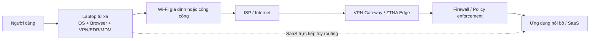
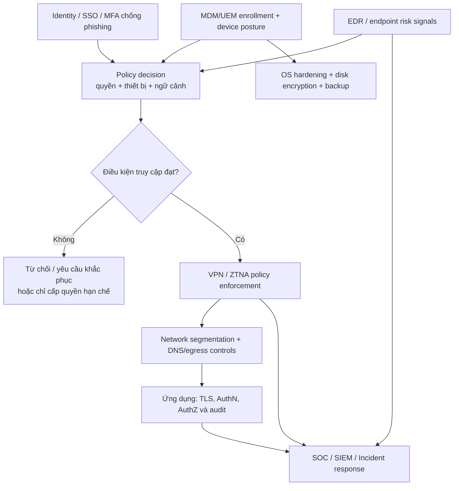
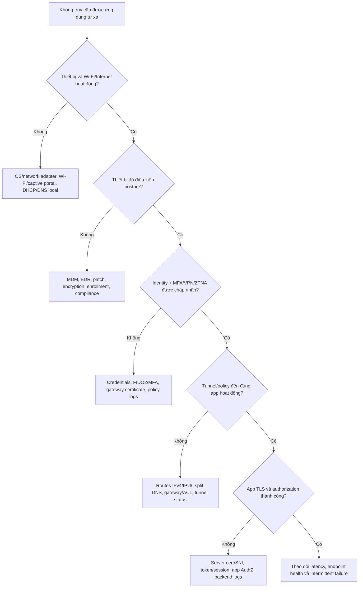

# Bảo vệ endpoint của người dùng từ xa: thiết bị, danh tính và kết nối an toàn

Một nhân viên làm việc tại nhà dùng laptop kết nối vào mạng công ty qua VPN. Đường hầm được mã hóa, máy chủ VPN xác thực thành công, nhưng laptop đã bị nhiễm phần mềm đánh cắp cookie phiên. Kẻ tấn công không cần giải mã đường hầm để lạm dụng phiên đăng nhập hoặc lấy dữ liệu mà người dùng đang được quyền xem. Đây là lý do **VPN an toàn chưa đồng nghĩa endpoint an toàn**.

**Endpoint của người dùng từ xa** là thiết bị ở đầu phía người dùng của một kết nối truy cập từ xa: laptop, máy tính để bàn, điện thoại, tablet, thiết bị ảo hoặc workstation do nhà thầu sử dụng. Thiết bị có thể nằm ngoài tầm kiểm soát vật lý của tổ chức, kết nối Wi-Fi gia đình/khách sạn, có các ứng dụng cá nhân và không thường xuyên gặp mạng quản trị nội bộ.

Trong chương **VPN và truy cập từ xa** thuộc module **SECURITY_NETWORK_SECURITY**, bảo vệ endpoint kết hợp các lớp phòng vệ: cấu hình hệ điều hành, mã hóa dữ liệu, quản lý bản vá, EDR, MDM, danh tính và xác thực mạnh, VPN/ZTNA, chính sách phân đoạn, DNS/HTTPS an toàn và giám sát xâm nhập. Mục tiêu là **chỉ cấp quyền cần thiết cho đúng người trên thiết bị có mức tin cậy phù hợp**, đồng thời phát hiện và phản ứng khi thiết bị không còn đáp ứng yêu cầu.

Sau bài học, người học có thể:

- Phân biệt **bảo mật endpoint**, **bảo mật đường hầm VPN**, **xác thực người dùng** và **ủy quyền truy cập ứng dụng**.
- Mô hình hóa rủi ro khi làm việc từ xa: thiết bị bị mất, mã độc, phishing, Wi-Fi giả, mạng gia đình, BYOD và phiên đăng nhập bị đánh cắp.
- Thiết kế baseline bảo vệ máy: update, full-disk encryption, quyền tối thiểu, khóa màn hình, firewall, EDR và backup.
- Giải thích **device posture**, MDM/UEM, identity, MFA chống phishing và điều kiện truy cập qua VPN/ZTNA.
- Đánh giá full tunnel, split tunnel, DNS/IPv6 leakage, local-network access và giới hạn của từng mô hình.
- Tổ chức giám sát, xử lý sự cố endpoint bị nhiễm mã độc hoặc thất lạc mà không gây ảnh hưởng quá mức tới nghiệp vụ.
- Sử dụng các lệnh **quan sát, không thay đổi cấu hình** để thu thập bằng chứng khi chẩn đoán.
- Xây dựng checklist và kiểm thử phòng vệ đầu cuối cho nhân viên, nhà thầu và BYOD.

## 1. Bài toán bảo vệ endpoint khi thiết bị ở ngoài văn phòng

Trong văn phòng, tổ chức có thể kiểm soát switch port, Wi-Fi doanh nghiệp, NAC, firewall biên và máy trạm thông qua hệ thống quản trị. Với làm việc từ xa, một số kiểm soát lớp mạng/không gian vật lý mất tác dụng hoặc phải được thay bằng cơ chế khác.

Ví dụ một kết nối thường gặp:



Sơ đồ chỉ diễn tả các vùng tin cậy. Với VPN split tunnel, một số kết nối có thể đi trực tiếp tới Internet thay vì đi qua gateway công ty; với ZTNA, đường đi có thể qua một connector/proxy riêng cho từng ứng dụng, không phải luôn đưa toàn bộ gói IP vào mạng doanh nghiệp.

### 1.1. Những ranh giới tin cậy thay đổi

| Ranh giới | Ai có thể kiểm soát? | Rủi ro thường gặp |
|---|---|---|
| Người dùng ↔ thiết bị | Người dùng, doanh nghiệp, đôi khi chủ sở hữu BYOD | Đánh cắp thông tin đăng nhập, tài khoản dùng chung, không khóa màn hình |
| Ứng dụng ↔ hệ điều hành endpoint | OS, trình duyệt, ứng dụng bên thứ ba | Mã độc, token/cookie theft, keylogging, extension độc hại |
| Endpoint ↔ Wi-Fi/ISP | Chủ mạng, router gia đình, khách sạn, ISP | Rogue AP, DNS/router bị đổi, quan sát metadata, captive portal |
| Internet ↔ VPN/ZTNA edge | Các hệ thống mạng trung gian và bên cung cấp dịch vụ | DoS, lỗi định tuyến, gateway cấu hình sai, certificate sai |
| VPN/ZTNA ↔ mạng nội bộ | Firewall, NAC, gateway, identity provider | Cấp quyền mạng quá rộng, lateral movement, policy khác với ý định |
| Client ↔ ứng dụng cuối | Endpoint, API/service, IdP, TLS | Phân quyền sai, phishing, lỗi TLS, đánh cắp session |

Một thiết bị có thể **xác thực VPN thành công nhưng không đủ an toàn** để truy cập ứng dụng nhạy cảm nếu đã mất khả năng giám sát, không có mã hóa ổ đĩa hoặc có dấu hiệu compromise.

### 1.2. Bốn câu hỏi phải trả lời riêng

1. **Ai đang truy cập?** Xác minh danh tính người dùng/tài khoản, MFA và trạng thái phiên.
2. **Đang dùng thiết bị nào?** Kiểm tra enrollment, khóa/chứng chỉ thiết bị và dấu hiệu nhận dạng phù hợp.
3. **Thiết bị hiện có đáng tin đến mức nào?** Bản vá, mã hóa ổ đĩa, EDR, posture và tín hiệu rủi ro.
4. **Được phép vào tài nguyên nào?** Thực thi least privilege ở VPN/ZTNA, firewall, application và data layer.

Không nên gộp các câu hỏi thành một điều kiện “đã đăng nhập VPN”. Trong mô hình Zero Trust, một lần xác thực thành công cũng không khiến mọi yêu cầu tiếp theo tự động đáng tin.

## 2. Mô hình phòng vệ nhiều lớp cho người dùng từ xa

Một kiến trúc thực tế cần hạn chế hậu quả nếu **một** lớp bảo vệ bị qua mặt:



### 2.1. Defense in depth theo vai trò

| Lớp | Kiểm soát chính | Giới hạn cần hiểu |
|---|---|---|
| **Endpoint hardening** | Patch, cấu hình OS, disk encryption, local firewall, quyền tối thiểu | Không chứng minh thiết bị không thể nhiễm mã độc |
| **EDR/AV** | Phát hiện hành vi, cách ly/quarantine, bảo vệ chống can thiệp | Agent có thể offline, bị lỗi hoặc bị đối tượng kiểm soát thiết bị tìm cách vô hiệu hóa |
| **MDM/UEM** | Quản lý enrollment, profile, khóa màn hình, version, chứng chỉ | Chỉ đo được những tín hiệu được thiết bị và nền tảng hỗ trợ; posture không phải bằng chứng tuyệt đối |
| **Identity/MFA** | Xác thực người dùng, quyền phiên, phát hiện đăng nhập đáng ngờ | Session cookie/token có thể bị lạm dụng sau MFA nếu endpoint bị xâm nhập |
| **VPN/ZTNA** | Bảo vệ kênh/đường truy cập, điều kiện kết nối, giới hạn phạm vi tài nguyên | VPN không dọn sạch mã độc trên host; ZTNA không thay authorization của ứng dụng |
| **Firewall/segmentation** | Chặn truy cập lateral không cần thiết, hạn chế egress | IP nguồn qua VPN chưa đủ chứng minh user/thiết bị |
| **Application/data controls** | TLS, AuthN/AuthZ, DLP, audit, secret protection | Phải triển khai đúng ở từng dịch vụ, không phó mặc gateway |
| **Monitoring/IR** | Tương quan sự kiện, phản ứng, bảo toàn bằng chứng | Log bị thiếu/offline hoặc sai thời gian có thể tạo khoảng trống |

**Nguyên tắc:** Không thiết kế một “mạng tin cậy” nơi sau khi kết nối VPN mọi máy được ping/SSH/RDP/SMB tới nhau. Truy cập nên giới hạn theo ứng dụng và vai trò, đồng thời liên tục đánh giá rủi ro.

## 3. Baseline bảo mật hệ điều hành cho endpoint từ xa

Hạ tầng VPN mạnh vẫn bị ảnh hưởng nghiêm trọng nếu endpoint không được bảo vệ. Baseline nên định nghĩa trạng thái **tối thiểu để cho phép truy cập** và các ngoại lệ có quy trình phê duyệt.

### 3.1. Quản lý bản vá và vòng đời OS

- Dùng phiên bản hệ điều hành còn được hỗ trợ và nhận bản vá bảo mật.
- Tự động cài bản vá quan trọng theo vòng thử nghiệm/triển khai phù hợp, đặc biệt cho browser, VPN client, EDR và thành phần network stack.
- Theo dõi **thời điểm thiết bị thực sự cài bản vá**; chỉ nhận báo cáo “đã có bản cập nhật” là chưa đủ.
- Thiết kế reboot window và nhắc người dùng hoàn tất khi patch cần khởi động lại.
- Đưa thiết bị quá hạn patch vào trạng thái hạn chế, remediation hoặc mất quyền truy cập nhạy cảm tùy mức độ rủi ro.
- Lưu inventory phiên bản, tình trạng hỗ trợ, owner và các ngoại lệ có thời hạn.

Không nên chỉ dựa vào một chỉ số “OS version”. Một thiết bị dùng cùng version vẫn có thể thiếu cập nhật, bị vô hiệu hóa cơ chế bảo vệ hoặc chứa ứng dụng dễ bị khai thác.

### 3.2. Mã hóa toàn bộ ổ đĩa (full-disk encryption)

Nếu laptop bị mất, **mã hóa ổ đĩa** giúp giảm khả năng truy cập dữ liệu khi thiết bị bị tắt hoặc khóa trong các điều kiện bảo vệ được duy trì.

| Hệ điều hành | Cơ chế thường gặp | Việc quản trị cần xác minh |
|---|---|---|
| Windows | BitLocker trên những edition/hardware được hỗ trợ | Encryption status, TPM/PIN policy, recovery key escrow, key access |
| macOS | FileVault | Bật đúng ổ, recovery key quản lý an toàn, phiên bản OS và trạng thái user |
| Linux | LUKS/dm-crypt hoặc thiết kế tương đương | Partition thực sự được mã hóa, unlock policy, backup/recovery keys |
| iOS/Android | Mã hóa dữ liệu tích hợp với thiết bị/hệ điều hành theo model | Screen lock, secure hardware, OS support, MDM posture và dữ liệu công việc |

**Giới hạn:** mã hóa ổ đĩa không ngăn kẻ tấn công đọc dữ liệu nếu thiết bị đang mở khóa và bị chiếm quyền. Sleep/hibernation, DMA/boot integrity, màn hình mở, recovery key bị lộ và session đăng nhập vẫn là những điều kiện cần xét.

Recovery key phải được bảo vệ như bí mật nhạy cảm; không đưa vào ticket công khai, log hoặc tài liệu chia sẻ. Cần diễn tập khôi phục dữ liệu để tránh mã hóa giúp chống mất cắp nhưng lại gây mất dữ liệu hợp lệ khi thiết bị hỏng.

### 3.3. Secure Boot, TPM và phần cứng tin cậy

**Secure Boot** giúp xác minh một số thành phần khởi động theo chính sách tin cậy. **TPM/Secure Enclave** có thể hỗ trợ lưu giữ khóa, đo trạng thái boot hoặc thực thi bảo vệ khóa theo khả năng phần cứng.

Không đồng nhất:

- “Có TPM” với “mọi khóa đều không thể bị lấy”.
- “Secure Boot bật” với “OS hiện tại không có malware”.
- “Device attestation thành công” với “người dùng không thể thực hiện hành vi độc hại”.

Những bằng chứng này giúp tăng mức tin cậy khi được đo, xác minh và ràng buộc với session đúng cách; chúng không thay EDR hay authorization.

### 3.4. Nguyên tắc quyền tối thiểu trên máy

- Người dùng làm việc thường ngày bằng tài khoản **không có local admin** nếu nghiệp vụ không yêu cầu.
- Dùng elevation tạm thời và có kiểm soát cho công việc cần quyền cao.
- Chỉ cho phần mềm được phê duyệt, kiểm soát browser extensions và cơ chế tự khởi chạy.
- Bật local firewall theo profile mạng phù hợp, hạn chế inbound RDP/SMB/SSH khi không cần.
- Tắt dịch vụ chia sẻ file, discovery và remote management công khai không được phép.
- Dùng khóa màn hình tự động, xác thực sinh trắc học/PIN/password phù hợp, không cho tài khoản dùng chung.
- Bảo vệ cài đặt bảo mật khỏi người dùng/ứng dụng không được cấp quyền thay đổi.

Không nên chạy dịch vụ RDP/SSH trực tiếp ra Internet chỉ để hỗ trợ một laptop từ xa. Dùng bastion/VPN/ZTNA và kiểm soát danh tính khi cần remote support.

### 3.5. Backup và khả năng phục hồi

Endpoint từ xa vẫn cần phương án backup đối với dữ liệu công việc được phép lưu cục bộ. Nên ưu tiên kho doanh nghiệp có mã hóa, versioning, retention và phân quyền phù hợp, kèm khả năng phục hồi khi mất máy/ransomware.

Backup không tự an toàn nếu lưu chung credentials và được đồng bộ xóa hàng loạt. Cần đánh giá backup version history, khả năng khôi phục độc lập và quy trình loại bỏ dữ liệu cá nhân khi thiết bị BYOD chấm dứt hợp đồng.

## 4. EDR, antivirus và health monitoring trên endpoint

**Endpoint Detection and Response (EDR)** thu thập tín hiệu trên host như process execution, file modification, network connection, account behavior và những sự kiện khác theo tính năng sản phẩm. Nó giúp phát hiện, điều tra và trong một số trường hợp **cô lập thiết bị** khi có dấu hiệu xâm nhập.

### 4.1. EDR khác kiểm tra antivirus có đang bật

| Khía cạnh | Endpoint AV truyền thống | EDR/XDR có khả năng nâng cao |
|---|---|---|
| Kiểm tra mẫu độc hại | Có thể quét signature/heuristics | Thường kết hợp với hành vi và nhiều nguồn telemetry |
| Quan sát process tree | Tùy sản phẩm | Thường có thông tin giúp điều tra process chain |
| Tương quan network | Có thể giới hạn | Có thể liên kết process → IP/domain/connection nếu agent hỗ trợ |
| Hỗ trợ response | Quarantine/deny file | Có thể isolate host, collect evidence, block indicator theo quyền |
| Phạm vi bảo đảm | Không bảo đảm phát hiện mọi mã độc | Cũng không bảo đảm ngăn mọi hành vi, đặc biệt nếu agent offline/tampered |

**Chạy EDR không đồng nghĩa thiết bị sạch.** Cần đo agent last-seen, phiên bản engine/signature, khả năng gửi sự kiện, tamper protection và endpoint risk verdict. Một cờ `agent_installed=true` không đủ để ra quyết định truy cập vào tài nguyên quan trọng.

### 4.2. Các tín hiệu nên đưa vào posture

- Agent có mặt, được đăng ký đúng tenant/organization và còn liên lạc theo khoảng thời gian cho phép.
- Engine phiên bản phù hợp, real-time protection hoặc sensor enabled theo chính sách.
- Không có cảnh báo nghiêm trọng chưa được xử lý hoặc dấu hiệu compromise.
- Thiết bị đang bật firewall và mã hóa ổ đĩa theo khả năng OS.
- Các bản vá bảo mật và hệ điều hành đạt ngưỡng cập nhật.
- Device ID, certificate và enrollment hợp lệ.

Chính sách phải xác định **nguồn nào là authoritative** cho từng tín hiệu. Ví dụ trạng thái EDR của laptop do EDR management ghi nhận đáng tin hơn một HTTP header do thiết bị tự gửi ghi “healthy=true”.

### 4.3. Cô lập endpoint từ xa cần kế hoạch phục hồi

Nếu EDR được lệnh cách ly mạng, nó có thể chặn phần lớn kết nối và chỉ cho các kênh quản trị/EDR cần thiết. Khi laptop đang ở ngoài văn phòng, cách ly sai có thể khiến đội IT **không còn đường quản trị hoặc hỗ trợ**. Trước khi bật tự động:

1. Xác định endpoint nào đủ điều kiện isolation tự động; tài sản quản trị quan trọng có thể cần xác minh/phê duyệt.
2. Đảm bảo kênh EDR/MDM và cơ chế phục hồi được chính sách isolate cho phép khi phù hợp.
3. Có playbook để kết nối người dùng bằng kênh độc lập như điện thoại.
4. Ghi audit người/automation yêu cầu, thời điểm và kết quả xác nhận trên agent.
5. Thử phương án rollback/release isolation trong lab trước khi áp dụng rộng.

Tín hiệu “isolation requested” **không chứng minh** thiết bị đã cách ly hoàn toàn; cần trạng thái xác nhận và kiểm tra đường mạng tương ứng.

## 5. Quản lý thiết bị bằng MDM/UEM và device posture

**Mobile Device Management (MDM)** hoặc **Unified Endpoint Management (UEM)** hỗ trợ enrollment, quản lý profile OS/ứng dụng, certificate, cấu hình VPN/Wi-Fi, yêu cầu bảo mật và một số thao tác từ xa.

**Device posture** là đánh giá tình trạng thiết bị theo tập điều kiện đã xác định, ví dụ được quản lý, không jailbreak/root theo tín hiệu hỗ trợ, đã cập nhật, có encryption/EDR và không có rủi ro nghiêm trọng.

### 5.1. Posture không phải một trạng thái tuyệt đối

Một thiết bị có thể:

- Đạt compliance lúc 09:00 nhưng EDR phát hiện malware lúc 09:05.
- Bị mất mạng và không gửi health report mới.
- Vừa cập nhật OS nhưng chưa reboot hoặc chưa gửi xác nhận.
- Có nhiều user profile và workload khác nhau với mức độ rủi ro khác nhau.
- Báo trạng thái “healthy” từ agent bị lỗi hoặc đã bị kẻ tấn công can thiệp.

Do đó, policy cần đặt **thời gian tối đa chấp nhận telemetry cũ**, yêu cầu re-evaluation và hành vi khi không có thông tin. Không nên coi `last_compliant=true` là quyền truy cập vô hạn.

### 5.2. Các trạng thái truy cập theo posture

| Trạng thái | Ví dụ | Hành động minh họa |
|---|---|---|
| **Compliant** | Thiết bị managed, patch/EDR/encryption đạt ngưỡng | Cấp quyền theo user role và ứng dụng cần thiết |
| **Needs remediation** | Patch quá hạn, agent chưa cập nhật | Chỉ cho vào portal/MDM/update service, giới hạn các app nhạy cảm |
| **Unknown/offline** | Không có báo cáo mới hoặc không xác minh được identity thiết bị | Từ chối các quyền nhạy cảm hoặc áp chính sách hạn chế theo rủi ro |
| **High risk/compromised** | EDR báo nghi compromise hoặc device certificate bị thu hồi | Chặn/thu hồi phiên và kích hoạt IR theo playbook |
| **BYOD chưa quản lý** | Thiết bị cá nhân không có posture đủ tin cậy | Dùng browser isolation/VDI hoặc ứng dụng giới hạn, không full network VPN |

Đây là **ma trận logic**, không phải hành vi tự động của mọi sản phẩm. Mỗi điều kiện chỉ có hiệu lực khi identity, MDM/EDR và VPN/ZTNA enforcement được tích hợp đúng.

### 5.3. Device certificate và khóa riêng

Một certificate do tổ chức phát cho thiết bị có thể giúp VPN/ZTNA xác minh rằng endpoint sở hữu khóa riêng tương ứng với device identity. Nhưng phải kiểm tra:

- Certificate có đúng CA, EKU, identity và thời hạn hay không.
- Khóa riêng có được bảo vệ và tránh export trái phép khi nền tảng hỗ trợ không.
- Enrollment có gắn với đúng asset/owner và trạng thái MDM không.
- Certificate có bị thu hồi khi máy mất, chuyển chủ, nhân viên nghỉ việc không.
- **User authentication và authorization** vẫn thực hiện riêng, không cấp toàn quyền chỉ vì có certificate.

MAC/IP/hostname do endpoint tự khai không nên được xem là bằng chứng mạnh về thiết bị. Với mạng Wi-Fi và VPN, MAC có thể thay đổi/không được nhìn thấy từ xa; IP public thường được nhiều thiết bị chia sẻ qua NAT.

## 6. Bảo vệ danh tính người dùng, MFA và phiên đăng nhập

Thiết bị được quản lý vẫn có thể bị lợi dụng nếu tài khoản người dùng bị phishing hoặc session token bị đánh cắp. Vì vậy quyền truy cập từ xa nên đi qua **SSO/IdP**, MFA, conditional access và chính sách phiên phù hợp.

### 6.1. Phân biệt mật khẩu, OTP và MFA chống phishing

| Phương pháp | Ưu điểm | Rủi ro cần nhận biết |
|---|---|---|
| Password + SMS/OTP | Dễ triển khai, tốt hơn chỉ password trong nhiều tình huống | Có thể bị phishing real-time, SIM swap hoặc chuyển mã |
| Push MFA | Dễ dùng trên thiết bị quản lý | Push fatigue/phishing nếu không có number matching/kiểm soát phù hợp |
| TOTP | Không phụ thuộc SMS | Có thể bị lấy mã qua trang đăng nhập giả theo thời gian thực |
| **FIDO2/WebAuthn security key/passkey** | Có thể ràng buộc xác thực với origin/RP và chống một số phishing dựa trên domain giả | Không khắc phục mọi dạng session hijacking hoặc malware sau login |
| Certificate-based auth | Gắn identity với chứng chỉ/khóa, có thể dùng cho thiết bị | Cần PKI, revocation và policy xác minh đúng |

Đối với truy cập hệ thống nhạy cảm, ưu tiên **MFA chống phishing** như WebAuthn/FIDO2 được triển khai và xác minh đúng. Không suy rằng MFA nói chung sẽ chặn mọi kẻ tấn công sử dụng **cookie/token của phiên đã đăng nhập**.

### 6.2. Token, cookie và nguy cơ session hijacking

Một trình duyệt đã đăng nhập có thể giữ session cookie hoặc access/refresh token. Nếu malware trên endpoint đọc/lạm dụng thông tin đó, kẻ tấn công có thể dùng phiên trong giới hạn chính sách, ngay cả khi người dùng trước đó đã hoàn tất MFA.

Các biện pháp bổ sung:

- Ngăn malware và browser extensions không được phê duyệt.
- Token/cookie có scope, audience và thời gian sống phù hợp; ràng buộc phiên hoặc thiết bị khi sản phẩm hỗ trợ.
- Dùng refresh token rotation/revocation và session controls theo rủi ro.
- Step-up authentication khi truy cập tác vụ nhạy cảm.
- Phát hiện thay đổi hành vi phiên và thu hồi quyền khi thiết bị bị compromise.
- Ứng dụng dùng cookies với các thuộc tính bảo vệ phù hợp (`Secure`, `HttpOnly`, `SameSite`) theo kiến trúc web; hiểu rằng chúng **không phải biện pháp chống mọi endpoint malware**.

### 6.3. Quyền cần thiết thay vì “đã vào VPN = tin cậy”

Một người dùng hợp lệ chỉ nên có quyền tới tài nguyên được giao. Ví dụ:

```text
Nhân viên kế toán + thiết bị compliant
    → ứng dụng tài chính qua ZTNA/VPN + MFA
    → không tự động có RDP tới domain controller

Nhà thầu + thiết bị chưa managed
    → portal/VDI phạm vi dự án
    → không có route tới database subnet
```

Phải kiểm tra authorization trong **ứng dụng**, firewall và identity policy. Một source IP thuộc VPN address pool không phải chứng cứ đủ mạnh rằng request do nhân viên kế toán thực hiện.

## 7. Cấu hình VPN client theo nguyên tắc an toàn

VPN tạo một kênh/overlay bảo vệ giao tiếp trong phạm vi được thiết kế. Các công nghệ có thể là IPsec/IKEv2, TLS-based VPN hoặc WireGuard; sự khác biệt về thuật toán và handshake không làm thay đổi yêu cầu cốt lõi: **xác thực đúng gateway, bảo vệ credential/keys và kiểm soát traffic được chuyển qua tunnel**.

### 7.1. Những thuộc tính cần kiểm tra

1. **Gateway identity:** VPN client xác thực certificate/khóa của đúng gateway; không bỏ qua cảnh báo chứng chỉ.
2. **User/device authentication:** có danh tính người dùng, MFA và/hoặc certificate thiết bị theo policy.
3. **Protocol/cipher:** dùng cấu hình mật mã được tổ chức hỗ trợ, tránh legacy insecure modes.
4. **Client integrity:** VPN client có nguồn cài đặt đáng tin, được cập nhật và không cho profile không được ủy quyền.
5. **Routing policy:** chỉ có đúng các prefix/ứng dụng cần đi qua tunnel; không vô tình mở mạng nội bộ rộng.
6. **DNS và IPv6:** DNS resolver, split DNS, IPv6 routes và local network rules phù hợp với mô hình tunnel.
7. **Disconnect behavior:** khi VPN mất kết nối, biết traffic nào tiếp tục đi trực tiếp, traffic nào bị chặn.
8. **Logging & response:** kết nối được liên kết với user/device identity, session ID, IP pool và trạng thái policy.

### 7.2. Full tunnel và split tunnel

**Full tunnel** thường có nghĩa các lưu lượng IP trong phạm vi hệ điều hành/chính sách định tuyến được gửi vào VPN để đi qua gateway tổ chức (bao gồm lưu lượng Internet nếu được cấu hình). **Split tunnel** chỉ gửi những mạng/ứng dụng được chỉ định qua VPN, còn phần khác đi trực tiếp.

```text
FULL TUNNEL (sơ đồ logic)
Laptop ── VPN ── Corporate gateway ── Internet / Internal apps

SPLIT TUNNEL (sơ đồ logic)
Laptop ── VPN ── Corporate gateway ── Internal apps
      └────────── Local ISP ──────── Internet / SaaS
```

| Tiêu chí | Full tunnel | Split tunnel |
|---|---|---|
| Tầm nhìn ở gateway công ty | Rộng hơn với traffic được tunnel | Giới hạn ở traffic đi qua tunnel |
| Độ trễ/băng thông gateway | Có thể tăng tải và độ trễ | Có thể giảm tải, thuận lợi cho SaaS/video |
| Rủi ro Internet egress trực tiếp | Ít hơn trong phạm vi được cấu hình thực sự | Có, cần local DNS/firewall/EDR và SaaS identity policy |
| Phụ thuộc VPN gateway | Có thể ảnh hưởng cả Internet khi gateway lỗi | Internet trực tiếp có thể còn hoạt động khi VPN lỗi |
| Triển khai | Cần egress capacity, DNS, IPv4/IPv6 routing và policy rõ | Cần xác định chính xác routes/domains/apps, DNS và chính sách ngoại lệ |

**Full tunnel không mặc định là “không leak”** nếu IPv6 hoặc một interface khác không thuộc policy. **Split tunnel không mặc định là không an toàn** nếu tổ chức có bảo vệ endpoint mạnh, egress web/DNS phù hợp và thiết kế theo ứng dụng. Rủi ro phụ thuộc cách cấu hình.

### 7.3. DNS, IPv6 và local LAN access

Một thiết bị dual-stack có thể:

- Được VPN cấp route IPv4 nội bộ nhưng vẫn giữ default IPv6 trực tiếp qua Wi-Fi.
- Nhận DNS resolver doanh nghiệp cho zone nội bộ nhưng ứng dụng/browsers dùng resolver khác hoặc DoH theo chính sách.
- Có nhiều interface (Wi-Fi, Ethernet, mobile hotspot, VPN) với metric/routing khác nhau.
- Gửi lưu lượng tới printer/router local theo ngoại lệ **Allow local LAN access**.

Không nên tuyên bố “VPN bảo vệ toàn bộ truy cập” nếu chưa kiểm tra **IPv4 route, IPv6 route, DNS route, app-based bypass và hành vi khi tunnel down**. Lưu lượng nội bộ như ARP/NDP, một số broadcast/multicast và captive portal có thể không đi qua VPN theo thiết kế.

### 7.4. Kill switch / Always-on VPN

Một số client hỗ trợ **kill switch**, **always-on VPN** hoặc policy chặn traffic nếu tunnel không sẵn sàng. Mục đích là giảm rủi ro một ứng dụng đang được yêu cầu dùng VPN chuyển sang đường trực tiếp sau khi kết nối rớt.

Tuy nhiên:

- Phạm vi bảo vệ có thể chỉ áp trên một giao diện, một nhóm ứng dụng hoặc routing profile.
- Một cấu hình sai có thể **cắt luôn đường MDM/EDR và hỗ trợ IT**.
- Các dịch vụ cần để thiết lập VPN (DNS/captive portal/time sync) có thể cần ngoại lệ an toàn.
- Khả năng đảm bảo khi sleep/resume, chuyển Wi-Fi hoặc roam phụ thuộc OS/VPN client.

Phải thử **tunnel up/down, chuyển Wi-Fi, IPv4/IPv6, restart, captive portal** trong môi trường được phép; không chỉ kiểm tra giao diện người dùng hiển thị “Connected”.

## 8. VPN, ZTNA và truy cập dựa trên điều kiện thiết bị

**VPN truyền thống** thường kết nối endpoint với một tập route/subnet qua tunnel. **Zero Trust Network Access (ZTNA)** thường hướng đến cấp quyền truy cập theo ứng dụng và policy, có thể thông qua broker/connector/proxy và kiểm tra danh tính, posture hoặc ngữ cảnh.

Hai mô hình có thể cùng tồn tại; một sản phẩm VPN cũng có thể hỗ trợ các tính năng theo danh tính và posture. Thuật ngữ ZTNA **không bảo đảm thiết bị thực tế có Zero Trust** nếu policy cấu hình quá rộng.

### 8.1. Từ “network access” sang “application access”

```text
VPN network-centric:
  User + device → VPN pool IP → permitted subnets
                              → app firewall / authorization

ZTNA application-centric:
  User + device + posture → policy decision
                          → connector cho một app cụ thể
                          → app authorization
```

Trong cả hai mô hình:

- Policy phải gắn với **identity người dùng và thiết bị**, không chỉ địa chỉ IP.
- Quyền cần được đánh giá lại khi rủi ro thay đổi.
- Các hệ thống bên trong vẫn cần TLS, authN/authZ và giám sát.
- Một thiết bị bị compromise có thể thao tác trong quyền đã được cấp, vì vậy không thể bỏ EDR/IR.

### 8.2. Device posture trong chính sách truy cập

Ví dụ policy logic:

```text
resource = finance-api

Require:
  user.role includes FINANCE
  user.MFA_strength = phishing_resistant
  device.enrolled = true
  device.disk_encrypted = true
  device.EDR_risk != high
  device.last_posture_seen <= policy_max_age

If all conditions hold:
  grant app-specific access with time-bounded session
Else:
  deny or redirect to approved remediation path
```

Đây là **pseudocode**, không phải syntax chính thức của một IdP/VPN/ZTNA sản phẩm nào. Việc có thể đánh giá từng điều kiện, xử lý kết nối đang sống và nhận độ tin cậy của posture **phụ thuộc tích hợp thực tế**.

### 8.3. Policy decision và policy enforcement phải nối đúng

Nếu IdP trả trạng thái “device noncompliant” nhưng gateway không nhận/cưỡng chế kết quả ấy, quyền mạng có thể vẫn còn. Nếu VPN gateway chặn kết nối mới nhưng session cũ tiếp tục tồn tại, phản ứng chưa đạt mục tiêu.

Khi thiết kế:

1. Nêu rõ hệ thống **đưa quyết định** (IdP/NAC/conditional access) và hệ thống **thực thi** (VPN/ZTNA/firewall/app).
2. Xác định thời điểm đánh giá lại và mức cũ tối đa của posture.
3. Thử trường hợp EDR offline, thiết bị mất certificate, user bị vô hiệu hóa và phiên đang hoạt động.
4. Kiểm tra cách revoke/disconnect thực sự có tác dụng.
5. Ghi evidence về quyết định policy, trạng thái enforcement, user/device/session và quyền ứng dụng.

## 9. Wi-Fi công cộng, mạng gia đình và kết nối ngoài văn phòng

### 9.1. SSID giả, captive portal và thông điệp đăng nhập

Ở khách sạn hoặc quán cà phê, tên SSID có thể bị sao chép; thiết bị có thể hiển thị **captive portal** trước khi được phép truy cập Internet. Người dùng không nên nhập mật khẩu doanh nghiệp vào một trang portal không thuộc luồng xác thực đã được phê duyệt.

Biện pháp thực hành:

- Xác minh tên mạng với đơn vị cung cấp nếu cần; không tự động kết nối lại SSID lạ.
- Chỉ cung cấp thông tin Wi-Fi mà địa điểm thực sự yêu cầu; không dùng thông tin đăng nhập công ty cho portal ngẫu nhiên.
- Dùng HTTPS với kiểm tra chứng chỉ; không bỏ qua cảnh báo TLS.
- Kết nối VPN/ZTNA theo policy trước khi truy cập tài nguyên cần bảo vệ.
- Chỉ mở browser/login site của công ty qua bookmark/SSO domain được quản lý; cảnh giác QR code và link giả.
- Xem xét dùng mạng di động/hotspot được quản lý khi môi trường Wi-Fi công cộng có rủi ro cao.

### 9.2. Mạng gia đình không mặc nhiên tin cậy

Router gia đình có thể sử dụng firmware cũ, mật khẩu quản trị yếu hoặc DNS settings đã thay đổi. Các thiết bị IoT/camera/TV trong cùng subnet cũng không nhất thiết an toàn.

Tổ chức nên:

- Yêu cầu endpoint local firewall chặn inbound không cần thiết trên profile mạng công cộng.
- Không cho chia sẻ file/screen/remote admin rộng tới mọi thiết bị trong LAN.
- Dùng DNS/proxy policy phù hợp và giám sát thiết bị truy cập dịch vụ nội bộ.
- Hướng dẫn người dùng cập nhật router, đổi mật khẩu quản trị và dùng Wi-Fi được bảo vệ theo khả năng thiết bị.
- Cẩn trọng khi VPN bật “allow local network”: máy vẫn có thể giao tiếp với các thiết bị gia đình ngoài phạm vi tunnel.

Việc dùng VPN **không vô hiệu hóa mã độc có sẵn trong laptop**, không tự bảo vệ toàn bộ thiết bị gia đình và không sửa được mọi cấu hình router bị chiếm quyền.

### 9.3. DNS-over-HTTPS, TLS và giới hạn bảo vệ

HTTPS/TLS giúp bảo vệ phiên tới ứng dụng khi xác minh endpoint đúng; VPN bảo vệ traffic thuộc tunnel. DNS truyền thống có thể bị thay đổi trong một số môi trường mạng không tin cậy; DNS mã hóa như DoH/DoT bảo vệ đường tới resolver phù hợp nhưng không thay DNSSEC hoặc TLS hostname verification.

Một giải pháp VPN có thể yêu cầu dùng DNS doanh nghiệp để phân giải private zones. Nếu browser dùng DoH riêng đi ngoài tunnel, DNS nội bộ có thể không hoạt động hoặc dữ liệu DNS thoát khỏi chính sách quan sát của tổ chức. Không tự tắt DoH/DoT trên mọi thiết bị: phải quyết định theo kiến trúc resolver, yêu cầu riêng tư, khả năng giám sát và mức độ tin cậy.

## 10. Dữ liệu công việc trên thiết bị từ xa

Một phiên VPN mã hóa chỉ bảo vệ đoạn truyền dẫn trong phạm vi tunnel; **dữ liệu tải xuống endpoint vẫn có thể bị lộ** qua file cục bộ, clipboard, email cá nhân, cloud sync không được phê duyệt hoặc màn hình mở ở nơi công cộng.

### 10.1. Data protection theo vòng đời

| Giai đoạn | Ví dụ rủi ro | Kiểm soát |
|---|---|---|
| Dữ liệu đang truyền | Truy cập qua mạng lạ, lỗi certificate | TLS đúng hostname, VPN/ZTNA phù hợp, không bỏ xác minh |
| Dữ liệu trên ổ đĩa | Mất máy, trộm ổ, backup cá nhân | Full-disk encryption, vùng lưu enterprise, hạn chế local copies |
| Dữ liệu đang sử dụng | Clipboard, browser extension, screenshot, copy/paste | Endpoint protection, DLP/VDI theo khả năng, user training |
| Dữ liệu đồng bộ | Personal drive, app ngoài policy, backup không kiểm soát | Conditional access, CASB/DLP, app allowlist và audit |
| Dữ liệu sau khi nghỉ việc | Còn tài khoản/session/cached documents | Selective wipe khi hỗ trợ, token revoke, account deprovision, retention policy |

### 10.2. VDI/browser isolation có thể giảm dữ liệu tại BYOD

Với thiết bị cá nhân hoặc nhà thầu không thể kiểm soát toàn bộ OS, một tổ chức có thể dùng:

- **Virtual Desktop Infrastructure (VDI):** ứng dụng/dữ liệu xử lý chủ yếu trên môi trường doanh nghiệp; endpoint nhận màn hình/đầu vào theo giao thức hỗ trợ.
- **Remote browser isolation:** cách ly phần chạy trình duyệt và kiểm soát những dữ liệu được chuyển xuống thiết bị.
- **Application-level access:** web portal với quyền hạn chế, không cấp full network VPN.

Các giải pháp này **không bảo đảm dữ liệu không thể bị chụp hoặc nhập lại**, và thiết bị người dùng vẫn có thể có keylogger hoặc màn hình bị ghi. Cần kiểm soát download/clipboard/printing theo mức rủi ro và giữ auth ở ứng dụng.

### 10.3. Chính sách riêng tư của người dùng

Khi triển khai MDM/EDR trên thiết bị cá nhân, tổ chức phải minh bạch về dữ liệu thu thập, khả năng remote wipe, quyền truy cập và cách tách dữ liệu công việc khỏi dữ liệu riêng. Có thể ưu tiên **work profile/containerization** trên nền tảng hỗ trợ và selective wipe thay vì xóa toàn bộ thiết bị khi không được phép.

**BYOD không mặc nhiên cấp quyền cài agent giám sát toàn bộ hoạt động cá nhân.** Cần chính sách, đồng ý phù hợp, bảo vệ dữ liệu và giải pháp thay thế như VDI nếu mức quản lý cần thiết không thể được chấp nhận.

## 11. Threat modeling: những tấn công nhắm vào remote endpoint

Mục tiêu của mô hình hóa mối đe dọa là chỉ rõ **tài sản cần bảo vệ, ranh giới tin cậy, khả năng kẻ tấn công và bằng chứng cần theo dõi**. Không nên dùng một danh sách “best practices” mà không xét các luồng dữ liệu thực tế của tổ chức.

### 11.1. Tài sản, đối tượng và đường tấn công

| Tài sản | Ví dụ | Hậu quả nếu bị xâm phạm |
|---|---|---|
| Danh tính người dùng | SSO password, MFA registration, recovery channel | Đăng nhập trái phép, chiếm quyền tài khoản |
| Chứng chỉ/khóa thiết bị | VPN client certificate, WireGuard private key | Giả mạo thiết bị hoặc kết nối trong phạm vi khóa được cấp |
| Phiên và token | Browser cookie, OAuth refresh token, VPN session | Chiếm quyền phiên dù MFA đã từng hoàn thành |
| Dữ liệu công việc | Tài liệu nội bộ, dữ liệu khách hàng, khóa API | Rò rỉ bí mật, vi phạm quyền riêng tư |
| Tính toàn vẹn OS | Boot chain, kernel/driver, EDR agent, browser | Mã độc, theo dõi hoạt động, vô hiệu hóa phòng vệ |
| Khả năng truy cập | VPN/IdP/MDM enrollment và recovery | Người dùng bị khóa khỏi môi trường làm việc, gián đoạn dịch vụ |
| Kênh quản trị | Remote support, EDR isolation, MDM commands | Thao tác trái quyền hoặc mất khả năng ứng cứu |

### 11.2. Bảng mối đe dọa và biện pháp phòng vệ

| Mối đe dọa | Dấu hiệu / điều kiện | Biện pháp phòng vệ |
|---|---|---|
| **Phishing IdP/VPN** | Người dùng mở trang SSO hoặc cổng VPN giả | MFA chống phishing, domain allowlist, browser protection, training |
| **Session/token theft** | Token dùng từ môi trường lạ, browser/extension bị xâm nhập | EDR, session controls, token revoke, step-up auth, app logging |
| **Infostealer/ransomware** | Process lạ, thay đổi nhiều file, EDR detection | Patch, application control, EDR, backup và IR isolation |
| **Mất/đánh cắp laptop** | Device offline bất thường, báo mất, truy cập ngoài dự kiến | Disk encryption, screen lock, thu hồi account/cert, selective/full wipe phù hợp |
| **Evil twin / Wi-Fi lạ** | SSID giống nhau, captive portal đáng ngờ | Xác thực HTTPS/VPN gateway, managed Wi-Fi profile, tránh credential reuse |
| **Endpoint → mạng nội bộ lateral movement** | VPN user đột nhiên quét SMB/RDP/SSH nhiều subnet | Microsegmentation, deny by default, EDR/NDR, hạn chế route VPN |
| **VPN client/gateway lỗi thời** | Phiên bản có lỗ hổng hoặc cài từ nguồn không tin | Patch nhanh, kiểm kê versions, ký mã, chỉ cài từ nguồn được duyệt |
| **DNS/local network abuse** | DNS resolver đổi, mDNS/SMB inbound, IPv6 path ngoài VPN | Local firewall, DNS policy, route validation, split-tunnel review |
| **Credential reuse / mật khẩu yếu** | Password bị dùng ở nhiều dịch vụ, failed sign-ins | Password manager, SSO, MFA mạnh, compromised credential monitoring |
| **Policy posture bypass** | Gateway tin client tự khai “healthy”, agent mất liên lạc | Server-side verified posture, freshness, revoke, policy enforcement |
| **BYOD data leakage** | File tải xuống personal drive, app sync không kiểm soát | VDI/isolated browser, DLP, session controls, hạn chế tải xuống |
| **Insider misuse** | User hợp lệ tải dữ liệu ngoài nhiệm vụ | Authorization, DLP, logging theo mục đích, review quyền |

**Đường vào và đường ra khác nhau:** malware có thể vào qua tài liệu độc hại hoặc browser, rồi dùng VPN hợp lệ làm cầu nối tới mạng nội bộ. Cần kiểm soát cả **endpoint → doanh nghiệp** và **doanh nghiệp → endpoint** theo quyền được cấp.

### 11.3. Cách suy luận một tình huống

**Quan sát:** EDR thấy một process lạ trên laptop đang kết nối VPN, đồng thời firewall log ghi source IP thuộc VPN pool gọi nhiều server qua TCP `445`.

**Giả thuyết:** Thiết bị có thể bị lạm dụng để discovery/lateral movement. Tuy nhiên cũng có thể là một công cụ hỗ trợ được phê duyệt, script inventory hoặc mapping IP sai.

**Cần kiểm chứng:** user/device ID của VPN session tại **đúng thời điểm**, EDR process tree, file signer, admin change ticket, route/subnet thực sự được phép, danh sách đích và kết quả từ endpoint liên quan. Chỉ khi có bằng chứng phù hợp mới gán incident severity và thực thi chặn/cô lập.

Không dùng IP public/NAT hiện tại để quy kết người dùng trong một sự kiện lịch sử. Phải đối chiếu phiên VPN, NAT translation và timestamp.

## 12. Chính sách truy cập theo loại thiết bị và nhóm người dùng

Không phải mọi endpoint nên được quản trị giống nhau. Một thiết bị công ty đã enroll có thể đáp ứng EDR/MDM đầy đủ, trong khi BYOD hoặc máy nhà thầu có những giới hạn riêng về quản trị.

### 12.1. Ma trận định hướng

| Đối tượng | Điều kiện tối thiểu minh họa | Đường truy cập khuyến nghị | Quyền |
|---|---|---|---|
| Nhân viên, laptop công ty managed | SSO + MFA chống phishing, MDM compliant, encryption, EDR khỏe | VPN theo app/prefix hoặc ZTNA | Ứng dụng theo role, không mở toàn bộ RFC1918 |
| IT admin, thiết bị quản trị chuyên dụng | Điều kiện trên + PIM/JIT, mạnh hơn về chứng chỉ/attestation | Admin ZTNA/bastion qua đường riêng | Quyền quản trị tạm thời, log/audit đầy đủ |
| Nhà thầu, thiết bị do đối tác quản lý | Identity được cấp rõ hạn, tín hiệu posture đáng tin hoặc cô lập phiên | Portal/VDI/ZTNA app-specific | Chỉ dự án được phép, hết hạn tự động |
| BYOD không enroll | SSO/MFA, browser/session controls, hạn chế dữ liệu | VDI/remote browser/web app được phê duyệt | Không full-tunnel vào LAN nội bộ |
| Thiết bị mobile managed | OS hỗ trợ, app protection, device compliance | Per-app VPN/ZTNA khi phù hợp | Email/collaboration theo điều kiện |
| Thiết bị EDR high-risk | Không đáp ứng policy | Deny/quarantine/remediation | Chỉ service phục hồi được phép |

Đây là **mô hình minh họa**, không phải tiêu chuẩn bắt buộc cho mọi doanh nghiệp. Mức truy cập phải dựa trên dữ liệu nhạy cảm, rủi ro nghiệp vụ, thiết bị được hỗ trợ và quy định liên quan.

### 12.2. Truy cập đặc quyền từ xa

Đối với quản trị hạ tầng, nên tách:

- **Thiết bị thường dùng** để email/web và **thiết bị/môi trường quản trị** khi rủi ro yêu cầu.
- **User account** và **privileged account** với quyền/phạm vi khác nhau.
- Đường truy cập quản trị qua **bastion, PAM/PIM, JIT** và session recording nếu tổ chức cho phép.
- Mạng/VRF quản trị khác mạng nhân viên; chỉ mở đúng protocol/port/host cần thiết.
- Không cho RDP/SSH tới domain controller, hypervisor hoặc cloud control plane từ mọi IP trong VPN pool.

Một “VPN admin” chia sẻ mật khẩu hoặc một account dùng chung là rủi ro kiểm toán lớn. Nên cấp danh tính cá nhân và quyền tạm thời theo nhiệm vụ để có thể truy vết.

### 12.3. Khi compliance không đạt: fail-open hay fail-closed?

Một quyết định thực tế là nếu MDM/EDR backend mất kết nối, hệ thống sẽ **giữ hay rút quyền**. Không có một đáp án phù hợp mọi ứng dụng:

- Với tài nguyên cực nhạy cảm, **không xác minh được posture** có thể đồng nghĩa từ chối truy cập.
- Với dịch vụ hỗ trợ/khắc phục, cần **đường remediation** giới hạn để người dùng cập nhật agent, CA hoặc OS.
- Với truy cập đã được cấp trước, phải quy định **thời hạn phiên và thời gian tồn tại của tín hiệu cũ**, không tự kéo dài vô hạn.
- Trường hợp khẩn cấp phải có cơ chế **break-glass** chặt chẽ, phê duyệt, thời hạn và audit; không dựa vào tài khoản chung.

Tính sẵn sàng và bảo mật cần được phân tích bằng **tác động nếu cho phép sai** và **tác động nếu chặn nhầm**, không bằng cách tắt toàn bộ posture validation khi gặp lỗi dịch vụ.

## 13. Thực hành quan sát endpoint, tunnel và routing

Các lệnh sau dùng để **đọc trạng thái** trong môi trường được phép. Không cần thay đổi cấu hình hoặc tắt firewall/VPN để thực hiện. Tên dịch vụ, quyền và cú pháp khả dụng tùy OS, edition và sản phẩm quản lý.

### 13.1. Windows: phiên OS, mã hóa, bảo vệ và mạng

```powershell
# Thông tin cơ bản về phiên bản OS và bản cập nhật đã cài (kết quả tùy edition).
Get-ComputerInfo | Select-Object OsName, OsVersion, OsBuildNumber
Get-HotFix | Select-Object -First 10

# Trạng thái BitLocker trên hệ thống hỗ trợ và có module/quyền phù hợp.
Get-BitLockerVolume | Select-Object MountPoint, ProtectionStatus, VolumeStatus

# Microsoft Defender trên hệ thống sử dụng Defender và có cmdlet tương ứng.
Get-MpComputerStatus | Select-Object AMServiceEnabled, AntivirusEnabled, RealTimeProtectionEnabled

# Firewall profile ở Windows.
Get-NetFirewallProfile | Select-Object Name, Enabled, DefaultInboundAction

# Địa chỉ, default route, DNS và những VPN profiles được công cụ nhận diện.
Get-NetIPConfiguration
Get-NetRoute -DestinationPrefix '0.0.0.0/0'
Get-NetRoute -DestinationPrefix '::/0'
Get-DnsClientServerAddress
Get-VpnConnection
```

Lưu ý:

- `Get-BitLockerVolume` không có ở mọi Windows edition và trạng thái hiển thị có thể cần quyền quản trị; không dùng nó để khẳng định mã hóa hoàn toàn nếu môi trường dùng giải pháp khác.
- `Get-MpComputerStatus` không đại diện cho EDR bên thứ ba; phải đối chiếu agent/console sản phẩm đang dùng.
- `Get-VpnConnection` chỉ hiện những VPN profiles do cơ chế Windows hỗ trợ và thuộc phạm vi lệnh; nhiều VPN client độc lập không xuất hiện tại đây.
- `Get-NetRoute` hiển thị một phần routing table; **route metric, interface và policy per-app** cũng quyết định đường gói thực tế.
- Tránh in và chia sẻ recovery keys, private keys, full VPN configs hoặc dữ liệu định danh nhạy cảm trong log chẩn đoán.

### 13.2. macOS: FileVault, trạng thái bảo mật và mạng

```bash
# Mã hóa ổ đĩa trên macOS.
fdesetup status

# Gatekeeper status theo cơ chế macOS có hỗ trợ.
spctl --status

# Dịch vụ mạng và thông tin DNS/network reachability.
networksetup -listallnetworkservices
scutil --dns
scutil --nwi

# Phiên bản hệ điều hành.
sw_vers

# Đường đi mặc định IPv4/IPv6 (cú pháp phụ thuộc bản macOS).
netstat -rn -f inet
netstat -rn -f inet6
```

`spctl --status` **không tự đo toàn bộ sức khỏe endpoint** hay kết quả EDR; nó chỉ cung cấp một khía cạnh về chính sách thực thi. MDM/EDR/device certificate status phải được kiểm tra ở console phù hợp. Một số lệnh có thể thay đổi hành vi theo phiên bản macOS.

### 13.3. Linux: disk encryption, firewall, routes, DNS

```bash
# Phiên bản OS, kernel, interface và địa chỉ.
cat /etc/os-release
uname -r
ip -br address

# IPv4/IPv6 routes và policy routing (nếu có).
ip route show
ip -6 route show
ip rule show

# Resolver configuration ở môi trường hiện tại.
cat /etc/resolv.conf
resolvectl status

# Filesystem và block devices: hỗ trợ điều tra nhưng không tự chứng minh toàn bộ FDE.
lsblk -f
findmnt -no SOURCE /

# Kiểm tra trạng thái firewall theo nền tảng đang dùng.
sudo nft list ruleset
```

Không phải mọi Linux distro dùng `systemd-resolved` hoặc `nftables`/dịch vụ tương ứng. Với máy dùng LUKS, trạng thái cần được xác minh bằng cơ chế thiết bị/mapping và inventory quản lý, không chỉ suy từ tên partition. **Đừng chạy lệnh thay route hay disable firewall** trong quá trình quan sát nếu không có phương án phục hồi.

### 13.4. Tách DNS khỏi route và TLS

Ví dụ môi trường có tên ứng dụng được phép:

```bash
# Chỉ kiểm tra resolution theo môi trường và công cụ có sẵn.
getent ahosts internal-api.example.test

# Quan sát một yêu cầu HTTPS end-to-end mà không tắt xác minh TLS.
curl -Iv https://internal-api.example.test/health

# Xem đường đến một IP thực sự đã được cấp phép kiểm thử.
ip route get 198.51.100.20
```

Các hostname `.test` và địa chỉ `198.51.100.20` chỉ dùng làm tài liệu; chúng **không có nghĩa vụ phân giải/kết nối trên Internet**. Trong lab có thể tạo zone/route riêng để chúng hoạt động.

Đọc kết quả theo từng lớp:

1. Hostname có được resolve bằng resolver thực tế không?
2. Route chọn interface VPN hay interface local/Internet?
3. Kết nối TCP/QUIC tới đích có hoàn thành không?
4. TLS có xác minh hostname/chứng chỉ thành công không?
5. API có trả kết quả và quyền ứng dụng đúng không?

Một `ping` thành công không chứng minh HTTPS được phép; `curl` thành công không chứng minh tất cả app traffic đã đi qua VPN. Muốn xác minh tunnel phải xem **đúng route/flow**, các address families và policy hiện hành.

### 13.5. Khi cần packet capture hoặc VPN logs

Nên ưu tiên VPN/EDR/OS logs có timestamp và session identity; packet capture chỉ thực hiện khi có quyền và lý do rõ ràng. Nếu dùng capture:

- Xác định đang bắt packet trên **interface vật lý ngoài tunnel** hay **interface ảo bên trong tunnel**.
- Packet ngoài tunnel có thể chỉ chứa ciphertext và IP của VPN gateway.
- Packet ở interface trong tunnel có thể hiển thị IP nội bộ, nhưng vẫn không tự cho thấy dữ liệu ứng dụng HTTPS đã giải mã.
- TLS, QUIC, DoH có thể mã hóa payload; không suy nội dung nhạy cảm từ ciphertext.
- PCAP có thể chứa private IP, DNS names, identifiers hoặc dữ liệu không mã hóa. Cần masking, quyền và retention.

Không hướng dẫn người dùng tắt mã hóa đường truyền để “dễ bắt gói”; thay vào đó dùng application/proxy logs và công cụ quan sát được phép.

## 14. SOC/IT cần theo dõi những tín hiệu nào?

Hệ thống giám sát endpoint remote nên tương quan **identity, device, session, network và application**, thay vì gom tất cả về một địa chỉ IP VPN.

### 14.1. Những trường điều tra quan trọng

| Nguồn | Trường thường hữu ích | Giới hạn |
|---|---|---|
| IdP/SSO | User ID, auth method, MFA strength, device binding, session/token event | User đăng nhập thành công không chứng minh endpoint sạch |
| VPN/ZTNA gateway | Session ID, user/device ID, assigned tunnel IP, connect/disconnect, posture decision | NAT/tunnel IP có thể tái cấp; không thấy mọi Internet traffic khi split tunnel |
| MDM/UEM | Enrollment, OS version, encryption, compliance, last check-in | Có thể offline/stale; trạng thái phụ thuộc phép đo |
| EDR | Process chain, alert, agent health, isolation status, network evidence | Agent có thể không thấy hoạt động ngoài host hoặc bị can thiệp |
| DNS/secure web gateway | Domain/query hoặc URL trong phạm vi được phép, policy action | DoH/HTTPS ngoài gateway có thể giảm tầm nhìn |
| Firewall/NDR/IDS | Src/dst/port, flow counts, deny, behavioral anomaly | IP không đồng nhất với người dùng, ciphertext giới hạn payload |
| Application/SaaS | Request ID, identity, authorization, file access, login/session changes | Cần retention, masking và kiểm soát dữ liệu cá nhân |
| PKI | Certificate ID, issuer, expiry/revocation, enrollment events | Certificate valid không đồng nghĩa user được quyền hoặc thiết bị khỏe |

### 14.2. Các chỉ số vận hành

- **% thiết bị managed/compliant** theo nhóm tài sản.
- **Patch age** của OS, VPN client, browser và các phần mềm thường bị khai thác.
- **Disk encryption coverage** và tình trạng recovery keys được bảo vệ.
- **EDR agent last-seen**, tamper events, risk alerts chưa xử lý.
- **MFA strength và sign-in anomalies** cho các ứng dụng nhạy cảm.
- **VPN/ZTNA connection failures** theo nguyên nhân: credential, certificate, posture, gateway unreachable.
- **Số phiên hoặc quyền còn hoạt động sau revoke** theo SLA ứng phó.
- **Thời gian phát hiện và cô lập** endpoint nghi compromise.
- **Khả năng phục hồi** thiết bị sau mất máy/reimage và tỷ lệ backup restore thành công.

Chỉ số phải có mẫu số đúng và bối cảnh. Ví dụ “EDR deployed 100%” không có ý nghĩa nếu 20% thiết bị đã offline nhiều tuần; cần phân biệt enrolled, active, monitored và policy-compliant.

### 14.3. Tương quan log với IP thay đổi

Một người dùng có thể sử dụng:

```text
08:00  Wi-Fi gia đình IP private 192.168.1.25
08:00  Public IP sau NAT của ISP
08:05  VPN assigned tunnel IP 10.250.10.42
10:00  VPN reconnect → IP 10.250.10.93
```

Để điều tra lưu lượng tới database lúc 08:30, cần gắn **VPN assigned IP + phiên + thiết bị + user theo thời gian**, rồi đối chiếu firewall và ứng dụng. Không dùng tunnel IP của 10:00 để quy mọi hoạt động 08:30. Với IPv6, prefix/temporary addresses hoặc sự thay đổi mạng cũng có thể làm danh tính IP biến động.

### 14.4. Tối thiểu hóa dữ liệu và quyền riêng tư

Endpoint telemetry có thể liên quan dữ liệu cá nhân, vị trí tương đối, app sử dụng và website truy cập. Tổ chức nên:

- Thu thập những trường cần thiết cho bảo mật/vận hành; không theo dõi nội dung cá nhân không liên quan.
- Phân quyền dữ liệu theo vai trò SOC, IT support, identity administration.
- Mã hóa log ở transit/rest; kiểm soát query, export và retention.
- Tránh log mật khẩu, private keys, tokens, recovery codes và dữ liệu thanh toán.
- Có quy trình review/phê duyệt khi điều tra thiết bị cá nhân.

**Lượng telemetry lớn không tự làm tăng bảo mật** nếu không có khả năng điều tra, mục tiêu rõ ràng và biện pháp bảo vệ dữ liệu thu thập.

## 15. Troubleshooting: phân biệt endpoint, identity, tunnel và ứng dụng

Một người dùng báo “không vào được mạng công ty”. Đừng bắt đầu bằng cách tắt firewall hay cài lại VPN. Hãy xác định **bước đầu tiên đã thất bại**.



### 15.1. Bảng lỗi thường gặp

| Triệu chứng | Giả thuyết | Cách xác minh |
|---|---|---|
VPN client không thấy Internet | Wi-Fi mất kết nối, captive portal, DNS local, proxy bắt buộc | Kiểm tra link, gateway local, captive portal, DNS trước VPN |
| Gateway trả certificate error | Gateway cert SAN/chain sai, clock lệch, proxy can thiệp | Xác minh đúng gateway và certificate chain, không bypass trust |
| Login SSO/MFA thành công nhưng VPN bị từ chối | Device posture không đạt, certificate client lỗi, role policy | IdP event + VPN policy decision + MDM/EDR status |
| VPN hiển thị connected nhưng IP nội bộ không tới | Route sai, gateway ACL, split tunnel, MTU/path issue, VPN client policy | Tunnel interface, route tables IPv4/IPv6, session logs |
| IP nội bộ truy cập được nhưng hostname lỗi | Split DNS, resolver, search domain, browser DoH policy | DNS ở process, resolver hiệu lực, private zone, VPN DNS settings |
| Một app báo `403` còn app khác hoạt động | App authorization hoặc ZTNA policy riêng | SSO claims, app logs, gateway policy, request ID |
| Một số traffic IPv6 đi trực tiếp | IPv6 routes không vào tunnel hoặc exclusion | `::/0`, policy routes, network flow theo interface |
| Laptop bị cô lập EDR | EDR detection/case hoặc isolation false positive | EDR incident details, trạng thái agent, phê duyệt giải cách ly |
| Sau sleep/resume VPN mất hoặc DNS sai | Network roam, client reconnect, route/DNS cache | Trạng thái tunnel, interface, DNS, thời điểm suspend/resume |
| Chỉ người dùng nhà thầu không vào được | Device not managed, certificate enrollment, access scope | Vendor identity, posture path, VDI/portal policy, expiration |
| Sau đổi password vẫn bị đăng xuất liên tục | Session/token revoked, identity risk, clock hoặc device registration | IdP audit, device identity, refresh token errors |
| VPN connected nhưng video call chậm | Full-tunnel hairpin, gateway capacity, MTU, Wi-Fi quality | Route, latency, packet loss, endpoint/gateway metrics |

HTTP `401/403` **không tự chỉ ra VPN bị lỗi**; nó có thể là từ IdP, ZTNA gateway, web proxy hoặc origin application. Cần log và request ID để xác định đúng thành phần.

### 15.2. Trình tự xử lý khi laptop không đáp ứng posture

1. Thu thập device ID và phiên VPN/ZTNA, tránh nhầm với laptop khác cùng username.
2. Đọc lý do deny từ gateway và policy version đang áp.
3. Đọc trạng thái MDM/EDR có timestamp, không tin report cũ.
4. Xác định điều kiện nào bị fail: encryption, patch, EDR health, certificate, OS support hay enrollment.
5. Cung cấp đường remediation phù hợp và hạn chế quyền đến khi kiểm chứng xong.
6. Sau khắc phục, kích hoạt re-evaluation/reconnect theo cách được hỗ trợ, xác nhận cả quyền **đúng** và những quyền không nên có.
7. Nếu có dấu hiệu compromise, không coi việc cập nhật agent xong là đủ: xử lý theo IR.

### 15.3. Khi nào nên nghi split tunnel hoặc DNS leak?

Ví dụ `internal-api.corp.example.test` không resolve khi client đã connected, trong khi Internet vẫn hoạt động. Hãy hỏi:

- Resolver nào được cung cấp qua VPN, có conditional DNS rules/private zone không?
- Client có gửi query tới resolver doanh nghiệp hay DoH riêng của trình duyệt?
- DNS đã trả IP đúng nhưng route tới IP lại đi qua Wi-Fi local?
- IPv4 và IPv6 có kết quả khác nhau?
- VPN client có split include/exclude routes hoặc per-app VPN policy không?

Đừng tự tắt IPv6 hoặc DNS encryption để “sửa nhanh” trước khi xác định nguyên nhân và đánh giá ảnh hưởng bảo mật.

## 16. Incident response: mất máy, compromise và thu hồi truy cập

Khi endpoint remote có sự cố, đội phản ứng phải xét cả **thiết bị, danh tính, phiên, chứng chỉ và dữ liệu**. Chỉ ngắt VPN hiện tại không đủ nếu kẻ tấn công còn có token cloud/SaaS hoặc khả năng dùng credentials khác.

### 16.1. Playbook A: laptop bị mất hoặc đánh cắp

**Mục tiêu:** giới hạn truy cập, bảo vệ dữ liệu và xác định hậu quả mà không xóa mất bằng chứng quan trọng ngoài ý định.

1. Ghi nhận thời điểm, người báo, asset ID, OS, mã hóa ổ đĩa và tình trạng thiết bị khi thất lạc (khóa/tắt/mở).
2. Đối chiếu MDM last check-in, EDR status và các phiên IdP/VPN/ZTNA gần nhất.
3. Thu hồi/khóa những phiên và quyền truy cập có nguy cơ; vô hiệu hóa thiết bị trong identity/device inventory theo chính sách.
4. Thu hồi certificate/khóa thiết bị và secret phù hợp, xét vòng đời refresh token, session cookie và ủy quyền ứng dụng.
5. Gửi yêu cầu **lock/wipe** nếu nền tảng, quyền và mức rủi ro cho phép; xác minh kết quả thật.
6. Đánh giá dữ liệu có thể nằm cục bộ, full-disk encryption state, khả năng lộ recovery keys và yêu cầu thông báo theo quy định.
7. Chuẩn bị thiết bị thay thế, phục hồi dữ liệu qua kênh được phê duyệt, cấp identity/cert mới.
8. Ghi ticket, bằng chứng, người phê duyệt và quyết định kết thúc incident.

**Remote wipe không phải phép màu:** máy offline có thể chưa nhận lệnh; máy đã bị can thiệp/đổi OS có thể không thực thi; thao tác có thể xóa bằng chứng cần cho điều tra. Cần cân bằng yêu cầu bảo vệ dữ liệu và khả năng bảo toàn chứng cứ.

### 16.2. Playbook B: EDR báo malware khi VPN đang hoạt động

1. Xác minh alert, host identity, thời gian, process tree và mức độ tin cậy.
2. Liên kết VPN session, endpoint route, firewall/NDR events để ước lượng tài nguyên đã được truy cập.
3. Theo quyền và severity, **cô lập endpoint**, chặn session hoặc giới hạn quyền tại gateway/firewall; giữ kênh phản ứng cần thiết.
4. Thu hồi credentials/tokens/secrets có thể đã bị lộ; xét phiên SaaS không đi qua VPN.
5. Bảo toàn log/forensic artifacts theo chính sách và khả năng kỹ thuật.
6. Điều tra lateral movement, file access, exfiltration nghi vấn; không kết luận rò rỉ chỉ từ outbound byte count.
7. Reimage/repair từ nguồn tin cậy, cấp lại khóa và xác minh EDR/MDM healthy trước khi khôi phục quyền.
8. Kiểm tra những tài sản liên quan và cập nhật detection, segmentation, patch policy sau sự cố.

Không để một script tự động **xóa toàn bộ file, tắt tất cả VPN gateways hoặc khóa mọi user** chỉ từ một alert có độ tin cậy thấp. Playbook phải giới hạn blast radius và có phê duyệt phù hợp.

### 16.3. Playbook C: nghi token/SSO session bị đánh cắp

- Đối chiếu IdP logs, device identity, thời gian, user agent và chính sách phiên.
- Thu hồi sessions/refresh tokens theo tính năng hệ thống, reset credentials khi có nguy cơ bị lộ.
- Kiểm tra MFA enrollment và account recovery methods có bị thay đổi trái phép không.
- Điều tra endpoint với EDR; không chỉ đổi password rồi cho laptop đã nhiễm malware tiếp tục truy cập.
- So ứng dụng/SaaS access logs để tìm thao tác trái quyền trong thời gian token còn hiệu lực.
- Khôi phục theo chính sách đăng ký thiết bị/identity và kiểm chứng step-up authentication.

### 16.4. Playbook D: nhà thầu hết hạn hợp đồng

Quy trình offboarding có thể cần:

1. Hết hạn/vô hiệu hóa account, quyền group, vai trò trong ứng dụng và các quyền đặc quyền.
2. Thu hồi device/client certificates, VPN/ZTNA registrations và những session đang hoạt động.
3. Thu hồi ứng dụng, dữ liệu, tài khoản SaaS và token API được cấp riêng cho nhà thầu.
4. Xóa dữ liệu công việc khỏi BYOD bằng cơ chế được phép (ví dụ selective wipe) và kiểm tra yêu cầu lưu trữ hồ sơ.
5. Ghi bằng chứng thu hồi theo SLA, không coi `account disabled` là bằng chứng toàn bộ quyền downstream đã mất.

## 17. Bài thực hành thiết kế và kiểm chứng quyền từ xa

### 17.1. Bối cảnh

Một tổ chức có:

```text
Managed laptop pool: nhân viên CORP
Contractor access: thiết bị đối tác / VDI
Identity provider: SSO + MFA chống phishing
Device management: MDM + EDR
Remote access: VPN/ZTNA
Applications:
    ticket.example.test      ứng dụng nghiệp vụ thông thường
    finance.example.test     dữ liệu nhạy cảm
    admin.internal.example   quản trị hạ tầng
```

Các hostname `.test` là tên tài liệu. Mục tiêu: nhân viên được cấp đúng quyền nghiệp vụ; nhà thầu không vào mạng quản trị; thiết bị không compliant chỉ được khắc phục lỗi; sự cố mất máy có thể thu hồi quyền nhanh.

### 17.2. Ma trận quyền dự kiến

| Tác nhân | Device posture | Ticket app | Finance app | Admin infrastructure |
|---|---|---|---|---|
| Nhân viên thường | Compliant | Allow theo role | Deny nếu không thuộc Finance | Deny |
| Nhân viên Finance | Compliant + MFA mạnh | Allow | Allow theo role + app AuthZ | Deny |
| IT admin | Managed admin device + JIT/PAM | Theo nhiệm vụ | Deny trừ khi được cấp riêng | Chỉ allow qua bastion/privileged path |
| Nhà thầu | BYOD không managed | Allow portal/VDI theo dự án | Deny | Deny |
| Bất kỳ user | EDR high risk/agent offline quá ngưỡng | Deny hoặc remediation hạn chế | Deny | Deny |

**Chính sách “allow” trong bảng chỉ là điều kiện ban đầu:** các ứng dụng vẫn phải xác thực, xác minh authorization và ghi audit. Không chấp nhận “đã có route tới IP” là bằng chứng người dùng có quyền.

### 17.3. Các phép thử an toàn trong lab

1. **Thiết bị compliant:** đăng nhập bằng user hợp lệ, hoàn tất MFA và chỉ tới những ứng dụng được phép.
2. **User sai role:** cùng thiết bị nhưng role không phù hợp, ứng dụng nhạy cảm bị từ chối.
3. **Thiết bị không compliant:** giả lập posture fail qua môi trường thử nghiệm được quản lý, chỉ có remediation path, không truy cập database.
4. **Gateway certificate sai:** cấu hình lab giả lập lỗi trust/hostname; client phải từ chối kết nối thay vì bỏ certificate validation.
5. **VPN disconnect:** kiểm tra các luồng được yêu cầu dùng tunnel có bị ngắt đúng theo policy, đường trực tiếp nào còn hoạt động.
6. **Split tunnel:** kiểm tra IPv4/IPv6 routes, DNS resolver, private zone và Internet/SaaS paths theo thiết kế.
7. **Revoke phiên:** thu hồi một test session, xác minh access token/VPN session không tiếp tục dùng sau giới hạn chấp nhận.
8. **EDR isolation thử nghiệm:** trên máy lab, xác minh isolation và kênh recovery của IT theo quy trình.
9. **Nhà thầu BYOD:** thử tải dữ liệu, clipboard/file transfer trong VDI hoặc portal theo policy, không thử trên dữ liệu thật.
10. **Telemetry:** đối chiếu IdP session, device ID, tunnel IP, app request ID và firewall/EDR logs theo timestamp.

Không sử dụng tài khoản người thật chưa cho phép, không phát tán mã độc hay làm gián đoạn VPN công ty để thử nghiệm. Có thể dùng **mô phỏng trạng thái posture/EDR** trong lab thay vì cố ý làm nhiễm máy.

### 17.4. Biên bản kiểm chứng mẫu

```text
Test ID: REMOTE-ENDPOINT-ACCESS-01
Environment: staging / isolated lab
User role: FINANCE
Device ID: managed-laptop-test-01
Device posture: compliant
MFA: FIDO2/WebAuthn
Access path: ZTNA finance app

Expected:
  Finance app = ALLOW, subject to app authorization
  Admin subnet = DENY
  Device high-risk = DENY until remediation

Evidence:
  IdP sign-in event ID / timestamp
  MDM and EDR posture signal timestamp
  ZTNA policy decision / connection ID
  App request ID and authorization decision
  Firewall route and deny evidence

Result: PASS / FAIL / INCONCLUSIVE
Reviewer: ...
Rollback / recovery notes: ...
```

Ghi `INCONCLUSIVE` khi không đủ bằng chứng, ví dụ chỉ có ảnh màn hình “Connected” nhưng không có log chứng minh quyền tài nguyên nhạy cảm đã bị từ chối.

## 18. Những hiểu lầm cần loại bỏ

| Nhận định | Điều cần hiểu đúng |
|---|---|
| “Có VPN là laptop an toàn.” | VPN bảo vệ đường truyền/phạm vi kết nối, không chặn malware/token theft trên endpoint. |
| “MFA thành công là không thể bị chiếm phiên.” | Cookie/refresh token có thể bị đánh cắp sau login; cần session controls và endpoint security. |
| “Laptop có EDR nghĩa là không bị compromise.” | Agent có giới hạn, có thể offline/tampered và không phát hiện mọi kỹ thuật. |
| “MDM báo compliant từ tuần trước là đủ.” | Device posture có thể thay đổi; phải xét freshness và re-evaluation. |
| “Full tunnel luôn mã hóa mọi packet.” | IPv6, local LAN, exempt apps, DNS/QUIC và tunnel failure behavior cần xác minh. |
| “Split tunnel luôn sai về bảo mật.” | Rủi ro phụ thuộc endpoint protection, egress, DNS, SaaS policy và use case. |
| “IP VPN là danh tính một người.” | Tunnel IP được tái cấp, có NAT/proxy và nhiều phiên; cần user/device/session mapping theo thời gian. |
| “Một máy có disk encryption thì không thể lộ dữ liệu.” | Thiết bị đang mở khóa hoặc malware có thể đọc dữ liệu; recovery key và session cũng cần bảo vệ. |
| “Device certificate thay được MFA người dùng.” | Chứng chỉ thiết bị xác minh device identity, không nhất thiết chứng minh người đang dùng máy. |
| “Rút quyền VPN là đã chặn mọi SaaS.” | SaaS có thể dùng phiên/token trực tiếp; cần revoke trên IdP/app và kiểm tra access paths. |
| “Máy BYOD cần cài toàn bộ agent công ty mới được làm việc.” | Có thể dùng VDI/isolated browser/app-limited access với policy bảo vệ quyền riêng tư. |
| “Remote wipe được gửi là máy đã xóa.” | Máy offline hoặc bị can thiệp có thể chưa thực thi; cần xác minh kết quả và đánh giá dữ liệu. |
| “`403` từ ứng dụng nghĩa là VPN lỗi.” | Có thể do app authorization, IdP hoặc proxy; phải điều tra theo log. |
| “Tắt firewall/EDR để test VPN là bình thường.” | Làm mất phòng vệ và che nguyên nhân; dùng phép đo, log và thay đổi được phê duyệt. |
| “Bảo vệ endpoint chỉ thuộc trách nhiệm người dùng.” | Cần baseline, MDM, PKI, SOC, IAM, quy trình cập nhật và quản trị tập trung. |

## 19. Câu hỏi tự kiểm tra và đáp án định hướng

### Câu 1. VPN đã mã hóa nhưng EDR báo infostealer. Điều gì có thể bị lộ?

**Gợi ý:** Session cookies, token, credentials, file local hoặc dữ liệu người dùng truy cập sau khi giải mã. Cần IR trên endpoint và identity, không chỉ đổi cipher suite của VPN.

### Câu 2. Người dùng bật MFA khi login VPN, sau đó dùng SaaS trực tiếp. VPN logout có bảo đảm SaaS logout không?

**Gợi ý:** Không. Tùy IdP/token/session lifetimes và khả năng revoke; cần xử lý phiên SaaS độc lập và điều phối qua IdP khi được hỗ trợ.

### Câu 3. Một laptop có private IPv4 đi qua VPN nhưng Internet IPv6 đi trực tiếp. Đây là lỗi ở đâu?

**Gợi ý:** Có thể là routing IPv6/dual-stack, policy split tunnel hoặc phạm vi full tunnel chưa hoàn chỉnh. Kiểm tra `0.0.0.0/0`, `::/0`, interface và các địa chỉ đích thực tế.

### Câu 4. Laptop vẫn còn local admin, nhưng đã bật full disk encryption. Có được coi là hoàn toàn compliant?

**Gợi ý:** Phụ thuộc policy. FDE bảo vệ dữ liệu khi nghỉ/trong một số trạng thái; least privilege và chống malware là các điều kiện riêng. Không gộp mọi posture thành một cờ.

### Câu 5. Thiết bị đạt compliance sáng nay nhưng EDR ngừng check-in sau đó. Có thể cấp quyền Finance vô hạn?

**Gợi ý:** Không. Phải xác định thời gian hợp lệ của telemetry, mức rủi ro, cách re-evaluate và chính sách fail-closed/remediation đối với dữ liệu nhạy cảm.

### Câu 6. Bên thứ ba yêu cầu RDP tới toàn bộ subnet quản trị để xử lý một server. Thiết kế nào thích hợp?

**Gợi ý:** Phê duyệt quyền đúng máy/port/thời hạn qua bastion/PAM/JIT và logging; không mở toàn bộ subnet do thuận tiện.

### Câu 7. Công ty gửi lệnh wipe cho laptop bị mất nhưng MDM ghi “pending”. Có thể đóng incident ngay không?

**Gợi ý:** Không nên coi wipe đã thành công. Phải kiểm tra encryption, sessions, revoke keys/tokens, dữ liệu có thể bị lộ và trạng thái thiết bị offline.

### Câu 8. Tại sao một máy có IP VPN thuộc `10.250.0.0/16` vẫn không được quyền vào database?

**Gợi ý:** IP thuộc tunnel pool chỉ cho biết đường mạng; phải kiểm tra user/device identity, firewall least privilege, application authentication và authorization. Không cấp quyền theo cả pool.

### Câu 9. Một nhân viên báo VPN connected nhưng ứng dụng nội bộ không resolve. Bạn kiểm tra gì?

**Gợi ý:** Resolver/split DNS ở client, private zones, DoH policy, IP routes tới resolver, ứng dụng có cache tên không; nếu resolve được thì chuyển sang route/TLS/app.

### Câu 10. Có nên bắt mọi BYOD cài EDR với quyền quan sát toàn bộ ứng dụng cá nhân?

**Gợi ý:** Không mặc định. Đánh giá quyền riêng tư, chính sách, consent phù hợp và phương án VDI/isolated browser/work profile. Mức truy cập phải tương xứng tín hiệu thiết bị có thể kiểm chứng.

### Câu 11. Kill switch ngắt cả MDM/EDR khi VPN down. Đó có phải cấu hình tốt?

**Gợi ý:** Không nhất thiết. Cần xác định traffic nào phải bị chặn và kênh phục hồi được phép, kiểm thử tunnel failure và đường điều khiển an toàn.

### Câu 12. Bạn thấy từ một VPN tunnel IP có kết nối tới nhiều server SMB. Có thể kết luận người dùng đã quét mạng không?

**Gợi ý:** Chưa. Cần map VPN session với asset/user tại timestamp, kiểm tra EDR process tree, change ticket, activity người dùng, chính sách truy cập và telemetry coverage trước khi gán kết luận.

## 20. Checklist bảo vệ endpoint cho truy cập từ xa

- [ ] Có asset inventory, phân loại thiết bị công ty/nhà thầu/BYOD/mobile và chủ sở hữu.
- [ ] OS/browser/VPN client/EDR còn được hỗ trợ, có quy trình patch và theo dõi hạn cập nhật thực tế.
- [ ] Full-disk encryption bật đúng thiết bị, recovery keys được quản lý, màn hình tự khóa và có backup phục hồi.
- [ ] Local firewall, least privilege, application control và cấm remote admin/RDP/SSH không được phép từ Internet.
- [ ] EDR có real-time protection theo chính sách, agent health/last-seen và khả năng gửi telemetry được kiểm chứng.
- [ ] MDM/UEM enrollment, device certificate và posture có ràng buộc danh tính, freshness, tình trạng offline và cách remediation.
- [ ] IdP/SSO áp MFA phù hợp, ưu tiên phishing-resistant MFA cho dữ liệu nhạy cảm; quản lý sessions/tokens/recovery.
- [ ] User identity và device identity được đánh giá riêng, không coi IP/MAC/hostname tự khai là xác thực mạnh.
- [ ] VPN gateway được xác thực đúng certificate/khóa; client/protocol được quản lý, cập nhật và không bỏ TLS verification.
- [ ] Full/split tunnel có policy rõ, đã kiểm tra IPv4/IPv6 routes, DNS, local LAN, DoH và hành vi tunnel down.
- [ ] ZTNA/VPN chỉ cấp đúng ứng dụng/subnet cần thiết; không có quyền lateral movement toàn mạng sau login.
- [ ] Firewall/ACL/VRF/segmentation chặn các vùng MGMT/DB nhạy cảm nếu không có ủy quyền; app tiếp tục kiểm tra AuthN/AuthZ.
- [ ] Có kiểm soát dữ liệu tải về, clipboard/browser extensions, personal sync và session của BYOD/contractor.
- [ ] Có lối truy cập giới hạn (VDI, remediation, browser isolation) khi không thể quản lý endpoint đầy đủ.
- [ ] Có VPN/ZTNA/IdP/EDR/MDM/firewall/app logs với timestamp, session ID và mapping IP theo thời gian.
- [ ] Thu thập log bảo vệ quyền riêng tư, che token/credential/PII, đặt RBAC, retention và audit exports.
- [ ] Có cảnh báo thiết bị mất liên lạc, EDR tampering, certificate expiry, sign-in bất thường, posture policy violation.
- [ ] Có playbook laptop mất cắp, malware, stolen token, nhà thầu nghỉ việc; gồm isolate, revoke, preserve evidence và recovery.
- [ ] Thử remote wipe/CoA/session revoke và EDR isolation trong lab; không coi lệnh gửi đi là hành động đã hoàn tất.
- [ ] Có pilot/canary, positive/negative tests, đường quản trị dự phòng, quy trình thay đổi và rollback.
- [ ] Không coi VPN encryption hoặc một cờ `compliant` là bảo đảm tuyệt đối; tiếp tục đánh giá identity, endpoint và ứng dụng.

**Điểm cốt lõi:** Bảo vệ endpoint của người dùng từ xa phải bắt đầu từ **thiết bị và danh tính**, không chỉ tại cổng VPN. Hệ thống an toàn kết hợp **OS hardening, disk encryption, patching, EDR, MDM/device posture, MFA chống phishing, truy cập tối thiểu qua VPN/ZTNA, phân đoạn và kiểm soát ứng dụng**, rồi duy trì khả năng giám sát, thu hồi quyền và phục hồi khi thiết bị không còn đáng tin. Khi một lớp phòng vệ thất bại, các lớp còn lại phải đủ rõ ràng và được kiểm chứng để hạn chế tác động.
