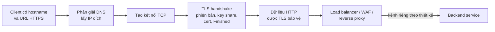
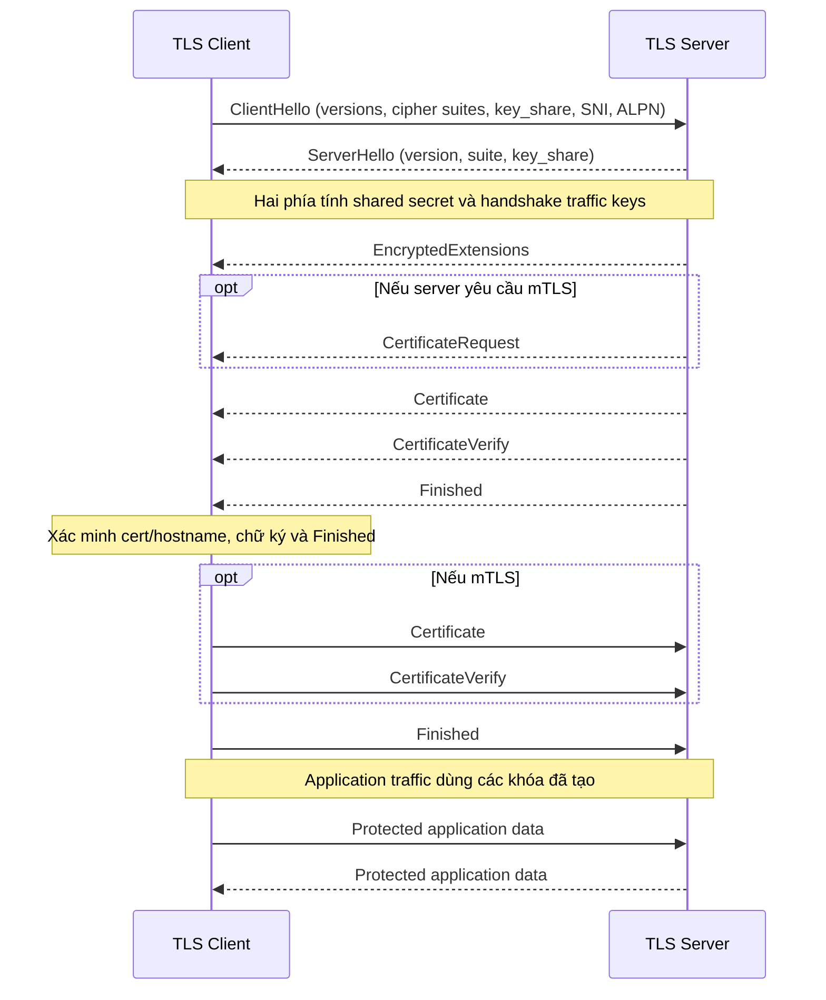
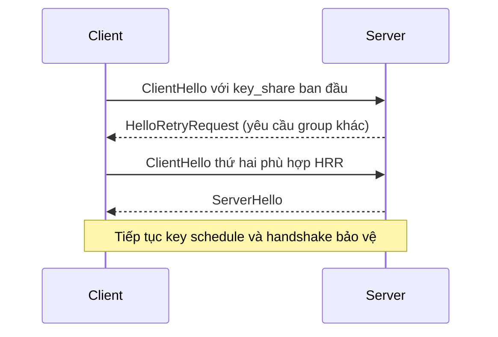
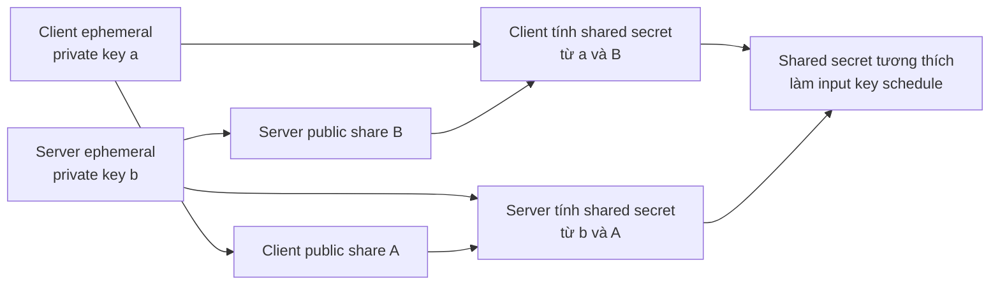
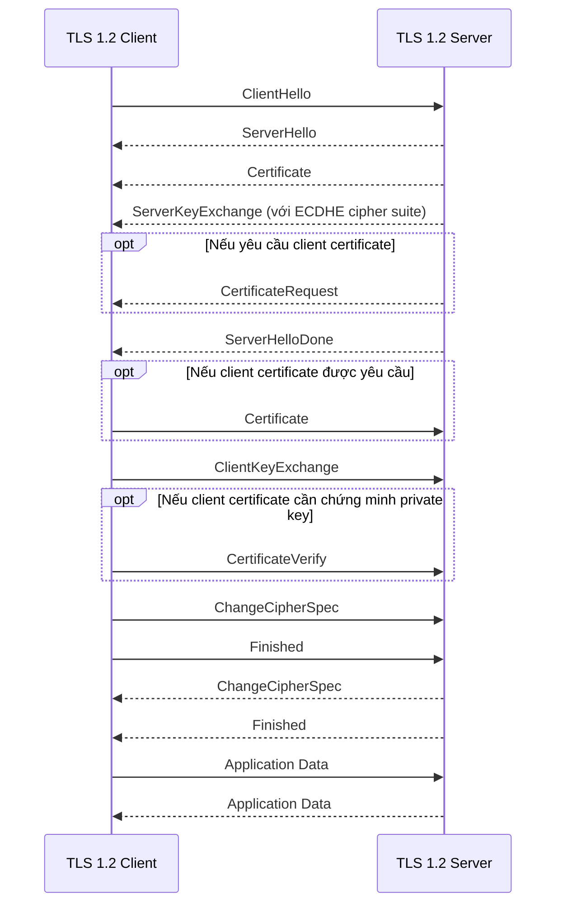
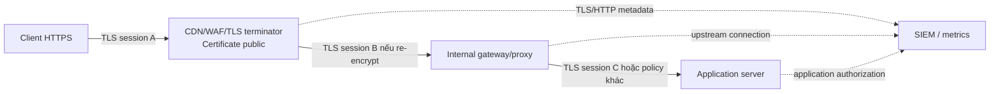

# TLS handshake và quá trình thương lượng

**TLS (Transport Layer Security)** là giao thức bảo mật kênh truyền giúp hai đầu kết nối thương lượng tham số, thiết lập khóa phiên, xác thực bên tương ứng theo mô hình tin cậy và bảo vệ dữ liệu khi truyền qua mạng. Phần quan trọng nhất để hiểu TLS là **handshake**: cuộc trao đổi diễn ra trước khi hai bên chuyển dữ liệu ứng dụng được bảo vệ bằng các khóa đã thống nhất.

Trong mô-đun **SECURITY_NETWORK_SECURITY**, hiểu TLS handshake là nền tảng để bảo vệ truy cập HTTPS, API, VPN hoặc kênh quản trị, kết hợp firewall/NGFW, phân đoạn mạng, IDS/IPS, WAF, bảo vệ DNS, kiến trúc cloud và giám sát xâm nhập. Một dịch vụ có thể “dùng HTTPS” nhưng vẫn không đạt yêu cầu nếu client **không kiểm tra đúng danh tính server**, tin nhầm chứng chỉ, chấp nhận phiên bản yếu hoặc có đoạn truyền dữ liệu không được bảo vệ phía sau reverse proxy.

Bài học tập trung vào **TLS 1.3** — mô hình handshake hiện đại thường được ưu tiên — và đối chiếu **TLS 1.2** để giải thích hệ thống cũ, tương thích, giám sát và xử lý sự cố. Các sơ đồ là mô hình khái quát; chúng không thay thế bản đặc tả giao thức và không nhất thiết mô tả từng record, packet hoặc extension trong mọi phiên kết nối.

## 1. Mục tiêu học tập

Sau bài học, người học cần có thể:

1. Giải thích vì sao TLS handshake phải thực hiện **thương lượng phiên bản, xác thực peer, thỏa thuận bí mật dùng chung và tạo khóa phiên**.
2. Đọc trình tự chính của **TLS 1.3 full handshake** từ ClientHello đến Finished và application data.
3. Phân biệt **cipher suite, key exchange group, signature algorithm, certificate, SNI và ALPN**.
4. Hiểu cách sử dụng **ECDHE và HKDF** tạo khóa, cùng ý nghĩa của transcript integrity và Perfect Forward Secrecy (PFS).
5. So sánh handshake TLS 1.3 và TLS 1.2, đặc biệt ở số lượt trao đổi, cơ chế chứng thực và các lựa chọn mật mã.
6. Giải thích **session resumption, PSK, 0-RTT early data** và rủi ro replay.
7. Phân biệt xác thực server với **mutual TLS (mTLS)** và kiểm soát quyền ở ứng dụng.
8. Chẩn đoán lỗi phiên bản, chứng chỉ, SNI, ALPN, thời gian, CA trust, proxy và firewall.
9. Kiểm tra đường đi có nhiều điểm **TLS termination/re-encryption** và xây dựng ma trận kiểm thử phòng thủ.

## 2. TLS bảo vệ điều gì, không bảo vệ điều gì?

TLS vận hành phía trên một transport được hỗ trợ; HTTPS truyền thống dùng **HTTP qua TLS qua TCP**, còn **HTTP/3 qua QUIC** tích hợp cơ chế handshake TLS 1.3 theo cách khác với TLS record layer trên TCP.

Ba thuộc tính an ninh thường mong muốn:

- **Confidentiality (bí mật):** dữ liệu ứng dụng được mã hóa để bên quan sát đường truyền không đọc được nội dung.
- **Integrity (toàn vẹn):** đối tượng can thiệp trên đường đi không thể thay đổi nội dung được bảo vệ mà không bị phát hiện với xác suất đáng kể theo mức an toàn của thuật toán.
- **Authentication (xác thực):** client xác minh mình đang nói chuyện với server phù hợp với danh tính mong đợi; trong **mTLS**, server cũng xác minh chứng chỉ client khi được cấu hình.

TLS **không tự** bảo vệ:

- Máy client hoặc máy server bị chiếm quyền, mã độc đọc dữ liệu trước/sau mã hóa.
- Phân quyền sai bên trong API, lộ dữ liệu qua ứng dụng hoặc SQL injection.
- Dữ liệu sau khi bị giải mã tại load balancer/proxy và được gửi tiếp qua chặng không an toàn.
- Metadata hoàn toàn: địa chỉ IP, thời điểm, kích thước, lưu lượng và một số thông tin handshake vẫn có thể quan sát tùy giao thức/cơ chế.
- Từ chối dịch vụ do đường truyền, CPU mã hóa, lượng kết nối hoặc quota bị quá tải.
- Sai DNS/định tuyến nếu ứng dụng **bỏ qua** xác minh tên và chuỗi chứng chỉ.

**Kết nối có mã hóa khác với kết nối đã được xác thực danh tính đúng.** Một client chấp nhận bất kỳ chứng chỉ nào sẽ làm mất một phần quan trọng của mục tiêu an ninh TLS.

## 3. Bức tranh tổng thể: từ TCP đến dữ liệu HTTPS



Trong một kết nối HTTPS qua TCP thường có trình tự:

1. Client biết hostname đích và xác định endpoint bằng DNS/cấu hình.
2. Client và endpoint thiết lập **TCP connection** nếu dùng HTTPS qua TCP.
3. Hai phía thực hiện **TLS handshake**, lựa chọn cấu hình và xác minh danh tính.
4. Sau khi các điều kiện thành công, ứng dụng trao đổi HTTP **được mã hóa qua TLS**.
5. Nếu có proxy kết thúc TLS, proxy giải mã traffic rồi thực hiện chính sách và có thể **mở TLS khác tới backend**.

Trong **QUIC/HTTP/3**, bước TCP không tồn tại và TLS handshake được mang trong cấu trúc QUIC; không áp nguyên sơ đồ TCP/TLS record cho QUIC.

### 3.1. Những khái niệm cần phân biệt

| Khái niệm | Vai trò |
| --- | --- |
| **TLS version** | Bộ quy tắc giao thức, ví dụ TLS 1.3 hoặc 1.2 |
| **Cipher suite** | Trong TLS 1.3, chủ yếu chọn thuật toán AEAD và hash liên quan |
| **Key exchange group** | Nhóm dùng để tạo bí mật chung, thường (EC)DHE |
| **Signature algorithm** | Cơ chế ký/xác minh danh tính qua chứng chỉ |
| **Certificate chain** | Chứng minh danh tính theo mô hình PKI và tin cậy đã cấu hình |
| **SNI** | Client báo hostname mong muốn để server chọn virtual host/chứng chỉ phù hợp |
| **ALPN** | Thỏa thuận giao thức ứng dụng như HTTP/1.1 hoặc HTTP/2 |
| **Session keys** | Khóa đối xứng bảo vệ dữ liệu/record sau khi tạo từ handshake |
| **TLS record** | Đơn vị bảo vệ thông tin trong TLS qua transport như TCP |
| **Finished** | Thông điệp xác nhận transcript/khóa handshake tương ứng |

## 4. TLS 1.3 full handshake: trình tự chuẩn ở mức khái niệm

Đây là luồng full handshake thông thường, khi client xác thực server bằng chứng chỉ và hai phía dùng key exchange phù hợp.



Điểm khác quan trọng của TLS 1.3: sau **ServerHello**, các thông điệp như **EncryptedExtensions, Certificate và Finished** thông thường được bảo vệ bằng **handshake traffic keys**. Bản thân ClientHello/ServerHello vẫn có các trường cần truyền trước khi tạo được khóa. Nếu client không chấp nhận chứng chỉ hoặc Finished thì **không được xem kết nối đã xác thực thành công**, dù đã từng nhận được vài thông điệp handshake.

### 4.1. Phân chia ba giai đoạn

| Giai đoạn | Thông điệp chính | Câu hỏi an ninh |
| --- | --- | --- |
| **Thương lượng** | ClientHello và ServerHello | Phiên bản, nhóm, cipher và các lựa chọn có tương thích không? |
| **Xác thực/thiết lập khóa** | EncryptedExtensions, Certificate, CertificateVerify, Finished | Có tin danh tính server? Hai bên có cùng transcript và khóa? |
| **Chuyển dữ liệu** | Application Data | Dữ liệu được bảo vệ bằng session keys nào, tới endpoint nào? |

**Handshake không tương đương TCP three-way handshake.** TCP xác định một phiên vận chuyển; TLS bổ sung thiết lập bảo mật. Một TCP connection có thể tồn tại nhưng TLS handshake thất bại, và một TLS handshake có thể thành công trong khi request HTTP bị ứng dụng từ chối.

## 5. ClientHello: client đề xuất khả năng gì?

**ClientHello** là thông điệp quan trọng để server biết client hỗ trợ những lựa chọn nào. Nó có thể chứa:

- **supported_versions:** các phiên bản TLS client cho phép thương lượng, ví dụ TLS 1.3 và đôi khi TLS 1.2.
- **cipher_suites:** danh sách cipher suite được hỗ trợ.
- **supported_groups:** những nhóm key exchange mà client hỗ trợ.
- **key_share:** dữ liệu key agreement ban đầu cho một hoặc nhiều nhóm phù hợp.
- **signature_algorithms:** những thuật toán chữ ký client có thể chấp nhận trong ngữ cảnh tương ứng.
- **server_name (SNI):** hostname mà client muốn kết nối, khi được sử dụng.
- **application_layer_protocol_negotiation (ALPN):** các giao thức ứng dụng client đề xuất.
- **pre_shared_key / psk_key_exchange_modes:** khi client muốn session resumption/PSK.
- Những extension khác liên quan policy, tương thích và khả năng triển khai.

**Không phải mọi ClientHello đều có tất cả trường**: client, protocol version và trường hợp sử dụng quyết định danh sách thực tế. Những extension không được hỗ trợ không nhất thiết đồng nghĩa kết nối nguy hiểm.

### 5.1. Ví dụ danh sách thương lượng

```text
ClientHello (minh họa, không phải wire format):
  supported_versions:
    - TLS 1.3
    - TLS 1.2
  cipher_suites:
    - TLS_AES_128_GCM_SHA256
    - TLS_AES_256_GCM_SHA384
    - TLS_CHACHA20_POLY1305_SHA256
  supported_groups:
    - x25519
    - secp256r1
  key_share:
    - x25519: <public key share>
  signature_algorithms:
    - rsa_pss_rsae_sha256
    - ecdsa_secp256r1_sha256
  server_name:
    - api.example.net
  alpn_protocols:
    - h2
    - http/1.1
```

Các tên chỉ là lựa chọn minh họa hợp lệ theo cơ chế tương ứng, không nói rằng mọi client/OS phải gửi cùng thứ tự hoặc cùng bộ thuật toán. Dữ liệu **public key share** không phải private key và không có nghĩa khóa phiên được gửi lộ trên mạng.

### 5.2. Phiên bản trong legacy fields

TLS 1.3 vẫn có một số trường và cấu trúc giữ tên/giá trị tương thích với TLS cũ. Ví dụ trường **legacy_version** có thể mang giá trị khiến người quan sát nhầm thành TLS 1.2, trong khi phiên bản TLS 1.3 được xác định qua **supported_versions**.

Vì vậy:

- Không suy phiên bản phiên chỉ từ một byte của **ClientHello legacy_version**.
- Phải đọc **ServerHello supported_versions** và kết quả thương lượng phù hợp.
- Với TLS 1.3, một số **ChangeCipherSpec** có thể xuất hiện để tương thích middlebox, không mang cùng ý nghĩa chuyển trạng thái như TLS 1.2.

### 5.3. GREASE và độ bền của parser

Một số TLS implementations dùng **GREASE** để đưa giá trị được dành cho khả năng mở rộng vào các danh sách, giúp phát hiện thiết bị trung gian/parser quá cứng nhắc. WAF, IDS/IPS hoặc middlebox không nên coi một giá trị extension lạ là chắc chắn độc hại hoặc làm rơi toàn bộ handshake nếu tiêu chuẩn yêu cầu bỏ qua.

Khi log TLS negotiation lỗi sau cập nhật client/browser, cần xét **middlebox compatibility**, không chỉ tập trung vào server certificate.

## 6. ServerHello: hai bên chốt những tham số nào?

Nếu server chấp nhận đề xuất, nó gửi **ServerHello** với các lựa chọn được thương lượng, trong đó gồm:

- Phiên bản giao thức được chọn (ở TLS 1.3 qua **supported_versions**).
- **Cipher suite** được chọn từ danh sách tương thích.
- **Key share** tương ứng khi dùng (EC)DHE.
- Các dữ liệu handshake cần thiết để hai phía tạo shared secrets.
- Thông tin lựa chọn PSK nếu phiên đang đi theo nhánh PSK/resumption phù hợp.

Không nên coi server được phép chọn **tùy ý bất kỳ thuật toán nào**: giá trị phải hợp lệ theo giao thức và chính sách tương thích với client. Nếu không tìm được cấu hình chung, quá trình có thể thất bại và tạo **TLS alert**.

### 6.1. HelloRetryRequest

Nếu server cần client cung cấp một key share thuộc nhóm khác được hỗ trợ, TLS 1.3 có cơ chế **HelloRetryRequest (HRR)**. Dù được biểu diễn qua cấu trúc liên quan ServerHello, nó có ý nghĩa yêu cầu client **gửi ClientHello thứ hai** phù hợp.



HRR **không nhất thiết là tấn công**: nó có thể xảy ra do khác biệt nhóm key exchange hoặc policy. Tuy nhiên, một lượng HRR bất thường sau thay đổi cấu hình cũng là dữ liệu cần điều tra vì ảnh hưởng độ trễ và khả năng tương thích.

### 6.2. Downgrade và fallback

Client/server nên ưu tiên phiên bản đáp ứng policy. Một thiết bị trung gian hoặc client lỗi có thể dẫn đến việc chọn phiên bản thấp hơn mong muốn. TLS có các cơ chế chống **version downgrade**; trong một số kịch bản tương thích còn gặp **TLS_FALLBACK_SCSV** của TLS cũ.

Trong vận hành, không chỉ ghi “kết nối thành công”: phải ghi **phiên bản thực tế đã chọn**. Nếu policy yêu cầu tối thiểu TLS 1.2 nhưng phiên thực tế dùng TLS 1.0, đó là dấu hiệu cấu hình sai nghiêm trọng, bất kể người dùng thấy trang đã mở được.

## 7. Cipher suite, key exchange group và chữ ký là ba lựa chọn khác nhau

Ở TLS 1.3, một tên cipher suite như **TLS_AES_128_GCM_SHA256** chủ yếu chỉ rõ:

- **AEAD algorithm**, ví dụ AES-128-GCM.
- **Hash** dùng trong key schedule/transcript, ví dụ SHA-256.

Nhóm **x25519/secp256r1** cho (EC)DHE và thuật toán **RSA-PSS/ECDSA** dùng ký chứng chỉ hoặc CertificateVerify được thương lượng/xác định **riêng**. Không đọc tên cipher suite TLS 1.3 rồi suy ra nó đã xác nhận dùng RSA, ECDSA hay nhóm ECDHE nào.

| Thành phần | Ví dụ | Mục đích |
| --- | --- | --- |
| TLS version | TLS 1.3 | Quy tắc giao thức |
| AEAD / cipher suite | TLS_AES_128_GCM_SHA256 | Bảo vệ dữ liệu và hash liên quan |
| Group / key share | x25519, secp256r1 | Tính bí mật chung bằng ECDHE |
| Signature scheme | rsa_pss_rsae_sha256, ecdsa_secp256r1_sha256 | Xác minh chữ ký liên quan danh tính |
| Certificate identity | api.example.net trong SAN | So khớp server với hostname mong đợi |
| ALPN | h2 | Giao thức ứng dụng chạy sau TLS |

### 7.1. Tại sao cần thuật toán AEAD?

**AEAD (Authenticated Encryption with Associated Data)** cung cấp cả mã hóa và kiểm tra toàn vẹn thông điệp khi sử dụng đúng với key/nonce và ngữ cảnh. TLS 1.3 dùng các cipher suite kiểu AEAD được chuẩn hóa; đây là khác biệt quan trọng với nhiều lựa chọn TLS 1.2 cũ, chẳng hạn các mode CBC với cơ chế MAC riêng.

Không tự thiết kế AES mode hoặc ghép thuật toán trong ứng dụng để “làm TLS tốt hơn”. Hãy để **TLS stack được duy trì** thực hiện key schedule, nonce, record sequence và kiểm tra integrity.

## 8. ECDHE, shared secret và Perfect Forward Secrecy

**Ephemeral Diffie–Hellman (DHE/ECDHE)** cho hai phía tính toán một **shared secret** mà không gửi trực tiếp bí mật đó trên mạng. Mỗi phía dùng private key tạm thời và public key share tương ứng. Kẻ quan sát chỉ thấy các public values, không thể dễ dàng suy ra shared secret nếu giả định mật mã đúng.

Sơ đồ khái niệm:



Đây chỉ là sơ đồ logic, không biểu diễn công thức toán học ECDH hay trường hợp dùng PSK. Kết quả ECDHE là **vật liệu bí mật đầu vào**, không dùng trực tiếp làm toàn bộ khóa traffic.

### 8.1. Forward secrecy là gì?

Với full handshake TLS 1.3 dùng **(EC)DHE ephemeral** và cấu hình chuẩn, việc kẻ tấn công lấy được **private key dài hạn của certificate server trong tương lai** không mặc nhiên giải mã được các phiên TLS đã ghi lại trước đó. Đó là ý tưởng **forward secrecy**.

Cần phân biệt:

- Private key chứng chỉ phục vụ **xác thực danh tính**, không thường dùng giải mã trực tiếp từng record.
- Ephemeral private keys phục vụ thỏa thuận shared secret.
- Traffic keys được tạo cho phiên hoặc từng giai đoạn, có thể cập nhật khi cần.
- Nếu **endpoint bị kiểm soát ngay lúc phiên hoạt động** hoặc traffic keys bị lộ, forward secrecy không tự ngăn dữ liệu bị đọc.
- Với một số chế độ **PSK-only không có (EC)DHE**, tính chất forward secrecy có thể không giống handshake dùng (EC)DHE.

## 9. TLS 1.3 key schedule: nhiều khóa, nhiều mục đích

TLS 1.3 dùng **HKDF** để trích xuất/mở rộng các bí mật thành những traffic secrets và keys theo giai đoạn. Nó không lấy trực tiếp một giá trị “mật khẩu TLS” rồi dùng cho cả handshake và application data.

Một cách nhìn đơn giản:

```text
PSK (nếu có) / giá trị đầu vào thích hợp
        |
     Early Secret
        |
(EC)DHE shared secret khi dùng
        |
    Handshake Secret
        |
   Client/Server Handshake Traffic Secrets
        |
     Master Secret
        |
Client/Server Application Traffic Secrets
        |
     Khóa và IV cho TLS record encryption
```

Đây là mô tả khái quát **bỏ qua các nhánh, nhãn HKDF, transcript hashes, giá trị zero và chi tiết derive-secret**. Phải tham chiếu thuật toán chuẩn khi triển khai TLS stack; không dùng sơ đồ này để tự viết key schedule.

### 9.1. Tại sao client và server có secrets theo chiều khác nhau?

Traffic theo chiều client → server và server → client được bảo vệ bằng **traffic keys tương ứng từng chiều**, được tạo từ dữ liệu handshake và key schedule. Điều này giúp tách ngữ cảnh mã hóa/giải mã. Khi TLS 1.3 dùng **KeyUpdate**, traffic keys có thể được cập nhật theo cơ chế của giao thức mà không phải thương lượng lại toàn bộ handshake từ đầu.

### 9.2. Transcript hash và Finished

**Handshake transcript** đại diện cho chuỗi thông điệp handshake phù hợp. Cơ chế CertificateVerify và Finished ràng buộc các bằng chứng xác thực và việc đồng thuận khóa vào **nội dung thương lượng đã diễn ra**.

**Finished** sử dụng giá trị xác thực dựa trên secret và transcript phù hợp. Nếu transcript bị thay đổi không hợp lệ, kiểm tra Finished hoặc kiểm tra chữ ký có thể thất bại. Đó là một phần quan trọng của **bảo vệ toàn vẹn quá trình thương lượng**, không chỉ của dữ liệu ứng dụng.

## 10. EncryptedExtensions, Certificate và CertificateVerify

Sau ServerHello của TLS 1.3, server thường gửi các thông điệp tiếp theo dưới khóa handshake.

### 10.1. EncryptedExtensions

Thông điệp **EncryptedExtensions** mang các extension liên quan kết quả handshake/ngữ cảnh phiên, chẳng hạn lựa chọn **ALPN** trong mô hình phù hợp. Đây không phải một chứng chỉ và **không tự chứng minh danh tính server**.

### 10.2. Certificate

Nếu server xác thực bằng chứng chỉ, nó gửi **Certificate** chứa certificate chain phù hợp. Client cần xác minh theo **trust policy**, không chỉ đọc chuỗi CN hay thấy certificate tồn tại.

### 10.3. CertificateVerify

**CertificateVerify** chứa chữ ký chứng minh phía gửi có quyền sử dụng private key gắn với chứng chỉ tương ứng trong transcript handshake, theo quy tắc TLS. Điều này giúp chống việc ai đó chỉ **sao chép certificate công khai** rồi giả là chủ sở hữu private key.

### 10.4. Finished

Sau các bước cần thiết, **Finished** cung cấp xác nhận toàn vẹn handshake. Client kiểm tra dữ liệu này cùng chứng chỉ/hostname và policy. Nếu một bước thất bại, phiên không được tiếp tục như đã xác thực.

| Thông điệp | Câu hỏi cần trả lời | Không nên nhầm với |
| --- | --- | --- |
| **EncryptedExtensions** | Extension nào của handshake được áp dụng? | Không phải xác thực server |
| **Certificate** | Certificate chain nào được trình bày? | Không phải chứng minh riêng việc sở hữu private key |
| **CertificateVerify** | Bên kia có chứng minh quyền dùng private key phù hợp? | Không thay thế kiểm tra hostname/CA |
| **Finished** | Hai phía có nhất quán về transcript và handshake secrets? | Không phải kiểm tra phân quyền của ứng dụng |
| **Application Data** | Dữ liệu sau handshake được gửi ra sao? | Không tự chứng minh nội dung nghiệp vụ an toàn |

## 11. Xác thực chứng chỉ server: đúng tên, đúng chuỗi, đúng thời gian

**Certificate validation** quyết định liệu client có thể tin danh tính peer mà nó đang kết nối hay không. Với HTTPS, client thường phải xác minh:

1. **Hostname / service identity:** tên được yêu cầu có khớp một định danh được cho phép trong **Subject Alternative Name (SAN)** của chứng chỉ?
2. **Trust chain:** chuỗi chữ ký có dẫn về trust anchor/CA phù hợp được hệ thống tin?
3. **Validity period:** thời gian hiện tại có nằm trong thời hạn hợp lệ của chứng chỉ?
4. **Key usage / Extended Key Usage:** chứng chỉ phù hợp mục đích TLS server authentication khi policy yêu cầu?
5. **Algorithm/key constraints:** chữ ký/khóa đáp ứng tiêu chuẩn bảo mật của client?
6. **Revocation policy:** client có cơ chế kiểm tra trạng thái thu hồi theo ứng dụng/nền tảng không?
7. **Name constraints và các chính sách PKI khác** khi có hiệu lực.

Chữ ký hợp lệ trên một certificate **không đủ** nếu hostname sai hoặc chain dẫn đến CA không được tin. Cũng không nên tự tin certificate được một “CA nào đó” ký là đúng: client phải có **trust anchor** tương ứng.

### 11.1. Hostname và SAN

Ví dụ client truy cập:

```text
https://api.example.net/v1/orders
```

Certificate có SAN **DNS:api.example.net** là ứng viên phù hợp với tên đó nếu các kiểm tra khác đều thành công. Certificate chỉ có SAN **DNS:admin.example.net** không trở nên hợp lệ cho api.example.net chỉ vì cả hai host cùng một server IP.

Wildcard certificate như **DNS:*.example.net** có quy tắc khớp tên riêng và **không tự bao phủ mọi cấp tên con** hoặc tên gốc example.net. Để an toàn, nên để **TLS library/HTTP client chuẩn** kiểm tra hostname thay vì viết hàm so khớp thủ công bằng cách tìm chuỗi.

### 11.2. Chứng chỉ tự ký và CA nội bộ

Trong hệ thống nội bộ hoặc lab, có thể dùng **private PKI** với CA root được cài vào trust store thiết bị được quản lý. Điều này khác với việc bật tùy chọn **“trust all certificates”**.

- CA nội bộ: có một **trust anchor được phê duyệt** và chính sách cấp chứng chỉ.
- Self-signed leaf certificate không được trust: client thường từ chối theo mặc định.
- Trust-all: bỏ qua cơ chế xác thực danh tính; **không dùng làm cách khắc phục production**.

### 11.3. Revocation, OCSP và CRL

Chứng chỉ có thể bị thu hồi khi private key bị lộ hoặc thay đổi quyền. Một số môi trường sử dụng **OCSP, CRL hoặc OCSP stapling**, nhưng cách trình duyệt/ứng dụng xử lý revocation khác nhau theo sản phẩm và policy; không coi việc **không thấy OCSP stapling** là bằng chứng chắc chắn rằng TLS không an toàn, cũng không giả định mọi client luôn từ chối khi không kết nối được tới OCSP responder.

Hạ tầng cần có **renewal, revocation, monitoring expiry và key rotation**, đặc biệt với certificate ngắn hạn, certificate nội bộ và mTLS.

## 12. SNI và ALPN: chọn đúng website và giao thức ứng dụng

### 12.1. Server Name Indication (SNI)

Một public IP có thể phục vụ nhiều hostname:

```text
203.0.113.10:
  api.example.net     -> Certificate API
  admin.example.net   -> Certificate Admin
  www.example.net     -> Certificate Web
```

**203.0.113.0/24** là dải dành cho tài liệu. Client dùng **SNI** để nêu tên mong muốn, giúp reverse proxy chọn virtual host/certificate. Nếu client không gửi SNI hoặc gửi tên sai, server có thể trả certificate mặc định hoặc từ chối kết nối tùy cấu hình.

SNI truyền thống trong ClientHello **thường quan sát được** trên đường đi; TLS 1.3 mã hóa nhiều thông điệp sau ServerHello nhưng **không mặc nhiên che SNI**.

**Encrypted ClientHello (ECH)** có thể che một phần thông tin ClientHello trong các triển khai hỗ trợ phù hợp, nhưng phụ thuộc client, server, DNS bootstrap và cấu hình. Không coi ECH đã hiện diện ở mọi phiên TLS 1.3.

### 12.2. Application-Layer Protocol Negotiation (ALPN)

ALPN giúp client/server chọn giao thức ứng dụng bên trong kênh bảo mật.

Ví dụ:

- Client đề xuất **h2** và **http/1.1**.
- Server chọn **h2** nếu có hỗ trợ và policy cho phép.
- Kết quả ALPN ảnh hưởng cách ứng dụng diễn giải dữ liệu sau handshake.

**ALPN không quyết định TLS version**, không xác thực hostname, và không tự chứng minh HTTP request được phân quyền. Một kết nối TLS 1.3 thành công nhưng ALPN khác kỳ vọng có thể khiến client dùng giao thức ứng dụng khác hoặc thất bại.

### 12.3. SNI khác HTTP Host/:authority

SNI nằm ở **TLS handshake** và thường hỗ trợ chọn certificate/virtual host. **HTTP Host** (hoặc **:authority** trong HTTP/2/HTTP/3) là dữ liệu ở lớp HTTP.

Chúng có liên hệ nhưng **không phải cùng một trường**. Reverse proxy/API gateway cần cấu hình chính sách nhất quán để tránh routing sai hoặc xử lý bất thường khi tên TLS và tên HTTP không phù hợp theo thiết kế.

## 13. TLS 1.2 handshake: cần biết để vận hành hệ thống cũ

**TLS 1.2** vẫn xuất hiện trong các môi trường phải duy trì tương thích, nhưng cách thương lượng khác TLS 1.3. TLS 1.2 cipher suite thường kết hợp **key exchange/authentication, bulk encryption và MAC/hash** trong tên suite, trong khi TLS 1.3 tách group và signature scheme ra ngoài tên cipher suite.

### 13.1. Luồng TLS 1.2 thường gặp với ECDHE và chứng chỉ server



Đây là một trường hợp đại diện; TLS 1.2 có nhiều lựa chọn key exchange và extension, các nhánh thực tế có thể khác. **CertificateVerify** của client là có điều kiện, không có nghĩa server luôn gửi thông điệp này như TLS 1.3.

### 13.2. Các khác biệt quan trọng

| Chủ đề | TLS 1.2 | TLS 1.3 |
| --- | --- | --- |
| Full handshake truyền thống | Nhiều trao đổi hơn trước khi hoàn tất | Có thể hoàn thành full handshake theo **1-RTT** trong trường hợp điển hình |
| Cipher suite | Thường gắn nhiều lựa chọn key exchange/auth/cipher/MAC | Chủ yếu chọn AEAD/hash; group và signature riêng |
| Mật mã phiên | Có cả các lựa chọn cũ tùy stack | Các lựa chọn AEAD hiện đại |
| Certificate server | Truyền trước khi có bảo vệ record sau ServerHello trong full handshake điển hình | Thường nằm trong phần handshake được mã hóa |
| RSA key transport | Từng có thể dùng ở một số cipher suite | **Không có** cơ chế RSA key transport của TLS 1.2 |
| Forward secrecy | Phụ thuộc cipher suite như ECDHE/DHE | Full handshake thông thường dùng (EC)DHE; xét riêng PSK modes |
| Renegotiation | Có cơ chế legacy | Không hỗ trợ renegotiation kiểu TLS 1.2 |
| Resumption | Session ID/ticket theo cơ chế TLS 1.2 | PSK/session ticket và key schedule TLS 1.3 |
| 0-RTT early data | Không theo cơ chế TLS 1.3 | Có thể có khi resumption được cấu hình và client/server hỗ trợ |

### 13.3. Không tự mở rộng phiên bản yếu để chữa lỗi client

Nếu thiết bị legacy chỉ hỗ trợ **TLS 1.0/1.1** hoặc cipher yếu, không nên bật lại trên toàn hệ thống chỉ để thiết bị hoạt động. Cần **nâng cấp, thay thế hoặc cách ly**, đánh giá nhu cầu thực, giới hạn endpoint/đường truy cập và có kế hoạch loại bỏ ngoại lệ.

Bảo mật TLS là một **quyết định policy và lifecycle**, không phải chọn một bộ cipher cố định rồi không bao giờ cập nhật.

## 14. Session resumption, PSK và 0-RTT

**Session resumption** giúp client/server tái sử dụng thông tin được thiết lập trong phiên trước để giảm chi phí hoặc độ trễ handshake, theo cơ chế của từng TLS version.

Trong TLS 1.3, server có thể gửi **NewSessionTicket** sau handshake để client dùng làm cơ sở cho phiên resumption với **PSK** phù hợp. Việc có thể resume phụ thuộc ticket, lifetime, server configuration, policy, key rotation và khả năng hai phía.

### 14.1. Resumption không đồng nghĩa bỏ qua bảo mật

- Client vẫn cần tin cậy phiên gốc và bảo vệ session ticket/PSK liên quan.
- Server phải kiểm tra ticket và các điều kiện resumption.
- Các khóa traffic mới được tạo theo **TLS 1.3 key schedule**.
- Có thể kết hợp **PSK và (EC)DHE**; mức forward secrecy cần xét chế độ cụ thể.
- Việc mTLS hoặc danh tính client có được kế thừa/đánh giá lại phụ thuộc chính sách triển khai; không mặc định resumption tự lặp toàn bộ cơ chế xác thực.
- Quản lý ticket encryption keys và vô hiệu phiên cũ khi có sự cố là một phần của vận hành.

### 14.2. 0-RTT early data có nguy cơ replay

**0-RTT** cho phép client đã có thông tin resumption gửi một phần dữ liệu sớm trong lúc khởi tạo kết nối mới, giảm độ trễ trong một số tình huống. Nhưng early data **không có cùng bảo đảm chống replay như dữ liệu sau khi handshake hoàn tất**.

Ví dụ: nếu một yêu cầu thanh toán hoặc cấp quyền được xử lý bằng early data mà không có bảo vệ chống lặp phù hợp, việc phát lại dữ liệu có thể gây hành vi ngoài ý muốn.

Do đó:

- **Không mặc định bật 0-RTT cho endpoint thay đổi trạng thái** hoặc thao tác nhạy cảm.
- Với ứng dụng HTTP, chỉ xem xét early data cho thao tác **an toàn với replay theo nghĩa nghiệp vụ**, kèm chính sách server/proxy rõ.
- **Idempotency** không luôn đồng nghĩa hoàn toàn vô hại khi replay; cần xét side effects như log, quota, gửi email, giao dịch.
- Server/gateway có thể **từ chối early data** và yêu cầu client gửi lại sau handshake bình thường, theo giao thức và ứng dụng.
- Cơ chế anti-replay của hạ tầng nhiều node phải xét synchronization, ticket lifetime và cách traffic được phân phối.

### 14.3. So sánh ba kiểu kết nối

| Tình huống | Mục tiêu | Rủi ro chính |
| --- | --- | --- |
| **Full TLS 1.3 handshake** | Xác thực và tạo secrets mới theo quy trình chuẩn | CPU, certificate/CA, policy mismatch |
| **PSK resumption** | Rút ngắn một số công việc đã làm ở phiên trước | Ticket/key lifecycle, stale session auth assumptions |
| **0-RTT early data** | Gửi dữ liệu sớm trước khi hoàn tất handshake | **Replay** và xử lý nghiệp vụ trước khi xác thực phiên mới hoàn toàn |

## 15. Mutual TLS (mTLS): cả hai phía dùng chứng chỉ

Với HTTPS phổ biến, **client xác thực server bằng certificate**; người dùng có thể đăng nhập bằng cookie/OIDC/token ở tầng ứng dụng. **Mutual TLS (mTLS)** bổ sung bước **server yêu cầu và kiểm tra chứng chỉ client**, thường dùng trong service-to-service, máy quản trị, API B2B hoặc service mesh.

Trong TLS 1.3, server có thể gửi **CertificateRequest** trong quá trình handshake để yêu cầu client certificate. Client gửi **Certificate** và **CertificateVerify** khi phù hợp, sau đó Finished theo trình tự giao thức.

### 15.1. Những gì mTLS xác minh

- Peer trình bày chứng chỉ client và chứng minh quyền dùng private key phù hợp.
- Server kiểm tra CA/trust store, validity, EKU/key usage, identity phù hợp và policy thu hồi khi được áp dụng.
- Danh tính chứng chỉ có thể ánh xạ tới service account, workload, thiết bị hoặc tổ chức đối tác.

**mTLS không tự cấp quyền nghiệp vụ.** Service được xác thực vẫn phải được kiểm tra **đúng resource, action, tenant hoặc API scope**. Một certificate hợp lệ của service A không có nghĩa service A được đọc mọi dữ liệu của service B.

### 15.2. mTLS trong service mesh

Một service mesh có thể tự triển khai và xoay vòng workload certificates thông qua proxy/sidecar hoặc các thành phần tương đương. Tác dụng là tạo **identity và kênh mã hóa giữa workloads**, nhưng phải kiểm tra:

- Control plane/CA nào cấp danh tính.
- Policy ở proxy cho phép service nào nói chuyện với service nào.
- Endpoint nào có **bypass path** đi thẳng tới backend không qua proxy.
- Chứng chỉ/key rotation, clock skew và sự cố trust bundle.
- Lượng traffic đi **ngoài mesh**, các hệ thống legacy hoặc batch job.
- Traffic được mã hóa giữa proxies không tự thay thế application-level AuthZ.

## 16. TLS termination, re-encryption và WAF/IDS/IPS

Trong doanh nghiệp, TLS thường được kết thúc ở **CDN, WAF, load balancer, reverse proxy hoặc API gateway**. Điểm termination có khả năng đọc và kiểm tra HTTP sau khi giải mã, rồi chuyển tiếp đến backend theo một đường khác.



### 16.1. HTTPS ngoài Internet không bảo đảm mọi chặng được mã hóa

- **Client → Edge:** TLS được xác thực bằng chứng chỉ public/enterprise policy.
- **Edge → Backend:** có thể dùng TLS độc lập với certificate trust và identity riêng.
- **Backend → DB/queue/service:** lại là các kênh khác, cần policy tương ứng.

Nếu edge giải mã rồi gửi **HTTP plaintext** tới backend, đoạn đó không còn được TLS bảo vệ. Trong một số vùng cô lập có đánh giá rủi ro, plaintext nội bộ có thể là lựa chọn thiết kế được chấp nhận; không được mô tả nó là end-to-end TLS từ client đến app.

### 16.2. TLS inspection và giới hạn quan sát của IDS/IPS

Firewall/WAF không đọc được toàn bộ HTTP body chỉ vì có thể nhìn thấy TCP/443. Cần **TLS termination hoặc TLS inspection hợp lệ tại điểm có quyền giải mã** và khả năng xử lý đúng giao thức.

- Thiết bị passive NDR/IDS có thể thấy **IP, cổng, thời gian, packet sizes và một phần handshake metadata**.
- **TLS 1.3** mã hóa nhiều thông điệp handshake sau ServerHello; một số thuật toán phân loại dựa trên chứng chỉ trong handshake TLS 1.2 không còn áp nguyên xi.
- **ECH** có thể giảm sự hiện diện của hostname thật trong một số traffic hỗ trợ.
- Proxy HTTPS interception thường tạo ra **kết nối TLS riêng với client**, yêu cầu trust model/CA được quản trị đúng và có ảnh hưởng riêng tư/an toàn đáng kể.
- **Certificate pinning** hoặc mTLS end-to-end có thể làm TLS interception không tương thích nếu không được thiết kế trước.

**Không tắt certificate validation trên client để giải quyết tương thích với thiết bị inspection.** Thiết kế kiểm tra traffic phải tôn trọng chính sách và ranh giới tin cậy.

## 17. TLS 1.3 trong QUIC và HTTP/3

**QUIC** sử dụng các thành phần handshake và xác thực của **TLS 1.3** nhưng **không dùng TLS record layer kiểu TCP**. TLS handshake messages được mang trong **QUIC CRYPTO frames**, và QUIC kết hợp kết quả key schedule vào bảo vệ packet của riêng nó.

So sánh:

| Phần | HTTPS/TCP với TLS | HTTP/3 với QUIC |
| --- | --- | --- |
| Transport | TCP | Thường UDP |
| TLS handshake | TLS handshake messages qua record layer | TLS handshake messages trong QUIC CRYPTO frames |
| Bảo vệ application data | TLS record encryption | QUIC packet protection |
| ALPN | Ví dụ h2, http/1.1 | Ví dụ h3 và các biến thể được hỗ trợ |
| Tên miền/chứng chỉ | SNI và certificate validation | Cũng cần danh tính/certificate validation thích hợp |
| Quan sát packet | TCP/443 thường gặp | UDP/443 thường gặp |
| Phiên bị chặn UDP | Không ảnh hưởng trực tiếp TCP TLS, tùy app | Client có thể dùng fallback nếu được thiết kế |

**Không dùng chỉ số TCP SYN hoặc TLS record capture để kết luận toàn bộ HTTP/3 handshake hoạt động hay không.** Cần telemetry của QUIC endpoint, firewall UDP, transport errors, packet loss và trạng thái kết nối.

### 17.1. 0-RTT trong QUIC

QUIC cũng có cơ chế 0-RTT gắn với TLS 1.3 và dữ liệu resumption. **Nguy cơ replay và yêu cầu an toàn nghiệp vụ** vẫn cần được xử lý; không vì HTTP/3 có hỗ trợ mà bật 0-RTT cho mọi API.

## 18. Các lỗi handshake thường gặp và cách suy luận

Một kết nối TLS có thể thất bại ở nhiều bước. Phải phân biệt **network failure** và **cryptographic/policy failure**.

| Biểu hiện | Giả thuyết | Dữ liệu để kiểm tra |
| --- | --- | --- |
| TCP connection không mở được | DNS, route, firewall, server port, proxy | IP/port, route, SYN/SYN-ACK, firewall logs |
| TCP mở nhưng TLS alert rất sớm | Không chung TLS version, cipher/group, extension | ClientHello/ServerHello và server policy |
| Certificate verify failed | Không tin CA, thiếu intermediate, expired, hostname sai | Chain, SAN, trust anchor, clock |
| Chứng chỉ của hostname khác | SNI thiếu/sai hoặc proxy chọn virtual host mặc định | SNI, proxy virtual host, certificate SAN |
| Client báo unknown_ca | Bên nhận không tin CA, đặc biệt trong mTLS | CA chain/trust bundle, EKU/client cert |
| mTLS handshake fail | Client không có cert, cert sai, key không phù hợp hoặc policy từ chối | CertificateRequest, client store, gateway logs |
| TLS kết nối nhưng HTTP/2 lỗi | ALPN hoặc cấu hình HTTP/2/proxy không tương thích | ALPN negotiated, server/app logs |
| TLS 1.3 không thành công, TLS 1.2 được | Phiên bản/extension/middlebox/algorithm compatibility | Version policy, TLS alerts, network path |
| Kết nối được nhưng tải dữ liệu lớn bị treo | MTU/PMTUD, buffering, app timeout, packet loss | Packet sizes, TCP retransmissions, proxy/app logs |
| Resumption đột ngột giảm | Ticket key rotation/config mismatch, load balancer changes | Full/resumed handshake metrics |
| Handshake hỏng sau đổi certificate | Chain sai, SAN sai, key/cert mismatch, renewal lỗi | Deployment diff, expiry, cert inspection |
| Chỉ một thiết bị lỗi | Clock/trust store, OS TLS stack, proxy/client config | Client logs, version support, endpoint posture |
| Chỉ lỗi sau load balancer | Backend TLS trust/SNI, health checks, mTLS | Upstream SNI/cert validation, proxy logs |

**Một TLS alert code không luôn chỉ đúng một nguyên nhân.** Một số server cố ý trả lỗi chung, và việc hai phiên bản stack log khác nhau là bình thường. Kết luận phải dựa trên **timing, hướng alert, các extension/certificate thực tế và config changes**.

## 19. Công cụ quan sát an toàn: kiểm tra từ client

Chỉ thực hiện trên **tài sản/endpoint bạn sở hữu hoặc được phép kiểm tra**. Các lệnh dưới đây nhằm xác minh cấu hình kết nối, không thử khai thác và không sửa server.

### 19.1. OpenSSL s_client

```bash
# Kết nối tới host được phép, gửi đúng SNI, quan sát handshake/cert
openssl s_client -connect api.example.net:443 \
  -servername api.example.net \
  -verify_hostname api.example.net \
  -verify_return_error

# Yêu cầu TLS 1.3 cho kiểm thử tương thích
openssl s_client -connect api.example.net:443 \
  -servername api.example.net \
  -tls1_3 \
  -verify_hostname api.example.net \
  -verify_return_error

# Yêu cầu TLS 1.2 nếu policy cho phép hỗ trợ phiên bản đó
openssl s_client -connect api.example.net:443 \
  -servername api.example.net \
  -tls1_2 \
  -verify_hostname api.example.net \
  -verify_return_error

# Quan sát kết quả ALPN với một nhóm protocol được hỗ trợ
openssl s_client -connect api.example.net:443 \
  -servername api.example.net \
  -alpn h2,http/1.1 \
  -verify_hostname api.example.net \
  -verify_return_error
```

**Lưu ý:**

- Các tùy chọn có thể khác theo **phiên bản OpenSSL/build**; xác minh khả năng của công cụ trước khi dùng.
- **verify_return_error** kết hợp với kiểm tra hostname giúp lệnh kết thúc với lỗi xác minh khi thích hợp; cần dùng **trust store/CAfile đúng** cho PKI nội bộ.
- Dùng SNI đúng để tránh nhận certificate của virtual host mặc định.
- **Không** dùng tùy chọn bỏ qua xác minh chứng chỉ để chứng minh TLS an toàn.
- Kết quả TLS 1.2 thành công không có nghĩa policy nên bật TLS 1.2 với mọi dịch vụ; nó chỉ nói về khả năng tương thích tại endpoint đang thử.
- Có proxy, WAF hoặc load balancer, công cụ có thể chỉ quan sát **TLS endpoint gần client**, không phải certificate backend.

### 19.2. curl để kiểm tra HTTPS và ALPN

```bash
# Chỉ xem thông tin kết nối và HTTP headers
curl -I -v https://api.example.net/

# Yêu cầu tối thiểu TLS 1.3 trên curl/build có hỗ trợ
curl -I -v --tlsv1.3 https://api.example.net/

# Cố định cả tối thiểu và tối đa TLS 1.2 để kiểm tra hỗ trợ cũ
curl -I -v --tlsv1.2 --tls-max 1.2 https://api.example.net/

# Buộc HTTP/1.1 để đối chiếu behavior HTTP/2
curl -I -v --http1.1 https://api.example.net/
```

**Không hiểu nhầm --tlsv1.2 là “chỉ TLS 1.2”** trên mọi bản curl: thông thường tùy chọn đặt phiên bản tối thiểu, cần **--tls-max** khi muốn giới hạn tối đa. Thông tin ALPN, certificate và TLS version được hiển thị theo khả năng của curl/TLS backend.

Một số API không hỗ trợ **HEAD**, nên lệnh **-I** có thể trả lỗi HTTP dù TLS handshake thành công. Tách kiểm tra **TLS handshake** khỏi kết quả phương thức HTTP.

### 19.3. Certificate ở thời điểm triển khai

Có thể kiểm tra certificate bằng thông tin từ công cụ quản trị TLS/PKI được phê duyệt:

- Subject/SAN, issuer và chain.
- Thời hạn NotBefore/NotAfter; thời gian hệ thống.
- Key type, key length/curve và signature algorithm.
- Trust anchor của client doanh nghiệp và client public.
- Certificate được edge và backend dùng có giống hoặc khác nhau theo thiết kế không?
- Chủ sở hữu key, quy trình cấp/renew/revoke và cảnh báo hết hạn.
- Kết quả mTLS client certificate khi các điểm yêu cầu.

**Không sao chép private key, PSK hoặc các session secrets vào log hoặc ticket.** Các chuỗi “key share” công khai trong handshake không đồng nghĩa private key an toàn khi lưu tùy tiện các file key từ endpoint.

## 20. Đọc packet capture TLS đúng cách

Wireshark hoặc công cụ phân tích gói có thể giúp xác định:

- TCP session có được thiết lập trước TLS hay không.
- ClientHello với SNI, supported_versions, supported_groups và các extension quan sát được.
- ServerHello, cipher suite và thông tin version được chọn.
- Alert hoặc việc kết nối đóng ở giai đoạn nào.
- Packet loss/retransmission, reset và thời điểm timeout.
- Độ trễ handshake, độ trễ gửi application data.

**TLS 1.3 mã hóa phần lớn handshake sau ServerHello**. Không nhìn thấy certificate ở dạng plaintext trong capture thụ động TLS 1.3 là **hành vi bình thường**, không chứng minh certificate không tồn tại.

### 20.1. Khi nào có thể giải mã traffic để debug?

Một số môi trường lab cho phép thu **session secrets** có kiểm soát để phân tích bằng Wireshark. Đây là **dữ liệu cực nhạy cảm**, có thể khiến nội dung phiên bị giải mã; chỉ làm trong phạm vi thử nghiệm được phê duyệt, theo chính sách bảo vệ dữ liệu, không chia sẻ key log hoặc pcap sản xuất tràn lan.

Ưu tiên **application telemetry, structured logs và trace IDs** để điều tra mà không cần thu toàn bộ nội dung HTTPS.

### 20.2. Không đọc quá mức từ metadata TLS

| Quan sát | Có thể kết luận | Không thể kết luận |
| --- | --- | --- |
| ClientHello nêu SNI | Client muốn dùng hostname đó theo trường SNI | Ứng dụng đã truy cập đúng resource hoặc người dùng có quyền |
| ServerHello chọn TLS 1.3 | Hai bên thương lượng phiên bản đó | Certificate đã được client xác minh thành công |
| ALPN chọn h2 | Giao thức HTTP/2 được thương lượng | Request cụ thể đã được xử lý thành công |
| TLS alert | Có lỗi trong giao thức/policy/thực thi | Nguyên nhân chắc chắn chỉ từ mã alert |
| Dữ liệu TLS application encrypted | Có traffic được bảo vệ qua phiên TLS | Backend không có lỗi, dữ liệu không thể lộ ở endpoint |
| Client không có SNI | Chưa thấy hostname trong trường đó | Không chắc client đang tấn công hoặc không có hostname |
| TLS resumption thành công | Một số thông tin phiên trước được dùng lại hợp lệ | Danh tính và quyền ứng dụng được kiểm tra lại đầy đủ |
| HTTP 403 sau TLS | Server/app từ chối request | TLS handshake thất bại |

## 21. Nguyên tắc hardening TLS trong hệ thống thực

**Hardening** là chọn baseline an toàn phù hợp với dịch vụ, mức nhạy cảm và khả năng client. Một hướng triển khai có kiểm soát gồm:

1. Ưu tiên **TLS 1.3** ở nơi clients và hạ tầng hỗ trợ.
2. Duy trì **TLS 1.2** chỉ khi có nhu cầu tương thích và cipher suites mạnh được phê duyệt.
3. Không chấp nhận **SSLv2/SSLv3, TLS 1.0/1.1** hoặc cipher suites cũ không còn phù hợp trong hệ thống mới.
4. Bảo đảm server certificate chain, **SAN/hostname** và trust anchor được cấu hình đúng.
5. Quản lý certificate **tự động hóa renewal**, thông báo hết hạn và rollback.
6. Hạn chế client certificate trust theo hệ thống/nhóm; tránh root CA quá rộng trong mTLS.
7. Kiểm soát **SNI/ALPN và virtual host** tránh phát nhầm chứng chỉ hoặc route sai.
8. Nếu có termination ở edge, áp **backend TLS/mTLS** khi yêu cầu phân loại dữ liệu, không mặc định chặng sau được bảo vệ.
9. Giới hạn đặc tính resumption/0-RTT theo **rủi ro nghiệp vụ và chính sách replay**.
10. Giám sát handshake failures, unexpected versions, weak crypto, cert expiration, CPU/connection pressure.
11. Kiểm thử cả **client hợp lệ** lẫn **client phải bị từ chối** theo baseline.
12. Xác minh từng sản phẩm/phiên bản cụ thể; không dán mẫu cấu hình của nginx sang Java, Envoy, cloud LB hay firewall mà không dịch chính xác.

### 21.1. Pseudopolicy độc lập nhà cung cấp

```yaml
# Policy mô tả ý định; KHÔNG phải cấu hình TLS server thực thi.
policy_id: TLS-PUBLIC-API
asset: api.example.net
transport_profile: https
tls:
  preferred_version: "1.3"
  allowed_legacy_version_if_approved: "1.2"
  disallow_legacy: ["SSLv2", "SSLv3", "TLS1.0", "TLS1.1"]
  cipher_policy: "modern-aead"
  certificate:
    source: "managed-pki"
    name_validation: required
    renew_before_expiry: true
    chain_monitoring: true
  sni:
    expected_names: ["api.example.net"]
  alpn:
    expected: ["h2", "http/1.1"]
  zero_rtt:
    enabled: false
backend:
  reencrypt: true
  validate_upstream_certificate: true
identity:
  require_mtls: false
observability:
  log_version_cipher_alpn: true
  log_certificate_errors_without_secrets: true
  alert_on_expiry_and_handshake_spike: true
change_control:
  owner: "Platform + Security"
  require_positive_and_negative_tests: true
  rollback: documented
```

Các field là **tên mô tả tự đặt**, không phải cấu hình chính thức của sản phẩm nào. Với TLS 1.2, một policy production cần danh sách cipher thực tế phù hợp hướng dẫn bảo mật và TLS stack đang dùng.

## 22. Hiệu năng, session setup và bảo vệ chống DoS

**TLS handshake** có chi phí CPU và bộ nhớ do xử lý mật mã, xác thực chứng chỉ và quản lý phiên. Một lượng lớn kết nối mới có thể làm bão hòa **TLS terminator, WAF, reverse proxy hoặc load balancer** ngay cả khi ứng dụng phía sau không nhận nhiều request.

Các chỉ số có giá trị:

| Chỉ số | Ý nghĩa |
| --- | --- |
| **New connections/s** | Áp lực tạo socket và trạng thái kết nối |
| **Full TLS handshakes/s** | Mức xử lý mật mã và authentication |
| **Resumed handshakes/s** | Hiệu quả của resumption và ticket policy |
| **Handshake latency p95/p99** | Người dùng chờ kết nối bảo mật bao lâu |
| **Handshake success/error rate** | Khả năng kết nối và sự cố tương thích |
| **TLS version/cipher distribution** | Có client legacy/crypto yếu không |
| **CPU / crypto acceleration** | Điểm bão hòa ở máy chủ/proxy |
| **Connection concurrency / FD count** | Tài nguyên lưu phiên |
| **Backend success/latency** | TLS khỏe nhưng app vẫn lỗi hay không |
| **Network Bps/Pps and drops** | Phân biệt áp lực handshake với volumetric overload |

### 22.1. Các biện pháp giảm áp lực hợp lệ

- Dùng **load balancer/CDN/WAF** với năng lực TLS phù hợp và bảo vệ origin.
- Tối ưu **connection reuse**, keep-alive, HTTP/2/HTTP/3 theo mô hình ứng dụng.
- Sử dụng **resumption** có quản lý khóa/ticket, không bỏ qua xác thực bắt buộc.
- Áp **connection admission/rate policies** dựa trên baseline và tác động tới người dùng hợp lệ.
- Phân tách public TLS terminator và private management interface.
- Có upstream DDoS protection để xử lý lưu lượng quá lớn trước khi đầy băng thông.
- Hạn chế ghi log quá mức trong đỉnh sự cố; vẫn giữ dữ liệu quan trọng cho điều tra.
- Đo tác động **chính sách chặn nhầm** khi nhiều client dùng CGNAT/proxy chung.

**Không dùng “đã từ chối nhiều handshake” làm thước đo duy nhất của thành công.** Phải chứng minh client hợp lệ vẫn hoàn tất TLS và truy cập ứng dụng với SLO chấp nhận được.

## 23. Bốn tình huống vận hành

### 23.1. Case A — Chứng chỉ đúng nhưng client báo hostname mismatch

**Bối cảnh:** ứng dụng ở **api.example.net** sau load balancer. Một client nhận certificate dành cho **admin.example.net**.

**Giả thuyết:** client không gửi SNI, proxy chọn certificate mặc định hoặc cấu hình virtual host sai. Certificate có thể hợp lệ về CA và thời hạn nhưng **không khớp tên service**.

**Bằng chứng:** ClientHello SNI, SAN certificate trả cho endpoint thực, config load balancer, URL yêu cầu và log mapping virtual host.

**Khắc phục:** sửa SNI/virtual host/certificate mapping đúng chính sách và thử lại với hostname validation được bật. Không chấp nhận certificate “gần giống” bằng cách bỏ qua kiểm tra.

### 23.2. Case B — Client legacy không kết nối sau tăng TLS baseline

**Bối cảnh:** dịch vụ vừa tắt TLS 1.0/1.1. Một thiết bị cũ báo lỗi handshake trong khi trình duyệt hiện đại hoạt động.

**Giả thuyết:** TLS version/cipher/group của client không còn tương thích; cũng có thể middlebox cũ xử lý sai extension TLS 1.3.

**Bằng chứng:** supported_versions/cipher/group trong ClientHello có thể quan sát, server policy, TLS alerts, log theo thiết bị và bản phát hành gần đây.

**Khắc phục:** lên kế hoạch nâng cấp/thay thế client; nếu bắt buộc cần ngoại lệ ngắn hạn, tách riêng endpoint/segment, có owner/thời hạn và rủi ro được duyệt. Không bật lại phiên bản yếu trên mọi public API.

### 23.3. Case C — TLS client → WAF khỏe nhưng backend TLS thất bại

**Bối cảnh:** WAF trả 502/503 sau khi client hoàn thành TLS 1.3 với certificate hợp lệ. Người dùng nghĩ TLS toàn hệ thống đã tốt.

**Giả thuyết:** WAF không xác minh được certificate backend, upstream SNI sai, backend yêu cầu mTLS mà proxy không có client cert, hoặc upstream cipher/version không tương thích.

**Bằng chứng:** tách hai phiên **TLS A: client ↔ WAF** và **TLS B: WAF ↔ backend**, xem mỗi phiên có cert, SNI, ALPN, identity và policy khác nhau. Kèm firewall/route/backend logs.

**Khắc phục:** sửa upstream TLS policy/trust/SNI/client credential và xác minh bằng health check/app request có quyền. **Không thay upstream bằng HTTP plaintext chỉ để hết 502** nếu yêu cầu bảo mật bắt buộc mã hóa.

### 23.4. Case D — API thanh toán phát sinh hành động lặp khi bật 0-RTT

**Bối cảnh:** nhóm tối ưu latency bật TLS 1.3 0-RTT cho một proxy cung cấp API xử lý hành động thay đổi trạng thái.

**Rủi ro:** early data có thể bị **replay**, nên ứng dụng phải có chính sách cho phép/không cho phép và idempotency/anti-replay phù hợp. Các thao tác thanh toán, thay quyền, gửi email hoặc tạo giao dịch không nên tiếp nhận early data thiếu bảo vệ.

**Khắc phục:** tắt early data cho các endpoint nhạy cảm, dùng phương án idempotency/transaction và kiểm thử trong lab. Đánh giá lại thiết kế cache/safe methods; không giả định mọi GET đều hoàn toàn không có side effect.

## 24. Ma trận kiểm thử TLS handshake và thương lượng

Các phép thử phải được phê duyệt và không làm gián đoạn production. Tách **test chứng minh điều được phép** và **test chứng minh điều phải bị từ chối**.

| ID | Phép thử | Kết quả mong đợi |
| --- | --- | --- |
| **T01** | Client hỗ trợ TLS 1.3 kết nối HTTPS hợp lệ | Thương lượng phiên bản, xác minh cert, Finished và truy cập app thành công |
| **T02** | Client TLS 1.2 trên endpoint cho phép legacy theo policy | Chỉ dùng cipher suite mạnh được duyệt |
| **T03** | Client TLS 1.0/1.1 vào endpoint hiện đại | Từ chối theo baseline, có telemetry phù hợp |
| **T04** | Hostname đúng trong SAN | Client certificate validation thành công |
| **T05** | Hostname không khớp SAN trong lab | Client không tiếp tục như xác thực thành công |
| **T06** | Chain CA không được tin | Client từ chối, không bật trust-all |
| **T07** | Certificate đã hết hạn hoặc thời gian sai trong lab | Báo lỗi phù hợp, phát hiện qua giám sát |
| **T08** | Server nhiều virtual hosts, SNI khác nhau | Chọn đúng chứng chỉ/route; không lộ default nhầm |
| **T09** | Client đề xuất h2 và http/1.1 | ALPN thương lượng đúng app protocol |
| **T10** | Client đề xuất group không có key share thích hợp | HRR hoặc lỗi có kiểm soát theo stack |
| **T11** | Client và server không có cipher/group chung | Handshake fail rõ, không fallback yếu |
| **T12** | mTLS client có certificate hợp lệ | Server xác thực peer và áp AuthZ resource riêng |
| **T13** | mTLS client thiếu hoặc sai certificate | Bị từ chối theo policy |
| **T14** | Full handshake so với resumed handshake | Theo dõi ticket/PSK và vòng đời an toàn |
| **T15** | API nhạy cảm gửi early data trong lab | Không xử lý 0-RTT ngoài chính sách |
| **T16** | TLS qua WAF rồi TLS tới backend | Cả hai chặng kiểm chứng certificate/hostname đúng |
| **T17** | Backend dùng CA nội bộ | Proxy trust CA đã duyệt, không bỏ xác minh |
| **T18** | HTTP/3 qua QUIC khi được bật | Handshake/ALPN/UDP policy hoạt động đúng |
| **T19** | Dịch vụ IPv6 và IPv4 | Certificate, SNI, ALPN, TLS policy nhất quán theo đích |
| **T20** | Certificate renewal/rotation có kiểm soát | Không gây outage, client dùng chain mới hợp lệ |
| **T21** | Spike traffic hợp lệ và nhiều handshake mới | SLO giữ được, alert rate/CPU chuẩn xác |
| **T22** | Policy rollback một thay đổi không tương thích | Trở về cấu hình đã duyệt mà không mở lỗ hổng cũ |
| **T23** | HTTP trả 401/403 dù TLS thành công | Phân biệt rõ lỗi application AuthN/AuthZ |
| **T24** | Client thay đổi network/proxy và dùng DoH/IPv6 | Đường TLS/identity vẫn xác minh đúng, không chấp nhận host lạ |

Chỉ dùng hostname, tài sản và tài khoản kiểm thử thuộc phạm vi được cấp phép. Không gửi traffic phá hoại hoặc bật các tính năng rủi ro trên production khi chưa có kế hoạch thử/rollback.

## 25. Những hiểu lầm cần tránh

| Hiểu lầm | Vì sao sai | Cách hiểu đúng |
| --- | --- | --- |
| “Dùng HTTPS là server chắc chắn đúng” | Client có thể không verify cert/hostname | Xác minh SAN, CA, validity và trust policy |
| “TLS handshake chính là TCP handshake” | TCP và TLS nằm ở hai tầng khác nhau | TCP connection có thể sống dù TLS fail |
| “TLS 1.3 cipher suite nói cả RSA/ECDHE group” | Group và signature scheme được chọn riêng | Phân tích đầy đủ negotiated parameters |
| “Certificate chứa public key nên đủ xác thực” | Cần proof-of-possession và chain/name validation | CertificateVerify, Finished và certificate checks |
| “Key share gửi trong ClientHello là secret” | Public key share không phải private key | (EC)DHE + key schedule tạo traffic keys |
| “TLS 1.3 che mọi metadata” | IP, packet timing, một số ClientHello vẫn lộ | Hiểu giới hạn visibility và ECH |
| “SNI là HTTP Host header” | Thuộc các tầng/giai đoạn khác nhau | Kiểm soát cả TLS và HTTP routing |
| “ALPN quyết định CA trust” | ALPN chọn app protocol | Certificate validation độc lập |
| “Thấy TLS 1.3 là app có quyền truy cập” | TLS không kiểm tra nghiệp vụ | Phân quyền ở ứng dụng/API |
| “TLS 1.2 luôn mất forward secrecy” | Có ECDHE/DHE cipher suites trong TLS 1.2 | Đánh giá cipher suite/key exchange thực tế |
| “TLS 1.3 0-RTT an toàn như dữ liệu sau Finished” | Early data có replay risk | Giới hạn ở request an toàn với replay |
| “Resumption bỏ qua hoàn toàn bảo mật” | PSK/ticket vẫn gắn với chính sách/key schedule | Quản lý ticket/auth lifecycle đúng |
| “mTLS tự cấp quyền mọi API” | mTLS xác thực peer, không thay AuthZ | Áp role/resource-level policy |
| “WAF đọc được nội dung vì thấy port 443” | Traffic vẫn được mã hóa nếu WAF không terminate/inspect | Xác định TLS placement |
| “TLS public thành công nên backend cũng an toàn” | Có thể chặng sau plaintext/sai cert | Kiểm chứng từng hop |
| “HTTP/3 dùng TLS record qua TCP” | QUIC dùng TLS handshake nhưng record layer riêng | Theo dõi QUIC UDP và packet protection |
| “Tắt verify cho hết lỗi certificate là chấp nhận được” | Mất bảo vệ danh tính, tạo điều kiện MITM | Sửa trust/cert/SNI/hostname thật |
| “TLS alert bất kỳ chứng minh bị tấn công” | Thường do cấu hình/clock/client/network | Tương quan log, protocol và thay đổi |
| “Chặn hết phiên mới giúp DDoS” | Có thể loại cả client hợp lệ | Đo handshake success/SLO, lọc theo rủi ro |

## 26. Checklist vận hành TLS handshake an toàn

- [ ] Danh mục endpoint HTTPS/API/VPN/proxy có owner và mục tiêu bảo mật rõ ràng.
- [ ] Có sơ đồ TLS termination, reverse proxy, backend encryption và mọi chặng truyền nhạy cảm.
- [ ] TLS versions tối thiểu/tối đa đúng baseline, không mở legacy không được phê duyệt.
- [ ] Cipher suites, key exchange groups và signature algorithms đúng chính sách cho mỗi phiên bản.
- [ ] Chứng chỉ có SAN khớp hostname, chain tin cậy, EKU/usage phù hợp, chưa hết hạn.
- [ ] Certificate và key được quản lý qua PKI/secret store, có renewal và revocation procedures.
- [ ] Không bật trust-all certificate hoặc bỏ hostname validation ở client, proxy/backend.
- [ ] ClientHello/ServerHello negotiation được quan sát đúng với legacy_version/supported_versions.
- [ ] SNI và ALPN được định nghĩa theo virtual host/giao thức ứng dụng.
- [ ] ECH, GREASE và extension mới không bị middlebox/parser chặn nhầm nếu hỗ trợ.
- [ ] TLS 1.3 full handshake được phân biệt với TLS 1.2 và session resumption.
- [ ] 0-RTT early data chỉ dùng cho hoạt động được đánh giá an toàn với replay.
- [ ] mTLS trust và danh tính client được tách khỏi phân quyền resource tại ứng dụng.
- [ ] Nếu có service mesh, biết rõ workload CA và các đường có thể bypass proxy.
- [ ] Có kiểm thử TLS client → WAF/CDN/LB và TLS WAF/LB → backend độc lập.
- [ ] Không suy rằng HTTP/TLS public được bảo vệ thì DB, queue và internal API cũng được mã hóa.
- [ ] IPv4/IPv6, TCP/QUIC/HTTP3 và DNS được kiểm tra theo giao thức thực tế bật.
- [ ] Có chỉ số full/resumed handshakes, version/cipher, cert errors, CPU và connection success.
- [ ] TLS alerts được tương quan với network/firewall/proxy/app logs, không kết luận từ alert đơn lẻ.
- [ ] Lệnh/pacap dùng trong lab hoặc hệ thống được phép, thu đúng metadata cần thiết.
- [ ] Không lưu private keys, PSK, bearer tokens, session secrets hoặc user data không cần thiết.
- [ ] Các exception legacy có owner, phạm vi, expiry và kế hoạch loại bỏ.
- [ ] Có change approval, kiểm thử dương tính/âm tính, xác minh sau deploy và rollback.
- [ ] Có runbook cho hostname mismatch, CA trust, expired cert, ALPN, mTLS và backend 502.
- [ ] Đánh giá hiệu quả bằng **client thành công + identity đúng + application SLO**, không chỉ handshake count.

## 27. Tổng kết

**TLS handshake** là quá trình hai phía **thương lượng giao thức và thuật toán, tạo shared secrets/traffic keys, xác minh danh tính peer và xác nhận tính toàn vẹn transcript**, trước khi chuyển application data theo cơ chế bảo vệ đã thiết lập. Với **TLS 1.3**, ClientHello/ServerHello, (EC)DHE, HKDF key schedule, EncryptedExtensions, Certificate, CertificateVerify và Finished là những mắt xích trọng yếu. **TLS 1.2** có trình tự và phạm vi cipher khác, cần hiểu để vận hành các hệ thống còn yêu cầu tương thích.

Thực tế triển khai đòi hỏi nhiều hơn một dòng “Enable TLS”: phải quản lý **SNI, ALPN, PKI/CA trust, hostname validation, mTLS, session resumption, 0-RTT replay risk, cipher policy, IPv6/QUIC, proxy termination và backend TLS**. Một phiên được mã hóa chỉ đáng tin khi client/server **xác thực đúng đối tượng và áp đúng quyền ở lớp ứng dụng**.

Trong mạng doanh nghiệp, **TLS + firewall/NGFW + DNS security + WAF + VPN + phân đoạn + kiểm soát danh tính + giám sát** tạo thành phòng vệ nhiều lớp. Tiêu chí thành công không chỉ là **TLS negotiated**, mà còn là **đúng danh tính, đúng giao thức, đúng đoạn được mã hóa, dữ liệu nguyên vẹn và dịch vụ hợp lệ hoạt động ổn định**.
