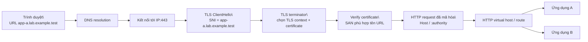
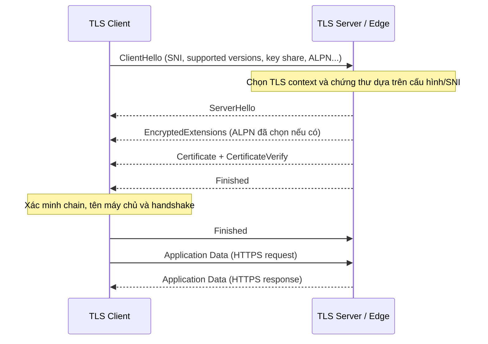

# SNI và lựa chọn virtual host trong TLS

## Mục tiêu học tập

Sau bài học này, bạn có thể:

1. Giải thích **Server Name Indication (SNI)** nằm ở đâu trong TLS handshake, nó cung cấp thông tin gì và **không** xác thực hay bảo đảm điều gì.
2. Phân biệt **tên miền trong URL, DNS resolution, SNI, certificate SAN, HTTP `Host`/HTTP/2 `:authority` và virtual host**, không nhầm một trường với trường khác.
3. Mô tả cách **một IP:port phục vụ nhiều website HTTPS** qua virtual hosting, lựa chọn cấu hình TLS/chứng thư theo SNI và lựa chọn ứng dụng theo HTTP authority.
4. Thiết kế hành vi **default virtual host, client thiếu SNI, tên không khớp, HTTP/2 connection coalescing, HTTP/3/QUIC** và chứng thư wildcard/multi-SAN cho nhiều dịch vụ.
5. Phân biệt **TLS termination**, **TLS passthrough**, **TLS re-encryption** và giới hạn của routing dựa trên SNI, nhất là khi có **Encrypted ClientHello (ECH)**.
6. Nhận diện rủi ro như **domain fronting, Host-header confusion, backend certificate verification sai, thiếu IPv6 listener, log thiếu ngữ cảnh** và phân quyền theo danh tính không đúng.
7. Thực hiện kiểm tra có kiểm soát bằng **OpenSSL và curl trong lab**, giải thích kết quả chứng thư, SNI/authority mismatch và xây dựng ma trận nghiệm thu an toàn.

## 1. Đặt vấn đề: nhiều website, một địa chỉ IP

Giả sử một reverse proxy phục vụ:

- `app-a.lab.example.test` — cổng ứng dụng A.
- `app-b.lab.example.test` — cổng ứng dụng B.
- `admin.lab.example.test` — ứng dụng quản trị có mức bảo vệ cao.

Cả ba tên cùng phân giải tới **một địa chỉ IP** và cùng cổng **TCP/443**. Trước khi nhận được HTTP request, server phải thực hiện **TLS handshake**. Làm thế nào gateway biết nên gửi **chứng thư TLS của tên nào** cho client?

**SNI** cho phép client khai báo **tên DNS của server mà nó muốn kết nối** trong TLS `ClientHello`. Server có thể dùng giá trị này để lựa chọn **TLS virtual host**, chứng thư, chính sách TLS hoặc backend phù hợp **trước khi** nhận HTTP request đã mã hóa.

Sau khi TLS handshake hoàn tất, HTTP request có thể chứa:

- HTTP/1.1: trường `Host: app-a.lab.example.test`.
- HTTP/2 và HTTP/3: pseudo-header `:authority` (đại diện authority của request).

Hai bước phục vụ **hai lớp**: SNI giúp lựa chọn ngữ cảnh TLS; HTTP authority giúp lựa chọn tài nguyên/virtual host của ứng dụng. Chúng thường **trùng nhau trong request trình duyệt thông thường**, nhưng không mặc nhiên trùng về mặt giao thức.

### 1.1. Sơ đồ tổng quan



Sơ đồ giản lược: việc **xác minh chứng thư được client thực hiện trong quá trình TLS handshake**, không phải server tự chứng minh danh tính chỉ vì có SNI. Application routing có thể diễn ra trên cùng terminator hoặc proxy/backend riêng.

### 1.2. Tại sao chủ đề này thuộc network security?

Trong module `SECURITY_NETWORK_SECURITY`, SNI và virtual hosting giao nhau với:

- **Firewall/segmentation:** phân biệt điểm vào HTTPS và quyền truy cập ứng dụng đích.
- **IDS/IPS/NDR:** SNI có thể là một phần metadata phục vụ phát hiện, nhưng không được coi là nguồn xác thực đáng tin.
- **DNS security:** tên miền được phân giải có thể khác tập IP dịch vụ, SNI không thay thế DNS integrity.
- **VPN/ZTNA:** gateway có thể định tuyến theo tên ứng dụng, song vẫn cần user/device authorization.
- **Cloud security:** load balancer, ingress controller, CDN và edge gateway thường quản lý chứng thư cho nhiều tenant.
- **Threat modeling:** lỗi mapping tên/chứng thư/virtual host có thể tạo cross-tenant routing hoặc phơi bày ứng dụng quản trị.

> **Nguyên tắc:** SNI là **gợi ý tên miền từ client trong TLS ClientHello**, không phải bằng chứng rằng client được quyền vào virtual host, không phải danh tính người dùng, và không đủ để xác định URL/path của HTTP.

## 2. Thuật ngữ và các lớp cần tách bạch

| Khái niệm | Thuộc lớp/bước nào? | Dùng để làm gì? | Không chứng minh điều gì? |
|---|---|---|---|
| **FQDN** | Tên DNS/ứng dụng | Định danh tên server đích | IP duy nhất hoặc dịch vụ an toàn |
| **DNS A/AAAA** | DNS | Phân giải tên sang IPv4/IPv6 | Server tại IP có quyền phục vụ tên đó |
| **Socket IP:port** | L3/L4 | Xác định đích truyền tải | Tên virtual host cuối cùng |
| **TLS SNI** | ClientHello của TLS | Gợi ý tên server để chọn TLS context/route | Người dùng đã xác thực hoặc Host HTTP trùng |
| **Certificate SAN** | Chứng thư X.509 | Liệt kê tên/địa chỉ mà chứng thư được cấp để xác thực | Chứng thư là của website an toàn về nội dung |
| **Trust chain** | Xác minh PKI | Xác thực chuỗi chứng thư, tin CA theo chính sách | Máy chủ hoặc ứng dụng không bị xâm nhập |
| **ALPN** | TLS handshake | Thỏa thuận protocol ứng dụng như `h2` hay `http/1.1` | Định danh tên miền hoặc quyền truy cập |
| **HTTP Host** | HTTP/1.1 | Chỉ định authority của request | Server đã gửi chứng thư phù hợp Host |
| **HTTP :authority** | HTTP/2, HTTP/3 | Authority ở tầng HTTP | SNI bắt buộc bằng authority |
| **Virtual host** | Web server/proxy | Chọn site/backend/config theo tên, địa chỉ hoặc rule | Phân đoạn mạng hay authorization đã đúng |
| **Default server** | TLS/server config | Hành vi khi thiếu/không khớp tên | Luôn an toàn nếu chưa kiểm tra cấu hình |
| **mTLS client certificate** | Xác thực TLS hai chiều | Xác thực client theo PKI | Quyền ứng dụng đã được xác định đầy đủ |

**Định danh tên không giống định danh người dùng hoặc thiết bị.** SNI và HTTP authority thường **được client cung cấp**; không dùng chúng thay thế MFA, OAuth/OIDC, mTLS identity, firewall hoặc authorization phía ứng dụng.

## 3. TLS handshake và vị trí của SNI

### 3.1. Trình tự TLS 1.3 đơn giản



Sơ đồ bỏ qua các tùy chọn, thứ tự phụ thuộc tình huống và chi tiết xác thực client. Trong **TLS 1.3**, phần lớn thông điệp sau ServerHello được mã hóa; thông thường **ClientHello/SNI vẫn hiện trong bản bắt gói thụ động nếu không có ECH**. TLS 1.3 **không tự mã hóa SNI theo mặc định**.

Server thường phải lựa chọn TLS parameters/certificate dựa trên thông tin có trong hoặc suy ra từ ClientHello. Tên SNI có thể ảnh hưởng đến certificate selection và một số chính sách TLS, nhưng **không tạo quyền ứng dụng**.

### 3.2. TLS 1.2 và TLS 1.3 khác nhau ở đâu đối với SNI?

| Điểm | TLS 1.2 | TLS 1.3 |
|---|---|---|
| SNI extension | Trong ClientHello nếu client gửi | Trong ClientHello nếu client gửi; ECH có thể bảo vệ tên đích bên trong |
| Chọn chứng thư bằng SNI | Có | Có |
| Bảo vệ certificate handshake | Certificate truyền không được mã hóa theo handshake TLS 1.2 điển hình | Certificate handshake được mã hóa sau khi khóa bắt tay được thiết lập |
| Forward secrecy | Phụ thuộc key exchange/cấu hình | Bắt tay chuẩn dùng cơ chế sinh khóa bảo mật tiến về phía trước; resumption có đặc điểm riêng |
| ALPN | Có thể được dùng | Có thể được dùng |
| HTTP Host | Chỉ có sau khi HTTP bắt đầu | Chỉ có sau khi HTTP bắt đầu |

**Không khuyến khích dùng TLS 1.2 với cấu hình cũ/yếu chỉ vì muốn làm rõ SNI trong lab.** Khi triển khai, ưu tiên phiên bản và cipher theo tiêu chuẩn bảo mật hiện hành của tổ chức; TLS 1.3 là lựa chọn nên ưu tiên khi tương thích.

### 3.3. SNI host_name là tên DNS, không phải IP literal

Trong RFC 6066, trường `host_name` của SNI là tên server dạng DNS; **địa chỉ IPv4/IPv6 literal không được biểu diễn như HostName của SNI**. Vì vậy khi client truy cập `https://192.0.2.10/`, có thể **không gửi SNI** dù kết nối TLS vẫn có thể thiết lập.

Nếu HTTPS dùng URL với IP literal, chứng thư vẫn cần **IP address SAN hợp lệ** để client xác minh tên đích là IP. Chứng thư chỉ có DNS SAN `app.example.test` không tự hợp lệ cho URL IP.

**Không dùng Host HTTP để “sửa” xác minh chứng thư thiếu SNI.** Chứng thư được kiểm tra ở giai đoạn handshake trước khi client gửi request HTTP.

## 4. Từ SNI đến TLS virtual host

### 4.1. Một socket, nhiều tên

Máy chủ có thể nhận kết nối tại một địa chỉ và chọn các cấu hình:

```text
Inbound: 192.0.2.10:443

TLS ClientHello SNI = app-a.lab.example.test
  -> TLS context A
  -> certificate SAN: app-a.lab.example.test

TLS ClientHello SNI = app-b.lab.example.test
  -> TLS context B
  -> certificate SAN: app-b.lab.example.test

TLS ClientHello không có SNI hoặc không match
  -> default TLS context / reject handshake
```

Cách server quyết định default và ưu tiên matching tùy implementation, cấu hình listener, IP family, exact/wildcard/regex names và phiên bản sản phẩm.

### 4.2. TLS virtual host không nhất thiết là HTTP virtual host

Một web server có thể tách:

- **TLS selection:** chọn chứng thư và các thông số TLS trước khi HTTP xuất hiện.
- **HTTP routing:** chọn website/application theo `Host`, `:authority`, path, method và rule.
- **Application authorization:** kiểm tra user, session, role, scope, resource access.
- **Backend identity:** khi proxy kết nối upstream qua TLS, phải xác minh tên/chứng thư của upstream riêng.

Nếu những lớp này không đồng bộ, request có thể đi tới **backend sai**, client nhận **chứng thư sai**, hoặc một tenant có thể tác động tới tenant khác.

### 4.3. Default virtual host và unknown SNI

Khi client không có SNI hoặc SNI không nằm trong danh sách phục vụ, server có thể:

1. Dùng **default certificate/site** theo listener.
2. **Từ chối TLS handshake** bằng chính sách tại điểm vào.
3. Cấp chứng thư chung cho tên hợp lệ trong phạm vi đã quản lý.
4. Tùy sản phẩm, chọn backend mặc định và tiếp tục xử lý HTTP.

Mặc định **không được route unknown SNI đến cổng quản trị hoặc một tenant bất kỳ**. Ưu tiên default deny/reject cho môi trường nhạy cảm, ghi log vừa đủ để điều tra, và giữ lộ trình phục hồi cho các client hợp lệ cũ không hỗ trợ SNI nếu thật sự cần.

## 5. SNI và HTTP Host/:authority: hai tên khác vai trò

### 5.1. Client thông thường

Khi trình duyệt mở:

```text
https://app-a.lab.example.test/dashboard
```

Trong trường hợp HTTPS trực tiếp phổ biến:

- Client phân giải `app-a.lab.example.test` ra địa chỉ IP.
- TLS ClientHello gửi `SNI = app-a.lab.example.test`.
- Server chọn chứng thư phù hợp, client xác minh SAN với tên trong URL.
- HTTP/1.1 gửi `Host: app-a.lab.example.test`, hoặc HTTP/2/3 gửi `:authority=app-a.lab.example.test`.
- HTTP router chọn đường ứng dụng và kiểm tra authorization.

**URL path `/dashboard` không nằm trong SNI.** Thiết bị chỉ thấy SNI không biết người dùng yêu cầu path nào, không biết cookie/session, cũng không thể suy ra dữ liệu HTTP đã mã hóa.

### 5.2. Khi SNI khác HTTP authority

Một client hoặc proxy có thể tạo tình huống:

```text
TLS SNI:     app-a.lab.example.test
HTTP Host:   admin.lab.example.test
Socket:      192.0.2.10:443
```

Đây là **hai trường khác nhau**. Nếu certificate của `app-a` được client tin cậy, TLS layer có thể hoàn tất, nhưng HTTP router có thể nhìn thấy authority `admin` và chuyển request tới backend không được mong đợi nếu cấu hình thiếu ràng buộc.

Các hệ thống cần tách biệt tenant nên có **policy authority/origin rõ ràng** tại điểm HTTP termination; ví dụ từ chối authority không được phục vụ bởi connection/context thích hợp. Đừng mặc định rằng có SNI thì tầng HTTP sẽ không bị route khác.

### 5.3. Domain fronting và Host confusion

**Domain fronting** là một mô hình dùng tên ở bề mặt TLS và authority HTTP khác nhau để che hoặc chuyển hướng đích phía sau một hạ tầng trung gian. Một số kiến trúc CDN/proxy từng cho phép hành vi này; nhiều dịch vụ áp chính sách từ chối hoặc hạn chế.

Về phòng vệ:

- Dùng **allowlist authority** cho từng ingress/app/tenant.
- Ràng buộc SNI và HTTP authority với tập origin được phép theo ngữ cảnh; không chỉ so chuỗi một cách mù quáng.
- Đảm bảo backend không tin **Host/X-Forwarded-Host/Forwarded** chưa được reverse proxy xác thực/ghi lại.
- Kiểm tra đường đi proxy, CDN, HTTP/2/3 và hệ thống có hỗ trợ **connection coalescing**.
- Ghi lỗi/mismatch theo chính sách nhưng tránh log thông tin nhạy cảm hoặc quá tải.

**Lưu ý:** SNI khác authority **không luôn là tấn công**; với HTTP/2, một kết nối TLS có thể được tái sử dụng có điều kiện cho nhiều origin mà client coi là phù hợp. Vì vậy chính sách “SNI luôn phải bằng :authority” chỉ phù hợp khi **đã loại trừ hoặc chủ động không hỗ trợ các tình huống hợp lệ đó**.

## 6. HTTP/2 connection coalescing và 421 Misdirected Request

### 6.1. Vì sao một TLS connection có thể phục vụ nhiều origin?

HTTP/2 có cơ chế **connection reuse/coalescing** khi các điều kiện về authority, chứng thư, endpoint và các quy định giao thức được thỏa mãn. Ví dụ một chứng thư có SAN cho cả `app-a` và `app-b`, client có thể tận dụng kết nối đã thiết lập thay vì mở một kết nối TLS mới cho mỗi origin khi đủ điều kiện.

Khi đó:

```text
TLS connection được thiết lập với:
  SNI = app-a.lab.example.test
  certificate SAN = [app-a.lab.example.test, app-b.lab.example.test]

HTTP/2 stream #1:
  :authority = app-a.lab.example.test

HTTP/2 stream #3:
  :authority = app-b.lab.example.test
```

Mô hình này **không mặc định cho phép mọi server/backend** tiếp nhận stream thứ hai. Server phải có quyền/cấu hình phục vụ origin tương ứng. Không chỉ dựa vào “chứng thư có SAN” để quyết định mọi request app được phép.

### 6.2. Khi nào trả HTTP 421?

**421 Misdirected Request** giúp server báo rằng request được gửi trên connection không thích hợp để trả lời origin đó. Đối với hạ tầng multi-tenant, 421 có thể là phản hồi hợp lý khi connection/context không được phép phục vụ authority trong request.

Không nhất thiết mọi mismatch đều phải 421; chính sách có thể từ chối request theo cách phù hợp sản phẩm và kiến trúc. Điều quan trọng là:

- Không âm thầm chuyển request sai sang tenant khác.
- Không tạo bypass authorization.
- Không gây loop khi proxy retry hoặc client cố coalesce lại.
- Có log/mapping rõ để analyst phân biệt lỗi cấu hình với hành vi đáng ngờ.

### 6.3. Không bỏ qua HTTP/3

HTTP/3 chạy trên **QUIC**, tích hợp TLS 1.3 theo cơ chế transport của QUIC. Khái niệm SNI/chứng thư/authority vẫn liên quan, nhưng **không phải TLS record thông thường trên TCP/443**.

Do đó một middlebox chỉ kiểm tra **TCP ClientHello** không thể mặc định có cùng khả năng quan sát hay định tuyến lưu lượng **UDP/443 QUIC**. Cần gateway/edge hỗ trợ QUIC/HTTP/3 và chính sách authority ở nơi đã giải mã HTTP hợp lệ.

## 7. SNI và ALPN không phải cùng một thứ

**ALPN (Application-Layer Protocol Negotiation)** cho phép client/server thương lượng giao thức ứng dụng sẽ chạy trên kết nối TLS, ví dụ `http/1.1` hoặc `h2`; với QUIC/HTTP/3 có định danh ALPN tương ứng như `h3`.

| Thuộc tính | SNI | ALPN |
|---|---|---|
| Trả lời | “Tên server nào đang được nhắm đến?” | “Giao thức ứng dụng nào dùng trên connection?” |
| Trong ClientHello | Có thể có server_name | Có thể có danh sách protocol được hỗ trợ |
| Tác động | Chọn TLS context/certificate/virtual server | Chọn cách diễn giải application bytes |
| Bằng chứng identity | Không | Không |
| Thay thế HTTP Host? | Không | Không |
| Trong ECH | Inner SNI có thể được bảo vệ | Các thông tin trong inner ClientHello có thể được bảo vệ tùy ECH |

Một tên miền có thể phục vụ HTTP/1.1 và HTTP/2 trên cùng TLS listener. **ALPN chọn protocol**, sau đó HTTP layer vẫn cần kiểm tra authority, path và authorization.

**Không suy “ALPN = h2” là request chắc chắn đến application A**; một HTTP/2 connection có thể mang nhiều stream với authority khác nhau theo điều kiện giao thức.

## 8. Chứng thư TLS được chọn và được xác minh như thế nào?

### 8.1. Server chọn chứng thư; client xác minh danh tính

Quy trình phổ biến:

1. Client gửi ClientHello kèm SNI khi hỗ trợ.
2. Server chọn certificate chain/key của TLS context tương ứng.
3. Server chứng minh sở hữu khóa riêng trong handshake.
4. Client xác thực **đường chứng thư đến trust anchor**, thời hạn, thuật toán, mục đích sử dụng và tên endpoint mong đợi.
5. Client chỉ gửi HTTP traffic sau khi xác thực thành công theo chính sách của mình.

**SNI không phải chứng thư.** Một server có thể trả chứng thư sai tên; client chuẩn phải báo lỗi name mismatch thay vì coi SNI gửi đi là đủ để tin cậy.

### 8.2. Subject Alternative Name (SAN)

Các HTTPS client hiện đại kiểm tra tên trong **SAN**, không nên dựa vào Common Name (CN) làm phương thức chính.

Ví dụ:

```text
Certificate A:
  DNS SAN: app-a.lab.example.test

Certificate B:
  DNS SAN: app-b.lab.example.test
           admin.lab.example.test

Certificate wildcard:
  DNS SAN: *.lab.example.test
```

Chứng thư `*.lab.example.test` thường bao phủ **một nhãn con** như `app-a.lab.example.test`, **không tự bao phủ** `deep.api.lab.example.test` hay zone apex `lab.example.test`. Cần kiểm tra các quy tắc matching theo chuẩn client, không tự mở rộng wildcard.

**Chứng thư có thể có nhiều SAN**, nhưng việc gom cả ứng dụng nhạy cảm và ứng dụng công khai vào cùng private key cần cân nhắc blast radius, rotation, key protection và ownership.

### 8.3. Cấp phát và rotation

Trong môi trường multi-vhost:

- Có inventory **FQDN → owner → TLS listener → certificate ID → backend**.
- Kiểm soát ACME/CA enrollment để không cấp chứng thư ngoài phạm vi quản lý.
- Giữ private key trong vùng/quyền thích hợp; hạn chế chia sẻ giữa tenant.
- Theo dõi expiry, chain validity, EKU và trust.
- Khi rotation, kiểm tra **mọi SNI name** trên IPv4/IPv6 và ở tất cả edge node.
- Với CDN/cloud gateway, xác nhận certificate đã được triển khai **đồng bộ tại những PoP/region cần**.
- Kiểm tra session resumption/connection reuse khi có thay đổi tên, certificate hoặc policy.

**Cert hết hạn** không nhất thiết khiến DNS lỗi; TLS handshake hoặc client verification sẽ lỗi. Đừng chữa bằng cách tắt hostname verification/đánh dấu `insecure` trên client.

### 8.4. Wildcard không giải quyết thiếu authorization

Một wildcard certificate cho `*.lab.example.test` có thể làm nhiều origin xác minh TLS thành công, **nhưng không có nghĩa người dùng được phép vào `admin.lab.example.test`**. Vẫn cần app auth, network policy, access gateway và host/authority routing đúng.

## 9. TLS termination, passthrough và re-encryption

### 9.1. TLS termination tại edge

```text
Client -- TLS --> [Reverse proxy / WAF / Load balancer] -- HTTP/TLS --> Backend
                    |
               SNI cert selection
               HTTP Host/:authority routing
               WAF/auth/rate policy khi được cấu hình
```

Khi TLS được terminate tại edge, proxy có thể thấy HTTP metadata và thực thi route, WAF, rate limit hoặc xác thực. Nếu proxy đến backend qua **HTTP cleartext**, traffic trên đoạn nội bộ không được TLS mã hóa; cần quyết định theo risk và vùng tin cậy.

Nếu dùng TLS tới backend, phải **bảo vệ và xác minh TLS ở kết nối upstream** thay vì cho rằng kết nối đầu đã bảo đảm toàn đường.

### 9.2. TLS passthrough

```text
Client -- TLS intact --> [TCP/TLS-aware load balancer] --> Backend TLS Server
                         |
                   Có thể phân loại qua SNI ClientHello
                   khi tên hiện rõ và parser hỗ trợ
```

Trong passthrough, điểm vào không giải mã HTTP. Nó thường chỉ có thể dựa vào các tín hiệu transport/ClientHello mà nó đọc được, chẳng hạn địa chỉ/cổng đích hoặc SNI **nếu có thể nhìn thấy**.

Hệ quả:

- Không thể đọc HTTP `Host`, `:authority` hoặc path khi traffic vẫn mã hóa.
- Không thể áp WAF/path-based rule thực sự ở lớp passthrough chỉ nhờ SNI.
- Cần xử lý client **không gửi SNI** và unknown names.
- Phải tính **ECH**: inner SNI có thể bị ẩn; route theo cleartext SNI không còn đơn giản.
- Dùng TCP/443 inspection không mặc định hỗ trợ QUIC/HTTP/3.
- Nếu các hostname khác nhau nhưng cùng outer ECH public name, frontend có thể không đủ thông tin để route từng origin riêng trước khi giải mã ECH ở backend phù hợp.

### 9.3. TLS re-encryption (bridge)

```text
Client -- TLS #1 --> Edge/WAF -- TLS #2 --> Backend
                        |                       |
                 Verify client side?       Verify backend cert
                 Chọn HTTP route           SNI upstream phù hợp
```

Hai phiên TLS **độc lập**. Edge nên:

- Chọn backend bằng policy đáng tin, không lấy Host tự khai làm quyết định duy nhất.
- **Bật xác minh chứng thư backend** với trust store và tên đúng.
- Gửi **SNI upstream** phù hợp backend khi cần, nhưng **SNI một mình không đủ**.
- Nếu dùng mTLS tới backend, cấp/xác thực chứng thư dịch vụ theo chính sách.
- Giới hạn tin tưởng các header định danh (ví dụ `X-Forwarded-For`, `Forwarded`, `X-Forwarded-Client-Cert`) chỉ khi proxy đã xác thực và kiểm soát hop tạo header.

Một cấu hình kiểu “proxy_pass https nhưng tắt verify upstream” vẫn có thể bị tấn công trên hop backend dù client thấy biểu tượng khóa HTTPS.

## 10. ECH: khi SNI không còn hiển thị như trước

### 10.1. SNI truyền thống có hạn chế quyền riêng tư

Với TLS thông thường **không dùng ECH**, một observer trên đường truyền có thể thường thấy **tên SNI trong ClientHello** dù payload HTTPS đã được mã hóa. Điều này có thể tiết lộ website/service mà client định truy cập; không phải luôn phản ánh đầy đủ URL hoặc nội dung.

**Encrypted ClientHello (ECH)** là cơ chế bảo vệ một phần thông tin ClientHello, trong đó có **tên server đích ở inner ClientHello** khi ECH được sử dụng thành công theo cấu hình hỗ trợ.

### 10.2. Inner và outer ClientHello

```text
ClientHelloOuter:
  Có thể chứa public name dùng cho ECH gateway/provider
  Chứa thông tin cần thiết để định tuyến/giải mã ECH theo thiết kế

ClientHelloInner (được ECH bảo vệ):
  Tên đích thực tế muốn truy cập
  Những extension khác được bảo vệ theo giao thức

Server/backend:
  Cần có khóa/cấu hình ECH và cơ chế xử lý thích hợp
```

**Không coi outer SNI là hostname thật của origin.** Khi ECH thành công, middlebox chỉ thấy outer ClientHello thường không thể lấy inner SNI chỉ bằng cách đọc packet. Việc ECH có được sử dụng thành công phụ thuộc client/server/edge, DNS HTTPS/SVCB/ECH configuration và chính sách thực tế.

### 10.3. Tác động đến thiết kế network security

| Cách làm cũ | Rủi ro khi có ECH | Phương án kiến trúc |
|---|---|---|
| Firewall allow/deny chỉ theo cleartext SNI | Có thể không thấy tên đích thực | Identity-aware proxy, endpoint/managed resolver, app controls |
| TCP load balancer chia backend theo SNI lộ rõ | Không phân biệt được inner origin | ECH-aware terminator/gateway hoặc routing theo public name hợp lệ |
| NDR kết luận “không có domain X vì không thấy SNI” | Thiếu visibility, false negative | Correlate DNS/endpoint/flow, ghi telemetry coverage |
| Dùng outer SNI để quy kết người dùng đã vào origin cụ thể | Outer name không nhất thiết là origin | App logs / endpoint / gateway được phép |
| Cố tắt TLS bảo vệ để lấy metadata | Gây rủi ro privacy/security | Thiết kế policy ở điểm có quyền giải mã hoặc nguồn tin cậy |

**ECH không đồng nghĩa mọi metadata đều biến mất.** Observer vẫn có thể thấy IP/port, lưu lượng, thời gian, kích thước packet và một số tín hiệu công khai; nhưng không nên suy ra inner hostname từ các tín hiệu đó khi thiếu chứng cứ.

## 11. Thiết kế reverse proxy bằng Nginx: ví dụ lab

Mục này minh họa **TLS termination** với nhiều HTTPS virtual host. Cấu hình là **ví dụ cho lab cô lập**, không phải tệp production có thể sao chép nguyên xi.

### 11.1. Tiền đề

- Máy lab có Nginx phiên bản hỗ trợ `ssl_reject_handshake` (tính năng này xuất hiện trong các phiên bản Nginx hiện đại; cần kiểm tra phiên bản thực tế).
- Hai FQDN test `app-a.lab.example.test` và `app-b.lab.example.test` được ánh xạ tới loopback hoặc IP của lab qua resolver/hosts test phù hợp.
- Có hai bộ **chứng thư và private key dành riêng cho lab**, có SAN đúng mỗi tên và được ký bởi **CA lab** mà client kiểm thử tin cậy.
- File private key chỉ đọc được bởi account/service thích hợp; không đưa private key vào tài liệu, Git hay log.

### 11.2. Nginx HTTPS virtual hosts tối giản

```nginx
# LAB CONFIG: tùy chỉnh đường dẫn chứng thư, listen và chính sách.
# Default listener: từ chối handshake khi không xác định đúng TLS vhost.
server {
    listen 443 ssl default_server;
    listen [::]:443 ssl default_server;
    server_name _;
    ssl_reject_handshake on;
}

server {
    listen 443 ssl;
    listen [::]:443 ssl;
    server_name app-a.lab.example.test;

    ssl_certificate     /etc/nginx/lab-certs/app-a-chain.pem;
    ssl_certificate_key /etc/nginx/lab-certs/app-a-key.pem;

    # Lab chủ động KHÔNG phục vụ yêu cầu HTTP authority khác SNI.
    # Nếu triển khai HTTP/2 coalescing nhiều origin, phải thiết kế lại chính sách.
    if ($ssl_server_name != "app-a.lab.example.test") {
        return 421;
    }

    default_type text/plain;
    return 200 "lab-app-a\n";
}

server {
    listen 443 ssl;
    listen [::]:443 ssl;
    server_name app-b.lab.example.test;

    ssl_certificate     /etc/nginx/lab-certs/app-b-chain.pem;
    ssl_certificate_key /etc/nginx/lab-certs/app-b-key.pem;

    if ($ssl_server_name != "app-b.lab.example.test") {
        return 421;
    }

    default_type text/plain;
    return 200 "lab-app-b\n";
}
```

Trong ví dụ:

1. **SNI được dùng khi TLS handshake** để chọn TLS vhost/chứng thư cho `app-a` hoặc `app-b`.
2. **Default listener** từ chối handshake thiếu/không khớp SNI thay vì lộ site bất kỳ.
3. **HTTP routing** dựa vào tên server được chọn từ authority khi Nginx xử lý request.
4. Điều kiện `$ssl_server_name` trong mỗi virtual host **cố ý yêu cầu hostname của TLS connection khớp hostname được phục vụ trong lab**; nó hữu ích khi muốn cấm cross-origin routing, nhưng **không phải policy đa tenant phổ quát**. Cần xem HTTP/2/3 coalescing, ECH, proxy chaining và sản phẩm trước khi áp.
5. Khi request không khớp policy, ứng dụng có thể trả **421**. Điều đó thể hiện quyết định ở tầng HTTP, khác với lỗi TLS handshake.

**Đặc biệt:** `server_name _;` không phải wildcard firewall magic; default server được chọn nhờ `default_server` trên mỗi listener. Nếu Nginx version không hỗ trợ `ssl_reject_handshake`, cần một default TLS context hợp lệ để từ chối có kiểm soát sau handshake hoặc dùng tính năng reject phù hợp ở edge; không tự giả định syntax sẽ hoạt động.

### 11.3. Khác biệt khi dùng reverse proxy tới backend

Một site thật thường dùng:

```nginx
# Ví dụ PHẦN CẤU HÌNH cho location trong virtual host đã kiểm chứng.
location / {
    proxy_pass http://127.0.0.1:8081;
    proxy_set_header Host $host;
    proxy_set_header X-Forwarded-Proto https;
}
```

Dòng này **không tự bảo vệ header trust hoặc backend**. Production cần thiết kế rõ:

- Host/authority allowlist ở edge.
- Chỉ những client hợp lệ mới tới được backend theo network policy.
- Header danh tính/forwarded phải được **proxy ghi đè và bảo vệ chuỗi tin cậy**.
- Khi backend chứa dữ liệu nhạy cảm, cân nhắc **TLS/mTLS cho upstream** thay vì HTTP.
- Backend phải kiểm tra **authorization** riêng, không chỉ dựa `Host` hay IP proxy.
- Có chính sách request size, timeout, rate limit, logging và WAF khi phù hợp.

## 12. TLS upstream: SNI tới backend khác SNI từ client

Một lỗi thực tế là edge TLS terminate đúng nhưng khi tạo phiên TLS tới backend lại dùng **SNI hoặc hostname verification sai**.

### 12.1. Ví dụ logic

```text
Client:
  URL = https://app-a.lab.example.test
  SNI client -> edge = app-a.lab.example.test

Edge:
  Backend được chọn theo policy = backend-a.service.lab.example.test
  TLS upstream SNI = backend-a.service.lab.example.test
  Verify backend cert DNS SAN = backend-a.service.lab.example.test

Backend:
  Chỉ nhận request từ proxy đáng tin
  App authorization vẫn hoạt động
```

**Không nhất thiết dùng cùng một tên ở hai hop.** Tên public và tên backend có thể khác. Điều cần giữ là **upstream SNI, hostname verification, service identity và HTTP Host/authority** nhất quán với thiết kế cụ thể.

### 12.2. Ví dụ Nginx upstream HTTPS trong lab

```nginx
# Ví dụ location cần được đặt trong server block TLS hợp lệ.
location / {
    proxy_pass https://backend-a.service.lab.example.test:8443;

    proxy_ssl_server_name on;
    proxy_ssl_name backend-a.service.lab.example.test;

    # Bật xác minh upstream; trust anchor là CA backend của lab.
    proxy_ssl_verify on;
    proxy_ssl_trusted_certificate /etc/nginx/lab-certs/backend-ca.pem;
    proxy_ssl_verify_depth 2;

    # Host HTTP được kiểm soát theo application routing.
    proxy_set_header Host app-a.lab.example.test;
    proxy_set_header X-Forwarded-Proto https;
}
```

Cần bảo đảm resolver/DNS của proxy giải được backend, certificate chain đúng CA, TLS policy phù hợp và không có đường bypass. `proxy_ssl_verify_depth 2` chỉ là ví dụ cho chain lab; phải chỉnh theo kiến trúc PKI.

**Không đặt `proxy_ssl_verify off` để giải quyết lỗi chứng thư production.** Lỗi có thể do upstream certificate SAN sai, CA thiếu, SNI sai, đồng hồ lệch, chain lỗi hoặc route nhầm.

## 13. TLS passthrough, SNI-based routing và rủi ro quan sát

### 13.1. Sơ đồ decision trên TLS ClientHello

```text
L4 gateway nhận TCP connection :443
      |
Đọc ClientHello nếu thực tế có thể
      |
SNI = app-a.lab.example.test -> TCP backend A
SNI = app-b.lab.example.test -> TCP backend B
SNI = unknown/absent        -> reject/default action
      |
Backend thực hiện TLS handshake và HTTP policy
```

SNI-based passthrough routing **không đảm bảo backend an toàn**. Mỗi backend vẫn phải sở hữu đúng chứng thư, xác thực request và không route unknown authority sang tenant khác.

### 13.2. Khi nào không nên dựa duy nhất vào SNI?

- **ECH được sử dụng:** outer SNI có thể chỉ đại diện public name.
- **HTTP/2 coalescing:** request authority có thể khác SNI của connection theo điều kiện hợp lệ.
- **Client cũ không có SNI:** không thể phân biệt tên ngay từ ClientHello.
- **IP literal:** SNI host_name chuẩn không gửi IP.
- **HTTP/3/QUIC:** cần gateway hiểu QUIC thay vì parser TLS/TCP thông thường.
- **ClientHello bị phân mảnh/đến nhiều packet:** implementation phải tái lắp đúng, không đọc một packet rồi khẳng định thiếu SNI.
- **SNI giả mạo/tùy ý:** client có thể gửi hostname không chứng minh quyền kiểm soát tên hoặc danh tính người dùng.
- **Nhiều ứng dụng cùng origin:** cần route theo URL path, cookie, token hoặc HTTP logic mà passthrough không đọc được.

**Nếu security policy phải kiểm tra Host/path/header/token**, thực thi tại **HTTP-aware terminator** hoặc ứng dụng phía sau, không đặt kỳ vọng đó vào TCP SNI inspection.

## 14. SNI và các kiến trúc cloud/CDN/Kubernetes

### 14.1. Cloud load balancer

Một HTTPS load balancer có thể:

- Sở hữu danh sách certificate gắn với listener.
- Chọn certificate theo SNI phù hợp.
- Kết thúc TLS rồi route theo `Host`/path tới backend.
- Thực thi WAF, authentication hoặc identity-aware policy nếu dịch vụ hỗ trợ.
- Re-encrypt traffic tới backend và xác minh chứng thư upstream nếu có cấu hình.

**Đừng mặc định CDN/cloud LB luôn tắt hoặc bật verification upstream giống nhau.** Phải đọc setting thực tế cho đường client → edge và edge → origin.

### 14.2. Kubernetes Ingress/Gateway

Một Ingress/Gateway có thể có:

```yaml
# MINH HỌA cấu trúc khai báo; tên/namespace/tlsSecret phải tồn tại trong lab.
apiVersion: networking.k8s.io/v1
kind: Ingress
metadata:
  name: app-a
  namespace: lab
spec:
  tls:
    - hosts:
        - app-a.lab.example.test
      secretName: app-a-tls
  rules:
    - host: app-a.lab.example.test
      http:
        paths:
          - path: /
            pathType: Prefix
            backend:
              service:
                name: app-a
                port:
                  number: 8080
```

Điểm cần phân biệt:

- `spec.tls.hosts` và `secretName` diễn tả **TLS certificate configuration** theo controller hỗ trợ.
- `rules.host` diễn tả **HTTP host matching** cho route.
- DNS cần trỏ tới gateway IP/load balancer thích hợp, nhưng **DNS không làm thay điều kiện của Ingress**.
- Secret chứng thư phải có SAN phù hợp; không tạo bảo đảm bằng cách chỉ ghi tên trong YAML.
- Behavior khi host không match, default backend, nhiều controller, regex/wildcard và TLS passthrough **phụ thuộc Ingress/Gateway implementation**.

**Kubernetes NetworkPolicy** không phải công cụ xác minh SNI hoặc certificate. Cần kết hợp ingress policy, workload isolation, network policy và identity-aware auth.

### 14.3. SaaS và multi-tenant domains

Với nhiều tenant, cấu hình nên lưu:

- Tenant ID, FQDN/custom domain, trạng thái xác minh quyền sở hữu tên.
- Certificate được cấp đúng tên và vòng đời renewal.
- Mapping `SNI/authority → tenant → backend` rõ ràng, có audit.
- **Unknown domain/default host → deny**, không tự chọn tenant đầu tiên.
- Hạn chế request mang Host tùy ý đi vào backend có quyền quản trị.
- Có test **cross-tenant authority**, misdirected request, HTTP/2 coalescing và cache key.
- Cấu hình routing/certificate nhất quán ở mọi edge region và IPv4/IPv6.

**Không dùng chỉ `Host` chưa xác thực để tạo link đặt lại mật khẩu, redirect OAuth hoặc quyết định tenant quyền cao**; cần danh mục host được duyệt và cơ chế xác định origin đáng tin.

## 15. DNS và SNI: liên hệ nhưng không thay thế

### 15.1. DNS A/AAAA và TLS name

```text
DNS: app-a.lab.example.test -> 192.0.2.10
TCP: connect 192.0.2.10:443
TLS: SNI = app-a.lab.example.test
Certificate: DNS SAN = app-a.lab.example.test
HTTP: Host / :authority = app-a.lab.example.test
```

**DNS answer không tự xác thực TLS endpoint.** Ngay cả khi DNS bị chuyển hướng tới IP khác, TLS client xác minh đúng tên và trust chain có thể phát hiện trường hợp certificate không hợp lệ; nhưng nếu endpoint có chứng thư hợp lệ hoặc client tắt verification thì vẫn có rủi ro.

DNSSEC tăng tính xác thực/toàn vẹn của dữ liệu DNS trong phạm vi triển khai, **không thay thế** TLS identity verification. Ngược lại, TLS không cho biết DNS record có được ký DNSSEC.

### 15.2. Mô hình với proxy và CDN

Client có thể phân giải `app-a` tới CDN PoP; edge CDN dùng certificate của `app-a`, rồi gửi request tới origin với **hostname khác**. Không nên buộc cùng SNI/Host cho mọi hop khi thiết kế có chủ đích sử dụng hai identity khác nhau.

Nhưng phải có **ràng buộc rõ ở từng hop**:

- Client xác minh public hostname.
- Edge xác định tenant/origin đúng và cho phép authority hợp lệ.
- Edge xác minh origin certificate bằng **tên upstream thực tế**.
- Origin chỉ tin các header proxy có nguồn được xác thực.
- Firewall/segmentation ngăn direct origin bypass khi ứng dụng yêu cầu đi qua WAF/CDN.

### 15.3. HTTPS/SVCB và ECH

DNS `HTTPS`/`SVCB` có thể quảng bá các tham số liên quan endpoint/dịch vụ, trong đó có thông tin hỗ trợ ECH khi triển khai. Tuy nhiên:

- Resolver/endpoint và TLS client phải hỗ trợ/đồng ý sử dụng.
- Đường từ DNS tới TLS cần bảo vệ chống thay đổi chính sách/giả mạo phù hợp.
- Không suy chỉ vì có HTTPS RR là client chắc chắn đã dùng ECH.
- Không suy chỉ vì client gửi outer SNI là tên origin được bảo vệ đã lộ.

## 16. Threat modeling: lỗi chọn virtual host tạo rủi ro nào?

| Mối đe dọa hoặc lỗi | Biểu hiện | Ảnh hưởng | Phòng vệ |
|---|---|---|---|
| **Default vhost trả app nhạy cảm** | Unknown/no SNI được gán tenant admin | Lộ endpoint hoặc tăng attack surface | Reject default/deny và test thiếu SNI |
| **Chọn certificate sai tên** | Browser báo name mismatch | Mất truy cập hợp lệ, nguy cơ người dùng bỏ qua cảnh báo | Mapping SNI → cert chính xác; monitoring |
| **Host header confusion** | TLS SNI A nhưng HTTP Host B route sai | Cross-tenant request hoặc dữ liệu lẫn | HTTP authority allowlist, origin/tenant binding |
| **Domain fronting không chủ đích** | Front domain khác backend thực | Bypass một số chính sách egress/WAF | Policy SNI/authority khi phù hợp, auth tại app |
| **Wildcard cert quá rộng** | Cùng private key trên nhiều dịch vụ | Tăng phạm vi rủi ro khi key bị lộ | Phân vùng cert/key, HSM/KMS, rotation |
| **Reverse proxy không verify backend** | TLS upstream encrypted nhưng không xác thực | Dễ định tuyến nhầm hoặc MITM upstream | Verify CA, SAN/hostname và SNI backend |
| **mTLS identity trong header chưa tin** | Client tự gửi X-Forwarded-Client-Cert | Mạo danh client tại backend | Strip/overwrite, protected proxy hops, token signing |
| **SNI được coi là user identity** | Rule chỉ dựa hostname | Bypass authorization | MFA/OIDC/mTLS và policy tài nguyên |
| **IPv6 listener thiếu policy** | IPv4 default deny, IPv6 default allow | Bypass virtual host/management restrictions | Test cả IPv4 và IPv6 |
| **ECH làm mất inner SNI visibility** | Middlebox không nhận diện tên cần chặn | False negative/SNI routing lỗi | ECH-aware gateway, managed DNS/endpoint/app policy |
| **HTTP/3 không được kiểm soát** | UDP/443 đi đường khác HTTP/1.1/2 | Policy parity kém | QUIC-aware gateway, H3 tests |
| **HTTP/2 coalescing không được xử lý** | Authority khác SNI trên connection | 421 sai hoặc route nhầm | Thiết kế per-origin authority phù hợp |
| **SNI/HTTP cache key không thống nhất** | Response của tenant này đến tenant khác | Rò dữ liệu/cache poisoning | Cache key gắn origin và auth context |
| **Private key/cert hết hạn ở một PoP** | Một số region lỗi handshake | Sự cố khó tái hiện | Inventory cert per edge, canary testing |
| **Fallback khi controller down mở route** | Default listener/route quá rộng | Phơi ứng dụng | Fail-safe policy và HA/rollback |
| **Log mọi tên/identity quá mức** | SNI/Host xuất hiện trong logs rộng rãi | Rủi ro riêng tư | Retention, RBAC, purpose limitation |

**Cảnh báo:** SNI chỉ là trường handshake do client gửi. Đừng gắn cờ “server độc hại” chỉ vì một client thử SNI lạ; có thể là scanner hợp lệ, lỗi client, URL chưa được cấu hình, coalescing hoặc hoạt động bất thường cần xác minh.

## 17. mTLS và chọn virtual host

### 17.1. mTLS làm gì?

**Mutual TLS (mTLS)** yêu cầu client chứng minh một identity bằng chứng thư bên cạnh việc client xác minh server. mTLS thích hợp cho một số **service-to-service, admin API hoặc kết nối nội bộ nhạy cảm**, nhưng không tự quyết định ứng dụng user được làm gì.

Ví dụ policy:

```text
TLS SNI = admin.lab.example.test
  -> Chọn certificate server admin
  -> Yêu cầu client certificate từ CA admin được tin
  -> Lấy device/service identity đã xác thực
  -> Kiểm tra role, endpoint, operation và session policy
  -> Chỉ allow action được cấp
```

Một client có thể yêu cầu đúng SNI nhưng **không có certificate hợp lệ**; server phải từ chối hoặc giới hạn đúng theo chính sách. Ngược lại, một client certificate hợp lệ nhưng user thiếu role vẫn không được thao tác quản trị.

### 17.2. Tách policy theo virtual host

Khi các virtual host có yêu cầu mTLS khác nhau:

- Kiểm tra server/terminator có hỗ trợ policy TLS/mTLS **per SNI context** không.
- Tránh để một request `Host: admin` chạy qua connection được thiết lập theo TLS context công khai không yêu cầu client certificate.
- Nếu cần cô lập chặt và middleware không bảo đảm, cân nhắc **listener/port/IP riêng hoặc gateway riêng** cho đường quản trị.
- Xem HTTP/2 coalescing và TLS session reuse để không đánh đồng “certificate của origin A” với quyền origin B.
- Khi proxy chuyển client identity đến backend, cần **signed assertion hoặc header bảo vệ trong trusted network path**, không chấp nhận header do Internet client cung cấp.

**Bài học kiến trúc:** Host-based HTTP routing và TLS handshake authentication có thể có thứ tự và phạm vi **khác nhau**; chính sách bảo mật phải nhất quán qua cả hai.

## 18. Lab an toàn: kiểm chứng TLS SNI bằng OpenSSL và curl

Lab này chỉ dùng **dịch vụ do bạn hoặc nhóm được cấp phép quản lý**. Không cần thử kết nối tới tên miền ngoài phạm vi, không thực hiện scanning hoặc làm gián đoạn hạ tầng production.

### 18.1. Topology và điều kiện

```text
Lab reverse proxy:
  127.0.0.1:443 (hoặc IP dành riêng cho mạng lab)

Virtual hosts:
  app-a.lab.example.test -> cert A -> response "lab-app-a"
  app-b.lab.example.test -> cert B -> response "lab-app-b"

Local CA:
  ./lab-ca.pem  (chứng thư CA công khai cho lab)
Private keys:
  Trên máy phục vụ lab, không copy vào tài liệu/report
```

Nếu không có môi trường TLS lab, vẫn có thể phân tích trên giấy và thực hiện **bảng logic** ở mục 19. Không tạo hoặc truy cập endpoint ngoài phạm vi.

### 18.2. Quan sát chứng thư theo SNI

Trên shell POSIX của máy lab (điều chỉnh nếu dùng PowerShell):

```bash
# SNI app-a, buộc kiểm tra hostname và CA lab.
openssl s_client \
  -connect 127.0.0.1:443 \
  -servername app-a.lab.example.test \
  -verify_hostname app-a.lab.example.test \
  -CAfile ./lab-ca.pem \
  -verify_return_error \
  -showcerts < /dev/null

# SNI app-b: mong đợi chứng thư hợp lệ cho app-b.
openssl s_client \
  -connect 127.0.0.1:443 \
  -servername app-b.lab.example.test \
  -verify_hostname app-b.lab.example.test \
  -CAfile ./lab-ca.pem \
  -verify_return_error < /dev/null
```

Đọc kết quả:

- **Verification OK** khi chain và hostname phù hợp CA lab, thời gian đúng và điều kiện xác minh đạt.
- **Certificate name mismatch** nếu server trả chứng thư không chứa tên cần xác minh.
- **Handshake failure/alert** nếu server từ chối unknown SNI, cipher/protocol không tương thích hoặc policy TLS khác.
- **Unknown CA** nếu client chưa tin CA lab, hoặc chain không đầy đủ.
- **Connection refused/timeout** phản ánh listener/route/firewall, không thể tự quy thành lỗi SNI.

Không dùng `-verify_return_error` như phép xác minh toàn bộ cấu hình server; cần xem kết quả verification, chain, giao thức, SAN và vị trí proxy.

### 18.3. Dùng curl không tắt certificate verification

```bash
# --resolve chỉ ép tên URL tới IP lab; URL hostname vẫn làm
# cơ sở SNI và kiểm tra certificate của curl.
curl --verbose \
  --cacert ./lab-ca.pem \
  --resolve app-a.lab.example.test:443:127.0.0.1 \
  https://app-a.lab.example.test/

curl --verbose \
  --cacert ./lab-ca.pem \
  --resolve app-b.lab.example.test:443:127.0.0.1 \
  https://app-b.lab.example.test/
```

Kỳ vọng:

- Request thứ nhất tới `app-a` và trả `lab-app-a`.
- Request thứ hai tới `app-b` và trả `lab-app-b`.
- Cả hai được **xác minh chứng thư** bằng CA lab, không cần `-k`/`--insecure`.
- Khi dùng proxy môi trường, `curl` có thể không đi thẳng đến loopback như dự định; cần cấu hình bypass proxy riêng cho test lab nếu có.

### 18.4. Thử SNI và Host mismatch có kiểm soát

```bash
# Chỉ thực hiện với lab. URL/SNI là app-a, nhưng Host HTTP là app-b.
curl --http1.1 --verbose \
  --cacert ./lab-ca.pem \
  --resolve app-a.lab.example.test:443:127.0.0.1 \
  -H 'Host: app-b.lab.example.test' \
  https://app-a.lab.example.test/
```

Với cấu hình lab ở mục 11 **chủ động không cho cross-origin**, kỳ vọng request bị từ chối ở tầng HTTP (ví dụ `421`). Nếu server trả nội dung `app-b`, đó là dấu hiệu phải **xem lại ràng buộc SNI/authority** so với chính sách mong đợi, chứ không phải kết luận TLS encryption thất bại.

**Không áp yêu cầu mismatch fail cho mọi HTTP/2/3 connection** mà không xem các điều kiện coalescing và cấu hình origin. Lab dùng `--http1.1` để giảm biến số khi muốn kiểm tra phân biệt hai trường.

### 18.5. Kiểm tra client không có SNI

Nếu bản OpenSSL sử dụng hỗ trợ tùy chọn `-noservername`:

```bash
openssl s_client \
  -connect 127.0.0.1:443 \
  -noservername \
  -CAfile ./lab-ca.pem < /dev/null
```

Với default listener `ssl_reject_handshake on`, handshake dự kiến bị từ chối. Nếu sử dụng phiên bản OpenSSL khác, kiểm tra capability trước khi dùng; **đừng suy không thấy `-servername` trong lệnh là không có SNI nếu công cụ tự suy tên từ host**.

### 18.6. Những điều cần ghi trong biên bản

```text
Test ID / UTC timestamp:
Client tool + version:
Target IP:port và IPv4/IPv6:
URL authority:
Sent SNI / absent SNI:
Negotiated TLS version + ALPN:
Received certificate SAN / trust chain result:
HTTP Host hoặc :authority:
Expected virtual host:
Observed backend/response:
Policy rule ID + status:
Result: PASS / FAIL / INCONCLUSIVE
```

**Không lưu private key, access token, cookies hoặc secrets** vào log kiểm thử. Nếu chỉ có timeout mà không biết listener health, kết luận nên là **INCONCLUSIVE** thay vì PASS do “không truy cập được”.

## 19. Lab offline: mô hình hóa lựa chọn TLS và HTTP route

Đây là bài tập Python chỉ chạy trên dữ liệu cố định trong bộ nhớ; **không mở socket, không tạo TLS connection**.

### 19.1. Quy tắc giả lập

- Chỉ hai tên được phục vụ: `app-a.lab.example.test` và `app-b.lab.example.test`.
- Thiếu hoặc unknown SNI → reject.
- Giả định chính sách lab **không cho HTTP authority khác SNI**.
- TLS certificate name phải match tên expected, và HTTP request phải được authorize.
- Mô hình không bao gồm HTTP/2 coalescing, ECH hay wildcard certificate matching.

```python
CERT_SAN = {
    "app-a.lab.example.test": {"app-a.lab.example.test"},
    "app-b.lab.example.test": {"app-b.lab.example.test"},
}
BACKEND = {
    "app-a.lab.example.test": "app-a",
    "app-b.lab.example.test": "app-b",
}

def simulate(sni, http_authority, client_trusts_cert=True):
    if not sni or sni not in CERT_SAN:
        return "TLS_REJECT_UNKNOWN_SNI"

    cert_names = CERT_SAN[sni]
    if not client_trusts_cert or sni not in cert_names:
        return "TLS_CERT_VERIFY_FAIL"

    # Lab minh họa policy bảo thủ cho hai origin riêng biệt.
    if http_authority != sni:
        return "HTTP_421_MISDIRECTED"

    if http_authority not in BACKEND:
        return "HTTP_404_UNKNOWN_ORIGIN"

    return "ROUTE_TO_" + BACKEND[http_authority]

tests = [
    ("app-a.lab.example.test", "app-a.lab.example.test",
     True, "ROUTE_TO_app-a"),
    ("app-b.lab.example.test", "app-b.lab.example.test",
     True, "ROUTE_TO_app-b"),
    ("app-a.lab.example.test", "app-b.lab.example.test",
     True, "HTTP_421_MISDIRECTED"),
    (None, "app-a.lab.example.test",
     True, "TLS_REJECT_UNKNOWN_SNI"),
    ("unlisted.lab.example.test", "unlisted.lab.example.test",
     True, "TLS_REJECT_UNKNOWN_SNI"),
    ("app-a.lab.example.test", "app-a.lab.example.test",
     False, "TLS_CERT_VERIFY_FAIL"),
]

for sni, authority, trusted, expected in tests:
    observed = simulate(sni, authority, trusted)
    assert observed == expected, (sni, authority, observed, expected)
    print(f"SNI={sni!r} authority={authority!r} -> {observed}")
```

Kết quả kỳ vọng: sáu assertion đều thành công; case mismatch từ chối ở tầng HTTP, còn unknown SNI từ chối ở giai đoạn TLS.

**Giới hạn của ví dụ:** mọi `client_trusts_cert` được giả định đã xác thực từ nguồn đáng tin, SAN matching chỉ là set membership, không xử lý wildcard/IDNA/port/CA/expiration/revocation, không mô phỏng cơ chế TLS thực hoặc HTTP/2/3. Không thể lấy kết quả Python làm bằng chứng một reverse proxy production đã chống domain fronting.

### 19.2. Bài tập mở rộng

1. Thêm `admin.lab.example.test` có policy mTLS riêng. Điều gì xảy ra nếu client vào qua TLS context public?
2. Cho certificate SAN chứa cả `app-a` và `app-b`. Mô hình cần thay thế nào để hỗ trợ HTTP/2 coalescing hợp lệ?
3. Thêm `ECH accepted`. Outer SNI là public name, inner SNI được bảo vệ; điểm nào có quyền lựa chọn app thật?
4. Thêm backend TLS identity `backend-a.service.lab.example.test`. Kiểm tra upstream SNI và hostname verification riêng.
5. Thêm IPv6 listener thiếu default deny. Test nào phát hiện khác biệt IPv4/IPv6?
6. Thêm một FQDN mới chưa được CA cấp chứng thư. Hệ thống phải báo lỗi ở bước nào?
7. Mô phỏng edge policy cache chưa cập nhật khi certificate rotation; làm sao tránh chỉ một PoP lỗi?

## 20. Ma trận nghiệm thu toàn diện

| Test case | Đầu vào/đường kiểm tra | Kỳ vọng |
|---|---|---|
| SNI A | ClientHello SNI `app-a` trên IPv4 | Certificate A hợp lệ, route A |
| SNI B | ClientHello SNI `app-b` trên IPv4 | Certificate B hợp lệ, route B |
| IPv6 SNI A | Client kết nối listener IPv6 của edge | Cùng policy/certificate phù hợp như IPv4 |
| No SNI | Client kết nối IP literal/không gửi SNI | Default reject hoặc chính sách fallback đã định |
| Unknown SNI | SNI chưa được đăng ký | Không route tới admin/tenant khác |
| Cert SAN mismatch | SNI A nhưng cert chỉ có SAN B | Client verification FAIL |
| Untrusted CA | Certificate chưa thuộc trust store client | Client verification FAIL |
| Expired cert | Cert hết hạn tại một edge | Alert và fail theo client validation |
| HTTP Host ≠ SNI (HTTP/1.1) | SNI A, Host B | Theo policy lab: reject/misdirected, không route lẫn tenant |
| HTTP/2 coalescing hợp lệ | Cert và origin cho phép chung connection | Không chặn sai; route đúng authority được phép |
| HTTP/2 coalescing không hợp lệ | Request cho origin không được phép | 421/reject, không leak cross-tenant |
| HTTP/3/QUIC | UDP/443 đến edge hỗ trợ HTTP/3 | Certificate/authority/security policy tương đương |
| ECH-capable path | Client dùng ECH thành công trong môi trường hỗ trợ | Không lệ thuộc inner SNI ở middlebox không giải mã |
| ECH không được chấp nhận | Client/server không hỗ trợ hoặc lỗi | Fallback theo chuẩn/cấu hình; không suy tất cả tên đã ẩn |
| TLS passthrough | Frontend SNI route; backend terminate | Backend cert đúng, unknown SNI không lộ tenant |
| HTTP termination | Edge route theo authority | Đúng app, auth/WAF theo rule |
| Upstream re-encryption | Edge → backend HTTPS | Upstream cert verify + SNI đúng |
| Backend cert wrong name | Backend trả SAN sai | Proxy không tắt verify để bỏ qua |
| Redirect URL | Request Host lạ | Không tạo open redirect hoặc link dùng Host giả |
| mTLS admin | Client certificate không hợp lệ | Không vào admin dù gửi đúng SNI |
| mTLS bypass via Host | TLS public SNI, HTTP admin Host | Không bypass yêu cầu client identity |
| HSTS/HTTP redirect | HTTP/80 → HTTPS | Redirect đúng authority đã duyệt, không lộ internal host |
| Default listener 443 | Không có matching host | Fail-safe, không serve app quản trị |
| IPv4/IPv6 parity | Cùng name ở A và AAAA | Cả hai đường đi áp đúng rule |
| HA/failover | Một edge node bị lỗi | Certificate/host mapping vẫn đồng nhất |
| Secret rotation | Cert A được thay mới | Tất cả PoP cập nhật đúng chain, không lỗi lẻ |
| Log correlation | TLS handshake và HTTP request | Có trace ID/edge ID, authority context và privacy |
| Unexpected traffic | Scanner thử tên lạ | Rate/log phù hợp, không tự xem là user có quyền |
| Rollback | Config mới route sai | Có khả năng quay lại config/cert phù hợp, kiểm tra lại |

**Kiểm tra phải có cả positive và negative case.** Một request bị timeout chưa chứng minh default-deny đúng; có thể listener đang down. Cần xác minh bằng **đường allow khỏe mạnh, log PEP, certificate, HTTP status và route thực tế**.

## 21. Quan sát, logging và điều tra sự cố

### 21.1. Trường telemetry hữu ích

| Nguồn | Trường nên ghi | Lưu ý |
|---|---|---|
| TLS terminator | Timestamp, listener, client IP theo chính sách, SNI observed, TLS version, ALPN, certificate ID, handshake result | Nếu ECH, outer SNI không phải inner origin; không suy sai |
| HTTP reverse proxy | HTTP authority, route/tenant ID, backend ID, response code, request ID | Tránh log cookies/tokens, query chứa secrets |
| WAF/identity gateway | Policy ID, user/session ID theo quyền, action, detection reason | Không lấy SNI thay user auth |
| Certificate management | SAN list, expiry, deployment revision, CA chain, private-key storage ID | Không log/export private key |
| DNS resolver | FQDN, response, time, resolver/view | DNS query không luôn tương ứng một TLS connection |
| Load balancer/Ingress | Route match, default backend, HTTP 421, upstream errors | Phân biệt TLS errors với HTTP errors |
| Backend service | Authenticated tenant/user, origin, API path class, request ID | Không tin Host hoặc proxy identity headers khi chưa kiểm chứng |
| NDR/IDS | Flow, port, TLS metadata có thể thấy, coverage | ECH/QUIC làm giảm những gì middlebox đọc được |
| Audit/change system | Ai thêm host/certificate/route, version và thời gian | Giúp phân tích lỗi khi deploy hoặc rotation |

**SNI có thể là thông tin riêng tư về nơi người dùng truy cập.** Thu thập đúng mục đích, giới hạn retention và quyền đọc, không dùng hostname logs để theo dõi cá nhân ngoài thẩm quyền.

### 21.2. Các chỉ số giám sát

- **TLS handshake success/failure** theo hostname/listener/region, phân nhóm lỗi nếu có.
- **Certificate mismatch/expiry** và số ngày còn hạn theo FQDN.
- **Unknown/no SNI** theo điểm vào, nhưng không gộp mọi scanner vào một incident.
- **HTTP 421 rate** theo origin, ALPN/h2/h3 và client type.
- **Host/SNI mismatch** theo policy, tránh false positive do coalescing.
- **Default virtual host hit** — phải có ngưỡng phát hiện cấu hình route lạ.
- **Backend verification failure** khi dùng re-encryption.
- **IPv4/IPv6 parity** và chênh lệch error rate theo network path.
- **Configuration drift** giữa edge nodes, cloud regions hoặc ingress controllers.
- **ECH visibility/coverage** khi tính năng được triển khai; không coi thiếu inner SNI là không có traffic.
- **User-facing success** qua synthetic probes được cấp phép.

### 21.3. Đọc lỗi theo lớp

```text
Connection refused / timeout
  -> TCP/UDP listener, route, ACL, firewall, service down.

TLS handshake alert
  -> TLS protocol/cipher/policy, no-SNI reject, mTLS, cert chain tùy tình huống.

Certificate verify failure
  -> CA/SAN/expiry/chain/hostname/clock/client policy.

HTTP 421/400/404 sau khi TLS OK
  -> Authority/origin routing hoặc application policy.

HTTP 401/403 sau TLS OK
  -> Authentication/authorization ứng dụng.

HTTP 502/503/504
  -> Backend/upstream health, upstream TLS, route hoặc availability.
```

**Không đồng nhất tất cả `502` với lỗi SNI**: upstream down, timeout hoặc DNS backend cũng có thể tạo gateway error.

## 22. Runbook: sai chứng thư hoặc route nhầm virtual host

### Giai đoạn 1 — Xác nhận sự cố

1. Ghi **FQDN, URL/authority, đích IP:port, IPv4/IPv6, thời điểm UTC, edge/PoP**.
2. Xác định client lỗi ở **TCP, TLS handshake, certificate validation hay HTTP layer**.
3. Tái hiện trong **lab/synthetic probe được phép** với SNI và CA xác minh đúng; không tắt certificate check.
4. Kiểm tra certificate SAN/expiry/chain, listener/default server và route table của edge.
5. Xem sự cố chỉ xảy ra với một hostname/region/client version hay tất cả.

### Giai đoạn 2 — Kiểm tra ranh giới bảo mật

6. Nếu nghi Host/SNI mismatch, kiểm tra **HTTP authority routing, allowed-origin policy, HTTP/2 coalescing** và CDN/proxy chain.
7. Nếu ảnh hưởng quản trị/mTLS, xác minh không có đường bypass qua **default/public TLS context**.
8. Nếu lỗi upstream, đối chiếu **proxy upstream SNI, CA verify, backend SAN và session**.
9. Kiểm tra bản cấu hình mới, certificate rotation, cloud ingress controller, IPv6 listener và QUIC path.
10. Thu thập log/correlation ID, tránh ghi token hoặc private key.

### Giai đoạn 3 — Giảm thiểu và khôi phục

11. Đưa unknown/default host về **deny/reject có kiểm soát** nếu nó đang route tới tenant sai.
12. Khôi phục mapping SNI→cert→virtual host và HTTP authority→backend theo config được duyệt.
13. Nếu nghi private key bị lộ, xử lý theo PKI incident: rotate/reissue, revoke khi phù hợp, tìm phạm vi sử dụng.
14. Test **allow + deny**, no-SNI, mismatch, IPv4/IPv6, HTTP/1.1/2/3 và mTLS nếu có.
15. Kiểm tra health của backend và kết quả từ người dùng, không chỉ TLS success.
16. Lưu timeline, rule version, nguyên nhân, ảnh hưởng và cơ chế ngăn tái diễn.

**Tránh chữa lỗi bằng cách gửi mọi unknown host sang cùng backend hoặc tắt upstream certificate verification.** Cách đó có thể làm dịch vụ “chạy được” nhưng xóa bỏ ranh giới bảo mật.

## 23. Những hiểu nhầm thường gặp

| Hiểu nhầm | Thực tế | Hướng xử lý |
|---|---|---|
| **“SNI là tên đã được xác thực”** | SNI do client gửi, không phải user identity | Xác minh server certificate, user/device auth riêng |
| **“SNI là HTTP Host”** | Hai lớp, hai thời điểm | Kiểm tra ràng buộc SNI/authority theo thiết kế |
| **“DNS A/AAAA quyết định certificate”** | Cert thường được chọn tại TLS server nhờ SNI/config | Test hostname và listener thực |
| **“TLS 1.3 luôn giấu SNI”** | Không, cần ECH để bảo vệ inner SNI khi hỗ trợ | Đánh giá ECH capability và visibility |
| **“ECH outer SNI là origin thực”** | Outer name có thể là public name | Dùng gateway/endpoint/app context |
| **“Một IP = một chứng thư”** | Nhiều SNI names có thể chung IP | Mapping nhiều virtual hosts an toàn |
| **“Có wildcard cert là mọi subdomain hợp lệ”** | Wildcard matching có giới hạn và không cấp app auth | Kiểm tra SAN, role và ownership |
| **“HTTP/2 Host luôn bằng SNI”** | Coalescing có thể tạo nhiều authorities | Hỗ trợ hoặc từ chối theo chính sách đúng |
| **“SNI và ALPN là một”** | SNI chọn tên, ALPN chọn giao thức | Log/route theo đúng field |
| **“TLS passthrough đọc được URL path”** | Không giải mã HTTP | Terminate ở điểm được phép để dùng L7 policy |
| **“Có HTTPS bên ngoài là end-to-end encrypted”** | Edge có thể dùng HTTP tới backend | TLS/mTLS và verify backend khi cần |
| **“proxy_pass https luôn verify origin cert”** | Tùy cấu hình proxy, có thể bị tắt | Bật hostname/CA verification thực tế |
| **“Unknown SNI đưa vào default site nào cũng được”** | Default site có thể lộ admin/tenant | Reject hoặc fallback giới hạn có audit |
| **“SNI filtering thay authorization”** | Hostname không chứng minh user/resource permission | App RBAC/ABAC và identity-aware PEP |
| **“Chặn toàn bộ mismatch là luôn đúng”** | HTTP/2 coalescing, ECH và proxy chain có trường hợp khác | Policy theo authority/origin; 421 khi thích hợp |
| **“SNI inspection ở TCP cũng áp cho QUIC”** | QUIC/TLS có framing khác | Edge hỗ trợ HTTP/3 và QUIC-aware policy |
| **“Tắt verify để debug”** | Che lỗi CA/SAN và tạo bypass | Dùng CA lab và công cụ verify |
| **“Chỉ test IPv4 là đủ”** | IPv6 listener có thể khác default/policy | Test IPv4, IPv6 và các PoP |
| **“HTTP 403 là handshake TLS lỗi”** | 403 thuộc tầng HTTP sau khi vào app | Phân loại lỗi theo lớp |
| **“Log SNI đủ để biết URL”** | Không thấy path/content, ECH có thể giấu tên | Chỉ quy kết khi có bằng chứng phù hợp |

## 24. Bài tập và đáp án

**Câu 1 — Chọn chứng thư.** Hai website dùng chung IP:443 với SNI `a.example.test` và `b.example.test`. Server có thể trả hai chứng thư khác nhau không?

**Đáp án:** Có, khi TLS server hỗ trợ SNI và được cấu hình map SNI tới TLS context/certificate tương ứng. Client vẫn phải kiểm tra chứng thư đối với hostname trong URL.

**Câu 2 — Không gửi SNI.** Client dùng IP literal, không có SNI. TLS server sẽ chọn gì?

**Đáp án:** Tùy listener/config: default TLS context/certificate hoặc từ chối handshake. Không được mặc định client sẽ được đưa tới đúng site; nên thiết kế default behavior rõ ràng.

**Câu 3 — SNI khác Host.** TLS SNI = `app-a`, HTTP/1.1 Host = `admin`. Đây có chắc là lỗi TLS certificate?

**Đáp án:** Chưa chắc. Handshake TLS cho `app-a` có thể hợp lệ. Rủi ro nằm ở **HTTP authority routing**; gateway phải quyết định có được phép phục vụ `admin` trong connection đó không.

**Câu 4 — TLS 1.3.** Khi dùng TLS 1.3, observer có đọc được SNI không?

**Đáp án:** Thông thường có nếu không dùng ECH và SNI được gửi trong ClientHello. TLS 1.3 không tự giấu SNI; ECH bảo vệ inner ClientHello khi triển khai và chấp nhận thành công.

**Câu 5 — Chứng thư wildcard.** `*.example.test` có tự xác thực `api.internal.example.test` không?

**Đáp án:** Không theo quy tắc wildcard một nhãn thông thường. Cần SAN phù hợp với hostname cụ thể hoặc wildcard ở cấp thích hợp.

**Câu 6 — ALPN.** Server nhận ALPN `h2`. Có biết người dùng đang đến `app-a` không?

**Đáp án:** Không. ALPN cho biết giao thức ứng dụng HTTP/2, không phải tên/tenant. Cần SNI và HTTP authority cùng policy.

**Câu 7 — HTTP/2 coalescing.** Một connection SNI A có thể mang stream cho B không?

**Đáp án:** Có thể, nếu các điều kiện HTTP/2 cho phép và server thực sự có quyền phục vụ origin B. Không thể mặc định đây là tấn công hoặc luôn cho phép; server có thể dùng 421 khi connection không thích hợp.

**Câu 8 — Passthrough.** TCP load balancer chưa terminate TLS có thể route theo URL path không?

**Đáp án:** Không nếu nó không giải mã HTTP. Nó chỉ có thể dựa trên metadata/ClientHello mà nó có quyền quan sát và khả năng hỗ trợ. Path-based routing cần HTTP-aware terminator hoặc backend.

**Câu 9 — HTTPS tới backend.** Edge terminate TLS và mở TLS mới tới origin nhưng tắt verify chứng thư. Có đủ bảo mật end-to-end không?

**Đáp án:** Không. Đoạn edge→backend thiếu bước xác minh identity; phải bật CA/hostname verification hoặc mTLS phù hợp.

**Câu 10 — ECH.** Khi ECH thành công, middlebox chỉ thấy outer SNI. Có thể coi nó là tên origin thật không?

**Đáp án:** Không. Outer public name không nhất thiết là tên đích trong inner ClientHello. Cần giải pháp ECH-aware hoặc telemetry được phép ở điểm tin cậy.

**Câu 11 — DNS.** `app.example.test` phân giải đúng IP nhưng browser báo certificate mismatch. DNS đã đúng có loại trừ cấu hình server sai không?

**Đáp án:** Không. IP có thể đúng nhưng SNI mapping, default certificate, certificate SAN, edge node hoặc listener bị cấu hình sai. Phải kiểm tra TLS handshake thực.

**Câu 12 — Virtual host và bảo mật.** SNI chọn đúng vhost admin, vậy user đã được quyền admin chưa?

**Đáp án:** Không. Vẫn cần user/device authentication, authorization, mTLS nếu bắt buộc, network segmentation và kiểm tra thao tác ở application.

**Câu 13 — HTTP/3.** Vì sao parser TCP/443 SNI truyền thống có thể không áp chính sách cho HTTP/3?

**Đáp án:** HTTP/3 chạy trên QUIC/UDP; framing và TLS integration khác TLS-over-TCP. Thiết bị cần QUIC-aware support và chính sách tại HTTP/3 terminator phù hợp.

**Câu 14 — Mất SNI trong log.** SOC không thấy hostname trong flow của client. Có thể kết luận client không dùng HTTPS tới tên đó không?

**Đáp án:** Không. Telemetry có thể thiếu/mất, client dùng ECH, QUIC, proxy hoặc kết nối không gửi SNI. Cần đối chiếu DNS, endpoint, gateway và ứng dụng.

**Câu 15 — Default vhost.** Unknown SNI được cấu hình trả app quản trị “để khỏi lỗi”. Có đúng không?

**Đáp án:** Không. Có thể phơi bày điểm vào nhạy cảm và cross-tenant routing. Nên reject/default deny phù hợp, có log và test no-SNI.

**Câu 16 — TLS client verification.** Lệnh curl dùng `--insecure` và nhận HTTP 200. Có được coi là kiểm tra certificate PASS không?

**Đáp án:** Không. `--insecure` bỏ bước xác minh chứng thư; dùng `--cacert` CA lab và hostname verification đúng.

**Câu 17 — mTLS admin.** Client có SNI admin nhưng không có client certificate và gateway yêu cầu mTLS. Có được phép không?

**Đáp án:** Không. SNI không thay thế client authentication; chính sách phải từ chối hoặc hạn quyền đúng và kiểm tra user authorization riêng.

**Câu 18 — Certificate rotation.** Cert mới hoạt động tại IPv4 nhưng IPv6 vẫn trả cert cũ. Nguyên nhân có thể?

**Đáp án:** Listener/default vhost IPv6 chưa được cập nhật, edge region drift hoặc deployment chưa đồng bộ. Cần test A/AAAA và tất cả listener/PoP.

## 25. Checklist thiết kế và triển khai

- [ ] Có inventory **FQDN → owner → DNS/IP:port → TLS virtual host → certificate → HTTP route/backend**.
- [ ] Phân biệt rõ DNS resolution, SNI, cert SAN, HTTP `Host`/`:authority` và app authorization.
- [ ] TLS versions/cipher phù hợp; client xác minh CA chain, SAN, thời hạn và tên URL.
- [ ] Chứng thư và private key được cấp/phân phối/rotate theo quyền hạn, có giám sát expiration.
- [ ] Unknown/no-SNI có default deny/reject hoặc fallback đã được đánh giá rủi ro.
- [ ] Không route unknown host vào admin hoặc tenant mặc định không phù hợp.
- [ ] HTTP authority được allowlist/bind với tenant và TLS context theo chính sách.
- [ ] Có xử lý hợp lệ với **HTTP/2 connection coalescing** hoặc chủ động không hỗ trợ cross-origin reuse.
- [ ] Có policy tương đương khi hỗ trợ **HTTP/3/QUIC**; không chỉ kiểm tra TCP.
- [ ] ECH được tính đến trong khả năng quan sát và architecture routing.
- [ ] TLS termination/passthrough/re-encryption được ghi rõ theo hop và failure domain.
- [ ] Với TLS tới backend, **verify upstream certificate + hostname** và kiểm soát SNI phù hợp.
- [ ] Nếu dùng mTLS, client identity và authorization được kiểm tra ở đúng PEP/hop.
- [ ] Các forwarded identity headers không được tin từ Internet client.
- [ ] HTTP cache/redirect/OAuth/tenant mapping không dùng Host tùy ý chưa kiểm soát.
- [ ] Có firewall/segmentation; SNI không dùng thay user/device authorization.
- [ ] IPv4/IPv6 listener, multi-region/CDN/PoP và HA config có policy/cert parity.
- [ ] Có positive/negative tests cho SNI A/B, no-SNI, unknown SNI, SAN mismatch, untrusted CA.
- [ ] Có test Host mismatch, HTTP 421, HTTP/2 coalescing và request đi nhầm tenant.
- [ ] Có test mTLS admin và authority bypass qua TLS context public.
- [ ] Dùng `openssl`/`curl` với CA lab, **không tắt verification** để nghiệm thu.
- [ ] Đo TLS handshake errors, certificate expiry, unknown hosts, 421 rate và backend verification failures.
- [ ] TLS/HTTP log có trace ID, edge node, UTC timestamp, policy version và RBAC/retention hợp lý.
- [ ] Có runbook phục hồi route/cert đúng, xử lý key leak và rollback an toàn.
- [ ] Định kỳ rà soát asset ownership, unused vhosts, stale certificates và default server.

## 26. Tài liệu tham khảo

- [RFC 6066 — Transport Layer Security (TLS) Extensions: Extension Definitions](https://www.rfc-editor.org/rfc/rfc6066): định nghĩa SNI/server_name extension và cách mang tên server trong TLS ClientHello.
- [RFC 8446 — The Transport Layer Security (TLS) Protocol Version 1.3](https://www.rfc-editor.org/rfc/rfc8446): TLS 1.3 handshake, certificate authentication và bảo vệ dữ liệu.
- [RFC 9325 — Recommendations for Secure Use of TLS and DTLS](https://www.rfc-editor.org/rfc/rfc9325): hướng dẫn cấu hình TLS/DTLS an toàn.
- [RFC 9525 — Service Identity in TLS](https://www.rfc-editor.org/rfc/rfc9525): xác minh tên máy chủ/service identity bằng chứng thư, SAN và wildcard.
- [RFC 7301 — TLS Application-Layer Protocol Negotiation Extension](https://www.rfc-editor.org/rfc/rfc7301): ALPN và cách chọn protocol trên TLS.
- [RFC 9110 — HTTP Semantics](https://www.rfc-editor.org/rfc/rfc9110): authority/target URI, trạng thái HTTP và 421 Misdirected Request.
- [RFC 9113 — HTTP/2](https://www.rfc-editor.org/rfc/rfc9113): HTTP/2, stream, connection reuse và `:authority`.
- [RFC 9114 — HTTP/3](https://www.rfc-editor.org/rfc/rfc9114): HTTP/3 chạy trên QUIC và request semantics.
- [RFC 9001 — Using TLS to Secure QUIC](https://www.rfc-editor.org/rfc/rfc9001): tích hợp TLS với QUIC.
- [RFC 9460 — Service Binding and Parameter Specification via the DNS (SVCB and HTTPS Resource Records)](https://www.rfc-editor.org/rfc/rfc9460): bản ghi SVCB/HTTPS và tham số endpoint.
- [RFC 5280 — Internet X.509 Public Key Infrastructure Certificate and CRL Profile](https://www.rfc-editor.org/rfc/rfc5280): cấu trúc và xác minh X.509 certificate.
- [RFC 8555 — Automatic Certificate Management Environment (ACME)](https://www.rfc-editor.org/rfc/rfc8555): quy trình tự động cấp/gia hạn chứng thư.
- [NIST SP 800-52 Rev. 2 — Guidelines for the Selection, Configuration, and Use of TLS Implementations](https://csrc.nist.gov/pubs/sp/800/52/r2/final): cấu hình TLS cho môi trường tổ chức.
- [NIST SP 800-207 — Zero Trust Architecture](https://csrc.nist.gov/pubs/sp/800/207/final): phân quyền theo tài nguyên, danh tính và ranh giới tin cậy thay vì chỉ tin IP hoặc mạng.
- **Tài liệu sản phẩm Nginx, HAProxy, Kubernetes Ingress/Gateway và cloud load balancer đang sử dụng:** đối chiếu với phiên bản sản phẩm thực tế trước khi áp configuration examples.

**Ghi nhớ:** **SNI cho TLS server biết tên được client nhắm đến khi handshake; certificate SAN giúp client xác minh danh tính tên đó; HTTP `Host`/`:authority` giúp chọn origin ứng dụng; authorization quyết định người dùng được làm gì.** Bốn chức năng này **không thay thế nhau**. Một kiến trúc virtual hosting an toàn cần **default-deny rõ ràng, mapping tên/chứng thư/route nhất quán, upstream TLS verification, xử lý ECH và HTTP/2/3 phù hợp, kiểm thử IPv4/IPv6, kiểm soát cross-tenant routing và logging có ngữ cảnh**.
