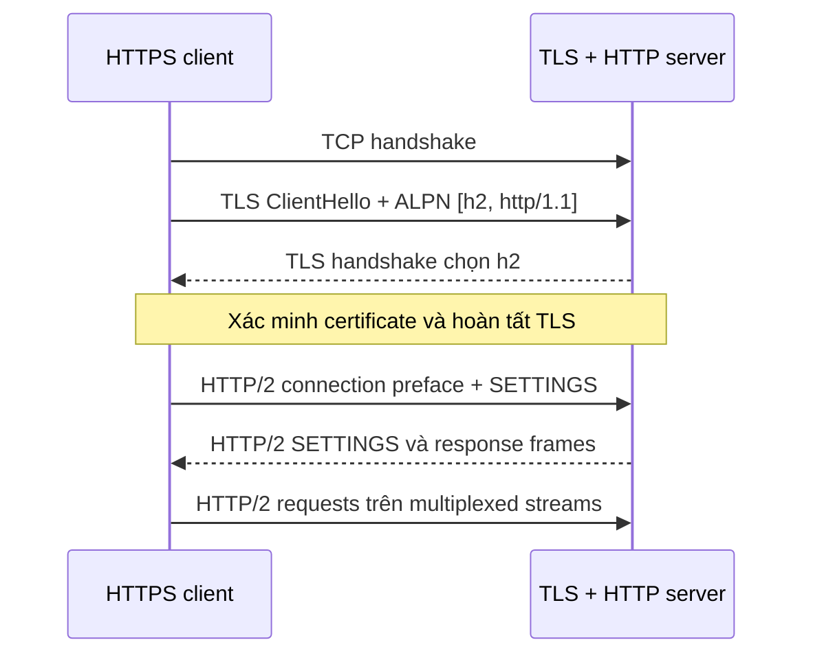
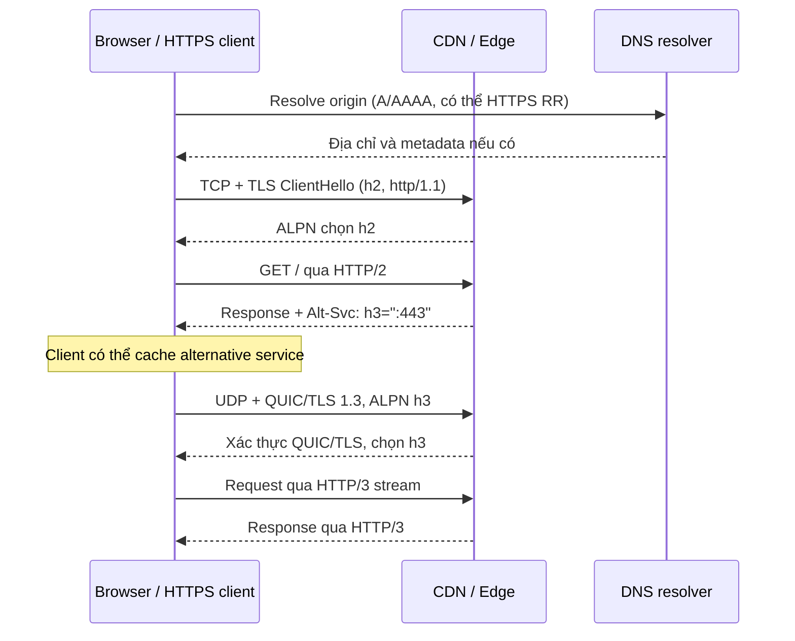
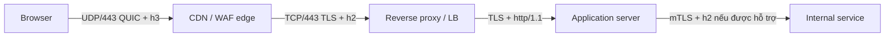

# ALPN và thương lượng HTTP/2 hoặc HTTP/3 trong TLS và QUIC

## 1. Tại sao một kết nối HTTPS cần thương lượng giao thức ứng dụng?

Khi người dùng mở `https://portal.example.com`, việc kết nối thành công qua TLS **chưa tự nói lên** hai phía sẽ trao đổi **HTTP/1.1, HTTP/2 hay HTTP/3**. Mỗi phiên bản HTTP có cách biểu diễn và truyền tải thông điệp riêng. Nếu client gửi frame nhị phân HTTP/2 nhưng server mong đợi cú pháp HTTP/1.1, hai phía sẽ không hiểu nhau, dù TLS được thiết lập đúng và chứng chỉ hợp lệ.

**Application-Layer Protocol Negotiation (ALPN)** là TLS extension được chuẩn hóa trong **RFC 7301**. Nó cho phép client thông báo các giao thức ứng dụng mà mình hỗ trợ, để server chọn một giao thức chung trong quá trình bắt tay bảo mật. Ví dụ:

- `http/1.1`: HTTP/1.1 trên kết nối TLS qua TCP.
- `h2`: HTTP/2 trên kết nối TLS qua TCP.
- `h3`: HTTP/3 trên QUIC, với handshake TLS 1.3 tích hợp vào QUIC.

ALPN **không phải HTTP header**, không mã hóa dữ liệu HTTP thay cho TLS và không phải cơ chế tự phát hiện mọi đường mạng hỗ trợ QUIC. Nó là **tín hiệu thương lượng giao thức ứng dụng** gắn với một kết nối bảo mật cụ thể.

Trong mô-đun **Security Network Security**, hiểu ALPN giúp đội vận hành thiết kế đúng **firewall, WAF, reverse proxy, CDN, TLS termination, IDS/IPS và hệ thống giám sát**. Một dịch vụ có thể nhận HTTP/3 từ Internet nhưng kết nối đến origin bằng HTTP/2 hoặc HTTP/1.1; kiểm tra một chặng không đủ kết luận toàn tuyến dùng cùng một protocol.

### Mục tiêu học tập

Sau bài này, người học có thể:

1. Giải thích ALPN hoạt động trong **TLS 1.2, TLS 1.3 và QUIC**.
2. Phân biệt **HTTP/2 qua TCP/TLS** với **HTTP/3 qua UDP/QUIC/TLS 1.3**.
3. Hiểu sự phối hợp của **ALPN, SNI, DNS HTTPS/SVCB record, Alt-Svc và certificate validation**.
4. Phân tích hành vi fallback, giới hạn quan sát và các rủi ro ở **CDN, WAF, load balancer và origin**.
5. Kiểm thử client/server, thiết kế telemetry, ứng phó khi HTTP/3 không hoạt động hoặc TLS/ALPN lệch chính sách.

## 2. Đặt ALPN vào đúng ngăn xếp giao thức

Một kết nối web có thể đi qua hai đường phổ biến:

```text
HTTP/2:
  HTTP/2 frames
       ↓
  TLS 1.2 hoặc TLS 1.3 (được cấu hình tương thích)
       ↓
  TCP
       ↓
  IP / Ethernet / Wi-Fi / ...

HTTP/3:
  HTTP/3 frames và QPACK
       ↓
  QUIC streams + QUIC connection management
       ↓
  TLS 1.3 handshake/key derivation tích hợp vào QUIC
       ↓
  UDP
       ↓
  IP / Ethernet / Wi-Fi / ...
```

**Không nên hiểu HTTP/3 là “HTTP/2 đổi cổng từ TCP sang UDP”.** HTTP/3 có mapping frame/stream và cơ chế nén header riêng, dựa trên **QUIC** thay vì TCP. QUIC sử dụng các cơ chế của **TLS 1.3 để bắt tay, xác thực và tạo khóa**, nhưng không đóng gói toàn bộ TLS records thông thường trên UDP như một TCP connection.

| Thành phần | Giải quyết vấn đề gì? | Có chọn HTTP version không? |
|---|---|---|
| **DNS A/AAAA** | tìm địa chỉ đích | không |
| **DNS HTTPS/SVCB** | quảng bá thông tin dịch vụ và tham số khả dụng theo thiết kế | hỗ trợ khám phá giao thức, **không thay quyết định ALPN cuối cùng** |
| **TCP** | vận chuyển byte stream có thứ tự | không |
| **UDP** | vận chuyển datagram | không |
| **TLS** | bắt tay, xác thực peer và mã hóa/tính toàn vẹn | mang ALPN khi được sử dụng |
| **ALPN** | chọn giao thức ứng dụng chung | có: `h2`, `http/1.1` hoặc `h3` tùy transport |
| **QUIC** | vận chuyển multiplexed streams, quản lý kết nối, khôi phục mất gói và tích hợp TLS 1.3 | có sử dụng ALPN để chọn ứng dụng như HTTP/3 |
| **HTTP/1.1, HTTP/2, HTTP/3** | mô hình request/response, headers và body | là giao thức được chọn |

Một client có thể hỗ trợ cả ba giao thức nhưng **không tự gửi HTTP/3 qua một socket TCP** sau khi ALPN báo `h2`. Cách kết nối và protocol được chọn phải **phù hợp đồng thời**.

## 3. ALPN hoạt động như thế nào?

### 3.1. Client đề xuất, server chọn

Client gửi danh sách **ALPN protocol identifiers** mà nó có thể sử dụng trong **ClientHello**. Một client HTTP trên TCP có thể đề xuất:

```text
ClientHello:
  ALPN protocols offered:
    - h2
    - http/1.1
```

Server căn cứ khả năng và chính sách của nó để chọn **một protocol** có mặt trong danh sách client. Nếu chọn `h2`, kết nối ứng dụng phía sau TLS phải thực sự nói HTTP/2. Nếu chọn `http/1.1`, hai phía dùng HTTP/1.1.

**Thứ tự client liệt kê không bắt buộc server phải chọn mục đầu tiên.** Server thực hiện lựa chọn theo cấu hình, khả năng hỗ trợ và giao thức chung; các implementation có thể khác nhau ở ưu tiên.

### 3.2. Vị trí phản hồi ALPN ở TLS 1.2 và TLS 1.3

| TLS version | Client đề xuất | Server thông báo lựa chọn |
|---|---|---|
| **TLS 1.2** | ALPN extension trong ClientHello | ALPN extension trong **ServerHello** |
| **TLS 1.3** | ALPN extension trong ClientHello | ALPN extension trong **EncryptedExtensions** |
| **QUIC với TLS 1.3** | handshake TLS 1.3 được vận chuyển qua các QUIC CRYPTO frames, có ALPN | server chọn qua **EncryptedExtensions** của TLS 1.3 bên trong QUIC |

Lựa chọn ALPN là một phần của **TLS handshake được xác thực khi bắt tay hoàn tất**, không phải kết quả do một HTTP header hay gói DNS tùy ý quyết định.

**Khác biệt quan sát:** ở TLS 1.3, thông tin lựa chọn nằm trong EncryptedExtensions được bảo vệ. Một IDS thụ động ở giữa đường có thể thấy client *đề xuất* giao thức trong một số điều kiện, nhưng **không nhất thiết thấy lựa chọn cuối cùng** nếu không có telemetry ở endpoint/điểm kết thúc TLS. Sự xuất hiện của ECH hoặc các mô hình proxy/tunnel còn có thể hạn chế những trường nhìn thấy từ bên ngoài.

### 3.3. Điều gì xảy ra khi không có giao thức chung?

Theo mô hình ALPN, server có thể kết thúc handshake bằng cảnh báo fatal **`no_application_protocol`** nếu không có giao thức phù hợp cho kết nối yêu cầu thương lượng đó. Một số triển khai/cấu hình có thể **không cung cấp ALPN**, khiến ứng dụng phải dựa vào quy tắc giao thức được xác định riêng hoặc thực hiện fallback kết nối theo khả năng sản phẩm.

Vì vậy cần phân biệt:

- **Không có giao thức chung:** có thể dẫn tới thất bại thương lượng.
- **Server không hỗ trợ hoặc không quảng bá ALPN:** không có lựa chọn ALPN; hành vi phụ thuộc giao thức ứng dụng và client.
- **Server chọn HTTP/1.1 dù client cũng đề xuất h2:** không nhất thiết là lỗi bảo mật, nếu policy cho phép.
- **Client yêu cầu h3 nhưng QUIC không đến được:** là vấn đề *đường kết nối/transport* trước khi nói tới ALPN của QUIC.

Trong hệ thống yêu cầu nghiêm ngặt HTTP/2 hoặc HTTP/3, không nên tự ý fallback sang một protocol khác mà không có **quy tắc chấp nhận và kiểm thử**. Trong hệ thống phục vụ trình duyệt phổ thông, fallback được thiết kế tốt là cách duy trì tính sẵn sàng.

## 4. ALPN không phải SNI, TLS version, cipher suite hay HTTP Host

Những trường này xuất hiện gần nhau trong quá trình kết nối nhưng phục vụ các mục đích khác nhau:

| Cơ chế | Câu hỏi chính | Ví dụ |
|---|---|---|
| **SNI (Server Name Indication)** | client muốn kết nối tên máy chủ nào để server chọn cấu hình/certificate phù hợp? | `portal.example.com` |
| **ALPN** | hai phía nói giao thức ứng dụng nào trên kết nối này? | `h2` |
| **TLS version** | các tính năng và quy tắc TLS nào áp dụng? | TLS 1.3 |
| **Cipher suite / key agreement** | thuật toán được dùng để bảo vệ dữ liệu/kết lập khóa trong TLS | AEAD suite phù hợp |
| **Certificate validation** | endpoint có xác minh danh tính/chuỗi tin cậy cho host đích không? | SAN, issuer, trust chain |
| **HTTP `:authority` / `Host`** | request đang hướng tới origin HTTP nào? | `portal.example.com` |
| **Alt-Svc / HTTPS RR** | client có thể biết một endpoint hoặc transport thay thế nào? | quảng bá h3 tại cổng 443 |

**SNI không chứng minh certificate hợp lệ**; client vẫn phải xác minh certificate theo hostname và policy tin cậy. **ALPN không xác thực domain**; nó chọn giao thức sau/đồng thời với quy trình thiết lập kênh bảo mật.

Với CDN và reverse proxy, cũng cần chú ý **SNI ở kết nối client→edge** có thể khác **SNI ở kết nối edge→origin**, và lựa chọn ALPN của hai kết nối cũng độc lập. Không được coi các header HTTP do client tự khai là nguồn sự thật thay thế việc kiểm tra kết quả TLS và routing của proxy.

## 5. HTTP/2 được thương lượng qua ALPN thế nào?

Khi truy cập **HTTPS over TCP**, client có thể đề xuất `h2` và `http/1.1`. Nếu server chọn `h2`, hai phía sau TLS trao đổi theo **HTTP/2 connection preface, SETTINGS và các frame của HTTP/2**.



Trong TLS 1.3, thông báo lựa chọn ALPN nằm trong **EncryptedExtensions**; sơ đồ gộp handshake cho dễ đọc.

### 5.1. Vì sao HTTP/2 không đơn thuần là HTTP/1.1 được nén?

HTTP/2 có:

- **Binary framing** thay vì biểu diễn request line và header như HTTP/1.1 truyền thống.
- **Multiplexing** nhiều stream logic trên **một kết nối TCP**.
- **HPACK** cho nén HTTP field section.
- Stream prioritization/flow control với những khả năng và giới hạn tùy phiên bản/triển khai.

Những khác biệt này đòi hỏi client và server **đồng thuận protocol ngay trước khi trao đổi HTTP messages**. Nếu server chọn `http/1.1`, client phải gửi request HTTP/1.1 hợp lệ thay vì bắt đầu gửi HTTP/2 frames.

### 5.2. HTTP/2 có bắt buộc TLS 1.3 không?

**Không.** HTTP/2 trên TLS có thể được triển khai với **TLS 1.2** theo các yêu cầu về cấu hình TLS/cipher suite của HTTP/2, hoặc TLS 1.3 khi hai phía hỗ trợ. Không thể suy ra “HTTP/2 = TLS 1.3”.

Đồng thời, chuẩn HTTP/2 áp đặt những yêu cầu và hạn chế về TLS 1.2, không nên cho rằng **mọi cipher suite cũ dùng được với h2**. Trong vận hành, nên chọn cấu hình TLS hiện đại theo chính sách tổ chức và khả năng client; không mở lại giao thức/cipher yếu chỉ vì một client cũ không nói được HTTP/2.

### 5.3. HTTP/2 cleartext: `h2c`

`h2c` là identifier liên quan **HTTP/2 qua TCP không dùng TLS** trong những cơ chế/kiến trúc hỗ trợ, không phải ALPN identifier dùng để chọn HTTP/2 trên HTTPS. Một số ứng dụng nội bộ có thể dùng cleartext HTTP/2 theo phương thức **prior knowledge** hoặc upgrade liên quan, tùy implementation.

**Không nhầm `h2` với `h2c`.** Đối với dịch vụ Internet và dữ liệu nhạy cảm, không cấu hình h2c public chỉ vì thấy HTTP/2 đã được hỗ trợ. Nếu thực sự dùng cleartext trên đường nội bộ, cần đánh giá **ranh giới tin cậy, mạng cách ly, service mesh/mTLS và yêu cầu tuân thủ**.

## 6. HTTP/3: QUIC + TLS 1.3 + ALPN `h3`

**HTTP/3 (RFC 9114)** ánh xạ HTTP semantics lên **QUIC**, một transport thường chạy qua **UDP**. QUIC cung cấp nhiều stream logic độc lập trong một kết nối, tích hợp chức năng bảo mật TLS 1.3 và những cơ chế kiểm soát packet loss/flow.

Để nói **HTTP/3 chuẩn**, endpoint phải có một **kết nối QUIC phù hợp** và thương lượng ứng dụng **`h3`** bằng ALPN trong handshake TLS 1.3 được QUIC mang theo.

```text
Client                    Edge HTTP/3 server
  |                             |
  |---- UDP / QUIC Initial ---->|
  |    TLS ClientHello          |
  |    ALPN: h3                 |
  |<--- QUIC handshake ---------|
  |    TLS 1.3 selects h3       |
  |                             |
  |==== QUIC 1-RTT traffic =====|
  |    HTTP/3 streams, frames  |
  |    QPACK header fields     |
```

**QUIC không chạy TCP.** HTTPS port `443` có thể cần **TCP/443** cho HTTP/1.1/HTTP/2 và **UDP/443** cho HTTP/3. Một firewall mở TCP/443 nhưng chặn UDP/443 có thể cho phép web hoạt động bình thường qua h2 trong khi **h3 không thể thiết lập**.

### 6.1. TLS 1.3 được tích hợp như thế nào?

QUIC sử dụng **TLS 1.3 handshake và key schedule** nhưng bản thân QUIC đảm nhận phần bảo vệ packet và vận chuyển những thông điệp handshake qua **CRYPTO frames**. Vì thế nói “QUIC = TLS records gửi trên UDP” là không chính xác.

QUIC sử dụng handshake để:

1. Thỏa thuận thông số mật mã và xác thực peer.
2. Thương lượng ứng dụng qua ALPN, thường `h3` cho HTTP/3.
3. Thiết lập khóa để bảo vệ các gói QUIC.
4. Thỏa thuận transport parameters mà QUIC cần.

**TLS 1.3 là nền tảng bắt buộc của QUIC theo các chuẩn QUIC hiện hành liên quan**; không có đường tương thích HTTP/3 chuẩn bằng cách lấy TLS 1.2 và đặt lên UDP.

### 6.2. Tại sao không chỉ đổi ALPN `h2` thành `h3`?

Vì:

- `h2` dùng framing, HPACK và multiplexing trên **TCP**.
- `h3` dùng **QUIC streams**, control streams và **QPACK** với framing phù hợp HTTP/3.
- Connection lifecycle, retransmission, packet ordering và flow control thuộc các lớp transport khác nhau.
- Số phiên/kết nối, điểm termination và quan sát của firewall/IDS cũng thay đổi.

Một server hỗ trợ cả hai phải có **hệ thống nhận TCP/TLS và UDP/QUIC** (có thể cùng sản phẩm edge), không chỉ thêm một chuỗi `h3` vào danh sách ALPN của TLS qua TCP.

## 7. Client biết server có HTTP/3 từ đâu?

**ALPN chọn giao thức trên một kết nối**, nhưng muốn bắt đầu QUIC client cần biết có thể thử **endpoint hỗ trợ HTTP/3**. Những cơ chế thường gặp:

### 7.1. HTTP Alternative Services (Alt-Svc)

Một server đang phục vụ HTTPS qua HTTP/1.1 hoặc HTTP/2 có thể thông báo rằng origin đó cũng có một **alternative service** qua HTTP/3:

```http
HTTP/2 200
alt-svc: h3=":443"; ma=86400
content-type: text/html
```

Ý nghĩa:

- `h3` chỉ **protocol identifier** được quảng bá.
- `":443"` cho biết endpoint alternative service dùng cổng 443 theo cú pháp Alt-Svc.
- `ma=86400` là **max-age 86400 giây (một ngày)** trong ví dụ; không phải thời gian bắt buộc mọi client dùng h3.

Client hỗ trợ có thể **lưu thông tin** và thử kết nối QUIC tới alternative service ở lần kết nối thích hợp. Client **không bắt buộc** dùng nó ngay hoặc thành công nếu UDP bị chặn, server không hỗ trợ, certificate không hợp lệ hoặc chính sách client không cho phép.

**Alt-Svc không thay đổi origin HTTP một cách vô điều kiện.** Việc sử dụng alternative service phải tuân theo mô hình origin, xác thực server/certificate và điều kiện an toàn trong chuẩn/implementation, tránh coi bất kỳ header tùy ý nào cũng có thể chuyển tài nguyên sang chủ thể không liên quan.

### 7.2. DNS HTTPS/SVCB resource records

**HTTPS resource record (RFC 9460)** dựa trên SVCB có thể quảng bá tham số kết nối của một dịch vụ HTTPS, trong đó có **ALPN protocol support** và thông tin endpoint liên quan theo quy tắc của record.

Ví dụ **minh họa cú pháp, không phải DNS zone thực của doanh nghiệp**:

```dns
example.com.  300  IN  HTTPS  1  .  alpn="h3,h2"
```

Khi client và resolver hỗ trợ cơ chế liên quan, record có thể giúp client **khám phá sớm** khả năng h3 mà không nhất thiết chờ phản hồi HTTP chứa Alt-Svc. Tuy nhiên:

- Record phải được phân giải và xử lý đúng loại/tham số.
- Client vẫn cần thiết lập **QUIC/TLS 1.3 và thương lượng h3 thành công**.
- Một số client, hệ điều hành, resolver, doanh nghiệp hoặc DNS policy có thể không sử dụng record.
- Không có HTTPS RR **không chứng minh** server không hỗ trợ HTTP/3.
- HTTPS RR không thay **certificate validation**, ALPN handshake hoặc xác thực origin.

### 7.3. Client cache và khả năng fallback

Một client từng truy cập một origin có thể đã cache Alt-Svc, HTTPS RR hoặc có hiểu biết khác về hỗ trợ HTTP/3; client mới ở vùng mạng khác có thể đi HTTP/2 trước. Vì thế hai máy thử cùng URL có thể **dùng giao thức khác nhau** mà không phải server cấu hình mâu thuẫn.

**Kết luận:** Alt-Svc và HTTPS RR là **tín hiệu khám phá**, còn ALPN là **kết quả thương lượng giao thức của phiên cụ thể**.

## 8. Luồng kết nối HTTP/2 → quảng bá HTTP/3 → dùng QUIC



Đây là **một luồng ví dụ**, không phải đường bắt buộc cho mọi client. Client có hỗ trợ DNS HTTPS RR có thể thử h3 sớm; client khác không hỗ trợ h3 hoặc bị chặn UDP có thể **tiếp tục ở h2**. Browser và CDN có thể áp dụng thuật toán thử song song, cache và timeout riêng.

### 8.1. Phân biệt ba thời điểm quyết định

1. **Discover:** client biết endpoint có thể hỗ trợ h3 từ Alt-Svc, DNS HTTPS RR hoặc metadata sẵn có.
2. **Connect:** client thử UDP/QUIC và TLS 1.3, network cho qua hoặc chặn.
3. **Negotiate:** hai endpoint trên kết nối QUIC chọn ALPN `h3`; sau đó mới nói HTTP/3.

Một header Alt-Svc thành công chỉ chứng minh bước **quảng bá**. Nó không chứng minh rằng thiết bị khách đã thực sự dùng HTTP/3.

## 9. So sánh HTTP/1.1, HTTP/2 và HTTP/3 theo góc vận hành

| Tiêu chí | HTTP/1.1 | HTTP/2 | HTTP/3 |
|---|---|---|---|
| Transport phổ biến với HTTPS | TCP | TCP | QUIC qua UDP |
| Bảo mật kênh web | TLS khi dùng HTTPS | TLS khi dùng HTTPS; có cơ chế cleartext riêng ngoài phạm vi ALPN HTTPS | TLS 1.3 tích hợp trong QUIC |
| ALPN identifier | `http/1.1` | `h2` | `h3` |
| Đơn vị truyền | request/response trong cú pháp text-oriented | binary frames và streams | HTTP/3 frames trên QUIC streams |
| Header compression | không theo cơ chế HPACK/QPACK | **HPACK** | **QPACK** |
| Multiplex nhiều request | giới hạn bởi cấu trúc connection và client | có, trên một TCP connection | có, trên QUIC streams |
| Ảnh hưởng mất packet | theo TCP và connection | **TCP-level HOL blocking** ảnh hưởng nhiều streams trong cùng connection | giảm phụ thuộc thứ tự giữa streams khi mất packet; vẫn có flow control/dependencies |
| Mạng cần mở | TCP port HTTPS | TCP port HTTPS | UDP port QUIC, thường UDP/443 |
| Giám sát/packet parser | HTTP/1.1 sau TLS termination | HTTP/2 framing sau TLS termination | QUIC/HTTP/3-aware tooling hoặc log tại termination |
| Khả năng thiết bị cũ | rộng | tương đối rộng | cần QUIC/HTTP/3 và network tương thích |

### 9.1. Head-of-line blocking không hoàn toàn biến mất

HTTP/2 multiplex nhiều stream nhưng vẫn dựa vào **TCP byte stream có thứ tự**. Một packet TCP bị mất có thể giữ lại dữ liệu sau nó đối với toàn connection, ảnh hưởng việc giao dữ liệu tới các HTTP/2 streams.

QUIC truyền dữ liệu trên **các stream độc lập**, nên mất dữ liệu của một stream thông thường không buộc các stream khác chờ dữ liệu đó theo cùng cách như TCP. Nhưng QUIC/HTTP/3 vẫn có **giới hạn congestion control, flow control, application dependencies và QPACK dynamic table references**; không nên quảng bá rằng HTTP/3 “không bao giờ bị HOL blocking hoặc trễ”.

### 9.2. Nhanh hơn không phải luôn đúng

HTTP/3 có thể mang lại lợi ích đáng kể ở một số mạng có **latency/loss/mobility** hoặc khi tái kết nối, nhưng có trường hợp HTTP/2 hoạt động tốt hơn do:

- UDP bị throttling/blocked.
- QUIC stack, CPU hoặc đường mạng chưa được tối ưu.
- Middlebox, NAT hoặc PMTU gây mất packet.
- Website tải nhiều tài nguyên từ nhiều origin và các dependency khác.
- CDN/ISP có hiệu năng khác nhau theo region và thiết bị.

**Protocol negotiation là một phần của tối ưu hiệu năng, không phải một bảo đảm SLO.** Cần đo theo dữ liệu thực.

## 10. ALPN và tính toàn vẹn khi thương lượng giao thức

Khi TLS handshake hoàn tất hợp lệ, dữ liệu thương lượng ALPN được ràng buộc trong quy trình xác thực của handshake. Điều này làm khác đi đáng kể so với mô hình client đọc một HTTP header chưa xác thực và tự tin tưởng server nói bất kỳ protocol nào.

Tuy nhiên, có các giới hạn:

- **Giao thức được chọn chỉ an toàn bằng cấu hình và implementation của nó.** Chọn `h2` không loại bỏ lỗ hổng parser, HTTP request smuggling ở proxy chain hoặc lỗi ứng dụng.
- **Certificate validation vẫn bắt buộc.** ALPN `h3` đúng không có nghĩa endpoint là server của domain mong đợi.
- **Client fallback hợp lệ** có thể làm protocol thực tế khác ưu tiên ban đầu, nhất là khi UDP bị chặn.
- **Proxy/TLS interception** có thể tạo các phiên TLS khác nhau; mỗi phiên có ALPN và certificate policy riêng.
- **ALPN không phải authorization.** Chọn HTTP/3 không xác định principal nào được phép đọc dữ liệu.

### 10.1. Downgrade về HTTP/2 có phải luôn là tấn công?

**Không.** Nếu UDP/443 bị firewall chặn, client có thể dùng HTTP/2 qua TCP/443 để duy trì dịch vụ. Đây có thể là **fallback có chủ đích**.

Tuy nhiên, thay đổi bất thường về tỉ lệ h3→h2 có thể là **tín hiệu vận hành/an ninh** cần tìm nguyên nhân: firewall mới, provider issue, cấu hình Alt-Svc sai, WAF chưa hỗ trợ h3, lỗi TLS/QUIC hoặc can thiệp đường mạng. Không thể kết luận **downgrade attack** chỉ từ việc thấy `h2`.

Khi chính sách thực sự **bắt buộc một phiên bản**, server/client phải enforce yêu cầu tại đúng endpoint và có kiểm thử, chứ không dựa vào header quảng bá Alt-Svc.

## 11. 0-RTT trong TLS 1.3/QUIC: hiệu năng và nguy cơ replay

**0-RTT (early data)** có thể cho phép một client đã có ngữ cảnh/resumption thích hợp gửi dữ liệu ứng dụng sớm hơn trong một lần kết nối sau. Trong QUIC, khả năng này thường được thảo luận cùng HTTP/3 vì giảm độ trễ ở những kết nối lặp lại.

**Điểm bảo mật quan trọng:** early data có những thuộc tính chống replay **khác với dữ liệu sau handshake đã hoàn tất**. Một số dữ liệu 0-RTT có thể bị replay trong các tình huống mà ứng dụng phải tự đánh giá, tùy triển khai và biện pháp chống replay.

### 11.1. Những thao tác cần cảnh giác

| Tác vụ HTTP | Rủi ro nếu bị replay | Gợi ý chính sách |
|---|---|---|
| GET tài nguyên công khai, không tạo tác dụng phụ | thường dễ kiểm soát hơn | có thể cân nhắc theo server/client policy và dữ liệu |
| GET có side effect do ứng dụng thiết kế sai | có thể tạo tác dụng lặp | sửa semantic ứng dụng; không tự cho phép early data |
| POST thanh toán hoặc đặt hàng | nguy cơ giao dịch lặp lại | không xử lý thiếu kiểm soát bằng 0-RTT; idempotency key và bảo vệ ứng dụng |
| Thay đổi mật khẩu, role, dữ liệu nhạy cảm | rủi ro trạng thái/ủy quyền nếu replay | đợi handshake hoàn tất và xác thực/ủy quyền đầy đủ |
| API ghi dữ liệu idempotent có bảo vệ | phụ thuộc business logic và replay window | chỉ cân nhắc khi có chính sách cụ thể và test đủ |

**HTTP status `425 Too Early`** có thể được server sử dụng để báo client thử lại yêu cầu theo cơ chế thích hợp khi không muốn xử lý early data vì lo replay. Không nên gửi 425 tùy tiện hoặc giả định tất cả client sẽ retry theo cùng cách; kiểm thử theo SDK/browser.

### 11.2. 0-RTT không đồng nghĩa mọi request đều nhanh hơn

Không phải client mới chưa từng kết nối nào cũng có dữ liệu phiên để dùng 0-RTT. Cache/resumption policy, key rotation, server configuration, replay defense, QUIC version và client support ảnh hưởng hiệu lực.

Mặc định an toàn với API nhạy cảm là **không nhận early data cho thao tác có side effect khi chưa có cơ chế chống replay được đánh giá**. Không được bật 0-RTT chỉ vì bài đo kết nối tổng hợp giảm latency.

## 12. QUIC, chống khuếch đại và khả năng chịu DoS

HTTP/3 dùng UDP làm transport. Điều này thay đổi cách thiết kế **rate limit, connection tracking, chống spoofing và DDoS mitigation**.

### 12.1. Xác minh địa chỉ và giới hạn amplification của QUIC

QUIC có các cơ chế **address validation**, chẳng hạn qua token/Retry theo điều kiện sử dụng, để giảm nguy cơ lợi dụng server gửi nhiều dữ liệu tới địa chỉ nguồn giả. Với một số giai đoạn trước khi địa chỉ được xác minh, QUIC giới hạn lượng dữ liệu server có thể gửi **tối đa gấp ba lần số byte nhận được** theo quy tắc chống amplification của QUIC trong phạm vi áp dụng.

Đây là **biện pháp giảm reflection/amplification ở giai đoạn chưa xác minh**, không bảo đảm QUIC/HTTP/3 miễn nhiễm mọi DDoS:

- Server vẫn có thể chịu tải CPU/memory/pps khi xử lý kết nối mới.
- Lưu lượng từ nguồn thật hoặc botnet có thể tiêu tốn băng thông.
- Retry/address validation có thể tác động trải nghiệm và latency.
- WAF/edge vẫn phải có capacity, rate control, bot protection và nhà cung cấp DDoS upstream phù hợp.

### 12.2. Quản trị QUIC ở firewall và IDS/IPS

Thiết bị chỉ phân tích TCP/HTTP/2 có thể không hiểu **QUIC packets và HTTP/3 streams**. Với mạng doanh nghiệp:

- Xem chính sách UDP/443 ở edge và egress theo mục đích.
- Không coi “UDP/443 là traffic xấu” cho mọi mạng, nhưng có thể hạn chế theo chính sách và đường egress được phê duyệt.
- Bố trí telemetry ở **QUIC termination/CDN/WAF** khi cần HTTP request context.
- Theo dõi drops, pps, connection attempts, retry rate, TLS errors, stream errors và SLO.
- Tránh ra quyết định chặn dựa duy nhất vào chuỗi ALPN trong ClientHello khi dữ liệu không đáng tin cậy/không đầy đủ.

Một firewall có thể cho HTTP/2 hoạt động trên TCP/443 nhưng khiến browser không thử được HTTP/3; đó là điều phải biết trong **thiết kế chính sách**, không nhất thiết là sai.

## 13. HTTP/3 và đường đi qua NAT, roaming, load balancer

**QUIC connection ID (CID)** hỗ trợ quản lý kết nối khi địa chỉ IP/port có thể thay đổi và cho phép endpoint liên kết các packet với một connection theo quy tắc giao thức. Một số mô hình QUIC có thể hỗ trợ **connection migration** và khôi phục khi client đổi đường mạng.

Tuy nhiên:

- Không phải mọi client/server triển khai migration giống nhau, và policy có thể hạn chế.
- Load balancer QUIC phải có chiến lược định tuyến packet của một connection đến backend phù hợp.
- NAT/firewall UDP idle timeout quá ngắn có thể làm mất đường hoặc tạo hiện tượng reconnect.
- CID là metadata của QUIC để định tuyến/trạng thái, **không phải user identity** và không nên coi nó là token ủy quyền.
- Nếu backend dùng shared cryptographic material/state cho retry/reset hoặc routing, việc quản lý khóa cần tuân thiết kế của giải pháp.

### 13.1. Anycast và kết nối UDP

CDN/edge có thể dùng **Anycast**. Khi route đổi PoP hoặc đường đi giữa kết nối, các cơ chế quản lý CID và trạng thái backend có thể ảnh hưởng tính liên tục. Không suy từ “dùng Anycast” ra một bảo đảm session migration hoặc không gián đoạn.

Trong monitoring, cần phân biệt:

1. **New QUIC connection**, do browser quyết định thử h3.
2. **QUIC migration/path validation**, khi cùng connection đổi path theo cơ chế được hỗ trợ.
3. **Fallback sang TCP h2**, khi HTTP/3 không khả dụng.

Chúng có dấu vết và tác động trải nghiệm khác nhau, dù người dùng chỉ thấy một lần mở website.

## 14. CDN, reverse proxy và ALPN trên từng chặng TLS

Kiến trúc thường gặp:



**Bốn mũi tên ở đây chỉ là ví dụ**. Không có quy tắc yêu cầu edge phải nói h2 với proxy hoặc origin phải dùng h1; từng chặng phụ thuộc cấu hình/capability.

### 14.1. ALPN là thuộc tính từng connection

Giả sử:

- Browser ↔ CDN: QUIC/TLS 1.3, **ALPN `h3`**.
- CDN ↔ load balancer: TCP/TLS 1.3, **ALPN `h2`**.
- Load balancer ↔ origin: TCP/TLS 1.2/1.3, **ALPN `http/1.1`** hoặc cấu hình giao thức cố định.

Đây **không phải một kết nối end-to-end có ba ALPN**, mà là **ba kết nối** với các security boundary riêng. Vì vậy:

- Log client thấy h3 không chứng minh origin xử lý HTTP/3.
- Một NIDS sau edge chỉ thấy h2/h1 nếu edge đã kết thúc QUIC.
- Certificate ở từng chặng có yêu cầu xác thực khác nhau.
- WAF inspect HTTP tại **nơi TLS/QUIC được terminate và parser tương ứng hoạt động**, không phải trên traffic mã hóa ngoài điểm đó.

### 14.2. Reverse proxy và request semantic

Khi chuyển HTTP/3 → HTTP/2 → HTTP/1.1, proxy cần **chuẩn hóa request**, áp giới hạn header/body và tạo representation phù hợp. Rủi ro có thể xảy ra nếu:

- Frontend/backend diễn giải không nhất quán `Content-Length`, `Transfer-Encoding` hoặc các trường điều khiển liên quan.
- Xử lý pseudo-headers HTTP/2/3, `:authority` và `Host` không đúng.
- Hệ thống WAF/parsers bỏ qua những frame/stream/control patterns không hỗ trợ.
- Proxy tin các header **client IP** do bên ngoài tự khai.
- Request body streaming, trailers, upgrade/CONNECT hoặc gRPC bị chuyển đổi sai semantics.

Điều này liên quan đến **HTTP request desynchronization/smuggling** và rủi ro protocol translation. Biện pháp phòng vệ là **proxy/HTTP stack được cập nhật, parser thống nhất, kiểm thử tích hợp, header normalization và audit ở chặng nhận request**.

### 14.3. mTLS ở origin

Nếu CDN và origin giao tiếp qua **mTLS**, kết nối đó có cơ chế xác thực cả hai phía theo certificate policy, nhưng **mTLS không tự chọn `h2` hoặc `h3`**. ALPN vẫn được thương lượng theo transport hỗ trợ, còn mTLS thực hiện xác thực peer ở chặng tương ứng.

Không hạ TLS ở origin xuống plaintext chỉ để một IDS đọc HTTP. Khi cần quan sát, ưu tiên **access logs, tracing, WAF tại termination và endpoint telemetry**; nếu có inspection được ủy quyền phải bảo vệ dữ liệu và thẩm quyền truy cập.

## 15. HTTP/2, HTTP/3 và bảo mật API, gRPC, WebSocket

### 15.1. API REST/JSON

API vẫn sử dụng HTTP semantics dù transport là h1/h2/h3. Những yêu cầu sau **không biến mất**:

- Authentication/authorization theo endpoint, tenant và object.
- Validation input, chống SQL injection/XSS/SSRF khi áp dụng.
- Rate limit, chống bot/credential stuffing và giới hạn payload.
- Logging request ID, status, principal và dữ liệu cần thiết cho điều tra.
- Bảo vệ idempotency/replay ở thao tác thay đổi trạng thái, đặc biệt khi bật 0-RTT.

**WAF/HTTP gateway** phải hiểu protocol thực sự terminate ở nó. Việc bật h3 ở CDN không chứng minh backend API đã hỗ trợ h3 hoặc được bảo vệ bởi cùng rule sau một chặng chuyển đổi.

### 15.2. gRPC

**gRPC truyền thống phổ biến dùng HTTP/2**, bao gồm stream và metadata theo ngữ nghĩa của nó; một số môi trường đang có hỗ trợ/tích hợp HTTP/3 nhưng **không được mặc định mọi gRPC library/proxy đều hỗ trợ HTTP/3**.

Trong vận hành, nếu service mesh/gRPC yêu cầu `h2` hoặc HTTP/2 prior knowledge trên đường được kiểm soát, phải kiểm tra cấu hình riêng cho **edge và backend**. Tránh đổi toàn bộ origin sang `h3` chỉ vì browser bên ngoài hỗ trợ HTTP/3.

### 15.3. WebSocket và extended CONNECT

WebSocket truyền thống có HTTP/1.1 upgrade handshake. HTTP/2 và HTTP/3 có những cơ chế **extended CONNECT hoặc liên quan** theo chuẩn/implementation để hỗ trợ một số ứng dụng như WebSocket, nhưng **không phải mọi gateway, WAF và SDK** đều xử lý giống nhau.

Kiểm thử cần xem:

- Proxy có hỗ trợ đúng cơ chế WebSocket trên protocol đang thương lượng không?
- Header và flow-control có bị biến đổi sai qua chặng h3↔h2↔h1 không?
- Idle timeout, keepalive, disconnect và backpressure hoạt động đúng không?
- WAF kiểm tra initial request, các frame tiếp theo và dữ liệu nhạy cảm ở mức được hỗ trợ không?

Một API GET thành công qua h3 **không đủ chứng minh** mọi ứng dụng streaming/WebSocket cũng hoạt động.

## 16. HTTPS DNS record, Alt-Svc và quản lý cấu hình đồng bộ

Ba nguồn cấu hình thường liên quan:

```text
DNS:
  A/AAAA, HTTPS/SVCB records

Edge:
  TCP/443 TLS ALPN: h2, http/1.1
  UDP/443 QUIC/TLS ALPN: h3

HTTP response:
  Alt-Svc: h3=":443"; ma=86400
```

Đây là mô hình mô tả trạng thái mong muốn, không phải cú pháp cấu hình có thể chép thẳng cho Nginx/Envoy/CDN.

### 16.1. Những sai lệch cấu hình thường gặp

| Sai lệch | Triệu chứng | Hướng xác minh |
|---|---|---|
| Quảng bá Alt-Svc `h3` nhưng UDP/443 bị chặn | client thử rồi quay về h2, chậm hoặc có lỗi tùy implementation | kiểm tra UDP path, firewall, QUIC edge listener |
| DNS HTTPS RR quảng bá h3, edge chưa sẵn sàng | một số client thử QUIC sớm và gặp lỗi | xem zone, readiness và policy rollout |
| Gateway hỗ trợ h3 nhưng WAF rule chỉ inspect h2 | khoảng trống kiểm tra hoặc logging theo sản phẩm | xác minh termination point và parity của WAF rules |
| Edge chấp nhận h3, origin chỉ hỗ trợ h1 | website thường vẫn hoạt động | cần kiểm tra protocol translation, không mặc định là lỗi |
| ALPN chọn h2 nhưng backend gửi HTTP/1.1 | lỗi protocol framing/connection | kiểm tra ALPN negotiated và backend listener |
| TLS certificate không hợp lệ | client chặn/không tin endpoint | xác minh chain, SAN, SNI và thời gian |
| Endpoint hỗ trợ TCP nhưng không có QUIC | h1/h2 hoạt động, h3 thất bại | kiểm tra khả năng sản phẩm và edge listener |
| HTTPS RR/cấu hình Alt-Svc còn cache | một số client tiếp tục thử endpoint cũ | quản lý TTL/max-age và lộ trình rollback |

### 16.2. Rollback an toàn

Nếu vừa bật HTTP/3 gặp lỗi diện rộng, có thể cân nhắc **ngừng quảng bá h3 mới** và điều chỉnh listener theo change plan. Nhưng client đã cache Alt-Svc hoặc HTTPS RR có thể còn thử h3; do đó cần **theo dõi max-age/TTL, lỗi QUIC và fallback** chứ không kỳ vọng tắt header là mọi thiết bị ngừng kết nối UDP ngay lập tức.

Rollback phải bảo vệ cả **khả năng truy cập hợp lệ** lẫn chính sách TLS/WAF, không chuyển tạm sang TLS yếu hoặc tắt authentication.

## 17. Phân tích giới hạn quan sát ở TLS/QUIC

### 17.1. Mạng ngoài TLS termination thấy gì?

Một hệ thống giám sát thụ động ở ngoài có thể nhận:

- IP nguồn/đích, port, protocol TCP/UDP, thời gian, kích thước và tốc độ gói.
- Một số metadata của handshake phụ thuộc protocol/version và cơ chế bảo vệ.
- Các dấu hiệu về QUIC packets theo khả năng của decoder.

Nhưng nó **không tự đọc HTTP path, query, body hoặc response nội dung** đã mã hóa. Với TLS 1.3, selected ALPN được bảo vệ trong EncryptedExtensions. Đọc danh sách ALPN **offered** của client không đồng nghĩa biết protocol **selected** của phiên đó.

### 17.2. TLS 1.3 và QUIC trong packet capture

Một công cụ capture có thể nhận diện **QUIC Initial** và một số dữ liệu protocol nhờ đặc tính công khai của Initial keys trong một số phiên bản QUIC, nhưng điều đó **không cho phép đọc tùy ý toàn bộ HTTP/3 payload**. Những giai đoạn bảo mật tiếp theo và dữ liệu 1-RTT được bảo vệ theo session keys.

Muốn xác nhận giao thức/HTTP events, nên ưu tiên:

1. **Client developer tools hoặc client logs** (protocol thực cho request).
2. **CDN/edge/gateway logs** ở nơi chấm dứt TLS/QUIC.
3. **HTTP server logs/tracing** có request ID và TLS/ALPN metadata nếu sản phẩm hỗ trợ.
4. **Flow/packet counters** để hiểu UDP drops, TCP fallback và mất gói.

### 17.3. SNI, ECH và bảo vệ metadata

Một số triển khai dùng **Encrypted ClientHello (ECH)** để bảo vệ thêm các thành phần của ClientHello khỏi người quan sát trung gian. Khả năng nhìn SNI hoặc những trường đề xuất trong handshake có thể thay đổi theo cách client/server hỗ trợ ECH.

Vì thế không thiết kế hệ thống IDS/egress policy dựa trên giả định **mọi kết nối HTTPS đều lộ chính xác hostname và ALPN của ứng dụng**. Khi cần quyết định identity/authorization, sử dụng **các log và điểm kiểm soát tin cậy**, không phụ thuộc duy nhất vào suy đoán từ packet metadata.

## 18. Lệnh kiểm tra ALPN và giao thức theo cách được cấp phép

Các lệnh dưới đây chỉ nhằm **kết nối thử với endpoint hợp lệ**, không thay đổi server hoặc tạo lưu lượng lớn. Thay domain bằng **dịch vụ mà bạn sở hữu hoặc được phép kiểm thử**.

### 18.1. Kiểm tra HTTP/2/HTTP/1.1 qua TLS

```bash
# Quan sát TLS certificate và ALPN trên cổng HTTPS
openssl s_client -connect example.com:443 \
  -servername example.com \
  -alpn h2,http/1.1

# Chọn HTTP/2 nếu curl được build hỗ trợ; quan sát protocol thực
curl -I -v --http2 https://example.com/

# Yêu cầu HTTP/1.1 để so sánh kết nối TCP/TLS
curl -I -v --http1.1 https://example.com/
```

**Cách đọc kết quả:**

- `openssl s_client` có thể hiển thị `ALPN protocol: h2` hoặc `http/1.1` nếu thương lượng được; nó **không tự kiểm tra hành vi request HTTP/2**.
- Cần xác minh certificate/hostname theo policy. Lệnh quan sát handshake không phải bằng chứng rằng toàn bộ ứng dụng đang an toàn.
- `curl --http2` biểu thị client **cố gắng dùng HTTP/2**, nhưng phiên có thể rơi về HTTP/1.1 tùy server/build; kiểm tra dòng protocol trong output, không chỉ exit code.
- `-I` dùng phương thức HEAD; một số ứng dụng có thể trả lỗi riêng cho HEAD dù GET hoạt động.
- `-v` có thể hiển thị request headers; tránh chạy kèm token/cookie thật trong log công khai.

### 18.2. Kiểm tra HTTP/3 khi curl hỗ trợ

```bash
# Kiểm tra curl có build hỗ trợ HTTP/3 không
curl --version

# Chỉ thử HTTP/3; sẽ báo lỗi nếu build/đường mạng không hỗ trợ
curl -I -v --http3-only https://example.com/

# Cho phép thử HTTP/3 và fallback tùy curl/build
curl -I -v --http3 https://example.com/
```

Không phải mọi bản phân phối `curl` có cùng tùy chọn/build QUIC. Nếu `--http3-only` không được hỗ trợ, đó là **giới hạn client**, không chứng minh server không có HTTP/3. Nếu option được hỗ trợ mà request thất bại, kiểm tra thêm DNS, UDP/443, TLS, edge listener và certificate trước khi quy nguyên nhân.

### 18.3. Kiểm tra HTTPS DNS resource record và Alt-Svc

```bash
# Xem DNS HTTPS RR của tên miền được phép
dig example.com HTTPS

# Xem A / AAAA thông thường
dig example.com A
dig example.com AAAA

# Xem response headers, gồm Alt-Svc nếu server quảng bá
curl -I -v --http2 https://example.com/
```

Không có Alt-Svc trong một response HEAD **không chứng minh** HTTP/3 không khả dụng; CDN có thể chỉ quảng bá ở một số response/region hoặc dùng HTTPS RR. Không suy ra nội dung HTTPS RR là kết quả bắt tay ALPN đã xảy ra.

### 18.4. Quan sát cổng TCP/UDP tại server do tổ chức quản lý

```bash
# Trên Linux server được cấp quyền, xem listener TCP
ss -lnt

# Xem listener UDP, trong đó có thể có QUIC/443
ss -lnu
```

Listener UDP/443 hiện diện **không chứng minh** hoàn tất HTTP/3 handshake hoặc WAF/edge xử lý đúng. Ngược lại, listener có thể nằm ở một upstream CDN/load balancer, nên backend origin không thấy UDP/443 là bình thường. Kiểm tra tại **đúng chặng** mà kiến trúc yêu cầu.

## 19. Troubleshooting: HTTP/3 không hoạt động thì đi từ đâu?

Sử dụng quy trình phân tầng thay vì ngay lập tức thay đổi toàn bộ TLS config:

### Bước 1 — Xác định client và hành vi thật

- Client/browser/curl version có hỗ trợ h3 không?
- Request đang đi trực tiếp, qua forward proxy, corporate firewall hay VPN?
- Developer tools/edge log báo `h3`, `h2` hay `http/1.1`?
- Lỗi xuất hiện ở **một client, một ISP, một region hay toàn cầu**?

### Bước 2 — Kiểm tra discovery

- Có Alt-Svc `h3` đúng format/port không?
- DNS HTTPS RR có giá trị đúng không, có được client dùng không?
- Cache Alt-Svc/HTTPS RR còn chỉ về endpoint cũ không?
- DNS A/AAAA/HTTPS có bất đồng giữa authoritative và resolver không?

### Bước 3 — Kiểm tra QUIC/UDP path

- UDP/443 từ client tới edge có được route/allow không?
- Firewall/NAT có UDP timeout, packet-size hoặc chính sách chặn QUIC không?
- Edge listener có nhận QUIC traffic và hỗ trợ phiên bản client không?
- Có nghẽn pps, packet loss, MTU/PMTU hoặc fragmentation issues không?

### Bước 4 — Kiểm tra TLS/ALPN và certificate

- Handshake TLS 1.3 trong QUIC có hoàn tất không?
- Server chọn ALPN `h3` khi client cung cấp `h3` không?
- Certificate chain, hostname/SNI và trust validation có đúng không?
- Edge/CDN có cùng cấu hình trên các PoP và node không?

### Bước 5 — Kiểm tra HTTP/3 ở tầng ứng dụng

- QUIC handshake thành công nhưng HTTP/3 SETTINGS, QPACK hoặc stream bị lỗi?
- WAF/API gateway/parser có hỗ trợ nội dung request thực không?
- Có lỗi với POST/streaming/WebSocket/gRPC, còn GET hoạt động không?
- Origin backend có bị quá tải vì chuyển đổi h3→h2/h1 hay không?

### Bước 6 — Xác định fallback và phạm vi ảnh hưởng

- Khi h3 thất bại, client có dùng h2 thành công không?
- Fallback mất bao lâu và có gây timeout trong ứng dụng không?
- Log có đủ để phân biệt h3 unsupported, UDP blocked, TLS failure và HTTP application error không?

**Không kết luận:** “h2 vẫn chạy, vậy HTTP/3 chắc chắn không có lỗi” — h2 có thể che giấu một sự cố UDP/QUIC rộng. Nhưng nếu người dùng vẫn đạt SLO và chính sách cho phép fallback, vấn đề có thể được xử lý như **giảm tối ưu** thay vì outage toàn phần.

## 20. Quan sát hiệu năng và tín hiệu an ninh

| KPI / sự kiện | Ý nghĩa | Cảnh báo khi nào? |
|---|---|---|
| **ALPN selected share** | tỉ lệ h1/h2/h3 theo client, PoP, dịch vụ | thay đổi bất thường ngoài kế hoạch |
| **HTTP/3 success rate** | request thành công trên QUIC/h3 | giảm theo region/client hoặc sau thay đổi |
| **QUIC handshake failure** | lỗi trước HTTP request | tăng đồng thời với UDP drops/TLS errors |
| **UDP/443 allow/drop** | tình trạng edge/firewall path | block hoặc hạn chế ngoài policy |
| **TCP fallback rate** | tỉ lệ client không dùng được h3 và dùng h2/h1 | tăng đột biến, trải nghiệm bị ảnh hưởng |
| **Handshake/connection latency** | chi phí thiết lập kết nối | p95/p99 tăng, network không ổn định |
| **0-RTT accept/reject** | early data theo policy | 0-RTT bị xử lý sai ở API nhạy cảm |
| **Certificate/TLS errors** | danh tính endpoint hoặc bảo mật kênh | tăng sau rotation/edge rollout |
| **WAF rule parity** | mức kiểm tra h1/h2/h3 ở điểm termination | h3 có lỗ hổng policy/logging so với h2 |
| **Origin 4xx/5xx** | ứng dụng/backend hoạt động thế nào | tăng khi edge đổi h3 hoặc translate protocol |
| **QPACK/stream errors** | lỗi giao thức h3 | tập trung một SDK/region/edge node |
| **Request SLO** | ảnh hưởng người dùng cuối | latency/availability vượt mục tiêu |

### 20.1. Mẫu event tương quan

```json
{
  "time_utc": "2026-11-28T02:10:00Z",
  "request_id": "request-demo-001",
  "host": "portal.example.com",
  "edge_pop": "example-pop",
  "client_transport": "udp-quic",
  "client_alpn_selected": "h3",
  "client_tls_version": "TLSv1.3",
  "origin_transport": "tcp-tls",
  "origin_alpn_selected": "h2",
  "http_status": 200,
  "quic_handshake_result": "success",
  "waf_action": "allow",
  "latency_ms": 45,
  "source": "illustrative-edge-log"
}
```

Các giá trị **chỉ minh họa**. Trường cụ thể của CDN/reverse proxy có thể khác và không phải vendor nào cũng ghi ALPN selected của cả client lẫn origin. Khi không có trường, đánh dấu **unknown** thay vì suy ra `h3` từ việc thấy Alt-Svc.

### 20.2. Bảo vệ dữ liệu telemetry

Log HTTP/edge có thể chứa URL, query parameter, IP, user agent hoặc token nếu cấu hình sai. Chỉ lưu dữ liệu cần thiết; **mask bí mật/cookie, kiểm soát retention, mã hóa đường truyền và giới hạn quyền tra cứu**. Không bật full packet decryption/capture ở production nếu chưa có căn cứ, phạm vi ủy quyền và biện pháp bảo vệ dữ liệu.

## 21. Thiết kế rollout HTTP/3 từng giai đoạn

### Giai đoạn A — Inventory và chuẩn bị

Kiểm kê:

1. Những origin cần hỗ trợ browser h3 tại CDN hoặc trực tiếp.
2. CDN/LB/WAF có hỗ trợ QUIC và HTTP/3 ở **edge nào**, phiên bản nào.
3. DNS HTTPS RR, Alt-Svc và các giá trị TTL/max-age đang dùng.
4. Firewall/ISP/SD-WAN/VPN có cho UDP/443 theo policy không.
5. HTTP/2/h1 backend có dùng gRPC, streaming, WebSocket hoặc request body lớn không.
6. TLS certificate, hostname validation, mTLS và origin authentication.
7. Dữ liệu baseline request latency, lỗi, WAF actions và fallback.

### Giai đoạn B — Pilot ở phạm vi nhỏ

Bật QUIC listener trên edge thử nghiệm/PoP nhỏ hoặc một hostname staging, kiểm chứng handshake `h3` và certificate. Chỉ công bố Alt-Svc/HTTPS RR cho phạm vi được phê duyệt và có kế hoạch rollback.

**Không chỉ test một GET ngắn**; thử API có POST, header lớn, file upload, nhiều requests đồng thời, auth cookies, redirect, cache, streaming, IPv6 và các mạng thực.

### Giai đoạn C — Canary và đo lường

So sánh:

- Request success, handshake failure, h3 share và fallback latency.
- p95/p99 TTFB/total latency theo device/region/network.
- WAF/bot rules, rate limits, request normalization và logs.
- Origin CPU/load, TLS connection count, memory/QUIC state và UDP packet drops.
- User/partner SDK khả năng tương thích; các client enterprise proxy bắt buộc đi TCP.

### Giai đoạn D — Enforce chính sách và vận hành

Đưa kết quả vào **runbook, alert, dashboard, change control**. Chỉnh TTL/Alt-Svc lifetime có cân nhắc cache, đảm bảo h1/h2 fallback vẫn an toàn nếu policy cho phép. Đánh giá sau firmware/browser/CDN upgrades.

**Bật HTTP/3 thành công không phải lý do tắt HTTP/2 ngay.** Cân nhắc nhu cầu client legacy, API/partner support và SLO trước khi thay đổi.

## 22. Ma trận kiểm thử chấp nhận

| Test case | Kỳ vọng | Bằng chứng |
|---|---|---|
| Client hỗ trợ h2, server TLS/TCP cho phép h2 | `h2` được chọn, request thành công | `openssl s_client` + curl/edge log |
| Client chỉ đề xuất HTTP/1.1 | h1 hoạt động nếu policy cho phép | client/server negotiated ALPN |
| Client có khả năng h3, UDP/443 hoạt động | QUIC handshake hoàn tất, `h3` được chọn | curl h3-only hoặc browser + edge log |
| Client không hỗ trợ h3 | tiếp tục h2/h1 theo policy | client version + access log |
| UDP/443 bị chặn trong lab được phép | h3 không dùng được; fallback h2 nếu thiết kế cho phép | firewall counter + request SLO |
| Alt-Svc h3 được quảng bá nhưng h3 listener tắt | phát hiện drift, không tuyên bố h3 đã chạy | edge config + h3-only test |
| HTTPS RR quảng bá h3 | client hỗ trợ khám phá và kết nối đúng | DNS lookup + client log |
| TLS certificate sai hostname | client từ chối kết nối | TLS verification result |
| HTTP/3 edge → HTTP/2 origin | HTTP semantics và authorization không đổi | correlated edge/origin request ID |
| HTTP/3 edge → HTTP/1.1 origin | proxy translation hợp lệ, headers/body không bị diễn giải sai | integration tests, WAF and app logs |
| HTTP/3 tải header/body lớn | flow control, giới hạn và WAF policy đúng | test result + limits counters |
| API giao dịch có side effect | 0-RTT không tạo replay side effects ngoài policy | negative tests + business audit |
| Roaming/chuyển mạng được hỗ trợ | kết nối/phục hồi theo SLO | QUIC path/session logs |
| WAF/chống bot có cùng policy trên h2/h3 | rule actions tương ứng trên request tương đương | WAF policy and event comparisons |
| CDN node failover/region khác | h3 hoặc fallback đúng, TLS valid | synthetic checks đa vùng |
| Đổi config Alt-Svc/HTTPS RR | cache và rollback theo kế hoạch | DNS TTL/max-age, client logs |

**Nguyên tắc test:** dùng domain, hệ thống và lưu lượng được tổ chức cho phép. Không cần gửi dữ liệu nguy hiểm hoặc traffic DoS tới dịch vụ công cộng để xác minh ALPN/HTTP version.

## 23. Tình huống điển hình: browser h3 nhưng đội backend chỉ thấy h2

### 23.1. Bối cảnh

Doanh nghiệp triển khai:

```text
Browser
  -- UDP/443 QUIC, ALPN h3 -->
CDN + WAF
  -- TCP/443 TLS, ALPN h2 -->
Internal load balancer
  -- mTLS/TCP, ALPN h2 hoặc http/1.1 -->
Backend API
```

Đội frontend báo Chrome developer tools cho thấy HTTP/3, đội backend báo service chỉ thấy HTTP/2 và nghi CDN “chặn” HTTP/3.

**Phân tích:** hai kết quả có thể **đúng đồng thời**. Browser nhận HTTP/3 ở **client-facing edge**, CDN kết thúc QUIC rồi mở một kết nối khác tới origin qua HTTP/2; điều đó là thiết kế phổ biến, không phải lỗi ALPN.

### 23.2. Các câu hỏi kiểm chứng

1. Client request **thực sự** dùng h3 hay chỉ có header Alt-Svc?
2. CDN/edge log ghi **client protocol** nào?
3. CDN mở **origin protocol** nào, có mTLS và certificate validation không?
4. WAF inspect request ở bước nào, policy HTTP/3 có parity với h2?
5. Backend có cần h3 không, hay chỉ cần HTTP semantics được chuyển đúng?
6. Có lỗi đặc thù WebSocket, gRPC, stream hoặc 0-RTT không?
7. Quan sát p95/p99 latency, HTTP errors và packet drops ra sao?

### 23.3. Một bất thường thực tế hơn

Giả sử sau thay đổi firewall, tỷ lệ h3 ở một chi nhánh giảm mạnh, nhưng browser vẫn vào website qua h2. SOC nhận alert tăng UDP drops.

Giải thích hợp lý cần kiểm chứng:

- Firewall egress mới chặn UDP/443.
- SD-WAN/VPN policy thay đổi route của traffic QUIC.
- Một số edge listener/PoP bị lỗi.
- Client disable h3 sau thất bại hoặc dùng proxy HTTP buộc TCP.

**Không suy đoán tấn công downgrade chỉ từ chỉ số h3 giảm.** Đội Network/SRE cần đối chiếu change window, client logs, edge telemetry và đường mạng để xác định nguyên nhân.

### 23.4. Quyết định xử lý

- Nếu **h2 fallback được phép và SLO vẫn đạt**: ưu tiên sửa QUIC path/config theo change control, tránh bật lại UDP quá rộng mà không có đánh giá.
- Nếu **latency/SLO giảm**: cân nhắc rollback chính sách edge/Alt-Svc, phối hợp ISP và giám sát cache.
- Nếu **WAF không inspect h3 theo mức yêu cầu**: hạn chế/không quảng bá h3 cho đến khi kiểm soát tương đương hoặc kiểm soát bù được chứng minh.
- Nếu **origin không cần HTTP/3**: không bắt buộc đổi giao thức backend chỉ để khớp protocol của browser.

## 24. Threat modeling ALPN, TLS và QUIC theo STRIDE

| Nhóm | Tình huống giả định | Biện pháp phù hợp |
|---|---|---|
| **Spoofing** | client kết nối endpoint giả nhưng vẫn thương lượng `h3` | certificate/hostname validation, DNS security và kiểm soát origin |
| **Tampering** | DNS HTTPS RR/Alt-Svc/config edge bị sửa trái phép | bảo vệ DNS provider/IaC, RBAC, audit, kiểm chứng endpoint |
| **Repudiation** | điều tra thiếu client/origin ALPN và request ID | correlation logs ở edge, WAF, proxy, application |
| **Information Disclosure** | origin plaintext hoặc TLS termination đặt sai ranh giới | TLS/mTLS phù hợp từng hop, secrets/log protection |
| **Denial of Service** | QUIC handshake flood, UDP link bão hòa hoặc request lớn | capacity, upstream mitigation, QUIC address validation, WAF/rate limits |
| **Elevation of Privilege** | WAF parser h3 khác h2; backend hiểu header không nhất quán | cập nhật proxy/parser, kiểm thử request semantics, AuthZ tại application |

### 24.1. Trust boundaries

Mỗi bước cần xác định **bên sở hữu và kiểm soát**:

1. Client/browser ↔ Internet và recursive DNS.
2. Internet ↔ CDN/WAF edge, nơi chấm dứt QUIC/TLS.
3. CDN ↔ origin load balancer, nơi có khả năng tái mã hóa.
4. Load balancer ↔ application, nơi HTTP được parse và authorization.
5. Application ↔ DB/internal services, thường có TLS/mTLS và network policy riêng.

ALPN giúp hai phía thống nhất **ngôn ngữ giao thức**, không tự giải quyết các ranh giới **danh tính, quyền và quản trị dữ liệu** phía sau.

## 25. Các hiểu lầm thường gặp

1. **“ALPN là header HTTP.”** ALPN là TLS extension và xuất hiện trong handshake.
2. **“Có TLS 1.3 thì chắc chắn là HTTP/3.”** TLS 1.3 qua TCP có thể dùng HTTP/2 hoặc HTTP/1.1.
3. **“HTTP/2 bắt buộc TLS 1.3.”** HTTP/2 qua TLS có thể dùng TLS 1.2 với cấu hình phù hợp.
4. **“HTTP/3 chạy trên TCP/443.”** HTTP/3 chuẩn sử dụng QUIC, thường trên UDP/443.
5. **“Chỉ thêm ALPN h3 trên TLS/TCP là xong.”** Cần QUIC listener, TLS 1.3 integration và HTTP/3 implementation.
6. **“Alt-Svc chứng minh client đã dùng HTTP/3.”** Alt-Svc chỉ quảng bá alternative service.
7. **“HTTPS RR thay thế ALPN.”** HTTPS RR giúp khám phá, ALPN vẫn được thương lượng tại kết nối.
8. **“Client đưa h2 trước thì server bắt buộc chọn h2.”** Lựa chọn phụ thuộc giao thức chung và policy của server.
9. **“TLS handshake thành công thì application protocol luôn đúng.”** Còn có khả năng parser/config sai sau handshake.
10. **“Client không thấy h3 tức server không hỗ trợ.”** Có thể do firewall, proxy, client build, cache hoặc DNS.
11. **“HTTP/3 luôn nhanh hơn HTTP/2.”** Phụ thuộc mạng, client/server và workload.
12. **“QUIC xóa hết head-of-line blocking.”** Giảm phụ thuộc thứ tự giữa streams nhưng không xóa mọi dependency/flow-control.
13. **“CDN nói h3 thì backend cũng nói h3.”** Mỗi hop có một TLS/ALPN riêng.
14. **“ALPN h3 là bằng chứng server đáng tin.”** Certificate và hostname validation vẫn bắt buộc.
15. **“TLS 1.3 EncryptedExtensions hiện rõ trong mọi packet capture.”** Selected ALPN thường không đọc được thụ động nếu không có session context/key/termination.
16. **“0-RTT an toàn cho mọi POST.”** Early data có rủi ro replay, cần chính sách và ứng dụng chống lặp.
17. **“UDP/443 mở thì chắc chắn h3 chạy.”** Listener, QUIC/TLS, certificate và HTTP/3 phải hoạt động đúng.
18. **“Fallback h3→h2 luôn là tấn công downgrade.”** Có thể là phản ứng bình thường với mạng không hỗ trợ QUIC.
19. **“Chặn h3 không ảnh hưởng WAF.”** Nếu edge thiếu parser/rules h3, có thể có lỗ hổng kiểm tra hoặc mất quan sát.
20. **“Protocol version quyết định quyền truy cập.”** Application AuthN/AuthZ luôn phải được thực thi độc lập.

## 26. Câu hỏi tự kiểm tra và bài tập

**Câu 1.** ALPN giúp giải quyết vấn đề nào trong TLS handshake? Khi nào client/server có thể không tìm được protocol chung?

**Câu 2.** ALPN nằm ở đâu trong TLS 1.2 so với TLS 1.3? Vì sao IDS thụ động không luôn nhìn được **selected ALPN** của TLS 1.3?

**Câu 3.** SNI, ALPN, certificate validation và HTTP `:authority` khác nhau về chức năng như thế nào?

**Câu 4.** Vì sao một client dùng TLS 1.3 qua TCP không đồng nghĩa đang nói HTTP/3?

**Câu 5.** So sánh `h2`, `http/1.1`, `h3` và `h2c`. Identifier nào dành cho HTTP/3 qua QUIC?

**Câu 6.** Một CDN gửi `Alt-Svc: h3=":443"` nhưng client vẫn dùng h2. Nêu ít nhất năm nguyên nhân hợp lý.

**Câu 7.** HTTPS RR có thể giúp client dùng HTTP/3 sớm hơn như thế nào, và tại sao vẫn cần ALPN?

**Câu 8.** Phân biệt TCP-level HOL blocking của HTTP/2 và khả năng độc lập stream của QUIC.

**Câu 9.** Vì sao HTTP/3 có thể gặp vấn đề với firewall, NAT idle timeout, PMTU hoặc middlebox trong khi HTTP/2 vẫn thành công?

**Câu 10.** Một API thanh toán có `POST /charge`. Cần kiểm soát rủi ro replay 0-RTT và idempotency ra sao?

**Câu 11.** Browser báo h3 nhưng origin báo h1. Khi nào điều đó bình thường và cần log ở những điểm nào?

**Câu 12.** Bạn cần kiểm thử WAF/ngữ nghĩa HTTP ra sao sau khi bật h3 ở edge? Vì sao HTTP GET đơn giản không đủ?

**Câu 13.** Một tỷ lệ h3 giảm sau khi chi nhánh đổi cấu hình SD-WAN. Tại sao không nên tự kết luận là tấn công?

**Câu 14.** Khi `curl --http3-only` báo lỗi, làm thế nào phân biệt thiếu hỗ trợ ở curl, bị chặn UDP, lỗi TLS/ALPN và lỗi HTTP/3 application?

**Bài tập A — sơ đồ giao thức:** vẽ **Browser → CDN/WAF → LB → API**, ghi transport, TLS version, ALPN và nơi certificate được kiểm tra ở từng chặng. Thêm đường fallback từ h3 sang h2 và nêu nguồn telemetry cần xem.

**Bài tập B — kế hoạch rollout:** xây checklist cho site hiện chỉ có h2 muốn triển khai h3 ở edge. Bao gồm listener UDP/443, DNS HTTPS RR/Alt-Svc, cache, certificate, WAF rule parity, 0-RTT policy, canary và rollback.

**Bài tập C — troubleshooting:** môi trường lab chỉ cho TCP/443, không cho UDP/443. Dự đoán kết quả của `curl --http2` và `curl --http3-only`, cách xác minh bằng firewall/edge logs và tác động trải nghiệm.

**Bài tập D — threat model:** dùng STRIDE để đánh giá một gateway hỗ trợ h3 từ Internet nhưng chuyển về h1 tới origin, có gRPC service riêng chạy h2. Xác định rủi ro trust boundaries, parser translation, TLS certificate, AuthZ, DoS và logging.

**Bài tập E — thiết kế KPI:** tạo dashboard gồm h3 adoption, QUIC handshake failures, h2 fallback rate, latency, WAF policy parity và 0-RTT reject. Nêu chỉ số nào cho thấy **người dùng bị ảnh hưởng** thay vì chỉ giao thức được chọn.

## 27. Tổng kết

**ALPN** là cơ chế thương lượng giao thức ứng dụng trong TLS handshake: client đề xuất identifiers, server chọn protocol phù hợp. Trên **TCP/TLS**, các tên `http/1.1` và `h2` giúp chọn HTTP/1.1 hoặc HTTP/2; với **QUIC tích hợp TLS 1.3**, identifier `h3` dùng cho HTTP/3. **Alt-Svc và DNS HTTPS/SVCB records** có thể giúp client khám phá HTTP/3 trước khi kết nối, nhưng không thay thế kết quả thương lượng ALPN thực tế.

HTTP/2 và HTTP/3 khác nhau ở **transport, framing, header compression và ảnh hưởng của packet loss**. HTTP/3 có thể cải thiện trải nghiệm ở một số mạng nhưng cần UDP/443, QUIC-aware edge, certificate validation, policy 0-RTT an toàn và telemetry phù hợp. Khi triển khai qua **CDN/WAF/reverse proxy**, mỗi chặng có **TLS/ALPN và trust boundary riêng**; client dùng h3 không có nghĩa origin cũng dùng h3.

Đối với bảo mật mạng, lựa chọn protocol chỉ là một lớp trong kiến trúc: phải kết hợp **DNS security, firewall, WAF, IDS/IPS, TLS/mTLS, segmentation, authentication/authorization, giám sát và ứng phó sự cố**. Thành công cần được chứng minh bằng **handshake và protocol thực tế, request success/SLO, độ bao phủ WAF, log từng chặng và kiểm thử fallback**, không chỉ bằng việc cấu hình một giá trị ALPN.

**Tài liệu tham khảo để học sâu:** RFC 7301 (*Transport Layer Security (TLS) Application-Layer Protocol Negotiation Extension*); RFC 8446 (*TLS 1.3*); RFC 9113 (*HTTP/2*); RFC 9114 (*HTTP/3*); RFC 9000 (*QUIC Transport*); RFC 9001 (*Using TLS to Secure QUIC*); RFC 9002 (*QUIC Loss Detection and Congestion Control*); RFC 7838 (*HTTP Alternative Services*); RFC 9460 (*Service Binding and Parameter Specification via DNS (SVCB and HTTPS RRs)*); RFC 8470 (*Using Early Data in HTTP*); RFC 9204 (*QPACK: Field Compression for HTTP/3*); tài liệu chính thức của CDN, load balancer, reverse proxy, TLS library, WAF và client được triển khai.
