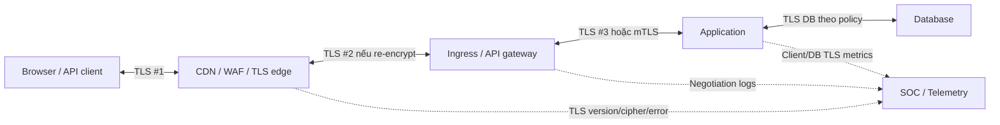
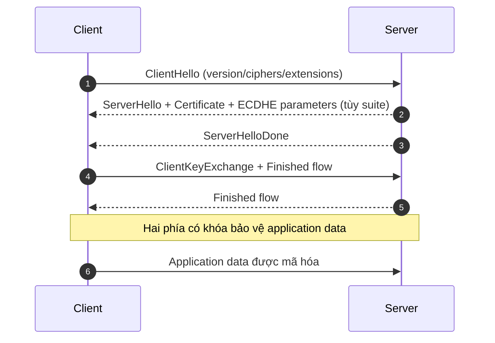
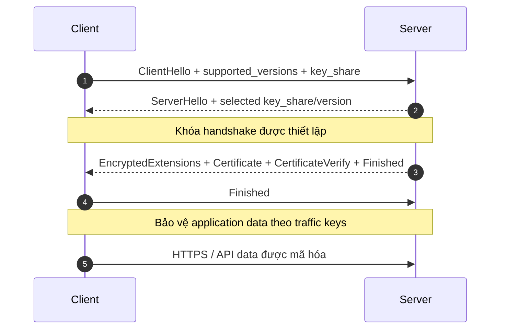
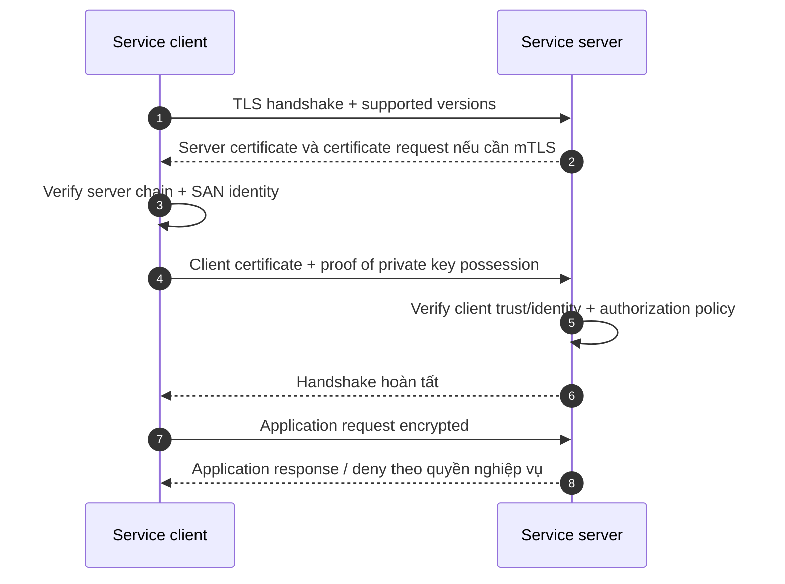

# TLS version và loại bỏ giao thức yếu

> **Học phần:** `SECURITY_NETWORK_SECURITY`  
> **Chương:** TLS và bảo mật kênh truyền  
> **Chủ đề:** Lựa chọn phiên bản TLS an toàn, loại bỏ SSL/TLS lỗi thời và bộ thuật toán yếu; bảo đảm thay đổi được kiểm chứng xuyên suốt client, load balancer, WAF, API gateway, ứng dụng, dịch vụ nội bộ và hệ thống kết nối từ xa.

## Mục tiêu học tập

Sau bài này, người học có thể:

1. Giải thích **TLS làm gì và không làm gì** trong kiến trúc bảo mật mạng; phân biệt phiên bản protocol với cipher suite và chất lượng cấu hình.
2. Nhận biết lý do **SSL 2.0, SSL 3.0, TLS 1.0 và TLS 1.1** không còn phù hợp cho hệ thống cần bảo mật hiện đại.
3. Giải thích khác biệt cốt lõi giữa **TLS 1.2** và **TLS 1.3** về handshake, thuật toán, trao đổi khóa, forward secrecy, chứng chỉ và tính năng bị loại bỏ.
4. Thiết kế chính sách **ưu tiên TLS 1.3, chỉ duy trì TLS 1.2 khi cần tương thích an toàn**, không hạ cấp sang giao thức yếu để “cho kết nối thành công”.
5. Phân biệt vấn đề protocol version, cipher suite, chứng chỉ, hostname verification, SNI, ALPN, session resumption, TLS 1.3 0-RTT và QUIC.
6. Xây dựng kế hoạch kiểm kê, quan sát, canary rollout, kiểm thử phủ định, rollback và xử lý thiết bị legacy.
7. Liên hệ chính sách TLS với WAF, IDS/IPS, VPN, DNS, firewall, phân đoạn, cloud, service mesh và xác thực kết nối.

## 1. TLS bảo vệ ranh giới nào?

**Transport Layer Security (TLS)** bảo vệ một kênh giao tiếp giữa hai đầu cuối TLS. Khi được triển khai và xác minh đúng, TLS có thể cung cấp:

- **Confidentiality:** bên trung gian không đọc được plaintext nội dung ứng dụng được mã hóa.
- **Integrity:** phát hiện nội dung được sửa đổi trái phép trong các bản ghi/packet được bảo vệ.
- **Authentication:** thông thường client xác minh danh tính server qua chứng chỉ; **mTLS** có thể cho phép server xác thực chứng chỉ client.
- **Key establishment:** hai phía thiết lập khóa phiên và điều kiện mã hóa cho kết nối.

TLS **không tự** cấp quyền truy cập tài nguyên. Một client kết nối HTTPS hợp lệ vẫn có thể không được đọc dữ liệu người dùng khác; đó là nhiệm vụ của **authorization** ở ứng dụng/IAM. TLS cũng không tự ngăn DDoS, truy vấn SQL tốn tài nguyên, dữ liệu độc hại từ người dùng đã xác thực hoặc lỗ hổng ứng dụng.

### Hình dung một luồng



Sơ đồ cho thấy **một request có thể đi qua nhiều kết nối TLS riêng biệt**. TLS 1.3 ở trình duyệt tới CDN **không chứng minh** CDN tới origin hoặc ứng dụng tới database cũng dùng TLS 1.3. Mỗi hop là một ranh giới tin cậy và phải có policy/telemetry độc lập.

## 2. Phân biệt SSL và các phiên bản TLS

TLS phát triển từ SSL, nhưng các phiên bản không có mức bảo vệ giống nhau.

| Phiên bản | Tình trạng bảo mật/vận hành | Hướng áp dụng cho hệ thống hiện đại |
|---|---|---|
| **SSL 2.0** | Giao thức rất cũ, không phù hợp an toàn hiện đại | **Không cho phép** |
| **SSL 3.0** | Đã lỗi thời, có các điểm yếu thiết kế/triển khai quan trọng | **Không cho phép** |
| **TLS 1.0** | Thiết kế cũ, cơ chế mật mã/hệ sinh thái legacy không đáp ứng baseline hiện đại | **Không cho phép** |
| **TLS 1.1** | Tương tự: không còn được khuyến nghị cho hệ thống cần bảo mật hiện đại | **Không cho phép** |
| **TLS 1.2** | Vẫn có thể bảo mật **nếu** cấu hình thuật toán, xác thực và triển khai phù hợp | Cho phép khi có nhu cầu tương thích, với **cipher suite mạnh** |
| **TLS 1.3** | Phiên bản hiện đại, loại bỏ nhiều lựa chọn yếu và giản lược handshake | **Ưu tiên** |

**RFC 8996** chính thức loại bỏ TLS 1.0 và TLS 1.1 khỏi cơ chế TLS được tiêu chuẩn hóa hiện hành; **RFC 7568** loại bỏ SSL 3.0. SSL 2.0 đã có yêu cầu cấm từ trước. Điều đó không có nghĩa mọi thiết bị legacy lập tức ngừng hoạt động: nhiều thiết bị vẫn có thể gửi handshake cũ và cần được xử lý trong chương trình nâng cấp.

### TLS 1.2 không tự động mạnh

TLS 1.2 cho phép nhiều tổ hợp mật mã, trong đó có lựa chọn **không phù hợp** (ví dụ static RSA key exchange, RC4, 3DES hay cấu hình CBC cũ trong những baseline cần loại bỏ). Vì vậy chỉ nhìn thấy nhãn “TLS 1.2” chưa đủ xác nhận kênh đạt chuẩn.

### TLS 1.3 không tự động giải quyết mọi thứ

TLS 1.3 giảm bề mặt cấu hình yếu, nhưng nếu client **không xác minh hostname/chứng chỉ**, server bị chiếm hoặc ứng dụng thiếu authorization, bảo mật tổng thể vẫn không đạt. TLS 1.3 còn có chính sách riêng về **resumption PSK** và **0-RTT** cần quyết định theo loại ứng dụng.

### Phân biệt tên gọi

- **“SSL certificate”** là thuật ngữ thương mại thường được dùng cho chứng chỉ của một hệ thống chạy TLS; không chứng minh hệ thống bật giao thức SSL cũ.
- **HTTPS** thường là HTTP chạy trên TLS, nhưng giao thức **HTTP/3 dùng QUIC tích hợp TLS 1.3** theo kiến trúc riêng, không đơn giản là “TLS record layer trên TCP”.
- **DTLS** là họ giao thức riêng dành cho datagram; không đồng nhất phiên bản DTLS với TLS theo cách cộng/trừ số.

## 3. Vì sao phải loại bỏ SSL và TLS 1.0/1.1?

Quyết định loại bỏ không chỉ dựa trên một lỗ hổng đơn lẻ, mà trên **thiết kế, thuật toán, khả năng downgrade và khả năng duy trì an toàn** của toàn hệ sinh thái.

### Các vấn đề thường được nhắc tới

| Tên/vấn đề | Liên hệ | Bài học |
|---|---|---|
| **POODLE** | Rủi ro liên quan cơ chế padding của SSL 3.0 và các tình huống lỗi triển khai | Không giữ SSL 3.0 vì yêu cầu tương thích |
| **BEAST** | Liên quan cách sử dụng CBC trong TLS 1.0 ở các điều kiện lịch sử cụ thể | Không giữ TLS 1.0 như baseline mới |
| **RC4 biases** | RC4 có thiên lệch thống kê và không phù hợp TLS hiện đại | Loại RC4 ở mọi phiên bản |
| **SWEET32** | Rủi ro liên quan 64-bit block ciphers như 3DES dưới tải/điều kiện nhất định | Loại 3DES và cipher 64-bit block khỏi policy |
| **FREAK/LOGJAM** | Cho thấy hậu quả của export-grade/nhóm DH yếu và lỗi lựa chọn tham số | Không cho phép EXPORT/nhóm DH yếu |
| **RSA key-exchange attacks** | Các biến thể oracle/triển khai làm lộ rủi ro với static RSA key exchange | Dùng (EC)DHE và xác thực phù hợp |
| **CRIME** | Rủi ro từ TLS-level compression trong điều kiện nhất định | Không bật TLS-level compression |
| **Downgrade/fallback** | Hai bên bị đẩy về phiên bản/thuật toán thấp hơn mức có thể hỗ trợ | Loại hẳn protocol cũ và kiểm tra chống downgrade |

**Không nên diễn giải bảng là “mỗi bản TLS luôn bị tấn công thành công”.** Nhiều lỗ hổng còn phụ thuộc chế độ cipher, loại plaintext, hành vi ứng dụng, khả năng của kẻ tấn công và bản vá. Tuy vậy, **giữ protocol yếu chỉ để tương thích** tạo bề mặt không cần thiết, tăng chi phí kiểm toán và rủi ro fallback.

### Rủi ro vận hành của giao thức cũ

- Hệ thư viện và thiết bị hỗ trợ cũ có thể đã hết cập nhật.
- Chính sách cipher, certificate và signature algorithm khó đồng nhất.
- Không đáp ứng yêu cầu của đối tác, tiêu chuẩn tổ chức hoặc kiểm toán.
- Dễ xuất hiện **đường “ngoại lệ vĩnh viễn”** không được quản lý.
- Một listener quên cấu hình có thể tiếp tục hỗ trợ TLS 1.0/1.1 dù endpoint chính đã nâng cấp.

## 4. Handshake TLS 1.2 và TLS 1.3: điểm khác nhau

TLS handshake dùng để hai bên thỏa thuận protocol/thuật toán, thiết lập khóa và xác thực server (và client nếu cần).

### TLS 1.2 — đường đi khái niệm với ECDHE



Sơ đồ **rút gọn**, không phải transcript đầy đủ. TLS 1.2 có nhiều handshake variant tùy key exchange, client authentication, session resumption và extension; `ChangeCipherSpec` và các bản tin `Finished` diễn ra theo trình tự chuẩn.

### TLS 1.3 — đường đi khái niệm



Nếu server yêu cầu **HelloRetryRequest**, client có thể cần gửi ClientHello mới; nếu dùng PSK/resumption, Certificate có thể không xuất hiện trong cùng dạng handshake. **TLS 1.3 không phải “mọi handshake luôn đúng một round-trip trong mọi hoàn cảnh”.**

### Những thay đổi nổi bật

| Đặc tính | TLS 1.2 | TLS 1.3 |
|---|---|---|
| Trao đổi khóa | Có thể dùng ECDHE/DHE hoặc static RSA ở cấu hình legacy | (EC)DHE hoặc các chế độ PSK theo đặc tả; loại static RSA key exchange |
| Encryption | Có thể chọn nhiều chế độ cũ, gồm CBC | Chỉ dùng AEAD cho bảo vệ bản ghi |
| Cipher suite | Gộp key exchange/auth/encryption/MAC trong tên suite | Chủ yếu chỉ định AEAD và hash/HKDF liên quan |
| Renegotiation | Tồn tại cơ chế TLS 1.2, cần kiểm soát | Không còn renegotiation cũ |
| Record compression | Cơ chế cũ cần vô hiệu hóa | Không hỗ trợ record compression như TLS cũ |
| Handshake latency | Thường nhiều bước hơn khi bắt đầu đầy đủ | Thiết kế thường giảm round-trip |
| Early data | Không có 0-RTT theo thiết kế TLS 1.3 | Có 0-RTT trong điều kiện PSK/resumption và chính sách phù hợp |
| Legacy cipher suites | Có thể còn xuất hiện nếu không giới hạn | Không hỗ trợ các cipher suites TLS 1.2 cũ |

### Cần xác minh điều gì ở log?

Một bản ghi “TLS handshake success” nên đi kèm **selected protocol**, **selected cipher**, **server identity**, **SNI**, **ALPN**, **resumption/early data status** khi có. Nếu chỉ thấy kết nối TCP 443 thành công, chưa thể khẳng định TLS đã xác thực đúng.

## 5. TLS 1.3: mức nền tảng hiện đại

TLS 1.3 (RFC 8446) giảm đáng kể số lựa chọn khó đảm bảo an toàn và tách rõ **key schedule** của từng giai đoạn.

### 5.1 AEAD

**Authenticated Encryption with Associated Data (AEAD)** cung cấp mã hóa và kiểm tra toàn vẹn/xác thực trong một cơ chế đã định nghĩa. Những thuật toán phổ biến gồm:

- AES-128-GCM;
- AES-256-GCM;
- ChaCha20-Poly1305.

Việc dùng thuật toán nào phụ thuộc **hỗ trợ client/server, tăng tốc phần cứng, chính sách tuân thủ** và đánh giá rủi ro; “256” trong tên cipher không tự chứng minh cấu hình tốt hơn mọi trường hợp có AES-128-GCM.

### 5.2 Forward secrecy và ngoại lệ PSK

Một **handshake đầy đủ dùng ephemeral (EC)DHE** cho phép các khóa ứng dụng có đặc tính forward secrecy dưới giả định thuật toán và triển khai an toàn. Tuy nhiên, TLS 1.3 cũng hỗ trợ **PSK-only key establishment** trong những trường hợp phù hợp. Không nên khẳng định **mọi** kết nối TLS 1.3 đều có forward secrecy nếu không biết chế độ key exchange.

Với session resumption dùng PSK, chế độ **PSK + DHE** có các tính chất khác PSK-only. Chính sách TLS nên xác định mức bảo vệ mong muốn và hỗ trợ thực tế của thư viện.

### 5.3 Key schedule tách các giai đoạn

TLS 1.3 dẫn xuất khóa dựa trên HKDF với transcript và các secret thích hợp. Các giai đoạn có thể gồm early, handshake và application traffic keys; key update cũng có thể có theo implementation.

**Không tự triển khai KDF hoặc chọn ngẫu nhiên bộ khóa ngoài TLS library.** Việc dùng thư viện được duy trì, kiểm tra chứng chỉ, xác minh hostname và cấu hình policy đúng quan trọng hơn việc “tối ưu” một bước mật mã thủ công.

### 5.4 Những gì TLS 1.3 không che giấu hoàn toàn

Một số metadata mạng vẫn có thể quan sát: IP đích, port, thời điểm, lượng traffic và một phần dữ liệu handshake. **SNI thông thường có thể xuất hiện trong ClientHello**; **Encrypted ClientHello (ECH)** giúp bảo vệ một số thông tin ClientHello khi được hỗ trợ/triển khai, nhưng không đồng nghĩa toàn bộ metadata biến mất.

Vì vậy thiết kế WAF/IDS/NDR phải biết sensor quan sát **trước hay sau TLS termination**, không giả định mọi HTTP path có thể đọc từ một đường dây TLS 1.3 mã hóa.

## 6. TLS 1.2: duy trì thế nào cho an toàn khi cần tương thích?

Có những client, middleware, thiết bị quản lý hoặc hệ thống đối tác chưa hỗ trợ TLS 1.3. **TLS 1.2 có thể tiếp tục được hỗ trợ theo chính sách** nếu chỉ chấp nhận bộ thuật toán mạnh và các yêu cầu xác thực hiện đại.

### Baseline khái niệm cho TLS 1.2

- Chỉ cho phép cipher suites với **ECDHE/DHE đủ mạnh** và encryption xác thực như **AES-GCM** hoặc **ChaCha20-Poly1305** khi có hỗ trợ tương thích.
- Không cho phép **RC4, 3DES, NULL, EXPORT, anonymous authentication** và các cipher suites legacy không đạt chính sách.
- Tránh **static RSA key exchange** nếu mục tiêu là forward secrecy.
- Không cho phép TLS-level compression.
- Xác minh server certificate, hostname, chain và signature policy.
- Không dùng DH group/elliptic curve không đáp ứng baseline.
- Theo dõi tỷ lệ client buộc phải dùng TLS 1.2 để lập kế hoạch nâng cấp.

### Tên cipher suite nói gì?

Ví dụ TLS 1.2:

```text
TLS_ECDHE_RSA_WITH_AES_128_GCM_SHA256
    ├─ ECDHE: ephemeral key exchange
    ├─ RSA: server authentication theo suite
    ├─ AES_128_GCM: AEAD encryption
    └─ SHA256: thành phần PRF/thuộc tính suite

TLS_RSA_WITH_AES_128_GCM_SHA256
    └─ static RSA key exchange; không có tính PFS tương đương ECDHE
```

Dòng thứ hai minh họa vì sao **cùng dùng AES-GCM vẫn có thể khác tính chất bảo mật**: key exchange/authentication quan trọng, không chỉ thuật toán mã hóa.

### Điều kiện kết thúc hỗ trợ TLS 1.2

Nên có **mục tiêu dài hạn** giảm phụ thuộc TLS 1.2 khi hệ sinh thái cho phép, nhưng không đặt thời hạn chung thiếu dữ liệu. Dựa vào số client, vendor support, SLA, compliance, rủi ro và kết quả test để quyết định giảm phiên bản hỗ trợ tại từng điểm.

## 7. Cipher suite, certificate và protocol version là ba lớp quyết định khác nhau

Một cuộc đàm phán TLS an toàn đòi hỏi **cả ba**:

1. **Protocol version** được chấp nhận.
2. **Algorithms/cipher suite/key share** đủ an toàn và có giao điểm.
3. **Identity/certificate policy** đúng đối tượng và còn hiệu lực.

| Kết quả | Ví dụ | Vì sao chưa đạt hoặc cần xem |
|---|---|---|
| TLS 1.3 + server certificate chưa được xác minh | Client bỏ qua hostname validation | Kênh có thể bị MITM dù cipher mạnh |
| TLS 1.2 + ECDHE/AES-GCM + cert đúng | Hệ đối tác chưa có TLS 1.3 | Có thể đạt baseline tương thích |
| TLS 1.2 + static RSA/3DES | Suite legacy vẫn được bật | Không đạt mục tiêu loại bỏ thuật toán yếu |
| TLS 1.0 + cipher mạnh nhất khả dụng | Protocol cũ | Không hợp lý để giữ production |
| TLS 1.3 + 0-RTT trên API chuyển tiền | Early data xử lý không chống replay | Cần chính sách chống replay/tắt 0-RTT |
| TLS 1.3 ở edge, HTTP plaintext edge→origin | TLS bị kết thúc rồi đi nội bộ không bảo vệ | Phải đánh giá boundary và khả năng dùng re-encryption/mTLS |
| TLS 1.3 + cert đúng nhưng authorization sai | API trả dữ liệu người khác | TLS không thay thế authorization |

**Mọi lớp đều cần kiểm chứng.** Scanner chỉ kiểm tra protocol version sẽ không phát hiện client ứng dụng đã tắt certificate verification trong code.

## 8. Chọn protocol: phiên bản được hỗ trợ và phiên bản thực sự thương lượng

**Client** gửi những khả năng mà nó hỗ trợ, **server** lựa chọn phiên bản/cipher theo giao thức và chính sách. Trong TLS 1.3, extension **supported_versions** được dùng để thương lượng phiên bản; không nên đọc một mình trường legacy_version trong cấu trúc handshake rồi kết luận kết nối thực chạy TLS 1.2.

### Những câu hỏi thiết thực

- Server hỗ trợ TLS 1.3 nhưng một nhóm client vẫn vào bằng TLS 1.2? **Bình thường** nếu server cho phép cả hai và client không thể/thực tế không chọn TLS 1.3.
- Server bật TLS 1.3 nhưng scanner vẫn kết nối được TLS 1.0? **Chưa loại bỏ protocol yếu**.
- Client hiển thị “TLS 1.3 capable” nhưng backend chọn TLS 1.2? Cần kiểm tra **middlebox, library, policy, SNI, TLS termination và ALPN**.
- Kết nối từ CDN đến origin dùng TLS 1.2? Phải đánh giá **TLS 1.2 cipher/hostname validation** ở hop này, không dựa vào phiên bản của browser→CDN.

### Chống “protocol fallback” thiếu kiểm soát

Nếu handshake thất bại, **đừng tự động lần lượt thử TLS 1.3 → TLS 1.2 → TLS 1.1 → TLS 1.0** để tối đa số kết nối, nhất là khi server có thể hỗ trợ phiên bản mạnh. Chính sách client cần **phiên bản tối thiểu** rõ ràng và ghi nhận lỗi tương thích.

## 9. Downgrade attack và các tín hiệu phòng vệ

**Downgrade attack** tìm cách khiến hai bên chấp nhận mức bảo mật thấp hơn khả năng đáng lẽ dùng, ví dụ buộc fallback về protocol/cipher yếu qua can thiệp handshake hoặc lỗi ứng dụng.

### Các cơ chế liên quan

- **Không cho phép protocol yếu** tại server và client là biện pháp quan trọng nhất.
- **TLS_FALLBACK_SCSV** hỗ trợ chống một số kiểu fallback không đúng trong các phiên bản TLS trước TLS 1.3 khi được dùng theo đặc tả.
- TLS 1.3 có các cơ chế downgrade protection trong handshake/compatibility, bao gồm dấu hiệu trong ServerHello của server hỗ trợ phiên bản cao hơn khi thương lượng TLS thấp hơn theo đặc tả.
- Validation của handshake transcript, Finished và certificate verification ràng buộc những thông tin cần bảo vệ.

**Không coi TLS_FALLBACK_SCSV là lý do giữ SSL 3.0/TLS 1.0.** Nó là bảo vệ bổ sung cho tình huống fallback đúng cơ chế, không thay chính sách protocol tối thiểu.

### Tình huống cần triage

Một ứng dụng vốn chủ yếu dùng TLS 1.3 bỗng tăng TLS 1.2. Đây **chưa chứng minh** MITM: có thể do thay CDN policy, một nhóm client mới, load balancer mới hoặc TLS 1.3 bị disable do cấu hình. Cần đối chiếu thay đổi phần mềm, đích/hostname, chứng chỉ, SNI, ALPN và đường mạng trước khi gọi là downgrade attack.

## 10. Chứng chỉ server và kiểm tra danh tính

Một kênh TLS chỉ đạt mục tiêu xác thực server nếu client kiểm tra **đúng danh tính**.

### Chuỗi kiểm tra tối thiểu

1. Chứng chỉ server thuộc **chain tin cậy** đến CA/trust anchor mà client cho phép.
2. Chứng chỉ còn hạn và thỏa các ràng buộc cần thiết về key usage, extended key usage và signature algorithms.
3. **Hostname đang kết nối** khớp đúng danh tính server được chứng chỉ công bố, thông thường trong **Subject Alternative Name (SAN)**.
4. Chính sách thu hồi/chứng chỉ hết hạn và các yêu cầu tuân thủ của hệ thống được xử lý theo nền tảng hỗ trợ.
5. Client không cho phép người dùng/code tự **bỏ qua tất cả lỗi certificate**.
6. Cơ chế SNI dẫn đến đúng virtual host và certificate tương ứng.

### Ví dụ

```text
Client thực sự muốn truy cập:
  https://api.partner.example.test

Certificate server trình:
  SAN: DNS:api.partner.example.test

Kiểm tra cần thành công:
  - chain tới trust anchor được phép
  - thời hạn, usages, thuật toán ký phù hợp
  - hostname trùng đúng định danh cần kết nối
  - chính sách trust/revocation được áp theo triển khai
```

Một certificate “được ký bởi CA công khai” **không tự đủ** nếu tên miền sai. Dùng `TrustAllCertificates`, `HostnameVerifier` luôn trả true hoặc bỏ qua kiểm tra chứng chỉ trong production là **vô hiệu hóa mục đích xác thực server**.

### Certificate expiration khác protocol deprecation

Một server chỉ dùng TLS 1.3 vẫn có thể lỗi vì certificate hết hạn. Một server chứng chỉ còn hạn vẫn có thể bật TLS 1.0. Cần cảnh báo **hai loại vấn đề riêng biệt** và không xem việc gia hạn certificate như đã nâng phiên bản TLS.

## 11. mTLS: xác thực cả server và client

**Mutual TLS (mTLS)** yêu cầu thêm xác thực chứng chỉ phía client theo policy triển khai. Nó thường hữu ích cho:

- Kết nối giữa các microservice/workload;
- API nội bộ hoặc đối tác B2B có danh tính máy;
- Control plane, service mesh và một số luồng quản trị nhạy cảm.



Sơ đồ khái niệm, chi tiết bản tin khác giữa TLS 1.2 và 1.3; **mTLS không cấp quyền mặc định** cho mọi service. Hệ thống cần mapping certificate identity vào principal/role, xác nhận đúng service được gọi và kiểm soát truy cập.

### Những điểm thường bị bỏ quên

- Certificate client đã **hết hạn hoặc bị thu hồi** nhưng endpoint vẫn dùng kết nối/resumption cũ;
- Nhiều workload dùng chung private key, làm mất khả năng định danh độc lập;
- Proxy/service mesh kết thúc mTLS nhưng ứng dụng tin header identity do client tự gửi;
- Sidecar nói “mTLS enabled” nhưng một số hop ra ngoài mesh vẫn plaintext;
- Certificate rotation thiếu overlap làm ứng dụng mất kết nối đồng loạt.

**Server mTLS phải tin danh tính do thành phần đáng tin xác thực**, không tin một header client có thể tự đặt. Giữ rõ **TLS peer identity, caller identity và application authorization**.

## 12. Session resumption, ticket và TLS 1.3 0-RTT

### 12.1 Resumption

TLS có cơ chế giảm chi phí handshake khi client kết nối lại. Trong TLS 1.3, **PSK resumption** sử dụng key material từ phiên trước/ticket tùy triển khai. Một hệ server lớn cần quản lý khóa ticket và chính sách lifetime/rotation cẩn thận.

**Rủi ro vận hành:** Dùng chung ticket keys quá rộng, lưu mãi không đổi, ghi ticket/secret ra log hoặc xử lý session sau khi credential bị thu hồi không đúng policy.

### 12.2 0-RTT early data

TLS 1.3 có tùy chọn **0-RTT** cho phép client gửi dữ liệu ứng dụng sớm khi resumption đủ điều kiện. Dữ liệu 0-RTT có **rủi ro replay** và các đảm bảo khác với dữ liệu sau handshake đầy đủ.

**Không nên bật 0-RTT cho hành động nhạy cảm hoặc thay đổi trạng thái nếu chưa có biện pháp chống replay và quyết định nghiệp vụ rõ**, ví dụ:

- Thanh toán, chuyển tiền, đặt hàng;
- Đổi mật khẩu, đổi MFA, tạo API key;
- Thay đổi quyền IAM, xóa dữ liệu;
- Tạo job đắt tiền hoặc tác vụ không idempotent.

Ngay cả request dùng HTTP GET **không tự động an toàn** nếu backend tạo side effect hoặc tiêu thụ tài nguyên lớn. API cần đánh giá idempotency, replay window và chính sách server/CDN.

### 12.3 Cách đặt policy

| Đường kết nối | Resumption | 0-RTT |
|---|---|---|
| Website thông tin công khai | Có thể cho phép theo chính sách | Chỉ khi đánh giá được replay và hệ thống hỗ trợ |
| API giao dịch | Có thể cho phép với quản lý key/session | Thường nên tắt trên luồng thay đổi trạng thái |
| API quản trị | Quản lý chặt session và client auth | Mặc định tránh |
| mTLS microservice | Theo identity, rotation và khả năng hỗ trợ | Chỉ bật khi đã đánh giá rủi ro |
| Kết nối tới dịch vụ legacy | Theo thư viện/version | Không giả định có 0-RTT |

## 13. SNI, ALPN, ECH và các lớp HTTP

TLS thương lượng phiên bản và cipher, trong khi một số extension giúp chọn tên dịch vụ hay giao thức ứng dụng.

| Tính năng | Công dụng | Điều không nên suy diễn |
|---|---|---|
| **SNI** | Client báo hostname mục tiêu để server chọn virtual host/certificate | Không phải server authentication; tên SNI có thể không được bảo vệ trong TLS thường |
| **ALPN** | Thỏa thuận application protocol, ví dụ `h2` hoặc `http/1.1` | Không phải chỉ báo cipher đủ mạnh |
| **ECH** | Bảo vệ phần ClientHello nhạy cảm trong kiến trúc hỗ trợ | Không ẩn mọi metadata IP/traffic; không phải mọi client/server đều hỗ trợ |
| **HSTS** | Chỉ thị browser dùng HTTPS cho website theo policy | Không thay thế TLS ở backend hoặc bảo vệ mọi ứng dụng API |
| **HTTPS redirect** | Hướng HTTP client tới HTTPS | Request HTTP ban đầu vẫn có thể lộ/được sửa; HSTS và không mở HTTP khi phù hợp cần xem riêng |
| **HTTP/2** | Giao thức ứng dụng, có yêu cầu TLS profile khi dùng TLS | Không đồng nhất HTTP/2 với TLS 1.3 |
| **HTTP/3** | HTTP chạy trên QUIC dùng TLS 1.3 | Không phải HTTPS over TCP+TLS record giống HTTP/1.1 |

### SNI và nhiều virtual host

Một IP load balancer có thể phục vụ nhiều hostname, mỗi hostname có chính sách và certificate riêng. Nếu kiểm thử TLS mà không gửi **SNI**, scanner có thể gặp **default certificate/vhost** và báo sai endpoint cần kiểm tra. Ngược lại, default vhost cũng cần policy an toàn vì client có thể truy cập mà không gửi SNI.

### HSTS và thứ tự triển khai

Bật HSTS là thay đổi có thể ảnh hưởng khả năng rollback: browser lưu chính sách trong thời hạn nhất định, và `includeSubDomains`/preload có hệ quả rộng. Chỉ bật các tùy chọn mạnh sau khi xác minh mọi hostname/subdomain trong phạm vi đều phục vụ HTTPS đúng và có kế hoạch certificate renewal.

## 14. QUIC, HTTP/3 và DTLS không phải “TLS phiên bản thấp”

### QUIC / HTTP/3

QUIC tích hợp **TLS 1.3 handshake** và cơ chế bảo vệ riêng cho QUIC packets. Nó thường hoạt động trên UDP 443 nhưng không sử dụng TLS record layer qua TCP.

Nếu tổ chức chỉ kiểm tra TCP 443/TLS 1.2 hoặc 1.3 mà bỏ qua UDP 443, có thể thiếu telemetry của HTTP/3. Cần kiểm thử **policy, WAF inspection, logging và firewall** trên cả hai đường được hỗ trợ.

### DTLS

**Datagram Transport Layer Security (DTLS)** là họ giao thức bảo vệ dữ liệu kiểu datagram. DTLS 1.2 và DTLS 1.3 có tiêu chuẩn/thuộc tính riêng; không đơn giản áp cấu hình `ssl_protocols TLSv1.2 TLSv1.3` của web server TCP cho thiết bị dùng DTLS.

### Những giao thức khác cần inventory

- TLS cho SMTP/IMAP/POP, LDAP, database và message broker;
- STARTTLS trên một số giao thức, cần **enforce** khi mục tiêu bảo mật yêu cầu thay vì opportunistic downgrade không được kiểm soát;
- VPN SSL/TLS của nhà cung cấp, service mesh và secure proxy;
- 802.1X/EAP-TLS cho mạng có dây/Wi-Fi;
- DNS over TLS/HTTPS ở resolver được quản lý.

**Tên chứa TLS không đồng nghĩa cùng một cấu hình/port.** Trường hợp nào cũng cần xác định **protocol semantics, peer identity và boundary** cụ thể.

## 15. Kiểm kê mọi điểm TLS termination và origination

Không thể loại bỏ giao thức yếu chỉ bằng chỉnh một load balancer nếu tồn tại nhiều listener và đường bypass.

### Ma trận kiểm kê

| Điểm kết nối | Ai là TLS server? | Ai là TLS client? | Cần kiểm tra |
|---|---|---|---|
| Browser → CDN/WAF | Edge/CDN | Browser | Protocol min/max, cert, WAF HTTPS policy |
| CDN/WAF → origin | Origin/LB | CDN | **Origin policy**, certificate validation, cipher |
| API Gateway → app | Application hoặc sidecar | Gateway | Re-encrypt/mTLS, đúng SAN, route |
| App → DB/cache | DB/cache service | Application | Driver/JVM, TLS version, trust/hostname |
| App → SaaS | Third-party API | Application | TLS client library, partner compatibility |
| VPN/web portal | VPN gateway/portal | Remote client | Version/cipher, auth method, appliance patch |
| IoT → broker | Broker | IoT firmware | TLS capability, certificate lifecycle, hardware |
| Kubernetes ingress → service | App/sidecar | Ingress | Mesh policy và plaintext fallback |
| Admin tools/monitor | Management endpoint | Script/agent | Legacy Java/Python/OpenSSL dependencies |

### Dữ liệu cần quản lý cho mỗi đường

- Domain/IP/port, service owner và môi trường;
- có qua CDN/WAF/proxy/LB hay đi thẳng origin;
- phiên bản TLS tối thiểu/tối đa được phép và **selected versions** đang quan sát;
- cipher/key exchange, certificate/CA, hostname/SNI;
- danh sách client/SDK có thể bị ảnh hưởng khi tắt protocol yếu;
- luồng có mTLS hay TLS server-only, cách ánh xạ identity;
- logging, owner, change window và phương án rollback.

Một **TLS policy source of truth** nên phản ánh cả inbound và outbound. Vấn đề egress thường bị quên: ứng dụng Java cũ có thể vẫn chủ động kết nối TLS 1.0 tới đối tác nếu không có chính sách client rõ ràng.

## 16. Ưu tiên xử lý theo mức độ rủi ro

Không phải mọi endpoint đều có cùng mức ảnh hưởng nếu đang bật giao thức cũ.

| Nhóm | Ví dụ | Ưu tiên thường thấy |
|---|---|---|
| **Internet-facing và dữ liệu nhạy cảm** | Login, payment, account API, admin portal | Rất cao |
| **Remote access và quản trị** | VPN gateway, control plane, bastion | Rất cao |
| **Liên thông đối tác** | B2B API, payment network, interconnect | Cao; cần kế hoạch cùng đối tác |
| **Microservice nội bộ** | Service mesh, app↔DB | Cao nếu dữ liệu nhạy cảm/khả năng lateral movement |
| **IoT/OT legacy** | Sensor firmware cũ, máy công nghiệp | Rủi ro cần xử lý riêng, ưu tiên an toàn vận hành |
| **Lab/test cô lập** | Dịch vụ thử thuật toán | Đặt phạm vi rõ, không phơi lộ production |

### Tránh hai cực đoan

**Cực đoan 1:** Để TLS 1.0 vĩnh viễn trên một Internet LB chỉ vì một client chưa cập nhật. Điều này mở protocol yếu cho toàn bộ khách hàng.

**Cực đoan 2:** Tắt tất cả phiên bản cũ trên hệ OT đang vận hành mà không biết thiết bị phụ thuộc, làm đứt đường giám sát an toàn.

**Cách tốt hơn:** Kiểm kê, đo tỷ lệ client, phối hợp owner, phân đoạn/isolate legacy path, nâng cấp phần mềm hoặc thêm gateway chuyển đổi **được đánh giá rủi ro**, với thời hạn xóa ngoại lệ và telemetry riêng.

## 17. Chính sách chuẩn đề xuất cho TLS version

Một baseline thường có thể được trình bày như sau:

```yaml
policyId: TLS-BASELINE-007
scope: "managed-HTTPS-and-service-TLS"
allowedProtocolVersions:
  preferred: "TLS1.3"
  minimum: "TLS1.2"
  disallowed:
    - "SSLv2"
    - "SSLv3"
    - "TLS1.0"
    - "TLS1.1"
tls12:
  requireEphemeralKeyExchange: true
  requireAuthenticatedEncryption: true
  reject:
    - "EXPORT"
    - "NULL"
    - "RC4"
    - "3DES"
    - "anonymous-authentication"
    - "static-RSA-key-exchange"
tls13:
  requireApprovedAEAD: true
  earlyData0RTT:
    default: "disabled"
identity:
  verifyTrustedChain: true
  verifyPeerHostname: true
  mutualTls: "required-where-service-policy-demands"
operations:
  logSelectedProtocolAndCipher: true
  monitorHandshakeFailures: true
  testEachTlsHop: true
  preserveChangeAndExceptionApproval: true
exceptionPolicy:
  mustSpecifyOwner: true
  mustSpecifyExpiry: true
  mustProvideIsolationAndUpgradePlan: true
```

Đây là **mô tả policy trung lập nhà cung cấp**, không phải cấu hình hợp lệ với một gateway, JDK hay TLS library cụ thể. Các sản phẩm có thể khác về thứ tự lựa chọn cipher, cấu hình TLS 1.3 cipher suites, resumption và mTLS; cần kiểm thử bản triển khai.

### Ngoại lệ phải có điểm kết thúc

Mỗi ngoại lệ TLS legacy nên nêu:

- Thiết bị/client cụ thể và danh tính owner;
- lý do chưa thể nâng cấp, bản đồ dữ liệu/tài sản chịu ảnh hưởng;
- phạm vi kết nối/zone/allowlist hẹp;
- bảo vệ bổ sung (gateway, firewall, certificate, monitoring);
- ngày rà soát, kế hoạch nâng cấp và điều kiện tắt ngoại lệ.

**Không mở lại TLS 1.0/1.1 trên endpoint public chính** để xử lý một client legacy nếu có thể xây đường thay thế được cô lập và được duyệt.

## 18. Ví dụ triển khai NGINX: chỉ TLS 1.2/1.3

Ví dụ **minh họa**, giả định NGINX/OpenSSL hỗ trợ cả TLS 1.2 và 1.3:

```nginx
upstream app_internal {
    # Chỉ là địa chỉ backend mẫu trong mạng riêng.
    server 10.20.10.10:8080;
}

server {
    listen 443 ssl;
    server_name app.example.test;

    ssl_certificate     /etc/tls/app.example.test/fullchain.pem;
    ssl_certificate_key /etc/tls/app.example.test/privkey.pem;

    # Không cho SSLv2/SSLv3/TLSv1.0/TLSv1.1.
    ssl_protocols TLSv1.2 TLSv1.3;

    # Giới hạn các cipher suites cho TLS 1.2.
    # TLS 1.3 suites chịu điều khiển khác theo NGINX/OpenSSL version.
    ssl_ciphers 'ECDHE-ECDSA-AES128-GCM-SHA256:ECDHE-RSA-AES128-GCM-SHA256:ECDHE-ECDSA-AES256-GCM-SHA384:ECDHE-RSA-AES256-GCM-SHA384';

    # Chỉ bật HSTS sau khi kiểm tra phạm vi hostname.
    add_header Strict-Transport-Security "max-age=31536000" always;

    location / {
        proxy_pass http://app_internal;
        proxy_set_header Host $host;
    }
}
```

### Ý nghĩa và những điểm không được bỏ sót

- `ssl_protocols TLSv1.2 TLSv1.3` giới hạn protocol tại **listener tương ứng**, nhưng cần xác minh mọi server block/default server. Với NGINX, lựa chọn protocol có thể chịu ảnh hưởng **default TLS virtual server** trước khi xác định SNI virtual host; không chỉ nhìn một file cấu hình.
- `ssl_ciphers` thường ảnh hưởng tới TLS 1.2/và cũ hơn; **không giả định** nó kiểm soát TLS 1.3 cipher suites theo cùng cách. Một số phiên bản dùng cấu hình qua OpenSSL directives hoặc library defaults.
- `proxy_pass http://app_internal` làm **hop NGINX→app là HTTP plaintext** trong ví dụ; chấp nhận hay không tùy boundary. Nếu cần mã hóa/mTLS nội bộ, cấu hình upstream HTTPS và **xác minh certificate upstream** bằng cơ chế thích hợp.
- HSTS chỉ ảnh hưởng các client/browser hỗ trợ và đã nhận policy; không thay certificate management. `includeSubDomains`/preload không được thêm máy móc.
- TLS 1.3 có thể yêu cầu phiên bản NGINX/OpenSSL đủ mới và được biên dịch hỗ trợ.

**Kiểm tra trước triển khai:** validate syntax, kiểm tra version hỗ trợ, chạy test trên staging và xác minh trực tiếp qua handshake. Một cấu hình đẹp trên giấy không chứng minh tất cả edge nodes đã áp chính sách mới.

## 19. Cấu hình client và Java JSSE: đừng chỉ sửa server

Ứng dụng Java có thể là **TLS client** khi gọi API, database, LDAP hoặc message broker. Cấu hình server an toàn nhưng client vẫn còn tin certificate sai thì rủi ro không giảm đủ.

### Java: giới hạn protocol trong một TLS server socket thử nghiệm

```java
import javax.net.ssl.SSLContext;
import javax.net.ssl.SSLServerSocket;

public final class TlsServerExample {
    public static SSLServerSocket create(
            SSLContext tlsContext,
            int port) throws Exception {

        // tlsContext PHẢI được khởi tạo với key/trust managers đúng.
        SSLServerSocket socket =
            (SSLServerSocket) tlsContext.getServerSocketFactory()
                                       .createServerSocket(port);

        // Chỉ chấp nhận TLS 1.3 và TLS 1.2 theo policy.
        socket.setEnabledProtocols(
            new String[] {"TLSv1.3", "TLSv1.2"}
        );

        // Chỉ bật khi server bắt buộc xác thực client mTLS.
        // socket.setNeedClientAuth(true);

        return socket;
    }
}
```

**Đây là ví dụ cục bộ**, không phải một HTTPS server hoàn chỉnh. Các cipher được phép, key managers, trust managers, certificate hostname/identity mapping, client authentication, socket lifetime và error handling phải được cấu hình theo thiết kế thực. Trên JDK không hỗ trợ TLS 1.3, cần cập nhật runtime thay vì chỉ thêm tên protocol.

### Java TLS client

- Ưu tiên API client chuẩn có **hostname verification** mặc định và trust store phù hợp.
- Cấu hình phiên bản tối thiểu ở JDK/library hoặc connection settings theo chính sách.
- Kiểm tra các thuộc tính như `jdk.tls.disabledAlgorithms` và `jdk.certpath.disabledAlgorithms`; thay đổi policy toàn JDK có thể ảnh hưởng nhiều ứng dụng, cần kiểm thử.
- Phân biệt **TrustStore** với **KeyStore**: TrustStore xác định CA/chứng chỉ tin cậy; KeyStore chứa credential private key/certificate client/server khi dùng.
- Không tạo custom trust manager bỏ qua chain hoặc hostname verification để kết nối tới hệ thống TLS legacy.
- Khi lỗi `handshake_failure`, xem protocol/cipher/certificate/ALPN/SNI trước khi mở lại TLS yếu.

### Dependency tương thích

Một Java application dùng JDK mới vẫn có thể dùng driver database cũ không hỗ trợ TLS 1.3 hoặc có behavior riêng. Tương tự, một reverse proxy nâng cấp không tự làm SDK phía client nâng cấp. Kiểm tra **đường TLS thực tế và thư viện thật** thay vì suy từ version OS.

## 20. Kiểm thử kết nối có phạm vi với OpenSSL và curl

Kiểm thử nên chạy **chỉ với endpoint do tổ chức sở hữu hoặc được phép đánh giá**, giới hạn tần suất và ghi kết quả. Đoạn lệnh minh họa dùng hostname tài liệu `app.example.test`, không phải đích production.

### OpenSSL s_client

```bash
# Kết nối thử bằng TLS 1.3, có SNI và kiểm tra tên host.
openssl s_client \
  -connect app.example.test:443 \
  -servername app.example.test \
  -tls1_3 \
  -verify_return_error \
  -verify_hostname app.example.test \
  -brief

# Kết nối thử bằng TLS 1.2.
openssl s_client \
  -connect app.example.test:443 \
  -servername app.example.test \
  -tls1_2 \
  -verify_return_error \
  -verify_hostname app.example.test \
  -brief

# Negative test: phải không thương lượng được TLS 1.0/1.1.
# Chỉ thử nếu OpenSSL client còn hỗ trợ tùy chọn/giao thức.
openssl s_client -connect app.example.test:443 \
  -servername app.example.test -tls1

openssl s_client -connect app.example.test:443 \
  -servername app.example.test -tls1_1
```

**Lưu ý cách đọc:** Một negative test thất bại có thể do **OpenSSL cục bộ đã disable TLS 1.0/1.1**, không chứng minh server đã từ chối. Muốn kết luận cần biết client thực sự có thể gửi handshake legacy và server phản hồi thế nào. Sử dụng công cụ kiểm thử TLS được cấp phép, có báo cáo rõ về khả năng client và đường đi.

### curl — giới hạn version chính xác

```bash
# --tlsv1.2 có thể chỉ là mức tối thiểu; thêm --tls-max để cố định.
curl --tlsv1.2 --tls-max 1.2 \
  --verbose https://app.example.test/health

curl --tlsv1.3 --tls-max 1.3 \
  --verbose https://app.example.test/health
```

Tùy phiên bản `curl`, backend TLS library và policy hệ điều hành, cú pháp/khả năng có thể thay đổi. **Không thêm `-k`/`--insecure` để “cho chạy được” rồi báo thành công**; tùy chọn đó bỏ qua kiểm tra chứng chỉ và có thể che lỗi danh tính server.

### Phải xem đúng kết quả

Một phép kiểm thử thành công nên ghi:

- Endpoint/hostname và SNI;
- client/test tool version, TLS backend;
- protocol **được chọn**;
- cipher và key exchange thực tế;
- kết quả certificate chain và hostname;
- ALPN nếu cần;
- có HTTP response hợp lệ theo nghiệp vụ không;
- thời gian và edge/origin node đã kiểm tra.

**Đừng xem `openssl ciphers -v` là danh sách cipher mà server hỗ trợ.** Lệnh đó mô tả khả năng/policy của **OpenSSL cục bộ**, không phải kết quả server đàm phán.

## 21. Kiểm thử từ client thật, qua CDN và tới origin

Một hệ thống có thể dùng CDN/WAF TLS termination và origin HTTPS. Để xác minh đúng:

1. **Client→edge:** Dùng hostname công khai qua DNS/route thật mà client sử dụng; kiểm tra certificate/SNI/selected version.
2. **Edge→origin:** Xem policy “origin pull”, certificate validation, minimum version và telemetry/cấu hình của CDN/LB. Không suy từ bước 1.
3. **Origin direct (nếu được phép):** Test từ mạng quản trị được phê duyệt, không mở origin ra Internet chỉ để quét.
4. **Gateway→app:** Kiểm tra upstream TLS/mTLS, hostname identity và policy route.
5. **App→dependency:** Dùng integration tests/driver logs cho database/SaaS, không chỉ kiểm thử trang chủ.
6. **Private/public listener:** Kiểm tra cả default virtual host, IPv4, IPv6, region và đường dự phòng.

### Bảo vệ tránh bypass

Nếu policy yêu cầu mọi truy cập Internet đi qua WAF, origin cần có allowlist/source authentication/tunnel thích hợp. Một endpoint origin khác hoặc IPv6 address bỏ quên có thể tiếp tục dùng TLS yếu và bỏ qua WAF.

**Quan sát thay vì phỏng đoán:** Kết quả TLS của một hostname có thể khác theo geo, load balancer node, IPv4/IPv6, SNI hoặc ALPN. Khi cần chắc chắn, kiểm thử nhiều đường đại diện với mức tải an toàn.

## 22. Giám sát protocol version và lỗi handshake

Để chuyển đổi an toàn, cần biết **client nào đang sử dụng phiên bản cũ** và **thất bại diễn ra ở lớp nào**.

| Nguồn | Có thể quan sát | Giới hạn |
|---|---|---|
| **TLS edge/CDN/WAF** | Negotiated TLS version, cipher, SNI, error codes, client hints | Chỉ thấy client→edge, không tự cho biết origin |
| **Load balancer/API gateway** | TLS listener config, upstream handshake, error rate | Một số trường có thể không được log |
| **Application/JDK** | TLS handshake result, exception, protocol, peer name | Phụ thuộc driver/library và cấu hình logging |
| **DB / message broker** | Client connection TLS settings, failures | Có thể không log cipher chi tiết |
| **Flow/IDS/NDR** | Metadata TCP/UDP, một số TLS handshake trước mã hóa | Không thấy plaintext ứng dụng khi TLS không bị kết thúc |
| **Endpoint/MDM** | Browser/SDK/JDK versions, client compatibility | Không đại diện mọi client bên ngoài |
| **PKI/CA** | Chứng chỉ gần hết hạn, issuance/rotation | Không xác nhận listener không hỗ trợ TLS 1.0 |
| **SIEM** | Thay đổi tỷ lệ TLS version, correlation và alert | Cần nguồn chuẩn hóa, không đếm trùng proxy hops |

### Các metric nên tạo

- Tổng TLS handshakes theo version: 1.3, 1.2, legacy, unknown;
- tỷ lệ `legacy_version_attempts`, đo **attempt** khác với **successful legacy connections**;
- handshake success/failure theo SNI, client class, network region và application;
- lỗi `protocol_version`/`handshake_failure`/certificate validation theo tool;
- version/cipher thực tế của **upstream connections**;
- HSTS coverage, mTLS authentication failure và cert expiry;
- resumption/0-RTT usage khi có;
- tỷ lệ user/business transaction bị ảnh hưởng sau thay đổi;
- WAF/IDS visibility trước/sau khi thay TLS termination hoặc HTTP/3.

### Mẫu log giả lập

```json
{
  "time": "2026-11-28T12:00:00Z",
  "edge": "lb-demo-01",
  "hostname": "app.example.test",
  "connection": "client-to-edge",
  "tlsVersion": "TLSv1.3",
  "cipher": "TLS_AES_128_GCM_SHA256",
  "alpn": "h2",
  "sni": "app.example.test",
  "certificateValidation": "client-side-not-observed",
  "handshakeResult": "success",
  "requestId": "tls-demo-007"
}
```

**Không tự ghi “certificateValidation=passed” ở server nếu server không thực sự biết client đã xác minh certificate hay chưa.** Server-side handshake success không chứng minh client hostname verification hoạt động đúng. Tập trung vào dữ liệu sensor thực cung cấp.

### Quyền riêng tư

SNI, client IP, certificate identity, session info và các trường telemetry có thể chứa thông tin nhạy cảm. Chỉ lưu những gì cần cho mục tiêu an ninh, giới hạn quyền, thời gian lưu và không log **private key, session key, bearer token hoặc nội dung riêng tư**.

## 23. Kế hoạch loại bỏ TLS yếu theo giai đoạn

### Giai đoạn 1 — Inventory và baseline

- Liệt kê toàn bộ endpoint, listener, proxy, WAF, CDN, API gateway, DB, mail, IoT, VPN portal và outbound clients.
- Đo phiên bản **thực tế được thương lượng**, không chỉ khả năng hỗ trợ.
- Tách traffic theo **client identity/class, môi trường, service owner và business criticality**.
- Kiểm tra phiên bản client library/JDK, OS, firmware và phụ thuộc bên thứ ba.

### Giai đoạn 2 — Xác định chính sách và exception

- Định nghĩa allowed protocols: thường TLS 1.3/TLS 1.2 với TLS 1.2 cipher baseline mạnh.
- Lập danh sách từng client không tương thích và phương án nâng cấp.
- Đánh giá chính sách certificate, mTLS và HSTS.
- Tạo exception hẹp, thời hạn, ownership, telemetry và bảo vệ bổ sung.

### Giai đoạn 3 — Kiểm thử trước khi thay đổi

- Staging/integration tests với client thật và SNI/ALPN thật.
- Negative tests đảm bảo không thương lượng SSL/TLS 1.0/1.1.
- Test TLS 1.2 cipher suites và TLS 1.3 AEAD.
- Kiểm tra certificate hostname, chain, trust store, mTLS, resumption và 0-RTT.
- Test CDN→origin, gateway→app, app→DB và cả IPv6/HTTP3 nếu sử dụng.

### Giai đoạn 4 — Canary rollout

- Thay đổi trên một số node/region/route có kế hoạch.
- Giám sát handshake errors, 4xx/5xx, latency, business success và đối tác.
- So sánh selected protocol distribution và **lỗi do client cũ** với các lỗi chứng chỉ/ALPN không liên quan.
- Bảo đảm không có cấu hình yếu tồn tại ở default listener/backup route.

### Giai đoạn 5 — Enforce và giám sát

- Disable SSLv2/SSLv3/TLS1.0/TLS1.1 ở toàn bộ phạm vi đã được duyệt.
- Giới hạn cipher suites và client library.
- Cập nhật hardening checklist/IaC, scanner compliance, alert cho protocol legacy còn được accept.
- Theo dõi sau ít nhất một chu kỳ vận hành có đủ traffic thực và thời gian retry/rotation phù hợp.
- Tắt exception khi phụ thuộc đã được sửa, không để tồn tại vô thời hạn.

### Giai đoạn 6 — Rollback có kiểm soát

Rollback **không đồng nghĩa bật lại TLS 1.0 trên public ingress không điều kiện**. Nếu lỗi nghiêm trọng xảy ra, chọn phương án ít mở rộng bề mặt nhất, ví dụ khôi phục phiên bản ứng dụng nhưng vẫn duy trì minimum TLS, chuyển client qua proxy legacy được cô lập và có kiểm soát, hoặc kích hoạt đường dự phòng đã kiểm định. Mọi rollback cần có approver và expiry.

## 24. Thiết bị legacy: xử lý thay vì giữ “đảo TLS yếu”

### Tình huống phổ biến

Một hệ IoT/OT hoặc máy báo cáo cũ chỉ hỗ trợ TLS 1.0, không thể cập nhật ngay do firmware hoặc quy trình sản xuất. Một hệ thống payment/partner có SDK rất cũ. Trong những tình huống này, có ba hướng:

1. **Nâng cấp/thay thế client/server:** phương án bền vững.
2. **Bọc trong vùng cô lập với gateway chuyển tiếp:** nếu đã đánh giá, gateway có thể nhận kết nối legacy **trong vùng tin cậy hẹp** và tạo TLS hiện đại cho hop tiếp theo; lưu ý hop legacy **vẫn yếu**, không thể “biến thành end-to-end TLS 1.3”.
3. **Giới hạn chức năng và quyền:** ràng buộc IP/port/identity, dữ liệu ít nhạy cảm, monitoring và lịch loại bỏ rõ.

### Ma trận ra quyết định

| Giải pháp | Ưu điểm | Hạn chế |
|---|---|---|
| Upgrade firmware/runtime | Loại gốc phụ thuộc protocol yếu | Cần test/maintenance, có thể mất hỗ trợ thiết bị |
| Replace thiết bị/SDK | Có thể chuẩn hóa policy lâu dài | Chi phí và thời gian |
| Isolated compatibility gateway | Giữ dịch vụ trong giai đoạn chuyển tiếp | Legacy hop vẫn yếu; gateway tăng phức tạp/trust boundary |
| Mở TLS 1.0 lại trên public LB | Tương thích nhanh | Tăng rủi ro cho mọi client; **không phải lựa chọn mặc định** |
| Ngừng tích hợp không đạt policy | Bảo vệ dữ liệu và compliance | Ảnh hưởng nghiệp vụ; cần thống nhất owner |

Không chạy **TLS protocol translation** cho traffic nhạy cảm mà không đánh giá **dữ liệu plaintext tại gateway, certificate/identity ở mỗi hop, phân đoạn và logging**. Nếu không thể xử lý rủi ro hợp lý, phải xem xét ngừng liên thông.

## 25. Tương tác với WAF, IDS/IPS, VPN và egress controls

### WAF và HTTPS inspection

WAF chỉ kiểm tra được HTTP path, header và body khi được đặt ở điểm có **khả năng đọc plaintext HTTP** sau TLS termination hoặc có cơ chế inspection phù hợp. Nếu TLS 1.3 đi end-to-end tới app và WAF chỉ ở dưới dạng network sensor không giải mã, WAF không thể áp các rule dựa trên nội dung HTTP.

**TLS inspection có đánh đổi:** dữ liệu có thể được giải mã tại một proxy, xuất hiện trust boundary mới, xử lý credential/PII/certificate và yêu cầu quản trị quyền nghiêm ngặt. Không mặc định giải mã tất cả traffic là cần thiết hoặc hợp pháp; cân bằng privacy/compliance và các nguồn telemetry khác.

### IDS/NDR

- Có thể quan sát IP/port, timing, volume và một số đặc tính handshake (khi chưa được mã hóa).
- Không đảm bảo nhìn thấy HTTP payload trong TLS 1.3.
- Sensor sau TLS termination hoặc endpoint telemetry có thể bổ sung dữ liệu khi được cấp quyền.
- Phải theo dõi HTTP/3/QUIC nếu mạng có dùng, tránh tạo điểm mù UDP 443.

### Firewall và segmentation

TLS **không** thay firewall/ACL/VRF/IAM. Chỉ mở kết nối theo nguồn/đích/protocol cần thiết và giới hạn đường nội bộ. Khi CDN→origin đang dùng HTTPS, cần đảm bảo origin certificate được xác minh đúng và direct-origin bypass không được tự do.

### VPN

IKEv2/IPsec là công nghệ bảo vệ khác TLS; một VPN “SSL VPN” của vendor có thể sử dụng TLS theo cách cụ thể. Không áp trực tiếp “TLS 1.3” vào IKE_SA_INIT/ESP của IKEv2; phải đánh giá **hai stack** theo bộ tiêu chuẩn của chúng.

### DNS

DoH/DoT dùng TLS/HTTPS trong những ngữ cảnh tương ứng. DNSSEC lại có mục tiêu xác thực DNS data khác. Việc tắt TLS 1.0 ở DoT resolver có thể làm client legacy không phân giải tên; cần tính trong inventory và bảo vệ resolver/đường thay thế.

### Cloud/service mesh

Các mesh có thể dùng mTLS tự động và certificate rotation, nhưng chính sách protocol/cipher giữa sidecar proxies và các endpoint ngoài mesh vẫn cần được kiểm chứng. Đừng suy rằng “mesh bật mTLS” đồng nghĩa tất cả traffic đến database/SaaS đều được mã hóa end-to-end.

## 26. Tình huống chẩn đoán và lỗi tương thích

| Triệu chứng | Nguyên nhân có thể | Điều cần kiểm tra |
|---|---|---|
| Client cũ lỗi ngay sau disable TLS 1.0 | Runtime chỉ hỗ trợ protocol cũ | Version client library/firmware, kế hoạch thay thế |
| `protocol_version` alert | Không có giao điểm version | ClientHello capabilities, server min version, proxy hop |
| `handshake_failure` | Cipher, key share, cert, client auth hoặc policy khác | Trace/error log theo pha, không quy ngay cho version |
| Client báo “certificate unknown” | CA/trust store, hostname, chain, mTLS yêu cầu | SAN, trust anchor, server/client auth |
| TLS 1.3 không thương lượng dù hai phía “hỗ trợ” | Library policy, load balancer, SNI, extension/middlebox | TLS path thực, selected version |
| HTTP/2 lỗi dù TLS thành công | ALPN/HTTP2 policy incompatibility | ALPN negotiated, app/lb support |
| HTTP/3 lỗi nhưng HTTP/2 chạy | UDP 443/QUIC path, edge policy | UDP allowlist, QUIC logs |
| TLS 1.2 chạy nhưng TLS 1.3 lỗi | Cipher/group/extension/library bug hoặc server config | Key share, supported_versions, security policy |
| API server trả 403 sau TLS 1.3 success | Authorization application từ chối | Identity, token, API role |
| Chỉ một region lỗi cert sau rollout | Edge node thiếu chain/certificate hoặc SNI route | Cert deployment per node, route |
| Java outbound TLS lỗi | JDK disabledAlgorithms, truststore, hostname | JSSE logs được redaction, driver/CA |
| Client mTLS không kết nối | Missing/expired client cert, EKU, identity mapping | PKI, trust store, authorization |
| 0-RTT request bị từ chối | Server/edge tắt early data hoặc replay policy | Retry theo handshake đầy đủ, idempotency |
| HSTS gây lỗi cho một subdomain | Subdomain chưa có HTTPS/cert đúng | HSTS scope, readiness và migration |

### Cách triage theo thứ tự

```text
1. Xác nhận endpoint, DNS, IP, port và SNI chính xác.
2. Xác nhận TCP/QUIC connectivity qua firewall/proxy.
3. Xem client và server thực hỗ trợ những phiên bản nào.
4. Xem negotiated version và cipher/key-share/ALPN.
5. Kiểm tra certificate chain, hostname, trust và client certificate.
6. Đối chiếu edge->origin hoặc service->dependency hop khác.
7. Kiểm tra HTTP/application auth, route và business metrics.
8. Xem certificate rotation, deployment, rollback và telemetry.
```

Đừng vội mở TLS 1.0/1.1 hoặc tắt certificate verification khi gặp lỗi handshake: hành động đó **che nguyên nhân** và phá chính sách phòng vệ.

## 27. Kiểm thử hồi quy và Gherkin

Bộ test nên xác nhận **được phép khi đủ điều kiện** và **bị từ chối khi dùng giao thức yếu**. Tránh kết luận chỉ từ exit code của một công cụ cục bộ không hỗ trợ giao thức cần thử.

```gherkin
Feature: TLS minimum-version and strong-identity enforcement

  Scenario: Modern client connects using TLS 1.3
    Given the server offers TLS 1.3 with an approved AEAD cipher suite
    And the client validates the server certificate and expected hostname
    When the client connects over TLS
    Then the handshake negotiates TLS 1.3
    And the application request succeeds under its authorization policy

  Scenario: Approved TLS 1.2 client remains compatible
    Given a client supports TLS 1.2 with approved ECDHE and AEAD
    And the server explicitly permits TLS 1.2 under the compatibility policy
    When the client connects
    Then the handshake can negotiate an approved TLS 1.2 suite
    And the selected protocol and cipher are recorded

  Scenario: Obsolete protocol is rejected by the server
    Given a test client is independently confirmed to support TLS 1.0
    When the client attempts a TLS 1.0-only handshake with the protected server
    Then the server does not negotiate TLS 1.0
    And the rejection is available in appropriate telemetry

  Scenario: Weak TLS 1.2 cipher suites cannot be selected
    Given a test client offers only deprecated TLS 1.2 cipher suites
    When it attempts a handshake
    Then no weak cipher suite is negotiated
    And the server does not silently enable a deprecated fallback

  Scenario: Certificate identity verification cannot be bypassed
    Given the client expects hostname api.example.test
    And the test server presents a certificate for another hostname
    When the client connects
    Then certificate hostname validation rejects the connection
    And the client does not ignore this mismatch

  Scenario: TLS termination must not hide an insecure origin
    Given the browser-to-edge connection uses TLS 1.3
    And the edge connects to a separate origin
    When security controls inspect the edge-to-origin configuration
    Then the origin hop has an independently verified TLS policy
    And plaintext or weak TLS is not accepted where end-to-end protection is required

  Scenario: Sensitive state changes reject unreviewed zero RTT
    Given a payment endpoint is classified as state-changing and replay-sensitive
    When a resumed TLS 1.3 connection offers early data
    Then the endpoint does not process the payment from unapproved early data
    And the request follows the authorized post-handshake path

  Scenario: A legacy exception cannot become global
    Given one isolated legacy endpoint has a documented temporary exception
    When a client tests the primary public ingress
    Then the primary ingress still rejects SSL and TLS 1.0 or 1.1
    And the exception scope, owner and expiration remain auditable
```

### Tiêu chí PASS

- Tất cả public/service endpoints mục tiêu từ chối SSL 2.0/3.0/TLS 1.0/1.1 theo chính sách.
- TLS 1.2 chỉ chọn thuật toán đủ mạnh, khi còn cho phép.
- TLS 1.3 negotiation và certificate validation thành công.
- Client không được bỏ qua server identity khi handshake lỗi.
- Origin/upstream và egress có chính sách riêng, không dựa vào edge.
- mTLS/role policy và API authorization vẫn hoạt động.
- Không kích hoạt 0-RTT cho thao tác không an toàn.
- Tỷ lệ giao dịch hợp lệ sau migration được theo dõi và chấp nhận.
- Mọi exception được cô lập, có owner và expiry.

## 28. Case study: TLS 1.3 ở CDN nhưng origin còn TLS 1.0

**Bối cảnh mô phỏng:** Website thanh toán sử dụng CDN/WAF. Security team kiểm thử từ trình duyệt thấy `TLS 1.3` và tưởng hệ thống đã hoàn tất nâng cấp.

### Khảo sát theo từng hop

| Kết nối | Phát hiện | Đánh giá |
|---|---|---|
| Browser → CDN | TLS 1.3, certificate đúng | Tốt ở hop public |
| CDN → origin LB | Policy chưa giới hạn version tối thiểu, đôi khi dùng TLS 1.0 | **Chưa đạt** bảo vệ origin |
| Origin LB → app | HTTP plaintext trên VLAN chia sẻ với workload không liên quan | Cần đánh giá boundary và khả năng re-encryption |
| App → payment API | TLS 1.2 với ECDHE/AES-GCM và hostname validation | Có thể chấp nhận theo chính sách |
| Admin UI cũ | TLS 1.1 trên cổng khác | Cần xử lý riêng, không để ngoài inventory |

### Phương án khắc phục

1. Giao owner cho từng hop, cập nhật sơ đồ và asset inventory.
2. Bật minimum TLS 1.2 và cipher policy đủ mạnh trên **origin**; bật TLS 1.3 khi có hỗ trợ.
3. Bảo đảm CDN **xác minh certificate origin**, không chỉ mã hóa mà chấp nhận mọi cert.
4. Cân nhắc TLS/mTLS LB→app nếu trust boundary yêu cầu.
5. Cô lập admin UI cũ trong zone quản trị và nâng cấp, không dùng ngoại lệ chung.
6. Kiểm thử lại từng đường ingress (IPv4/IPv6, DR region, direct-origin).
7. Đo handshake errors và giao dịch thanh toán thành công, có kế hoạch rollback có kiểm soát.

**Bài học:** “HTTPS trên trình duyệt hiện TLS 1.3” là **một phát hiện cho đúng một kết nối**, không phải chứng chỉ bảo mật cho cả kiến trúc end-to-end.

## 29. Case study: Java client legacy và migration theo đối tác

**Bối cảnh mô phỏng:** API nội bộ đã chuyển sang TLS 1.3 + TLS 1.2 an toàn. Một hệ thống báo cáo chạy JDK/driver cũ gửi request theo lịch và thất bại sau khi TLS 1.0 bị tắt.

### Cách phân tích

- Server log cho thấy client từng thương lượng TLS 1.0 trước migration.
- Application owner xác nhận hệ báo cáo chỉ chạy mỗi đêm, nên baseline giờ hành chính trước đó không phát hiện phụ thuộc.
- Driver/JDK cũ có thể không hỗ trợ cấu hình an toàn mong muốn.
- Không có bằng chứng về tấn công; đây là **compatibility failure** sau hardening.

### Kế hoạch xử lý

1. Nâng JDK/driver hoặc thay hệ báo cáo theo lịch thay đổi có phê duyệt.
2. Test trên staging, xác minh hostname/certificate và protocol thực được chọn.
3. Trong thời gian chuyển tiếp, nếu phải duy trì đường legacy, đặt **gateway tương thích trong vùng hạn chế**, cho client duy nhất, kiểm soát secrets/data và log.
4. Không phục hồi TLS 1.0 trên public LB đang phục vụ mọi người dùng.
5. Theo dõi công việc báo cáo qua ít nhất một lần chạy theo lịch; xóa exception khi client mới đã hoạt động.
6. Cập nhật dependency inventory và kiểm thử CI để tránh tái phát.

**Đánh đổi:** Một gateway compatibility có thể giảm phạm vi rủi ro nhưng không xóa được tính yếu của **legacy hop**. Owner phải chấp nhận rủi ro có thời hạn hoặc quyết định dừng dịch vụ khi không thể giảm thiểu đủ.

## 30. Threat modeling TLS downgrade và cấu hình yếu theo STRIDE

| Nhóm STRIDE | Tình huống | Kiểm soát |
|---|---|---|
| **Spoofing** | Client chấp nhận certificate của server giả, hoặc trust header mTLS giả | Chain/hostname/identity validation, mTLS PKI |
| **Tampering** | Kẻ có quyền đổi cấu hình TLS/cipher hoặc DNS/proxy để buộc dùng policy yếu | RBAC, IaC review, change audit, integrity monitoring |
| **Repudiation** | Không biết ai mở lại TLS 1.0 hoặc thêm exception | Policy owner, ticket, config version, SIEM |
| **Information Disclosure** | SSL/TLS cũ, cipher yếu, cert validation tắt, plaintext origin hop | TLS min version, AEAD, re-encryption, key management |
| **Denial of Service** | Handshake flood, CPU crypto, certificate/ALPN lỗi gây outage | Edge DDoS controls, rate limits, caching, load test có kiểm soát |
| **Elevation of Privilege** | TLS/mTLS connection được coi là cho phép mọi API/admin action | Application authorization, identity mapping, segmentation |

### Threat statement mẫu

> Một public load balancer phục vụ đăng nhập nhưng vẫn chấp nhận TLS 1.0 để tương thích với một SDK chưa được nâng cấp. Do giao thức yếu và cấu hình cipher chưa thống nhất, khách hàng có thể bị đưa vào kết nối kém bảo vệ hơn mong muốn trong các điều kiện liên quan. Giảm thiểu bằng disable TLS 1.0/1.1 trên ingress chính, dùng TLS 1.3 hoặc TLS 1.2 mạnh, chuẩn hóa kiểm tra chứng chỉ, nâng SDK và nếu thật cần thì đặt ngoại lệ trong một đường riêng có giám sát và thời hạn.

Đánh giá threat dựa trên **thực tế endpoint, loại traffic, khả năng kẻ tấn công và kết quả handshake**, không chỉ một CVE hay tên scanner finding.

## 31. Những hiểu nhầm thường gặp

**“Có HTTPS là an toàn.”** Không đủ. Cần kiểm tra protocol, cipher, chứng chỉ/danh tính, TLS termination và application authorization.

**“TLS 1.2 luôn yếu và phải tắt ngay.”** Không đúng trong mọi môi trường. TLS 1.2 với ECDHE/AEAD và xác thực phù hợp vẫn có thể đạt baseline; ưu tiên TLS 1.3 khi khả thi.

**“TLS 1.3 luôn có PFS trong mọi chế độ.”** Không tuyệt đối. Các trường hợp PSK-only khác với (EC)DHE; cần kiểm tra chế độ key exchange và resumption.

**“AES-256 luôn khiến hệ thống an toàn hơn AES-128-GCM.”** Chỉ tăng key length không sửa sai hostname validation, key management, endpoint hoặc cipher mode.

**“Chỉ cần `ssl_protocols` là mọi cipher an toàn.”** Không. TLS 1.2 còn cho phép nhiều tổ hợp thuật toán và chứng chỉ cần cấu hình riêng.

**“TLS 1.3 cipher suite được điều khiển hoàn toàn bởi directive TLS 1.2.”** Không phải lúc nào cũng đúng; cách cấu hình khác giữa TLS library và server version.

**“Thấy certificate của CA tin cậy tức là đúng server.”** Sai nếu hostname/SAN không khớp danh tính client muốn truy cập.

**“SNI chính là cách xác thực website.”** Không. SNI chủ yếu giúp chọn virtual host/cert; client vẫn phải xác minh certificate.

**“Bật HSTS sẽ bảo vệ CDN→origin.”** Không. HSTS chủ yếu là chính sách browser đối với website trong scope; origin hop cần TLS riêng.

**“0-RTT TLS 1.3 mặc định an toàn cho API chuyển tiền.”** Sai. Early data có replay risk, cần policy đặc biệt; thường nên tắt trên thao tác không idempotent.

**“HTTP/3 là TLS chạy qua TCP 443.”** Sai. HTTP/3 dùng QUIC qua UDP với TLS 1.3 tích hợp.

**“TLS encryption làm WAF/NDR tự xem được plaintext.”** Không. TLS được thiết kế để ngăn bên trung gian đọc nội dung nếu không ở điểm termination/inspection được phép.

**“Handshake OK nghĩa ứng dụng được cấp quyền.”** Không. Authentication/authorization ở ứng dụng vẫn có thể từ chối.

**“Tắt TLS 1.0 ở một load balancer là hoàn tất.”** Không. Cần kiểm tra origin, DR site, default virtual host, IPv6, outbound SDK và service-to-service.

**“Không kết nối được thì bật `--insecure` để tiếp tục.”** Điều này vô hiệu hóa certificate validation và che lỗi thật; không được dùng làm giải pháp bảo mật.

**“Client bắt tay TLS 1.0 thất bại là server chắc chắn chặn.”** Không nếu thư viện test tự disable TLS 1.0 trước khi gửi ClientHello. Cần negative test có kết luận từ hai phía.

## 32. Checklist kiểm soát TLS phiên bản và giao thức yếu

- [ ] Có inventory **mọi** TLS listener và client hop: public, internal, CDN→origin, ingress→app, app→DB, egress, DR, IPv4/IPv6.
- [ ] Policy **ưu tiên TLS 1.3**, tối thiểu TLS 1.2 khi có nhu cầu tương thích và dùng cấu hình đủ mạnh.
- [ ] **SSL 2.0, SSL 3.0, TLS 1.0 và TLS 1.1** bị vô hiệu hóa trên các endpoint thuộc phạm vi chuẩn hóa.
- [ ] TLS 1.2 không cho RC4, 3DES, EXPORT, NULL, anonymous, static RSA key exchange và thuật toán yếu theo baseline.
- [ ] TLS 1.3 sử dụng AEAD được phép; hiểu giới hạn của PSK-only, resumption và early data.
- [ ] Certificate chain, SAN/hostname, thời hạn, key usage/signature policy và revocation được kiểm tra đúng theo implementation.
- [ ] Client không bỏ qua `HostnameVerifier`, `TrustManager`, certificate warnings hoặc dùng `--insecure` trong production.
- [ ] mTLS có identity-to-role mapping, trust store/key rotation và không tin header identity không xác thực.
- [ ] SNI/ALPN/default virtual host và HTTP/2/HTTP/3/QUIC được kiểm thử theo đường thật.
- [ ] HSTS chỉ bật trong phạm vi đã sẵn sàng HTTPS; `includeSubDomains`/preload được xem xét riêng.
- [ ] Không bật TLS 1.3 0-RTT trên API nhạy cảm khi chưa có policy chống replay được kiểm chứng.
- [ ] TLS termination ở WAF/CDN/LB được mô hình hóa; upstream/origin có TLS/mTLS và hostname validation phù hợp.
- [ ] Firewall, segmentation, IDS/IPS/NDR quan sát đúng trước/sau điểm giải mã theo thẩm quyền và privacy.
- [ ] Bảo vệ DNS/DoH/DoT, VPN và service mesh được đánh giá ở đúng giao thức/hop của chúng.
- [ ] Có telemetry selected TLS protocol/cipher và lỗi handshake theo client, hostname, region và owner.
- [ ] Negative test legacy version có công cụ thực sự hỗ trợ protocol thử và xác nhận server không thương lượng.
- [ ] Kiểm thử tích hợp với JDK/driver/SDK, thiết bị legacy và batch job theo thời điểm hoạt động thực.
- [ ] Mỗi exception có owner, scope, expiry, compensating controls và kế hoạch thay thế.
- [ ] Thay đổi IaC/cấu hình TLS được review, canary, đo business metrics, kiểm tra rollback và audit.
- [ ] Không mở lại giao thức yếu toàn cục chỉ để sửa một client không tương thích.
- [ ] Có runbook triage `network → TLS handshake → certificate → HTTP/application → downstream`.
- [ ] Theo dõi certificate expiry, key rotation, trust changes, resumption và sự kiện downgrade bất thường.
- [ ] Security scanning, compliance report và kết quả kiểm thử được lưu theo policy, không đưa private/session keys vào log.
- [ ] Định kỳ rà soát supported versions khi nâng cấp TLS library, reverse proxy, cloud provider và firmware.

## Kết luận

**TLS version và loại bỏ giao thức yếu** là quá trình quản lý **toàn bộ đường truyền**, không đơn giản là bật một checkbox “TLS 1.3” ở website. SSL 2.0/3.0 và TLS 1.0/1.1 không còn phù hợp làm giao thức bảo vệ hiện đại; **TLS 1.3 nên được ưu tiên**, còn **TLS 1.2 có thể duy trì** khi được cấu hình với key exchange, authenticated encryption và xác thực danh tính đủ mạnh.

Một chính sách hiệu quả phải kiểm tra **selected version, cipher suite, certificate/hostname verification, mTLS identity, resumption/0-RTT, TLS termination tại từng hop, ứng dụng và hệ thống legacy**. Cùng với firewall, WAF, IDS/IPS, VPN, DNS, phân đoạn, cloud IAM và telemetry, việc loại bỏ TLS yếu giúp giảm nguy cơ downgrade và làm nền tảng cho kết nối mạng có thể tin cậy, vận hành được và kiểm chứng được.

**Tài liệu đọc thêm:** RFC 8446 (*TLS 1.3*); RFC 5246 (*TLS 1.2*); RFC 8996 (*Deprecating TLS 1.0 and TLS 1.1*); RFC 7568 (*Deprecating SSL 3.0*); RFC 6176 (*Prohibiting SSL 2.0*); RFC 9325 (*Recommendations for Secure Use of TLS and DTLS*); RFC 9001 (*Using TLS to Secure QUIC*); RFC 9147 (*DTLS 1.3*); RFC 6066 (các TLS extensions, trong đó có server_name); RFC 7301 (*ALPN*); RFC 7905 (*ChaCha20-Poly1305 Cipher Suites for TLS*); hướng dẫn OWASP *Transport Layer Security Cheat Sheet*; NIST SP 800-52 Rev. 2 (*Guidelines for the Selection, Configuration, and Use of TLS Implementations*). Khi triển khai, đối chiếu cấu hình, API, cipher suites và mức hỗ trợ thực của TLS library, client, reverse proxy, CDN và cloud provider theo phiên bản đang vận hành.
