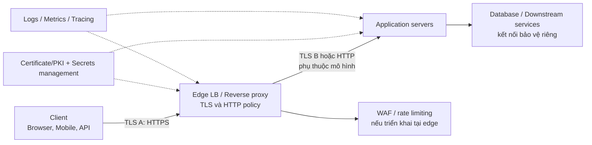
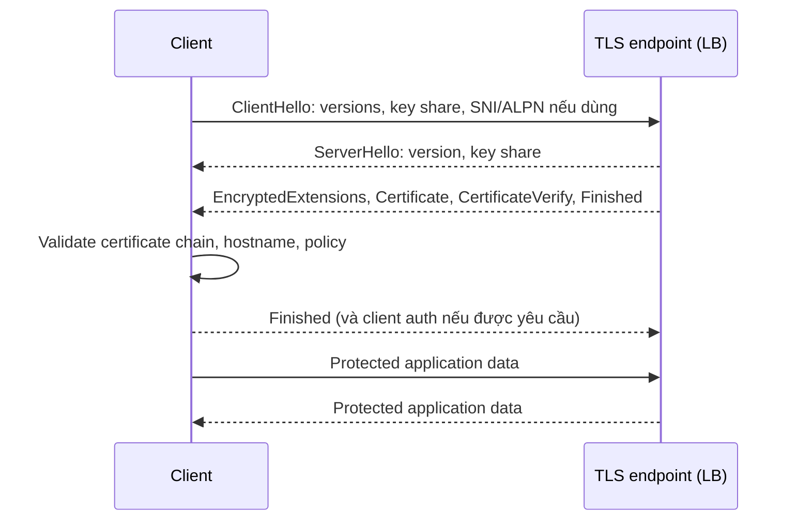
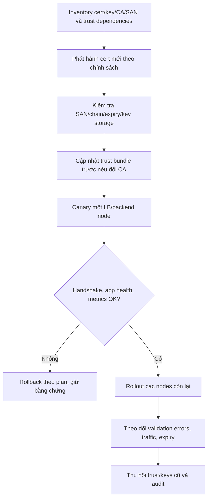
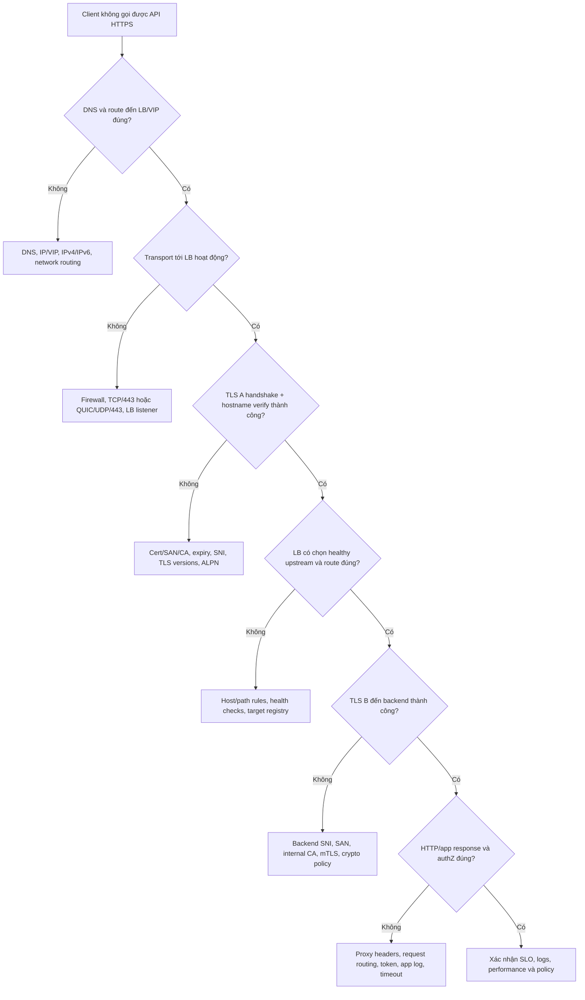

# Bảo vệ TLS ở load balancer và application: mã hóa, xác thực và ranh giới tin cậy

Một dịch vụ API công khai nhận HTTPS tại load balancer (LB). Trình duyệt hiển thị biểu tượng khóa, chứng chỉ còn hạn và kết nối đã đàm phán TLS 1.3. Tuy nhiên, LB lại gửi request tới backend bằng HTTP không mã hóa qua một mạng chia sẻ, hoặc dùng HTTPS nhưng **không xác minh chứng chỉ của backend**. Trong trường hợp đó, đường truyền từ người dùng đến LB được bảo vệ, còn chặng sau LB vẫn có thể bị nghe lén hoặc bị điều hướng tới máy chủ giả.

**Bảo vệ TLS ở load balancer và application** không chỉ là “bật cổng 443”. Cần xác định **TLS kết thúc ở đâu**, mỗi chặng có bảo vệ gì, ai xác minh danh tính của ai, chứng chỉ và private key do ai quản lý, và ứng dụng có được quyền tin những thông tin do reverse proxy chuyển tiếp hay không.

Trong chương **TLS và bảo mật kênh truyền** của module **SECURITY_NETWORK_SECURITY**, bài học nối kiến thức TLS với phân đoạn mạng, firewall, VPN, IDS/IPS, WAF, DNS, cloud và giám sát lưu lượng. TLS bảo vệ tính bí mật/toàn vẹn của kênh **trong phạm vi phiên được thiết lập**; nó không tự xác thực quyền truy cập nghiệp vụ, không làm sạch mã độc trên server và không thay chính sách mạng.

Sau bài học, bạn có thể:

1. So sánh **TLS passthrough, TLS termination/offloading và TLS re-encryption/bridging** qua LB.
2. Xác định hai hoặc nhiều **trust boundaries**, phân biệt mã hóa với **xác thực chứng chỉ** và mTLS.
3. Thiết kế cấu hình client-facing TLS và backend TLS phù hợp với hostname, SNI, ALPN, CA và certificate lifecycle.
4. Kiểm soát các header như `Forwarded`, `X-Forwarded-For`, `X-Forwarded-Proto`, `Host`, và **PROXY protocol** để tránh giả mạo danh tính/ngữ cảnh HTTPS.
5. Ngăn **origin bypass** và hạn chế quyền kết nối trực tiếp tới backend bằng firewall, private routing, mTLS và chính sách ứng dụng.
6. Hiểu quan hệ giữa TLS với HTTP/2, HTTP/3 (QUIC), WebSocket, gRPC, HSTS, session resumption và 0-RTT.
7. Chẩn đoán lỗi handshake, trust chain, hostname mismatch, routing, health check, redirect loop, HTTP 502/503/504 và các vấn đề TLS phía sau LB.
8. Xây dựng checklist, phương án rotation chứng chỉ, giám sát và các kịch bản thử nghiệm có thể kiểm chứng.

> **Quy ước:** Các hostname thuộc `.test` và dải địa chỉ `192.0.2.0/24`, `198.51.100.0/24`, `203.0.113.0/24`, `2001:db8::/32` là dữ liệu minh họa, không phải endpoint Internet để kiểm thử thật. Lệnh và cấu hình bên dưới chỉ được áp trên lab hoặc hệ thống được phép quản trị sau khi thay bằng thông số đã xác minh.

## 1. Load balancer làm gì với TLS?

**Load balancer** phân phối hoặc chuyển tiếp kết nối/request đến nhiều backend dựa trên thông tin tầng 4 (IP/port, transport) hoặc tầng 7 (HTTP host, path, headers, cookies và chính sách ứng dụng). **Reverse proxy** thường đứng trước application server, nhận request thay cho backend. Một LB có thể là reverse proxy, nhưng không phải mọi LB đều hoạt động ở cùng tầng.

TLS có thể được:

- **Giữ nguyên qua LB** để application server hoàn tất handshake với client.
- **Kết thúc tại LB**, sau đó LB gửi request bằng HTTP/plaintext tới backend ở một mạng được kiểm soát.
- **Kết thúc tại LB rồi tạo phiên TLS mới** đến backend, gọi là TLS bridging hoặc re-encryption.

Trong cả ba trường hợp, cần biết **điểm nào nhìn thấy plaintext** và **điểm nào có private key của certificate**.

### 1.1. Kiến trúc tổng quát



Hình trên mô tả một mô hình có **TLS termination tại LB**, không phải TLS passthrough. Trên thực tế, WAF có thể tích hợp trong LB, đứng trước LB hoặc ở một hop khác. Khi có CDN → WAF → LB → application, **mỗi hop lại là một ranh giới tin cậy riêng**.

### 1.2. Ranh giới cần trả lời rõ

| Câu hỏi | Client → LB | LB → Application |
|---|---|---|
| Có TLS không? | Cần cho HTTPS public | Phụ thuộc termination/bridging/passthrough |
| Ai trình diện server certificate? | LB/CDN hoặc backend khi passthrough | Backend nếu có TLS B |
| Ai xác minh certificate? | Client kiểm tra LB-facing certificate | LB phải kiểm tra backend certificate khi dùng TLS B |
| Payload HTTP có được nhìn thấy không? | LB termination mới đọc HTTP ở edge | Backend nhận plaintext sau khi TLS B kết thúc |
| Ai quyết định route/request policy? | LB L7 nếu đã giải mã HTTP | Ứng dụng vẫn tự kiểm tra authorization |
| Cần network restriction không? | Firewall/edge access policy | Private subnet, security group, ACL và egress policy |

Điểm cốt lõi: **TLS 1.3 từ browser tới LB không bảo đảm TLS 1.3 hoặc thậm chí TLS tồn tại từ LB tới backend**. Ngược lại, một backend có certificate hợp lệ cũng không tự làm endpoint public an toàn nếu LB cho phép ciphers/versions yếu ở phía client.

## 2. Ba mô hình TLS giữa client, load balancer và application

### 2.1. TLS passthrough

```text
Client                         L4 LB                        Backend App
  |                              |                              |
  |---- TLS ClientHello -------->|---- TLS ClientHello -------->|
  |<--- TLS handshake response --|<--- TLS handshake response --|
  |====================== 1 phiên TLS end-to-end ===============>|
  |                    LB không giải mã HTTP                    |
```

LB chuyển tiếp TCP hoặc một luồng transport tương ứng mà **không kết thúc TLS**. Certificate và private key của dịch vụ nằm tại backend (hoặc hệ thống TLS termination sau LB). Client xác minh **server certificate của backend** qua phiên end-to-end.

**Ưu điểm:**

- LB không cần private key của ứng dụng và không nhìn thấy plaintext HTTP.
- Giữ một phiên TLS từ client đến endpoint thực sự kết thúc TLS.
- Hữu ích khi cần mTLS trực tiếp giữa client và application, hoặc chính sách không cho LB giải mã.

**Giới hạn:**

- LB không thể dựa vào HTTP path/cookie/body để cân bằng hoặc dùng WAF L7 theo cách thông thường.
- Một số L4 proxy có thể nhìn **SNI trong ClientHello** nếu SNI không bị che và sản phẩm hỗ trợ, nhưng đó không phải giải mã HTTP.
- Chứng chỉ và cấu hình TLS thường được vận hành trên các backend, hoặc ở thành phần TLS termination tiếp theo.
- Health checking có thể chỉ đo TCP/TLS hoặc dùng phương pháp riêng, không nhất thiết xác minh đầy đủ authorization/logic ứng dụng.

**Lưu ý:** “Passthrough” không mặc định đồng nghĩa bảo vệ end-to-end trên mọi lớp, vì TCP proxy có thể được cấu hình thêm thành phần khác, và application có thể gọi downstream bằng kênh khác. Hãy kiểm tra luồng thực tế.

### 2.2. TLS termination / TLS offloading tại LB

```text
Client                    HTTPS / L7 LB               Backend App
  |                           |                             |
  |======= TLS A ============>|                             |
  |       HTTPS request       |---- HTTP plaintext -------->|
  |                           |<--- HTTP response ----------|
  |<====== TLS response ======|                             |
```

LB kết thúc TLS, có quyền giải mã request để thực hiện path routing, header policy, request buffering, rate limiting hoặc WAF inspection nếu được tích hợp. LB gửi HTTP tới backend.

**Ưu điểm:** quản lý certificate công khai tập trung, giảm độ phức tạp TLS trên backend, dễ dùng L7 routing, logging hoặc WAF.

**Rủi ro:** chặng LB → backend **không được TLS bảo vệ**. Nếu hop này chạy qua mạng chia sẻ, VPC peering, overlay không đáng tin hoặc một node bị compromise, dữ liệu có thể bị quan sát hoặc bị thay đổi ở nơi kẻ tấn công có quyền truy cập. Khả năng thực tế phụ thuộc bảo vệ mạng và nền tảng, không phải cứ “private subnet” là một ranh giới mật mã.

HTTP backend có thể được chấp nhận trong một số threat model được phê duyệt, nhưng phải xem đây là **quyết định rủi ro có ghi nhận**, không phải mặc định vì đã có biểu tượng khóa ngoài Internet.

### 2.3. TLS termination + re-encryption / bridging

```text
Client                      L7 LB                     Backend App
  |                           |                             |
  |======== TLS A ===========>|                             |
  |      Decrypt HTTP         |                             |
  |                           |======== TLS B =============>|
  |                           |     Encrypt HTTP again      |
  |                           |<======= TLS B ==============|
  |<======= TLS A ============|                             |
```

LB kết thúc **TLS A** để xử lý HTTP, sau đó khởi tạo **TLS B độc lập** tới backend và xác minh backend certificate. Plaintext xuất hiện trong bộ nhớ/chặng xử lý của LB và application, nhưng traffic LB → backend được TLS bảo vệ.

Điểm cần hiểu:

- **TLS A và TLS B có chứng chỉ, phiên, ciphers, ALPN, keys và lifecycle khác nhau**. Không phải một phiên TLS “chạy xuyên” LB.
- LB đóng vai **server** đối với client và đóng vai **TLS client** đối với backend.
- TLS B chỉ có ý nghĩa xác thực backend khi **LB kiểm tra CA/trust và hostname/SAN**, không chỉ bật “HTTPS” ở `proxy_pass`.
- Backend không mặc nhiên nhìn thấy chứng chỉ/identity người dùng từ TLS A; nếu cần **client authentication** hoặc user identity, phải thiết kế kênh chuyển tiếp đã xác minh và authorization riêng.

### 2.4. So sánh lựa chọn

| Tiêu chí | Passthrough | Terminate → HTTP | Terminate → TLS |
|---|---|---|---|
| LB đọc HTTP plaintext | Không (trong mô hình L4 thuần) | Có | Có |
| Chặng LB → backend mã hóa bởi TLS | Cùng một TLS client–backend | Không | Có, phiên TLS thứ hai |
| Public certificate đặt ở đâu | Backend/TLS terminator sau LB | LB | LB |
| Backend server certificate | Client xác minh | Không cần cho HTTP | LB phải xác minh |
| WAF/routing theo HTTP path tại LB | Thường không | Có | Có |
| mTLS trực tiếp client–application | Có thể | Không xuyên suốt theo phiên TLS | Không xuyên suốt; cần cơ chế riêng |
| Yêu cầu CA/PKI nội bộ | Tùy dịch vụ | Không cho HTTP hop | Có nếu backend dùng private CA |
| Khả năng log/tracing ở edge | L4/metadata | Có HTTP context | Có HTTP context |

**Chọn mô hình dựa trên dữ liệu, threat model, yêu cầu pháp lý và khả năng vận hành**. Không chọn chỉ từ tên “TLS enabled” trong console.

## 3. TLS handshake và các thuộc tính mà LB phải xử lý

TLS dùng để **bảo vệ dữ liệu trên kênh và xác thực peer theo chính sách**, thông thường bằng X.509 certificate ở phía server. Nó không tự bảo đảm user đã được phép gọi API.

### 3.1. Chuỗi TLS 1.3 rút gọn



Đây là sơ đồ khái niệm cho một **full handshake có server certificate**, không mô tả mọi message, PSK resumption, HelloRetryRequest hoặc client certificate exchange chính xác. Trong TLS 1.3, phần lớn thông tin handshake sau ServerHello được mã hóa. **SNI trong ClientHello truyền thống thường lộ**, nhưng Encrypted ClientHello (ECH) có thể che tên nội bộ theo điều kiện client/server/CDN hỗ trợ; không dựa vào SNI luôn nhìn thấy để làm kiểm soát bảo mật duy nhất.

### 3.2. Các thành phần cần hiểu

| Thành phần | Vai trò | Rủi ro khi cấu hình sai |
|---|---|---|
| **Protocol version** | Chọn TLS version được hỗ trợ | Cho phép SSL/TLS cũ yếu hoặc client tương thích sai |
| **Cipher suite / AEAD** | Mã hóa và kiểm tra tính toàn vẹn dữ liệu | Dùng thuật toán yếu hoặc cấu hình không được hỗ trợ |
| **ECDHE/key exchange** | Thiết lập khóa phiên; hỗ trợ forward secrecy với cơ chế phù hợp | Lựa chọn nhóm khóa và crypto policy không phù hợp |
| **Server certificate** | Danh tính hostname/service và public key | Expired, wrong SAN, untrusted chain, key compromise |
| **SNI** | Client chỉ tên server cần kết nối khi handshake, nếu có | LB trình diện sai certificate/vhost hoặc route nhầm backend |
| **ALPN** | Thương lượng giao thức ứng dụng như `h2`, `http/1.1` | Client và LB không thống nhất HTTP version |
| **Session resumption** | Tối ưu kết nối TLS mới nhờ trạng thái/ticket/PSK | Quản lý resumption keys và lifetime kém, rủi ro nếu key bị lộ |
| **Client certificate (mTLS)** | Xác thực phía client trong phiên TLS khi được yêu cầu | Không map đúng certificate → identity/quyền |

Trong TLS 1.3, cipher suite không mã hóa toàn bộ lựa chọn key exchange, certificate signature hay nhóm elliptic curve; các lựa chọn có cơ chế negotiation riêng. Không suy từ một tên cipher suite rằng toàn bộ chính sách crypto đã đúng.

### 3.3. TLS versions và nguyên tắc hardening

Một baseline hiện đại thường ưu tiên **TLS 1.3** và cho phép **TLS 1.2** nếu phải phục vụ client hợp lệ chưa hỗ trợ TLS 1.3. Các phiên bản SSL, TLS 1.0 và TLS 1.1 không nên dùng cho dịch vụ mới. TLS 1.2 cần cipher suites và key exchange phù hợp chính sách hiện hành (ví dụ AEAD và forward secrecy nếu được yêu cầu).

Không có một danh sách cipher/certificate/curve “tối ưu cho mọi sản phẩm”. LB managed service, NGINX, Envoy, HAProxy, F5, ingress controller và thư viện TLS có **defaults/cipher expressions khác nhau**. Cần dùng policy được vendor hỗ trợ, kiểm tra ciphers thật được đàm phán và có quy trình đánh giá tương thích.

**Tuyệt đối không tắt kiểm tra server certificate** hoặc dùng chế độ “insecure/skip verify” để làm lỗi handshake biến mất trong production. Điều đó loại bỏ thành phần xác thực peer trong đúng chặng TLS cần bảo vệ.

## 4. Chứng chỉ TLS: public endpoint và backend có hai bộ danh tính

### 4.1. TLS A — chứng chỉ của dịch vụ công khai

Khi client gọi `https://api.example.test`, client cần xác minh certificate server theo **tên hostname `api.example.test`** và trust policy của mình:

1. Certificate còn hiệu lực theo thời gian hệ thống phù hợp.
2. Certificate chain dẫn tới một CA/trust anchor được client chấp nhận.
3. **Subject Alternative Name (SAN)** phù hợp với hostname yêu cầu; không mặc định Common Name (CN) thay thế được SAN trong client hiện đại.
4. Public/private key và signature algorithms được client hỗ trợ.
5. Các điều kiện certificate policy, key usage, revocation theo cơ chế client và chính sách áp dụng.

**DNS trả một IP không chứng minh TLS peer là dịch vụ đúng.** Certificate validation cần thực hiện theo hostname mong đợi, ngay cả khi kết nối đến IP lấy từ DNS hoặc load balancer VIP.

### 4.2. TLS B — chứng chỉ backend và trust riêng

Nếu LB kết nối `app-backend.internal.example.test:8443`, backend có thể dùng **certificate do private CA phát hành**, miễn là LB được cấu hình trust đúng CA và xác minh SAN phù hợp.

```text
Public client:
  URI        https://api.example.test/
  Trust      public/client-trusted CA policy
  TLS peer   edge LB

LB as backend TLS client:
  Upstream   app-backend.internal.example.test:8443
  Trust      approved internal CA bundle
  TLS peer   application server
```

Một lỗi thường gặp: LB kết nối tới backend bằng **địa chỉ IP** nhưng verify certificate theo `app-backend.internal.example.test`. Cấu hình phải thể hiện **đúng hostname được xác minh**, SNI nếu backend cần, và private CA bundle. Nếu backend certificate chỉ có SAN của một node khác, LB phải từ chối; không chữa bằng cách tắt verify.

### 4.3. Pool gồm nhiều backend nhưng dùng cùng service identity

Giả sử LB cân bằng đến `app-01` và `app-02`, mỗi máy có certificate với private key riêng nhưng đều được cấp **SAN `app-backend.internal.example.test`** theo cùng service identity. LB có thể verify cùng một tên cho cả pool.

Ưu điểm: cấu hình upstream verification đơn giản. Hạn chế: nếu cùng service identity không đủ để phân biệt node, cần bổ sung asset identity/PKI và monitoring cho từng node. **Không cần chia sẻ một private key giữa các node** để có cùng tên SAN; PKI có thể cấp chứng chỉ khác nhau với khóa riêng từng node theo chính sách.

Nếu thiết kế yêu cầu xác minh **đích chính xác của từng node** thay vì service identity chung, LB/service discovery phải gắn đúng tên node vào SNI/hostname verification cho từng kết nối. Không được dùng một `proxy_ssl_name` chung rồi tuyên bố đã xác thực duy nhất từng máy.

### 4.4. Wildcard, multi-tenant và giới hạn SAN

Wildcard certificate như `*.example.test` có thể giảm số lượng certificate cho các hostname một mức phù hợp nhưng làm mở rộng phạm vi ảnh hưởng khi **private key bị lộ**. Nó không tự bao phủ mọi cấp subdomain (ví dụ thông thường `*.example.test` không bao phủ `a.b.example.test`).

Với nhiều tenant, phải kiểm soát certificate selection theo SNI, HTTP `Host`/`:authority`, application tenant resolution và giới hạn quyền, để một request không bị route tới dữ liệu tenant khác. **Certificate phù hợp hostname không chứng minh user được phép truy cập tenant**.

## 5. Mutual TLS (mTLS): xác thực thêm ai đang kết nối?

**TLS một chiều** thường yêu cầu client xác minh server. **Mutual TLS** bổ sung việc server xác thực client certificate, từ đó có thể xác định danh tính một thiết bị hoặc workload theo certificate mapping.

### 5.1. Hai trường hợp mTLS khác nhau

| Chặng | Ai trình diện client certificate? | Ai xác minh? | Danh tính chứng minh được |
|---|---|---|---|
| **Client → LB (TLS A)** | Trình duyệt/app client (nếu được cấu hình) | LB | Danh tính client certificate trong phạm vi TLS A |
| **LB → App (TLS B)** | LB với tư cách backend TLS client | App | Danh tính của LB/workload proxy trong phạm vi TLS B |

Hai trường hợp không tự thay thế nhau. Nếu mTLS kết thúc tại LB, backend **không trực tiếp quan sát** certificate cryptographic handshake của client trong TLS A.

### 5.2. Chuyển danh tính client từ LB về application

Khi app cần biết người dùng/thiết bị được mTLS ở edge xác minh, các lựa chọn phụ thuộc sản phẩm:

- LB có thể chuyển metadata certificate đã xác minh qua một header **được thiết kế rõ**.
- LB có thể cấp một token/assertion **đã ký** hoặc một kênh identity propagation có xác thực.
- App có thể tra session identity thông qua gateway/IdP.
- Hoặc chọn TLS passthrough để app trực tiếp xác minh client certificate.

**Không tin header do Internet client gửi** như `X-Forwarded-Client-Cert`, `X-SSL-Client-Verify` hay bất kỳ chuỗi “verified=true” nếu chưa có ranh giới trust:

1. Edge phải **loại bỏ/ghi đè** những header nhạy cảm từ client.
2. Chỉ thành phần proxy tin cậy được phép đưa thông tin đã xác minh.
3. Đường proxy → app được bảo vệ, thường có mTLS và network policy.
4. App chỉ nhận metadata identity trên đường đã xác minh, có mapping/authorization riêng.
5. Chỉ tin certificate client nếu đã kiểm tra chain, SAN/identity, policy và trạng thái thu hồi theo yêu cầu.

Header **không biến thành chứng cứ mật mã** chỉ vì có tên giống trường trong certificate. Một proxy bị compromise hoặc đường backend cho phép direct access có thể khiến header bị giả.

### 5.3. Khác biệt giữa mTLS và authorization

Một certificate chứng minh peer có khóa riêng và được cấp một danh tính theo PKI; nó không tự cấp quyền đọc cơ sở dữ liệu hoặc quản trị hệ thống. App vẫn phải kiểm tra:

- Certificate/service identity có được phép gọi endpoint này không?
- Quyền user/role, token scope, tenant và ranh giới dữ liệu có phù hợp không?
- Có cần step-up/MFA hoặc approval cho tác vụ nhạy cảm không?
- Quyền đã bị thu hồi ở IdP/PKI/NAC chưa?

Trong microservices, có thể dùng service mesh hoặc mTLS giữa workloads để xác thực **service identity**, còn **user authorization** vẫn là một vấn đề khác.

## 6. Ngăn bypass load balancer và bảo vệ origin

**Origin bypass** xảy ra khi một client hoặc thành phần ngoài phạm vi tin cậy kết nối trực tiếp đến backend, vượt qua WAF/rate limit, authentication/authorization gateway, header normalization hoặc giám sát đặt ở edge.

Ví dụ:

```text
Thiết kế mong đợi:
  Internet → LB/WAF → App private subnet

Đường không mong đợi:
  Internet → public IP/port khác của App  (bỏ qua LB/WAF)
```

Ngay cả khi LB thực hiện TLS B hoàn chỉnh, origin bypass vẫn có thể tồn tại nếu ứng dụng có địa chỉ public hoặc security group mở rộng.

### 6.1. Phòng vệ theo nhiều lớp

1. **Không đặt backend public IP nếu không cần**; sử dụng private subnet/VPC, private service endpoint hoặc đường mạng hạn chế.
2. Security group/firewall của backend **chỉ cho các nguồn LB/proxy được phép** tới port ứng dụng, không cho mọi Internet host.
3. Tại nơi có rủi ro east–west, xác thực LB bằng **mTLS** hoặc cơ chế service identity phù hợp.
4. App chỉ tin headers/identity do những hop proxy đã được ủy quyền chuyển tới.
5. Giữ **authorization tại app**, không giả định request qua WAF là đã được phép.
6. Quản lý DNS origin, certificate, các cổng dự phòng/debug và các interface management không vô tình mở public.
7. Test trực tiếp các đường không được phép trong lab/staging, không chỉ kiểm tra đường VIP thông thường.

**Allowlist IP của LB có giới hạn** khi LB dùng shared egress IP, NAT, CDN thay đổi ranges hoặc có nhiều đường được phép; cần cập nhật từ nguồn tin cậy và bổ sung cryptographic identity khi phù hợp.

### 6.2. Mối quan hệ giữa TLS và network segmentation

TLS B mã hóa hop backend và giúp xác thực peer; nó **không quyết định ứng dụng nào được quyền mở kết nối** nếu thiếu network policy. Firewall giới hạn source/destination; nó **không thay certificate verification** khi traffic đi qua mạng bị can thiệp.

Defense in depth cần cả hai:

```text
LB → Backend:
  Network reachability = chỉ proxy/LB được phép
  TLS encryption       = bảo vệ nội dung trên hop
  Server identity      = backend cert xác minh đúng tên
  Optional client auth = backend xác minh LB cert
  App authorization    = policy riêng cho API/user/workload
```

## 7. HTTP reverse proxy headers: nguồn gốc của nhiều lỗi bảo mật

Sau TLS termination, app thường nhận request từ IP của LB, không phải IP thật của client. Thông tin về scheme và nguồn gốc request có thể được chuyển qua headers. Chúng hữu ích nhưng **không đáng tin nếu đến từ nguồn tùy ý**.

### 7.1. Những header phổ biến

| Header/thông tin | Mục đích thường gặp | Rủi ro nếu app tin sai |
|---|---|---|
| `X-Forwarded-For` | Chuỗi IP client/proxy để audit và chọn policy | Client tự thêm IP giả, bypass IP allowlist/rate limit |
| `X-Forwarded-Proto` | Scheme ngoài edge như `https` | App tưởng HTTP request là HTTPS hoặc tạo redirect/cookie sai |
| `X-Forwarded-Host` | Hostname gốc qua proxy | Host-header poisoning, tạo URL reset password/callback sai |
| `Forwarded` (RFC 7239) | Biểu diễn `for`, `proto`, `host` theo chuẩn | Chưa có trust/normalization, parser khác nhau |
| `Host` / HTTP/2 `:authority` | Virtual host/application routing | Route nhầm tenant, URL generation không an toàn |
| PROXY protocol v1/v2 | Truyền client address/port ở transport trước payload ứng dụng | Nếu chấp nhận từ client không tin cậy có thể giả mạo client IP |
| Header mang certificate identity | Danh tính client đã được edge xác minh | Tạo quyền trái phép nếu client tự đặt header |

**Không dùng một header như công cụ xác thực người dùng.** IP có thể là NAT/proxy và header có thể do bất kỳ client gửi nếu không có chuỗi proxy tin cậy.

### 7.2. Cơ chế trust đúng cho forwarded headers

Một thiết kế an toàn thường:

1. **Chặn đường trực tiếp** Internet → app; chỉ LB/proxy được phép đến app.
2. Cấu hình LB **xóa hoặc ghi đè** header do client tự đưa cho những thuộc tính được dùng để ra quyết định bảo mật.
3. Chỉ cho app tin headers khi **network peer** chính là LB/proxy nằm trong tập được kiểm soát; nếu có nhiều hop, xác định rõ cách diễn giải chuỗi.
4. Ánh xạ hostname/scheme bằng **allowlist** theo dịch vụ thay vì phản chiếu mọi `Host` từ client.
5. Dùng OAuth2/OIDC/token/mTLS cho identity và authorization của user/service thay vì `X-Forwarded-User` tự khai.
6. Kiểm thử request có `X-Forwarded-For`, `Forwarded`, `X-Forwarded-Proto` do client cố ý chèn để xác nhận chúng không thay đổi quyền.

Khi sử dụng NGINX, biến `$proxy_add_x_forwarded_for` **nối thêm `$remote_addr` vào header `X-Forwarded-For` đến từ client nếu header đó đã tồn tại**. Vì thế, tại edge đầu tiên **không nên mặc định rằng toàn bộ chuỗi là đáng tin**. Có thể chọn chính sách ghi đè bằng địa chỉ client quan sát trực tiếp (`$remote_addr`) và xử lý chuỗi proxy đáng tin nếu thực sự có CDN trước edge.

### 7.3. Khi CDN đứng trước LB

```text
Internet client → CDN → LB → Backend
```

LB sẽ nhìn thấy **IP CDN** làm network peer. Nếu muốn xác định IP client gốc:

- Chỉ tin client-IP headers do **CDN cụ thể và được phép** tạo, xác minh request thật đến từ tập IP/kênh CDN tin cậy.
- Cập nhật ranges/identity của CDN theo cơ chế nhà cung cấp; không cho mọi request ngoài Internet tự khai là “từ CDN”.
- Ghi đè và chuẩn hóa headers trước khi app tiêu thụ.
- Với nhiều CDN/proxy và các header khác nhau, cần kiểm tra chuỗi từ **hop tin cậy cuối đến hop đầu**, không chọn IP tùy tiện.

Nếu không cần IP gốc ở app để ra quyết định bảo mật, nên giảm sử dụng thông tin ấy, ưu tiên identity/token và policy tại edge.

## 8. Application framework sau TLS termination

Backend được LB gọi bằng HTTP hoặc HTTPS nội bộ có thể nhận biết sai request origin nếu không được cấu hình đúng. Những lỗi thường thấy:

- Ứng dụng tạo redirect từ `https://` thành `http://` hoặc lặp redirect giữa LB và app.
- `Set-Cookie` thiếu thuộc tính `Secure` khi frontend thực sự là HTTPS.
- Absolute URL trong email/reset password được tạo từ untrusted `Host`.
- App dùng IP của LB để rate limit tất cả người dùng thành một nhóm, hoặc tin IP giả do client tự khai.
- CSRF/callback/origin checks nhận sai scheme/host.

### 8.1. Tách “external URL” và “upstream transport”

```text
External URL: https://api.example.test
Client TLS:   Browser ↔ LB
Backend hop:  LB ↔ App (HTTP hoặc HTTPS)
App origin:   api.example.test / https, theo trusted proxy configuration
```

Với ứng dụng có reverse proxy, nên cấu hình **canonical external base URL** và danh sách trusted proxies/allowed hosts rõ ràng. Đừng lấy mọi giá trị `X-Forwarded-Host`/`X-Forwarded-Proto` từ client làm sự thật.

### 8.2. Ví dụ khái niệm với Spring Boot

Spring Boot có cấu hình cho phép xử lý proxy-forwarded headers, ví dụ:

```yaml
# application.yml - ví dụ minh họa cho môi trường đã chặn direct access.
server:
  forward-headers-strategy: framework
  servlet:
    session:
      cookie:
        secure: true
        http-only: true
```

**Cảnh báo:** Khi bật xử lý forwarded headers, ứng dụng có thể tin các giá trị chuyển tiếp. Cần đảm bảo proxy/ingress **ghi đè dữ liệu không đáng tin** và backend chỉ nhận request từ trusted hops. Tính năng/thứ tự filters và mức độ hỗ trợ tùy Spring Boot version, servlet/reactive stack và deployment.

`cookie.secure: true` giúp giới hạn việc gửi session cookie qua HTTPS trên trình duyệt, nhưng không thay HSTS, `SameSite`, CSRF protection hoặc authentication/authorization. Nếu ứng dụng có reverse proxy khác, cần kiểm tra cả `Forwarded` chuẩn và `X-Forwarded-*` để tránh **hai nguồn ngữ nghĩa mâu thuẫn**.

### 8.3. Ví dụ khái niệm với Express/Node.js

```javascript
const express = require("express");
const app = express();

// Chỉ tin proxy gần app được quản lý, KHÔNG dùng true tùy tiện
// khi có nhiều đường truy cập hoặc không giới hạn direct access.
app.set("trust proxy", "loopback");

app.get("/health", (req, res) => {
  res.json({ ok: true, secure: req.secure });
});

app.listen(3000, "127.0.0.1");
```

Ví dụ này **chỉ thích hợp khi reverse proxy kết nối từ loopback của cùng host**. Nếu LB chạy trên máy/VPC khác, phải cấu hình trusted CIDR/hops chính xác và network policy tương ứng, không sao chép `"loopback"` rồi kỳ vọng production sẽ đúng. `trust proxy=true` không hạn chế trên ứng dụng có thể bị truy cập trực tiếp có thể khiến client giả mạo IP/scheme.

Không đưa cookie/session token, credentials hay định danh nhạy cảm vào `/health`. Ứng dụng vẫn cần test actual auth flow qua LB khi cấu hình HTTPS termination.

## 9. Cấu hình mẫu NGINX: HTTPS ở edge và xác minh TLS tới backend

Phần này minh họa **một kiến trúc có hai TLS sessions độc lập**:

```text
                  TLS A                         TLS B
Client --------------------------> NGINX --------------------> App nodes
          api.example.test:443        |     10.20.40.11:8443
                                     |     10.20.40.12:8443
                                     |
                       Verify backend identity:
                       app-backend.internal.example.test
```

Giả định:

- Public DNS `api.example.test` trỏ tới VIP/edge NGINX.
- Mỗi backend dùng **certificate riêng** do internal CA tin cậy cấp, có SAN `app-backend.internal.example.test`.
- NGINX có certificate/key cho `api.example.test`, cùng **CA bundle** để verify backend.
- Firewall chỉ cho LB truy cập backend TCP `8443`; người dùng Internet không truy cập trực tiếp backend.
- Backend xử lý HTTPS tại `8443` hoặc qua một TLS terminator đáng tin ngay trước ứng dụng.

### 9.1. Ví dụ cấu hình

```nginx
# nginx.conf hoặc file được include đúng ngữ cảnh "http".
# Ví dụ học thuật, CHƯA phải cấu hình production hoàn chỉnh.

upstream application_nodes {
    server 10.20.40.11:8443;
    server 10.20.40.12:8443;
}

server {
    listen 443 ssl;
    server_name api.example.test;

    # TLS A: certificate client nhìn thấy.
    ssl_certificate     /etc/nginx/tls/public-api-chain.pem;
    ssl_certificate_key /etc/nginx/tls/public-api-key.pem;
    ssl_protocols       TLSv1.2 TLSv1.3;

    # Dùng HSTS thời gian thử nghiệm ngắn; chưa tự bật
    # includeSubDomains hoặc preload trên domain thực.
    add_header Strict-Transport-Security "max-age=300" always;

    location / {
        # TLS B: NGINX ở vai trò client đến application.
        proxy_pass https://application_nodes;
        proxy_ssl_protocols TLSv1.2 TLSv1.3;

        # Bắt buộc xác minh certificate của backend.
        proxy_ssl_trusted_certificate /etc/nginx/ca/internal-backend-ca.pem;
        proxy_ssl_verify on;
        proxy_ssl_verify_depth 3;
        proxy_ssl_server_name on;
        proxy_ssl_name app-backend.internal.example.test;

        # Edge là trusted boundary đầu tiên: không nối tiếp
        # X-Forwarded-For mà client có thể tự gửi.
        proxy_set_header Host api.example.test;
        proxy_set_header X-Forwarded-Host api.example.test;
        proxy_set_header X-Forwarded-Proto https;
        proxy_set_header X-Forwarded-For $remote_addr;
        proxy_set_header X-Real-IP $remote_addr;
        proxy_set_header X-Request-ID $request_id;

        # Không cho header chuẩn Forwarded hay identity do
        # client tự khai truyền nguyên vẹn vào backend.
        proxy_set_header Forwarded "";
        proxy_set_header X-Forwarded-Client-Cert "";

        proxy_connect_timeout 5s;
        proxy_read_timeout 30s;
    }
}
```

**Đọc kỹ trước khi áp dụng:**

1. `ssl_certificate` và `ssl_certificate_key` thuộc **TLS A**. Private key cần được bảo vệ bằng quyền file/KMS/HSM hoặc cơ chế secrets theo nền tảng; không đưa vào Git.
2. `proxy_pass https://...` bật TLS B, nhưng nếu không bật `proxy_ssl_verify on` cùng CA và đúng tên, **không được mặc định là backend đã được xác thực**.
3. `proxy_ssl_name app-backend.internal.example.test` đặt tên TLS mà LB xác minh và dùng cho SNI khi bật `proxy_ssl_server_name on`. Hai backend IP trong pool phải trình diện certificate có SAN phù hợp.
4. `X-Forwarded-For $remote_addr` phản ánh peer mà **NGINX trực tiếp thấy**. Nếu CDN ở trước NGINX, đây có thể là IP CDN; không tự nhận là IP người dùng cuối. Muốn có IP gốc phải cấu hình trusted CDN identity/ranges và real-IP handling riêng.
5. Các header `Host`, `X-Forwarded-Proto` được cố định theo hostname và HTTPS listener ở ví dụ **một vhost**. Mô hình đa hostname cần mapping/allowlist riêng, không được hardcode chung cho mọi tenant.
6. `Forwarded ""` và `X-Forwarded-Client-Cert ""` trong NGINX `proxy_set_header` bỏ trường tương ứng khỏi request upstream theo cách xử lý header trống của sản phẩm; cần kiểm tra thêm các **vendor-specific identity headers** thực sự có trong hệ thống.
7. `max-age=300` là HSTS thử nghiệm. Chỉ tăng thời gian sau khi chắc chắn HTTPS vận hành ổn và tất cả hostname liên quan được hỗ trợ.
8. Timeout trong ví dụ chỉ là giả định cho request tương đối ngắn; gRPC/streaming, upload lớn hoặc long polling cần điều chỉnh theo SLO, tránh 504 không cần thiết.
9. Ví dụ chưa cấu hình HTTP listener redirect, client mTLS, OCSP, rate limit, request-size limit, access logs hoặc mọi hardening khác; phải hoàn thiện theo threat model.
10. Syntax/khả năng hỗ trợ phụ thuộc bản NGINX và module/SSL library được cài. Dùng quy trình verify và rollout của tổ chức trước khi thay production.

### 9.2. Nếu backend yêu cầu mTLS từ LB

Trong `location` của ví dụ, bổ sung certificate/key **dành riêng cho LB làm TLS client**:

```nginx
# Chỉ bật nếu backend thực sự yêu cầu client certificate.
proxy_ssl_certificate     /etc/nginx/tls/lb-client.crt;
proxy_ssl_certificate_key /etc/nginx/tls/lb-client.key;

# Vẫn phải duy trì các dòng verify TLS backend:
# proxy_ssl_trusted_certificate ...
# proxy_ssl_verify on;
# proxy_ssl_name app-backend.internal.example.test;
```

Ở phía backend TLS terminator, cần **yêu cầu và xác minh certificate của LB** bằng CA/trust riêng, ví dụ ý tưởng NGINX server block:

```nginx
# Minh họa cho một backend có TLS termination riêng.
server {
    listen 8443 ssl;
    server_name app-backend.internal.example.test;

    ssl_certificate     /etc/nginx/tls/backend-chain.pem;
    ssl_certificate_key /etc/nginx/tls/backend-key.pem;

    ssl_client_certificate /etc/nginx/ca/approved-lb-client-ca.pem;
    ssl_verify_client on;

    location / {
        proxy_pass http://127.0.0.1:8080;
    }
}
```

Lúc này LB phải kiểm tra **server identity của backend**, backend phải kiểm tra **client identity của LB**. Ứng dụng ở port `8080` vẫn cần authorization và chỉ nên nhận kết nối từ TLS terminator cục bộ. Certificate của LB không tự chứng minh user phía Internet đã được xác thực.

**Không chia sẻ private key client mTLS của LB cho mọi ứng dụng.** Cấp identity/khóa theo vai trò, giới hạn truy cập, rotation và audit.

### 9.3. Kiểm tra cấu hình trước khi reload

```bash
# Trên máy NGINX đã được phép quản trị.
sudo nginx -t

# Chỉ sau khi cấu hình hợp lệ và thay đổi được phê duyệt,
# thực hiện reload bằng cơ chế vận hành của hệ thống.
# sudo nginx -s reload
```

`nginx -t` kiểm tra cú pháp và một số khả năng nạp resources; nó **không bảo đảm backend đã khỏe, CA/SAN đúng trong mọi kết nối hay không có origin bypass**. Đừng reload một LB production đang là đường quản trị duy nhất nếu chưa có rollout/rollback.

## 10. Ví dụ TLS passthrough ở load balancer tầng 4

Một LB L4 có thể chỉ chuyển tiếp byte TCP:

```nginx
# Ví dụ tối giản cho NGINX stream module.
# Đặt "stream" ở context phù hợp, tách với block "http".
stream {
    upstream tls_application_nodes {
        server 10.20.40.11:8443;
        server 10.20.40.12:8443;
    }

    server {
        listen 443;
        proxy_pass tls_application_nodes;
    }
}
```

Trong mô hình này:

- NGINX **không trình diện certificate ứng dụng** và không giải mã HTTP; TLS handshake diễn ra giữa client và backend.
- Mỗi backend phải trình diện certificate phù hợp với hostname mà client gọi, có cấu hình TLS và key quản trị đúng.
- Routing dựa trên HTTP path hoặc WAF inspection không thể thực hiện tại LB `stream` thuần này.
- NGINX stream module cần tồn tại/được nạp ở triển khai thực tế; cú pháp ví dụ không phải bảo đảm hỗ trợ mọi bản.
- Kết nối TCP thành công tới backend không chứng minh **TLS certificate valid**, ứng dụng khỏe hoặc HTTP 200.

Một số proxy L4 hỗ trợ **`ssl_preread`** đọc thuộc tính ClientHello như SNI/ALPN để chọn backend mà **không giải mã**. Nhưng với **ECH** và các cơ chế mã hóa ClientHello, không được mặc định SNI tên đích thật luôn được quan sát. Hơn nữa, SNI do client gửi **không phải bằng chứng identity/authorization**.

### 10.1. Passthrough và client IP

Backend có thể thấy địa chỉ nguồn của L4 proxy thay vì client, tùy chế độ forwarding/NAT/direct server return. **PROXY protocol** là một phương án chuyển thông tin địa chỉ/port nguồn cho backend.

PROXY protocol **không phải cơ chế xác thực client**. Nếu backend mở cổng nhận PROXY protocol trực tiếp cho bất kỳ nguồn nào, một đối tượng không tin cậy có thể khai source IP giả. Hãy chỉ chấp nhận từ LB được ủy quyền, phân đoạn network và có mTLS/ACL phù hợp trong kiến trúc yêu cầu.

## 11. TLS, HTTP/2, gRPC, WebSocket và HTTP/3/QUIC

Chính sách TLS phải phù hợp với **giao thức ứng dụng và điểm chuyển giao**. Một LB có thể nhận HTTP/2 từ client nhưng nói HTTP/1.1 tới backend; hoặc nhận HTTP/3 qua QUIC ở edge rồi chuyển sang HTTPS HTTP/2 ở phía sau.

| Giao thức / tình huống | Đặc tính cần lưu ý | Rủi ro vận hành |
|---|---|---|
| HTTPS HTTP/1.1 | Nhiều request có thể tái sử dụng kết nối | Idle timeout, keep-alive, header normalization |
| HTTP/2 | Multiplexing nhiều streams qua một connection, ALPN thường thương lượng `h2` | Stream limits, flow control, proxy compatibility, request smuggling do parser mismatch |
| gRPC | Thường dựa trên HTTP/2 và nhiều RPC dài hạn | LB/backend protocol mismatch, idle/read timeout, retry không an toàn |
| WebSocket | Thường dùng HTTP Upgrade hoặc cơ chế phù hợp phiên bản | Handshake/header và idle timeout gây disconnect |
| HTTP/3 | QUIC dùng UDP, tích hợp TLS 1.3 handshake ở lớp QUIC | Firewall UDP/443, QUIC transport, H3 edge → H2/H1 backend, telemetry |
| Server-Sent Events/long polling | Response streaming/kết nối dài | Buffering, read timeout, connection draining |

### 11.1. Hai chặng có HTTP version khác nhau

```text
Browser -- HTTP/3 over QUIC --> Edge LB
Edge LB -- HTTP/2 over TLS --> Application
```

Ở mô hình này, LB **kết thúc QUIC/TLS** và tạo hop backend khác. Không nên nhìn thấy `HTTP/3` trong browser rồi kết luận backend cũng dùng HTTP/3 hoặc TLS 1.3. Tương tự, hỗ trợ HTTP/2 ở edge không có nghĩa NGINX hay service mesh tự proxy gRPC đúng nếu cấu hình backend connection không thích hợp.

HTTP/3 dùng TLS 1.3 theo cơ chế trong QUIC, **không truyền TLS record thông thường trên TCP**. Một firewall chỉ giám sát TCP/443 có thể bỏ sót QUIC; đội vận hành phải biết bật/tắt UDP/443 theo chính sách và quan sát được đường đi.

### 11.2. HTTP/2, parser mismatch và request smuggling

Khi edge nhận request theo HTTP/2 rồi dịch sang HTTP/1.1, các tầng phải thống nhất về **framing, header, body length và message boundaries**. Parser không đồng nhất có thể dẫn tới request desynchronization/smuggling trong một số triển khai.

Để giảm rủi ro:

- Cập nhật LB, gateway, server và thư viện HTTP.
- Không để **ambiguous/invalid framing headers** đi vào backend không được kiểm soát.
- Đảm bảo edge và app thống nhất xử lý `Content-Length`, `Transfer-Encoding`, pseudo-headers và duplicate/invalid headers theo chuẩn/implementation.
- Kiểm thử với request hợp lệ và invalid theo bộ kiểm thử bảo mật được phê duyệt.
- Bật WAF/rule phù hợp khi có nhưng không xem WAF là thay thế cho parser đúng.

### 11.3. gRPC, streaming và health check

Một health check HTTP GET `/health` trả 200 không chứng minh gRPC endpoint đã hoạt động với đúng protocol, TLS identity và authorization. Có thể cần gRPC Health Checking Protocol hoặc kiểm thử request nghiệp vụ được phép; kiểm tra đúng SNI, ALPN `h2`, path service và upstream timeout.

Nếu backend bắt buộc mTLS, health checker cũng cần identity hợp lệ hoặc một **health endpoint riêng được giới hạn và bảo vệ**. Không tắt client certificate verification của toàn backend chỉ để load balancer health probe đi qua.

## 12. HSTS, HTTPS redirects và secure application behavior

**HTTP Strict Transport Security (HSTS)** là chính sách do website HTTPS gửi để hướng dẫn browser truy cập domain bằng HTTPS trong khoảng thời gian chỉ định. Nó giúp giảm một số trường hợp hạ cấp truy cập từ HTTP sang HTTPS sau khi trình duyệt đã ghi nhận chính sách hoặc domain nằm trong danh sách preload.

Ví dụ header:

```http
Strict-Transport-Security: max-age=300
```

Đây là **giá trị thử nghiệm**. Khi vận hành ổn định có thể tăng thời gian theo quy trình. Hai tùy chọn cần đặc biệt thận trọng:

- `includeSubDomains`: tác động tới những subdomain được bao phủ; có thể làm gián đoạn dịch vụ legacy HTTP.
- `preload`: có yêu cầu riêng và quá trình đưa vào/xóa khỏi preload list; rollback không đơn giản.

### 12.1. Edge hay application nên phát HSTS?

Nếu edge LB có quyền chỉnh HTTP response, HSTS thường được cấu hình tại **điểm HTTPS đối diện client**. Nếu app cũng phát header, cần thống nhất policy để không có nhiều giá trị mâu thuẫn. HSTS chỉ có ý nghĩa qua HTTPS hợp lệ; một HTTP response không thể tin cậy để thiết lập HSTS theo cách browser được thiết kế.

### 12.2. HTTP → HTTPS redirect

Một LB có thể nhận HTTP ở port `80` để redirect sang HTTPS, nhưng cần tránh:

- Redirect tạo hostname theo `Host` không được allowlist.
- Loop giữa LB (thấy HTTPS) và app (thấy HTTP backend) do app không biết external scheme.
- Redirect từ `https` sang `http` do app tạo URL không an toàn.
- Mang secrets/tokens trong query string và ghi lộ chúng qua access logs.
- Áp redirect sai ở health endpoint hoặc traffic máy–máy không theo mô hình browser.

Ở các dịch vụ chỉ hỗ trợ HTTPS, **đóng cổng HTTP hoàn toàn** có thể là lựa chọn hợp lệ; quyết định giữa redirect và deny phụ thuộc UX, HSTS và khả năng client.

### 12.3. Secure cookies và authorization

Ứng dụng session-based nên cấu hình `Secure`, `HttpOnly`, `SameSite` theo chính sách phù hợp. Đừng dựa duy nhất vào `req.secure` nếu nó đến từ một forwarded header không đáng tin. Khi edge và app dùng nhiều hostname/tenant, kiểm tra cookie `Domain`, `Path` và redirect callback để tránh gửi cookie sang host không mong muốn.

**TLS mã hóa request trong phiên**, không sửa lỗi IDOR/BOLA, CSRF, SSRF, injection hoặc sai quyền người dùng. Đó là trách nhiệm ứng dụng và các lớp kiểm soát bổ sung.

## 13. Session resumption, tickets và TLS 1.3 early data (0-RTT)

Một LB thường xử lý rất nhiều TLS handshakes, vì vậy performance và security của **session resumption** cần được quản lý.

### 13.1. Session resumption

Client có thể tái sử dụng trạng thái được cho phép (ví dụ session ticket/PSK) để giảm chi phí handshake khi kết nối lại. LB cần quản lý:

- Thời hạn resumption/session tickets và chính sách rotation.
- Đồng bộ/tách khóa giữa nhiều LB nodes nếu sản phẩm chia sẻ session state.
- Bảo vệ các ticket encryption keys trong secrets management.
- Khả năng thu hồi hoặc giảm hiệu lực khi có rủi ro key compromise.
- Quan hệ với certificate rotation, backend policy, user authentication/session revocation.

**Resumption không phải user session authorization**: việc TLS handshake được rút ngắn không bảo đảm token ứng dụng còn hợp lệ. Cần xử lý quyền người dùng độc lập.

### 13.2. TLS 1.3 0-RTT và replay risk

TLS 1.3 có khả năng **early data (0-RTT)** khi điều kiện resumption phù hợp. Dữ liệu có thể được gửi trước khi handshake hoàn tất đầy đủ, giúp giảm độ trễ, nhưng **0-RTT không cung cấp bảo vệ replay như dữ liệu 1-RTT thông thường**.

Do đó:

- Không bật 0-RTT một cách vô điều kiện cho API có side effects như tạo đơn hàng, chuyển tiền, đổi password hoặc thao tác quản trị.
- Nếu triển khai, chỉ cho các hoạt động được chứng minh replay-safe, kết hợp anti-replay mechanisms và policy phù hợp trên **toàn LB cluster**.
- Khả năng xử lý `425 Too Early`/retry phụ thuộc client và server; không tự giả định mọi client tuân thủ.
- Khi không có yêu cầu giảm latency rõ ràng và khả năng kiểm chứng, **không sử dụng early data** là lựa chọn đơn giản hơn cho dịch vụ nhạy cảm.

**HTTP method `GET` không tự đồng nghĩa mọi triển khai đều không có side effects**. Phải xem business logic trước khi coi một request replay-safe.

## 14. Certificate, private key và vòng đời xoay vòng ở nhiều hop

Chứng chỉ có thể hợp lệ hôm nay nhưng hết hạn vào đêm triển khai sau. Một LB được cấu hình đúng cũng có thể ngắt dịch vụ nếu private key bị thay sai, SAN không phù hợp hoặc backend trust bundle không theo kịp CA rotation.

### 14.1. Inventory cần quản lý

| Trường | Ý nghĩa |
|---|---|
| Endpoint / domain | Hostname public, internal service name và owner |
| TLS hop | Client–CDN, CDN–LB, LB–App, App–Service |
| Certificate SAN / issuer | Tên được bảo vệ và CA phát hành |
| Private key storage | HSM/KMS/secrets manager/file protected, người có quyền |
| Expiry / renewal | Ngày hết hạn, cơ chế cấp/gia hạn, người chịu trách nhiệm |
| Trust bundle | Client trust store, LB backend CA, app mTLS client CA |
| Protocol policy | TLS versions, cipher suites, ALPN, client auth, SNI |
| Rotation/rollback | Kế hoạch thay cert/key/CA an toàn theo phiên bản |
| Monitoring | Alert đến hạn, lỗi validation, 5xx và handshake failure |

### 14.2. Public certificate và internal certificate rotation

**Public-facing certificate** có thể được quản lý qua ACME hoặc dịch vụ certificate tích hợp của nhà cung cấp LB/CDN. Cần xác minh phương thức **domain control validation** (DNS/HTTP/TLS-ALPN challenge tùy khả năng), quyền DNS, bảo vệ automation credentials và tình trạng renew.

**Backend certificate** có thể được cấp bằng private CA và short-lived certificates theo năng lực PKI. Cần đảm bảo:

- LB tin **CA mới** trước khi backend chuyển sang chứng chỉ do CA mới ký.
- Certificate mới có SAN, EKU/key usage và key algorithm phù hợp.
- Các backend nodes được rollout tuần tự, quan sát tỷ lệ TLS B failures.
- Sau giai đoạn di chuyển đã xác minh, CA/credentials cũ bị thu hồi hoặc loại khỏi trust bundle theo chính sách.
- Kế hoạch rollback không làm mở một CA không còn đáng tin vô thời hạn.

### 14.3. Quy trình rotation có kiểm soát



### 14.4. Những lỗi rotation thường gặp

- **Certificate chain thiếu intermediate:** một số client đã cache intermediate nên vẫn chạy, client khác thất bại.
- **SAN thiếu hostname:** health check dùng IP hoặc tên node khác hostname public/private được cấp.
- **Leaf certificate đổi nhưng trust store backend chưa cập nhật** sau CA rotation.
- **Private key không khớp certificate** hoặc permissions khiến LB không đọc được khi reload.
- **Một node còn cert cũ:** gây lỗi ngẫu nhiên khi cân bằng tải/roaming request giữa các LB nodes.
- **Thời gian đồng hồ sai:** certificate “not yet valid” hoặc “expired”.
- **CRL/OCSP policy bị lỗi:** có thể làm validation fail hoặc chuyển sang hành vi fallback theo implementation; phải biết policy đang áp.
- **Client-certificate CA đổi:** backend mTLS từ chối LB dù server certificate vẫn hợp lệ.

Để giảm sự cố, thiết lập cảnh báo **trước hạn** theo cả hai chặng, ưu tiên tự động hóa có quyền tối thiểu và luôn kiểm tra trên đúng client/backend TLS policy chứ không chỉ đọc ngày hết hạn trong một file.

## 15. Cloud load balancer, Kubernetes ingress và service mesh

### 15.1. Cloud-managed LB: đừng nhầm HTTPS listener với backend TLS

Một dịch vụ LB do cloud quản lý có thể cho cấu hình:

```text
Public listener:
  HTTPS :443 → certificate public → TLS policy

Backend / target group:
  HTTP :8080 hoặc HTTPS :8443 (tùy cấu hình)
```

**Bật HTTPS listener không tự bật backend HTTPS**. Tùy nền tảng, một mục “HTTPS target” còn có những khác biệt trong việc **xác minh certificate của backend**, SNI, health checker và mTLS. Phải đọc tài liệu tính năng/version của sản phẩm đang vận hành và **kiểm chứng thực tế**, không suy rằng mục `protocol=HTTPS` luôn tương đương **hostname verification theo CA/chain** như một browser.

Cloud security group/network ACL cũng phải giới hạn backend chỉ nhận traffic từ đường được phép. LB/WAF phía trước không ngăn origin public bị truy cập trực tiếp nếu route/firewall vẫn mở.

### 15.2. Kubernetes ingress controller

```text
Internet
   |
Ingress Controller: HTTPS cert cho api.example.test
   |
   +-- HTTP tới Service/Pod (một số mặc định/thiết kế)
   |
   +-- HTTPS tới Service/Pod (khi đã cấu hình backend TLS)
          |
      Application TLS terminator
```

Ingress object chứa TLS secret ở phía client-facing **không tự chứng minh** kết nối tới Pod được bảo vệ. Nên kiểm tra:

- TLS secret/certificate ở ingress có đúng namespace, hostname và expiry.
- Ingress/controller đang nói HTTP, HTTPS hay gRPC/TLS gì tới Service.
- Nếu backend HTTPS, **CA trust và hostname verification** có thực sự bật không.
- Service endpoints/Pod readiness có đại diện cho ứng dụng khỏe không.
- Namespace/network policy/CNI có hạn chế ingress đến Pod, và Pod có thể bị bypass qua route khác không.
- Certificate secrets có RBAC/rotation/reloader an toàn, không lưu private key trong manifests hoặc logs.

Một vài controller dùng annotation/CRD để quy định backend protocol, verify depth, trusted CA hoặc upstream SNI. **Tên cấu hình không thống nhất**; đừng sao chép annotation từ controller khác rồi mặc định nó có hiệu lực.

### 15.3. Service mesh và sidecar mTLS

Trong service mesh, sidecar/ambient proxy có thể kết thúc và khởi tạo **mTLS workload-to-workload** thay application. Đường đi có thể:

```text
Client --TLS A--> Ingress --HTTP--> Local proxy
Local proxy --mTLS mesh--> Destination proxy --HTTP--> Application
```

Mesh mTLS giúp bảo vệ **proxy-to-proxy hop** và xác thực workload theo service identity, nhưng đoạn app ↔ local proxy có thể là plaintext trên loopback/namespace theo thiết kế. Phải mô tả đúng trust boundary chứ không gọi mọi byte “end-to-end encrypted” nếu app không trực tiếp chạy TLS.

Cần xác minh **mTLS mode**, chính sách PeerAuthentication/AuthorizationPolicy tương đương theo sản phẩm, certificate rotation, service identity và cách traffic không vào mesh (non-mesh workloads/bypass ports). Một service mesh không tự thay endpoint authentication của người dùng hay authorization trong ứng dụng.

### 15.4. Nhiều hop CDN → WAF → LB → App

```text
Client ── TLS 1 ──> CDN ── TLS 2 ──> WAF/LB ── TLS 3 ──> App
```

Tại mỗi hop nên kiểm tra:

1. Endpoint nào **kết thúc TLS**, có private key và có quyền nhìn plaintext?
2. Bên phát kết nối có verify **server identity/certificate** của hop tiếp theo không?
3. Có yêu cầu **client cert/mTLS** cho hop nội bộ không?
4. Traffic có thể bypass bất kỳ hop nào không?
5. Headers, SNI, ALPN, `Host`, request ID và user identity được chuyển tiếp theo policy nào?
6. Logs/monitoring/incident response gắn sự kiện của các hop như thế nào?

Tránh dùng từ “end-to-end TLS” không kèm điểm cuối rõ ràng. Với ba phiên TLS độc lập, dữ liệu được mã hóa **trên từng hop**, nhưng có thể được giải mã tại các trung gian.

## 16. Chẩn đoán TLS theo từng hop bằng công cụ an toàn

Khi người dùng báo “HTTPS lỗi”, cần phân biệt **DNS**, **TCP/QUIC**, **TLS A**, **LB routing**, **TLS B**, **backend application** và **authorization**. Cùng một thông báo trình duyệt hoặc một HTTP `502` có thể bắt nguồn từ nhiều lớp.

### 16.1. Quy trình điều tra



**Với passthrough**, TLS handshake thực tế diễn ra client ↔ backend, nên nhánh TLS A/TLS B ở sơ đồ termination phải được thay bằng **một phiên TLS end-to-end**, và LB chỉ chuyển tiếp transport.

### 16.2. Kiểm tra TLS A bằng OpenSSL

Trên Linux/macOS hoặc môi trường Bash có OpenSSL, từ mạng được phép kết nối:

```bash
# Quan sát TLS handshake với SNI và hostname verification.
# Host .test chỉ hoạt động khi lab có DNS hoặc hosts file phù hợp.
openssl s_client \
  -connect api.example.test:443 \
  -servername api.example.test \
  -verify_hostname api.example.test \
  -verify_return_error \
  -showcerts \
  -alpn h2,http/1.1 < /dev/null
```

Kiểm tra:

- Protocol và cipher negotiated phù hợp baseline hay không.
- Peer certificate chain, issuer, validity, SAN đúng `api.example.test`.
- Tham số `-servername` có tác dụng chọn virtual host/certificate trong các triển khai dùng SNI.
- `-verify_hostname` giúp kiểm tra hostname, `-verify_return_error` khiến quá trình không im lặng bỏ qua một số lỗi validation.
- ALPN negotiation có thực sự ra `h2`/`http/1.1` như yêu cầu hay không.

**Giới hạn:** thành công ở TLS A không chứng minh backend TLS B được verify; `s_client` là TLS test, không chứng minh HTTP request được authorize. Certificate validation phụ thuộc trust store và những option OpenSSL thực sự dùng.

### 16.3. Bypass DNS để kiểm tra đúng một VIP mà vẫn giữ TLS hostname

Nếu cần phân biệt DNS trả sai IP với LB TLS, trong lab có thể thử một IP VIP minh họa:

```bash
# --resolve gán địa chỉ kết nối cho hostname trong đúng test.
# Không tắt kiểm tra certificate bằng -k/--insecure.
curl -v \
  --resolve api.example.test:443:198.51.100.10 \
  --max-time 10 \
  https://api.example.test/health
```

`curl --resolve` giữ URL hostname để đặt HTTP host/SNI và kiểm tra certificate theo hostname, trong khi chọn IP đích đã chỉ định. Địa chỉ `198.51.100.10` ở đây **chỉ dành cho tài liệu**, phải thay bằng VIP hợp lệ trong môi trường thử nghiệm có quyền.

Nếu IP trực tiếp thành công còn DNS bình thường thất bại, cần kiểm tra DNS resolver/cache, IPv4/IPv6, multiple VIPs hoặc đường mạng theo địa chỉ; không lập tức thay certificate.

### 16.4. Kiểm tra TLS B trực tiếp từ mạng được phép

Kết nối từ host/namespace có quyền truy cập backend:

```bash
# Certificate backend dùng private CA được phép.
openssl s_client \
  -connect 10.20.40.11:8443 \
  -servername app-backend.internal.example.test \
  -verify_hostname app-backend.internal.example.test \
  -CAfile ./internal-backend-ca.pem \
  -verify_return_error < /dev/null
```

Kỳ vọng: backend trình diện certificate đúng SAN và CA; TLS handshake hoàn tất theo yêu cầu. Nếu backend **yêu cầu client certificate**, lệnh trên có thể không hoàn tất thành công; muốn kiểm tra mTLS cần một **client certificate được cấp quyền** và các tùy chọn như `-cert`/`-key` phù hợp, tuyệt đối không sử dụng khóa của hệ thống thật ngoài phạm vi quản trị.

Lệnh trên là phép thử **từ test client tới backend**, không đồng nghĩa LB thực tế đã bật `proxy_ssl_verify` hoặc dùng đúng `proxy_ssl_name`. Cần đọc chính sách LB và log handshake của chính LB.

### 16.5. Đọc certificate file mà không lộ private key

```bash
openssl x509 \
  -in ./backend-cert.pem \
  -noout -subject -issuer -dates -ext subjectAltName
```

Lệnh giúp xem những trường của certificate được phép đọc; không xuất private key. Nhưng một file certificate đúng không chứng minh daemon backend **đang tải file đó**, cert/key khớp, hoặc client đã nhận chain đầy đủ. Phải kiểm tra certificate trình diện trên đường kết nối thực.

### 16.6. TLS 1.2 và TLS 1.3 có được hỗ trợ thật?

```bash
# Chỉ kiểm tra khả năng negotiation, không dùng để thay crypto policy.
openssl s_client -connect api.example.test:443 \
  -servername api.example.test -tls1_2 < /dev/null

openssl s_client -connect api.example.test:443 \
  -servername api.example.test -tls1_3 < /dev/null
```

Những lệnh rút gọn ở đây **chưa gắn đầy đủ hostname verification**; kết quả handshake đơn thuần phải được đọc cùng phép thử `-verify_hostname` ở trên. Không nên coi kết nối được với TLS 1.2 hoặc 1.3 là bằng chứng mọi cipher, certificate hoặc app authorization an toàn.

### 16.7. Kiểm tra request cuối cùng mà không tắt TLS verify

```bash
curl -v --max-time 10 https://api.example.test/health
curl -I --max-time 10 https://api.example.test/
```

Lệnh `-I` gửi HEAD; có ứng dụng trả `405 Method Not Allowed` với HEAD dù GET vẫn khỏe. Vì vậy **không dùng HEAD response một mình** để đánh giá cả API. Đối với private CA ở chặng client test, cấu hình CA bundle được phê duyệt thay vì dùng `-k`.

## 17. Troubleshooting theo symptom: từ lỗi TLS đến HTTP 5xx

### 17.1. Bảng chẩn đoán nhanh

| Triệu chứng | Nguyên nhân khả dĩ | Bằng chứng nên kiểm tra |
|---|---|---|
| Browser báo **certificate name mismatch** | LB chọn sai certificate theo SNI, SAN thiếu hostname hoặc route nhầm vhost | `s_client -servername`, SAN, cert selection, LB listener |
| **Unknown CA / untrusted issuer** | Certificate chain thiếu intermediate, trust bundle sai hoặc CA mới chưa được phân phối | Chain trên đường mạng, trust store của client, kế hoạch CA rotation |
| **Certificate expired/not yet valid** | Leaf/CA hết hạn, đồng hồ sai, LB node còn cert cũ | Certificate validity, NTP, mọi LB/backend nodes |
| TLS handshake bị reset sau ClientHello | Protocol/cipher/curve mismatch, policy/mTLS yêu cầu, gateway/firewall | TLS version, SNI, LB logs, client capabilities |
| Một số client lỗi, số khác không | Khác trust store/TLS support/IPv6 VIP hoặc LB node certificate | Phân nhóm client OS, IP, SNI, LB zone, ciphers |
| LB tới backend báo **hostname verification failed** | `proxy_ssl_name` sai, backend SAN khác, IP trực tiếp không khớp cert | LB upstream TLS config, backend cert/SNI, SAN |
| LB tới backend báo **untrusted CA** | Thiếu internal CA/trust chain, cert mới dùng CA khác | `proxy_ssl_trusted_certificate`, CA rotation và cert chain |
| Backend từ chối LB **client cert** | mTLS cert thiếu/sai CA, EKU, expiry, identity hoặc revocation | Backend TLS logs, client certificate, LB proxy SSL settings |
| HTTP `502` hoặc tương đương | LB không kết nối/handshake được upstream, upstream response lỗi hoặc protocol mismatch | LB error log, target status, TLS B handshake, HTTP protocol |
| HTTP `503` hoặc tương đương | Không có healthy targets, policy/saturation hoặc app unavailable | Target health state, health probe, scaling, backend logs |
| HTTP `504` hoặc tương đương | Timeout khi kết nối/đọc upstream theo LB semantics | Connect/read timeout, backend latency, routes, app traces |
| **Redirect loop** | LB thấy HTTPS nhưng app nghĩ request dùng HTTP, forwarded proto sai | LB/app scheme, trusted headers, external URL, redirect logic |
| **Cookie không được lưu/gửi** | `Secure`/`SameSite`/domain/path hoặc cross-origin policy | Browser devtools, `Set-Cookie`, `Host`/scheme, app config |
| **Client IP giả/không đúng** | Tin `X-Forwarded-For` do client gửi, trust proxy sai, CDN hop bị nhầm | Header overwrites, trusted proxy ranges, LB/app logs |
| **HTTP/2/gRPC lỗi nhưng HTTP/1.1 tốt** | ALPN/proxy protocol/streaming timeout/flow control mismatch | Client protocol, LB backend protocol, app/gRPC logs |
| **QUIC/HTTP/3 chỉ lỗi ở một mạng** | UDP/443 bị chặn, MTU/path/QUIC support khác nhau | UDP flow, ALPN/H3, fallback HTTP/2, client telemetry |
| **Passthrough không thấy HTTP logs ở LB** | LB không giải mã traffic, không có HTTP context | Chế độ L4/L7, kết thúc TLS ở đâu |

**Các mã HTTP 502/503/504 không được ánh xạ cứng cho mọi LB/CDN/WAF.** Cách biểu diễn lỗi của cloud service/vendor khác nhau; phải xem thành phần nào thật sự phát status và log nguyên nhân.

### 17.2. Case A — HTTPS public tốt, nhưng origin TLS bị bỏ qua validation

**Bối cảnh:** Public `api.example.test` có certificate đúng; LB nối backend bằng HTTPS. Khi chứng chỉ backend sai SAN, request vẫn thành công.

**Giả thuyết:** LB bật TLS B nhưng **không bật certificate verification** hoặc trust policy quá rộng. Đây là lỗi bảo mật ngay cả khi hiện tại người dùng chưa thấy outage.

**Điều tra:** Kiểm tra policy `proxy_ssl_verify`/tính năng tương đương, internal CA bundle, expected backend name và SNI. Trong lab được phép, dùng backend test trình diện certificate không phù hợp để xác minh LB **từ chối**. Không thử gây gián đoạn trên production.

**Khắc phục:** Bật hostname/chain validation đúng, cập nhật certificate backend hợp lệ và đảm bảo không có đường plaintext fallback ngoài chính sách.

### 17.3. Case B — Sau CA rotation, một nửa request trả 502

**Bối cảnh:** Hai backend nodes chuyển sang CA mới; LB chưa có trust bundle mới hoặc chỉ một instance LB được cập nhật.

**Giả thuyết:** TLS B xác minh thất bại ở một tập node, tạo lỗi ngẫu nhiên theo load balancing.

**Điều tra:** Nhóm lỗi theo `upstream address`, LB instance, time, certificate issuer và target health. Xác minh từng node từ cùng network namespace với LB. Nếu đúng, triển khai trust bundle theo thứ tự, làm canary rồi rollout, có rollback.

### 17.4. Case C — Redirect từ HTTPS tới HTTP

**Bối cảnh:** LB terminates TLS A và gửi HTTP backend, app dựng absolute URL dựa trên `req.scheme=http`.

**Giả thuyết:** App không nhận biết external scheme hoặc tin forwarded proto sai.

**Điều tra:** So LB listener, header được LB đặt, cấu hình trusted proxies và logic URL generation. Dùng canonical public URL, header normalization và xử lý chính xác scheme. Không cho app tin trực tiếp `X-Forwarded-Proto` từ client Internet.

### 17.5. Case D — Backend được bảo vệ mTLS nhưng health check luôn fail

**Bối cảnh:** Backend yêu cầu certificate của LB; health checker gửi TLS request nhưng không có client certificate.

**Giả thuyết:** Health checker và data-plane TLS client có identity/transport khác nhau. Cũng có thể health probe verify name sai, path sai hoặc endpoint yêu cầu auth nghiệp vụ.

**Điều tra:** Đọc health check config, trust CA, client identity, method/path, status, backend logs. Thiết kế probe được phép hoặc kênh health có giới hạn phù hợp; không tắt `ssl_verify_client` của toàn backend chỉ vì probe fail.

### 17.6. Case E — Mạng CDN → LB hoạt động, truy cập trực tiếp origin vẫn được

**Bối cảnh:** CDN/WAF đã thiết lập rate limit nhưng một địa chỉ public của backend tiếp tục mở TCP/443.

**Rủi ro:** Đối tượng không tin cậy có thể bypass edge policy nếu định tuyến hoặc service config cho phép.

**Khắc phục:** Thu hồi public exposure không cần thiết, giới hạn ingress theo CDN/LB, bổ sung mTLS/service authentication, giữ app authorization, theo dõi direct-origin traffic. Kiểm tra cả IPv4 và IPv6, cổng phụ/debug và đường load balancer cũ.

### 17.7. Case F — Browser dùng HTTP/3, backend chỉ hỗ trợ gRPC HTTP/2

**Bối cảnh:** Edge chấp nhận QUIC/HTTP3, ứng dụng nội bộ triển khai gRPC và cần HTTP/2.

**Giải thích:** Edge có thể phải chuyển đổi giao thức. Nếu backend được cấu hình HTTP/1.1 hoặc không hỗ trợ gRPC trailers/streaming, RPC có thể lỗi dù TLS A thành công.

**Khắc phục:** Đọc ALPN ở edge, cấu hình HTTP version tới upstream, gRPC proxy mode, timeout, keepalive và backend TLS. Không suy từ thành công của HTTPS GET `/` rằng gRPC stream hoạt động.

### 17.8. Case G — Client IP trong audit là `127.0.0.1` dù người dùng ở Internet

**Bối cảnh:** Một client tự đặt `X-Forwarded-For: 127.0.0.1`; app tin header và log/ACL xử lý như internal request.

**Lỗi:** Proxy/app không đặt trust boundary đúng; log user IP bị giả, rate limit hoặc IP-based authorization có thể bị ảnh hưởng.

**Khắc phục:** Chặn direct access; edge xóa/ghi đè header; chỉ tin những proxy hops được xác định; dùng identity/token thay vì tin IP cho quyền nhạy cảm; kiểm thử cả `Forwarded` và các header tương đương.

### 17.9. Case H — TLS 1.3 handshake thành công nhưng application `403`

**Bối cảnh:** Browser không có lỗi certificate, LB và backend TLS ổn, API trả `403`.

**Giải thích:** Đây có thể là authorization ở WAF, identity gateway, app hoặc backend; không nhất thiết là lỗi TLS.

**Điều tra:** Dùng request ID, policy logs và response headers có chọn lọc để xác định thành phần trả 403, sau đó kiểm tra token/role/tenant/action. Không “sửa” bằng cách giảm yêu cầu TLS hoặc tắt mTLS.

## 18. Quan sát và giám sát chất lượng TLS nhiều chặng

TLS observability cần phát hiện không chỉ **dịch vụ sập** mà cả trường hợp **dịch vụ vẫn chạy nhưng không còn xác thực đúng**. Một LB có thể trả HTTP `200` trong khi backend certificate verify đã bị tắt.

### 18.1. Những metric quan trọng

| Nhóm | Ví dụ đo lường | Cách diễn giải |
|---|---|---|
| **TLS A success/errors** | Client handshake success, cert errors, protocol mismatch | Phân nhóm theo SNI, LB node/zone, client TLS capabilities |
| **TLS B success/errors** | Backend handshake/verification failures, upstream TLS connect latency | Định danh backend, CA, SNI, mTLS failure và target |
| **Protocol/cipher usage** | TLS 1.2/1.3, ALPN `h2`/`http/1.1`, QUIC adoption | Phát hiện clients legacy, traffic bypass crypto policy |
| **Certificate inventory/expiry** | Days to expiry cho public/backend/client cert | Cảnh báo theo cả các cert đang trình diện và những node còn cert cũ |
| **HTTP response** | 4xx/5xx, 502/503/504 by upstream/route | Một số lỗi là routing/app, không phải TLS |
| **Performance** | Handshake latency, request duration, connection reuse, backend queue | Chi phí TLS, resumption, saturation và timeout |
| **Authorization/risk** | mTLS identity failure, unexpected direct-origin traffic, forwarded header anomalies | Bảo vệ trust boundary, không chỉ tỷ lệ success |
| **Deployment state** | TLS policy version, CA bundle version, config rollout hash | Điều tra khác biệt giữa LB/backend instances |

### 18.2. Những trường log hữu ích

Một record logic:

```json
{
  "request_id": "req-example-001",
  "timestamp": "2026-11-28T08:30:00Z",
  "edge_host": "api.example.test",
  "tls_front_version": "TLSv1.3",
  "tls_front_alpn": "h2",
  "upstream_id": "app-node-02",
  "upstream_tls_verify": "passed",
  "upstream_tls_peer_name": "app-backend.internal.example.test",
  "http_status": 200,
  "upstream_status": 200,
  "policy_version": "release-42"
}
```

**Đây là schema do bài học tự minh họa**, không phải cấu trúc log hoặc trường có sẵn của NGINX/cloud LB. Đặc biệt `upstream_tls_verify` phải được lấy từ **tính năng telemetry có thật** hoặc từ thông tin cấu hình/kiểm thử được xác minh; không tự điền `"passed"` chỉ vì HTTP response thành công.

### 18.3. Tương quan request qua nhiều hop

Khi CDN, WAF, LB và application cùng log, cần một **request/correlation ID** được quản lý an toàn. Phía edge thường nên tạo mới hoặc chuẩn hóa ID từ client, không tin mọi header ID do client đưa trong trường hợp dùng cho audit/security correlation.

```text
Client request
  → CDN log: request_id, edge decision, TLS info
  → WAF log:  request_id, rule/action
  → LB log:   request_id, upstream, TLS B errors
  → App log:  request_id, user identity, AuthZ decision
```

Thời gian hệ thống cần đồng bộ; nhiều proxy dùng UTC với precision khác nhau. Đừng đánh đồng IP nguồn sau NAT hoặc IP CDN với danh tính người dùng. Log không nên chứa **private keys, bearer tokens, cookies, password, đầy đủ authorization headers hoặc body nhạy cảm**.

### 18.4. Alerts nên được thiết kế theo failure mode

- Certificate public hoặc backend sắp hết hạn; server đang trình diện cert khác với inventory.
- Một nhóm LB/backend mới có handshake errors sau config/CA rotation.
- Cấu hình backend **tắt hostname verification** hoặc CA trust quá rộng.
- Bất ngờ bật TLS version/cipher ngoài baseline.
- Direct-origin traffic, request qua cổng không mong đợi hoặc phía Internet trực tiếp chạm backend.
- Tăng tỷ lệ HTTP 502/504 sau khi bật mTLS/HTTP2/QUIC.
- Số lượng đáng kể header spoof anomalies hoặc IP attribution sai.
- RADIUS/PKI/Secrets/ACME dependencies lỗi làm renew không thành công, gây nguy cơ outage về sau.

Không chỉ theo dõi certificate expiry: **định cấu hình sai mà dịch vụ vẫn trả 200** có thể nguy hiểm hơn outage dễ nhìn thấy.

## 19. Mô hình hóa mối đe dọa cho TLS ở LB và application

### 19.1. Những tài sản cần bảo vệ

| Tài sản | Ví dụ | Hậu quả nếu bị lộ/thay đổi |
|---|---|---|
| TLS private key của public endpoint | Khóa gắn với `api.example.test` | Có thể hỗ trợ giả mạo server theo điều kiện trust, gia tăng phạm vi sự cố |
| Internal CA / trust bundle | CA xác thực TLS B và mTLS clients | Cho phép tin nhầm service, khó kiểm soát việc cấp cert |
| Client mTLS key của LB | Danh tính proxy trước backend | Backend có thể tin kết nối giả mạo LB |
| HTTP headers/metadata | Forwarded identity, origin scheme, tenant routing | Bypass policy, log sai, tạo URL/token sai |
| Application tokens/cookies | Session và quyền user | Session theft, unauthorized actions |
| Service routing/health status | Backend targets, DNS, SNI routing | Đưa request tới nhầm hệ thống hoặc gây outage |
| Log/tracing/metrics | Client identity, request metadata, sự kiện bảo mật | Rò dữ liệu hoặc mất khả năng điều tra |

### 19.2. Mối đe dọa và phòng vệ

| Mối đe dọa | Hành vi/rủi ro | Phòng vệ |
|---|---|---|
| **MITM tại backend hop** | TLS A tốt nhưng TLS B không verify | Re-encrypt với CA/hostname verification, mTLS, network restrictions |
| **Origin bypass** | Truy cập trực tiếp app tránh LB/WAF/rate limit | Private networking, firewall, mTLS, application authorization |
| **Certificate/key compromise** | Private key bị lấy từ file/CI/log/secret | HSM/KMS nếu hỗ trợ, RBAC, rotation, audit và IR |
| **SNI/hostname mismatch** | LB chọn wrong cert/backend/vhost | SAN verification, SNI routing tests, allowed hosts |
| **Client IP/identity spoof** | App tin `X-Forwarded-*` do client tự gửi | Trusted proxy chain, strip/overwrite headers, strong identity |
| **TLS downgrade/weak legacy** | Cho phép protocol/cipher không đạt policy | TLS 1.2/1.3 baseline, crypto scanning, versioned policy |
| **0-RTT replay** | Thực thi lại request có side effects | Tắt early data hoặc anti-replay và only replay-safe operations |
| **HTTP request desync** | Parser LB/app khác nhau | Patch, request normalization và test framing mismatch |
| **DoS handshake hoặc app** | Cạn tài nguyên TLS/connection pools | Rate/concurrency limits, LB scaling, firewall, capacity planning |
| **Expired/misissued cert** | Cắt dịch vụ hoặc mất xác thực peer | PKI lifecycle, SAN/CA review, renew alerts |
| **Broken HSTS/redirect** | Downgrade, redirect loop hoặc subdomain outage | Staged HSTS, canonical URL và scheme-aware app |
| **Unauthorized mTLS identity** | App/backend chấp nhận cert từ CA quá rộng | Dedicated CA/identity policy, SAN mapping, revocation |
| **Bypass ở IPv6/secondary port** | Backend public qua route không được kiểm soát | Inventory IPv4/IPv6 listeners, SG/firewall all paths |

### 19.3. Điểm kiểm chứng quan trọng nhất

Nếu cần ưu tiên theo rủi ro, hãy xác minh trước:

1. **Client TLS A** xác thực hostname công khai và chỉ dùng crypto policy được phê duyệt.
2. **TLS B** thực sự mã hóa và verify certificate đúng CA/SAN nếu kiến trúc yêu cầu backend TLS.
3. **Backend không bị truy cập vòng qua edge** qua public IP, private peering hoặc cổng phụ ngoài policy.
4. **Application không tin forwarded headers/identity từ client** và vẫn thực thi authorization.
5. **Certificate/key rotation** có thể chạy không gây outage, và các bản ghi giám sát đủ chứng minh điều đó.

Những vấn đề khác như performance, QUIC, compression, cache hay khả năng tương thích vẫn quan trọng, nhưng không thể bù cho mất peer identity hoặc lỗi trust boundary.

## 20. Thay đổi TLS policy ở production: rollout và rollback

Một thay đổi nhỏ ở LB có thể ảnh hưởng hàng nghìn clients hoặc nhiều backend instances. Thiết kế rollout phải tính tới khả năng mất đường quản trị, các client legacy và sự khác biệt giữa node/version.

### 20.1. Trước khi thay đổi

1. **Vẽ lại traffic path:** DNS → CDN/WAF → LB → backend, chỉ ra những đoạn TLS và những interface/ports đang mở.
2. **Inventory certificates:** public/backend/client mTLS, SAN, issuer, private key storage, owner, expiry, trust bundles.
3. **Xác nhận giao thức:** TLS versions/ciphers, ALPN, HTTP/2/gRPC, HTTP/3/QUIC và những client cũ còn được cho phép.
4. **Xác định trust boundary:** ai là TLS terminator, ở đâu đọc HTTP, ai được quyền gửi identity/forwarded headers.
5. **Lấy baseline:** tỷ lệ handshake, 4xx/5xx, latency, backend health, auth failures và phân bố traffic.
6. **Phân tích tác động:** nếu backend cert bị từ chối, liệu toàn bộ mục tiêu sẽ unready? Có đường rollback/trusted CA transition không?
7. **Chuẩn bị dự phòng:** out-of-band management, HA targets, versioned config, backup secrets phù hợp và người phê duyệt.

### 20.2. Trong khi rollout

1. Triển khai chính sách vào **staging/canary** với chính hostname/certificate model.
2. Chạy các bài kiểm thử **positive và negative**, đặc biệt cert sai SAN/CA phải bị từ chối ở hop yêu cầu verify.
3. Cập nhật từng LB/backend node theo kế hoạch; giữ khả năng quay lại config/CA trước nếu rủi ro đã được chấp nhận.
4. Theo dõi handshake failures, target health, backend mTLS, HTTP error rates và latency so baseline.
5. Xác minh **không tạo đường fallback plaintext** hoặc bypass mTLS trong quá trình chuyển đổi.
6. Nếu sai lệch vượt ngưỡng, rollback, ghi lại evidence và xử lý nguyên nhân trước khi tiếp tục.

### 20.3. Sau triển khai

- Kiểm tra certificate thực sự đang được trình diện trên **tất cả** LB/backends.
- Xác nhận đường **client → LB → backend → app** bằng request thật và request ID.
- Kiểm tra negative tests: wrong SAN, untrusted CA, direct-origin, forged headers.
- Đọc logs theo TLS A và TLS B, xác nhận policy enforcement hoạt động chứ không chỉ listener port mở.
- Chốt inventory, owner, key rotation schedule, change ticket và runbook.

### 20.4. Checklist rollback có tính tới trust

Rollback không chỉ là “khôi phục certificate cũ”. Nếu khóa cũ đã bị compromise hoặc CA cũ không còn đáng tin, việc re-enable nó có thể tạo lỗ hổng. Chọn phương án rollback phù hợp **trạng thái bảo mật thật**: certificate thay thế đã được xác minh, tạm chuyển target lành mạnh, hoặc gián đoạn có kiểm soát còn hơn quay lại một trust policy nguy hiểm.

## 21. Lab thực hành: bảo vệ hai chặng TLS qua load balancer

### 21.1. Mô hình lab

```text
Client test
    |
    | TLS A: api.example.test
    v
LB/reverse proxy (NGINX)
    |
    | TLS B: app-backend.internal.example.test
    |
    +-------> App 1: 10.20.40.11:8443
    |
    +-------> App 2: 10.20.40.12:8443

Internal PKI phát certificate backend.
Firewall giới hạn LB → App trên TCP/8443.
```

Cần chuẩn bị hai certificate groups:

- **Edge certificate:** SAN `api.example.test`, đúng CA mà test client tin.
- **Backend certificates:** SAN `app-backend.internal.example.test`, đúng private CA được LB trust. Mỗi backend có private key riêng. Nếu mTLS B được bật, LB còn có **client certificate** riêng.

Các IP, hostname chỉ dùng cho lab được cấu hình; **không quảng bá dải tài liệu ra Internet thật**.

### 21.2. Test cases có kết quả kỳ vọng

| Test | Thay đổi/thao tác trong lab | Kết quả mong đợi |
|---|---|---|
| **T01 — Baseline** | Client kết nối HTTPS public, backend certificate hợp lệ | TLS A và B success, HTTP response phù hợp quyền |
| **T02 — Wrong public SAN** | Edge test trình diện cert không khớp `api.example.test` | Client hostname verification từ chối |
| **T03 — Wrong backend SAN** | Một backend test trình diện cert không khớp backend identity | LB từ chối TLS B target tương ứng |
| **T04 — Untrusted backend CA** | Backend test dùng CA không nằm trong allowlist của LB | LB không chấp nhận TLS B |
| **T05 — Missing LB client cert** | Backend test yêu cầu mTLS, LB không trình diện cert | Backend từ chối TLS B theo chính sách |
| **T06 — Direct-origin attempt** | Client không được phép thử kết nối thẳng tới backend | Firewall/policy từ chối, không bypass LB |
| **T07 — Header spoof** | Client gửi giả `X-Forwarded-For`, `Forwarded`, `X-Forwarded-Proto` | Backend chỉ nhìn metadata từ trusted proxy, không nâng quyền |
| **T08 — Expired cert** | Dùng cert đã hết hạn trong lab | Peer tương ứng từ chối handshake theo validation policy |
| **T09 — Rotation** | Thay backend CA/cert theo trình tự có canary | Không mất trust ngoài kế hoạch, tất cả nodes trả kết quả đúng |
| **T10 — Wrong protocol** | Test gRPC/H2 hoặc HTTP/3 edge với backend chưa hỗ trợ | Lỗi được nhận diện ở protocol mapping, không tự coi TLS fail |
| **T11 — Connection drain** | Thay LB/backend node khi có kết nối dài | Streaming/gRPC phục hồi theo SLO, không mất dữ liệu ngoài mong đợi |
| **T12 — HSTS/redirect** | Client dùng HTTP/HTTPS và kiểm tra `Host` không mong đợi | Redirect tới canonical HTTPS; không redirect loop/host poisoning |
| **T13 — Backend down** | Một app node ngừng phục vụ theo kịch bản lab | Health/routing giảm tải khỏi node lỗi, app healthy còn phục vụ nếu thiết kế cho phép |
| **T14 — False-success test** | Tắt backend certificate verify ở lab để xem kết quả | Giám sát/chính sách cấu hình phải phát hiện **misconfiguration**, không chấp nhận làm trạng thái chuẩn |

**T14 đặc biệt quan trọng:** một request vẫn có thể trả 200 khi security verification bị vô hiệu hóa. Phải có **configuration compliance checks**, không chỉ functional success tests.

### 21.3. Trình tự kiểm chứng

1. Cấu hình DNS hoặc hosts file **trong lab** cho `api.example.test` và routing tới LB.
2. Kiểm tra `nginx -t` hoặc công cụ validation của LB trước khi áp config.
3. Chạy `openssl s_client` và `curl` từ client tới edge; kiểm tra CA/SAN/SNI/TLS version.
4. Chạy `openssl s_client` từ mạng được phép tới backend; xác minh private CA/SAN và mTLS nếu có.
5. Gửi request đến API qua LB; dùng correlation ID so LB và backend logs.
6. Chạy từng negative test với một backend/cert riêng trong lab; không dùng certificate sản xuất cố ý làm sai.
7. Test forged headers để xác minh edge ghi đè hoặc loại bỏ metadata không đáng tin.
8. Test đường direct-origin phải bị deny, kể cả IPv6/cổng phụ nếu cấu hình có.
9. Quan sát metrics handshake, error, target health, latency và policy version.
10. Khôi phục toàn bộ lab, thu hồi test credentials theo chính sách, ghi các kết quả pass/fail/inconclusive.

### 21.4. Mẫu biên bản

```text
Test ID: TLS-LB-APP-03
Environment: isolated staging/lab
External hostname: api.example.test
LB endpoint: 198.51.100.10:443 (documentation)
Backend service identity: app-backend.internal.example.test
Backend CA: approved-internal-test-ca

Condition:
  Test backend presents a certificate with unexpected SAN.

Expected:
  LB refuses TLS B to that target.
  No plaintext fallback.
  Other healthy targets remain available according to policy.

Evidence:
  - LB policy and expected proxy_ssl_name/trust bundle
  - TLS B handshake/verification failure
  - Correlation ID and upstream target
  - App log/health state

Result: PASS / FAIL / INCONCLUSIVE
Reviewer: ...
Rollback: Restore valid test certificate/config.
```

Nếu product không có telemetry để chứng minh LB thực sự đã xác minh certificate backend, hãy ghi **INCONCLUSIVE** và bổ sung kiểm thử có kiểm soát thay vì tự ghi PASS chỉ vì URL public hoạt động.

## 22. Câu hỏi ôn tập và đáp án định hướng

### Câu 1. Client dùng TLS 1.3 tới LB, LB gửi HTTP tới application. Có thể gọi “end-to-end TLS” không?

**Đáp án định hướng:** Không nếu hiểu từ client đến application qua toàn đường. TLS A kết thúc ở LB, hop backend là plaintext. Cần mô tả rõ phạm vi TLS và rủi ro của hop nội bộ.

### Câu 2. LB dùng `proxy_pass https://...` nhưng không verify certificate backend. Đã an toàn chưa?

**Đáp án định hướng:** Chưa đầy đủ. TLS có thể mã hóa dữ liệu nhưng thiếu xác thực backend đúng CA/hostname, dẫn đến nguy cơ kết nối với peer không mong muốn. Cần hostname/chain verification, SNI và trust bundle đúng.

### Câu 3. Vì sao `proxy_ssl_name` hoặc upstream SNI quan trọng?

**Đáp án định hướng:** Backend có thể chọn certificate/vhost theo SNI; LB phải so tên cert với service identity mong đợi. Kết nối theo IP mà xác minh nhầm hostname dễ gây lỗi hoặc mất bảo đảm về peer identity.

### Câu 4. TLS passthrough có cho WAF tại LB đọc URL path không?

**Đáp án định hướng:** Không trong L4 passthrough thuần, vì LB không giải mã HTTP. Có thể quan sát metadata hữu hạn như SNI khi không bị che, nhưng không tương đương WAF HTTP inspection.

### Câu 5. Frontend mTLS và backend mTLS có xác thực cùng một đối tượng không?

**Đáp án định hướng:** Không mặc định. TLS A client cert chứng minh client với LB. TLS B client cert chứng minh LB với backend. Đưa user identity vào app cần một cơ chế propagation tin cậy/được xác minh.

### Câu 6. Vì sao `X-Forwarded-For` có thể bị dùng để giả mạo danh tính?

**Đáp án định hướng:** Đây là HTTP header mà client có thể tự gửi. Nếu app tin dữ liệu không được edge overwrite/normalize, client có thể khai IP giả. Phải xác định trusted hops và authorization dựa trên identity mạnh.

### Câu 7. LB terminates TLS và ứng dụng trả redirect vô hạn. Đầu tiên kiểm tra gì?

**Đáp án định hướng:** External scheme/host và forwarded headers. App có thể thấy HTTP backend và tạo redirect HTTPS không phù hợp hoặc không tin đúng trusted proxy metadata.

### Câu 8. Một cloud LB có HTTPS listener và HTTPS target group. Điều gì còn phải xác minh?

**Đáp án định hướng:** Cơ chế backend certificate validation thực sự của sản phẩm, SNI, hostname/SAN, CA trust, health checks, origin firewall và quyền direct access. Chữ HTTPS trên cấu hình chưa đủ.

### Câu 9. HSTS `includeSubDomains` có nên bật ngay mọi domain không?

**Đáp án định hướng:** Không. Có thể làm hỏng các subdomain chưa hỗ trợ HTTPS; cần inventory, staging, tăng max-age theo lộ trình và hiểu rollback/preload.

### Câu 10. Một API thanh toán có thể bật TLS 1.3 0-RTT cho mọi request không?

**Đáp án định hướng:** Không nên. Early data có replay risk, đặc biệt với side effects. Chỉ cân nhắc khi hiểu idempotency, anti-replay và policy trên toàn LB cluster.

### Câu 11. Tại sao một backend certificate có SAN chung không nhất thiết yêu cầu dùng chung private key?

**Đáp án định hướng:** PKI có thể cấp nhiều certificates cho cùng service identity với private key riêng theo node. Điều đó giảm phạm vi ảnh hưởng khi một khóa bị lộ, dù việc xác minh chung không tự định danh riêng từng node.

### Câu 12. LB public hoạt động nhưng application backend có IP public và rule mở toàn Internet. Vấn đề là gì?

**Đáp án định hướng:** Origin bypass: request có thể đi thẳng tới app, tránh WAF/rate limit/header normalization. Cần private routing, firewall, mTLS theo yêu cầu và authorization tại app.

### Câu 13. HTTP `502` ngay sau khi rotation backend CA có đủ chứng minh certificate bị lỗi không?

**Đáp án định hướng:** Chưa. Kiểm tra upstream TLS error details, trust bundle, SAN/SNI và health target; 502 cũng có thể do connection reset, routing hoặc HTTP protocol. Correlate theo node và thời điểm.

### Câu 14. App cần xác minh user đã trình diện mTLS client certificate tại LB. Một header `X-Forwarded-Client-Cert` là đủ?

**Đáp án định hướng:** Không. Chỉ được tin metadata do LB đã xác minh, strip input client, bảo vệ hop LB–app và map danh tính/authorization theo policy; cân nhắc signed assertion hoặc passthrough nếu yêu cầu.

### Câu 15. Vì sao HTTP/3 ở edge không bảo đảm HTTP/3 ở backend?

**Đáp án định hướng:** LB có thể kết thúc QUIC/TLS và tạo phiên khác bằng HTTP/2 hoặc HTTP/1.1. Cần kiểm tra protocol mapping và compatibility, đặc biệt gRPC/streaming.

### Câu 16. Kiểm tra ứng dụng HTTP 200 và chứng chỉ public còn hạn đã đủ đo bảo mật TLS chưa?

**Đáp án định hướng:** Không. Cần negative test certificate sai, kiểm tra TLS B verify, private key protection, origin bypass, header spoof, crypto baseline, mTLS identity, monitoring và quyền ứng dụng.

## 23. Checklist bảo vệ TLS tại load balancer và application

- [ ] Sơ đồ hệ thống thể hiện tất cả hop: client, CDN, WAF, LB, ingress, backend, service mesh, app và downstream.
- [ ] Mỗi hop được gắn rõ **passthrough / termination / re-encryption**, vị trí plaintext và người quản lý TLS keys.
- [ ] Public endpoint chỉ cho các TLS versions/cipher suites/ALPN được phê duyệt; không bật SSL/TLS legacy.
- [ ] Client-facing certificate đúng CA/chain/SAN/hostname, còn hạn; TLS SNI/vhost được cấu hình đúng.
- [ ] Có DNS/route/VIP inventory cho cả IPv4 và IPv6; không nhầm IP đúng với TLS identity đúng.
- [ ] Nếu dùng TLS B, LB **thực sự kiểm tra** CA/chain/hostname/SAN/backend identity; SNI đúng khi backend cần.
- [ ] Backend certificate và client mTLS certificate được cấp theo PKI/least privilege và có rotation, revocation.
- [ ] Không dùng `skip verify`, `-k`, trust-any-certificate hoặc HTTP fallback để xử lý lỗi production.
- [ ] Nếu dùng passthrough, hiểu rõ LB không giải mã HTTP và không tự thực thi WAF/L7 route policy.
- [ ] Backend không public ngoài ý định; firewall/security group chỉ cho LB/proxy kết nối port cần thiết.
- [ ] Origin bypass được kiểm tra trên IPv4/IPv6, cổng phụ, debug endpoint, LB cũ, private peering và cloud routes.
- [ ] Nếu mTLS client kết thúc ở LB, metadata được truyền về app theo kênh tin cậy; client headers được strip/overwrite.
- [ ] `X-Forwarded-For`, `Forwarded`, `X-Forwarded-Proto`, `Host` và PROXY protocol chỉ được app tin từ proxy hops được kiểm soát.
- [ ] Canonical external URL, HTTPS redirects, secure cookies, CSRF/origin validation và application AuthN/AuthZ được kiểm tra end-to-end.
- [ ] HSTS được bật từng giai đoạn; `includeSubDomains`/`preload` chỉ sau khi đánh giá đầy đủ các hostname.
- [ ] HTTP/2, gRPC, WebSocket, streaming và HTTP/3/QUIC có backend protocol mapping, timeouts và health checks phù hợp.
- [ ] 0-RTT chỉ được bật khi replay risk được kiểm soát; các thao tác side-effect không bị xử lý sai.
- [ ] TLS session/ticket keys, certificate private keys và internal CA secrets được bảo vệ và xoay vòng an toàn.
- [ ] Monitoring phân biệt TLS A, TLS B, HTTP application, backend health, cert expiry, handshake failures và response 5xx.
- [ ] Có request/correlation ID tin cậy và logs không chứa private keys, credentials, bearer tokens, cookies hoặc dữ liệu nhạy cảm không cần thiết.
- [ ] Mỗi cấu hình quan trọng được kiểm tra bằng **positive lẫn negative tests**: wrong SAN, untrusted CA, direct origin, forged headers.
- [ ] Cloud LB/ingress/service mesh được kiểm tra theo **khả năng thực tế** thay vì suy từ nhãn “HTTPS” hoặc “mTLS enabled”.
- [ ] Thay đổi có plan, canary, HA, out-of-band management, rollback, đánh giá tác động và audit.
- [ ] Không nhầm TLS với WAF, firewall, IAM hay kiểm soát ứng dụng; mỗi lớp vẫn giữ chức năng và trách nhiệm riêng.

**Ghi nhớ:** Bảo vệ TLS ở load balancer và application là bảo vệ **từng ranh giới tin cậy cụ thể**, không chỉ bật HTTPS ở điểm đầu tiên. Với mô hình terminate và re-encrypt, phải có **TLS A đúng cho client và TLS B được xác minh đúng cho backend**, kiểm soát certificate/khóa, forwarded identity, origin access và authorization tại ứng dụng. Kiểm chứng tốt phải bao gồm cả tình huống dịch vụ thành công và **tình huống sai certificate/header/route bị từ chối đúng cách** — bởi vì một hệ thống vẫn trả HTTP 200 chưa chắc đã an toàn.
