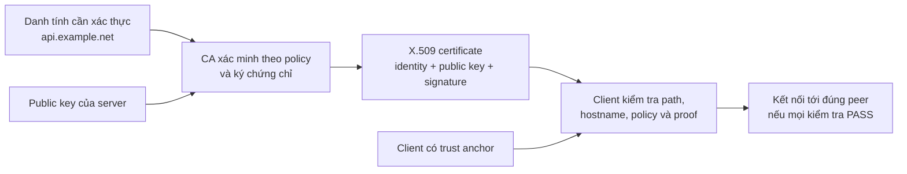
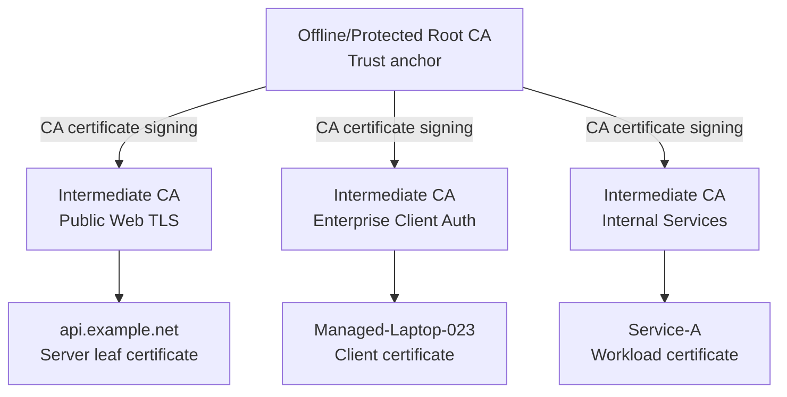
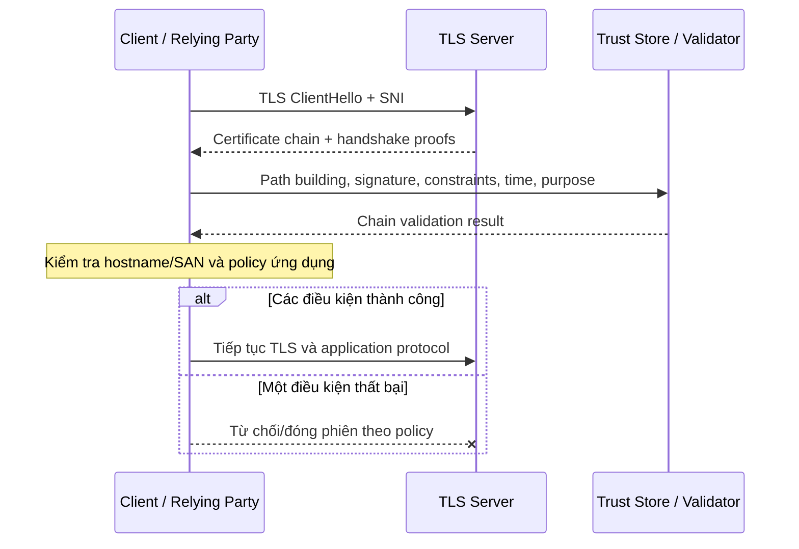
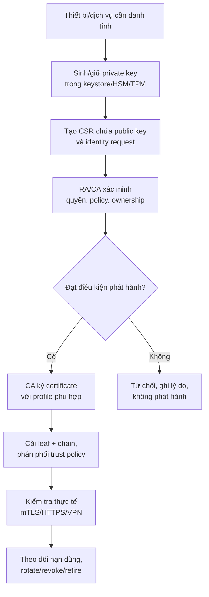
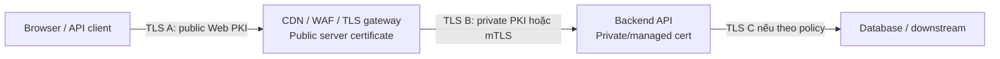
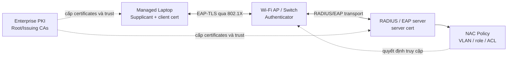
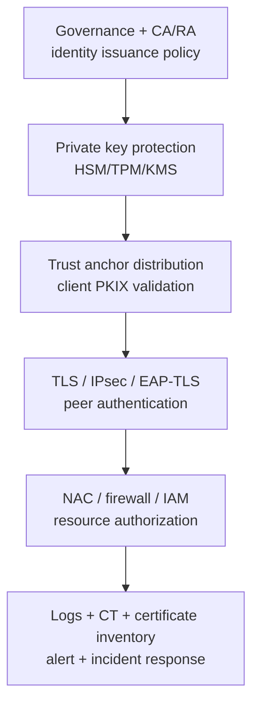

# Vai trò của Public Key Infrastructure (PKI) trong bảo mật mạng

**Public Key Infrastructure (PKI)** — *hạ tầng khóa công khai* — là tập hợp **con người, chính sách, quy trình, phần mềm, phần cứng và các dịch vụ** dùng để tạo lập, xác minh, phân phối, quản lý và thu hồi sự ràng buộc giữa **danh tính** và **khóa công khai**. PKI giúp một thiết bị hoặc ứng dụng trả lời câu hỏi quan trọng: *“Tôi có thể tin rằng khóa công khai này thực sự thuộc về máy chủ, người dùng hoặc thiết bị mà tôi định kết nối không?”*

PKI không chỉ là một máy chủ cấp chứng chỉ. Nó gồm cơ quan chứng thực (*Certificate Authority — CA*), hoạt động xác minh danh tính, chính sách tin cậy, kho chứng thư, bảo vệ khóa riêng, vòng đời phát hành–gia hạn–thu hồi, cơ chế kiểm tra chứng thư và giám sát sự cố. Trong phạm vi Internet và doanh nghiệp, nhiều triển khai sử dụng **chứng chỉ X.509**; nhưng không phải mọi hệ thống dùng khóa công khai đều sử dụng X.509 hoặc cùng một mô hình PKI.

Trong mô-đun **SECURITY_NETWORK_SECURITY**, PKI liên kết trực tiếp với **TLS/HTTPS, VPN, mạng Wi-Fi doanh nghiệp, 802.1X/NAC, firewall/NGFW, DNS, IDS/IPS, Zero Trust, quản trị máy chủ và kiến trúc cloud**. PKI cung cấp nền tảng danh tính có thể kiểm chứng bằng mật mã; **routing, phân đoạn và authorization** vẫn quyết định thiết bị được đi đâu và làm gì sau khi đã được xác thực.

Bài học tập trung vào **vai trò của PKI**, cách thiết kế và vận hành có thể kiểm toán, những giới hạn thường bị hiểu sai và phương pháp chẩn đoán an toàn trên tài sản được phép quản trị. Các ví dụ tên miền, khóa và địa chỉ đều chỉ mang tính minh họa.

## 1. Mục tiêu học tập

Sau bài học, người học có thể:

1. Giải thích tại sao chỉ biết **public key** không đủ để tin danh tính chủ sở hữu và PKI giải quyết vấn đề ràng buộc danh tính–khóa như thế nào.
2. Phân biệt **Root CA, Intermediate CA, Registration Authority (RA), relying party, trust anchor, certificate repository, HSM và dịch vụ trạng thái chứng thư**.
3. Đọc các trường quan trọng của **X.509 certificate** và hiểu chuỗi kiểm chứng **PKIX/certificate path validation**.
4. Phân biệt **authentication, confidentiality, integrity, digital signature, key agreement và authorization**.
5. Vẽ vòng đời chứng thư: **đăng ký → xác minh → cấp phát → triển khai → giám sát → gia hạn/đổi khóa → thu hồi → ngừng sử dụng**.
6. Hiểu **CRL, OCSP, OCSP stapling, short-lived certificates, Certificate Transparency (CT)** và giới hạn của từng cơ chế.
7. Ứng dụng PKI trong **TLS/mTLS, IPsec/IKEv2, Wi-Fi 802.1X/EAP-TLS, VPN, máy chủ nội bộ, workload cloud và IoT**.
8. Chẩn đoán các lỗi như **unknown CA, hostname mismatch, certificate expired, incorrect EKU, chain incomplete và revocation issues**.
9. Đề xuất các biện pháp bảo vệ **private key/CA, phân quyền vận hành, tự động hóa và ứng phó sự cố**.
10. Kiểm thử cả trường hợp **được tin hợp lệ** và **phải bị từ chối** mà không cần tắt xác minh chứng chỉ.

## 2. Vấn đề gốc: có public key nhưng có tin đúng người không?

Mật mã khóa công khai sử dụng **cặp khóa**: một khóa riêng (*private key*) và một khóa công khai (*public key*). Khóa công khai có thể được chia sẻ; khóa riêng phải được bảo vệ.

Giả sử client muốn truy cập **api.example.net**. Nó được một server đưa cho public key để thực hiện bảo mật kênh truyền. Nếu không có cơ chế xác minh, một thiết bị trung gian có thể cung cấp **public key của chính nó** và tự xưng là server thật. Client khi đó có thể tạo kết nối mã hóa **đến sai đối tượng**.

PKI giải quyết bài toán này bằng một **chuỗi bằng chứng**:

- Một cơ quan có thẩm quyền kiểm tra yêu cầu cấp danh tính theo chính sách.
- Cơ quan chứng thực **ký số** lên chứng chỉ gắn một danh tính cụ thể với public key.
- Client có sẵn hoặc được cấu hình một **trust anchor đáng tin**.
- Client kiểm tra chữ ký, đường chứng chỉ, thời hạn, mục đích sử dụng và **danh tính mong đợi**.
- Trong quá trình giao thức, peer còn phải **chứng minh sở hữu private key** tương ứng, theo cơ chế handshake.



**Chứng chỉ không biến một public key thành bí mật.** Nó giúp bên nhận có cơ sở xác minh **ai được phép gắn danh tính nào với public key đó**, trong giới hạn của mô hình tin cậy và chính sách xác thực.

### 2.1. Bốn câu hỏi an ninh phải tách riêng

| Câu hỏi | Lớp giải quyết | Ví dụ |
| --- | --- | --- |
| **Identity:** Peer là ai? | PKI, certificate, IdP, thiết bị quản lý | Chứng chỉ ghi đúng danh tính api.example.net |
| **Possession:** Peer có private key tương ứng? | Chữ ký trong handshake, proof-of-possession | Server ký transcript TLS phù hợp |
| **Transport:** Kênh được bảo vệ ra sao? | TLS, IPsec, WireGuard, giao thức liên quan | Client/server dùng AEAD và traffic keys |
| **Authorization:** Peer được làm gì? | Firewall, NAC, ứng dụng, IAM, RBAC/ABAC | Service A chỉ được đọc API X, không được xóa DB |

PKI thường góp phần vào **identity và possession**. Nó có thể hỗ trợ bảo vệ transport và chính sách truy cập, nhưng **không thay thế authorization**.

## 3. Những thành phần PKI cần biết

| Thành phần | Chức năng | Điều dễ nhầm |
| --- | --- | --- |
| **Root CA** | Đỉnh tin cậy trong một hệ phân cấp CA; thường tự ký | Root tự ký **không tự đáng tin** nếu client chưa cài/cho phép trust anchor |
| **Intermediate/Issuing CA** | CA được CA cấp trên ủy quyền, thường dùng để ký chứng chỉ end-entity | Không nên phát quyền CA quá rộng cho mọi intermediate |
| **Registration Authority (RA)** | Xác minh danh tính/điều kiện đăng ký trước khi CA cấp | RA không nhất thiết giữ private key của CA |
| **End-entity/Leaf certificate** | Chứng chỉ của server, client, thiết bị, người dùng hoặc workload | Không mặc nhiên được phép ký chứng chỉ khác |
| **Relying party** | Bên dựa vào certificate để đưa ra quyết định tin cậy | Phải kiểm tra chain, identity và policy; không tin mọi certificate thấy được |
| **Trust store/trust anchor** | Tập root hoặc điểm tin cậy do hệ thống/người quản trị cấu hình | Thêm root mới có thể tăng đáng kể phạm vi có thể bị tin |
| **Certificate repository** | Nơi phân phối certificate, intermediate, CRL hoặc metadata | Chứa public certificate không có nghĩa chứa private key |
| **OCSP responder/CRL distribution** | Công bố hoặc trả thông tin trạng thái thu hồi | Không bảo đảm mọi client kiểm tra online trong mọi lần kết nối |
| **HSM/KMS/secure element** | Bảo vệ thao tác dùng khóa, giảm nguy cơ xuất private key | Cần chính sách, backup, kiểm soát quyền và lifecycle |
| **Policy/audit systems** | Quản lý điều kiện cấp, thay đổi, log và bằng chứng | PKI không tự an toàn nếu tổ chức vận hành yếu |

### 3.1. PKI là một hệ thống quản trị, không chỉ công nghệ

Một CA có thuật toán ký mạnh vẫn có thể cấp sai chứng chỉ nếu:

- Nhân viên xác minh sai quyền kiểm soát tên miền hoặc danh tính.
- Tài khoản quản trị CA bị chiếm.
- Chính sách cấp quá rộng hoặc nhiều người có quyền phê duyệt một mình.
- Private key của CA bị lộ.
- Template cho phép cấp chứng chỉ sai EKU, SAN hoặc cấp quyền CA ngoài dự kiến.
- Không có audit và không phát hiện việc cấp trái phép.

Do đó, **RA, CA, quy trình phê duyệt và quản lý khóa** quan trọng tương đương các thuật toán mật mã.

## 4. Root CA, Intermediate CA và mô hình phân cấp tin cậy

Một hệ PKI X.509 thường có dạng phân cấp:



Sơ đồ là mô hình minh họa. Internet public Web PKI, private enterprise PKI, service mesh CA và CA dành cho thiết bị có thể là **những hệ thống độc lập**, không nhất thiết chung một Root CA như hình.

### 4.1. Tại sao không dùng Root CA để ký mọi leaf certificate?

Một root được tin bởi nhiều thiết bị có **blast radius rất lớn**. Nếu dùng root thường xuyên để ký leaf, private key phải xuất hiện trong vận hành hàng ngày và chịu nhiều bề mặt rủi ro hơn.

Cách làm phổ biến:

- Bảo vệ **Root CA private key**, có thể duy trì offline khi phù hợp.
- Root ký **intermediate CA certificates** theo quy trình chặt chẽ.
- Intermediate/issuing CA thực hiện hoạt động cấp chứng chỉ thường ngày.
- Tách intermediate theo **mục đích, nhóm quản trị, thiết bị/ứng dụng hoặc vùng tin cậy**.
- Dùng giới hạn **Basic Constraints, Key Usage, pathLenConstraint và Name Constraints** khi phù hợp để giảm quyền ủy nhiệm.

**Một intermediate bị lộ** vẫn là sự cố nghiêm trọng, nhưng có thể được thu hồi/thay mới theo thiết kế mà không nhất thiết thay mọi root trust anchor, với điều kiện phân cấp và cách thực thi kiểm chứng hỗ trợ.

### 4.2. Self-signed khác trusted

Root certificate thường **self-signed**, nhưng:

- Bất kỳ ai có thể tự tạo một self-signed certificate; hành động tự ký **không chứng minh tin cậy**.
- Client tin root vì **trust anchor được cấu hình/kiểm soát**, không vì trường Issuer giống Subject.
- Private enterprise root có thể hợp lệ với máy được quản lý, nhưng **không mặc nhiên đáng tin với trình duyệt công cộng**.
- Trust anchor của một hệ thống có thể dùng metadata/chính sách riêng ngoài certificate; cách diễn giải tùy PKIX implementation.

## 5. Chứng chỉ X.509 chứa thông tin gì?

**X.509 certificate** là cấu trúc dữ liệu được CA ký số để gắn danh tính và public key với các điều kiện sử dụng. Các trường đáng quan sát:

| Trường/extension | Vai trò | Rủi ro khi hiểu sai |
| --- | --- | --- |
| **Version/Serial Number** | Phiên bản cấu trúc, số định danh do CA cấp | Serial một mình không chứng minh certificate hợp lệ |
| **Issuer** | Danh tính CA được ghi là bên cấp | Chuỗi Issuer giống tên CA không thay bước xác minh chữ ký |
| **Subject** | Một phần thông tin chủ thể | Với HTTPS, không dựa riêng vào Common Name để match hostname |
| **Subject Public Key Info** | Public key và thuật toán khóa | Public key có thể công bố; private key không nằm trong certificate |
| **Not Before / Not After** | Thời hạn chứng chỉ | Hết hạn vẫn có thể có chữ ký CA đúng nhưng **không còn hợp lệ** |
| **Subject Alternative Name (SAN)** | DNS names, IP addresses, URI và danh tính mở rộng | Bắt buộc đối chiếu danh tính mong đợi theo loại kết nối |
| **Basic Constraints** | Phân biệt CA và end-entity, giới hạn độ sâu trong một số trường hợp | Một leaf không nên có khả năng ký CA tùy tiện |
| **Key Usage (KU)** | Các mục đích dùng khóa được đánh dấu | Key dùng cho ký chứng thư không đồng nghĩa dùng đúng cho TLS server |
| **Extended Key Usage (EKU)** | Mục đích ứng dụng như serverAuth/clientAuth | Client cert thiếu EKU phù hợp có thể bị từ chối |
| **Authority/Subject Key Identifier** | Hỗ trợ chọn và xây dựng certificate path | Không thay thế kiểm tra chữ ký/chain |
| **AIA/CDP** | Gợi ý nơi lấy intermediate, OCSP hoặc CRL | Không đảm bảo mọi client tự tải hoặc truy cập được |
| **Signature Algorithm/Signature** | Cách CA ký và chữ ký bảo vệ nội dung certificate | Phải đánh giá thuật toán, khóa CA và chain |

### 5.1. Subject Alternative Name quan trọng hơn tên dễ đọc

Ví dụ client mở **https://api.example.net/**. Certificate có SAN **DNS:api.example.net** là ứng viên có danh tính phù hợp. Certificate dành cho **DNS:admin.example.net** không hợp lệ cho api.example.net chỉ vì cả hai ở cùng IP hoặc cùng tổ chức.

Nếu client kết nối tới **IP trực tiếp**, policy hostname/IP matching khác với tên DNS; không thể đơn giản thay **DNS SAN** cho **IP SAN** theo mọi tình huống. Dùng **TLS library chuẩn** để xác minh tên thay vì tự kiểm tra bằng so sánh chuỗi tùy tiện.

### 5.2. Wildcard và các giới hạn

Certificate với SAN **DNS:*.example.net** có phạm vi khớp tên theo quy tắc của ứng dụng/tiêu chuẩn; không tự bảo vệ **example.net** hoặc tên nhiều cấp như **deep.api.example.net**.

Một certificate chứa quá nhiều SAN làm tăng phạm vi bị ảnh hưởng khi private key lộ, đồng thời khiến vòng đời thay đổi tên miền phức tạp hơn. Nên cân nhắc **phân tách certificate theo dịch vụ/vùng tin cậy** khi phù hợp.

## 6. Certificate path validation: vì sao client tin được một leaf?

Khi client kết nối TLS tới server, server có thể gửi **leaf certificate và một số intermediate certificates**. Client xây một đường chứng chỉ tới trust anchor được tin và xác minh các điều kiện phù hợp.



Chi tiết thông điệp TLS phụ thuộc TLS 1.2/1.3 và resumption; ví dụ này không mô tả đầy đủ key schedule hay mọi nhánh mTLS.

### 6.1. Các phép kiểm tra cơ bản

1. **Signature chain:** từng certificate được CA phát hành phù hợp ký, liên hệ với certificate cấp trên và trust anchor.
2. **Validity:** thời gian của certificate còn hợp lệ theo đồng hồ và policy.
3. **CA constraints:** intermediate có quyền ký certificate và không vi phạm path length/name constraints liên quan.
4. **Key usage/EKU:** mục đích khóa/chứng chỉ đáp ứng ứng dụng đang xác minh.
5. **Certificate identity:** hostname/IP/URI hoặc danh tính client đúng với đối tượng mong đợi.
6. **Security policy:** thuật toán, độ dài khóa, trust anchor, policy OID và các yêu cầu riêng nếu được áp dụng.
7. **Revocation status:** kiểm tra trạng thái thu hồi theo cơ chế/chính sách thực tế của client.
8. **Proof-of-possession:** handshake chứng minh peer có private key tương ứng theo giao thức.

Không được suy rằng “server đã gửi certificate” đồng nghĩa **certificate đã được client chấp nhận**. Nếu client tắt verify hoặc trust-all, một kết nối được mã hóa có thể xảy ra **với peer không đáng tin**.

### 6.2. Trust anchor và trust store có thể khác nhau

Hệ điều hành, trình duyệt, Java runtime, container image, VPN client và thiết bị IoT có thể sử dụng **trust store riêng**. Vì vậy cùng một server certificate có thể:

- Được trình duyệt trên máy công ty tin.
- Bị Java service trong container từ chối vì thiếu CA nội bộ.
- Bị thiết bị IoT đời cũ từ chối do thiếu intermediate hoặc trust anchor.
- Bị mobile app từ chối khi chính sách pinning khác hoặc certificate đổi.

Khắc phục cần xác định **chính xác process nào đang xác minh và trust store nào được sử dụng**, không chỉ cài certificate vào một nơi rồi coi mọi client đã tin.

## 7. PKI, chữ ký số, mã hóa và TLS: trách nhiệm tách biệt

PKI dựa trên các cơ chế khóa công khai nhưng không tự thực hiện mọi tác vụ mã hóa.

### 7.1. Digital signature

CA dùng private key ký phần nội dung chứng chỉ. Relying party dùng **CA public key** để xác minh chữ ký. Nếu nội dung bị sửa sau khi ký hoặc chữ ký không hợp lệ, phép kiểm tra sẽ thất bại theo giả định mật mã.

### 7.2. Key agreement và khóa phiên

Trong TLS 1.3, hai đầu thường sử dụng **(EC)DHE** để tạo shared secret và **HKDF** để dẫn xuất traffic keys. Chứng chỉ và private key dài hạn hỗ trợ **xác thực peer**; bản thân certificate **không mang symmetric session key**.

### 7.3. Encryption không tự là authentication

Một kết nối dùng mã hóa mạnh nhưng bỏ kiểm tra certificate có thể bảo vệ dữ liệu khỏi người quan sát thụ động, song vẫn dễ bị **kẻ trung gian chủ động tự xưng là server**. Do đó luôn đánh giá cả:

- Có tạo kênh mã hóa đúng thuật toán?
- Có xác thực **đúng danh tính peer**?
- Client có kiểm tra SAN, chain và chính sách tin cậy?
- Sau khi xác thực peer, ứng dụng có kiểm soát **authorization**?

### 7.4. Forward secrecy

Với TLS full handshake dùng ephemeral key agreement đúng cách, việc lộ **server certificate private key trong tương lai** không mặc nhiên giải mã các phiên trước đã thu thập. Tuy nhiên, nếu endpoint hoặc traffic secret bị lộ khi phiên diễn ra, dữ liệu có thể vẫn bị đọc.

**PKI không tự bảo đảm PFS**: đó là tính chất của giao thức/key exchange và cách cấu hình.

## 8. Đăng ký và cấp chứng chỉ: ai được quyền nhận danh tính nào?

Trong quy trình phát hành, câu hỏi không chỉ là “CSR có đúng định dạng?” mà là **người yêu cầu có quyền nhận certificate cho danh tính được khai báo không?**

### 8.1. RA và quá trình xác minh

**Registration Authority (RA)** hoặc hệ thống đảm nhiệm registration xác minh thông tin và quyền theo chính sách. Trong public Web PKI, phương thức xác minh quyền kiểm soát tên miền chịu các yêu cầu vận hành phù hợp; trong private PKI, việc xác minh có thể gắn với asset inventory, MDM, HR/IdP, tài khoản hệ thống hoặc chứng chỉ bootstrap.

Không nên tự cho rằng **domain validation (DV)** là xác minh danh tính pháp nhân. DV chủ yếu chứng minh điều kiện kiểm soát tên miền ở mức yêu cầu; các loại kiểm tra tổ chức khác có quy trình khác.

### 8.2. Certificate Signing Request (CSR)

**CSR** thường chứa public key, danh tính/thuộc tính yêu cầu và chữ ký thể hiện khả năng dùng private key tương ứng. Nhưng:

- CSR **không tự là certificate đã được CA phê duyệt**.
- Nội dung SAN/subject trong CSR là **yêu cầu**, CA/RA phải áp chính sách trước khi chấp nhận.
- CSR không bảo đảm private key được tạo an toàn, không bị sao chép hoặc phù hợp HSM.
- CA có thể sửa, thêm, loại bỏ hoặc từ chối extensions theo profile được phê duyệt.

### 8.3. Ví dụ vòng phát hành



Một số cơ chế enrollment tự động tạo/cung cấp khóa theo cách khác, chẳng hạn phần cứng tạo khóa không cho xuất. Sơ đồ chỉ trình bày các giai đoạn tin cậy, không ép mọi CA dùng một giao thức hoặc endpoint.

## 9. Certificate Policy, CPS và phân quyền vận hành

Chất lượng PKI phụ thuộc mạnh vào **quy tắc ai có thể được cấp chứng chỉ, dùng để làm gì và ai có quyền thay đổi quy tắc**.

- **Certificate Policy (CP):** mô tả quy tắc/đảm bảo của một lớp chứng chỉ.
- **Certification Practice Statement (CPS):** mô tả cách CA thực thi và quản lý quy trình, tùy mô hình tổ chức.
- **Issuance profile/template:** ràng buộc SAN, EKU, KeyUsage, validity, CA constraints, loại khóa và điều kiện cấp.
- **RBAC:** chia vai trò người yêu cầu, người phê duyệt, CA operator, PKI security officer, auditor.
- **Separation of duties:** thao tác nhạy cảm không chỉ do một tài khoản toàn quyền quyết định.
- **Audit:** log issuance, renewal, revocation, thay đổi template, người thực hiện và access tới key systems.

### 9.1. Nguy cơ của template quá rộng

Một certificate template cho phép người dùng thông thường yêu cầu bất kỳ **subject/SAN/clientAuth identity** nào có thể tạo đường **mạo danh tài khoản hoặc máy chủ** nếu điều kiện kiểm soát không chặt. Tương tự, một template vô tình cho quyền **CA:TRUE** hoặc KeyUsage **keyCertSign** có thể mở rộng quyền ký mà tổ chức không dự định.

Đội phòng thủ nên kiểm tra quyền **enroll/auto-enroll, sửa template, quản lý CA, approve/deny request và thay SAN**. Không coi “chỉ user nội bộ mới truy cập được CA” là đủ.

## 10. Bảo vệ private key, CA key và Hardware Security Module

**Private key là tài sản nhạy cảm nhất** của một danh tính khóa công khai. Một leaf private key bị lộ có thể cho phép mạo danh leaf trong điều kiện cụ thể; một CA private key bị lộ có thể phá vỡ phạm vi tin cậy rộng hơn nhiều.

### 10.1. Các nguyên tắc bảo vệ khóa

1. Ưu tiên tạo private key **tại nơi nó sẽ được bảo vệ**, hạn chế xuất hoặc sao chép.
2. Dùng **HSM/KMS/TPM/secure enclave** theo mức độ rủi ro, tính năng và yêu cầu vận hành.
3. Chỉ cấp quyền sử dụng khóa cho tiến trình/nhân sự có nhiệm vụ, tách quyền **use**, **export**, **delete** và **administer** khi có thể.
4. Không ghi private key vào Git, ticket, nhật ký CI/CD hoặc hình chụp màn hình.
5. Mã hóa backup, kiểm soát phục hồi, có kiểm toán **key ceremony** đối với CA quan trọng.
6. Dùng **rotation/renewal** và kế hoạch thay khóa khi nghi ngờ lộ.
7. Kiểm soát endpoint đọc khóa: một service bị chiếm quyền vẫn có thể lạm dụng thao tác ký dù key không xuất được.
8. Có cảnh báo truy cập bất thường, thao tác ký trái quy trình và thay đổi chính sách key store.

### 10.2. HSM không có nghĩa bất khả xâm phạm

HSM có thể giữ key material trong phần cứng và cung cấp thao tác mật mã, nhưng nếu tài khoản quản trị bị lộ hoặc quy tắc ký sai, CA vẫn có thể cấp chứng chỉ không được phép. Đánh giá tổng thể phải bao gồm **physical access, quorum, backup, firmware, API, operator roles, CA issuance policy và log integrity**.

### 10.3. Root CA offline

Với private PKI doanh nghiệp, root thường được thiết kế **ít hoạt động và được bảo vệ chặt**, có thể offline. Issuing CA online để phục vụ cấp/gia hạn chứng chỉ.

Ưu điểm là giảm diện tiếp xúc của root key; đổi lại cần quy trình bảo trì, gia hạn intermediate, khôi phục thảm họa và xử lý sự cố. Không sao chép chiến lược root offline từ nơi khác mà thiếu **kế hoạch rollover, DR và yêu cầu sẵn sàng**.

## 11. Vòng đời chứng chỉ: cấp mới, triển khai, gia hạn, thu hồi

Một certificate có thể hợp lệ lúc phát hành nhưng trở thành rủi ro khi thiết bị đổi chủ, tên miền đổi quyền, private key bị nghi lộ hoặc người dùng nghỉ việc.

| Giai đoạn | Công việc chính | Bằng chứng/tiêu chí |
| --- | --- | --- |
| **Inventory/request** | Xác định asset, service, SAN/identity, owner, mục đích | Ticket/CMDB, risk classification |
| **Key generation** | Sinh key đúng loại, lưu trong key store được bảo vệ | Key ownership, location, access controls |
| **Registration** | Xác minh quyền nhận danh tính | Approved identity evidence |
| **Issuance** | Ký certificate với profile, EKU, validity đúng | Issuance/audit event, serial, issuer |
| **Deployment** | Cài leaf, intermediate, cấu hình TLS/mTLS/802.1X | Handshake tests và app SLO |
| **Monitoring** | Theo dõi expiry, trust, CT khi phù hợp, revocation | Alert, dashboard, inventory reconciliation |
| **Renew/rotate** | Thay certificate, có thể thay private key, rollout an toàn | New fingerprint, validation, rollback |
| **Revoke** | Đánh dấu certificate không còn được tin theo policy | CRL/OCSP status, response/propagation |
| **Retire** | Loại certificate/keys/trust còn dư theo vòng đời | Audit và kiểm thử từ chối |

### 11.1. Renewal khác rekey

- **Renewal/reissuance** cấp certificate mới theo chính sách, có thể dùng lại public key trong một số hệ thống nếu được cho phép.
- **Rekey/key rotation** tạo cặp khóa mới, tránh tiếp tục phụ thuộc private key cũ.
- **Revocation** báo certificate không nên được tin nữa, nhưng không tự xóa private key khỏi mọi thiết bị đã sao chép.
- **Trust anchor rotation** thay đổi cấp tin cậy rộng hơn; phải có kế hoạch tương thích trust stores.

Với rủi ro lộ private key, **chỉ renew certificate giữ cùng khóa cũ không giải quyết nguyên nhân**.

## 12. Tự động hóa chứng chỉ: ACME và hệ thống enrollment

Ở môi trường có hàng trăm/thousands dịch vụ, làm chứng chỉ thủ công dễ dẫn đến **hết hạn, thiếu đồng bộ, nhầm SAN và downtime**. Tự động hóa giúp giảm lỗi vận hành nếu vòng cấp quyền và audit được thiết kế tốt.

### 12.1. ACME trong Web PKI và private PKI

**Automated Certificate Management Environment (ACME)** hỗ trợ các bước yêu cầu, xác minh quyền theo cơ chế phù hợp, cấp và gia hạn certificate bằng giao thức tự động. Một số hệ thống CA public và private PKI hỗ trợ ACME, nhưng **không phải CA nào hoặc mọi loại danh tính đều dùng cùng challenge**.

Các câu hỏi cần kiểm tra:

- Client ACME nào được phép tạo/renew certificate?
- Ai được quyền yêu cầu certificate cho hostname hoặc namespace?
- Cơ chế challenge có phù hợp với kiến trúc DNS/web không?
- Account keys, CA endpoint, DNS provider credentials và automation secrets được bảo vệ ra sao?
- Có giới hạn rate, xác thực và phân quyền để ngăn phát hành tùy tiện?
- Rollout mới có **atomic reload, health check và rollback** không?
- Đã tính đến certificate chains và trust store ở client chưa?

### 12.2. Đặt alert trước hết hạn

Một hệ thống có thể theo dõi **NotAfter** và phát cảnh báo trước hết hạn theo nhiều ngưỡng, ví dụ 30/14/7 ngày nếu phù hợp tổ chức. Không dùng chỉ một mốc cố định cho mọi certificate: thiết bị IoT offline, workload short-lived hoặc cross-region rollout có yêu cầu khác nhau.

Khi xác định certificate đã thay, cần kiểm tra **certificate đang thực sự được endpoint gửi**. File mới nằm trên disk không chứng minh reverse proxy đã reload hoặc node khác trong load balancer đã dùng certificate mới.

### 12.3. Short-lived credentials

Chứng chỉ tuổi ngắn có thể **giảm cửa sổ sử dụng** khi cần thay danh tính/khóa, nhưng đòi hỏi enrollment và renewal rất đáng tin. Short-lived certificate không đồng nghĩa **không cần revocation hoặc incident response** trong mọi môi trường; hệ quả phụ thuộc thời hạn, loại chứng chỉ và yêu cầu bảo mật.

## 13. Revocation: CRL, OCSP và thực tế xác minh trạng thái

**Revocation** là việc CA đánh dấu certificate không nên được tiếp tục tin trước khi hết hạn, ví dụ khi private key bị lộ, thiết bị bị thu hồi hoặc danh tính không còn hợp lệ.

### 13.1. Certificate Revocation List (CRL)

**CRL** là danh sách có chữ ký của CA chứa thông tin chứng chỉ bị thu hồi và metadata liên quan. Client/validator tải hoặc được cấp CRL, kiểm tra chữ ký, thời điểm và tìm certificate cần đánh giá.

Ưu điểm: có thể phân phối/cache; có giá trị với hệ thống offline hoặc môi trường cần kiểm soát tập trung. Giới hạn: danh sách lớn, kỳ cập nhật, phân phối và cache có thể khiến client không thấy revocation ngay lập tức.

### 13.2. Online Certificate Status Protocol (OCSP)

**OCSP** cho phép hỏi trạng thái của một certificate qua responder được cấp thẩm quyền. Các trạng thái thường thấy gồm **good, revoked, unknown**, nhưng cách client ứng xử với lỗi mạng, thiếu thông tin hay policy tùy triển khai.

**OCSP good không chứng minh certificate đáp ứng mọi điều kiện danh tính/authorization**, chỉ phản ánh trạng thái theo nguồn/phạm vi của responder.

### 13.3. OCSP stapling

Với một số triển khai TLS, server có thể kèm phản hồi OCSP trong handshake để client có dữ liệu mà không cần tự truy cập responder. Cơ chế này có thể giảm độ trễ/ảnh hưởng riêng tư, nhưng không bảo đảm mọi client/server đều hỗ trợ hoặc bắt buộc kiểm tra như nhau.

### 13.4. Fail-open và fail-closed

Khi không thể kiểm tra trạng thái chứng chỉ vì DNS/network/OCSP/CRL lỗi:

- **Fail-open/soft-fail** có thể cho kết nối tiếp tục để ưu tiên tính sẵn sàng.
- **Fail-closed/hard-fail** có thể từ chối kết nối khi không xác nhận được trạng thái theo policy.

Không có lựa chọn phù hợp cho **mọi** hệ thống. Thiết bị quản trị nhạy cảm, tài khoản service-to-service và trình duyệt public có mô hình rủi ro/khả năng riêng. Cần mô tả rõ **sự kiện nào làm từ chối, rủi ro chấp nhận và cách khôi phục khi hạ tầng revocation lỗi**.

### 13.5. Thu hồi không phải nút “tắt” tức thì

Một client đã có session hoặc đã cache trạng thái có thể không kiểm tra lại certificate ngay. Để giảm tác động khi private key lộ, thường phải kết hợp **revoke + rotate key/certificate + chấm dứt sessions + chặn peer/resource ở gateway hoặc ứng dụng** theo mức sự cố.

## 14. Certificate Transparency: phát hiện cấp sai chứng chỉ public

**Certificate Transparency (CT)** sử dụng cơ chế log có thể kiểm toán để tăng khả năng phát hiện chứng chỉ public TLS được cấp ngoài dự kiến. Trong hệ sinh thái Web PKI, các trình duyệt/chính sách nhà cung cấp có thể yêu cầu bằng chứng đăng ký CT cho những chứng chỉ thuộc phạm vi áp dụng.

CT giúp chủ tên miền và đội bảo mật:

- Theo dõi những certificate công khai chứa tên miền mình sở hữu.
- Phát hiện CA/issuer lạ, SAN ngoài dự kiến hoặc hoạt động cấp không có ticket.
- Ghép CT với thông tin CA, DNS change, domain inventory và ứng dụng.

Nhưng CT **không tự ngăn CA phát hành sai** và không chứng minh certificate có private key được bảo vệ. CT cũng không có nghĩa **mọi private enterprise certificate phải xuất hiện trên log công khai**; công bố tên nội bộ có thể gây rò rỉ metadata và cần tuân thiết kế PKI.

### 14.1. Phân biệt CT và revocation

| Cơ chế | Câu hỏi chính | Giới hạn |
| --- | --- | --- |
| **CT** | Có chứng chỉ public được cấp/đăng log cho tên miền nào? | Chủ yếu giúp phát hiện/audit, không tự làm mất hiệu lực certificate |
| **CRL/OCSP** | Certificate cụ thể bị thu hồi chưa? | Phụ thuộc cập nhật, kiểm tra, khả năng truy cập và policy client |
| **CA audit** | CA có tuân quy trình phát hành, khóa và kiểm soát? | Không thay thế kiểm tra từng lần kết nối |
| **Certificate inventory** | Endpoint nội bộ nào đang dùng cert nào, bao giờ hết hạn? | Cần discovery và đồng bộ liên tục |

## 15. PKI trong TLS/HTTPS: xác thực đúng tên miền

Đối với HTTPS, vai trò PKI rõ nhất là giúp client kiểm tra server certificate trong **TLS handshake**:

1. Client biết tên đích, ví dụ **api.example.net**.
2. Server gửi certificate/chain phù hợp với cơ chế handshake.
3. Client xác minh **certificate path, trust anchor, thời hạn, SAN/hostname, EKU, thuật toán và policy**.
4. Server chứng minh sở hữu private key trong trao đổi giao thức tương ứng.
5. Hai phía tạo traffic keys và trao đổi dữ liệu được bảo vệ.
6. Ứng dụng tiếp tục xác thực **người dùng/API token**, phân quyền request và ghi audit.

**PKI không tự xác thực user truy cập web** trong mô hình TLS server-only. Cookie, OIDC, session hoặc cơ chế app mới làm việc này, trừ khi mTLS client authentication được thiết kế rõ.

### 15.1. SNI và certificate selection

Một reverse proxy có thể phục vụ nhiều hostname trên cùng một IP, sử dụng **SNI** trong TLS ClientHello để chọn certificate. Nếu client không gửi hoặc gửi sai SNI, proxy có thể trả certificate mặc định dẫn đến **hostname mismatch**.

SNI không phải bằng chứng client đã được cấp quyền; đó là chỉ dẫn chọn virtual host/certificate. Cần kiểm tra cả tên trong HTTP Host/:authority và policy routing ở proxy.

### 15.2. TLS termination và WAF



Một kết nối TLS được xác thực từ browser đến WAF **không tự bảo đảm** WAF–backend đã xác thực certificate hoặc mã hóa dữ liệu. Mỗi chặng có thể có **issuer, SAN, CA trust và chứng chỉ khác nhau**. Một WAF thấy HTTP body do nó là điểm termination; điều này cũng đặt ra yêu cầu bảo vệ log, quyền truy cập và dữ liệu giải mã.

## 16. mTLS và danh tính của workload/service

**Mutual TLS (mTLS)** yêu cầu cả hai phía trình bày và kiểm tra chứng chỉ phù hợp theo thiết kế. Đây là nền tảng thường dùng trong **service-to-service**, API doanh nghiệp, thiết bị quản trị hoặc service mesh.

### 16.1. mTLS xác thực ai?

Một workload có thể có certificate SAN dạng DNS/URI hoặc danh tính được hệ thống quản lý cấp. Nếu service A kết nối service B:

- A xác thực B bằng certificate, trust bundle và tên/danh tính mong đợi.
- B xác thực A bằng client certificate và trust policy phù hợp.
- Service authorization kiểm tra **A có được gọi endpoint/action của B không**.
- Các proxy/service mesh có thể phân phối certificates ngắn hạn và tự rotate.

**mTLS không tự phân quyền mọi request.** Một client có cert hợp lệ vẫn không nên được phép gọi endpoint xóa dữ liệu nếu không có role/scope phù hợp.

### 16.2. Không chấp nhận mọi certificate từ cùng CA một cách máy móc

Một trust bundle CA có thể cấp chứng chỉ cho nhiều workload khác nhau. Nếu server chỉ kiểm tra “client certificate được một CA nội bộ ký” mà không đối chiếu **danh tính cụ thể, EKU, group/namespace, resource policy**, việc truy cập có thể quá rộng.

Nên kiểm tra:

- CA/issuer nào được trust cho **client authentication**.
- SAN/URI/identity nào được phép cho service/tenant cụ thể.
- Certificate lifecycle và xóa peer khi workload bị retire.
- Có đường bypass đi thẳng vào app không qua mTLS proxy không.
- Ứng dụng có đọc identity từ header do proxy cấp không, và có chống **header spoofing** từ nguồn ngoài proxy không.

## 17. PKI trong Wi-Fi Enterprise, 802.1X và NAC

**IEEE 802.1X** dùng mô hình client/supplicant, **authenticator** (switch/AP) và **authentication server** (thường RADIUS) để kiểm soát quyền truy cập vào mạng.

Trong **EAP-TLS**, chứng chỉ có thể phục vụ xác thực lẫn nhau, giúp tổ chức xác thực thiết bị/người dùng và client xác thực máy chủ RADIUS theo policy.



Sơ đồ lược bớt chi tiết EAPOL/RADIUS, các loại EAP-TLS và cơ chế mã hóa Wi-Fi. **AP không cần phải sở hữu private key của client hoặc RADIUS** chỉ vì nó chuyển các thông điệp xác thực.

### 17.1. Hai chiều tin cậy đều quan trọng

**Client phải kiểm tra certificate của authentication server**: chain, tên server được phê duyệt và các điều kiện tương ứng. Nếu laptop chỉ tin mọi “RADIUS server có certificate nào đó”, kẻ tấn công có thể dựng điểm truy cập/trạm xác thực giả để lừa người dùng hoặc gây rủi ro tùy giao thức/cấu hình.

**RADIUS/NAC phải kiểm tra client certificate** và liên kết danh tính với thiết bị/user, policy, hạn dùng/thu hồi. Một certificate hợp lệ có thể map sang:

- VLAN hoặc network role dành cho managed employee.
- VLAN IoT riêng theo device certificate/profile.
- Quarantine khi posture không phù hợp.
- Deny khi certificate bị thu hồi hoặc không thuộc nhóm được phép.

### 17.2. EAP-TLS không tự thay policy

Chứng chỉ client là bằng chứng danh tính theo PKI, **không tự cho phép truy cập tất cả subnet**. Sau kết quả 802.1X, cần tiếp tục firewall/NAC policy, DNS đúng zone, logging và application-level authorization.

### 17.3. Khó khăn vận hành

- Client thiếu intermediate/root CA hoặc RADIUS đổi certificate mà MDM chưa cập nhật trust.
- Thiết bị hết hạn client certificate trong lúc mất kết nối tới enrollment service.
- Laptop đổi owner/được trả lại nhưng certificate vẫn còn.
- Thiết bị không có đồng hồ đúng làm validation thất bại.
- Revocation responder không truy cập được do policy mạng quá chặt.
- Mismatch về identity mapping, SAN/EKU hoặc NAC group.

Cần chuẩn bị **onboarding/quarantine network** có kiểm soát để thiết bị có thể nhận cấu hình tin cậy mà không phải tắt EAP certificate validation.

## 18. PKI trong VPN và IPsec/IKEv2

Với **site-to-site VPN**, hai gateway có thể dùng chứng chỉ thay vì một PSK chia sẻ dài hạn. Với **remote access VPN**, chứng chỉ máy/người dùng có thể kết hợp **IdP/MFA, posture và authorization**.

Trong **IKEv2**, certificate có thể xác thực peer theo identity được thương lượng, CA trust và chính sách đã cấu hình. Nhưng một kết nối tunnel thành công chỉ có ý nghĩa:

- Gateway hoặc client **xác thực được peer** theo chính sách.
- Các Security Associations và thuật toán được thương lượng.
- Chưa chắc **routing, subnet selectors, NAT, firewall và ứng dụng** đã đúng.

### 18.1. Peer identity phải khớp policy

Một VPN gateway không nên tin mọi certificate do một CA công ty ký để nhận vai trò **gateway đối tác**. Cần đối chiếu **identity được mong đợi**, EKU và các ràng buộc phù hợp với công nghệ.

### 18.2. MFA và chứng chỉ không thay nhau

- Certificate thiết bị giúp chứng minh quyền sử dụng một private key.
- MFA xác thực người dùng bằng các yếu tố thích hợp.
- Firewall/IdP/NAC/ứng dụng xác định **tài nguyên nào được truy cập**.

Một thiết bị có client certificate không chứng minh người đang dùng máy là nhân viên còn hợp đồng; vòng đời user/device cần được liên kết và thu hồi chính xác.

### 18.3. WireGuard và các mô hình khóa khác

**WireGuard** sử dụng peer public keys nhưng không tích hợp X.509 CA chain theo cùng cách TLS/IPsec. Tổ chức có thể xây hệ quản lý cấp/thu hồi peer dựa trên khóa công khai, nhưng không nên suy rằng nhập một WireGuard public key tương đương **certificate PKIX được ký và kiểm tra**.

## 19. PKI trong cloud, container và Kubernetes

Cloud và kiến trúc microservices thường có số lượng workload lớn, thay đổi nhanh, vòng đời certificate ngắn và nhiều trust domains.

### 19.1. Các lớp danh tính

| Lớp | Chứng chỉ có thể dùng | Rủi ro vận hành |
| --- | --- | --- |
| Public HTTPS ingress | Public CA certificate cho domain | Certificate hết hạn, SNI sai, chain sai |
| Internal ingress/backend | Private CA server cert hoặc mTLS | Proxy không verify upstream hostname |
| Service-to-service | Workload identity certificate | Cert/CA trust rộng, bypass sidecar, stale identity |
| Kubernetes ingress | TLS Secret hoặc tích hợp certificate controller | Secret bị đọc trái quyền, cert renewal không reload |
| IoT/edge devices | Device identity certificate | Không có revocation/reprovisioning khi thiết bị mất |
| API B2B | Server + client certificate | Đối tác thay khóa, trust onboarding và AuthZ |
| Database connection | Server cert, đôi khi client cert | App “encrypt=true” nhưng bỏ verify server |
| Administrative API | mTLS hoặc private PKI | Một operator có quyền phát cert sai danh tính |

Trong Kubernetes, **certificate Secret** có thể chứa private key. Secret không tự bảo đảm an toàn tuyệt đối: cần **RBAC, encryption at rest khi áp dụng, audit và giới hạn quyền truy cập của pods/controllers**.

### 19.2. Identity federation và service mesh

Một service mesh có thể dùng workload identities như **URI SAN** với trust domain được định nghĩa, cấp chứng chỉ ngắn hạn và rotation tự động. Nhưng:

- Workload trust domain có thể khác giữa cluster/tenant.
- Không phải mọi sidecar/agent cấu hình đúng là mọi luồng đều đi qua mesh.
- AuthZ policy phải map identity sang destination/action.
- CA compromise hoặc trust bundle sai ảnh hưởng nhiều dịch vụ.
- Certificate expiration/rotation có thể tạo outage hàng loạt nếu control plane lỗi.

### 19.3. Cloud KMS và Managed CA

Dịch vụ cloud có thể quản lý CA, private keys hoặc certificate issuance. Cần phân biệt **managed certificate service** (cấp/triển khai) với **KMS** (quản lý khóa/cryptographic operations), và xem:

- Ai được quyền issue/revoke certificates?
- Private key được tạo/lưu/xuất ở đâu?
- Cloud IAM/roles nào có quyền ký, rotate, delete hoặc thay policy?
- Có audit trail đầy đủ không?
- Khi provider/region bị gián đoạn, service có dùng certificate còn hạn an toàn không?
- Khi chuyển vendor, có kế hoạch chuyển trust anchor và secrets không?

## 20. PKI so với DNSSEC, RPKI, SSH CA và các mô hình tin cậy khác

Thuật ngữ “PKI” đôi khi dùng rộng cho hạ tầng khóa công khai, nhưng **không phải mọi hệ xác thực chữ ký đều là một cây X.509 giống public Web PKI**.

| Cơ chế | Điều nó thường ràng buộc | Khác với X.509 TLS PKI thế nào? |
| --- | --- | --- |
| **Web PKI/X.509** | Hostname/domain hoặc danh tính phù hợp với public key | Browser/OS trust stores, CA chain, TLS validation |
| **Private enterprise X.509 PKI** | Server, user, device, workload identities | Trust anchor do tổ chức quản lý và phân phối |
| **DNSSEC** | DNS RRsets và chuỗi ủy quyền zone đã ký | Các bản ghi DNSKEY/DS/RRSIG và trust anchor riêng; không thay TLS cert |
| **RPKI** | AS origin được ủy quyền cho IP prefix trong ROA | Mô hình chứng nhận tài nguyên IP/AS và ROV; không xác thực HTTPS hostname |
| **SSH certificates** | User/host SSH identity theo định dạng và SSH CA | Không mặc định dùng certificate X.509/trust store của trình duyệt |
| **OpenPGP** | Khóa người dùng/danh tính theo mô hình tin cậy riêng | Không tự đồng nhất với PKIX chain |
| **WireGuard peer keys** | Peer public key được cấu hình | Không mặc định có CA hierarchy hoặc X.509 leaf |
| **OAuth/OIDC tokens** | Identity/claims/quyền trong token ký theo kiến trúc IdP | Token/signing keys khác lifecycle và mục đích TLS certificate |

### 20.1. DNSSEC không thay TLS certificate

DNSSEC giúp resolver xác minh DNS dữ liệu đã ký theo chain of trust DNS, nhưng **không tự chứng minh** website tại IP trả về có đúng danh tính TLS hoặc ứng dụng an toàn. Ngược lại, HTTPS certificate có thể xác thực endpoint dù DNS query đi qua resolver chưa dùng DNSSEC, theo giới hạn và giả định đường kết nối.

### 20.2. RPKI không thay PKI của thiết bị mạng

RPKI Route Origin Validation giúp đánh giá **origin AS** so với ROA, không xác minh quản trị viên SSH tới router hay IKEv2 gateway certificate. Mỗi mô hình bảo vệ một **đối tượng tin cậy khác nhau**.

## 21. Threat modeling: PKI có thể bị phá ở đâu?

PKI cung cấp bằng chứng danh tính đáng tin **khi quy trình phát hành, khóa và quá trình kiểm tra đều đúng**.

### 21.1. Ma trận rủi ro

| Rủi ro | Tác động có thể | Phòng vệ |
| --- | --- | --- |
| Leaf private key bị lộ | Mạo danh một dịch vụ/thiết bị khi điều kiện phù hợp | HSM/TPM, least privilege, rotation, revoke |
| Intermediate CA key lộ | Phát hành certificate ngoài phép trong phạm vi CA đó | HSM, key ceremony, giới hạn CA, audit, incident response |
| Root CA key lộ | Đứt nền tảng tin cậy diện rộng | Offline/protected root, quorum, kế hoạch trust reset |
| RA/issuance policy bị lạm dụng | Cấp chứng chỉ đúng chữ ký nhưng sai danh tính | Dual control, template review, IAM, audit |
| Trust store bị cấy root lạ | Client tin thêm các certificate do root đó ký | MDM baseline, integrity monitoring, RBAC |
| Client bỏ verify hostname | Kết nối mã hóa tới server sai | TLS defaults an toàn, static review, negative tests |
| Certificate hết hạn | Service outage, lỗi EAP/VPN/API | Inventory, renewal automation, expiry alert |
| Missing intermediate | Một số client không xây được path | Chain deployment test nhiều trust stores |
| Revocation unavailable | Không phát hiện cert bị thu hồi hoặc outage | HA, CRL/OCSP policy, short-lived cert nếu phù hợp |
| CT phát hiện cert không được phép | Nguy cơ domain issuance sai | Domain ownership review, provider escalation, revoke |
| mTLS trust quá rộng | Client được CA ký truy cập sai service | SAN/EKU mapping + AuthZ |
| CA tự động cấp quá rộng | Phát hành danh tính tùy tiện ở quy mô lớn | Enrollment authorization và namespace ownership |
| Lỗi đồng hồ | Chứng chỉ bị đánh giá chưa hiệu lực/hết hạn | Time synchronization được bảo vệ và giám sát |
| TLS termination chặng sau plaintext | Lộ dữ liệu ngoài đoạn TLS công khai | Re-encryption/mTLS, network segmentation |

### 21.2. Defense in depth



**Một CA đáng tin không tự làm mạng an toàn**. Nếu ứng dụng bỏ AuthZ, dữ liệu vẫn có thể bị rò rỉ dù cả hai phía đã xác thực mTLS đúng. Nếu routing hoặc firewall sai, có thể có kết nối ngoài phạm vi cần thiết dù certificate hoàn toàn hợp lệ.

## 22. Kịch bản sự cố thường gặp và cách chẩn đoán

### 22.1. Case A — Trình duyệt báo chứng chỉ không đáng tin

**Triệu chứng:** browser báo unknown issuer/unknown CA hoặc certificate chain error khi mở app nội bộ.

**Giả thuyết:** root CA nội bộ chưa được cài cho client; thiếu intermediate; server gửi chain sai; CA bị thay hoặc client dùng trust store khác.

**Điều tra:** xác định browser/process, hostname, certificate chain thực sự được server gửi, issuer, trust store và thời điểm. Trên thiết bị được quản lý, đối chiếu trust policy/MDM và CA inventory.

**Khắc phục:** cấp đúng trust anchor qua kênh quản trị, sửa intermediate chain hoặc certificate deployment. **Không dặn người dùng bỏ qua cảnh báo** và không bật “trust all”.

### 22.2. Case B — HTTPS public được nhưng backend mTLS lỗi

**Triệu chứng:** client → WAF handshake thành công, nhưng WAF → backend trả 502 sau khi bật mTLS.

**Giả thuyết:** WAF thiếu client certificate hoặc private key; backend không tin client issuing CA; EKU/SAN hoặc identity mapping sai; WAF không verify được server backend.

**Điều tra:** chia thành hai phiên TLS độc lập; kiểm tra SNI/ALPN, SAN, trust store, clientAuth EKU, yêu cầu CertificateRequest, audit và firewall logs.

**Khắc phục:** sửa certificate/trust/identity của **chặng lỗi**, không chuyển backend thành HTTP plaintext để bỏ qua vấn đề.

### 22.3. Case C — 802.1X Wi-Fi bị từ chối hàng loạt sau đổi RADIUS cert

**Triệu chứng:** nhiều laptop được quản lý không vào được Enterprise Wi-Fi, trong khi AP/switch hoạt động.

**Giả thuyết:** RADIUS certificate mới khác tên mong đợi, chưa có intermediate hoặc root trust; một số clients chưa nhận profile MDM cập nhật.

**Điều tra:** so certificate từ EAP-TLS server, tên RADIUS server được client pin theo policy, trust anchor, logs RADIUS/NAC, giờ của client và thay đổi gần đây.

**Khắc phục:** cập nhật certificate chain/profiles qua kênh tin cậy, thử trên nhóm thiết bị nhỏ, giữ enrollment path an toàn và rollback có kiểm soát. **Không tắt server certificate validation** trên toàn bộ Wi-Fi.

### 22.4. Case D — Certificate service mesh hết hạn đồng loạt

**Triệu chứng:** nhiều microservices bắt đầu từ chối kết nối mTLS cùng thời điểm.

**Giả thuyết:** certificate issuer/control plane ngừng gia hạn, trust bundle rotation lỗi, node clocks sai hoặc workload certificates không reload.

**Điều tra:** inventory NotAfter, controller logs, CA health, service mesh proxy cert thực tế, trust roots trên từng cluster, route và thông tin thời gian.

**Khắc phục:** phục hồi issuance/trust distribution, rotate có thứ tự, kiểm tra service-level connectivity. Không tạo một CA mới tùy tiện mà thiếu kế hoạch chuyển trust.

### 22.5. Case E — Phát hiện certificate public ngoài lịch

**Triệu chứng:** CT monitoring phát hiện một certificate mới cho **api.example.net** từ issuer không nằm trong change ticket.

**Giả thuyết cạnh tranh:** nhóm khác đã phát hành hợp lệ nhưng không đăng ký; nhà cung cấp CDN quản lý certificate; hoặc phát hành không được phép.

**Điều tra:** xem certificate details/SAN, CA, thời gian, ownership của domain, DNS/CA account logs, provider và release history. Chỉ quyết định cấp sai khi bằng chứng đã đủ.

**Khắc phục:** nếu xác minh trái phép, phối hợp issuer để thu hồi, xử lý quyền domain/account, rà soát khả năng sử dụng certificate và kiểm soát identity, đồng thời bổ sung inventory/alert. **CT chỉ phát hiện một bằng chứng issuance, không tự chứng minh certificate đã được dùng để tấn công.**

## 23. Lệnh kiểm tra certificate và chain an toàn

Chỉ thực hiện trên **endpoint/certificate thuộc quyền quản trị hoặc được cho phép**. Những lệnh dưới đây chủ yếu **đọc/kiểm chứng**, không cấp/thu hồi certificate, không xuất private key và không thay cấu hình server.

### 23.1. Quan sát certificate công khai của endpoint HTTPS

```bash
# Kết nối TLS tới endpoint được phép; dùng SNI và kiểm tra hostname
openssl s_client -connect api.example.net:443 \
  -servername api.example.net \
  -verify_hostname api.example.net \
  -verify_return_error \
  -showcerts
```

Lưu ý:

- Công cụ trả certificate chain được endpoint **thực sự trình bày**; không tự chứng minh backend sau CDN/WAF dùng cùng certificate.
- **-verify_hostname** và **-verify_return_error** yêu cầu kiểm tra danh tính/chain phù hợp với phiên bản OpenSSL, trust store và CA được cấu hình.
- Với **private PKI**, có thể cần chỉ định CAfile/CApath được duyệt, thay vì tắt verification.
- Nếu server bị lỗi do chưa đưa đúng intermediate, cần sửa chain ở **server/gateway**, không sửa bằng cách tin một leaf lạ vĩnh viễn.

### 23.2. Xem certificate đã được cấp

```bash
# Xem phần public certificate ở định dạng PEM
openssl x509 -in server-cert.pem -noout -text

# Kiểm tra hạn dùng
openssl x509 -in server-cert.pem -noout -dates

# Kiểm tra serial/issuer/subject/SAN qua phần thông tin certificate
openssl x509 -in server-cert.pem -noout -serial -issuer -subject -ext subjectAltName

# In fingerprint certificate để đối chiếu inventory
openssl x509 -in server-cert.pem -noout -fingerprint -sha256
```

Một fingerprint SHA-256 giúp đối chiếu **certificate bytes/đối tượng cụ thể**, nhưng không cho biết certificate đã được **path validation**, chưa bị revoke hoặc đúng hostname.

### 23.3. Kiểm tra CSR do tổ chức quản lý

```bash
# Xem yêu cầu cấp chứng chỉ (không chứa private key)
openssl req -in server-request.csr -noout -text -verify
```

Lệnh xác minh chữ ký của CSR có thể phát hiện một số vấn đề định dạng/proof-of-possession, nhưng **không chứng minh người gửi có quyền nhận SAN đó**. RA/CA phải xác minh authorization của yêu cầu.

### 23.4. Xác minh chain theo CA được phê duyệt

```bash
# Ví dụ: root-ca.pem là CA trust anchor được tổ chức phê duyệt,
# intermediates.pem chứa intermediate(s) phù hợp,
# server-cert.pem là leaf certificate được kiểm tra.
openssl verify \
  -CAfile root-ca.pem \
  -untrusted intermediates.pem \
  -purpose sslserver \
  -verify_hostname api.example.net \
  server-cert.pem
```

Lệnh kiểm tra dựa trên dữ liệu và khả năng OpenSSL đang dùng. **Không mặc định** chỉ một lệnh đã bao phủ chính sách revocation, CT, pinning, ứng dụng hoặc state của certificate trên server thực tế.

### 23.5. Xem CRL nội bộ

```bash
# Chỉ đọc CRL PEM thuộc hệ thống được phép quản trị
openssl crl -in issuing-ca.crl.pem -noout -text
```

Không suy “certificate chưa nằm trong một CRL đang có” đồng nghĩa chắc chắn an toàn: CRL có thể cũ, cache, không đúng issuer hoặc không đầy đủ theo chính sách. Kiểm tra thời gian cập nhật và nguồn phân phối.

### 23.6. Java truststore và vấn đề runtime

Một Java service có thể dùng truststore riêng thay vì trust store OS. Với **keystore do tổ chức quản lý**, có thể quan sát:

```bash
# Công cụ có trong JDK, có thể yêu cầu mật khẩu keystore:
keytool -list -v -keystore truststore.p12 -storetype PKCS12
```

**Không đưa mật khẩu truststore hoặc private key vào tham số dòng lệnh được log/ghi lịch sử**, đặc biệt tham số hiển thị công khai. Khi cần kiểm tra, ưu tiên phương án nhập bí mật an toàn được môi trường hỗ trợ.

### 23.7. Windows certificate store

Trong PowerShell trên thiết bị được phép:

```powershell
# Liệt kê certificate cá nhân của tài khoản hiện tại (metadata)
Get-ChildItem Cert:\CurrentUser\My |
  Select-Object Subject, Issuer, NotBefore, NotAfter, Thumbprint

# Liệt kê các certificate Root trong store máy (metadata)
Get-ChildItem Cert:\LocalMachine\Root |
  Select-Object Subject, Issuer, Thumbprint
```

Danh sách root dài chưa chắc có vấn đề; cần đối chiếu **baseline do tổ chức phê duyệt**, loại bỏ/mở rộng trust qua quy trình quản lý. Không tự xóa root hoặc certificate production chỉ dựa trên một issuer chưa quen.

## 24. Hướng dẫn vận hành: inventory, monitoring và runbook

### 24.1. Inventory tối thiểu

| Thuộc tính | Ví dụ | Mục đích |
| --- | --- | --- |
| Asset/service ID | API-PROD-001 | Gắn certificate với tài sản thật |
| Certificate serial/fingerprint | SHA-256 fingerprint | Tránh nhầm các certificate cùng subject |
| SAN/identity | api.example.net | Đối chiếu mục đích cấp |
| Issuer/root/intermediate | Enterprise Issuing CA 02 | Theo dõi trust domain |
| EKU/KeyUsage | serverAuth/digitalSignature | Kiểm soát mục đích |
| Validity | NotBefore/NotAfter | Alert hạn dùng |
| Key storage | HSM/TPM/managed keystore | Đánh giá bảo vệ key |
| Endpoint/termination | Public WAF, internal API, VPN gateway | Biết nơi certificate được trình bày |
| Renewal owner | Platform SRE | Quyền và trách nhiệm |
| Revocation route | CRL/OCSP/policy | Xử lý khi nghi lộ |
| Automation source | ACME/MDM/PKI controller | Kiểm tra quyền cấp |
| Last verification | Timestamp + result | Đánh giá tình trạng thực tế |

### 24.2. Một mẫu sự kiện monitoring (dữ liệu giả định)

```json
{
  "timestamp": "2026-11-28T03:00:00Z",
  "event_id": "pki-demo-001",
  "asset": "API-PROD-001",
  "hostname": "api.example.net",
  "certificate_fingerprint_sha256": "example-redacted",
  "issuer": "Enterprise Intermediate CA",
  "not_after": "2027-01-15T00:00:00Z",
  "chain_validation": "pass",
  "hostname_validation": "pass",
  "deployment_point": "edge-waf",
  "alert_reason": "scheduled_expiry_review",
  "owner": "Platform-SRE",
  "key_material_logged": false
}
```

Đây là **schema minh họa**, không phải output của một PKI vendor. Trong hệ thống thực, nên đánh dấu rõ trường nào được đo, trường nào suy từ inventory và trạng thái kiểm tra **ở thời điểm nào**.

### 24.3. Runbook khi certificate deployment gây outage

1. Xác định **dịch vụ, hostname, nhóm client, thời gian, điểm termination** đang lỗi.
2. Kiểm tra client báo lỗi **network, TLS handshake, CA trust, hostname, expired, EKU hay application**.
3. Lấy certificate/chain thực sự được **endpoint gửi**, không chỉ xem file trong kho secrets.
4. Đối chiếu SAN, issuer, fingerprint, validity, chain, trust store của client và log deployment.
5. Kiểm tra node/region nào chưa reload hoặc chưa được cấp chứng chỉ mới.
6. Kiểm tra chặng **edge → backend** và mTLS client identity riêng nếu dùng.
7. Nếu lỗi do thay đổi mới, rollback **đúng điểm certificate/trust/secret/policy** theo phương án được phê duyệt.
8. Xác minh lại client hợp lệ và client phải bị từ chối; không dùng **disable certificate verification** làm workaround.
9. Ghi timeline, nguyên nhân, phạm vi ảnh hưởng, kênh chứng chỉ và sự cố trust liên quan.
10. Cập nhật automation, alert, owner và checklist để tránh lặp.

## 25. Ma trận kiểm thử PKI cho bảo mật mạng

Một bộ test nên bao gồm **positive tests** và **negative tests**; không chỉ chứng minh hệ thống hoạt động khi mọi thứ đúng.

| ID | Bối cảnh | Điều kiện kiểm thử có phép | Kết quả kỳ vọng |
| --- | --- | --- | --- |
| **T01** | HTTPS | Server có leaf + intermediate hợp lệ | Client xác minh chain và SAN thành công |
| **T02** | HTTPS | Server không có intermediate cần thiết, client không tự lấy được | Báo chain error rõ ràng |
| **T03** | HTTPS | SAN không khớp hostname | Client từ chối identity |
| **T04** | HTTPS | Certificate hết hạn trong môi trường lab | Client không tiếp tục như cert hợp lệ |
| **T05** | HTTPS | Root CA không nằm trong truststore | Client báo unknown CA/issuer |
| **T06** | HTTPS | Truststore có đúng root được phê duyệt | Client kết nối hợp lệ, không cần trust-all |
| **T07** | mTLS | Client cert được tin và có identity/role đúng | Handshake + resource authorization cho phép đúng scope |
| **T08** | mTLS | Client cert thuộc CA khác hoặc sai clientAuth policy | Bị từ chối theo trust/auth policy |
| **T09** | mTLS | Client cert hợp lệ nhưng không có quyền resource | Resource bị deny sau authentication |
| **T10** | PKI issuance | CSR yêu cầu SAN ngoài ownership | RA/CA không phát hành |
| **T11** | Issuing template | User không có quyền CA certificate issuance | Không thể tự cấp CA:TRUE/keyCertSign |
| **T12** | Key protection | Operator không có quyền export leaf/CA private key | Access control ngăn theo thiết kế |
| **T13** | Renewal | Cert tự động thay trước hết hạn | Endpoint thực sự dùng cert mới, app SLO giữ được |
| **T14** | Rotation | Private key đổi sau nghi lộ | Certificate mới dùng key mới, phiên/credential cũ xử lý |
| **T15** | Revocation | Certificate test bị revoke | Client/gateway áp đúng policy kiểm tra trạng thái |
| **T16** | Revocation outage | OCSP/CRL không truy cập được trong lab | Fail-open/closed theo chính sách đã phê duyệt, có cảnh báo |
| **T17** | 802.1X | Managed device có EAP-TLS cert hợp lệ | Xác thực đúng server, nhận VLAN/role phù hợp |
| **T18** | 802.1X | RADIUS server cert sai tên/CA | Supplicant từ chối, không bỏ verification |
| **T19** | VPN IKEv2 | Gateway có certificate/identity đúng | Xác thực peer, IPsec và policy hoạt động |
| **T20** | VPN IKEv2 | Gateway cert do CA hợp lệ nhưng sai peer identity | Bị từ chối theo policy |
| **T21** | WAF/backend | Public TLS hợp lệ nhưng backend cert sai | Gateway từ chối chặng backend và cảnh báo |
| **T22** | Service mesh | Workload cert được rotate | mTLS liên tục theo SLO, trust bundle tương thích |
| **T23** | CT monitoring | Lab/audit ghi nhận cert public mới của domain do tổ chức quản lý | Có review/alert, không tự kết luận tấn công |
| **T24** | Client diversity | Java, browser, mobile, IoT dùng trust stores riêng | Phát hiện khác biệt trust/chain trước deploy |
| **T25** | CA outage | Issuing CA không sẵn sàng | Cert đang còn hạn hoạt động theo policy; có kế hoạch phục hồi issuance |
| **T26** | Root rotation | Cài trust anchor mới trước khi thay chain | Chuyển đổi có kiểm thử, client cũ không mất kết nối ngoài dự kiến |
| **T27** | Policy rollback | Một issuer/template change gây lỗi | Khôi phục bản đã duyệt, vẫn bảo đảm kiểm tra danh tính |
| **T28** | Offboarding | Thiết bị/user bị thu hồi quyền | Certificate/session và NAC/AuthZ được xử lý đúng vòng đời |

**Chỉ thực hiện các thử nghiệm thay trust, revoke, root rotation hoặc giả lập chứng chỉ lỗi trong lab/staging hoặc phạm vi production đã được phê duyệt.** Không tạo CA tin cậy trên máy người khác, không thử giả mạo peer thật ngoài quyền quản trị và không phát hành certificate cho domain không sở hữu.

## 26. Các hiểu lầm thường gặp

| Hiểu lầm | Vì sao sai | Cách hiểu đúng |
| --- | --- | --- |
| “PKI chỉ là một CA server” | Thiếu RA, policy, key store, trust distribution và audit | PKI là hạ tầng kỹ thuật **và quản trị** |
| “Public key có sẵn thì peer đáng tin” | Không có ràng buộc danh tính được xác minh | Cần certificate/chuỗi tin cậy hoặc pinning được quản lý |
| “Self-signed certificate luôn đáng tin” | Tự ký không tự tạo trust anchor ở client | Trust phải được cấu hình/kiểm soát |
| “Root CA nên ký mọi service certificate” | Tăng rủi ro lộ root key | Dùng issuing intermediates có giới hạn |
| “Certificate chứa private key” | Chứng chỉ thường chứa **public key**, private key quản lý riêng | Bảo vệ private key trong keystore/HSM |
| “CA đã ký thì hostname nào cũng hợp lệ” | SAN/identity validation độc lập với chữ ký | Kiểm tra đúng tên và mục đích |
| “Certificate hợp lệ chứng minh ứng dụng không có lỗi” | PKI không kiểm tra code/authz | Vẫn cần secure coding và service authorization |
| “mTLS cấp toàn quyền API cho client” | mTLS xác thực peer, không cấp quyền mọi action | Map identity sang resource policy |
| “Có CA nội bộ thì mọi client đều tự tin” | Java/container/IoT có trust stores khác | Phân phối/kiểm thử từng runtime |
| “Certificate hết hạn mới cần thay” | Renewal muộn tạo outage; lộ key phải rotate ngay | Tự động hóa expiry và incident response |
| “Renew certificate là private key đã đổi” | Có thể reissue với cùng public key | Kiểm tra rekey thực tế |
| “Revoke là mọi phiên lập tức chết” | Có cache, session, policy kiểm tra và lỗi mạng | Kết hợp revoke, rotate, session revoke và ACL |
| “OCSP good chứng minh user được phép” | OCSP chỉ liên quan trạng thái certificate | Authorization độc lập |
| “Không thấy OCSP stapling là TLS luôn sai” | Các client/policy hỗ trợ khác nhau | Xem requirement và revocation design cụ thể |
| “CT tự chặn mọi cert cấp lén” | CT cung cấp minh bạch/audit, không tự revoke | Monitor, điều tra và xử lý issuer |
| “HSM tự động khiến CA an toàn” | Lạm dụng quyền ký vẫn có thể xảy ra | RBAC, quorum, issuance policy, audit |
| “TLS ở WAF đồng nghĩa backend luôn mã hóa” | TLS termination chia đường thành các chặng riêng | Validate/re-encrypt từng hop theo policy |
| “EAP-TLS xác thực đúng chỉ bằng client cert” | Client còn phải xác minh server đáng tin | Kiểm tra RADIUS certificate và name policy |
| “VPN peer cert đúng thì subnet nào cũng được phép” | Tunnel auth không thay routing/ACL | Filter prefix, zone và service AuthZ |
| “DNSSEC/RPKI dùng cùng trust store của HTTPS” | Mục tiêu và trust models khác nhau | Hiểu trust anchor riêng từng giao thức |

## 27. Checklist triển khai PKI an toàn

- [ ] Có inventory CA roots, intermediates, certificate templates/profiles và owner.
- [ ] Có **CP/CPS** hoặc tài liệu chính sách cấp chứng chỉ phù hợp rủi ro/phạm vi.
- [ ] Phân biệt root trust anchor, issuing CA, RA, relying party và certificate repository.
- [ ] Root key được bảo vệ chặt; issuing CA có giới hạn quyền và khả năng khôi phục.
- [ ] Kiểm soát quyền **enroll, approve, modify template, issue, revoke, export key, manage CA**.
- [ ] CA/RA xác minh **ownership** của SAN/identity, không tin mọi CSR một cách mặc định.
- [ ] Certificate profiles có SAN, Basic Constraints, KU/EKU, validity và algorithms đúng.
- [ ] Private keys được tạo/lưu an toàn, không xuất vào repo/log/ticket, có kế hoạch rotation.
- [ ] Phân biệt certificate bytes, certificate fingerprint, public key và private key trong inventory.
- [ ] Trust stores được phân phối theo OS, browser, Java, container, VPN, IoT và NAC clients.
- [ ] Không cài root CA mới hoặc bỏ hostname/chain verification khi chưa có phê duyệt rủi ro.
- [ ] Certificate path validation bao gồm chữ ký, chain, time, SAN, purpose và revocation policy.
- [ ] Có vòng đời **issuance → deploy → renew/rekey → revoke → retire** với owner và log.
- [ ] Renewal automation có quyền hạn hẹp, secrets an toàn, health check và rollback.
- [ ] Certificate expiry/unknown issuer/chain failure được giám sát trước khi gây outage.
- [ ] CRL/OCSP/short-lived certificate policy được thiết kế theo SLA và mô hình rủi ro.
- [ ] Root/intermediate rollover có kế hoạch song song trust và kiểm thử nhiều client types.
- [ ] Với public Web PKI, CT được theo dõi để phát hiện issuance ngoài lịch khi áp dụng.
- [ ] TLS endpoints có SAN đúng, chain đầy đủ, SNI đúng và trust anchors phù hợp.
- [ ] WAF/CDN/LB/backend kiểm chứng từng phiên TLS; backend không mặc nhiên plaintext.
- [ ] mTLS client identity được map vào **authorization**, không tin mọi leaf của cùng CA.
- [ ] Wi-Fi EAP-TLS/NAC kiểm tra cả RADIUS server và client certificate, không mở bypass diện rộng.
- [ ] VPN IKEv2 certificate có peer identity, trust và ACL/route policy đúng.
- [ ] Cloud workloads/Kubernetes/IoT có inventory, identity rotation và access controls cho secrets.
- [ ] CA, HSM, RA và certificate issuance changes được đưa vào audit/SIEM.
- [ ] Đã kiểm thử dương tính/âm tính cho CA, SAN, expired, revoked, EKU và trust store mismatch.
- [ ] Có runbook ứng phó leaf key compromise, CA compromise, cert expiry và invalid chain.
- [ ] Ghi rõ thời gian, service owner, impact, kết luận và **bằng chứng thực tế** sau khắc phục.
- [ ] Không xem PKI là thay thế firewall, DNS security, routing policy hay secure coding.

## 28. Tổng kết

**Public Key Infrastructure** cung cấp **cơ chế thiết lập và duy trì niềm tin đối với danh tính gắn với khóa công khai**. Các yếu tố cốt lõi gồm **CA/RA, root và intermediate CAs, trust anchors, chứng chỉ X.509, kiểm tra certificate path, bảo vệ private key và quản trị toàn bộ vòng đời issuance–renewal–revocation**. Một certificate do CA ký chỉ là một bằng chứng trong quá trình xác thực: client còn phải kiểm tra **chain, danh tính mong đợi, thời hạn, mục đích và chính sách tin cậy**, còn giao thức phải chứng minh peer sử dụng private key phù hợp.

PKI tạo nền tảng cho **HTTPS/TLS, mutual TLS, Wi-Fi 802.1X/EAP-TLS, IPsec/IKEv2 VPN, service-to-service, cloud workload và danh tính thiết bị**. Tuy nhiên, **xác thực danh tính không đồng nghĩa cấp quyền**: firewall, NAC, routing segmentation, IAM và authorization ở ứng dụng vẫn phải thực thi những gì peer được phép làm.

Một PKI vận hành tốt không được đo chỉ bằng “đã cấp bao nhiêu chứng chỉ”, mà bằng **cấp đúng danh tính, bảo vệ đúng khóa, phân phối đúng trust, phát hiện/thu hồi đúng sự cố, gia hạn không gián đoạn và chứng minh được việc từ chối peer không đáng tin**. Khi phối hợp với các lớp bảo vệ mạng khác trong **SECURITY_NETWORK_SECURITY**, PKI giúp biến một đường kết nối được mã hóa thành một **quan hệ tin cậy có căn cứ, giới hạn và kiểm toán được**.
