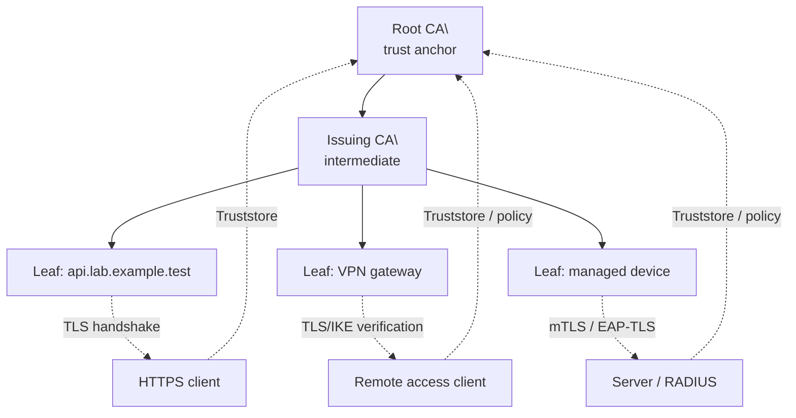
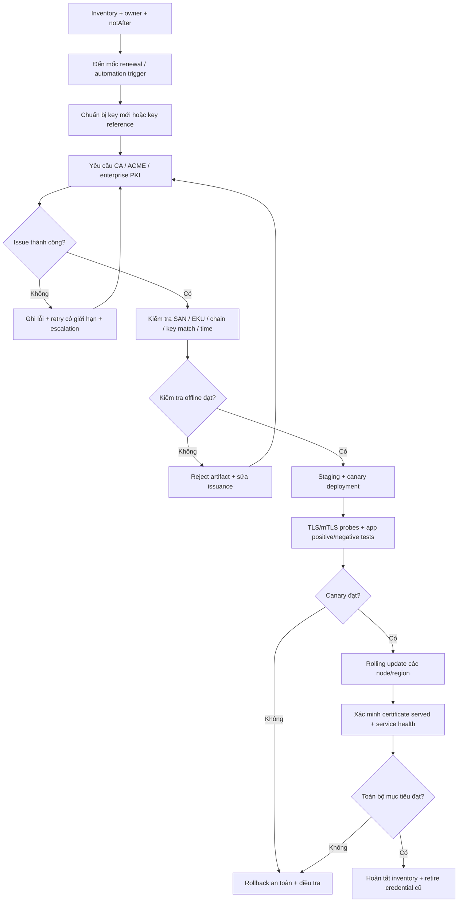
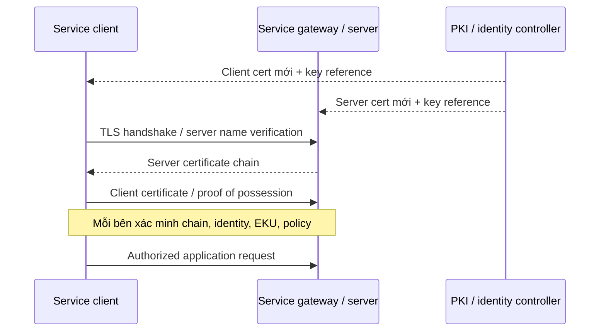

# Gia hạn và thay thế certificate trước hạn trong PKI mạng

## Mục tiêu học tập

Sau bài học, bạn có thể:

1. Phân biệt **certificate còn hiệu lực về thời gian**, **certificate hợp lệ theo chính sách**, **chứng thư đang được server thực sự phục vụ** và **chứng thư đã được cấp nhưng chưa triển khai**.
2. Giải thích **notBefore**, **notAfter**, thời gian còn hạn, chuỗi tin cậy, SAN, EKU, trạng thái thu hồi và vì sao việc chờ tới ngày hết hạn để thay certificate dễ gây gián đoạn.
3. Phân biệt **renewal, reissuance, rekey, certificate replacement, CA/intermediate rotation và trust-anchor rotation**, cùng các tình huống bắt buộc thay khóa hay mở rộng thời gian chuyển tiếp.
4. Tính **cửa sổ gia hạn** dựa trên tuổi thọ chứng thư, thời gian cấp phát, triển khai, kiểm thử, rollback và dự phòng cho sự cố, không áp một ngưỡng cứng cho mọi hệ thống.
5. Xây quy trình tự động **inventory → phát hiện sắp hết hạn → yêu cầu chứng thư → kiểm tra → staging → canary/rolling rollout → xác minh → hoàn tất/rollback**.
6. Vận dụng nguyên tắc cho **TLS web/reverse proxy, mTLS service-to-service, VPN, Wi-Fi 802.1X/EAP-TLS, RADIUS, thiết bị mạng, cloud load balancer và Kubernetes**.
7. Thiết kế monitoring, runbook và kiểm thử với **OpenSSL, keytool, telemetry và lab tính lịch offline** mà không tiết lộ private key hay thao tác ngoài phạm vi được phép.

## 1. Vì sao phải gia hạn certificate trước hạn?

Một HTTPS website có thể đang hoạt động bình thường nhưng ngừng phục vụ người dùng khi **certificate server hết hạn**. Trình duyệt hoặc TLS client có xác minh đúng sẽ từ chối chứng thư không còn trong khoảng hiệu lực. Sự cố tương tự có thể xuất hiện ở:

- VPN concentrator hoặc cổng ZTNA đang dùng chứng thư máy chủ.
- Hệ thống Wi-Fi doanh nghiệp dùng **EAP-TLS**, RADIUS server certificate hoặc client device certificate.
- mTLS giữa microservices, API gateway, service mesh hoặc kết nối qua VPN.
- Load balancer, ingress controller, reverse proxy, WAF và edge CDN.
- API quản trị switch/router/firewall, controller, BMC và công cụ monitoring.
- Giao tiếp với đối tác dùng certificate pinning hoặc CA/truststore riêng.

Hết hạn certificate có thể gây **mất tính sẵn có**, nhưng cách khắc phục vội vàng như tắt certificate verification lại đe dọa **tính xác thực và bảo mật kênh truyền**.

Trong module `SECURITY_NETWORK_SECURITY`, bài học thuộc chương **PKI và chứng thư cho mạng**. Nội dung liên quan trực tiếp đến TLS, firewall, VPN, NAC/802.1X, cloud network, IDS/IPS, mô hình hóa rủi ro và vận hành kiến trúc mạng an toàn.

> **Nguyên tắc:** Certificate rotation thành công chỉ khi **đúng chứng thư, đúng danh tính, đúng chuỗi tin cậy và khóa, được triển khai ở mọi điểm phục vụ có liên quan, client thực sự xác minh thành công, dịch vụ vẫn hoạt động và bản cũ có kế hoạch nghỉ sử dụng**.

### 1.1. Một chứng thư hợp lệ trên máy chưa chắc là chứng thư client nhận được

Ví dụ, nhóm vận hành đặt `new-cert.pem` trên reverse proxy nhưng quên reload process, hoặc chỉ cập nhật một trong ba load balancer. Khi đó:

- Tệp `new-cert.pem` trên đĩa có thể còn hạn dài.
- Một worker vẫn phục vụ `old-cert.pem` sắp hết hạn.
- Những client đi qua region A thành công, region B lỗi.
- Client giữ phiên TLS cũ hoặc resumption có thể chưa thực hiện handshake đầy đủ để thấy chứng thư mới.
- Backend mTLS có thể dùng một certificate khác với certificate edge public.

Cần phân biệt **certificate issued**, **certificate installed**, **certificate loaded**, **certificate served** và **certificate verified by intended clients**.

### 1.2. Gia hạn không phải thao tác thuần hành chính

Gia hạn cần bảo đảm đồng thời:

1. **Confidentiality:** private key không bị lộ, thuật toán/chế độ TLS phù hợp.
2. **Integrity:** cấu hình và chuỗi chứng thư không bị thay đổi trái phép.
3. **Authenticity:** certificate SAN, issuer, EKU và trust chain khớp mục đích.
4. **Availability:** không gây outage khi thay thế, mọi endpoint/region hoạt động.
5. **Auditability:** có owner, ticket, log cấp phát, phiên bản cấu hình và bằng chứng nghiệm thu.

## 2. Cấu trúc PKI cần biết trước khi thay certificate

Một hệ thống PKI thường có:

- **Trust anchor/root CA:** điểm gốc mà client hoặc chính sách tin cậy; được phân phối tới truststore.
- **Intermediate/issuing CA:** CA trung gian được root hoặc một CA khác ký, thường trực tiếp cấp leaf certificate.
- **Leaf/end-entity certificate:** chứng thư của HTTPS server, VPN gateway, thiết bị hoặc service client.
- **Private key:** khóa bí mật tương ứng public key trong certificate; phải được bảo vệ riêng.
- **Certificate chain:** tập chứng thư giúp client xây đường tin cậy từ leaf tới trust anchor.
- **CSR (Certificate Signing Request):** yêu cầu ký có public key và thông tin nhận dạng; CA quyết định nội dung chứng thư cuối theo quy trình xác thực.
- **CRL/OCSP hoặc cơ chế tình trạng khác:** hỗ trợ xác định chứng thư bị thu hồi khi hệ thống kiểm tra.



Sơ đồ giản lược: CA có thể có nhiều cấp hoặc cross-signing, client không nhất thiết tải/cần server gửi root, và truststore có thể khác nhau giữa browser, OS, Java, network appliance và ứng dụng.

### 2.1. Các trường X.509 cốt lõi

| Trường/khái niệm | Ý nghĩa | Rủi ro khi thay chứng thư |
|---|---|---|
| `notBefore` | Mốc bắt đầu khoảng hiệu lực | Chứng thư mới chưa có hiệu lực do thời điểm/clock skew |
| `notAfter` | Mốc kết thúc khoảng hiệu lực | Handshake xác minh thất bại sau thời điểm hết hạn |
| **Subject / SAN** | Danh tính liên quan chứng thư; SAN dùng để xác minh tên/IP | Thiếu FQDN, IP hoặc tên cần phục vụ |
| **Issuer / AKI / SKI** | Thông tin hỗ trợ liên kết các chứng thư trong chain | Nhầm issuing CA hoặc đường tin cậy |
| **Key Usage / Extended Key Usage** | Mục đích sử dụng khóa/chứng thư | Dùng chứng thư server cho mục đích client auth không được phép |
| **Basic Constraints** | Phân biệt CA và end entity, giới hạn liên quan | Sai cấu trúc chain hoặc quyền ký |
| **Serial number** | Định danh chứng thư trong phạm vi CA | Nhầm chứng thư mới/cũ dù cùng SAN |
| **Public key / algorithm** | Khóa công khai và thuật toán | Backend/client không tương thích khi đổi key type |
| **Certificate policy / name constraints** | Hạn chế theo chính sách PKI khi áp dụng | Client hoặc gateway từ chối certificate mới |
| **AIA/CDP/OCSP information** | Gợi ý nơi tìm intermediate/trạng thái thu hồi | Client không lấy được dữ liệu hoặc chain không đầy đủ |
| **Certificate fingerprint** | Mã băm xác định chính xác chứng thư cụ thể | Nhầm chứng thư có cùng subject nhưng khác serial |

**Hết hạn theo `notAfter` chỉ là một điều kiện của xác minh.** Certificate còn hạn có thể vẫn bị từ chối do sai SAN, không tin CA, key usage/EKU không đúng, signature algorithm lỗi thời, bị thu hồi, thiếu intermediate hoặc policy của client.

### 2.2. Đồng hồ và múi giờ

X.509 validity dùng các thời điểm chuẩn; khi vận hành nên chuẩn hóa **UTC** và kiểm tra đồng bộ thời gian ở server lẫn client.

Ví dụ:

```text
notBefore = 2027-01-01T00:00:00Z
notAfter  = 2027-04-01T00:00:00Z
```

Khi lập kế hoạch, không chỉ so chuỗi ngày theo timezone của máy người dùng. Một client lệch giờ đáng kể có thể báo **certificate not yet valid** hoặc **certificate expired** dù hệ thống giám sát ở nơi khác thấy bình thường.

## 3. Renewal, reissue, rekey và rotation không giống nhau

| Thuật ngữ | Thay đổi gì? | Khi nào thường dùng? |
|---|---|---|
| **Renewal** | Được cấp chứng thư mới để tiếp tục sử dụng danh tính/dịch vụ, có hiệu lực mới | Chứng thư sắp hết hạn theo lịch |
| **Reissuance** | CA cấp lại chứng thư, có thể cùng tên và mục đích | Lỗi nội dung, policy, SAN, tổ chức hoặc chuỗi cấp phát |
| **Rekey** | Sinh **cặp khóa mới** và cấp certificate mới cho public key mới | Khóa cần thay theo chính sách, nghi lộ khóa, tăng độ an toàn |
| **Leaf rotation** | Chuyển hệ thống đang phục vụ từ leaf cũ sang leaf mới | Rollout HTTPS/VPN/mTLS trước hạn |
| **Intermediate CA rotation** | Thay CA phát hành/chuỗi cấp phát | Issuing CA đổi khóa, hết hạn, chuyển PKI |
| **Root/trust-anchor rotation** | Thay root mà client tin cậy | Chuyển hệ PKI, CA hết hạn/compromise, chính sách |
| **Revocation** | CA tuyên bố certificate không còn được tin vì lý do phù hợp | Lộ khóa, cấp sai, asset mất, thay đổi quyền |
| **Replacement** | Khái niệm vận hành rộng: dùng credential/certificate khác thay cái đang chạy | Bảo trì thường lệ hoặc xử lý sự cố |

**Một lần “renew” theo sản phẩm có thể tái dùng private key hoặc sinh key mới**. Không suy từ nhãn nút bấm rằng khóa đã được xoay vòng; cần kiểm tra policy, thao tác cấp phát và public key fingerprint.

### 3.1. Tái sử dụng hay thay private key?

**Tái sử dụng khóa** có thể làm giảm yêu cầu triển khai khóa mới trong một số hệ thống, nhưng nếu khóa cũ đã lộ thì certificate mới với cùng khóa **không giải quyết được compromise**.

**Sinh khóa mới** thường thích hợp cho vòng đời bảo mật chủ động và bắt buộc khi có rủi ro đối với private key. Tuy nhiên phải chuẩn bị:

- HSM/TPM/PKCS#11/KMS hoặc key store cần hỗ trợ key mới.
- Certificate mới phải chứa **public key tương ứng**.
- Tất cả nơi dùng private key mới đã được cấu hình/kiểm tra.
- Không xóa private key cũ trước khi hoàn tất rollback, trừ quy trình xử lý khóa bị compromise yêu cầu ngừng ngay.
- Nếu public key/cert được pin bởi client, phải có kế hoạch chuyển pin/trust trước.

Trong trường hợp lộ khóa, **an toàn được ưu tiên hơn rollback về khóa cũ**; cần phương án thay thế và revoke, không “quay lại” credential đã bị coi là mất an toàn.

## 4. Những loại certificate cần lập kế hoạch riêng

| Loại | Ai trình chứng thư? | Ai xác minh? | Hậu quả thường gặp khi hết hạn |
|---|---|---|---|
| **Public HTTPS server** | Reverse proxy/CDN/web server | Browser/API client | Lỗi truy cập website/API |
| **Private TLS server** | Internal service, ingress, database proxy | Service client, app, Java truststore | Lỗi kết nối nội bộ |
| **VPN server/gateway** | VPN/remote access endpoint | VPN client | User không thiết lập được kết nối |
| **mTLS client** | Workload/device | Server/PEP | API hoặc service-to-service bị từ chối |
| **mTLS server** | Internal service | Workload client | Sidecar/connector báo lỗi TLS |
| **EAP-TLS RADIUS server** | AAA/RADIUS | Supplicant Wi-Fi/802.1X | Endpoint không xác thực được mạng |
| **EAP-TLS device cert** | Laptop/điện thoại/IoT có PKI | RADIUS/NAC | Thiết bị không được mạng cấp quyền |
| **Thiết bị mạng admin UI** | Switch/router/firewall/AP | Admin client, automation | Quản trị qua HTTPS/API lỗi hoặc không tin cậy |
| **Monitoring/agent identity** | Collector, agent hoặc server | Peer trong hệ giám sát | Mất logs/metrics hoặc truy cập điều khiển |
| **IoT/OT certificate** | Device/controller | Peer theo chính sách | Thiết bị mất kết nối, khó thay trực tiếp |
| **Trust anchor/issuing CA** | CA chain/truststore | Mọi bên liên quan | Có thể ảnh hưởng rộng nhiều dịch vụ |

Không thể áp cùng lịch và quy trình cho certificate **90 ngày** của web và certificate **nhiều tháng/năm** trên thiết bị không hỗ trợ tự động. Với các chứng thư ngắn hạn, thời điểm gia hạn cần theo **tỷ lệ vòng đời và SLA vận hành**, không chờ alert “còn 30 ngày” nếu chứng thư chỉ sống vài ngày.

## 5. Inventory: biết certificate nào đang tồn tại và ai sở hữu

Để không bị bất ngờ khi certificate hết hạn, trước hết cần **inventory có liên hệ với dịch vụ và điểm thực thi**.

### 5.1. Schema gợi ý

| Nhóm dữ liệu | Trường cần lưu |
|---|---|
| **Danh tính chứng thư** | Certificate ID, serial, SHA-256 fingerprint, issuer, key algorithm |
| **Danh tính dịch vụ** | FQDN/IP SAN, EKU, owner, application, business criticality |
| **Thời gian** | notBefore, notAfter, issued_at, first_seen, last_verified, renewal target |
| **Chuỗi tin cậy** | Intermediate, root/trust anchor, truststore liên quan, mốc CA rotation |
| **Private key** | Key reference, HSM/KMS/vault/keystore ID, custodian; **không lưu raw private key trong inventory** |
| **Vị trí dùng** | Host/service, listener IP:port, SNI, load balancer, region, pod, device fleet |
| **Client phụ thuộc** | Browser, OS, Java truststore, VPN client, Wi-Fi supplicant, partner pinning |
| **Vòng đời** | CA/ACME account, automation owner, last renewal attempt, deployment state |
| **Kiểm soát thay đổi** | Change ticket, rollout/rollback owner, policy version, approval |
| **Bằng chứng** | Handshake fingerprint từ các điểm kiểm thử, logs, monitoring source |
| **Quyền** | Ai được yêu cầu/revoke/triển khai chứng thư; secret-access audit |

**Một certificate có thể được cài trên nhiều node, và một node có thể phục vụ nhiều certificate theo SNI.** Inventory nên mô hình hóa quan hệ **many-to-many** thay vì “mỗi máy một certificate”.

### 5.2. Tìm chứng thư theo nhiều nguồn

- **Certificate authority / ACME client logs:** biết chứng thư đã phát hành.
- **Certificate store** trên máy chủ, Java keystore/PKCS#12, HSM, vault: biết chứng thư đang được lưu.
- **Load balancer/CDN/Ingress/WAF inventory:** biết cấu hình chứng thư tại edge.
- **TLS handshake observation** trên những endpoint thuộc phạm vi sở hữu: biết certificate **đang được trình cho client**.
- **Device management/MDM/NAC/VPN:** biết chứng thư client/server liên quan đăng nhập mạng.
- **Certificate Transparency (CT) logs:** có ích cho chứng thư public Web PKI khi đã log; **không phản ánh toàn bộ chứng thư private PKI**.
- **CMDB/IPAM/IaC:** biết asset/owner và các kết nối phụ thuộc.

Không phụ thuộc một công cụ duy nhất. Certificate được CA phát hành nhưng chưa deploy, hoặc certificate lưu trên đĩa nhưng process không load, là hai trạng thái khác nhau.

### 5.3. Asset không có owner là lỗ hổng vận hành

Các certificate không có người chịu trách nhiệm sẽ khó gia hạn, đặc biệt trên thiết bị legacy hoặc dịch vụ do đối tác vận hành. Cần có:

- Primary owner và backup owner.
- Hợp đồng/SLA với nhà cung cấp hoặc CA.
- Runbook và người có quyền truy cập hệ thống thay chứng thư.
- Kênh cảnh báo độc lập với nhân viên đang nghỉ phép.
- Danh sách điểm phục vụ thực tế, bao gồm disaster recovery, node standby, IPv6, region phụ và môi trường production/staging.

## 6. Tính cửa sổ gia hạn trước hạn

### 6.1. Các biến đầu vào

Ký hiệu:

```text
T_expire    = thời điểm notAfter của certificate hiện tại
T_issue_p95 = thời gian cấp chứng thư ở mức P95 từ CA/ACME
T_deploy_p95= thời gian triển khai tới mọi điểm phục vụ
T_verify   = thời gian kiểm thử và xác nhận với client liên quan
T_rollback = thời gian có thể dùng cho rollback an toàn
T_buffer   = dự phòng cho outage, CA rate limit, change freeze, nghỉ lễ
T_policy   = thời gian dự báo tối thiểu theo chính sách/độ quan trọng

required_lead = T_issue_p95 + T_deploy_p95
                + T_verify + T_rollback + T_buffer

target_lead   = max(required_lead, T_policy)

target_start  = T_expire - target_lead
```

Nếu `target_lead` **lớn hơn hoặc bằng toàn bộ tuổi thọ certificate**, không thể giữ nguyên quy trình thủ công đó. Cần rút ngắn thời gian cấp/triển khai, tăng automation hoặc thay kiến trúc quản lý khóa.

Đây là **mô hình lập lịch**, không phải yêu cầu RFC bắt buộc. Giờ giấc và xác suất thành công phải được lấy từ số liệu thật của CA/provider/hạ tầng.

### 6.2. Ví dụ minh họa

Giả sử:

- Hôm nay: **28/11/2026**, tính UTC theo cửa sổ vận hành.
- Leaf TLS certificate hết hạn: **26/02/2027** (còn khoảng 90 ngày theo ngày).
- CA issuance P95: 2 ngày.
- Triển khai nhiều edge node: 2 ngày.
- Verification/app tests: 1 ngày.
- Rollback: 1 ngày.
- Buffer: 7 ngày.
- Tổ chức yêu cầu bắt đầu trước hạn ít nhất 30 ngày.

```text
required_lead = 2 + 2 + 1 + 1 + 7 = 13 ngày
target_lead   = max(13, 30) = 30 ngày
target_start  = 26/02/2027 - 30 ngày = 27/01/2027
```

**Ngày 27/01/2027 là mốc bắt đầu muộn nhất theo chính sách minh họa**, không phải ngày nên để pipeline cố tình đứng yên tới lúc đó. Các automation tốt có thể gia hạn sớm hơn trong giới hạn CA/policy và yêu cầu tối thiểu của hệ thống.

### 6.3. Alert theo tầng

| Mốc gợi ý với certificate có vòng đời phù hợp | Mục đích | Hành động |
|---|---|---|
| Đến **mốc target_start** | Bắt đầu/quét trạng thái gia hạn | Tạo renewal job, gán owner |
| Vượt thời gian cấp phát/triển khai dự kiến | Phát hiện pipeline bị kẹt | Escalate CA/secret/deployment owners |
| Còn ít thời gian hơn **tổng thời gian sửa lỗi còn lại** | Nguy cơ outage rõ ràng | Incident hoặc change ưu tiên cao |
| Certificate đã hết hạn | Ảnh hưởng hoặc rủi ro tức thời | Kích hoạt incident, khôi phục có kiểm soát |
| Chứng thư mới đã serving ở mọi điểm | Xác nhận rollout | Close task, lên lịch thu hồi/xóa bản cũ |
| Chứng thư **có thời hạn rất ngắn** | Không dùng ngưỡng 30 ngày theo kiểu tuyệt đối | Dùng % vòng đời, renewal automation và alert theo số chu kỳ lỗi |

Các mốc như 30/14/7 ngày chỉ là ví dụ theo chính sách. Cảnh báo phải gắn **impact/risk**, không gộp thiết bị lab ít quan trọng với RADIUS hoặc VPN gateway production.

## 7. Quy trình gia hạn chuẩn: phát hành không đồng nghĩa triển khai



### 7.1. Giai đoạn chuẩn bị

1. Xác nhận **FQDN, SNI, IP literal SAN nếu dùng, service owner, key usage/EKU và client compatibility**.
2. Kiểm tra CA nào có thẩm quyền cấp, thuộc **public hay private PKI**, và validation method.
3. Xác minh key policy: tạo khóa mới, HSM/TPM hoặc có lý do giữ khóa.
4. Kiểm tra lịch bảo trì, policy change freeze và tác động tới các hệ phụ thuộc.
5. Xác nhận quy trình rollback, đồng thời phân biệt **lỗi triển khai** với **khóa bị compromise**.

### 7.2. Giai đoạn kiểm tra artifact

Trước khi cài lên server:

- Leaf có đúng **SAN, EKU, algorithm, notBefore/notAfter**?
- Public key của certificate có khớp private key/key reference dự kiến?
- Chuỗi intermediate có xây được đường tin cậy tại **client thực sự dùng**?
- CA/certificate policy và pinning có yêu cầu chuyển tiếp đặc biệt?
- File PEM/PKCS#12/JKS có được giữ secret an toàn và không log khóa?
- Certificate mới có hiệu lực ngay khi deploy hay chỉ sau một thời điểm trong tương lai?
- Các DNS/CDN/gateway route trỏ đúng backend và certificate đã được upload tới đủ node?

### 7.3. Giai đoạn triển khai

- Upload/cài artifact qua kênh đã xác thực và có audit.
- Dùng **staging và kiểm tra cú pháp** trước khi thay listener.
- Canary một node hoặc phần lưu lượng nhỏ trong phạm vi đã kiểm soát.
- Khi đạt kiểm tra, **rolling update** theo health/capacity; không đồng thời mất hết edge.
- Quan sát đường **IPv4/IPv6, SNI, TLS 1.2/1.3 (nếu còn hỗ trợ), client cũ, mTLS và tất cả hostnames**.
- Kiểm tra **chứng thư đang được trình trên kết nối mới** tại từng edge, không chỉ ngày hết hạn của file.
- Cập nhật inventory/tracking, ghi bằng chứng và lịch xóa credential cũ.

## 8. Tự động gia hạn bằng ACME và các giao thức enterprise PKI

### 8.1. ACME là gì?

**ACME (Automatic Certificate Management Environment)** theo RFC 8555 hỗ trợ client tự động yêu cầu và quản lý certificate với CA khi chứng minh quyền kiểm soát identifier theo phương thức CA hỗ trợ.

Một ACME pipeline thường gồm:

1. ACME account và quyền giao tiếp với CA.
2. Order cho các tên cần cấp.
3. Authorization/challenge để chứng minh quyền kiểm soát.
4. CSR và cấp certificate.
5. Nhận certificate chain.
6. Triển khai bằng hook/controller có quyền phù hợp.
7. Xác minh phục vụ thực tế và giám sát chu kỳ gia hạn tiếp theo.

**Chỉ được cấp certificate** vẫn chưa hoàn thành renewal: nếu deployment hook lỗi, ứng dụng tiếp tục trình certificate cũ.

### 8.2. Các phương thức xác minh phổ biến

| Challenge | Tín hiệu CA kiểm tra | Phù hợp | Lưu ý |
|---|---|---|---|
| **HTTP-01** | Token xác minh qua HTTP trên tên miền được yêu cầu | Website có HTTP challenge endpoint công khai phù hợp | CA phải tiếp cận đúng DNS/HTTP route; không tự hỗ trợ wildcard |
| **DNS-01** | TXT record dưới `_acme-challenge` với giá trị kiểm chứng | Tên không mở HTTP trực tiếp, wildcard khi CA hỗ trợ | Giới hạn quyền cập nhật DNS; propagation, cache, cleanup |
| **TLS-ALPN-01** | Phản hồi TLS đặc biệt với ALPN liên quan trên cổng TLS | Dịch vụ TLS phù hợp và client/CA hỗ trợ | Phải định tuyến đúng challenge tại TLS edge; không phải mọi LB đều hỗ trợ |

**Wildcard trong ACME thường phải dùng DNS-01** theo hỗ trợ ACME, không thể đơn giản chứng minh wildcard bằng HTTP-01. Quyền chỉnh DNS TXT phục vụ challenge phải **giới hạn theo zone/tên hoặc tài khoản phù hợp**, vì token/API quyền cao có thể dẫn đến cấp certificate trái phép.

### 8.3. Những điểm automation dễ thất bại

- ACME account key hoặc DNS API credential bị revoke/hết quyền.
- DNS CAA policy không cho issuing CA mới theo yêu cầu.
- Challenge endpoint bị chặn do WAF/CDN, redirect hoặc routing.
- DNS-01 TXT record chưa lan truyền tới authoritative DNS mà CA kiểm tra.
- CA rate limiting hoặc outage; retry quá nhiều gây tăng chậm trễ.
- Template CSR/SAN sai sau đổi tên dịch vụ.
- Certificate đã issue nhưng **deployment/reload/secret sync** lỗi.
- Plugin không xử lý được quyền trên HSM/KMS hoặc file permission.
- CA đổi intermediate; client truststore riêng không theo kịp.
- Monitoring chỉ theo ngày hết hạn certificate cũ mà không theo **issuance pipeline**.

**ACME CAA** (DNS Certification Authority Authorization) có thể giúp định nghĩa CA nào được cấp chứng thư cho domain theo chính sách Web PKI; không thay thế bảo vệ DNS/API account, không tự giải quyết private key leak hoặc sai triển khai.

### 8.4. EST, SCEP và giao thức cấp cho thiết bị

Trong môi trường enterprise PKI, có thể gặp:

- **EST (Enrollment over Secure Transport)**: nền tảng đăng ký/cấp chứng thư dựa trên kênh bảo vệ, phù hợp một số thiết bị và client hỗ trợ.
- **SCEP (Simple Certificate Enrollment Protocol)**: giao thức cấp phát thường gặp ở MDM, thiết bị mạng/IoT; thiết kế xác thực/khóa và độ bảo mật tùy server/client/chính sách.
- **MDM/UEM certificate payloads:** nền tảng quản lý có thể tích hợp CA/SCEP/PKCS#12 để cấp, gia hạn và thu hồi credential.
- **Service mesh/workload PKI:** một số hệ dùng identity controller cấp chứng thư mTLS ngắn hạn tự động.

Không dùng một mẫu ACME web server để suy quy trình **EAP-TLS client certificate** hay **VPN certificate** giống hệt. Cần xác minh giao thức, key custody, trust anchors và khả năng renew của từng thiết bị.

## 9. Khóa riêng: thành phần quan trọng nhất của quy trình thay thế

### 9.1. Chính sách tạo và lưu khóa

- Tạo cặp khóa bằng thư viện/phần cứng được phê duyệt, entropy phù hợp.
- Dùng **HSM, TPM, secure element hoặc KMS** nếu threat model yêu cầu.
- Phân quyền tối thiểu cho secret store, process và automation account.
- Không commit private key vào Git, không gửi qua email/chat, không ghi vào SIEM.
- Nếu phải phân phối khóa, dùng kênh có xác thực/mã hóa và audit, giới hạn người/điểm nhận.
- Không tự động sao chép một private key của tenant nhạy cảm sang toàn bộ hệ thống không cần thiết.
- Backup và recovery chỉ theo quy trình key management có kiểm soát.

### 9.2. Certificate, CSR và private key khác nhau

```text
Private key (bí mật)
  |
  +--> Public key
            |
            +--> CSR được gửi CA
                       |
                       +--> CA ký leaf certificate
                                 |
                                 +--> Certificate public + chain
```

**Chứng thư public không chứa private key.** CSR có thể được tạo với key mới; CA ký certificate gắn với public key. Một certificate còn hạn nhưng private key bị mất hoặc không khớp sẽ không thể hoàn tất handshake cần chứng minh sở hữu khóa.

### 9.3. Khi nào phải thu hồi ngay thay vì chờ lịch?

Nếu có bằng chứng private key bị lộ, bị truy cập trái phép hoặc certificate được cấp nhầm danh tính:

1. Phân loại compromise theo chính sách và yêu cầu CA.
2. Chặn/thay thế key/certificate ở điểm sử dụng, hạn chế khả năng lạm dụng.
3. Yêu cầu revoke certificate bị ảnh hưởng khi phù hợp/quy định.
4. Chấm dứt những session/token phụ thuộc còn rủi ro.
5. Kiểm tra CT, secrets/logs, account permissions và phạm vi phát tán key.
6. Không giữ một key đã compromise chỉ để rollback cho tiện.
7. Theo dõi khôi phục của từng client/endpoint.

**Gia hạn định kỳ và xử lý key compromise là hai kịch bản khác nhau**; thứ tự thao tác và rollback phải phù hợp rủi ro.

## 10. Trust chain, CA rotation và tương thích client

### 10.1. Thay leaf đơn giản so với thay intermediate/root

**Leaf rotation:** nếu issuer/trust chain không đổi, chủ yếu cần kiểm tra SAN, key, expiry, deployment và xác minh tại client.

**Intermediate rotation:** leaf mới có thể được ký bởi CA trung gian khác. Server phải cung cấp chain cần thiết, client phải xây được đường tin cậy phù hợp.

**Root/trust-anchor rotation:** ảnh hưởng lớn hơn vì client cần tin root mới. Với các hệ nội bộ **không tự cập nhật truststore**, thiết bị có thể chấp nhận leaf cũ nhưng từ chối leaf mới dù cả hai còn hạn.

### 10.2. Nguyên tắc “trust trước, certificate sau”

Khi chuyển CA và có khả năng cập nhật truststore trên client, một kế hoạch an toàn thường là:

1. Inventory **tất cả client/truststore** cần giao tiếp với dịch vụ.
2. Phân phối root/intermediate hoặc trust configuration mới theo chính sách, kiểm tra sự tin cậy và thời điểm hiệu lực.
3. Duy trì **giai đoạn tin cả cũ và mới** nếu rủi ro/chính sách cho phép.
4. Triển khai server/client certificates mới theo canary/rolling.
5. Xác minh client cũ, thiết bị offline, Java truststore, MDM, EAP-TLS/VPN.
6. Khi không còn phụ thuộc và đã đạt điều kiện, loại trust anchor/certificate cũ theo kế hoạch.

**Không áp quy tắc “trust cả hai” khi CA hoặc khóa cũ đã compromise và cần ngừng tin ngay**; đó là incident khác, có thể chấp nhận gián đoạn có kiểm soát để bảo vệ danh tính.

### 10.3. Cross-signing và pinning

**Cross-signed intermediate** có thể hỗ trợ một số lộ trình tin cậy, nhưng client khác nhau có thể xây chain khác nhau. Không suy một chuỗi chạy trên browser mới sẽ chạy trên embedded device.

**Certificate/public-key pinning** có thể khiến rotation bị từ chối dù CA chain hợp lệ. Khi có pinning:

- Kiểm kê bên cấu hình pin và các ứng dụng mobile/partner.
- Lập kế hoạch chuyển pin/backup pins theo thiết kế.
- Triển khai cập nhật client trước khi server đổi khóa nếu yêu cầu.
- Không tắt certificate validation để né pin mismatch.
- Có phương án phục hồi nếu client offline và không nhận được bản cập nhật.

## 11. Gia hạn certificate cho reverse proxy và load balancer

### 11.1. Một FQDN có thể đi qua nhiều listener

```text
                 DNS / Anycast / Global LB
                         |
               +---------+---------+
               |                   |
             Region A            Region B
              LB A1               LB B1
              LB A2               LB B2
               |                   |
          Reverse proxy        Reverse proxy
               |                   |
             Backend             Backend
```

Cần biết certificate nằm ở:

- Cloud-managed HTTPS load balancer/CDN hay máy chủ tự quản.
- Nginx/HAProxy/Envoy/Apache hay ứng dụng backend.
- SNI-specific vhost hoặc default listener.
- IPv4, IPv6, TCP/443 và UDP/443/HTTP/3 nếu có.
- Gateway trong primary/DR sites.
- Client-facing TLS và upstream TLS có thể là **hai certificate khác nhau**.

### 11.2. Zero-downtime rollout

1. Cấp certificate/key mới và kiểm tra offline.
2. Đưa vào secret store/certificate slot của edge theo quy trình.
3. Canary một LB node hoặc deployment slice, chạy handshake mới và app tests.
4. Chỉ mở traffic khi health OK; nếu hỗ trợ, giữ node đủ công suất để tránh outage.
5. Rolling reload/restart theo phương thức **graceful** của sản phẩm.
6. Xác minh fingerprint/expiry phục vụ trên từng IP:port/SNI và từ nhiều điểm giám sát.
7. Theo dõi handshake error, latency, 5xx, TLS renegotiation/resumption behavior tùy giao thức.
8. Sau khi mọi node ổn định, retire certificate cũ theo thời hạn/chính sách.

**Không mặc định thao tác reload là zero-downtime:** điều đó phụ thuộc phần mềm, phiên bản, TLS session handling, cấu hình socket và health check.

### 11.3. Kiểm tra đúng SNI

Nếu `app-a.lab.example.test` và `app-b.lab.example.test` cùng IP:443, kiểm tra certificate được trình khi gửi **mỗi SNI**, không chỉ lấy default:

```bash
# Chỉ trên loopback / dịch vụ lab do bạn kiểm soát.
openssl s_client \
  -connect 127.0.0.1:8443 \
  -servername app-a.lab.example.test \
  -verify_hostname app-a.lab.example.test \
  -CAfile ./lab-ca.pem \
  -verify_return_error \
  -showcerts < /dev/null
```

Đối chiếu **Subject Alternative Name, issuer, serial, notAfter và trust chain**. Không kết luận thành công chỉ vì tệp cert mới trên ổ đĩa đã được sửa ngày.

## 12. Gia hạn certificate trên VPN và mạng Wi-Fi 802.1X

### 12.1. VPN server/gateway

Một VPN client có thể xác minh server certificate trước khi cho user nhập thông tin hoặc thiết lập đường kết nối. Khi rotate:

- Kiểm tra hostname/subject identity đúng profile VPN.
- Client có tin CA/chain mới không?
- Server/client có hỗ trợ thuật toán khóa mới và yêu cầu EKU không?
- Gateway HA/standby có cập nhật certificate tương ứng không?
- Cấu hình IKEv2/IPsec, TLS VPN hoặc giải pháp cụ thể có dùng file/store khác nhau không?
- Các remote endpoint offline dài ngày có nhận trust updates trước khi cert thay không?
- Client session cũ và session mới có hành vi khác nhau sau rotation không?

Không tắt kiểm tra chứng thư trên client VPN để giảm ticket. Nếu chain thay đổi, chuẩn bị **MDM/profile rollout và kênh recovery** trước khi cutover.

### 12.2. RADIUS/EAP-TLS server certificate

Với Wi-Fi enterprise, **supplicant** xác thực danh tính RADIUS/authentication server qua chứng thư TLS theo profile EAP được cấu hình.

Một rollover sai có thể khiến **cả văn phòng không xác thực được Wi-Fi**, dù AP/router vẫn khỏe.

- Kiểm kê **RADIUS/AAA nodes**, site dự phòng và identity mà client kiểm tra.
- Đưa issuing CA/subject name mới vào cấu hình supplicant/MDM khi có thay đổi.
- Dùng **EAP server certificate** đúng policy/EKU và kiểm tra private key association.
- Canary bằng nhóm client/SSID/VLAN hoặc cơ chế test AAA riêng được cấp phép.
- Kiểm tra Windows/macOS/iOS/Android/IoT và các profile đã được phân phối.
- Đánh giá AAA failover có dùng certificate/chain nhất quán không.
- Test reconnect/reauthentication, không chỉ phiên Wi-Fi đang giữ kết nối.

### 12.3. EAP-TLS client/device certificates

Khi **client certificate** sắp hết hạn:

- MDM/UEM phải cấp certificate mới **trước khi** certificate cũ hết hạn.
- Device phải có connectivity đến enrollment/CA theo phạm vi cho phép, kể cả khi chưa vào corporate Wi-Fi.
- Cập nhật mapping device identity/trust ở NAC/RADIUS.
- Với hai cert cùng tồn tại, hệ thống phải chọn **đúng cert theo issuer/EKU/SAN/policy**; không tự chọn sai cert cũ.
- Đánh giá trạng thái revoke của device bị mất/nghỉ việc và phiên đã được cấp.
- Với thiết bị offline, có kênh onboarding hoặc support để re-enroll an toàn.

**Bẫy vòng lặp:** thiết bị cần Wi-Fi enterprise để nhận cert mới, nhưng muốn vào Wi-Fi lại phải có cert chưa hết hạn. Thiết kế nên có **renewal sớm và đường bootstrap/remediation được bảo vệ**.

## 13. mTLS nội bộ: thay server và client theo hai hướng

mTLS có thể dùng certificate cho cả hai phía:



Với môi trường service mesh hoặc các dịch vụ nội bộ, lưu ý:

- **Client cert và server cert có vòng đời khác nhau**.
- Workload identity có thể nằm trong DNS SAN hoặc URI SAN theo PKI/profile, không chỉ CN.
- Sidecar/agent thường cần **hot reload** certificate/secret; khả năng thực tế tùy sản phẩm.
- Nếu trust anchor đổi, cần phát tán trust bundle trước khi cấp certificate mới ở quy trình thông thường.
- Phải kiểm tra service identity và policy authorization, không chỉ `TLS handshake success`.
- Nếu một bên mất khả năng renew, service có thể bị phân đoạn dù leaf bên kia còn hạn.

**Certificate ngắn hạn** có thể giảm thời gian hiệu lực của credential bị lộ, nhưng đòi hỏi **automation tin cậy, thời gian chính xác, phương án outage và telemetry**.

## 14. Java keystore, truststore và certificate rotation

Java application có thể dùng **PKCS#12, JKS**, cấu hình JSSE hoặc thư viện TLS riêng. Không mặc định Java tự dùng cùng truststore của hệ điều hành.

### 14.1. Cần kiểm kê

- `javax.net.ssl.keyStore` và `javax.net.ssl.keyStoreType` khi dùng các system property tương ứng.
- `javax.net.ssl.trustStore` và truststore type.
- Cấu hình của framework, web server (Tomcat/Jetty/Netty) hoặc driver.
- Alias/key entry và certificate chain liên quan.
- Container image/volume/secret mount và đường reload.
- TLS client tới database, message broker, API khác có CA bundle riêng không.
- Ngày hết hạn và trust của **cả server và client certificates** nếu dùng mTLS.

### 14.2. Các lệnh kiểm tra read-only trong lab

```bash
# Liệt kê các entry trong PKCS#12 keystore của lab; công cụ có thể
# yêu cầu nhập mật khẩu qua prompt. KHÔNG đưa mật khẩu vào script/log.
keytool -list -v \
  -keystore ./lab-server.p12 \
  -storetype PKCS12

# Liệt kê truststore lab để biết CA đang tin.
keytool -list -v \
  -keystore ./lab-truststore.p12 \
  -storetype PKCS12
```

**Không suy rằng thay file PKCS#12 trên đĩa thì JVM đang chạy tự reload**. Một số framework cần cấu hình hot-reload hoặc rolling restart, và có thể còn TLS connection pool cũ. Nghiệm thu phải bao gồm **new connections** và tình trạng ứng dụng.

### 14.3. Đường migration an toàn

1. Kiểm tra keystore alias, certificate chain và matching private key.
2. Chuẩn bị keystore/truststore mới qua secret management có audit.
3. Nếu đổi CA, thêm trust anchor mới cho client Java trước khi server cutover khi phù hợp.
4. Canary một application instance; mở kết nối TLS mới tới service.
5. Test **hostname verification**; không bật trust-all/hostname verifier giả.
6. Rolling deploy/restart, quan sát pool/handshake errors, traffic và app metrics.
7. Rà soát những service Java khác còn truststore cũ.
8. Thu hồi credential cũ và dọn secret theo chính sách.

## 15. Cloud, Kubernetes và controller quản lý certificate

### 15.1. Managed certificate của cloud/CDN

Dịch vụ cloud có thể tự renew **managed certificate**, nhưng tổ chức vẫn chịu trách nhiệm một số phần:

- Xác nhận **domain validation/DNS CAA** và quyền sở hữu tên.
- Đảm bảo managed certificate gắn đúng **listener/region/edge hostname**.
- Kiểm tra loại certificate và phạm vi hỗ trợ; không mặc định mọi private CA/third-party cert được auto-renew.
- Theo dõi **pending validation, failed issuance, failed deployment**.
- Kiểm tra origin/backend cert riêng nếu CDN/LB terminate TLS rồi kết nối TLS mới.
- Không quên endpoint backup, private endpoint, old ingress hoặc DR region.
- Kiểm soát IAM quyền cấp/xóa certificate và ghi audit.

**“Cloud-managed” không có nghĩa “không bao giờ hết hạn”.** DNS ownership, validation và integration vẫn có thể lỗi.

### 15.2. Kubernetes cert-manager: ví dụ khai báo

Một ví dụ **có chủ đích rút gọn** cho lab Kubernetes đã cài cert-manager và cấu hình issuer:

```yaml
# LAB EXAMPLE: không hoạt động nếu không có issuer, DNS và
# solver phù hợp với cluster và các hostname này.
apiVersion: cert-manager.io/v1
kind: Certificate
metadata:
  name: api-lab
  namespace: lab
spec:
  secretName: api-lab-tls
  dnsNames:
    - api.lab.example.test
  issuerRef:
    name: lab-issuer
    kind: Issuer
  duration: 2160h     # Ví dụ yêu cầu 90 ngày, CA có thể áp giới hạn riêng.
  renewBefore: 360h   # Ví dụ bắt đầu gia hạn trước 15 ngày.
```

Lưu ý:

- `duration`/`renewBefore` thể hiện ý định theo tài nguyên; CA có thể cấp tuổi thọ khác và controller có logic cụ thể.
- `Secret` có thể được cập nhật nhưng **Ingress controller, gateway hoặc app không nhất thiết tự reload thành công**.
- Không chia một Secret giữa nhiều namespace/tenant bằng cách sao chép không kiểm soát.
- ACME challenge solver, DNS-01 credentials, RBAC và certificate approval policy cần được bảo vệ.
- Root/intermediate rotation cần cập nhật **trust bundle** của client/workload, không chỉ thay server secret.

### 15.3. Read-only kiểm tra trạng thái trong lab

```bash
# Chỉ trong cluster lab hoặc cluster mà bạn được phép quan sát.
kubectl get certificate -n lab
kubectl describe certificate api-lab -n lab
kubectl get certificaterequest -n lab

# Xem tài nguyên ứng dụng (không in raw TLS Secret/private key).
kubectl get ingress -n lab
```

Các lệnh trên không chứng minh gateway đã load cert; cần **TLS handshake từ phía client** qua đúng endpoint, SNI và IP family.

## 16. Kiểm tra certificate trước khi rollout

### 16.1. Lệnh OpenSSL để đọc leaf certificate

```bash
# Chỉ đọc chứng thư công khai ở file lab.
openssl x509 -in ./new-leaf.pem -noout \
  -subject -issuer -serial -dates -fingerprint -sha256

# Kiểm tra extension: SAN, EKU, Key Usage, issuer...
openssl x509 -in ./new-leaf.pem -noout -text
```

Quan sát những điều sau:

- Tên SAN bao phủ **đúng FQDN/SNI hoặc IP address** client sử dụng.
- Certificate có **serverAuth/clientAuth** khi mô hình/chuỗi yêu cầu.
- RSA/ECDSA/EdDSA và các thuật toán được client/gateway hỗ trợ theo chính sách.
- `notBefore` đã có hiệu lực tại thời điểm deploy.
- Issuer/trust chain phù hợp với truststore của các client.
- Public key của leaf trỏ tới private key dự kiến; khóa không được phép đem ra ngoài vault/HSM chỉ để kiểm tra.

### 16.2. Kiểm tra còn hạn tối thiểu bằng OpenSSL

```bash
# Exit code thành công nếu certificate sẽ vẫn còn hiệu lực
# về thời gian sau 30 ngày (2,592,000 giây) kể từ lúc kiểm tra.
openssl x509 -in ./new-leaf.pem -noout -checkend 2592000
```

**`-checkend` chỉ kiểm tra thời gian còn hạn**, không kiểm tra SAN, chain, key usage, revoke, policy hay certificate đang serving. Cần kết hợp các bước xác minh riêng.

### 16.3. Xác minh chain và hostname

```bash
# Root CA và intermediate chain của lab đã được cấp quyền sử dụng.
openssl verify \
  -CAfile ./lab-root-ca.pem \
  -untrusted ./lab-intermediates.pem \
  -purpose sslserver \
  -verify_hostname api.lab.example.test \
  ./new-leaf.pem
```

Đây là kiểm tra một đường tin cậy theo OpenSSL và các file cung cấp. **Client thật có thể dùng truststore/policy khác** nên không được suy từ `OK` trên máy lab rằng Android, Java, embedded device hoặc đối tác đều chấp nhận.

### 16.4. Kiểm tra certificate phục vụ qua TLS

```bash
# Truy cập đúng HTTPS endpoint lab: địa chỉ kết nối có thể là
# một node canary, còn SNI/hostname là tên dịch vụ cần xác minh.
openssl s_client \
  -connect 127.0.0.1:8443 \
  -servername api.lab.example.test \
  -verify_hostname api.lab.example.test \
  -CAfile ./lab-root-ca.pem \
  -verify_return_error \
  -showcerts < /dev/null
```

Cần phân biệt:

- **TCP connection refused/timeout:** listener/route/firewall, không chứng minh certificate lỗi.
- **TLS alert/handshake failure:** có thể do phiên bản, cipher, client-auth hoặc server policy.
- **Certificate verify error:** có thể do SAN, CA, chain, time, EKU hoặc revocation/policy.
- **HTTP 401/403:** TLS có thể đã hoạt động; đây là quyết định ở lớp ứng dụng.
- **HTTP 200:** không đủ để chứng minh certificate mới nếu client tắt verification.

Tránh `curl -k`/`--insecure` làm bằng chứng nghiệm thu. Nếu test HTTPS qua proxy môi trường, kiểm tra request thực đi đúng node cần đo.

## 17. Triển khai an toàn và rollback

### 17.1. Kỹ thuật thay thế có kiểm soát

Một mô hình triển khai:

```text
Validated certificate/key bundle (version N+1)
          |
       Staging
          |
     Canary node
          |
     Health + TLS + app tests
          |
     Rolling deploy các node còn lại
          |
     Observe certificate served / client success
          |
     Mark N+1 ACTIVE, retire N theo policy
```

**Không ghi đè trực tiếp private key/certificate đang phục vụ mà không có bản sao/phiên bản an toàn**, trừ khi platform có atomic secret update hỗ trợ. File permission, secret mount, symlink/atomic rename, configuration test và reload strategy phải được đánh giá theo sản phẩm.

### 17.2. Ví dụ trình tự Nginx trong lab

Sau khi nhóm vận hành đã đặt certificate/key mới vào thư mục lab phù hợp và cập nhật cấu hình có kiểm soát:

```bash
# Kiểm tra cấu hình; trong lab được cấp phép:
nginx -t

# Chỉ reload khi đã đạt kiểm tra và có quyền vận hành:
nginx -s reload
```

Các lệnh trên **không tự bảo đảm zero-downtime**. Cần có health checks, quyền thao tác, cửa sổ change, telemetry, khả năng rollback; không chạy trên production chỉ vì thấy ví dụ.

### 17.3. Rollback trong hai nhóm sự cố

**Nhóm A — certificate mới đúng nhưng deployment lỗi:**

- Có thể quay lại phiên bản cấu hình/chứng thư cũ **nếu cert cũ vẫn hợp lệ, khóa không bị compromise và policy cho phép**.
- Khôi phục route/listener, kiểm tra từ client, ghi nguyên nhân.
- Không quên khắc phục pipeline để vẫn thay certificate **trước khi bản cũ hết hạn**.

**Nhóm B — khóa/certificate cũ bị compromise, cấp sai hoặc bị revoke:**

- **Không rollback về credential cũ** dù dịch vụ có thể tạm hoạt động.
- Dùng certificate/key mới đã xác minh; nếu cần, thực thi phương án phục hồi dự phòng.
- Phối hợp CA, security incident commander và chủ sở hữu dịch vụ.
- Thu hồi session/credentials phụ thuộc và đánh giá ảnh hưởng.

### 17.4. Các điểm kiểm tra trong lúc rollout

- Có quá nhiều node bị restart cùng lúc không?
- Certificate mới có load trên **cả IPv4 lẫn IPv6** không?
- SNI A/B có nhận đúng cert hay default vhost trả cert cũ?
- Client mới và client dùng resumption có lỗi không?
- HTTP/2/3, mTLS, VPN/EAP-TLS có cần reconnect/reauthentication không?
- Có tăng **TLS handshake failures, 5xx, 421, timeout, latency** không?
- Secret store/CA/account/monitoring có healthy và không bị mất quyền?
- Kế hoạch quay lại đã được kiểm tra trong phạm vi an toàn chưa?

## 18. Monitoring không chỉ theo ngày hết hạn

### 18.1. Các lớp quan sát

| Lớp | Chỉ số nên giám sát | Bẫy |
|---|---|---|
| **CA/issuance** | Order state, issuance latency, validation failures, rate limit | Issue thành công nhưng chưa deploy |
| **Certificate inventory** | Earliest notAfter, owner, SAN, issuer, key age | Inventory thiếu edge/standby |
| **Secret store/KMS** | Secret version, access error, key availability, audit | Có secret mới nhưng app không đọc |
| **Deployment controller** | Desired vs observed version, reload status, pod rollout | Đã update Secret nhưng process vẫn dùng cũ |
| **TLS serving endpoint** | Served serial/fingerprint/notAfter theo SNI/node | Một IP load balancer có thể chọn nhiều node |
| **Client success** | TLS verify errors, VPN/EAP rejects, API mTLS failure | TLS success chưa chắc application success |
| **Trust distribution** | % client đã nhận CA/truststore mới | Browser mới OK, Java/IoT cũ FAIL |
| **Security** | Unexpected certificate issuance, key access, revocation changes | Có thể là misissuance/compromise |
| **Business SLO** | Successful login, API error, latency, availability | Certificate thay đúng nhưng app vẫn lỗi |

### 18.2. Các trạng thái pipeline nên theo dõi

```text
DISCOVERED
OWNER_ASSIGNED
RENEWAL_DUE
REQUESTING
ISSUED
VALIDATED
STAGED
CANARY
ROLLING
SERVING_VERIFIED
COMPLETED
FAILED_NEEDS_ACTION
REVOKED / RETIRED
```

Không gộp tất cả thành `renewed=true`. Nếu chỉ lưu “renewed” vì CA đã issue, hệ thống sẽ **bỏ lỡ lỗi deploy/reload/traffic routing**.

### 18.3. Alert mẫu dạng JSON giả lập

```json
{
  "alert_id": "pki-renewal-20261128-007",
  "event_type": "pki.certificate_renewal_at_risk",
  "observed_at": "2026-11-28T10:00:00Z",
  "service": "vpn-gateway-lab",
  "certificate_id": "lab-cert-007",
  "cert_fingerprint_sha256": "SHA256:EXAMPLE_ONLY",
  "not_after": "2026-12-28T00:00:00Z",
  "target_renewal_start": "2026-11-28T00:00:00Z",
  "owner": "network-platform-team",
  "pipeline_state": "ISSUED_NOT_DEPLOYED",
  "deployment_targets": 3,
  "targets_verified_new_cert": 0,
  "risk_priority": "high",
  "recommended_action": "validate_new_chain_and_rollout_with_canary"
}
```

Dữ liệu chỉ để minh họa. Severity cần dựa trên **thời gian còn lại, dịch vụ/khách hàng bị ảnh hưởng, độ phủ cert mới và khả năng hoàn tất**, không dựa vào một ngưỡng chung cho mọi certificate.

## 19. Runbook khi gia hạn thất bại hoặc certificate gần hết hạn

### Giai đoạn 1 — Xác định phạm vi

1. Xác minh **certificate serial/fingerprint, issuer, SAN, notAfter** và service owner.
2. Tìm **mọi listener/vhost/region/standby/pod/device** đang sử dụng certificate.
3. Kiểm tra **CA issuance logs** và đường deployment/secret sync.
4. Đo certificate đang được trình cho client ở từng endpoint có quyền kiểm thử.
5. Phân loại nguyên nhân: issuance fail, validation fail, key mismatch, trust chain, reload, client compatibility hay service route.

### Giai đoạn 2 — Quyết định ưu tiên

- Nếu còn đủ thời gian: xử lý theo change có canary và rollback.
- Nếu gần `notAfter` hơn tổng thời gian khắc phục: escalate tới incident/change owner, ưu tiên bảo vệ dịch vụ.
- Nếu đã hết hạn: xác minh outage trên client/ứng dụng, triển khai certificate hợp lệ theo quy trình khẩn cấp có kiểm soát.
- Nếu nghi private key compromise: kích hoạt **security incident**, không ưu tiên quay lại khóa cũ.
- Nếu đang root/intermediate migration: đánh giá khả năng tin cậy của **client offline/truststore cũ** trước cutover.

### Giai đoạn 3 — Khắc phục theo nguyên nhân

| Triệu chứng | Hướng điều tra | Khắc phục phù hợp |
|---|---|---|
| ACME authorization pending | Challenge DNS/HTTP/TLS và CA account | Khôi phục challenge path/quyền hợp lệ |
| CA issue thành công nhưng app còn cert cũ | Secret version, reload, active/standby | Reconcile deployment, canary và xác minh serving |
| Server trả đúng SAN nhưng client báo untrusted | Missing intermediate, root mới chưa được tin | Sửa chain/trust distribution, không tắt verify |
| Certificate not yet valid | notBefore và clock skew | Đồng bộ thời gian, dùng cert đã hiệu lực |
| Key mismatch | Cert public key khác key của listener | Triển khai đúng key pair, xử lý secret ownership |
| Chỉ IPv6 lỗi | Listener/route/cert khác IPv4 | Đồng bộ cấu hình IPv6 và kiểm thử |
| Chỉ một region/PoP lỗi | Config drift, LB target khác | Fix riêng node, rollout toàn bộ sau canary |
| RADIUS/EAP-TLS bị từ chối | Server cert chain/profile supplicant | Trust rollout và server identity đúng |
| Java API mTLS lỗi | Truststore riêng, client cert, JVM reload | Cập nhật keystore/truststore và reconnect |
| Đối tác vẫn pin khóa cũ | Pinning/client release chưa triển khai | Phối hợp migration và trust trước cutover |
| OCSP/CRL không kiểm tra được | Endpoint validation/revocation service | Xử lý nguồn revocation, áp policy fail mode đúng |
| Cloud managed cert chưa active | Domain validation/CAA/listener attachment | Sửa validation/mapping và xác minh provider status |

### Giai đoạn 4 — Xác minh và hậu kiểm

1. **TLS handshake mới** xác minh được chain, hostname và certificate version ở đủ điểm.
2. Kiểm tra ứng dụng **positive path và negative path**, mTLS/VPN/802.1X khi liên quan.
3. Giám sát 5xx, TLS alert, cert errors và sức khỏe frontend/backend.
4. Đảm bảo certificate cũ không còn được phục vụ ở standby/DR/vhost phụ.
5. Ghi timeline, lý do thất bại, bản sửa, owner và lessons learned.
6. Cập nhật automation SLA, cảnh báo sớm, phương án CA outage và inventory coverage.

## 20. Lab offline: tính lịch gia hạn và độ phủ rollout

Bài lab sử dụng **ngày và dữ liệu cố định**, không mở socket, không gửi request CA, không phát hành chứng thư và không thay cấu hình hệ thống.

### 20.1. Đề bài

Một nhóm quản lý certificate cho ba dịch vụ:

| Dịch vụ | notAfter (UTC) | Issuance P95 | Deploy P95 | Verify | Rollback | Buffer | Policy lead |
|---|---|---:|---:|---:|---:|---:|---:|
| Web edge | 2027-02-26 | 2 ngày | 2 ngày | 1 ngày | 1 ngày | 7 ngày | 30 ngày |
| VPN gateway | 2027-01-27 | 3 ngày | 2 ngày | 2 ngày | 1 ngày | 7 ngày | 30 ngày |
| Internal mTLS | 2026-12-28 | 1 ngày | 1 ngày | 1 ngày | 1 ngày | 3 ngày | 10 ngày |

Tính `target_start` cho mỗi dịch vụ và phân loại trạng thái so với ngày giả định **28/11/2026**.

### 20.2. Mã Python chỉ xử lý dữ liệu trong bộ nhớ

```python
from datetime import datetime, timedelta, timezone

NOW = datetime(2026, 11, 28, tzinfo=timezone.utc)

services = [
    {
        "name": "web-edge",
        "not_after": "2027-02-26",
        "issue": 2,
        "deploy": 2,
        "verify": 1,
        "rollback": 1,
        "buffer": 7,
        "policy_min": 30,
        "nodes_total": 3,
        "nodes_verified": 0,
    },
    {
        "name": "vpn-gateway",
        "not_after": "2027-01-27",
        "issue": 3,
        "deploy": 2,
        "verify": 2,
        "rollback": 1,
        "buffer": 7,
        "policy_min": 30,
        "nodes_total": 2,
        "nodes_verified": 1,
    },
    {
        "name": "internal-mtls",
        "not_after": "2026-12-28",
        "issue": 1,
        "deploy": 1,
        "verify": 1,
        "rollback": 1,
        "buffer": 3,
        "policy_min": 10,
        "nodes_total": 10,
        "nodes_verified": 2,
    },
]

def evaluate(item):
    expiry = datetime.fromisoformat(item["not_after"]).replace(
        tzinfo=timezone.utc
    )
    required_lead = sum(
        item[key] for key in ("issue", "deploy", "verify", "rollback", "buffer")
    )
    lead = max(required_lead, item["policy_min"])
    start = expiry - timedelta(days=lead)

    if NOW >= expiry:
        state = "EXPIRED"
    elif NOW >= start:
        state = "RENEWAL_DUE"
    else:
        state = "SCHEDULED"

    coverage = item["nodes_verified"] / item["nodes_total"]
    return start.date().isoformat(), state, coverage

for service in services:
    start, state, coverage = evaluate(service)
    print(
        service["name"],
        "target_start=" + start,
        "state=" + state,
        "verified=" + f"{coverage:.0%}",
    )
```

Kết quả kỳ vọng theo bộ dữ liệu:

```text
web-edge target_start=2027-01-27 state=SCHEDULED verified=0%
vpn-gateway target_start=2026-12-28 state=SCHEDULED verified=50%
internal-mtls target_start=2026-12-18 state=SCHEDULED verified=20%
```

**Lưu ý:** Độ phủ 50% hay 20% ở đây chỉ đếm **node đã xác minh chứng thư mới theo dữ liệu lab**, không khẳng định lưu lượng thực tế chia đều giữa các node. Nếu một node xử lý gần hết traffic, mức ảnh hưởng có thể không tỷ lệ với số node.

### 20.3. Bài tập mở rộng

1. Đổi `NOW` thành **20/12/2026**: dịch vụ nào đã tới mốc renewal?
2. Tăng issuance P95 của web edge từ 2 lên 20 ngày: `target_start` có thay đổi không khi policy_min vẫn 30?
3. Thêm chứng thư chỉ sống **7 ngày**, nhưng total required lead 13 ngày. Vì sao lịch đang không khả thi?
4. Thêm điều kiện: chỉ `COMPLETED` khi `nodes_verified == nodes_total` và từng client test đã đạt.
5. Nếu CA certificate mới đổi issuer, thêm danh sách `required_truststores_updated` trước khi deploy.
6. Nếu key cũ compromise, loại bỏ nhánh rollback sang credential cũ.
7. Thêm dữ liệu IPv4/IPv6 và SNI-specific endpoint để phát hiện cert cũ còn phục vụ ở một listener.

### 20.4. Khác nhau giữa “rollout success” và “service healthy”

Trong lab, thêm hai chiều kiểm chứng:

```text
certificate_rollout_success =
  all required endpoints serve expected certificate
  AND all required client trust / hostname checks PASS

service_recovery_success =
  certificate_rollout_success
  AND authentication / app probes PASS
  AND error rate / latency trong giới hạn
```

Một API có TLS OK nhưng trả **401/403 hoặc 5xx** vẫn cần được kiểm tra theo mục tiêu ứng dụng. Ngược lại, HTTP 200 qua một client bỏ qua certificate verification **không đủ** để chứng minh PKI rollout đúng.

## 21. Ma trận nghiệm thu certificate renewal

| Test | Đầu vào/tình huống | Kết quả mong đợi |
|---|---|---|
| Inventory completeness | Một certificate dùng ở 3 listener và 2 region | Cả 6 mối gắn certificate–endpoint được nhận diện chính xác |
| Expiry calculation | Đọc notAfter UTC | Đúng thời gian còn lại và lead window |
| SNI multi-host | Hai FQDN trên cùng IP | Mỗi tên trình certificate SAN phù hợp |
| IPv4/IPv6 parity | Cùng FQDN có A và AAAA | Cert/chain/policy đúng ở cả hai |
| notBefore future | New cert chưa có hiệu lực | Không đưa vào phục vụ trước thời điểm hợp lệ |
| SAN missing | Cert mới thiếu alias bắt buộc | Reject trước deploy |
| Key mismatch | Cert/key không cùng cặp | Reject hoặc TLS load fail có cảnh báo |
| Unsupported key algorithm | Client IoT/legacy không hỗ trợ | Phát hiện trong canary, có migration plan |
| Missing intermediate | Leaf đúng tên, chain thiếu | Kiểm tra fail; sửa chain |
| Intermediate changed | Issuer mới, root trust phù hợp | Client trust tests PASS trước rollout |
| Root migration | Client Java truststore chưa cập nhật | Canh báo và không cutover gây outage |
| Cert pinning | Partner pin public key cũ | Phối hợp cập nhật trước khi rekey |
| ACME HTTP-01 fail | WAF hoặc route chặn validation | Job failed có alert và retry có kiểm soát |
| ACME DNS-01 fail | TXT propagation/quyền API sai | Diagnostic rõ; không coi issued |
| CA unavailable | Order bị chậm so SLA | Alert trước khi hết buffer |
| Secret new, process old | Disk/Secret đã đổi nhưng handshake vẫn cert cũ | Rollout chưa hoàn tất |
| Active/standby | Standby chưa cập nhật cert | Failover test phát hiện và sửa |
| Multi-region | Một PoP trả serial cũ | Per-region alert và rollback có scope |
| Backend re-encryption | Public cert đúng, upstream cert hết hạn | Backend TLS error được phát hiện riêng |
| mTLS client cert | Client mới cert hợp lệ, server tin CA | Auth và app authorization PASS |
| VPN client trust | Client cũ không tin issuer mới | Phát hiện trước cutover; không tắt verify |
| EAP-TLS Wi-Fi | Supplicant nhận RADIUS cert mới | Login/reconnect PASS đúng profile |
| Java truststore | JKS/PKCS#12 đã cập nhật | Kết nối Java mới verify thành công |
| Revocation | Cert bị revoked | Deny new sessions và xử lý existing theo policy |
| Compromised key | Key cũ bị lộ | Không rollback về credential cũ |
| Device offline | Không nhận profile/cert mới đúng hạn | Có bootstrap/remediation plan |
| Zero-downtime rollout | Canary/rolling node update | App SLO trong giới hạn và đủ capacity |
| Audit | Có certificate ID, ticket, owner và thời điểm | Truy được nguồn thay đổi |
| Rotation rollback | New cert issue đúng nhưng cấu hình lỗi | Rollback an toàn khi cert/key cũ còn tin cậy |
| Expired cert incident | Hết hạn ngoài dự kiến | Xử lý incident, verify client recovery và root cause |

Không dùng một lệnh `openssl x509 -checkend` để thay thế toàn bộ bảng trên; nó chỉ đánh giá một khía cạnh của certificate lifecycle.

## 22. Những sai lầm thường gặp

| Sai lầm | Hậu quả | Cách đúng |
|---|---|---|
| **Chờ đến ngày hết hạn mới renew** | Không còn thời gian cho CA outage và rollback | Tính lead window trước hạn |
| **Certificate issued = production ready** | Server vẫn dùng cert cũ | Kiểm tra served cert per endpoint |
| **Chỉ đọc cert ở file local** | Quên node khác, proxy cache và standby | TLS handshake từ phía client |
| **Chỉ test một FQDN** | Một SNI virtual host vẫn dùng cert cũ | Inventory SAN và mọi vhost |
| **Chỉ test IPv4** | IPv6 trả certificate/chain khác | Kiểm tra IPv4 và IPv6 |
| **Renew lại với key đã lộ** | Compromise tiếp diễn | Rekey và revoke theo incident |
| **Nhầm renewal với rekey** | Không đáp ứng chính sách rotation | Kiểm tra public key và key record |
| **Tắt verify để chữa lỗi certificate** | Tạo bypass TLS/PKI | Sửa CA, SAN, chain, time, policy |
| **Gộp root và leaf rotation không có kế hoạch** | Client cũ mất tin | Trust migration trước leaf cutover khi phù hợp |
| **Đổi CA nhưng quên Java/IoT truststore** | Lỗi chỉ một nhóm client | Inventory client trust dependencies |
| **Cài leaf mà không cài intermediate cần thiết** | Chain building fail | Kiểm tra chain đúng |
| **Mặc định mọi cloud managed cert tự renew** | Validation/listener attachment thất bại | Theo dõi lifecycle ở provider |
| **Cert-manager Secret đổi = ứng dụng đã reload** | Pod tiếp tục dùng credential cũ | Test actual TLS serving |
| **Certificate pinning không được kiểm kê** | Mobile/partner client ngừng hoạt động khi rekey | Plan pin rotation |
| **ACME DNS API key có quyền toàn bộ DNS** | Tăng blast radius nếu secret bị lộ | Least privilege và audit |
| **Dùng cùng private key mọi môi trường** | Một lần lộ ảnh hưởng production/staging | Key separation theo boundary |
| **Không có owner backup** | Gia hạn chậm khi nhân sự vắng | Owner + escalation rõ |
| **Auto-retry không giới hạn** | Rate limiting hoặc che nguyên nhân | Retry có backoff/alert |
| **Bỏ kiểm tra clock skew** | Not yet valid/expired giả | NTP, UTC và monitoring |
| **Revoke cert cũ quá sớm trong migration** | Client/connection chưa chuyển xong bị lỗi | Planned overlap nếu không có compromise |
| **Giữ cert/key cũ mãi sau rollout** | Bề mặt credential không cần thiết | Retire theo chính sách và chứng cứ |
| **Roll back về cert đã compromise** | Khôi phục dịch vụ nhưng mở lại rủi ro | Recovery qua key/cert an toàn |
| **Chỉ xem TLS OK, không đo app** | Handshake thành công, ứng dụng vẫn lỗi | End-to-end health probes |
| **Ghi private key/password vào debug logs** | Lộ credential trong SIEM/log | Sanitization, RBAC, secret handling |

## 23. Câu hỏi ôn tập và đáp án

**Câu 1 — Issued hay served?** CA đã cấp certificate mới cho website, nhưng browser vẫn thấy serial cũ. Renewal hoàn tất chưa?

**Đáp án:** **Chưa**. Certificate issued chưa chứng minh edge đã cài/load/phục vụ. Cần kiểm tra deployment hook, reload, SNI, IPv4/IPv6, CDN/region và actual handshake.

**Câu 2 — Renew với cùng khóa.** Một service renew leaf trước hạn nhưng dùng lại private key cũ. Đây có chắc là rekey?

**Đáp án:** **Không**. Certificate mới có thể có serial/validity mới nhưng public key không đổi. Rekey yêu cầu cặp khóa mới và certificate gắn với public key mới.

**Câu 3 — Không thể rollback.** Key cũ bị xác nhận compromise, hệ thống mới triển khai bị lỗi. Có nên khôi phục cert/key cũ cho nhanh?

**Đáp án:** **Không**. Đây là security incident; cần khôi phục bằng credential an toàn khác và xử lý revoke. Khóa đã lộ không phải rollback target hợp lệ.

**Câu 4 — Chain.** Certificate còn hạn và đúng SAN nhưng client Java không tin. Có thể do điều gì?

**Đáp án:** Java truststore thiếu root/intermediate thích hợp, certificate chain sai, purpose/algorithm/policy không phù hợp hoặc Java đã dùng truststore riêng. Cần xác minh thực tế, không bật trust-all.

**Câu 5 — Cửa sổ gia hạn.** Issue P95 2 ngày, deploy 2, verify 1, rollback 1, buffer 7, policy min 30. Lead chọn bao nhiêu?

**Đáp án:** `required_lead = 13` ngày; `target_lead = max(13,30) = 30` ngày.

**Câu 6 — Certificate ngắn hạn.** Certificate mTLS chỉ sống 7 ngày nhưng pipeline thủ công mất 10 ngày để renew. Có nên chỉ đặt alert 30 ngày không?

**Đáp án:** Không khả thi. Phải tự động hóa, giảm SLA và có cơ chế phát hiện lỗi theo tỷ lệ vòng đời; thiết kế lại quy trình thay vì dùng threshold lớn hơn tuổi thọ cert.

**Câu 7 — Public vs private CA.** CT logs không thấy certificate mTLS nội bộ. Có kết luận nó không tồn tại không?

**Đáp án:** **Không**. Private PKI không bắt buộc xuất hiện trong public CT logs; phải dựa inventory CA, keystore, device management và mTLS telemetry.

**Câu 8 — ACME và wildcard.** Muốn xin wildcard bằng ACME HTTP-01 có đủ không?

**Đáp án:** Không theo các challenge thông thường; wildcard authorization đòi hỏi DNS-01 theo khả năng và chính sách CA. Phải bảo vệ DNS API credential.

**Câu 9 — Wi-Fi EAP-TLS.** Đổi RADIUS server cert sang issuer mới, AP vẫn khỏe nhưng laptop từ chối kết nối. Nguyên nhân?

**Đáp án:** Supplicant không tin issuing CA/trust chain mới hoặc profile kiểm tra server name không phù hợp. Cần phân phối trust/profile trước cutover và test reconnect đa hệ điều hành.

**Câu 10 — mTLS.** Server certificate đã renew, nhưng client certificate của workload hết hạn. Có thể API vẫn lỗi?

**Đáp án:** Có. mTLS xác minh **hai phía**; server cert hợp lệ không thay client cert. Cần theo dõi cả client và server lifetimes.

**Câu 11 — PKI và DNS/SNI.** Một IP:443 phục vụ ba tên, team chỉ kiểm tra hostname mặc định. Đã đủ chưa?

**Đáp án:** **Chưa**. Mỗi SNI virtual host có thể dùng cert khác; cần test đúng hostname, IPv4/IPv6, region và default behavior.

**Câu 12 — Trust-anchor migration.** Root CA mới được cài trên server nhưng thiết bị IoT cũ chưa tin. Có thể chuyển leaf ngay không?

**Đáp án:** Không nên cutover trước khi thiết kế trust migration phù hợp. **Server giữ root không tự khiến client tin root**; cần kiểm tra truststore IoT, cross-signing/dual trust khi cho phép, hoặc kế hoạch thay thiết bị.

**Câu 13 — Hot reload.** Kubernetes Secret chứa cert mới, ingress logs không báo lỗi. Có đủ để kết luận mọi traffic đã dùng cert mới?

**Đáp án:** Không. Cần xác minh từng listener/hostname/node qua handshake mới, kiểm tra reload/controller, traffic và app SLO.

**Câu 14 — Thu hồi.** Khi leaf HTTPS được thay thường lệ, có bắt buộc ngay lập tức revoke bản cũ trong mọi trường hợp?

**Đáp án:** Không có một câu trả lời chung. Theo policy/CA và migration plan; cần tránh dùng credential cũ quá lâu, nhưng revocation sớm có thể ảnh hưởng các node chưa chuyển. Nếu key compromise hoặc certificate bị cấp sai, xử lý revocation khẩn cấp.

**Câu 15 — Kiểm thử.** `openssl x509 -checkend 2592000` báo OK. Có chắc website sản xuất không lỗi cert?

**Đáp án:** Không. Lệnh chỉ kiểm tra thời gian của **file**; phải xác minh chain, SAN, private-key association, served cert, client trust và application health.

**Câu 16 — Dịch vụ có cert mới nhưng 5xx tăng.** Nên đóng change vì TLS handshake tốt?

**Đáp án:** **Không**. Cần xem backend re-encryption, route, proxy reload, app health, connection pooling và SLO; nghiệm thu bao gồm traffic ứng dụng.

## 24. Checklist triển khai certificate renewal

- [ ] Có inventory mọi certificate **public/private**, issuer, serial, SHA-256 fingerprint, SAN/EKU, notAfter và owner.
- [ ] Liên kết certificate với mọi **listener/SNI/IP family/LB/region/pod/device** đang phục vụ.
- [ ] Ghi client dependencies: OS/browser, Java truststore, VPN profile, RADIUS supplicant, IoT, partner pinning.
- [ ] Tính renewal lead từ issuance/deploy/verify/rollback/buffer và policy, không đợi sát ngày.
- [ ] Có automation/alert cho issuance failure **và** deployment/serving failure.
- [ ] Phân biệt renewal/reissue/rekey/CA rotation; biết khi nào phải sinh khóa mới.
- [ ] Không lưu private key trong repo/log/inventory; bảo vệ key trong KMS/HSM/vault khi phù hợp.
- [ ] CSR/certificate mới có SAN, EKU, thuật toán, notBefore/notAfter và chain đúng.
- [ ] Root/intermediate migration có kế hoạch cập nhật truststore client trước cutover khi phù hợp.
- [ ] ACME/EST/SCEP hoặc cơ chế CA được cấu hình đúng quyền và kiểm soát challenge/token.
- [ ] DNS API/CA account credentials có least privilege, audit và quy trình rotation.
- [ ] Có staging, canary, rolling deploy, health metrics và phương án rollback an toàn.
- [ ] Reload/hot-reload được xác minh ở ứng dụng thật, không chỉ file/Secret đổi.
- [ ] TLS handshake mới kiểm tra **served certificate**, SNI/SAN/CA ở IPv4/IPv6 và các region.
- [ ] Kiểm thử mTLS **cả client/server**, VPN server/client và EAP-TLS/RADIUS nếu liên quan.
- [ ] Backend TLS re-encryption có upstream certificate verification đúng.
- [ ] Không dùng `--insecure`, trust-all hay tắt hostname verification làm biện pháp cứu chữa.
- [ ] Rotation có policy riêng cho key compromise, không rollback về key đã bị lộ.
- [ ] Thời gian hệ thống được đồng bộ; log và alert dùng UTC.
- [ ] Monitoring có certificate serial/fingerprint, lifecycle state, deployment coverage, issuer, SLO và owner.
- [ ] Kiểm thử cả allow/deny, new/existing sessions, client cũ, HA/DR và proxy/CDN.
- [ ] Sau chuyển đổi, retire cert/key cũ theo chính sách và kiểm tra không còn node phục vụ.
- [ ] Mọi thao tác có ticket, người phê duyệt, version, bằng chứng nghiệm thu và hậu kiểm.
- [ ] Có quy trình khẩn cấp khi CA outage, missing trust, secret leak hoặc certificate đã hết hạn.
- [ ] Tự động rà soát certificate “mồ côi” không có owner và các endpoint nằm ngoài giám sát.

## 25. Tài liệu tham khảo

- [RFC 5280 — Internet X.509 Public Key Infrastructure Certificate and CRL Profile](https://www.rfc-editor.org/rfc/rfc5280): cấu trúc certificate, validity, chain/path validation, usage và CRL.
- [RFC 8555 — Automatic Certificate Management Environment (ACME)](https://www.rfc-editor.org/rfc/rfc8555): quy trình cấp, renew và quản lý certificate tự động.
- [RFC 8737 — Automated Certificate Management Environment (ACME) TLS-ALPN Challenge Extension](https://www.rfc-editor.org/rfc/rfc8737): TLS-ALPN-01.
- [RFC 8659 — DNS Certification Authority Authorization (CAA) Resource Record](https://www.rfc-editor.org/rfc/rfc8659): chính sách công bố CA được phép cấp chứng thư domain.
- [RFC 6960 — X.509 Internet Public Key Infrastructure Online Certificate Status Protocol (OCSP)](https://www.rfc-editor.org/rfc/rfc6960): cơ chế kiểm tra trạng thái thu hồi.
- [RFC 6962 — Certificate Transparency](https://www.rfc-editor.org/rfc/rfc6962): hệ thống log phục vụ minh bạch cấp chứng thư public PKI.
- [RFC 7030 — Enrollment over Secure Transport](https://www.rfc-editor.org/rfc/rfc7030): EST và quy trình enrollment cho client/thiết bị.
- [RFC 8894 — Simple Certificate Enrolment Protocol](https://www.rfc-editor.org/rfc/rfc8894): SCEP trong môi trường device/enterprise PKI.
- [RFC 8446 — The Transport Layer Security (TLS) Protocol Version 1.3](https://www.rfc-editor.org/rfc/rfc8446): TLS handshake, authentication và key establishment.
- [RFC 9525 — Service Identity in TLS](https://www.rfc-editor.org/rfc/rfc9525): kiểm tra DNS/IP identity và chứng thư theo tên endpoint.
- [RFC 9325 — Recommendations for Secure Use of TLS and DTLS](https://www.rfc-editor.org/rfc/rfc9325): yêu cầu và khuyến nghị cho TLS/DTLS an toàn.
- [NIST SP 800-52 Rev. 2 — Guidelines for the Selection, Configuration, and Use of TLS Implementations](https://csrc.nist.gov/pubs/sp/800/52/r2/final): vận hành và lựa chọn TLS phù hợp.
- [NIST SP 800-57 Part 1 Rev. 5 — Recommendation for Key Management](https://csrc.nist.gov/pubs/sp/800/57/pt1/r5/final): nguyên tắc vòng đời khóa và quản lý mật mã.
- [NIST SP 800-207 — Zero Trust Architecture](https://csrc.nist.gov/pubs/sp/800/207/final): định danh, truy cập tài nguyên và vai trò của các điểm thực thi.
- **Tài liệu của CA, ACME client, Nginx/HAProxy/Envoy, cloud load balancer, cert-manager, MDM và RADIUS đang được triển khai:** luôn đối chiếu phiên bản/tính năng thực tế trước khi áp hướng dẫn vào production.

**Ghi nhớ:** **Gia hạn certificate trước hạn là quy trình PKI end-to-end**, không chỉ là lấy một PEM mới. Phải biết chứng thư **ở đâu, phục vụ tên nào, do ai sở hữu, sắp hết hạn khi nào, dựa trên khóa/CA nào và client nào cần tin**; sau đó **cấp và kiểm tra artifact, triển khai dần, xác minh chứng thư đang được trình, kiểm tra dịch vụ hợp lệ và loại bỏ credential cũ an toàn**. Không vì áp lực tránh outage mà bỏ qua xác minh chứng thư, làm lộ private key hoặc quay lại khóa đã bị compromise.
