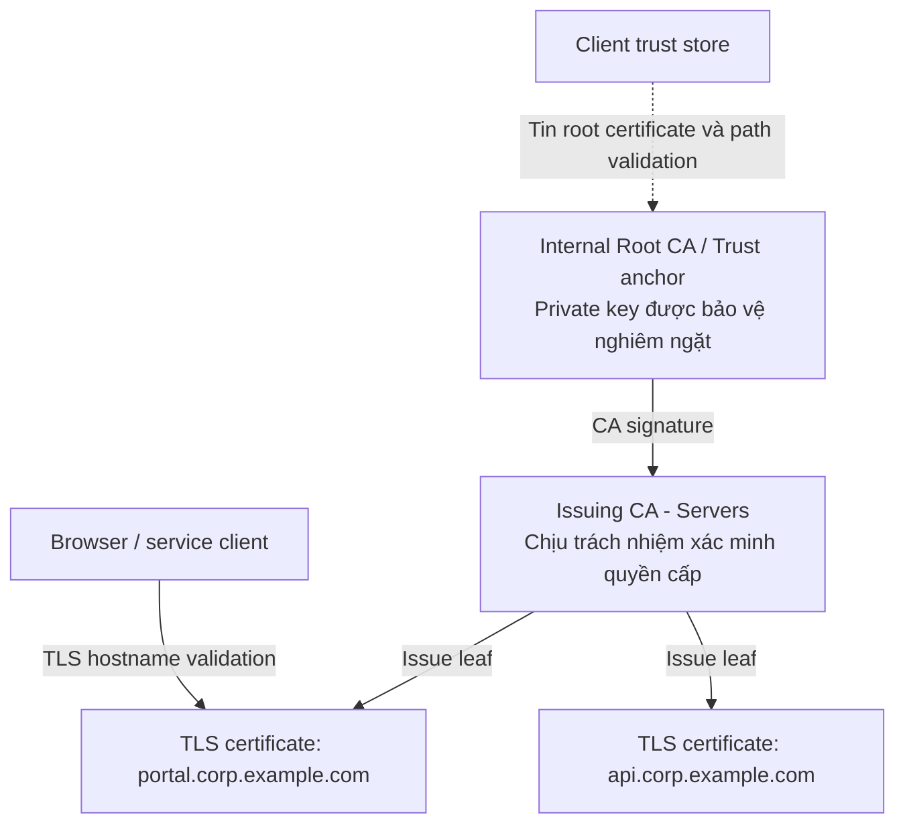
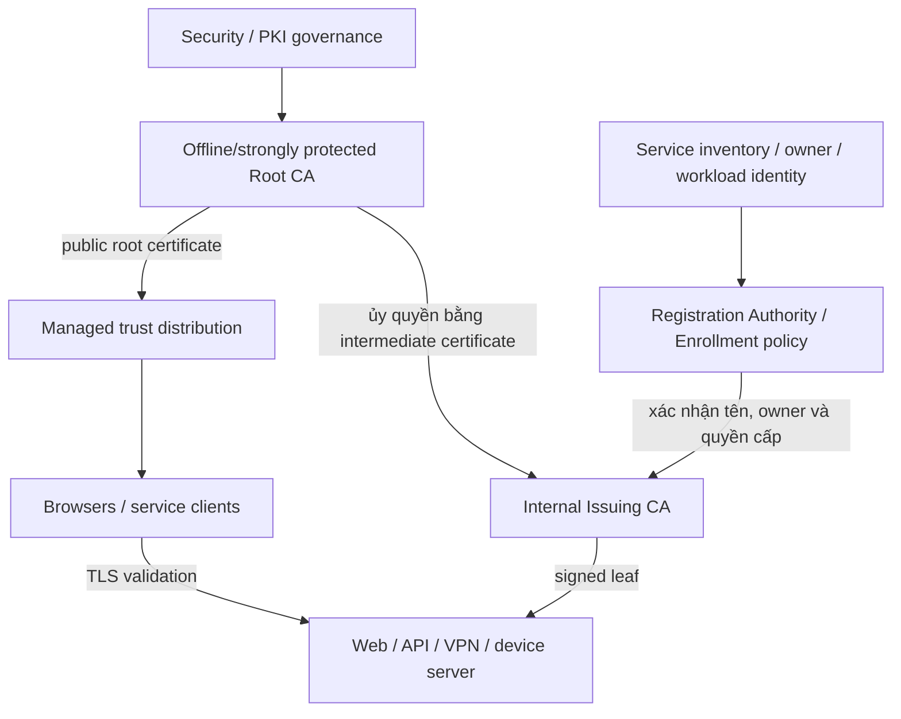
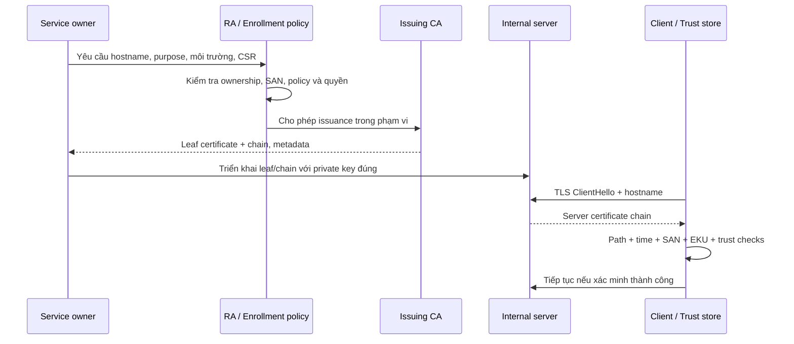
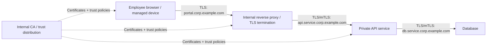
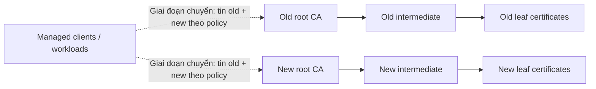

# Certificate cho máy chủ nội bộ: thiết kế PKI, xác minh TLS và quản lý vòng đời

## 1. Vì sao máy chủ nội bộ cũng cần certificate?

Trong một doanh nghiệp, phần lớn giao tiếp không chỉ đi từ trình duyệt bên ngoài vào website công khai. Laptop nhân viên có thể truy cập `https://portal.corp.example.com`; API đặt trong một private subnet gọi database, message broker hoặc gRPC service; VPN gateway chuyển người dùng tới ứng dụng nội bộ; hệ thống giám sát trao đổi dữ liệu với thiết bị mạng. Những lưu lượng đó vẫn có nguy cơ **bị nghe lén, giả mạo đầu cuối hoặc can thiệp đường truyền** nếu chỉ dựa vào việc “nằm trong LAN”.

**Chứng thư số (digital certificate)**, thường là **X.509 certificate** trong TLS, liên kết một public key với **danh tính được khai báo và xác minh theo chính sách của Certificate Authority (CA)**. Khi client kiểm tra chứng thư máy chủ đúng cách và hoàn tất TLS, nó có cơ sở để tin rằng đang nói chuyện với endpoint có quyền kiểm soát private key tương ứng và được tin cậy cho **tên dịch vụ cần truy cập**.

Certificate cho máy chủ nội bộ đặc biệt có ích khi:

- Trình duyệt hoặc ứng dụng kết nối đến **intranet, API, dashboard quản trị, CI/CD, VPN portal, load balancer**.
- Các service giao tiếp qua **TLS/mTLS** trên private network, VPC/VNet hoặc Kubernetes.
- Một số thiết bị đi qua các ranh giới **branch office, guest network, DMZ, VPN, proxy, SD-WAN và cloud**.
- Cần **đổi khóa, thu hồi, theo dõi hạn chứng thư và audit ai được cấp danh tính** thay vì phát tán self-signed certificate không quản lý.
- Muốn áp dụng **Zero Trust**: không mặc định tin một kết nối chỉ vì IP nguồn ở mạng nội bộ.

> **Nguyên tắc:** mạng “private” giảm một số đường tiếp cận nhưng **không thay thế xác thực máy chủ hoặc mã hóa kênh truyền**. Ngược lại, chứng thư TLS hợp lệ **không tự cấp quyền đọc dữ liệu**: sau bước xác thực server vẫn cần authentication và authorization của ứng dụng.

### Mục tiêu bài học

Sau bài này, người học có thể giải thích mô hình PKI nội bộ, phân tích **certificate chain, SAN, EKU, key usage, trust store và revocation**, chọn public/private CA đúng tình huống, tổ chức cấp phát và tự động gia hạn, xác minh TLS bằng công cụ đọc thông tin, xử lý sự cố chứng thư và thiết kế kiến trúc an toàn cho hệ thống mạng nhiều lớp.

## 2. Phân biệt certificate, private key, CA và TLS

| Thành phần | Vai trò | Có bí mật không? |
|---|---|---|
| **Private key** | tạo chữ ký/chứng minh quyền kiểm soát khóa, hoặc tham gia các thao tác mật mã phù hợp | **có**, phải bảo vệ nghiêm ngặt |
| **Public key** | dùng để xác minh các thao tác tương ứng | không |
| **Certificate X.509** | chứa public key, danh tính/thuộc tính và chữ ký của CA | phần lớn không bí mật; **không chứa private key** |
| **Root CA certificate** | trust anchor do hệ thống/ứng dụng tin cậy | certificate công khai, nhưng **root private key** rất nhạy cảm |
| **Intermediate/issuing CA** | cấp chứng thư cuối theo chính sách được ủy quyền | issuing CA private key rất nhạy cảm |
| **CSR** (*Certificate Signing Request*) | yêu cầu cấp chứng thư, có public key và thông tin đề xuất | thường không bí mật; cần xác thực quyền yêu cầu |
| **Trust store** | tập trust anchors và chính sách client chấp nhận | nội dung thường không bí mật nhưng thay đổi cần bảo vệ |
| **TLS** | giao thức bắt tay xác thực và thiết lập kênh bảo mật | dùng khóa phiên, kiểm tra chứng thư và các thuật toán được hỗ trợ |
| **DNS** | ánh xạ tên dịch vụ sang địa chỉ/endpoint | không tự chứng minh endpoint có quyền sở hữu danh tính TLS |

**Certificate không mã hóa dữ liệu một mình.** Trong TLS hiện đại, handshake xác minh danh tính và thiết lập **khóa phiên**; dữ liệu được bảo vệ bằng cơ chế mật mã đối xứng sau đó. Một chứng thư có chữ ký CA hợp lệ nhưng client **bỏ qua kiểm tra hostname** vẫn không đạt mục tiêu xác thực đúng máy chủ.

### 2.1. Xác thực máy chủ khác với quyền truy cập ứng dụng

Ví dụ người dùng mở trang nhân sự nội bộ:

1. DNS trả địa chỉ cho `hr.corp.example.com`.
2. TLS kiểm tra certificate chain, hostname và các điều kiện khác.
3. Trình duyệt có kết nối được bảo vệ tới server được xác minh.
4. Ứng dụng vẫn yêu cầu IdP/SSO, MFA hoặc phiên người dùng phù hợp.
5. Backend áp dụng **RBAC/ABAC và quyền trên từng dữ liệu**, không chỉ “người này đã vào được HTTPS”.

**Server authentication (TLS) ≠ user authentication (SSO) ≠ authorization (quyền thao tác).**

## 3. X.509 certificate chứa thông tin gì?

Certificate có các trường quan trọng theo **RFC 5280** và profile TLS/service identity liên quan.

| Thành phần | Ý nghĩa đối với máy chủ nội bộ | Cần kiểm tra |
|---|---|---|
| **Subject** | tên định danh của đối tượng theo cách khai báo | không được chỉ dựa Subject/CN thay SAN khi kiểm tra DNS identity hiện đại |
| **Subject Alternative Name (SAN)** | các tên DNS, IP hoặc loại danh tính được cấp theo policy | hostname dùng khi kết nối phải khớp đúng kiểu/tên theo quy tắc |
| **Issuer** | tổ chức/CA phát hành certificate | chain có nối tới trust anchor được phê duyệt không |
| **Serial number** | định danh chứng thư do issuer cấp | theo dõi phát hành/thu hồi; serial không nhất thiết duy nhất toàn thế giới |
| **Not Before / Not After** | khoảng thời gian certificate có hiệu lực | hệ thống có đồng bộ thời gian không; có sắp hết hạn không |
| **Subject Public Key Info** | thuật toán và public key | có đáp ứng chính sách mật mã và client compatibility không |
| **Signature Algorithm** | thuật toán CA ký chứng thư | có được policy/validator hỗ trợ an toàn không |
| **Basic Constraints** | nhận biết CA hoặc end-entity, cùng giới hạn đường chain | server leaf thường `CA:FALSE` |
| **Key Usage (KU)** | các công dụng khóa được phép như digital signature | tương thích TLS/certificate profile thực tế |
| **Extended Key Usage (EKU)** | ứng dụng được phép dùng cert, như `serverAuth` hoặc `clientAuth` | server TLS thường cần `serverAuth` theo policy/validator |
| **Authority Key Identifier / Subject Key Identifier** | hỗ trợ xây chain và nhận diện khóa CA | hữu ích khi CA có nhiều khóa/intermediate |
| **AIA / CRL Distribution Points** | thông tin dịch vụ/cách lấy CA hoặc trạng thái thu hồi nếu được khai báo | client có truy cập được các endpoint không? |
| **Certificate Policies / Name Constraints** | chính sách và giới hạn tên cấp cho intermediate trong một số kiến trúc | cần hiểu khả năng hỗ trợ và giới hạn kiểm tra của client |

Không phải mọi certificate cần mọi extension, và quy tắc kiểm tra phụ thuộc **định danh mong đợi, mục đích sử dụng, hệ điều hành/TLS library, profile PKI và chính sách tin cậy**. Không suy ra một certificate “đạt chuẩn” chỉ từ giao diện báo màu xanh.

### 3.1. SAN quan trọng hơn Common Name

Với **TLS server identity hiện đại**, **DNS-ID trong SAN** là cơ sở chính để client xác minh hostname theo quy tắc tương ứng. Không thiết kế certificate nội bộ mới theo mô hình “chỉ đặt `CN=server1` rồi hy vọng mọi client sẽ tin”.

Ví dụ:

```text
Subject:
  CN = portal.corp.example.com

Subject Alternative Name:
  DNS:portal.corp.example.com
  DNS:portal.internal.example.com
```

Nếu client truy cập `https://portal.corp.example.com`, validator kiểm tra hostname đó với **DNS SAN**. Nếu client truy cập theo **địa chỉ IP literal**, cần xem quy tắc **IP SAN** phù hợp; một DNS SAN chứa ký tự trông như IP không tự tương đương một IP address SAN.

### 3.2. EKU và KU không phải trường trang trí

Certificate dùng cho server TLS cần cấu hình **Key Usage và Extended Key Usage phù hợp**, chẳng hạn **digitalSignature** và **id-kp-serverAuth** trong nhiều cấu hình TLS hiện đại. Không sao chép một certificate chỉ dành cho client authentication vào máy chủ rồi bỏ qua validator error.

Một certificate có thể được cấp cho nhiều mục đích theo policy, nhưng **tách server certificate và client certificate** thường giúp áp giới hạn quyền, lifecycle và hậu kiểm rõ ràng hơn, đặc biệt trong mTLS.

## 4. Chuỗi tin cậy PKI: root, intermediate và server leaf

Trong PKI nội bộ, mô hình phổ biến là có **root CA** được phân phối như trust anchor cho client; root ký một hoặc nhiều **issuing intermediate CA**; intermediate cấp **end-entity/leaf certificates** cho máy chủ.



### 4.1. Vì sao không dùng root CA để ký trực tiếp mọi server?

Nếu root CA private key thường xuyên online trên hệ thống cấp phát hằng ngày, sự cố ở máy đó có thể làm mất **trust anchor** cho rất nhiều dịch vụ. Thiết kế tốt thường:

1. Giữ **root CA** trong vùng bảo vệ mạnh, có thể offline hoặc online với kiểm soát tương ứng nhu cầu và HSM.
2. Dùng **issuing intermediate** cho cấp phát tự động theo policy.
3. Phân chia issuing CA theo **môi trường, mục đích hoặc mức độ tin cậy** khi cần.
4. Áp **Basic Constraints, Key Usage, Name Constraints** và chính sách xác minh quyền cấp tương ứng.
5. Có quy trình rotation, backup/khôi phục và **root migration** đã diễn tập.

Intermediate vẫn là CA: private key của nó **không được** đặt trong container hay repository như file cấu hình bình thường.

### 4.2. Chain validation là gì?

Client tìm một certificate path có thể xác minh từ leaf qua issuing CA tới một **trust anchor mà nó tin**. Nó kiểm tra chữ ký, thời hạn, mục đích, các giới hạn CA và những chính sách cần thiết; xác minh server identity theo hostname/loại tên là **một bước liên quan nhưng riêng biệt**.

Không thể coi “chữ ký toán học hợp lệ” là đủ: một attacker có thể tự tạo một root CA rồi tự ký server certificate. Nếu client **không tin** root đó, chain không được chấp nhận. Ngược lại, thêm **root CA của bên không tin cậy** vào trust store cấp hệ thống có thể mở rộng quyền tin cậy tới nhiều hostname không mong muốn.

### 4.3. Server nên gửi những certificate nào?

Khi kết nối TLS, server thường gửi **leaf** và các **intermediate certificates cần thiết** để client xây path. Root CA thường đã nằm trong trust store của client và **không cần** server gửi root. Không nên phụ thuộc vào khả năng một client tự động tải intermediate qua AIA, vì môi trường nội bộ/air-gapped có thể không có đường truy cập.

Thứ tự, định dạng `fullchain.pem` và cách cấu hình tùy sản phẩm. Kiểm tra **chain thực server đưa ra**, không chỉ file CA được quản trị viên đặt trong thư mục.

## 5. Khi nào dùng private CA và khi nào dùng public CA?

### 5.1. Private CA

**Private/internal CA** phù hợp khi:

- Máy chủ chỉ dành cho **managed laptops, server-to-server, môi trường private/air-gapped**.
- Doanh nghiệp có thể phân phối trust anchor và quản lý client.
- Muốn **certificate profile, validity, EKU, namespace và identity policy** theo nhu cầu nội bộ.
- Hệ thống dùng định danh workload hoặc name constraints trong một trust domain có kiểm soát.

Ưu điểm là chủ động về chính sách; đổi lại tổ chức phải vận hành **CA, enrollment, trust distribution, revocation và monitoring**. Nếu một khách bên ngoài không có root của doanh nghiệp, trình duyệt của họ sẽ báo certificate **không đáng tin**, và đó là hành vi đúng.

### 5.2. Public CA cho hostname chỉ phân giải nội bộ

Một dịch vụ **không public ra Internet** vẫn có thể dùng **certificate được cấp bởi public CA** nếu hostname nằm dưới **domain thực do tổ chức kiểm soát** và CA có thể xác minh quyền kiểm soát domain theo phương thức được hỗ trợ (ví dụ ACME DNS-01 trong những tình huống phù hợp).

Ví dụ:

```text
app.corp.example.com
   DNS nội bộ → private IP của ứng dụng
   Certificate → public CA, nếu tổ chức kiểm soát domain thật và validation đạt
```

Việc dùng public CA không bắt buộc ứng dụng phải mở cổng inbound HTTPS ra Internet; **chứng minh domain qua DNS** có thể thực hiện theo thiết kế được CA chấp nhận. Tuy nhiên, public issuance có thể kéo theo **Certificate Transparency (CT)** và làm lộ sự tồn tại của một số tên host qua certificate/metadata, tùy cách cấp phát.

**Không dùng public CA cho những tên nội bộ tùy ý không đủ điều kiện xác minh**, như một nhãn hostname cục bộ không thuộc domain đăng ký được kiểm soát, hoặc dựa trên giả định rằng mọi private IP đều có thể đưa vào public TLS certificate.

### 5.3. So sánh quyết định

| Tiêu chí | Private CA | Public CA |
|---|---|---|
| Client tin mặc định | không; cần phân phối trust anchor | nhiều hệ điều hành/browser đã tin các CA có trong root program |
| Phạm vi tên | theo namespace/chính sách riêng | theo yêu cầu xác minh domain và quy định public CA |
| Phù hợp máy chủ nội bộ thuần túy | tốt nếu kiểm soát fleet | tốt khi dùng domain đăng ký thực và có quy trình validation |
| Bảo vệ root/issuing CA | tổ chức chịu trách nhiệm | CA công cộng vận hành, tổ chức quản lý account/validation |
| CT/log công khai | không bắt buộc theo mô hình private CA | public TLS issuance thường có nghĩa vụ transparency theo root program |
| Enrollment/gia hạn | tự xây hoặc dùng sản phẩm PKI | ACME hoặc phương thức CA hỗ trợ |
| Giới hạn quan trọng | trust store và lifecycle phức tạp | chính sách/tên hợp lệ, exposure metadata, phụ thuộc CA |

Không cần cố chọn một CA duy nhất cho mọi hệ thống: **browser-facing intranet** và **short-lived workload identity** có thể có nhu cầu quản lý trust khác nhau.

## 6. Đặt tên máy chủ nội bộ và cấu hình SAN

Chứng thư phải phản ánh **cách client thật sự truy cập dịch vụ**. Nếu người dùng mở `https://git.corp.example.com`, certificate cho `server-17.local` không đáp ứng hostname verification cho URL đó.

### 6.1. Ưu tiên tên DNS ổn định

Trong một hệ thống có nhiều VM, tránh buộc client truy cập IP/hostname instance thay đổi sau scale/failover. Nên dùng **FQDN được quản lý** đại diện cho service, có thể ánh xạ tới load balancer hoặc virtual IP:

```text
git.corp.example.com       → internal load balancer
registry.corp.example.com  → internal service endpoint
grafana.corp.example.com   → monitoring gateway
```

`example.com` là tên miền tài liệu; các tên ở đây **không đại diện cho hạ tầng thật**. Trong môi trường triển khai, phải dùng namespace mà doanh nghiệp thực sự sở hữu và có quyền quản trị.

### 6.2. SAN DNS, IP và các loại identity khác

| Client truy cập bằng | Identifier phù hợp | Lưu ý |
|---|---|---|
| `https://git.corp.example.com` | DNS SAN: `git.corp.example.com` | kiểm tra tên theo quy tắc DNS-ID |
| `https://192.0.2.10` | IP SAN: `192.0.2.10` | IP nằm trong dải tài liệu RFC 5737 ở ví dụ; cần IP-ID đúng kiểu |
| `https://[2001:db8::10]` | IP SAN IPv6 tương ứng | cú pháp URL có dấu ngoặc vuông; SAN lưu địa chỉ IP chứ không lưu dấu ngoặc |
| gRPC tới tên service | DNS SAN của endpoint hoặc URI/service identity theo validator | phải biết client xác minh identifier loại nào |
| Workload identity SPIFFE | URI SAN như `spiffe://corp.example/ns/prod/sa/api` | cần SPIFFE-aware verifier; không thay DNS hostname validation của browser |

**Không tự động đặt toàn bộ tên DNS, IP, URI vào mỗi certificate.** Mỗi identifier bổ sung làm tăng phạm vi mà private key đó có thể đại diện; cấp theo **service ownership và nhu cầu thật**.

### 6.3. Wildcard certificate

Certificate `*.corp.example.com` có thể phù hợp cho một nhóm hostname theo quy tắc wildcard được validator chấp nhận, nhưng:

- Thường không khớp đa cấp như `api.dev.corp.example.com` chỉ vì có `*.corp.example.com`.
- Không mặc nhiên khớp apex `corp.example.com`.
- Nếu dùng cùng private key trên nhiều host, một host bị lộ key có thể ảnh hưởng **nhiều tên**.
- Việc cấp phát và renewal phải rõ owner; tránh đẩy wildcard key ra toàn bộ fleet.

**Ưu tiên leaf certificate cho từng service/endpoint** khi quy mô automation cho phép. Dùng wildcard có đánh giá rủi ro và giải pháp quản lý khóa phù hợp.

### 6.4. SNI và split-horizon DNS

**Server Name Indication (SNI)** cho phép server/proxy chọn cấu hình TLS và certificate theo hostname trong ClientHello trong những điều kiện hỗ trợ. **Split-horizon DNS** có thể cho cùng FQDN trả địa chỉ nội bộ ở văn phòng và một địa chỉ khác cho các client được phép bên ngoài.

SNI và DNS không phải bằng chứng đủ để tin endpoint:

- DNS chỉ cung cấp **đường đi**.
- SNI là **tên client dự định kết nối**.
- Chứng thư phải vượt **chain + hostname validation**.
- Server có thể có nhiều virtual hosts và certificate; cần test từng hostname.

## 7. Thiết kế PKI nội bộ có phân quyền và ranh giới tin cậy

Một cấu trúc tham chiếu:



### 7.1. Tách vai trò

| Vai trò | Quyền phù hợp | Không nên có |
|---|---|---|
| **PKI owner** | chính sách CA, kiểm soát root/intermediate, giám sát issuance | cấp mọi certificate không cần xác minh |
| **RA/enrollment authority** | xác thực owner và quyền xin tên | tự quản trị root private key theo mặc định |
| **Application/service owner** | yêu cầu/triển khai cert cho tên được phê duyệt | cấp cert cho domain/tenant khác |
| **Infrastructure automation** | cấp/gia hạn/triển khai cert đúng policy | quyền sửa toàn bộ CA và trust store |
| **Endpoint management** | phân phối trust root và client policy | tin mọi private CA tùy ý |
| **SOC/audit** | truy xuất log, kiểm chứng sự cố và drift | truy cập private keys khi không cần thiết |

Một hệ thống cấp phát tự động tốt thường **ràng buộc requester identity, project/namespace, allowed SANs, EKU, validity và approver** thay vì coi CSR do một host gửi lên là yêu cầu hợp pháp cho bất kỳ tên nào.

### 7.2. CA policy và giới hạn namespace

Có thể thiết kế:

- Issuing CA A cho **server nội bộ** với `serverAuth`.
- Issuing CA B cho **client device identities** với `clientAuth`.
- Issuing CA C cho **workload mTLS** trong trust domain được quản lý.

Việc dùng **Name Constraints**, CA path length và policy OID có thể tăng tính phân tách trong một số hệ thống nhưng đòi hỏi **kiểm thử validator**. Name Constraints không tự kiểm soát mọi URI/service identity theo cách người thiết kế tưởng tượng. Quyền CA còn phải được kiểm soát ở **enrollment/issuance policy**.

## 8. Quản lý trust store của client: tin ai, tại phạm vi nào?

Client không thể xác minh private CA nếu chưa có **trust anchor** tương ứng theo mô hình xác minh mà ứng dụng sử dụng. Cần xem từng loại client:

- **Windows domain-joined/managed:** certificate stores và chính sách triển khai qua cơ chế quản trị endpoint phù hợp.
- **macOS/iOS:** trust settings/MDM profile, có thể có bước cấu hình mức tin cậy cụ thể tùy loại certificate và OS.
- **Linux:** system CA store theo phân phối, package/update service hoặc app-specific trust settings.
- **Java:** JVM truststore hoặc trust managers do ứng dụng cấu hình, có thể khác OS trust store.
- **Container image:** trust bundle có thể được đóng gói theo image và không tự cập nhật theo host.
- **Kubernetes workloads:** CA bundle có thể gắn qua secret/config, init/bootstrap process hoặc service mesh, phải bảo vệ quyền update.
- **Browser:** có thể dùng OS trust hoặc trust store riêng tùy browser/platform/policy.
- **Thiết bị mạng/IoT:** thường có store riêng và khả năng cập nhật/thu hồi hạn chế.

### 8.1. Không khuyến khích “import root tùy ý để hết lỗi”

Một root CA tin cậy có thể cho phép phát hành certificate cho **nhiều hostname hoặc identity** mà client kiểm tra. Vì vậy việc cài root của một nhà cung cấp không được đánh giá vào **system-wide trust store** có thể mở rộng quyền tin cậy quá mức.

Thiết kế cần:

1. Xác minh **nguồn gốc và fingerprint** của root qua kênh quản trị tin cậy.
2. Phân phối qua **MDM, GPO, configuration management** hoặc cơ chế được ủy quyền.
3. Giới hạn trust theo **ứng dụng/chức năng**, nếu phù hợp và khả thi.
4. Theo dõi phiên bản bundle, thời điểm áp dụng, máy chưa cập nhật và phương án rollback.
5. Đảm bảo root migration có thể chạy **old+new trust song song** trong giai đoạn chuyển đổi.

**Một client Java chạy trong container có thể không tin cùng root với trình duyệt trên laptop quản trị.** Vì vậy kiểm thử phải chạy từ **đúng runtime và container image** của consumer thật.

### 8.2. Trust anchor không phải server certificate

**Không thêm từng leaf server certificate làm CA root của toàn hệ điều hành** để chữa lỗi chain. Pin leaf/certificate theo một số mô hình ứng dụng cần chính sách và vòng đời riêng; nó có thể làm hỏng renewal nếu khóa đổi. Với private PKI quy mô lớn, mô hình chuẩn là **trust root/intermediate theo policy và xác minh hostname/service identity**.

## 9. Private key: nơi đặt và ai được sử dụng?

**Private key là tài sản quan trọng nhất của server certificate.** Nếu bị sao chép, đối tượng không được phép có thể mạo danh máy chủ trong điều kiện có thể dẫn traffic tới họ hoặc lợi dụng khả năng ký/xác thực liên quan.

### 9.1. Nguyên tắc quản lý

- Tạo private key trên **host, HSM/KMS hoặc hệ thống cấp khóa được phê duyệt**; tránh xuất key không cần thiết.
- Gắn key với service owner, host/workload identity, môi trường và certificate cụ thể.
- Dùng quyền file **tối thiểu**; chỉ process cần thiết đọc hoặc sử dụng key.
- Không commit key vào Git, container image, file backup công khai, ticket hoặc screenshot.
- Nếu key phải được phân phối qua secret manager, dùng **mã hóa, IAM tối thiểu, audit và rotation**.
- Khi thay key, deploy certificate tương ứng; không dùng certificate cũ ghép với key mới không khớp.
- Có quy trình ứng phó khi nghi key bị lộ, không chỉ “gia hạn certificate” bằng cùng private key.

### 9.2. Thuật toán khóa

Những lựa chọn có thể phù hợp với TLS hiện đại gồm **RSA với độ dài đáp ứng policy** và **elliptic-curve keys** như P-256/P-384, tùy client/CA/TLS library. Không chọn một thuật toán chỉ vì ngắn hoặc nhanh; cần đánh giá **mức an toàn, hiệu năng, hỗ trợ của hardware, compatibility và quy định tổ chức**.

Ví dụ, **RSA 3072-bit** hoặc **ECDSA P-256** thường được dùng trong thiết kế hiện đại tùy môi trường; đây không phải cam kết rằng mọi tổ chức/bộ quy định đều chấp nhận và không phải giá trị bắt buộc của TLS.

### 9.3. Key rotation và cert renewal khác nhau

**Certificate renewal** có thể sử dụng cùng public/private key hoặc cấp key mới tùy phương thức cấp phát. **Key rotation** là thay cặp khóa. Với dịch vụ có yêu cầu assurance cao, việc tạo khóa mới trong quy trình renewal và giới hạn tuổi khóa có thể là lựa chọn phù hợp.

Khi nghi private key lộ, **chỉ ký certificate mới trên key cũ không xử lý được rủi ro**.

## 10. CSR: chứng minh sở hữu public key nhưng không tự được quyền cấp tên

**Certificate Signing Request (CSR)** thường chứa public key, thông tin định danh đề xuất và chữ ký bằng private key tương ứng để chứng minh requester có quyền sử dụng khóa đó.

CSR **không chứng minh requester có quyền sở hữu hostname**. Một chủ thể bất kỳ có thể tự tạo CSR ghi `DNS:payments.corp.example.com`; CA/RA phải kiểm tra **quyền cấp tên** trước khi phát hành.

### 10.1. Ví dụ tạo CSR trong lab được phép

Ví dụ dưới đây dùng tên miền tài liệu **không triển khai cho tài sản ngoài phạm vi**. Lệnh minh họa trên Linux shell với OpenSSL; private key được tạo cục bộ, không gửi cho CA.

```bash
# Trong lab được phép; bảo vệ quyền đọc private key khi tạo file.
umask 077

# Tạo RSA key cho mục đích minh họa.
openssl genpkey -algorithm RSA \
  -pkeyopt rsa_keygen_bits:3072 \
  -out portal.key

# CSR tạo từ khóa có sẵn và yêu cầu DNS SAN.
openssl req -new \
  -key portal.key \
  -subj "/CN=portal.corp.example.com" \
  -addext "subjectAltName=DNS:portal.corp.example.com,DNS:portal.internal.example.com" \
  -out portal.csr
```

**Giới hạn:**

- Tùy phiên bản OpenSSL, cú pháp `-addext` có thể không khả dụng; có thể dùng file cấu hình CSR riêng theo tài liệu công cụ.
- Tạo key bằng lệnh trên **không thay** yêu cầu HSM/KMS hoặc private key non-exportable của production.
- Nếu cần **IP SAN**, CA phải cho phép đúng kiểu IP và kiểm tra quyền với địa chỉ; không tự suy từ quyền sở hữu DNS.
- Không đưa CSR SAN do caller yêu cầu vào cert mà **không được RA xác minh**.
- Không gửi `portal.key` cho CA hoặc gắn nó vào issue/ticket.

### 10.2. CSR và certificate là hai đối tượng khác nhau

Sau khi xác minh chính sách, CA cấp **signed leaf certificate**, có thể sử dụng SAN/EKU/validity khác hoặc giới hạn hơn so với những gì CSR đề xuất. Người vận hành phải đọc **certificate đã cấp**, không chỉ CSR ban đầu.

```bash
# Đọc thông tin public trong CSR
openssl req -in portal.csr -noout -text

# Sau khi CA đã trả certificate (tên file chỉ minh họa)
openssl x509 -in portal.crt -noout -text

# Xem các mốc thời gian có hiệu lực
openssl x509 -in portal.crt -noout -dates

# Quan sát SHA-256 fingerprint của certificate
openssl x509 -in portal.crt -noout -fingerprint -sha256
```

Fingerprint phục vụ **đối chiếu certificate**, không tự chứng minh certificate đó được cấp đúng quyền nếu thiếu xác minh nguồn và chain.

## 11. Quy trình phát hành chứng thư máy chủ nội bộ



Một vòng đời chuẩn:

1. **Inventory:** tên dịch vụ, owner, environment, entrypoint, client population và mức độ quan trọng.
2. **Profile:** xác định SAN, EKU, KU, thuật toán, validity, CA issuer, danh sách client cần tin.
3. **Key generation:** sinh và bảo vệ private key đúng nơi/role.
4. **Request:** tạo CSR hoặc dùng API issuance được bảo vệ.
5. **Authorization:** RA/CA xác minh requester **được phép cấp đúng tên và mục đích**.
6. **Issue:** CA ký leaf theo policy, ghi serial và bằng chứng.
7. **Deploy:** cài key, leaf và chain lên đúng listener/virtual host.
8. **Verify:** xác thực qua TLS từ consumer thật, kiểm tra cả hostname, chain và application health.
9. **Monitor/renew:** theo dõi hạn, tự động gia hạn, certificate inventory và test sau rollout.
10. **Revoke/decommission:** thu hồi hoặc ngừng tin khi cần, xóa key khỏi service đã gỡ bỏ, cập nhật inventory.

**Quan trọng:** quy trình cấp phát là **identity authorization**, không phải chỉ ký mọi CSR hợp lệ về mặt cú pháp.

## 12. Tự động cấp và gia hạn qua ACME nội bộ

**Automated Certificate Management Environment (ACME, RFC 8555)** là giao thức tự động hóa yêu cầu, xác minh quyền kiểm soát định danh theo cơ chế được CA hỗ trợ, cấp phát và gia hạn certificate.

Đối với **internal CA**, có thể triển khai **private ACME endpoint** và chính sách riêng cho tài sản nội bộ. Quy trình tự động có thể quản lý certificate cho nhiều VM, ingress hoặc reverse proxy mà không cần con người tạo CSR/ticket thủ công mỗi lần.

### 12.1. ACME không đồng nghĩa public Internet

Một private ACME server có thể nằm trên mạng nội bộ; ngược lại, một dịch vụ private cũng có thể lấy certificate từ public ACME CA bằng **DNS validation** nếu hostname đủ điều kiện và tổ chức kiểm soát domain thật.

Một số kiểu validation phổ biến:

| ACME challenge | Nguyên tắc | Lưu ý cho máy chủ nội bộ |
|---|---|---|
| **HTTP-01** | CA kiểm tra token trên đường HTTP của tên yêu cầu | có thể không phù hợp nếu CA không reach endpoint private; không bắt buộc mở tài sản nhạy cảm ra Internet |
| **DNS-01** | CA kiểm tra record TXT cho tên challenge trong DNS theo quy tắc | phù hợp nhiều trường hợp private service dưới domain sở hữu; bảo vệ DNS API credentials |
| **TLS-ALPN-01** | xác minh qua TLS với cơ chế ALPN/chứng thư challenge theo chuẩn | phụ thuộc CA reach endpoint và khả năng listener/proxy phối hợp |

Các challenge có quy tắc cụ thể của chuẩn; không được cho rằng chỉ cần tự tạo một TXT record bất kỳ là CA sẽ ký. **CA policy, account authorization, domain control, network reachability và challenge lifecycle** đều phải được thiết kế đúng.

### 12.2. Bảo vệ quyền issuance tự động

Nguy cơ của automation không chỉ là khóa TLS máy chủ; còn có **ACME account key, DNS API token, CA enrollment token và quyền tạo certificate**.

Nên:

- Gắn automation identity với service/project cụ thể.
- Giới hạn các tên có thể xin; không cho pipeline dev cấp tên Production tùy ý.
- Phân quyền DNS challenge **hẹp nhất khả thi**.
- Audit issue/renew/revoke theo requester, hostname, CA, serial và thời gian.
- Rate limit hoặc quota phù hợp nhưng không làm hỏng renewal hàng loạt.
- Thiết kế HA, bảo vệ secret, vòng quay credential và alert issuance bất thường.

**Tự động hóa tốt làm giảm lỗi hết hạn, nhưng cấp tự động sai quyền có thể làm PKI trở thành nguồn mạo danh hàng loạt.**

## 13. EST, SCEP, AD CS và cách chọn enrollment phù hợp

Ngoài ACME, môi trường doanh nghiệp có thể dùng:

| Cơ chế/hệ thống | Ứng dụng thường thấy | Lưu ý |
|---|---|---|
| **EST** (*Enrollment over Secure Transport*, RFC 7030) | certificate enrollment/renewal trong hạ tầng quản lý thiết bị/mạng | cần thiết kế TLS trust, bootstrap và quyền requester |
| **SCEP** (RFC 8894) | enrollment cho một số thiết bị mạng/MDM và hệ thống legacy | kiểm tra đúng profile, policy, challenge/RA và giới hạn sản phẩm |
| **Microsoft AD CS** | CA/templates trong môi trường Active Directory | template permissions, enrollment agents, NTAuth/trust, audit và CA hardening rất quan trọng |
| **Private ACME CA** | máy chủ web, reverse proxy, tự động renewal | kiểm soát domain validation, token và allowed names |
| **Cloud private CA services** | issuance API tích hợp IAM/cloud | đánh giá trust-domain boundaries, phí, logs, CA key protection |
| **cert-manager/Kubernetes issuers** | tự động certificate cho ingress/workload ở cluster | quyền tạo Certificate/Issuer/Secret, RBAC, SAN policy và CA ownership |
| **Service mesh / SPIFFE-SPIRE** | short-lived workload identities và mTLS | service identity có thể dùng URI SAN, cần trust domain và workload attestation |

Không có giao thức nào tự mang lại “PKI an toàn” nếu **xác minh quyền xin certificate sai**. Với AD CS, cấu hình certificate templates/enrollment permissions quá rộng có thể dẫn đến cấp chứng thư vượt phạm vi; với Kubernetes, người có quyền sửa Issuer hoặc Secret có thể ảnh hưởng nhiều workload.

### 13.1. Đánh giá thiết bị mạng legacy

Một số switch, firewall, IP camera, storage hoặc máy in chỉ hỗ trợ import PKCS#12/PEM thủ công hoặc một giao thức enrollment cũ. Trước khi deploy:

- Xem thiết bị hỗ trợ **RSA/ECDSA, TLS version, SAN, EKU và fullchain** tới đâu.
- Có thể reload certificate **không reboot** hoặc không gián đoạn traffic không?
- Trust store và key storage có cơ chế bảo vệ/backup riêng không?
- Có cập nhật firmware và đường migrate khỏi cơ chế mật mã lỗi thời không?
- Có thể giới hạn mạng quản trị và cấp cert tạm thời đúng policy trong khi thay thiết bị không?

Không hạ tiêu chuẩn của toàn bộ PKI chỉ để một thiết bị legacy chưa được nâng cấp tiếp tục hoạt động.

## 14. Triển khai server certificate tại reverse proxy và load balancer

Nhiều ứng dụng nội bộ không trực tiếp terminate TLS trên process ứng dụng. Một **reverse proxy/ingress gateway/load balancer** có thể nhận TLS từ client, xác minh client khi dùng mTLS và mở một TLS connection khác về backend.



**Mỗi mũi tên TLS là một kết nối riêng**, với:

- Tên đích hoặc service identity cần kiểm tra.
- Certificate leaf/key/chain trên **server của chặng đó**.
- Trust anchor và validator của **client ở chặng đó**.
- TLS version/cipher/ALPN theo khả năng tương ứng.
- Logging, session policy và ứng dụng phía sau.

### 14.1. Không nhầm certificate ở edge và origin

Nếu browser nhận certificate hợp lệ từ `portal.corp.example.com` trên load balancer, điều đó **không tự chứng minh** đường load balancer → API được mã hóa hoặc backend đã được xác minh hostname.

Muốn bảo vệ origin:

1. Bật TLS/mTLS tới origin theo threat model.
2. Cấu hình **hostname/SNI/service identity** đúng và kiểm tra certificate của origin.
3. Giới hạn firewall/security group để origin chỉ nhận traffic được phép.
4. Xác minh WAF/proxy logs và TLS errors từng hop.
5. Tránh đưa private key của edge vào từng backend nếu không cần.

### 14.2. Certificate cho IP hay cho VIP?

Một load balancer có virtual IP (VIP) nhưng người dùng truy cập bằng **FQDN**. Certificate nên khớp **tên dịch vụ mà client dùng**, không nhất thiết phải cấp riêng cho mỗi IP/VIP. Nếu API/client thực sự dùng IP literal, cần IP SAN và policy tương ứng; tránh biến IP động thành identity chính của dịch vụ.

## 15. mTLS giữa các máy chủ: khác server TLS một chiều ra sao?

**Mutual TLS (mTLS)** xác thực cả hai phía của kết nối bằng chứng thư trong những cơ chế và cách cấu hình phù hợp. Với TLS server authentication thông thường, client xác minh server; trong mTLS, server còn yêu cầu và xác minh **client certificate**.

### 15.1. Hai hướng xác thực

```text
Service A (client)                    Service B (server)
     |                                      |
     |-- TLS handshake -------------------->|
     |<-- Certificate của B ----------------|
     |    A kiểm tra identity B             |
     |---- Certificate của A (nếu mTLS) --->|
     |    B kiểm tra identity A             |
     |<========= TLS application data =====>|
```

Trình tự message của TLS 1.3/1.2 khác nhau; sơ đồ nhấn mạnh **bằng chứng nhận diện và chiều xác minh**, không phải thứ tự đầy đủ của mọi handshake.

Trong hệ thống nội bộ:

- **Server cert** thường cần EKU `serverAuth`.
- **Client cert** thường cần EKU `clientAuth`.
- Server phải kiểm tra **client identity được phép**, không chỉ “certificate có chữ ký của bất kỳ CA nào trong trust store”.
- Ứng dụng vẫn phải kiểm tra **phân quyền theo role, operation và dữ liệu**.

### 15.2. Trust domain và workload identity

Một hệ thống có thể dùng URI identity, ví dụ SPIFFE ID:

```text
spiffe://corp.example/ns/prod/sa/payments-api
```

Các SVID/workload certificates phải được cấp dựa trên **workload attestation**, namespace/service-account policy và trust domain. Một SPIFFE ID trong URI SAN **không tự được trình duyệt mặc định xem là DNS hostname**, và không nên cấp chứng thư chỉ vì requester viết URI đó trong CSR.

### 15.3. Mức tin cậy của client CA

Nếu server mTLS tin một root CA được phép cấp **rất nhiều client certificates** cho nhiều ứng dụng, server vẫn phải kiểm tra **đúng subject/URI/SAN/issuer và authorization mapping**. Chỉ có `VerifyPeerCertificate == true` chưa đủ để kết luận client được quyền gọi API thanh toán.

### 15.4. Non-human identity cũng có lifecycle

Tài khoản dịch vụ, mTLS certificates và workload IDs cần **short-lived identity/automated renewal**, phân quyền, khóa tạm, revocation/redeploy và audit. Việc dùng mTLS không miễn kiểm soát bí mật ứng dụng hoặc quyền DB.

## 16. Chứng thư, TLS version, ALPN và client compatibility

Certificate tương tác với TLS handshake nhưng **không quyết định HTTP version**. ALPN có thể chọn `http/1.1`, `h2` hoặc `h3` theo transport và hai endpoint, trong khi certificate dùng cho **xác thực endpoint**.

| Thông số | Tác động | Có thể sai thế nào? |
|---|---|---|
| Server certificate + SAN | xác minh tên máy chủ | certificate sai hostname |
| Certificate chain | nối đến CA được tin | thiếu intermediate hoặc client không có root |
| TLS version | tính năng handshake/mật mã | server/client không có version chung |
| Key/cipher/signature algorithms | tương thích mật mã | thiết bị cũ không hỗ trợ lựa chọn mới |
| **ALPN** | chọn HTTP/1.1, HTTP/2 hoặc HTTP/3 | client/server không thống nhất protocol |
| SNI | chọn virtual host/cert phù hợp | client không gửi hoặc gửi tên khác |
| Client certificate (mTLS) | xác minh peer client | chưa được phát hành, chain sai, EKU không phù hợp |
| Revocation/validity | certificate có được chấp nhận tại thời điểm đó? | expired, revoked hoặc policy không kiểm tra được |

**HTTP/3** sử dụng QUIC/TLS 1.3; certificate validation vẫn cần như với một HTTPS connection an toàn. Không giả định rằng chỉ cần certificate còn hạn thì HTTP/3 listener và UDP/443 đã hoạt động.

Một certificate phù hợp TLS 1.3 **không tự bảo đảm** ứng dụng đạt TLS 1.3 khi client/server còn có cấu hình phiên bản cũ. Chính sách TLS version phải được áp **trên listener**, kiểm thử qua handshake thật.

## 17. Validity và kế hoạch gia hạn không gián đoạn

Certificate có `NotBefore` và `NotAfter`. Nếu client kiểm tra thời gian đúng, certificate ngoài khoảng hiệu lực sẽ bị từ chối. Trong hệ thống nội bộ có hàng nghìn endpoints, hết hạn certificate có thể làm dừng:

- Dashboard/website nhân viên.
- gRPC giữa các microservices.
- VPN/TLS portal và API của thiết bị mạng.
- Authentication server nếu certificate được dùng cho EAP/TLS hoặc kết nối AAA được bảo vệ.
- CI/CD, observability hoặc secret service.

### 17.1. Định kỳ gia hạn bao lâu?

Không có một thời hạn leaf certificate duy nhất hợp lý cho mọi môi trường. **30/60/90 ngày** có thể được dùng làm ví dụ chính sách **short-lived certificates** trong một số hệ thống có automation; hệ thống khác có yêu cầu/giới hạn riêng theo governance, ứng dụng và CA.

Điểm quan trọng không phải con số, mà là:

- Automation hoạt động **trước thời điểm hết hạn**, có retry/backoff và cảnh báo.
- Gia hạn có thể thay key theo policy.
- Host/ingress thực sự **reload certificate mới**, không chỉ lưu file trên ổ đĩa.
- Cả server fleet và client trust stores đều tương thích với chain mới.
- Có **làm mới certificate trong trạng thái HA** để giảm downtime.

### 17.2. Rolling renewal

Ví dụ một cụm có ba reverse proxies:

1. CA cấp certificate mới và trả đúng chain.
2. Kiểm tra certificate/key matching trong hệ thống deploy được cấp quyền.
3. Triển khai trên một node canary.
4. Đo TLS success, hostname validation, HTTP health và metrics của client.
5. Tiếp tục rollout tới các node còn lại theo policy.
6. Xác nhận mọi node đang **serve certificate mới**, không chỉ certificate file đã thay.
7. Thu hồi/xóa secret cũ theo quy trình và kiểm tra expiration monitoring.

**Thay file trên disk không đồng nghĩa process đã reload**. Một số web servers cần reload; một số proxy/mesh hỗ trợ dynamic certificate updates. Khả năng này phụ thuộc sản phẩm và cấu hình.

## 18. Thu hồi chứng thư: CRL, OCSP và short-lived certificates

**Revocation** dùng khi một certificate cần bị từ chối **trước ngày hết hạn**: private key bị nghi lộ, host bị giải phóng, service owner thay đổi hoặc CA phát hành sai quyền.

Các cơ chế chính:

- **Certificate Revocation List (CRL)**: danh sách serial bị thu hồi do CA phát hành, có thời gian cập nhật/hết hiệu lực.
- **Online Certificate Status Protocol (OCSP)**: client/ứng dụng có thể truy vấn trạng thái chứng thư tùy cấu hình và hỗ trợ.
- **OCSP stapling**: server có thể gửi thông tin OCSP phù hợp trong TLS theo tính năng; kiểm tra hiệu lực phụ thuộc validator.
- **Short-lived certificates**: giảm khoảng thời gian certificate có thể được sử dụng nếu hết hạn nhanh; yêu cầu automation và enforcement tốt.
- **Trust removal / emergency block**: loại bỏ CA/identity hoặc chặn trên gateway/client policy khi thu hồi thông thường chưa đủ.

### 18.1. Không mặc định mọi client đều kiểm tra revocation

Việc kiểm tra CRL/OCSP có thể **khác nhau giữa Windows, Java, Linux TLS libraries, browsers, thiết bị IoT và service mesh**. Một số client có hành vi **soft-fail** khi không đến được OCSP/CRL endpoint; một số có thể áp chính sách khác.

Do đó, một certificate đã được đánh dấu “revoked” ở CA **không bảo đảm tất cả client ngừng chấp nhận nó ngay lập tức**. Cần kiểm tra:

1. Validator có bật revocation checking không?
2. Client có đường mạng tới endpoint CRL/OCSP không, kể cả khi VPN/PKI gặp sự cố?
3. Chính sách fail-open/fail-closed và cache có phù hợp rủi ro không?
4. Có thể **cắt phiên đang mở** hoặc cô lập host khi có sự cố key compromise không?
5. Trust store hoặc application allowlist có cần cập nhật không?

### 18.2. Revocation không thu hồi một TLS session đã mở theo phép màu

Một kết nối TLS đã xác lập có thể tiếp tục dùng session state theo quy tắc của giao thức/sản phẩm. Nếu certificate/key bị lộ, cần xem **ngắt kết nối, xoay khóa, thay endpoint, chặn đường truyền hoặc thu hồi token/credential ứng dụng** tương ứng, không chỉ phát hành CRL rồi coi sự cố kết thúc.

## 19. Kiểm tra certificate và chain bằng OpenSSL

Những lệnh dưới đây dùng để **đọc và xác minh** trong môi trường đã được phép, không tạo traffic phá hoại. Các file `portal.crt`, `internal-root.pem`, `intermediate.pem` và hostname là dữ liệu minh họa; thay bằng tài sản được quản lý.

### 19.1. Xem nội dung certificate

```bash
openssl x509 -in portal.crt -noout -subject -issuer -dates

# Xem SAN, EKU, KU, Basic Constraints và thuật toán
openssl x509 -in portal.crt -noout -text

# SHA-256 fingerprint để đối chiếu đúng certificate
openssl x509 -in portal.crt -noout -fingerprint -sha256
```

**Không in private key**, file P12 có mật khẩu hoặc secret vào issue log. Public certificate là dữ liệu được phép xem theo chính sách nhưng metadata hostname vẫn có thể nhạy cảm trong kiến trúc nội bộ.

### 19.2. Kiểm tra chain từ file

```bash
# Với file gốc/intermediate đã lấy từ nguồn tin cậy được xác minh:
openssl verify \
  -CAfile internal-root.pem \
  -untrusted intermediate.pem \
  -purpose sslserver \
  -verify_hostname portal.corp.example.com \
  portal.crt
```

Kết quả thành công chỉ có ý nghĩa theo **tham số và dữ liệu tin cậy được chỉ định**. Không dùng file CA do endpoint nghi ngờ tự cung cấp rồi coi nó là trust anchor đáng tin. Tùy phiên bản OpenSSL, cú pháp/chuẩn kiểm tra và revocation policy có thể khác; đối chiếu với runtime của ứng dụng.

### 19.3. Kiểm tra TLS trên server đang chạy

```bash
openssl s_client \
  -connect portal.corp.example.com:443 \
  -servername portal.corp.example.com \
  -verify_hostname portal.corp.example.com \
  -verify_return_error \
  -CAfile internal-root.pem \
  -showcerts
```

Lệnh thể hiện:

- `-connect` chọn endpoint mạng.
- `-servername` gửi **SNI** đúng virtual host.
- `-verify_hostname` yêu cầu so khớp hostname.
- `-verify_return_error` giúp không chỉ in lỗi mà còn khiến xác minh thất bại có ý nghĩa.
- `-CAfile` chỉ định trust anchor theo kịch bản test.
- `-showcerts` giúp quan sát certificate chain do server gửi.

Lệnh này không chứng minh application authorization, hiệu năng, khả năng revocation của mọi client hay đáp ứng mTLS nếu chưa cấu hình tương ứng.

### 19.4. Kiểm tra bằng curl

```bash
# Không dùng -k hoặc --insecure để che lỗi.
curl --cacert internal-root.pem \
  -v https://portal.corp.example.com/health
```

`--cacert` phù hợp khi muốn kiểm chứng endpoint theo trust root được duyệt, còn `-v` hiển thị nhiều metadata của request. Không chạy cùng bearer token/cookie thật trong transcript có thể chia sẻ.

**Không khuyến nghị dùng `curl -k` hoặc `verify=False` làm cách sửa lỗi production.** Chúng bỏ qua các kiểm tra certificate quan trọng và khiến việc giả mạo endpoint dễ hơn.

## 20. Sự cố thường gặp và cách phân loại

| Triệu chứng | Nguyên nhân có thể | Hướng xác minh |
|---|---|---|
| **Unknown CA / untrusted issuer** | client chưa có trust anchor hoặc CA không được phép | truststore của **runtime thật**, certificate chain và policy |
| **Unable to get local issuer** | thiếu intermediate hoặc đường path không xây được | `-showcerts`, issuer/AKI/SKI, chain mà server cung cấp |
| **Hostname mismatch** | SAN không chứa hostname mà client truy cập | URL, SNI, DNS SAN/IP SAN, virtual host |
| **Expired certificate** | NotAfter đã qua; process vẫn serve cert cũ | thời gian UTC, certificate đang phục vụ, renewal/reload logs |
| **Not yet valid** | NotBefore ở tương lai hoặc đồng hồ client/server lệch | NTP/time synchronization và issuance time |
| **Wrong EKU / key usage** | cert được cấp cho mục đích không phù hợp | xem EKU/KU, profile CA và TLS role |
| **Key/certificate mismatch** | deploy key và leaf không thuộc cùng cặp | đối chiếu public key theo công cụ được phép |
| **TLS alert handshake failure** | nhiều khả năng: cert, version, cipher, client auth, policy | handshake logs, client/server compatibility |
| **mTLS client rejected** | client cert thiếu, CA không tin, identity sai hoặc bị thu hồi | server verify logs, client chain, authorization mapping |
| **Revocation check unavailable** | CRL/OCSP endpoint không tới được hoặc cache cũ | network path, validator policy và log |
| **Một vài node lỗi, node khác hoạt động** | rollout cert/chain không đồng nhất | kiểm tra từng pod/node/PoP, load balancer logs |
| **Java lỗi nhưng browser chạy** | JVM truststore khác OS, algorithm constraints khác | đúng JVM/image/truststore và TLS debug logs |
| **Kubernetes Pod lỗi sau redeploy** | Secret/cert mount, trust bundle hoặc reload sai | namespace, service account, certificate controller, application |

### 20.1. Trình tự xử lý lỗi

1. Xác định **client, URL/hostname, thời điểm, vùng mạng, endpoint TLS thật**.
2. Kiểm tra DNS/SNI và route có đưa tới đúng listener không.
3. Xem leaf **đang được server phục vụ**, không chỉ file certificate trên máy.
4. Kiểm tra SAN, issuer, intermediate chain, validity và EKU.
5. Xác nhận client có trust anchor từ **kênh triển khai được phê duyệt**.
6. Nếu dùng mTLS, kiểm tra **cả chiều xác minh client certificate** và authorization.
7. Kiểm tra kết nối tới CRL/OCSP hoặc hệ thống kiểm tra trạng thái theo policy.
8. So sánh giữa node/client hoạt động và bị lỗi; không tắt xác minh TLS để “chữa nhanh”.

Một lỗi `certificate verify failed` có thể là **sự cố vận hành** hoặc **tín hiệu bị dẫn sang endpoint không tin cậy**. Không coi mọi lỗi là “certificate tự ký gây phiền” rồi bỏ qua.

## 21. Root/intermediate rotation và thay đổi trust anchor

Root CA có thể cần thay khi sắp hết hạn, thay thuật toán, đổi governance, CA bị compromise hoặc doanh nghiệp sáp nhập/tách hệ thống. Đây là hoạt động có **blast radius lớn hơn leaf renewal**.

### 21.1. Mô hình chuyển trust hai giai đoạn



Một trình tự thận trọng:

1. Kiểm kê toàn bộ consumer: browser, server, JVM, container, thiết bị mạng, IoT, đối tác, offline environments.
2. Phát hành và xác minh **new root/intermediate**; bảo vệ private keys và audit chính sách.
3. Phân phối **new root trust anchor trước** cho các consumer, không vội xóa old root.
4. Kiểm thử path validation từ các runtime đại diện.
5. Bắt đầu phát hành leaf dưới new issuer; rolling deploy theo hệ thống.
6. Theo dõi các client còn phụ thuộc old intermediate/root và các certificate còn hạn.
7. Chỉ loại bỏ old trust khi đã đánh giá phụ thuộc, thời gian chuyển và rủi ro; điều tra fail cases.

**Không tự khẳng định hai root được client tin vì certificate có chung Subject CN.** Trust dựa trên certificate/key và chính sách validator, không phải chỉ string tên CA.

### 21.2. Khi root hoặc issuing CA bị lộ khóa

Tình huống CA key compromise có thể đòi hỏi hành động khẩn cấp: ngừng issuing, cô lập hạ tầng, công bố/thu hồi phù hợp, phân phối trust thay thế và **đánh giá lại tất cả cert chịu ảnh hưởng**. Một số client offline/legacy có thể khó cập nhật trust; cần kế hoạch dự phòng riêng.

**Issuing CA bị lộ** không giống **một leaf key bị lộ**: số lượng danh tính có thể bị mạo danh rộng hơn rất nhiều.

## 22. Giám sát, inventory và điều kiện cảnh báo

Một hệ thống PKI nội bộ không nên phụ thuộc vào lịch nhắc gia hạn thủ công. Inventory cần quan sát **certificate đã cấp, certificate thực sự được serve và quyền sở hữu key/service**.

| Dữ liệu | Dùng để làm gì? | Nguồn tin cậy |
|---|---|---|
| Hostname/SAN | xác định tên mà leaf được phép đại diện | CA issuance + server deployment |
| Issuer/serial/fingerprint | nhận diện certificate cụ thể | CA database, endpoint scan được phép |
| NotBefore/NotAfter | giám sát thời gian hiệu lực | certificate thực tế |
| EKU/KU/algorithms | kiểm soát profile và compliance | CA policy + certificate |
| Key protection mode | HSM/TPM/secret store hoặc file key bảo vệ | hệ thống quản lý khóa, không lấy key vào SIEM |
| Service/owner/team | biết ai xử lý renewal và sự cố | CMDB, IaC, service catalog |
| Environment/namespace | phân biệt dev/test/prod và trust boundaries | inventory và control plane |
| Deployment location | biết node/pod/ingress đang dùng cert | gateway/controller/agent |
| Issuance automation | theo dõi job renewal, challenge và CA | ACME/EST controller logs |
| Trust bundle version | phát hiện client chưa nhận root mới | MDM/config management, runtime logs |
| Revocation status | phản ứng với cert/key bị lộ | CA/CRL/OCSP theo chính sách |
| Last observed TLS check | xác minh thật listener đang serve gì | synthetic monitors |

### 22.1. Alert nên có

- Certificate Production sắp hết hạn mà **renewal chưa có bằng chứng thành công**.
- Certificate đã renew trên CA nhưng endpoint vẫn serve **old leaf**.
- CA cấp SAN/EKU ngoài whitelist/owner hoặc từ requester bất thường.
- Intermediate/root sắp hết hạn hoặc signing service không đạt HA/SLO.
- Certificate trust lỗi tập trung theo region, client runtime hoặc phiên bản app.
- Private key được truy xuất/xuất ra ngoài path dự kiến theo log được hỗ trợ.
- Một service có certificate **issued bởi CA khác** ngoài chính sách.
- Certificate revoked nhưng một số endpoint vẫn phục vụ hoặc client vẫn chấp nhận theo đường được kiểm chứng.
- DNS/route/SNI bất thường khiến client nhận certificate không khớp.
- Trust bundle drift ở container/client sau rollout.

### 22.2. KPI vận hành

- **Certificate inventory coverage:** tỷ lệ endpoint được gắn đúng leaf, owner và thời hạn.
- **Automated renewal success rate:** tỷ lệ renewal diễn ra và deploy đúng, không chỉ CA ký thành công.
- **Expiration risk:** số cert còn ít hơn ngưỡng cảnh báo đã duyệt, phân loại theo mức quan trọng.
- **TLS handshake/verification failures:** số lỗi theo nguyên nhân, client, runtime và chặng mạng.
- **Trust store adoption:** tỷ lệ client đã có root/intermediate bundle yêu cầu.
- **Unauthorized issuance findings:** cấp phát ngoài policy hoặc credential automation bị sử dụng sai.
- **Key rotation coverage:** các cert thuộc phạm vi yêu cầu xoay key và tiến độ.
- **Revocation response latency:** khoảng từ quyết định revoke tới khi các enforcement points ngừng chấp nhận theo SLA.
- **Service SLO after renewal:** xác nhận thay chứng thư không làm gián đoạn chức năng.

**Số chứng thư đã được CA cấp ≠ số listener đã triển khai thành công.** Cần kiểm tra từ consumer thực để đo đúng kết quả.

## 23. Threat modeling chứng thư nội bộ theo STRIDE

### 23.1. Tài sản và ranh giới tin cậy

Các tài sản gồm **root/intermediate private keys, CA control plane, enrollment tokens, DNS namespace, server private keys, client trust stores, mạng phân phối secret, identity của workload và dữ liệu trong TLS**.

Các ranh giới quan trọng:

1. Người dùng/dịch vụ → DNS và hạ tầng mạng.
2. Client → TLS endpoint/hostname validation.
3. Service owner/automation → RA/issuing CA.
4. CA → secret manager/host process.
5. TLS termination → backend TLS/mTLS và ứng dụng.
6. Endpoint management → client trust distribution.

### 23.2. Bảng STRIDE

| STRIDE | Kịch bản | Điều kiện dẫn tới rủi ro | Kiểm soát |
|---|---|---|---|
| **Spoofing** | endpoint giả có certificate không đáng tin | client bỏ qua hostname/chain validation | verifier đúng, managed trust, SNI/SAN checks |
| **Spoofing** | giả mạo server bằng cert được cấp trái quyền | CA/RA cấp SAN tùy ý cho requester | issuer policy, RBAC, audit và namespace constraints |
| **Tampering** | trust store bị thêm root không được duyệt | endpoint/IaC/MDM bị sửa trái phép | ký/duyệt cấu hình, least privilege, drift monitoring |
| **Tampering** | leaf/key bị thay ở ingress | quyền deploy/secret access quá rộng | secret manager, RBAC, immutable pipelines, code review |
| **Repudiation** | không truy được ai cấp/deploy certificate | log thiếu principal, serial, change ID | issuance + deployment audit |
| **Information Disclosure** | TLS bị vô hiệu hóa hoặc origin plaintext | termination ranh giới sai, cipher/policy yếu | TLS mọi chặng cần thiết, kiểm chứng mTLS |
| **Denial of Service** | cert/intermediate/root hết hạn | thiếu renewal/trust rotation | automation, HA, synthetic checks và runbook |
| **Elevation of Privilege** | client cert của dịch vụ thường được chấp nhận như admin | chỉ kiểm tra CA ký, không kiểm tra identity/role | mTLS identity mapping + per-action AuthZ |

### 23.3. Rủi ro còn lại

Ngay cả khi mọi TLS cert đúng:

- Một host có key hợp lệ vẫn có thể bị malware kiểm soát.
- Ứng dụng vẫn có thể có lỗi authorization, SQL injection hoặc lộ token.
- Admin có quyền hợp lệ nhưng thao tác sai có thể làm hỏng dịch vụ.
- Mạng có thể bị DDoS, DNS outage hoặc nhiễu Wi-Fi.
- CA có thể bị cấp phát sai quyền do policy lỗi mà chữ ký mật mã vẫn hợp lệ.

Vì vậy certificate là **lớp xác thực endpoint**, không phải bảo đảm tổng thể về hệ thống.

## 24. Quy trình ứng phó khi certificate hoặc private key bị lộ

### Giai đoạn A — Xác nhận và khoanh vùng

1. Xác định **key/cert nào**, server, SAN, issuer/serial và thời gian nghi lộ.
2. Tìm chứng cứ trong secret manager, Git history, CI/CD logs, filesystem ACL và audit (không sao chép key thêm).
3. Xác định khả năng private key đã bị truy cập hoặc chỉ public certificate bị nhìn thấy.
4. Kiểm tra service nào dùng chung key/wildcard cert, trust domain và các phiên kết nối liên quan.
5. Đánh giá có dấu hiệu DNS/routing hijack, endpoint mạo danh hoặc ứng dụng bị truy cập bất thường không.

### Giai đoạn B — Containment và rotation

- Thu hồi quyền đọc key, cô lập host/pipeline/người dùng bị nghi xâm nhập.
- **Sinh cặp khóa mới**, yêu cầu CA cấp certificate mới đúng SAN/EKU.
- Triển khai mới theo cách giảm downtime, xác minh cả front-end lẫn backend.
- **Revoke certificate cũ** theo CA policy và kiểm tra validator của client.
- Nếu rủi ro ảnh hưởng **CA private key**, kích hoạt quy trình CA compromise/root migration với phạm vi rộng hơn leaf.
- Kiểm tra token, credential, application sessions và tài nguyên bị ảnh hưởng theo evidence; không cho rằng thay TLS key đã đủ.

### Giai đoạn C — Phục hồi và hậu kiểm

- Synthetic TLS checks từ nhiều client/runtime, hostname và vùng mạng.
- Đối chiếu cert fingerprint/serial mới với server actual.
- Xác minh revocation enforcement theo SLA đã thiết kế.
- Kiểm tra mTLS client/server, trust bundle và những thiết bị cũ.
- Review quyền CI/CD, secret leakage prevention, logs và approval.
- Ghi timeline, root cause, owner và test hồi quy.

### 24.1. Không xử lý bằng cách tắt verification

Khi thấy người dùng không thể vào server vì certificate bị thu hồi hoặc hết hạn, việc bật `verify=False` hay `insecureSkipVerify` là **đường tắt nguy hiểm**: client sẽ chấp nhận endpoint mạo danh trong nhiều điều kiện. Cần ưu tiên **khôi phục certificate/chain/trust đúng**, hoặc sử dụng đường ứng phó khẩn cấp có phê duyệt, không biến bỏ xác minh TLS thành cấu hình lâu dài.

## 25. Tình huống thực hành: HR portal, gRPC API và Kubernetes

### 25.1. Bối cảnh giả định

Doanh nghiệp có:

- `hr.corp.example.com`: nhân viên truy cập bằng trình duyệt trên VPN hoặc Wi-Fi quản lý.
- `api.svc.corp.example.com`: gRPC service trong VPC private, gọi từ backend.
- `payroll-db.svc.corp.example.com`: database backend riêng.
- Một Kubernetes cluster có cert-manager/ingress controller và service mesh.
- Windows laptops và một số Java services chạy trong container.
- Internal issuing CA có root được triển khai trên endpoint và runtime được quản lý.

### 25.2. Thiết kế certificate theo chặng

| Chặng | TLS server name/identity | Issuer/trust | Đặc điểm |
|---|---|---|---|
| Browser → HR ingress | `hr.corp.example.com` DNS SAN | public CA phù hợp hoặc private CA đã phân phối trust | HTTPS, browser hostname validation, SSO ở ứng dụng |
| HR backend → API | `api.svc.corp.example.com` DNS SAN hoặc workload URI identity được client hỗ trợ | internal workload/server issuer theo policy | TLS/mTLS, kiểm tra client authorization |
| API → DB | `payroll-db.svc.corp.example.com` theo driver/service | internal CA được trust đúng ở app runtime | TLS/mTLS nếu thiết kế, DB user/role riêng |
| Kubernetes ingress controller | cert cho tên client-facing thực | CA phù hợp với tập client | renew/reload secrets trên tất cả nodes |
| Java service client | trust root/bundle của service nó gọi | JVM hoặc app truststore | không mặc định dùng OS trust store |

**Tình huống lỗi A:** browser HR portal hoạt động, Java client báo `PKIX path building failed`. Nguyên nhân giả định: Java container không có root CA nội bộ, hoặc server thiếu intermediate. Cách giải quyết đúng là **kiểm tra truststore của JVM và chain**, không thêm `trustAllCertificates`.

**Tình huống lỗi B:** ingress đã renew nhưng một Pod vẫn serve cert cũ. Cần kiểm tra **secret mount/reload behavior, controller cache, workload rollout** và đo certificate trên listener thật.

**Tình huống lỗi C:** API gRPC dùng mTLS nhưng service caller bị từ chối. Kiểm tra **client certificate EKU/client identity**, server trust bundle và authorization mapping. Một certificate do đúng CA ký nhưng mang URI identity khác vẫn có thể phải bị từ chối.

### 25.3. Kế hoạch kiểm chứng

1. Kiểm tra DNS/SNI khớp endpoint và SAN.
2. Xác minh leaf → intermediate → root từ runtime của browser, Java và các workload.
3. Xác minh certificate thực tế trên tất cả ingress nodes.
4. Kiểm tra `serverAuth` và `clientAuth` theo đúng chiều TLS/mTLS.
5. Kiểm thử sai hostname và sai CA phải bị từ chối.
6. Kiểm chứng API vẫn cần authorization dù mTLS thành công.
7. Diễn tập gần hết hạn và renewal canary trong lab.
8. Xác nhận thu hồi key/identity của workload có hiệu lực theo policy.

## 26. Ma trận kiểm thử và nghiệm thu

| Test case | Kỳ vọng | Bằng chứng |
|---|---|---|
| Client có root đúng, server cert hợp lệ | kết nối TLS thành công | runtime TLS logs, cert path |
| Client không tin CA | từ chối kết nối | lỗi unknown CA/untrusted root |
| Client kết nối hostname không nằm trong SAN | từ chối | hostname verification logs |
| Server thiếu intermediate | client kiểm tra path thất bại hoặc hành vi phụ thuộc trust/cache | `s_client -showcerts` và client validation |
| Cert đã hết hạn hoặc chưa có hiệu lực | client từ chối theo policy | NotBefore/NotAfter và đồng hồ |
| Cert không có EKU/KU đúng mục đích | bị từ chối khi validator/policy yêu cầu | x509 text và log |
| Private key không khớp leaf | listener không khởi tạo đúng hoặc triển khai bị từ chối | deployment validation logs |
| SNI khác virtual host được yêu cầu | cert khác, hostname check vẫn phải đúng | TLS handshake per hostname |
| Renewal thành công | server tất cả nodes serve cert mới, ứng dụng đạt SLO | CA issuance + listener fingerprints |
| Trust migration old+new | consumer mục tiêu chấp nhận chuỗi mới đúng chính sách | pilot client/runtime matrix |
| Cert revoked | client/enforcement xử lý theo policy đã kiểm chứng | CA status + revocation test |
| mTLS caller identity đúng | có thể kết nối và vào resource được cấp quyền | TLS verify + application auth logs |
| mTLS caller được CA ký nhưng sai role | bị ứng dụng/policy từ chối | identity mapping + AuthZ deny |
| Service decommission | DNS/ingress/secret/cert được xử lý, không còn phục vụ tên cũ | asset/CA/deployment inventory |
| CA/ACME issuance ngoài allowed SAN | bị từ chối trước khi ký | RA/CA policy decision và audit |
| Một client legacy không hỗ trợ thuật toán | lỗi được nhận diện, không mở TLS yếu toàn hệ thống | compatibility test và risk acceptance |

**Tiêu chí nghiệm thu phải quan sát kết nối thực.** Mẫu CSR đẹp, CA báo “issued” hoặc một file PEM được tạo chưa chứng minh server đang vận hành đúng TLS.

## 27. Những hiểu lầm phổ biến

1. **“Máy chủ nằm trong LAN nên không cần certificate.”** Nội bộ vẫn có nguy cơ giả mạo, cấu hình sai và lateral movement.
2. **“HTTPS là mã hóa, không cần hostname check.”** Thiếu xác minh danh tính có thể làm mất mục tiêu chống giả mạo endpoint.
3. **“Cứ có certificate là client phải tin.”** Client phải tin trust anchor và validate chain/identity/policy.
4. **“CSR ghi SAN gì thì CA nên ký đúng như vậy.”** Requester phải chứng minh quyền cấp đúng tên.
5. **“Common Name còn tồn tại nên SAN là tùy chọn.”** Thiết kế TLS server hiện đại dùng SAN cho DNS/IP identity.
6. **“Certificate chứa private key.”** X.509 leaf chứa public key; private key cần bảo vệ riêng.
7. **“Root public certificate phải bí mật.”** Root certificate có thể được phân phối; **root private key** mới là bí mật đặc biệt quan trọng.
8. **“Root CA nên ký mọi server trực tiếp để đơn giản.”** Issuing intermediate giúp giảm rủi ro và tách chính sách.
9. **“Certificate self-signed luôn là xấu.”** Một root trust anchor thường self-signed; vấn đề là **quyền tin cậy, kiểm tra và quản lý**, không chỉ nhãn self-signed.
10. **“Import leaf vào trust store toàn hệ thống là cách sửa tốt.”** Có thể mở trust sai phạm vi và làm renewal khó.
11. **“Public CA không thể cấp cert cho internal service.”** Có thể với domain được tổ chức kiểm soát và validation phù hợp, dù service private.
12. **“CA công khai ký được mọi tên .local hoặc IP private.”** Public CA có yêu cầu về tên và xác minh, không thể mặc định.
13. **“Không cần xem Java truststore vì Windows browser tin root.”** Java/container có thể dùng bundle khác.
14. **“Wildcard certificate an toàn như leaf riêng trên từng host.”** Dùng chung private key mở rộng blast radius.
15. **“Cert đã renew nghĩa là server đang dùng cert mới.”** Process có thể chưa reload hoặc node cũ còn phục vụ.
16. **“Đánh dấu revoked là client nào cũng chặn ngay.”** Revocation checking và cache khác nhau theo validator.
17. **“mTLS thành công nghĩa là service có mọi quyền.”** Phải kiểm tra identity và authorization cụ thể.
18. **“IP source chính là workload identity.”** IP có thể thay đổi, NAT hoặc được tái cấp.
19. **“TLS 1.3 tự động nghĩa là HTTP/3.”** ALPN/QUIC và transport là những điều kiện riêng.
20. **“Lỗi chứng thư chỉ cần dùng `-k`/`verify=False`.”** Bỏ xác minh có thể tạo lỗ hổng giả mạo server.
21. **“Chứng thư có hạn dài sẽ tránh mọi outage.”** Tăng thời gian phơi lộ key và vẫn cần vòng đời/thu hồi.
22. **“Có private CA là không cần kiểm soát cấp tên.”** Issuance policy là ranh giới bảo mật quan trọng.
23. **“Đổi root không ảnh hưởng đến máy khách.”** Mỗi runtime/truststore có thể cần cập nhật.
24. **“DNSSEC thay được certificate của server.”** DNSSEC và TLS endpoint authentication bảo vệ những thuộc tính khác nhau.

## 28. Câu hỏi tự kiểm tra và bài tập

**Câu 1.** Vì sao máy chủ internal chạy trong private VPC vẫn nên dùng TLS server certificate? TLS certificate bảo vệ gì và không bảo vệ gì?

**Câu 2.** Phân biệt private key, public key, CSR, leaf certificate, issuing CA và root trust anchor. Thành phần nào phải giữ bí mật?

**Câu 3.** Một certificate có `CN=portal.corp.example.com` nhưng không có DNS SAN. Vì sao đây không phải thiết kế phù hợp cho TLS server identity hiện đại?

**Câu 4.** Trình bày cách client kiểm tra **certificate path, validity, EKU và hostname**. Tại sao chữ ký hợp lệ chưa đủ?

**Câu 5.** So sánh private CA với public CA cho một server chỉ phân giải trong DNS nội bộ nhưng sử dụng hostname dưới domain đăng ký thực của tổ chức.

**Câu 6.** Một client kết nối bằng IP literal nhưng server cert chỉ có DNS SAN. Điều gì có thể xảy ra và giải pháp hợp lý hơn là gì?

**Câu 7.** Tại sao wildcard private key trên 30 máy có blast radius khác với mỗi máy có khóa riêng?

**Câu 8.** Các điểm khác nhau khi triển khai root trust vào Windows browser, Java container và một thiết bị IoT là gì?

**Câu 9.** CSR tự khai SAN của tài sản nhạy cảm. Registration Authority phải kiểm tra thông tin gì trước khi cấp certificate?

**Câu 10.** Nếu dùng ACME DNS-01 để cấp certificate cho dịch vụ private, cần bảo vệ những API token và quyền DNS nào?

**Câu 11.** Tại sao certificate marked revoked không có nghĩa tất cả client ngay lập tức chặn certificate đó?

**Câu 12.** Browser tới ingress dùng public CA, ingress tới API dùng internal CA. Cần kiểm tra những gì trên hai TLS hops?

**Câu 13.** mTLS xác minh được một client certificate nhưng service không có role được phép gọi API thanh toán. Kết nối có được quyền thao tác không?

**Câu 14.** Sau renewal, CA đã cấp certificate mới nhưng browser vẫn nhìn cert cũ. Tại sao và cách xác minh từng node ra sao?

**Câu 15.** Khi root CA sắp hết hạn, tại sao cần triển khai trust mới trước khi thay issuer và xóa root cũ?

**Bài tập A — thiết kế PKI:** vẽ kiến trúc **root CA → issuing CA → server certificates** cho mạng có browser-facing intranet, VPN gateway, backend gRPC và database. Ghi trust anchor, SAN, EKU, CA policy, private-key storage và owner của từng thành phần.

**Bài tập B — certificate issuance:** dùng một môi trường lab được phép, tạo một private key và CSR có DNS SAN, gửi qua CA nội bộ thử nghiệm theo quy trình được phê duyệt, kiểm tra certificate trả về với OpenSSL. Ghi rõ **không đưa private key vào CSR hoặc ticket**.

**Bài tập C — TLS validation matrix:** kiểm thử tên đúng/sai, CA trusted/untrusted, thiếu intermediate, cert hết hạn, SNI sai và mTLS client thiếu `clientAuth`. Với từng test ghi expected outcome, logs và cách khôi phục đúng, không dùng `verify=False`.

**Bài tập D — rollover:** lập kế hoạch thay issuing CA hoặc root CA cho 500 servers và nhiều client Java/container. Bao gồm phân phối trust, canary, migration windows, ownership, monitoring, rollback và xử lý thiết bị offline.

**Bài tập E — threat modeling:** dùng STRIDE cho một hệ thống ACME private CA + Kubernetes ingress + secret manager. Đánh giá khả năng xin SAN không được phép, lộ ACME token, root compromise, cert hết hạn, người vận hành thêm root CA trái phép và lỗi authorization sau mTLS.

## 29. Tổng kết

**Certificate cho máy chủ nội bộ** là nền tảng để xác thực endpoint và bảo vệ kênh truyền ngay cả trong mạng private, VPN, VPC và Kubernetes. Mô hình PKI chuẩn tách **root trust anchor, issuing CA, server leaf, private key và client trust store**. Một certificate chỉ được tin khi client xác minh **chain, danh tính trong SAN, thời hạn, mục đích sử dụng và các yêu cầu TLS/policy**; không nên bỏ qua các bước này chỉ để kết nối thành công.

Doanh nghiệp cần chọn **private/public CA** phù hợp namespace và client fleet, xác minh **quyền cấp chứng thư**, bảo vệ khóa bằng IAM/secret manager/HSM khi cần, tự động cấp/gia hạn bằng **ACME, EST hoặc nền tảng quản lý PKI**, kiểm chứng **TLS termination ở từng hop**, đồng bộ trust stores và chuẩn bị **revocation/rotation/CA migration**. Với mTLS, **certificate chỉ chứng minh identity theo cơ chế kiểm tra được cấu hình**; quyền truy cập cuối cùng vẫn thuộc application/network authorization.

PKI không đứng riêng: phải phối hợp **DNS security, firewall/segmentation, VPN, NAC, TLS/mTLS, IDS/IPS, bảo vệ endpoint và monitoring** để phát hiện giả mạo, giảm tác động khi khóa bị lộ và duy trì **availability** khi certificate hoặc CA thay đổi. Hệ thống vận hành tốt cần đo **listener đang phục vụ certificate nào, client thật có chấp nhận không và ứng dụng có đạt SLO không**, chứ không chỉ nhìn CA dashboard báo “issued”.

**Tài liệu tham khảo để đọc sâu:** RFC 5280 (*Internet X.509 Public Key Infrastructure Certificate and CRL Profile*); RFC 9525 (*Service Identity in TLS*); RFC 8446 (*TLS 1.3*); RFC 8555 (*ACME*); RFC 8737 (*ACME TLS-ALPN-01*); RFC 7030 (*EST*); RFC 8894 (*SCEP*); RFC 6960 (*OCSP*); RFC 6125 (tiền thân của RFC 9525 về xác minh danh tính dịch vụ); RFC 7301 (*ALPN*); NIST SP 800-57 (*Key Management*); NIST SP 800-207 (*Zero Trust Architecture*); tài liệu chính thức của OpenSSL, Microsoft AD CS, cert-manager, SPIFFE/SPIRE và nền tảng PKI/TLS đang được triển khai.
