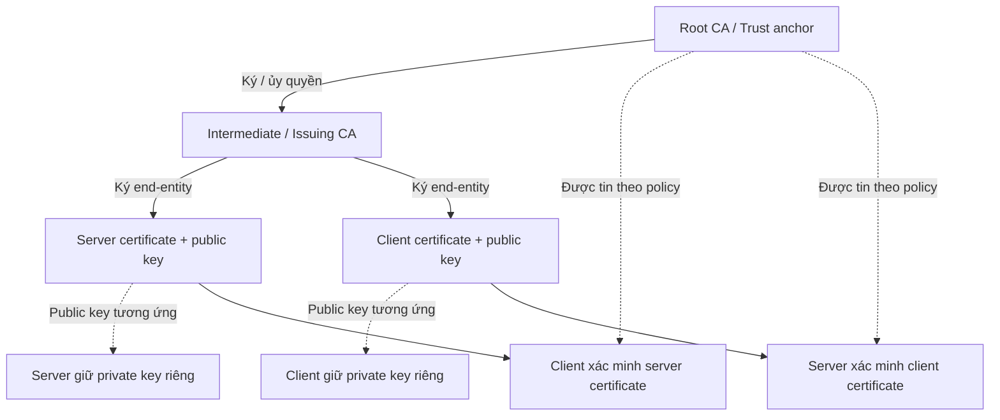
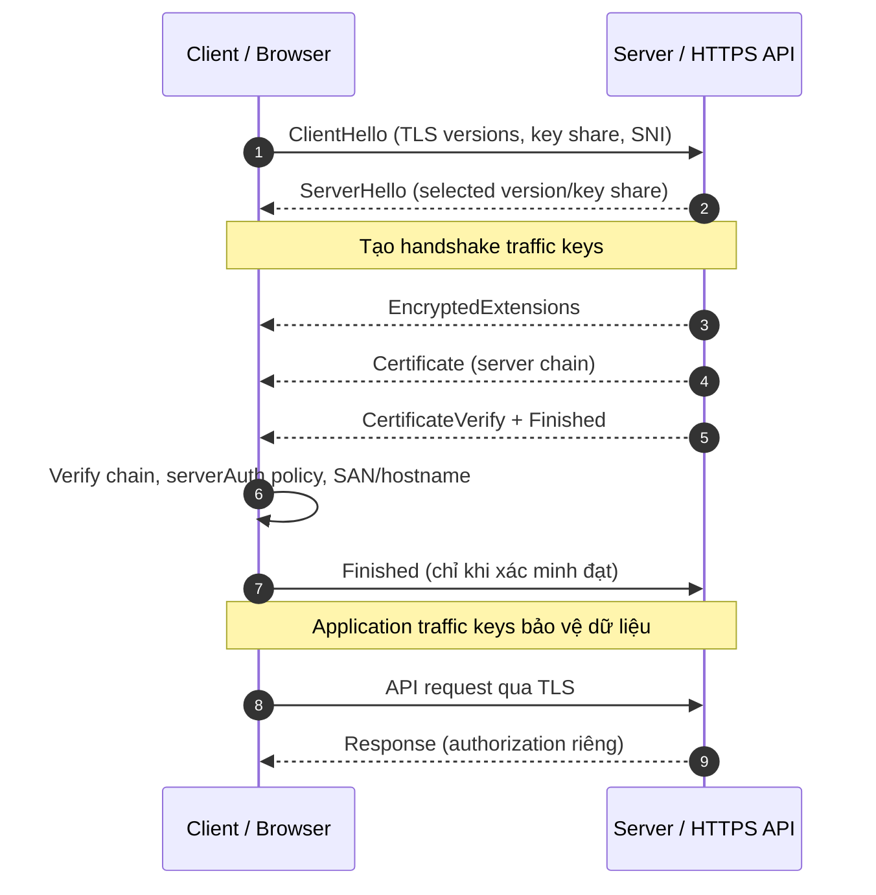
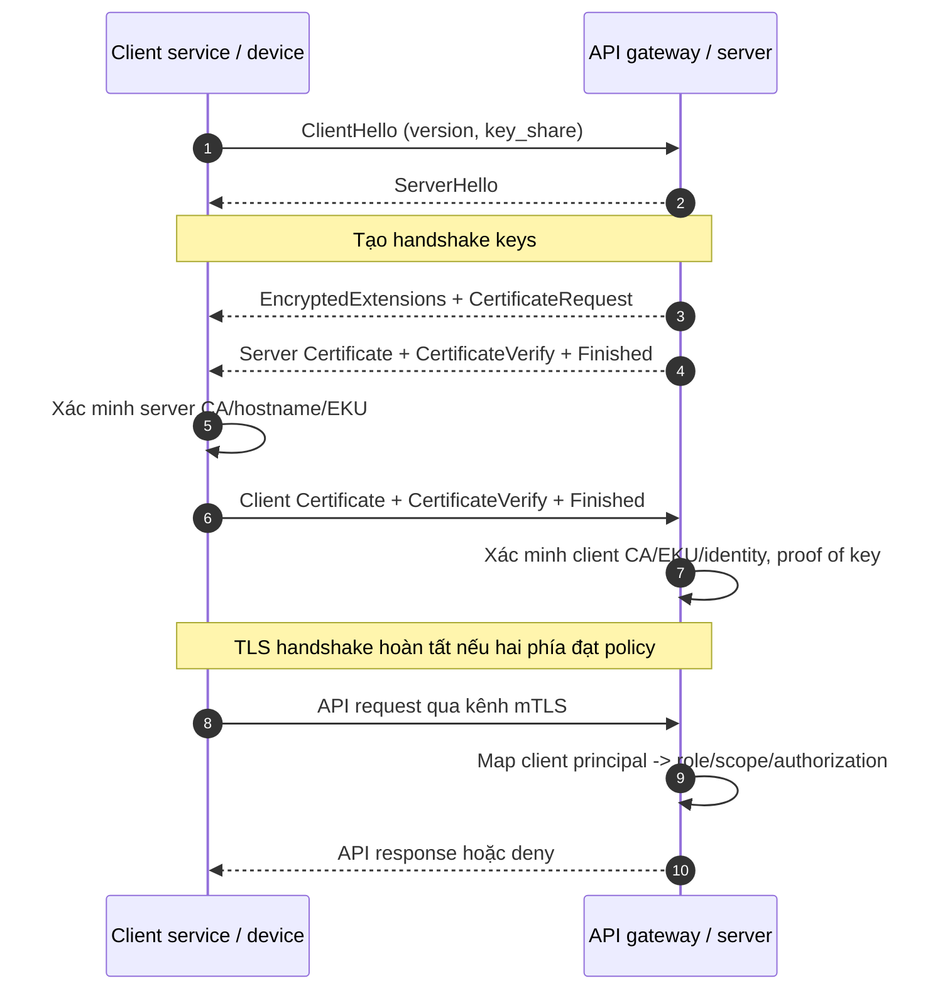
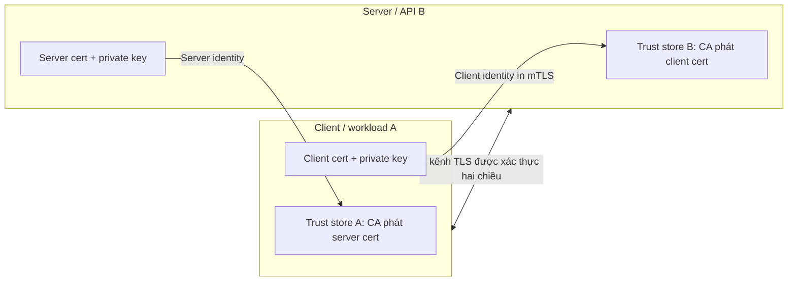
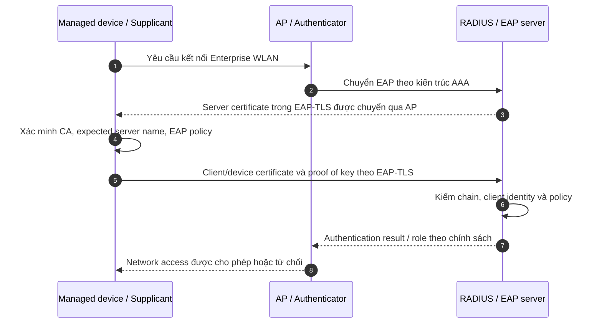
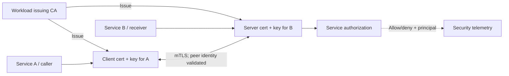
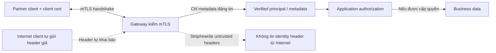

# Sự khác nhau giữa certificate server và client

> **Học phần:** `SECURITY_NETWORK_SECURITY`  
> **Chương:** PKI và chứng thư cho mạng  
> **Trọng tâm:** Phân biệt chứng thư X.509 dùng để **xác thực phía cung cấp dịch vụ (server certificate)** với chứng thư dùng để **xác thực phía kết nối (client certificate)**; hiểu quan hệ giữa TLS, mTLS, PKI, xác minh danh tính và phân quyền; triển khai vòng đời chứng thư an toàn trong HTTPS, API, Wi-Fi Enterprise, VPN và hạ tầng cloud.

## Mục tiêu học tập

Sau bài này, người học có thể:

1. Giải thích bản chất **certificate, public/private key, CA, trust anchor, chứng thư trung gian và chuỗi tin cậy**.
2. Phân biệt **server certificate** và **client certificate** theo vai trò xác thực, bên trình chứng thư, bên kiểm tra chứng thư, định danh, **SAN**, **Key Usage**, **Extended Key Usage (EKU)** và nơi cất giữ khóa riêng.
3. Minh họa handshake **TLS server authentication** và **mutual TLS (mTLS)** ở TLS 1.3, nhận biết điểm khác của TLS 1.2.
4. Thực hiện kiểm tra đúng: certificate chain, thời hạn, tên/danh tính mong đợi, mục đích sử dụng, chính sách CA và trạng thái thu hồi khi áp dụng.
5. Phân biệt **xác thực thiết bị/workload** bằng client certificate với **xác thực con người** và **authorization** ở API, ứng dụng và mạng.
6. Lựa chọn mô hình phát hành, phân phối, thu hồi và xoay vòng server/client certificate trong nội bộ, hệ đối tác, Wi-Fi Enterprise, VPN và service mesh.
7. Xây dựng chính sách TLS/mTLS, hướng dẫn chẩn đoán và các bài kiểm thử có kiểm soát, không để lộ private key.

## 1. Điểm khác nhau cốt lõi

**Server certificate** là chứng thư mà một **TLS server** thường trình cho phía kết nối để chứng minh danh tính dịch vụ, ví dụ server của `https://api.example.test`. **Client certificate** là chứng thư mà một **TLS client** trình khi server yêu cầu xác thực client bằng chứng thư, ví dụ thiết bị quản lý kết nối vào API mTLS hoặc laptop dùng EAP-TLS ở mạng Enterprise.

Điểm quan trọng: cả hai thường là **chứng thư X.509**, mang public key và thông tin định danh được bên phát hành ký. Sự khác nhau nằm ở **mục đích sử dụng, vai trò trong giao thức, danh tính được xác minh và chính sách tin cậy**, không phải ở việc một loại “mã hóa” còn loại kia “không mã hóa”.

### Bảng so sánh nhanh

| Góc nhìn | Server certificate | Client certificate |
|---|---|---|
| **Ai thường trình?** | TLS server (website, API, DB, reverse proxy) | TLS client (ứng dụng, thiết bị, service, trình duyệt nếu cấu hình) |
| **Ai xác minh?** | Client xác minh server | Server xác minh client |
| **Câu hỏi trả lời** | “Tôi đang kết nối **đúng dịch vụ** không?” | “Ai/thiết bị hoặc workload **đang kết nối tới tôi**?” |
| **Danh tính phổ biến** | DNS hostname hoặc IP trong SAN | Device ID, user ID, workload ID, URI/email/DN/SAN theo PKI |
| **EKU thường gặp** | `id-kp-serverAuth` | `id-kp-clientAuth` |
| **Khóa riêng đặt ở đâu?** | TLS server, LB, proxy, HSM/key manager | Thiết bị client, TPM/secure element, workload/secret store |
| **Trust store phía kiểm tra** | Client tin CA có quyền phát hành server cert theo policy | Server tin CA/issuer có quyền phát hành client cert theo policy |
| **Có bắt buộc trong TLS web phổ biến?** | Thường có với HTTPS xác thực server bằng chứng thư | Không; chỉ khi endpoint cấu hình client certificate authentication |
| **Tác dụng trực tiếp** | Xác thực peer là server; tham gia handshake để bảo vệ kênh | Xác thực peer là client; server liên kết với principal |
| **Không tự thay thế** | Login, MFA, API authorization | API authorization, user session, MFA, device posture |

**Ví dụ thực tế:** Trình duyệt vào website ngân hàng qua HTTPS thường **xác thực server** bằng server certificate, rồi người dùng đăng nhập bằng tài khoản/phương thức khác. Một hệ thống B2B dùng mTLS có thể yêu cầu đối tác vừa xác minh certificate của server, vừa cung cấp **client certificate** riêng để phía API xác thực ứng dụng đối tác.

## 2. PKI: certificate khác private key thế nào?

**Public Key Infrastructure (PKI)** là tập hợp vai trò, chính sách, quy trình và công nghệ để cấp và quản lý chứng thư khóa công khai. Một certificate không phải là private key; nó thường chứa **public key**, thông tin chủ thể, thông tin CA phát hành, ràng buộc sử dụng, thời hạn và chữ ký số của issuer.



Sơ đồ giản lược: trust store có thể chứa root, một CA riêng, hoặc trust anchor thích hợp; **không phải mọi hệ thống dùng chung một CA** cho cả server/client. Trong triển khai tốt, việc phân tách **issuing CA, policy và trust domain** thường hữu ích để giảm phạm vi ảnh hưởng.

### Bốn thành phần không được nhầm

- **Certificate:** dữ liệu công khai được ký để ràng buộc danh tính với public key và ràng buộc sử dụng.
- **Private key:** bí mật tương ứng public key, dùng tạo bằng chứng sở hữu khóa trong giao thức ký/xác thực; phải được bảo vệ.
- **Certificate Authority (CA):** đơn vị/hệ thống có quyền phát hành chứng thư theo chính sách.
- **Trust anchor / trust store:** tập hợp CA hoặc khóa được một verifier tin cho mục đích cụ thể.

**Chứng thư được CA ký không tự động đáng tin cho mọi hệ thống.** Verifier còn phải chấp nhận CA đó, kiểm tra đúng chain, identity, usage và policy. CA công khai cho HTTPS và CA doanh nghiệp dùng cho thiết bị quản lý có thể là **hai trust domain tách biệt**.

## 3. Certificate có những trường gì?

Chứng thư TLS server và client thường dựa trên **X.509**, được mô tả bởi RFC 5280 và các profile/giao thức liên quan.

| Trường / extension | Chức năng | Điểm cần xác minh |
|---|---|---|
| **Subject** | Thông tin đối tượng; có thể chứa CN/O/OU tùy profile | Không đồng nhất Subject CN với toàn bộ quy tắc xác minh hostname |
| **Issuer** | Định danh CA ký chứng thư | Có thể xây chain tới trust anchor được phép không? |
| **Serial Number** | Định danh chứng thư trong phạm vi issuer | Hữu ích cho revocation và audit |
| **Validity (Not Before/After)** | Khoảng thời gian chứng thư được phép có hiệu lực | Đồng hồ hệ thống và lịch rotation đúng? |
| **Subject Public Key Info** | Public key và thuật toán | Key size/curve/algorithm thỏa policy? |
| **Signature Algorithm** | Thuật toán CA dùng để ký chứng thư | Có bị cấm bởi policy, có tương thích không? |
| **Subject Alternative Name (SAN)** | Các dạng định danh như DNS, IP, URI, email và dạng khác | Định danh đang kiểm tra có xuất hiện đúng loại và giá trị? |
| **Key Usage (KU)** | Giới hạn thao tác khóa như digitalSignature, keyEncipherment, keyCertSign | Được dùng đúng mục đích TLS profile? |
| **Extended Key Usage (EKU)** | Giới hạn mục đích ứng dụng như serverAuth/clientAuth | Verifier có yêu cầu usage phù hợp không? |
| **Basic Constraints** | Xác định chứng thư CA hay end-entity, path length khi có | CA cấp phép có `CA:TRUE`; leaf thường `CA:FALSE` |
| **Authority/Subject Key Identifier** | Hỗ trợ liên kết chứng thư và CA trong chain | Chain xây đúng CA và key tương ứng không? |
| **CRL Distribution Points / AIA** | Chỉ vị trí thông tin CRL/issuer/OCSP khi có | Chính sách revocation và khả năng truy cập phù hợp? |
| **Certificate Policies / Name Constraints** | Ràng buộc chính sách và phạm vi danh tính khi áp dụng | Có được verifier thực sự thực thi không? |

**Extension xuất hiện không đồng nghĩa được hệ thống kiểm tra.** Một chứng thư có SAN đúng nhưng client tắt hostname verification vẫn không đáp ứng mục tiêu xác thực; một client certificate có EKU phù hợp nhưng server gán quyền administrator cho mọi cert trusted cũng không an toàn.

## 4. EKU và Key Usage: cách phân biệt rõ nhất

**Extended Key Usage (EKU)** xác định mục đích sử dụng của khóa/chứng thư trong những ngữ cảnh cụ thể. Hai OID đặc biệt quan trọng:

| EKU | OID | Mục đích thường gặp |
|---|---|---|
| `id-kp-serverAuth` | `1.3.6.1.5.5.7.3.1` | TLS Web Server Authentication |
| `id-kp-clientAuth` | `1.3.6.1.5.5.7.3.2` | TLS Web Client Authentication |

**Key Usage** lại quy định kiểu **thao tác mật mã** mà khóa được dùng. Ví dụ, với TLS 1.3 xác thực bằng chứng thư, private key thường dùng tạo chữ ký trong handshake, nên profile thích hợp phải tương thích với `digitalSignature`. Những legacy TLS 1.2 suites có thể có yêu cầu `keyEncipherment` khác, nhưng **không nên lấy yêu cầu legacy làm chuẩn mới**.

### Bảng ví dụ

| Certificate profile | BasicConstraints | KU thường gặp | EKU thường gặp |
|---|---|---|---|
| **TLS server leaf** | `CA:FALSE` | `digitalSignature` (theo key/handshake) | `serverAuth` |
| **TLS client leaf** | `CA:FALSE` | `digitalSignature` (theo method) | `clientAuth` |
| **Issuing CA** | `CA:TRUE` | `keyCertSign`, `cRLSign` nếu dùng CRL | Không coi là leaf TLS; chính sách EKU của CA tùy thiết kế |
| **Dual-use leaf** | `CA:FALSE` | Tùy cơ chế sử dụng | Có thể chứa cả hai EKU nhưng **không nên dùng mặc định** |

**Lưu ý chuẩn xác:** Theo RFC 5280, EKU có thể **không hiện diện** trong một số profile, và cách verifier giải nghĩa ràng buộc còn phụ thuộc mục đích/ứng dụng và chính sách CA. Vì vậy **không kết luận “không có EKU thì mọi hệ thống chắc chắn từ chối”**, cũng không kết luận “có hai EKU thì an toàn để dùng chung”. Tổ chức nên **yêu cầu rõ EKU mục tiêu và kiểm tra tại verifier**.

### Vì sao không gộp server/client certificate tùy tiện?

Nếu cùng một private key/chứng thư được dùng làm danh tính server và client:

- Lộ khóa ở một đầu mở rộng phạm vi mạo danh ở đầu còn lại.
- Khó phân quyền riêng giữa host cung cấp dịch vụ và workload gọi dịch vụ.
- Rotation, revocation và logging không tách biệt chức năng.
- EKU hoặc chính sách issuer quá rộng làm tăng nguy cơ dùng credential ngoài ý muốn.

Nên thiết kế **credential riêng theo principal và mục đích**. Một số hệ thống thực tế hỗ trợ dual-use có chủ đích, nhưng phải được đánh giá rủi ro và áp policy chặt, không coi là mặc định.

## 5. Server certificate: xác minh đúng dịch vụ

Server certificate có vai trò tạo **bằng chứng danh tính của server** trong TLS handshake. Khi client muốn đến `api.partner.example.test`, nó cần kiểm tra chứng thư được server trình có hợp lệ **với đúng đích mà client định kết nối**.

### Các bước xác minh phía client

1. **Chain of trust:** từ leaf qua intermediate tới trust anchor được client tin.
2. **Validity:** thời gian thực tế phù hợp `NotBefore/NotAfter`.
3. **Expected hostname/identity:** kết nối tới hostname nào, có SAN DNS phù hợp không?
4. **Certificate usage:** EKU/KU và thuật toán phù hợp với server authentication được policy cho phép.
5. **Signature/path validation:** chữ ký, constraints và đường CA hợp lệ.
6. **Revocation status:** theo cách ứng dụng/PKI xử lý CRL/OCSP hay cơ chế thay thế.
7. **Security policy:** không chấp nhận certificate/CA/key/signature algorithms bị cấm.

### Ví dụ đúng và sai

```text
URL client gọi: https://billing.example.test

Server trình:
  SAN: DNS:billing.example.test
  EKU: serverAuth
  Basic Constraints: CA:FALSE
  Chain: Issuing CA -> Root CA được client tin

Khi policy phù hợp:
  [OK] Danh tính server có thể được xác minh.

Nếu server trình:
  SAN: DNS:reporting.example.test

Kết quả:
  [FAIL] Không khớp hostname billing.example.test,
         dù cùng một CA đã ký và chứng thư chưa hết hạn.
```

**Điểm cần nhớ:** Với DNS hostname hiện đại, xác minh nên dựa trên **SAN dNSName** theo quy tắc của ứng dụng và tiêu chuẩn áp dụng, không dựa vào **CN fallback** như một biện pháp an toàn thay thế. Khi kết nối theo **IP literal**, cần chứng thư có **SAN iPAddress** phù hợp; một chuỗi `DNS:192.0.2.10` không tương đương SAN loại IP.

### SNI khác hostname verification

**Server Name Indication (SNI)** giúp server chọn virtual host và chứng thư theo hostname mà client gửi. SNI không tự xác thực server: client vẫn phải kiểm tra certificate trả về có khớp **hostname mong đợi** hay không.

## 6. Client certificate: xác minh bên đang yêu cầu kết nối

Client certificate thường được TLS server **yêu cầu** và dùng để xác thực **client identity**. Trong môi trường quản lý, client có thể là:

- Một service gọi API nội bộ hoặc API B2B;
- Laptop doanh nghiệp có chứng thư thiết bị;
- Ứng dụng chạy trên server, container, VM;
- Một operator/admin dùng trình duyệt có client certificate;
- IoT gateway, bộ điều khiển hoặc thiết bị có secure element;
- Một process sidecar/service mesh đại diện workload.

**Danh tính client không nhất thiết là username của con người.** Chứng thư có thể nói “đây là workload `orders-api` thuộc trust domain X”, trong khi người thực hiện nghiệp vụ phải đăng nhập và được phân quyền **riêng**.

### Server xác minh điều gì?

1. Client có trình certificate hay không, **nếu policy yêu cầu**.
2. Chain tới **CA được phép phát hành client certificate** trong phạm vi endpoint.
3. EKU/KU và certificate policy phù hợp với client authentication.
4. Client đã chứng minh sở hữu private key tương ứng thông qua TLS handshake.
5. Danh tính SAN/Subject/URI hoặc trường được quy ước **có nằm trong danh sách principal hợp lệ không**.
6. Certificate chưa hết hạn/bị thu hồi theo policy, và thiết bị/workload chưa bị chặn ở inventory.
7. Vai trò và **authorization** của principal phù hợp endpoint/hành động.

Một certificate client hợp lệ chỉ xác minh **credential/principal được chứng thực**. Nó **không tự bảo đảm** thiết bị còn sạch mã độc, người dùng hiện tại có MFA, credential chưa bị sử dụng trên máy bị chiếm hoặc principal có quyền truy cập mọi dữ liệu.

## 7. Vì sao server certificate thường gặp hơn client certificate?

Hầu hết website công khai cần giúp mọi trình duyệt xác minh **server có đúng danh tính** trước khi truyền mật khẩu, token, thông tin cá nhân. Nhưng website không thể yêu cầu hàng triệu khách hàng phải được cấp chứng thư client từ trước một cách thực tế trong nhiều mô hình.

Do đó mô hình thông dụng là:

- **TLS server authentication**: server certificate bắt buộc trong đường chứng thực dựa trên PKI; client không trình cert.
- **Application authentication**: user dùng password/SSO/MFA, session hoặc token OAuth/OIDC.
- **Application authorization**: API kiểm tra user/role/scope/ownership sau khi đã xác thực.

Mô hình **mTLS** thường phù hợp hơn khi tổ chức kiểm soát được cả hai phía hoặc có thỏa thuận phát hành/trust rõ ràng: hệ service-to-service, thiết bị doanh nghiệp, B2B tích hợp và một số ứng dụng quản trị.

**Không đồng nhất client certificate với “mã hóa hai lần”.** Trong mTLS, cả hai bên được xác thực bằng certificate, còn TLS vẫn là **một phiên bảo vệ kênh** với key schedule của giao thức.

## 8. TLS server authentication: trình tự khái niệm

Ở TLS 1.3, client và server thỏa thuận phiên bản, key share và xác thực server. Sau khi ServerHello, nhiều thông điệp handshake được mã hóa bằng khóa handshake.



Sơ đồ chỉ mô tả **full TLS 1.3 handshake với server certificate**, không phải mọi tình huống. **PSK resumption** có thể không có trao đổi Certificate giống full handshake; **HelloRetryRequest** và extensions có thể thêm bước.

### Phần nào thực sự chứng minh private key?

Bản thân certificate chỉ chứa **public key và chữ ký CA**. Server dùng private key tương ứng để tạo **bằng chứng trong handshake** (ví dụ `CertificateVerify` của TLS 1.3), giúp client xác minh rằng server kiểm soát private key phù hợp certificate. Mối ràng buộc này cũng phụ thuộc transcript và key establishment của TLS.

**Không thể xác thực server chỉ bằng việc nhận một file certificate** nếu không kiểm tra handshake, chain và hostname.

## 9. Mutual TLS (mTLS): cả hai phía xác thực

**mTLS** bổ sung bước server yêu cầu **client certificate** và xác minh credential của client. Với TLS 1.3, server có thể gửi `CertificateRequest` trong handshake khi muốn xác thực client.



Sơ đồ là **happy path giản lược** và không phải trace đầy đủ mọi packet. Thứ tự chi tiết, thông báo tùy chọn, certificate selection, post-handshake client authentication và resumption tùy phiên bản/config. Trong **TLS 1.2**, thông điệp `CertificateRequest`/client certificate xuất hiện trong luồng handshake khác TLS 1.3. Ý tưởng chung vẫn là **hai bên cung cấp và kiểm chứng bằng chứng danh tính**.

### Phân biệt ba quyết định

| Bước | Kiểm tra | Ai quyết định? |
|---|---|---|
| **TLS server authentication** | Có đúng hostname/server và CA được tin không? | Client |
| **TLS client authentication** | Có đúng client certificate và principal được chấp nhận không? | Server hoặc TLS termination proxy |
| **Application authorization** | Principal có quyền gọi route, đọc object hoặc sửa tài nguyên này không? | Gateway/ứng dụng/IAM theo policy |

**Quan hệ bao hàm:** Certificate authentication giúp **xác định danh tính kết nối**. Nó **không phải** toàn bộ authorization. Nếu server nhận cert client rồi cho phép mọi endpoint, lỗi phân quyền vẫn tồn tại.

## 10. Trust store của client và server thường khác nhau

Trong mô hình server-only TLS:

- **Client trust store** chứa các trust anchor thích hợp để xác minh **server certificates**.
- Server dùng **certificate/private key** của mình, thường thông qua **key store** hoặc secret manager.
- Server **không cần** cấu hình danh sách client CA để yêu cầu chứng thư client nếu nó không triển khai mTLS.

Trong mô hình mTLS:

- Client phải **tin issuer server** và xác minh server identity.
- Server phải **tin issuer client** và xác minh client identity.
- Hai trust stores **có thể khác nhau**, và đây thường là thiết kế mong muốn.



**Đừng coi “tất cả chứng thư cùng thuộc một Root CA” là đủ để cấp mọi quyền.** Một CA nội bộ phục vụ nhiều phòng ban có thể phát certificate với SAN/Subject khác nhau. Server cần **issuer scope và identity-to-authorization mapping**, không chỉ “certificate signed by InternalRoot”.

### Trust store và key store

| Thành phần | Chứa gì? | Nguy cơ |
|---|---|---|
| **Trust store** | CA/trust anchors hoặc chứng thư được pin/ủy quyền để xác minh peer | Trust quá rộng, không kiểm tra expected identity |
| **Key store / private-key store** | Private key và chain certificate của chính entity | Lộ khóa, quyền đọc secret quá rộng |
| **CA signing system** | CA signing private key, cấu hình phát hành, policy | Bị chiếm có thể phát certificate mạo danh trong phạm vi |
| **Revocation / inventory service** | Danh sách certificate đã cấp, trạng thái và owner | Không cập nhật/không kiểm tra dẫn tới credential hết quyền vẫn được dùng |

**Cần phân quyền khác nhau cho từng loại kho.** Trust store không mặc nhiên là “kho chứa private key”, dù một số định dạng như PKCS#12 có thể chứa cả certificate, chain và private key.

## 11. Chain validation và các lỗi thường gặp

Một chuỗi chứng thư phổ biến:

```text
Root CA (trust anchor bên xác minh)
  └── Intermediate / Issuing CA
       └── End-entity certificate (server hoặc client)
```

Verifier phải kiểm tra chữ ký, thời hạn, BasicConstraints/KeyUsage của CA, các constraints và policy phù hợp. Ngoài chain, cần **identity check** cho đúng peer.

### Kịch bản chẩn đoán

| Triệu chứng | Nguyên nhân có thể | Cách xác minh |
|---|---|---|
| `unknown_ca` | Trust store thiếu CA hoặc chain không hợp lệ | Root/intermediate/cert path, đúng trust domain |
| `certificate_expired` | Leaf/issuer quá hạn, đồng hồ sai | NotBefore/NotAfter, system time |
| `bad_certificate` | Cert không phù hợp policy/định dạng/identity | KU/EKU, signature, SAN, chain |
| `certificate_required` hoặc tương đương | Server yêu cầu cert client, client không gửi | TLS profile, cert selection, issuer list |
| `unsupported_certificate` | Key algorithm/EKU/format không được hỗ trợ | Client/server TLS library và policy |
| Hostname mismatch | SAN DNS/IP không khớp đích | URL/SNI/expected hostname và SAN type |
| Client cert hợp lệ nhưng API `403` | Authentication đạt, authorization không cấp quyền | Identity mapping, role/scope, object owner |
| mTLS qua proxy thất bại | Client cert bị kiểm tại sai hop, proxy không truyền principal an toàn | Termination topology, trust header và upstream mTLS |
| Một số thiết bị Wi-Fi không vào 802.1X | CA/RADIUS tên sai, cert client thiếu hoặc expired | EAP-TLS profile, MDM/PKI, RADIUS logs |

**Mã lỗi từ TLS library không luôn phân loại chính xác nguyên nhân.** Nhiều implementation trả lỗi tổng quát `handshake_failure`. Cần log hai bên và **dữ liệu có redaction**, không suy chỉ từ một alert code.

## 12. Chủ thể và SAN: server hostname khác client principal

### Danh tính server

Server certificate cho HTTPS thường có:

- `dNSName` cho tên dịch vụ, như `billing.example.test`;
- `iPAddress` nếu client thực sự kết nối bằng IP literal và chính sách cho phép;
- nhiều SAN nếu một endpoint phục vụ nhiều hostname được sở hữu;
- các ràng buộc domain/CA phù hợp hệ thống tin cậy.

Chứng thư có SAN cho một domain **không chứng minh** server được phép phục vụ toàn bộ domain khác trong tổ chức.

### Danh tính client

Một hệ enterprise có thể chọn:

- `rfc822Name` hoặc định danh email cho người dùng, **nếu** PKI và verifier được thiết kế như vậy;
- `uniformResourceIdentifier` (URI SAN) để biểu diễn workload/service identity;
- `otherName` theo enterprise profile;
- Subject DN/serial hoặc certificate policy để gắn vào asset inventory.

**Không có một loại SAN client dùng chung cho mọi giao thức/nhà cung cấp.** Dùng SAN nào phải được quy định bởi **certificate profile, verifier implementation và identity source**, tránh suy user role từ một CN có thể đặt tùy ý.

### Ví dụ policy identity

```yaml
serverIdentity:
  expectedDNSName: "api.partner.example.test"
  trustedIssuers:
    - "PartnerServerIssuingCA"
  requireEku: "serverAuth"
clientIdentity:
  trustedIssuers:
    - "CorpWorkloadClientCA"
  requireEku: "clientAuth"
  acceptedUriSanPrefixes:
    - "spiffe://corp.example.test/ns/orders/"
  mapToPrincipal: "workload-identity"
authorization:
  allowedOperations:
    - "POST /v1/orders"
  denyByDefault: true
```

Đây là YAML **minh họa policy**, không phải định dạng chuẩn của một gateway. Tiền tố `spiffe://...` chỉ có ý nghĩa danh tính bảo mật khi hệ thống thật có **trust domain, issuer và verifier SPIFFE** được cấu hình đúng; không được tin một URI bất kỳ do client tự khai báo.

## 13. Phát hành certificate: CSR, CA và certificate profile

Một quy trình PKI phổ biến:

1. Chủ thể tạo **private/public key pair** ở nơi được bảo vệ, hoặc dùng cơ chế cấp khóa được tổ chức cho phép.
2. Tạo **Certificate Signing Request (CSR)** chứa public key và thông tin đề nghị.
3. CA/registration authority xác minh quyền đối với danh tính theo **profile**.
4. CA phát certificate với **SAN/KU/EKU/validity** đúng policy, không mù quáng tin mọi extension trong CSR.
5. Chủ thể nhận leaf certificate và chain, **private key vẫn được quản lý an toàn**.
6. Triển khai vào server/client, kiểm tra handshake và ghi inventory/owner/expiry.
7. Gia hạn/rotation, thu hồi, thay thế và hủy credential theo vòng đời.

### Bảng profile đề xuất

| Thuộc tính | Server certificate profile | Client certificate profile |
|---|---|---|
| **Proof trước phát hành** | Xác minh quyền quản lý domain/service/server | Xác minh user/device/workload identity và owner |
| **SAN** | DNS/IP dịch vụ, theo CA policy | URI/otherName/email/DN hoặc ID theo PKI enterprise |
| **EKU** | serverAuth | clientAuth |
| **Private key placement** | HSM/secret store hoặc server key manager | TPM/secure element, host/workload key store |
| **CA phù hợp** | Public WebPKI hoặc enterprise/private CA tùy audience | Thường private/workload/device PKI; CA được server tin |
| **Rotation** | Theo tên dịch vụ, cert expiry và deployment | Theo thiết bị/user/workload lifecycle, thu hồi khi offboarding |
| **Revocation trigger** | Key compromise, hostname/control-plane incident, CA issue | Thiết bị mất, người dùng rời tổ chức, workload bị chiếm |
| **Authorization** | Server được phép làm TLS endpoint cho hostname nào? | Client được phép gọi route, subnet, hành động nào? |

**Public CA cấp HTTPS certificate** và **private CA cấp client identity** không phải chức năng hoán đổi mặc định. Public WebPKI có chính sách về domain validation và server authentication; cấp client certificate cho nội bộ thường cần **CA và verifier policy riêng**.

## 14. Ví dụ tạo CSR cho server và client trong lab

Những lệnh sau nhằm hiểu **nội dung CSR và cách đọc certificate**, chỉ chạy trên máy thử nghiệm được phép. Chúng **không** tạo một PKI production hoàn chỉnh; việc phát chứng thư phải qua CA/phần mềm quản lý có policy hợp lệ.

### Tạo private key và CSR server

```bash
# Chạy trong lab, OpenSSL có hỗ trợ EC P-256 và -addext.
# openssl genpkey có thể hỏi passphrase khi dùng mã hóa private key.
openssl genpkey -algorithm EC \
  -pkeyopt ec_paramgen_curve:P-256 \
  -aes-256-cbc -out server.key

openssl req -new \
  -key server.key \
  -out server.csr \
  -subj "/CN=api.example.test" \
  -addext "subjectAltName=DNS:api.example.test"

# Chỉ đọc CSR; không phát chứng thư.
openssl req -in server.csr -noout -text
```

### Tạo private key và CSR client

```bash
openssl genpkey -algorithm EC \
  -pkeyopt ec_paramgen_curve:P-256 \
  -aes-256-cbc -out client.key

openssl req -new \
  -key client.key \
  -out client.csr \
  -subj "/CN=orders-client-demo" \
  -addext "subjectAltName=URI:spiffe://corp.example.test/ns/orders/sa/caller"

openssl req -in client.csr -noout -text
```

**Điểm phân biệt:** Hai CSR đều chỉ chứa **public key và yêu cầu thông tin**, không tự thể hiện đã được CA chấp thuận serverAuth/clientAuth. CA phải áp **issuing profile** để tạo certificate, thêm/kiểm tra KU/EKU và xác minh quyền đối với danh tính. **Không nghĩ rằng chỉ đặt `CN=server` hoặc `CN=client` là chứng thư có mục đích tương ứng**.

### Quy tắc bảo mật của lab

- File `server.key` / `client.key` có **private key**; không commit vào Git, gửi qua chat/ticket hoặc đưa vào log.
- Tài khoản và máy thử nghiệm phải được bảo vệ; sau lab xử lý khóa theo chính sách.
- Không dùng CA tự phát tùy tiện để ký chứng thư production.
- Không dùng tên miền người khác trong CSR nhằm nhận quyền ngoài phạm vi.
- Private key được mã hóa khi lưu vẫn cần quản lý **passphrase và runtime decryption** an toàn.

## 15. Đọc certificate và kiểm tra purpose

Giả sử CA trong lab đã phát `server.pem`, `client.pem`, và có `issuing-ca.pem`, `root-ca.pem` tương ứng.

```bash
# Xem thông tin chứng thư, SAN, KU/EKU, thời hạn.
openssl x509 -in server.pem -noout -text
openssl x509 -in client.pem -noout -text

# Xem hạn chứng thư, issuer và subject.
openssl x509 -in server.pem -noout -dates -issuer -subject
openssl x509 -in client.pem -noout -dates -issuer -subject

# Kiểm tra server certificate theo CA và hostname kỳ vọng.
openssl verify -CAfile root-ca.pem \
  -untrusted issuing-ca.pem \
  -purpose sslserver \
  -verify_hostname api.example.test \
  server.pem

# Kiểm tra client certificate theo chain và mục đích client auth.
openssl verify -CAfile root-ca.pem \
  -untrusted issuing-ca.pem \
  -purpose sslclient \
  client.pem
```

**Các lệnh này chỉ minh họa** một số phép kiểm tra của OpenSSL trên certificate file; kết quả còn phụ thuộc **OpenSSL version, trust store, revocation setup và policy thật**. Một chứng thư pass `openssl verify` không chứng minh nó **đã được bên nhận chấp nhận trong một TLS handshake**, cũng không chứng minh principal có quyền ứng dụng.

### Một điều dễ nhầm

`openssl verify -purpose sslclient` không tự biết API muốn principal `orders-client`; nó chủ yếu kiểm tra certificate path và purpose theo khả năng OpenSSL. **Authorization** như “chỉ cho phép route /v1/orders từ workload orders” phải được cấu hình độc lập trong API gateway/service.

## 16. Test server-only TLS và mTLS có kiểm soát

### Kết nối HTTPS chỉ cần server certificate

```bash
openssl s_client \
  -connect api.example.test:443 \
  -servername api.example.test \
  -verify_hostname api.example.test \
  -verify_return_error \
  -CAfile root-ca.pem \
  -brief
```

Đây là ví dụ kiểm thử **server authentication** cho lab/private CA. Nếu endpoint dùng public CA được hệ điều hành/OpenSSL tin, cách chọn CA bundle phụ thuộc môi trường.

### Kết nối mTLS

```bash
openssl s_client \
  -connect api.example.test:443 \
  -servername api.example.test \
  -verify_hostname api.example.test \
  -verify_return_error \
  -CAfile root-ca.pem \
  -cert client.pem \
  -key client.key \
  -brief
```

**Không kết luận “mTLS đã hoạt động” chỉ vì lệnh có `-cert`/`-key` và thoát thành công.** Server có thể không yêu cầu cert client, không kiểm tra identity hoặc chỉ bật optional client cert. Cần xem **server-side authentication decision**, principal được ánh xạ và thử **negative test không có/không hợp lệ client certificate**.

### Mô hình negative test

| Ca | Kết quả kỳ vọng |
|---|---|
| Client đúng CA server, hostname và TLS policy | Kết nối TLS thành công |
| Server certificate đúng CA nhưng SAN hostname khác | Client từ chối |
| Server certificate hết hạn | Client từ chối theo policy |
| Endpoint bắt buộc mTLS nhưng client không gửi certificate | Server từ chối xác thực/đường truy cập |
| Client certificate có EKU/policy không phù hợp | Verifier từ chối theo policy |
| Client certificate từ CA ngoài allowlist | Server từ chối |
| Client certificate đúng nhưng chưa được cấp quyền API | TLS auth thành công, API trả `403`/deny theo policy |
| Client private key không khớp certificate | Không thể hoàn tất proof of possession |
| Certificate đã bị thu hồi | Bị từ chối theo cơ chế revocation có hiệu lực |
| Client certificate bị xoay vòng | Trạng thái cũ bị loại bỏ sau giai đoạn chuyển tiếp có kiểm soát |

**Không dùng `-k`, `--insecure` hay trust manager luôn chấp nhận mọi chứng thư** để “đạt bài test”. Những tùy chọn này làm mất giá trị của kiểm tra identity.

## 17. NGINX: chỉ server TLS và mTLS khác gì nhau?

Đoạn cấu hình dưới đây là **mẫu học tập**, không phải file production hoàn chỉnh.

### Server certificate cho HTTPS

```nginx
server {
    listen 443 ssl;
    server_name api.example.test;

    ssl_certificate     /etc/pki/server/fullchain.pem;
    ssl_certificate_key /etc/pki/server/private.key;

    ssl_protocols TLSv1.2 TLSv1.3;

    location / {
        return 200 "Server TLS only (demo)\n";
    }
}
```

Ở đây **server trình chứng thư** cho client, nhưng **không yêu cầu** client certificate. Một ứng dụng thực vẫn có thể dùng token/cookie/OIDC để xác thực người dùng. Kiểm tra server hostname được thực hiện **ở client**, không thể suy từ một response 200.

### Bật mTLS ở một listener được kiểm soát

```nginx
server {
    listen 8443 ssl;
    server_name partner-api.example.test;

    ssl_certificate     /etc/pki/server/fullchain.pem;
    ssl_certificate_key /etc/pki/server/private.key;
    ssl_protocols TLSv1.2 TLSv1.3;

    # CA riêng được cho phép xác minh client certificate.
    ssl_client_certificate /etc/pki/client-ca/trusted-issuers.pem;
    ssl_verify_client on;
    ssl_verify_depth 3;

    location /v1/ {
        # Demo không chuyển tới backend;
        # ứng dụng thật phải map identity -> authorization.
        return 200 "Client certificate verified at TLS proxy (demo)\n";
    }
}
```

### Những điều bắt buộc xem thêm

- `ssl_verify_client on` yêu cầu client certificate tại **TLS listener**; cấu hình `optional` cho phép trường hợp khác và cần application policy bổ sung.
- `ssl_client_certificate` khai báo CA để NGINX xác minh client, **không phải đường tới client private key**.
- Bộ CA được phép phải đủ **hẹp**; đừng cấu hình một CA root có thể phát rất nhiều danh tính không liên quan rồi cấp quyền chung.
- Nếu thật sự proxy request tới backend, cần **identity mapping và authorization**, không trả 200 chỉ vì cert hợp lệ.
- Phiên bản NGINX/OpenSSL có thể khác về TLS 1.3 cipher, CRL/OCSP, logging và cách kiểm chứng client cert; phải test thực tế.
- Không log toàn bộ raw client certificate hoặc private key khi chỉ cần fingerprint/serial và identity đã xác minh.

**TLS termination là điểm tin cậy mới**: client đã mTLS với NGINX không có nghĩa NGINX→backend cũng dùng mTLS; phải thiết kế hop nội bộ và cách truyền identity đáng tin.

## 18. Java/JSSE: server và client cert trong hệ ứng dụng

Java có **KeyStore**, **TrustStore** và các thành phần JSSE tương ứng. Cách dùng thường phản ánh hai vai trò.

| Ứng dụng Java | Private key/cert của chính mình | Trust store để xác minh peer |
|---|---|---|
| **HTTPS server** | Server key + server certificate chain | Không cần client trust khi không làm mTLS |
| **HTTPS server bắt buộc mTLS** | Server key + chain | CA/trust domain được phép phát client cert |
| **TLS client gọi API thông thường** | Có thể không có client key/cert | CA/trust domain của server API |
| **TLS client gọi API mTLS** | Client key + client certificate chain | CA/trust domain của server API |

### API minh họa bật bắt buộc client certificate

```java
import javax.net.ssl.SSLContext;
import javax.net.ssl.SSLServerSocket;

public final class MtlsServerSocketDemo {
    public static SSLServerSocket create(
            SSLContext configuredContext,
            int port) throws Exception {

        // SSLContext phải được cấu hình với server key/cert,
        // trust managers chỉ tin client issuers được duyệt.
        SSLServerSocket socket =
            (SSLServerSocket) configuredContext
                .getServerSocketFactory().createServerSocket(port);

        socket.setEnabledProtocols(
            new String[] {"TLSv1.3", "TLSv1.2"}
        );
        socket.setNeedClientAuth(true);
        return socket;
    }
}
```

**Code không đầy đủ cho production**: `SSLContext` phải có đúng KeyManager/TrustManager, certificate profile và policy, application authorization và xử lý socket. `setNeedClientAuth(true)` bật cơ chế yêu cầu client cert cho handshake theo API, **không tự quyết định user/role**.

### Client Java dùng mTLS

TLS client cần KeyManager cung cấp client certificate phù hợp khi server yêu cầu, đồng thời cần TrustManager xác minh **server**. Nếu sử dụng HTTPS, phải bảo đảm **hostname verification** được bật ở tầng HTTPS/endpoint identification; không chỉ tin chain.

**Không tráo trust store và key store để “sửa handshake”.** Nếu client đưa CA clientAuth vào trust store dùng cho server authentication một cách tùy tiện, phạm vi trust có thể rộng hơn dự kiến.

## 19. Client certificate là danh tính máy, danh tính người hay danh tính workload?

Một certificate không có ý nghĩa “đây chắc chắn là con người A” nếu hệ thống phát hành không ràng buộc và chứng minh danh tính đó.

### Ba mô hình phổ biến

| Mô hình | Danh tính trên cert | Điều vẫn cần |
|---|---|---|
| **Device certificate** | Managed device ID, serial/asset principal | Device compliance, owner, user login và policy NAC |
| **User certificate** | User principal theo enterprise PKI | Lifecycle user, MFA/session theo mức rủi ro, revoke khi nghỉ việc |
| **Workload/service certificate** | Service account, URI SAN, workload principal | Service authorization, workload attestation, rotation, trust domain |

**Device certificate ≠ user authentication.** Một laptop được quản lý có thể dùng shared workstation hoặc nhiều người đăng nhập. Device cert chứng minh credential thiết bị; API vẫn cần người dùng/role khi nghiệp vụ yêu cầu.

**Workload certificate ≠ instance luôn an toàn.** Nếu máy/container bị chiếm, kẻ tấn công có thể **sử dụng credential đang có** dù private key là non-exportable, nếu malware được phép yêu cầu ký/xác thực qua key provider. Vì vậy vẫn cần bảo vệ host, workload identity, least privilege và phát hiện hành vi.

### Kết hợp identity nhiều lớp

Ví dụ B2B API yêu cầu:

1. mTLS xác minh **client application** của công ty đối tác;
2. OAuth access token xác minh **scope và actor/business context**;
3. API authorization kiểm tra resource owner và contract;
4. audit gắn cả client certificate principal lẫn app/user identity theo yêu cầu.

Không cần xem OAuth và mTLS là đối thủ: chúng có thể bổ trợ nhau. **Client cert ràng buộc kết nối**, token có thể biểu diễn quyền/ủy quyền ở tầng ứng dụng; nếu cần, sử dụng cơ chế certificate-bound token theo chuẩn và khả năng ứng dụng.

## 20. Trong Wi-Fi Enterprise, ai là server và ai là client?

Ở mạng **802.1X/EAP-TLS**, “server certificate” và “client certificate” vẫn là khái niệm về **vai trò xác thực**, nhưng luồng không phải một HTTPS request thông thường.

Các vai trò:

- **Supplicant:** laptop/điện thoại/thiết bị yêu cầu kết nối WLAN.
- **Authenticator:** AP hoặc WLAN controller điều khiển quyền truy cập.
- **Authentication server:** RADIUS/EAP server xử lý xác thực theo cấu hình.



Sơ đồ **giản lược EAP-TLS**, không phải transcript frame/EAP chính xác. Quan trọng là **thiết bị phải xác minh đúng EAP/RADIUS server identity** trước khi tin kết nối; AP chỉ là thành phần điều khiển/chuyển tiếp phù hợp và **không tự trở thành CA tin cậy**.

### Liên hệ rogue AP/evil twin

Một AP mạo danh SSID có thể khiến thiết bị thử kết nối. Nếu client **không xác minh server certificate/CA/name**, nó có thể bị dẫn tới kênh xác thực không đáng tin tùy EAP method và tình huống. Với EAP-TLS được quản lý đúng, việc xác minh server và dùng client credential mạnh giúp giảm rủi ro này.

**Không chỉ cài client cert rồi cho phép mọi RADIUS server.** Profile MDM/supplicant cần chỉ rõ CA và server identity phù hợp, không cho user bỏ qua certificate warning chỉ để có Wi-Fi.

## 21. Trong VPN, server và client certificate nằm ở đâu?

### TLS-based remote-access VPN

Một số VPN dùng TLS làm kênh điều khiển và/hoặc dữ liệu theo kiến trúc sản phẩm. Khi đó:

- VPN gateway thường có **server certificate**;
- VPN client xác minh **VPN gateway identity**;
- gateway có thể yêu cầu **client certificate** từ thiết bị/người dùng;
- VPN policy vẫn phải phân quyền subnet/ứng dụng sau xác thực.

### IKEv2/IPsec dùng chứng thư

**IKEv2 không phải TLS handshake**; nó có **IKE_SA_INIT/IKE_AUTH** và cơ chế xác thực bằng chứng thư/khóa riêng phù hợp với IKEv2. Trong cách gọi đời thường, gateway certificate có thể được gọi là “server cert” và remote device credential là “client cert”, nhưng **vai trò/certificate policy phải kiểm tra theo IKEv2/thiết bị**, không lấy mặc định TLS EKU/hostname rules áp máy móc.

| Công nghệ | Đường xác thực | Điểm cần nhớ |
|---|---|---|
| **HTTPS server-only** | TLS cert của server | Client xác minh hostname/server |
| **HTTPS mTLS** | TLS cert của cả server và client | Hai hướng trust, sau đó authorization |
| **EAP-TLS Wi-Fi** | TLS trong EAP giữa supplicant và EAP server | Thiết bị kiểm server, server kiểm client |
| **TLS-based VPN** | TLS profile của VPN vendor | TLS identities và VPN authorization |
| **IKEv2/IPsec** | IKE authentication theo chuẩn và cấu hình | Không đồng nhất IKE với TLS hoặc EAP-TLS |

Một tunnel VPN đã lên **không đồng nghĩa** user được phép truy cập management VLAN hoặc data zone. Route, firewall, NAC, IAM và application authorization tiếp tục quan trọng.

## 22. PKI trong cloud, Kubernetes và service mesh

Trong microservices/cloud, client và server thường là **workload**, không phải con người.

### Mô hình mTLS service-to-service



Nhiều service mesh sử dụng workload identity, auto-issued certificates và rotation ngắn hạn. Một certificate có thể biểu diễn **service identity** dựa trên **SPIFFE X.509-SVID** (theo profile tương ứng), thường dùng **URI SAN** như `spiffe://trust-domain/ns/payments/sa/processor`.

### Những điểm quan trọng

- Workload/identity không chỉ là IP hoặc pod name, vì IP và pod có thể đổi nhanh.
- Nếu mesh proxy làm TLS termination/origination thay app, phải biết **điểm nào xác thực peer**, ai được phép đọc plaintext và app có tin đúng identity context không.
- **CA trust domain** quyết định phạm vi các danh tính được chấp nhận; không chia sẻ root/issuing CA quá rộng nếu không cần.
- Rotation ngắn hạn giảm thời gian credential bị sử dụng, nhưng không thay thế kiểm soát private key và authorization.
- Sidecar ingress/egress, database, third-party API và các đường **ngoài mesh** cần policy riêng.
- Cloud IAM, NetworkPolicy, VPC security groups/NACL và egress restriction bổ sung các lớp phòng vệ khác với TLS.

**Không kết luận “mTLS enabled = zero trust hoàn chỉnh”.** Zero trust cần kiểm tra liên tục identity, quyền theo resource, device/workload context và telemetry; mTLS cung cấp một cơ chế chứng thực kết nối.

## 23. TLS termination, reverse proxy và nguy cơ giả mạo identity header

Trong thực tế, client certificate có thể được xác minh tại **NGINX, Envoy, API gateway, WAF hoặc cloud load balancer**, không phải trực tiếp trong application process.



**Rủi ro:** Nếu backend tin các header như `X-Client-Cert`, `X-Client-DN` hoặc `X-Authenticated-User` mà client Internet có thể tự gửi/đi vòng gateway, một đối tượng có thể giả mạo danh tính đã xác thực.

### Điều kiện để forward identity an toàn

1. Gateway **thực sự xác minh client certificate**, không chỉ đọc chuỗi certificate từ HTTP header.
2. Mọi header identity từ client không tin cậy được **xóa và thay mới** ở boundary.
3. Backend chỉ chấp nhận traffic từ gateway đáng tin theo network policy và tốt hơn là xác thực hop nội bộ.
4. Metadata được ký/đóng gói hoặc truyền qua giao thức/identity channel có kiểm soát theo kiến trúc.
5. Identity đã xác minh được **map tới principal** với scope phù hợp, không cấp quyền admin mặc định.
6. Không cho phép **direct-to-origin bypass** qua IP/IPv6/đường khác.
7. Đánh giá header encoding, duplicate headers và normalization theo proxy/framework.

**Certificate forwarding ≠ certificate authentication.** Server app nhận một chuỗi PEM trong header không thể coi nó là client đã chứng minh sở hữu private key trên **kết nối TLS tới app**, trừ khi gateway cung cấp sự bảo đảm và ràng buộc đáng tin của mình.

## 24. Vòng đời: issuance, renewal, rotation và offboarding

Certificate có tuổi thọ giới hạn. Cần quản lý cả **server và client** trong vòng đời chứ không chỉ kiểm tra lần cài đầu.

### Quy trình server certificate

1. Xác minh owner/domain/service identity.
2. Tạo key pair trong key store/HSM được cấp phép, hoặc theo quy trình tập trung.
3. Cấp cert từ CA phù hợp, cài đúng chain ở server/LB/CDN.
4. Tự động theo dõi expiry và renewal, ví dụ qua cơ chế ACME khi phù hợp.
5. Kiểm tra SNI/SAN và client trust sau rotation.
6. Thu hồi certificate nếu key bị lộ hoặc quyền domain/service thay đổi.
7. Loại bỏ cert cũ/tập tin khóa ở các node và DR instances sau chuyển tiếp.

### Quy trình client certificate

1. Xác minh device/user/workload trong identity inventory.
2. Cấp chứng thư từ issuing CA/profile đúng `clientAuth`.
3. Phân phối key qua TPM/secure element/MDM/workload identity manager nếu hỗ trợ.
4. Gắn cert identity với role/scope/resource policy.
5. Xoay vòng định kỳ hoặc cấp cert ngắn hạn tự động.
6. Thu hồi/khóa identity khi thiết bị mất, tài khoản bị vô hiệu hóa, workload bị xóa hoặc credential nghi bị lộ.
7. Đánh giá session đang tồn tại và cache xác thực sau revocation.

### Công cụ/protocol cấp phát phổ biến

| Cơ chế | Thường phục vụ | Điểm cần quản lý |
|---|---|---|
| **ACME** | Tự động cấp/renew server certificates và các profile được hỗ trợ | DNS/HTTP challenge, account keys, domain authorization |
| **EST** | Certificate enrollment cho thiết bị/enterprise | Bootstrap identity, trust anchors và renewal |
| **SCEP** | Một số MDM/network device workflows | Profile, khả năng xác thực enrollment, hạn chế triển khai |
| **MDM + enterprise CA** | Laptop/phone/device certificates | Owner, thiết bị được quản lý, revoke và compliance |
| **SPIFFE/SPIRE hoặc workload PKI** | Short-lived workload identities | Attestation, trust domain, automatic rotation |
| **Cloud certificate manager** | Public/internal certificate trên LB, gateway, dịch vụ cloud | Khả năng export key, scope và backend TLS validation |

**Không coi giao thức enrollment tự nó là sự bảo đảm danh tính.** Một hệ thống cấp client certificate chỉ đáng tin khi **enrollment/attestation** kiểm tra đúng ai được nhận certificate và quản lý khóa ra sao.

## 25. Thu hồi chứng thư: CRL, OCSP và certificate ngắn hạn

**Revocation** là cơ chế tuyên bố chứng thư không còn được tin trước thời điểm hết hạn. Hai giải pháp truyền thống gồm:

- **CRL (Certificate Revocation List):** CA công bố danh sách serial đã thu hồi theo chu kỳ.
- **OCSP:** verifier hỏi (hoặc nhận thông tin do cơ chế như stapling cung cấp) trạng thái của một cert khi phù hợp.

### Những giới hạn không nên bỏ qua

- Không phải mọi TLS client/server tự kiểm CRL/OCSP theo cùng cách hoặc cùng chính sách.
- OCSP responder/CRL endpoint có thể mất kết nối; **fail-open/fail-closed** có đánh đổi bảo mật–khả dụng, cần được phê duyệt.
- Thông tin revocation có độ trễ, cache và thời gian hiệu lực; không có nghĩa “revoke là mọi phiên hiện tại ngừng ngay”.
- Với certificate **ngắn hạn**, một số hệ chọn vòng đời ngắn/rotation mạnh để giảm phụ thuộc revocation, nhưng **không thay thế** khả năng vô hiệu hóa identity/tunnel/phiên khi có sự cố.
- OCSP stapling chủ yếu phổ biến trong một số đường **server certificate**; với **client certificate nội bộ**, cách server xác minh revocation tùy PKI và gateway.
- Khi private key bị lộ, còn cần quản lý credential khác, session/token và điều tra phạm vi sử dụng.

### Tình huống offboarding

Một nhân viên rời tổ chức có client certificate chưa hết hạn trên laptop. Nếu server mTLS chỉ kiểm tra chain/expiry mà **không có revoke/deny identity**, credential có thể tiếp tục được chấp nhận. Vì vậy cần:

1. Thu hồi hoặc vô hiệu hóa credential theo PKI;
2. cập nhật identity/authorization directory;
3. đặt policy cho session tồn tại và các token gắn với phiên;
4. kiểm tra telemetry về việc credential còn được dùng sau offboarding.

**Một server certificate bị thu hồi** cũng không tự đảm bảo mọi client từ chối nếu cơ chế revocation của client không bắt buộc/không được thực thi; vẫn cần certificate replacement và kiểm tra từ client đại diện.

## 26. Private key protection và blast radius

Certificate là dữ liệu chủ yếu mang tính công khai; **private key mới là tài sản cần bảo vệ nghiêm ngặt**.

### Server private key

- Lưu trong HSM, key manager hoặc file mã hóa/secret store có quyền tối thiểu khi phù hợp.
- Không copy một private key rộng khắp các service không cần thiết.
- Kiểm soát backup, restore và distribution tới load balancer nodes.
- Monitor thay đổi certificate/key/cấu hình listener.
- Đặt quy trình **key compromise response** và rotate/replace.

### Client private key

- Dùng TPM, secure enclave/element hoặc workload secret manager khi khả thi.
- Không đưa client key vào container image, repo, CI logs hoặc file cấu hình chia sẻ.
- Phân biệt thiết bị/user/workload để **thu hồi riêng từng principal**.
- Quản lý quyền truy cập key store; app/service không liên quan không được đọc key.
- Với key non-exportable, vẫn phải bảo vệ **khả năng sử dụng khóa** của phần mềm bị chiếm; chống sử dụng trái phép, không chỉ chống copy key.

### Kích thước rủi ro khi dùng chung

| Sai lầm | Tác động có thể |
|---|---|
| Một client cert/key chung cho 100 thiết bị | Không phân biệt được thiết bị, revoke làm hỏng cả nhóm |
| Một server key được copy sang nhiều môi trường | Mất phân tách dev/staging/prod, mở rộng blast radius |
| Trust một root CA quá rộng cho mọi client | Bất kỳ cert phù hợp từ nhiều mục đích có thể bị xem là principal hợp lệ nếu thiếu identity policy |
| Đưa private key vào pipeline log | Key có thể bị tiết lộ và sử dụng mạo danh |
| Không thay key khi cert nghi lộ | Cấp lại cert cùng key không luôn giải quyết rủi ro key compromise |
| Rely vào expiry nhưng không quản lý offboarding | Client mất quyền vẫn có thể giữ cert chưa hết hạn |

## 27. Quan sát và ghi log: ai đã được xác minh?

Một hệ mTLS cần telemetry rõ **điểm nào xác thực** và **principal nào được công nhận**, không chỉ ghi “TLS success”.

### Schema event gợi ý

```json
{
  "event_time": "2026-11-28T12:00:00Z",
  "service": "partner-api-lab",
  "tls_termination": "gateway-demo-01",
  "protocol": "TLSv1.3",
  "server_identity": "api.partner.example.test",
  "client_certificate_requested": true,
  "client_certificate_verified": true,
  "client_issuer": "CorpWorkloadClientCA",
  "client_serial": "DEMO-0010",
  "client_identity": "workload:orders-client",
  "authorization_action": "deny",
  "authorization_reason": "scope-not-granted",
  "route": "POST /v1/admin/delete",
  "request_id": "mtls-demo-010"
}
```

**Đây là schema giả định, không phải log thật.** `client_certificate_verified=true` chỉ hợp lệ nếu chính thành phần ghi log thực sự **xác minh** cert; không sao chép một giá trị header do client tự gửi để nhận dạng là verified.

### Những trường thường hữu ích

| Nhóm | Trường | Lưu ý |
|---|---|---|
| **TLS handshake** | Version, cipher, SNI/ALPN, success/failure | Một TCP connection thành công chưa phải TLS success |
| **Server identity** | SAN expected, issuer, serial, expiry, validation result phía client | Server không tự biết mọi client đã check hostname |
| **Client identity** | Subject/SAN principal, issuer, serial/fingerprint, verification result | Chỉ ghi identity đã được verifier xác minh |
| **Authorization** | Principal, requested resource, allow/deny, reason | TLS auth khác authorization |
| **PKI operations** | Cert issued/renewed/revoked, rotation failure, owner | Hạn chế PII và kiểm soát sự kiện CA |
| **Detection** | Certificate mismatch, unknown issuer, expired cert, unusual source | Dùng context trước khi kết luận tấn công |

Không ghi **private key, passphrase, full credential/tokens, dữ liệu riêng tư hoặc nội dung chứng thư không cần thiết** vào SIEM. Serial/fingerprint cũng có thể trở thành định danh liên kết thiết bị/người dùng; áp chính sách retention và phân quyền.

## 28. Mô hình threat modeling theo STRIDE

| Nhóm STRIDE | Kịch bản | Kiểm soát |
|---|---|---|
| **Spoofing** | Client bỏ qua server hostname check; API nhận client cert sai CA/identity | SAN/chain/identity validation, mTLS trust policy |
| **Tampering** | Sửa trust store, CA policy, reverse proxy header hoặc profile enrollment | RBAC/PAM, signed config, change audit |
| **Repudiation** | Không biết ai cấp cert client hoặc thay quyền principal | CA audit, inventory, issuance ticket, app request ID |
| **Information Disclosure** | Server private key lộ, client cert dùng chung, plaintext TLS-terminated hop | HSM/TPM, key isolation, backend TLS, segmentation |
| **Denial of Service** | CA/cert rotation lỗi, CRL/OCSP outage, mTLS handshake flood | HA PKI, rotation canary, cache/failover policy |
| **Elevation of Privilege** | Chấp nhận cert client CA hợp lệ rồi cấp administrator cho mọi cert | Map identity-to-role, per-route authorization, deny by default |

### Threat statement mẫu

> Một API cho đối tác dùng mTLS tin toàn bộ chứng thư do CA nội bộ phát hành nhưng không kiểm tra URI SAN hoặc phân quyền theo đối tác. Khi một workload hợp lệ ở bộ phận khác có client certificate cùng CA, nó có thể được xác thực như client và gọi API ngoài phạm vi nếu ứng dụng thiếu authorization. Giảm thiểu bằng issuing CA/trust domain riêng hoặc ràng buộc issuer–SAN, principal mapping, per-route scopes và audit quyết định allow/deny.

**Điểm mấu chốt:** “Chứng thư hợp lệ” không có nghĩa “được phép mọi hành động”. Một CA có thể **xác nhận identity** trong phạm vi của nó, còn service phải áp **quyền** phù hợp.

## 29. Case study: HTTPS hoạt động nhưng client vẫn truy cập nhầm server

**Bối cảnh giả lập:** Ứng dụng doanh nghiệp gọi `https://payments.partner.example.test` qua TLS 1.3. Server trả certificate do một CA được tin ký nhưng SAN lại là `reports.partner.example.test`. Một lập trình viên đề xuất tắt hostname verification để khôi phục tích hợp.

### Phân tích

- **Protocol TLS 1.3:** có thể đã thương lượng được, nhưng không đủ chứng minh đúng peer.
- **CA chain:** có thể hợp lệ; tuy nhiên nó xác nhận issuer, **không thay** xác minh đích.
- **SAN mismatch:** client không thể xác minh certificate thuộc đúng hostname đã yêu cầu.
- **Nếu tắt hostname check:** tạo nguy cơ chấp nhận một server khác dùng cert CA tin cậy, làm yếu chức năng authentication của TLS.

### Hướng xử lý

1. Đối chiếu hostname/port, SNI, DNS và đường CDN/load balancer.
2. Kiểm tra server certificate deployment có nhầm virtual host hay SAN thiếu không.
3. Yêu cầu đối tác sửa certificate/SNI/endpoint theo thỏa thuận.
4. Không dùng trust-all hoặc bỏ qua hostname verification trong production.
5. Test lại chain, SAN, expiry, TLS version, API function và authorization.

**Kết luận:** Đây là **server certificate identity failure**. Không thể xử lý nó bằng việc cấp **client certificate** mới; hai phía xác minh những mục đích khác nhau.

## 30. Case study: B2B API mTLS nhưng mọi đối tác được quyền admin

**Bối cảnh giả lập:** API gateway yêu cầu client certificate từ một CA đối tác. Mọi cert chain valid được chấp nhận, sau đó gateway gắn chung header `X-Partner-Authenticated: true`. Backend chỉ kiểm tra header này để cho phép cả route thao tác quản trị.

### Vấn đề

- mTLS chứng minh một credential client thuộc CA được tin, **không chứng minh quyền admin**.
- Không có mapping identity → partner → resource → scope.
- Header dạng boolean thiếu principal cụ thể và có thể tạo rủi ro spoof nếu backend reachable trực tiếp.
- Nếu CA phát cert cho nhiều công ty, rủi ro cấp quyền ngoài ý muốn càng lớn.

### Thiết kế lại

1. Gateway xác minh client cert chain/EKU và **định danh client được phép**, không chỉ CA.
2. Ánh xạ identity qua SAN/issuer hoặc CA riêng của đối tác sang **principal**.
3. Chỉ chuyển metadata principal đáng tin tới backend qua kênh có xác thực; strip/rewrite headers từ client.
4. Backend áp authorization theo route, tenant, scope, object owner.
5. Test negative: một client cert thật nhưng **không có quyền route admin** phải bị deny.
6. Log certificate issuer/serial và authorization decision để điều tra.

**Kết quả kỳ vọng:** Các client được phép vẫn truy cập chức năng hợp đồng; cert của client khác hoặc cert đúng nhưng sai scope không được cấp quyền vượt phạm vi.

## 31. Case study: Wi-Fi EAP-TLS và certificate client bị thu hồi

**Bối cảnh giả lập:** Laptop doanh nghiệp dùng EAP-TLS có client certificate thiết bị. Thiết bị bị mất, IT đã disable user account nhưng certificate thiết bị còn hạn. WLAN vẫn được cấu hình tin issuing CA và chưa đồng bộ revoke/deny identity.

### Câu hỏi triage

- Cert đang đại diện **thiết bị** hay **người dùng**?
- CA/identity inventory đã ghi nhận thiết bị bị mất chưa?
- RADIUS/EAP server có kiểm revocation hoặc trạng thái thiết bị không?
- Tài khoản user bị vô hiệu hóa có làm mất quyền thiết bị ở NAC không?
- Các phiên Wi-Fi/VPN đang tồn tại được hủy theo policy nào?

### Hướng khắc phục

1. Thu hồi/vô hiệu hóa certificate thiết bị theo chính sách và xác minh trạng thái tại RADIUS.
2. Chặn identity/NAC role tương ứng nếu cần ứng phó tức thời.
3. Kiểm tra những session còn hoạt động và hoạt động bất thường sau thời điểm mất.
4. Đảm bảo managed EAP-TLS profile vẫn xác minh **server certificate**, tránh mở lỗ hổng mới khi xử lý.
5. Đánh giá tự động hóa offboarding giữa MDM, PKI, IAM và WLAN controller.

**Bài học:** Vòng đời **client certificate** gắn với thiết bị/principal và quyền kết nối; disable user chưa chắc tương đương revoke chứng thư thiết bị.

## 32. Bộ kiểm thử Gherkin

Bộ kiểm thử dưới đây phù hợp **lab được cấp quyền** với CA/chứng thư giả lập, môi trường staging hoặc integration test; không thử truy cập tài nguyên ngoài phạm vi.

```gherkin
Feature: Distinguish server and client certificates in secure network access

  Scenario: TLS client validates the intended server
    Given an HTTPS client expects api.example.test
    And the server presents an unexpired serverAuth certificate
    And the certificate chain terminates at an approved server CA
    And the SAN contains DNS:api.example.test
    When the TLS handshake completes
    Then the client accepts the server identity under its policy
    And the selected protocol and cipher are recorded

  Scenario: A wrong server SAN is rejected
    Given the client expects api.example.test
    And the server certificate SAN is DNS:other.example.test
    When certificate verification occurs
    Then the client rejects the server identity
    And hostname validation is not disabled to bypass the failure

  Scenario: mTLS endpoint rejects a missing client certificate
    Given a protected API requires client certificate authentication
    When a client does not present the required certificate
    Then the server does not accept the client as an authenticated principal
    And the protected API action is denied

  Scenario: Client cert without the approved issuing trust is rejected
    Given the API trusts only CorpWorkloadClientCA for client authentication
    And an otherwise valid client cert chains to an unrelated CA
    When client certificate verification occurs
    Then the API gateway rejects the client certificate
    And no privileged principal is created

  Scenario: A server certificate is not automatically a client credential
    Given the client certificate policy requires the clientAuth purpose
    And an end-entity certificate is restricted to serverAuth
    When the certificate is presented as a client certificate
    Then the client-authentication policy rejects its usage

  Scenario: Valid client certificate does not imply all API permissions
    Given a partner has a valid clientAuth certificate
    And its principal has permission only for POST /v1/orders
    When the partner calls DELETE /v1/admin/accounts
    Then TLS client authentication may succeed
    And application authorization denies the requested operation

  Scenario: A forwarded identity header cannot be spoofed
    Given the API gateway verifies client certificates
    And the backend accepts identity only from the authenticated gateway
    When an external client supplies a forged X-Client-Identity header
    Then the gateway removes or replaces the untrusted header
    And the backend does not elevate the forged identity

  Scenario: A revoked device certificate loses network access
    Given a device credential is revoked under organizational policy
    And the EAP-TLS or mTLS verifier enforces that status
    When the device attempts a new protected authentication
    Then it is denied by the appropriate verifier or access policy
    And the decision is auditable without logging private keys

  Scenario: Certificate rotation preserves service identity
    Given a server has a new certificate with the approved hostname and CA chain
    And the old certificate will expire soon
    When the deployment rotates the server certificate
    Then representative clients still validate the expected server identity
    And the old key is retired according to policy
```

### PASS criteria cho lab

- Server-only HTTPS kiểm chứng được CA, SAN, EKU/usage và private-key proof phía server.
- Endpoint mTLS từ chối client không có certificate hoặc sai CA/identity/usage.
- Client cert hợp lệ nhưng thiếu quyền route không thể thực hiện hành động.
- Revocation/offboarding có test theo policy của verifier.
- Các hệ nối qua proxy/mesh không tin identity header do client tự khai báo.
- Không có key/PSK/passphrase bị ghi vào log hoặc file báo cáo.
- Log phân biệt **authentication failure** với **authorization deny**.
- Các trường hợp này được kiểm tra ở đúng TLS hop và đúng giao thức, không suy từ tên file cert.

## 33. Những hiểu nhầm thường gặp

**“Server certificate mã hóa, client certificate chỉ để đăng nhập.”** Không. Cả hai là credential public-key dùng trong xác thực TLS; **khóa phiên** do handshake tạo và bảo vệ lưu lượng. Vai trò certificate phụ thuộc bên nào trình và bên nào kiểm.

**“Có HTTPS nghĩa người dùng đã được xác thực.”** Không. HTTPS thường xác thực server; user login và authorization là cơ chế khác.

**“mTLS là mã hóa hai lớp độc lập.”** Không. mTLS thường là **một TLS connection có xác thực hai chiều**, không phải hai lớp encryption được ghép tùy ý.

**“Bất kỳ chứng thư X.509 nào cũng dùng làm client certificate.”** Không. Verifier có thể yêu cầu EKU/clientAuth, KU, issuer, certificate policy và danh tính cụ thể.

**“Không có EKU thì mọi verifier đều từ chối.”** Không phải quy tắc tuyệt đối; cần xem profile, RFC và cách implement. Với PKI quản lý nên đặt usage rõ ràng và enforce.

**“Chứng thư CA ký đúng tức mọi server/client đều đáng tin.”** Không. Trust anchor, peer identity, SAN, usage và authorization đều cần kiểm tra.

**“Certificate của server có CN đúng nên không cần SAN.”** Đối với HTTPS hiện đại, cần kiểm tra **SAN phù hợp**, không dựa vào CN fallback như quy trình chuẩn.

**“Một certificate có serverAuth và clientAuth là giải pháp tối ưu.”** Không mặc định. Credential tách riêng giảm rủi ro và giúp lifecycle/revocation rõ hơn.

**“Client certificate luôn nhận dạng con người.”** Không. Nó có thể là machine, workload, service hoặc device identity.

**“Private key không export được nghĩa malware không thể sử dụng nó.”** Không. Một process bị chiếm có thể có quyền **gọi thao tác ký** qua key provider; cần bảo vệ runtime và phân quyền.

**“Có client certificate hợp lệ thì không cần kiểm tra API authorization.”** Sai. TLS authentication và application authorization là hai quyết định khác nhau.

**“mTLS ở API gateway nghĩa app trực tiếp xác minh client certificate.”** Không nhất thiết. App có thể chỉ nhận principal đã được gateway xác minh, cần kênh tin cậy và chống header spoof.

**“Cấp lại certificate cùng private key xử lý xong vụ lộ khóa.”** Không. Nếu private key bị lộ cần thay key và xử lý credential liên quan.

**“Revoke certificate là cắt ngay mọi session đang mở.”** Không tự động. Cần kiểm tra cơ chế revocation, cache, session lifetime và cách hủy phiên.

**“EAP-TLS Wi-Fi chỉ cần client certificate.”** Không. Supplicant còn phải **xác minh EAP/RADIUS server identity** và policy truy cập.

**“IKEv2 certificate authentication chính là TLS/mTLS.”** Không. IKEv2 dùng giao thức xác thực riêng và phải kiểm tra certificate policy theo thiết kế của IKE.

**“TLS 1.3 loại bỏ nhu cầu quản lý certificate.”** Không. TLS 1.3 với certificate authentication vẫn cần chain, SAN/identity, KU/EKU, key protection và renewal.

## 34. Checklist thiết kế certificate server và client

- [ ] Danh mục từng **TLS hop** và rõ ai đóng vai server/client, kể cả CDN→origin, LB→app, app→DB, mesh và API đối tác.
- [ ] Phân biệt **server-authenticated TLS** và **mTLS**; yêu cầu client cert chỉ ở những endpoint cần.
- [ ] Server certificate có SAN DNS/IP đúng, serverAuth profile phù hợp và private key được bảo vệ.
- [ ] Client certificate có identity theo principal, clientAuth profile phù hợp và key riêng cho từng thiết bị/user/workload khi khả thi.
- [ ] Client xác minh đúng **server trust anchor, chain, hostname và usage**; không dùng trust-all.
- [ ] Server mTLS xác minh đúng **client issuer, chain, usage, identity và policy**, không chỉ “certificate exists”.
- [ ] CA/issuing profile được tách theo trust domain và mục đích khi hợp lý; không mở trust root quá rộng.
- [ ] KU/EKU/BasicConstraints và certificate policies được kiểm tra theo profile; không dùng CA certificate làm leaf.
- [ ] Có identity-to-role mapping, deny-by-default và per-route/resource authorization.
- [ ] Có inventory CA, issuer, serial, SAN principal, owner, expiry và hệ thống dùng certificate.
- [ ] Khóa riêng được bảo vệ bằng HSM/TPM/secure element/secret store tùy hệ; không lưu trong Git hoặc logs.
- [ ] MDM/PKI cấp và thu hồi device certificates; offboarding gắn với NAC/VPN/application policy.
- [ ] EAP-TLS supplicant xác minh CA/tên server RADIUS; không cho bỏ qua certificate errors.
- [ ] VPN TLS và IKEv2 certificate use cases được phân biệt đúng theo giao thức.
- [ ] Service mesh, sidecar và mTLS proxy có trust domain rõ và không tạo đường plaintext ngoài dự kiến.
- [ ] Reverse proxy strip/rewrite untrusted identity headers; backend không nhận traffic vòng qua gateway.
- [ ] Có quy trình renewal/rotation theo chu kỳ, cảnh báo chứng thư sắp hết hạn và kiểm thử rollover.
- [ ] Revocation/CRL/OCSP/identity deny theo khả năng áp dụng có policy fail-open/fail-closed được xét duyệt.
- [ ] Có xử lý key compromise: rotate key/certificate, revoke, điều tra session/token và thu hồi quyền.
- [ ] TLS version/cipher ở cả hai phía đạt baseline (ưu tiên TLS 1.3 hoặc TLS 1.2 mạnh khi cần).
- [ ] Có negative tests: SAN sai, CA sai, EKU sai, thiếu client cert, cert hết hạn/thu hồi, key mismatch.
- [ ] Có positive tests chứng minh principal hợp lệ chỉ được phép **đúng quyền**, không tất cả quyền.
- [ ] Quan sát được kết quả certificate verification và application authorization tách biệt trong log.
- [ ] Log chỉ chứa fingerprint/serial và identity cần thiết, không chứa private key hay secrets.
- [ ] Mọi certificate exception có owner, lý do, phạm vi, ngày hết hạn và thay đổi được audit.
- [ ] Có runbook triage từ **TLS version → peer certificate → CA/chain → SAN/EKU → authentication → authorization**.

## Kết luận

**Server certificate** và **client certificate** thường cùng sử dụng nền tảng **X.509/PKI**, nhưng phục vụ **hai hướng xác thực khác nhau**. Server certificate giúp client xác minh “đúng dịch vụ tôi muốn tới”; client certificate giúp server xác minh “đúng thiết bị, người dùng hoặc workload đang kết nối”. Trong HTTPS thông thường, chỉ server cần trình certificate; trong **mTLS**, cả hai bên sử dụng certificate và đều phải kiểm chứng peer đúng chính sách.

Khác biệt này không dừng ở tên file. Thiết kế bảo mật cần xác định **issuer/trust domain, SAN/identity, EKU/KU, private-key placement, chain validation, lifecycle và authorization**. Khi kết hợp với **TLS hiện đại, firewall, phân đoạn, NAC, Wi-Fi EAP-TLS, VPN, cloud IAM, service mesh và giám sát IDS/IPS**, chứng thư trở thành một thành phần của kiến trúc kiểm soát danh tính đáng tin cậy — không phải giấy thông hành cho mọi tài nguyên.

**Tài liệu học sâu:** RFC 5280 (*Internet X.509 Public Key Infrastructure Certificate and CRL Profile*); RFC 8446 (*TLS 1.3*); RFC 5246 (*TLS 1.2*); RFC 6125 và các cập nhật về xác minh danh tính dịch vụ trong TLS; RFC 9525 (*Service Identity in TLS*); RFC 9325 (*Recommendations for Secure Use of TLS and DTLS*); RFC 5216 và RFC 9190 (*EAP-TLS*); RFC 7296 (*IKEv2*); RFC 7030 (*Enrollment over Secure Transport – EST*); RFC 8555 (*ACME*); RFC 8705 (*OAuth 2.0 Mutual-TLS Client Authentication and Certificate-Bound Access Tokens*); tài liệu SPIFFE X.509-SVID, NIST SP 800-52 và OWASP *Transport Layer Security Cheat Sheet*. Khi triển khai thực tế, đối chiếu đặc điểm của CA, TLS library, proxy, JDK, RADIUS, VPN, cloud và service mesh đang dùng.
