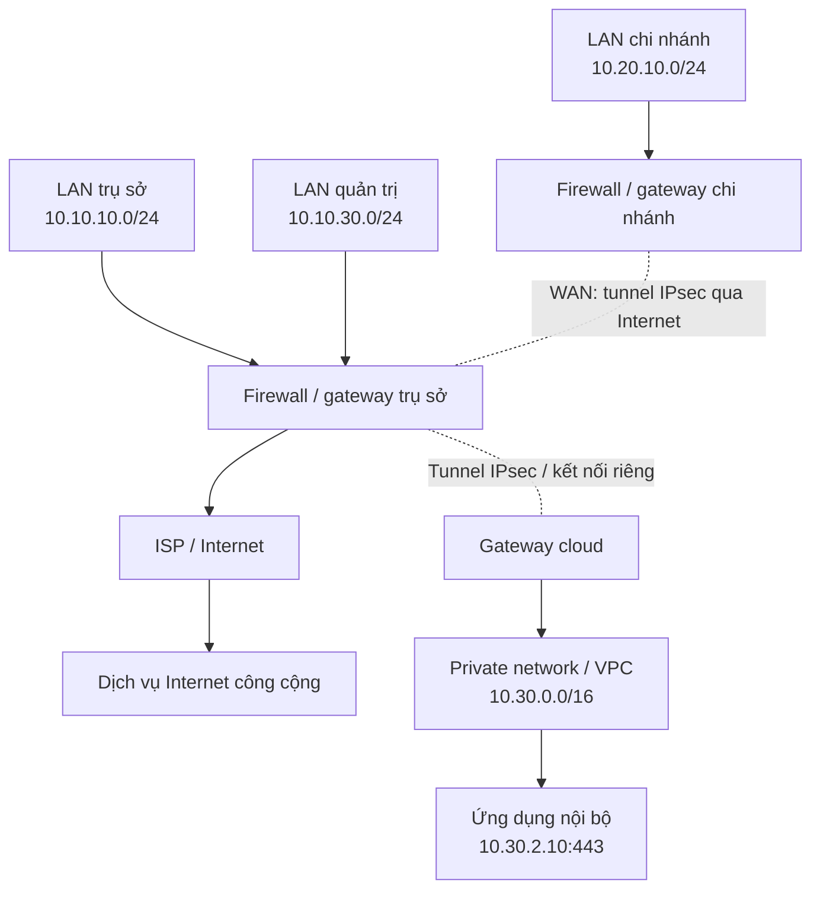

# LAN, WAN, internet và private network

> **Chương:** Mô hình mạng
>
> **Phạm vi:** SECURITY_NETWORK_SECURITY — học cách nhận diện các kiểu mạng, theo dõi đường đi của lưu lượng và lựa chọn biện pháp bảo vệ phù hợp tại từng ranh giới tin cậy.

## Mục tiêu học tập

Sau bài học, bạn có thể:

1. Phân biệt **LAN**, **WAN**, **Internet** và **private network** theo phạm vi kết nối, quyền quản trị và khả năng truy cập; giải thích vì sao các khái niệm này có thể chồng lấp.
2. Mô tả đường đi của gói tin trong cùng mạng con, giữa các VLAN, qua WAN và ra Internet; xác định vai trò của switch, router, gateway, firewall, DNS và NAT.
3. Nhận biết địa chỉ IPv4 riêng, IPv4 công cộng và địa chỉ IPv6 nội bộ; không đồng nhất địa chỉ riêng với tính bảo mật.
4. Thiết kế một kiến trúc cơ bản nối trụ sở, chi nhánh và mạng đám mây, có phân đoạn, chính sách truy cập, VPN và điểm giám sát.
5. Sử dụng các lệnh quan sát mạng để khoanh vùng lỗi kết nối mà vẫn phân biệt được lỗi định tuyến, phân giải tên và chặn lưu lượng bởi chính sách an ninh.

## 1. Bốn khái niệm nhìn từ những góc độ khác nhau

**LAN (Local Area Network)** là mạng cục bộ, thường kết nối thiết bị trong một căn hộ, văn phòng, trường học hoặc khuôn viên có phạm vi quản lý tương đối tập trung. **WAN (Wide Area Network)** kết nối các mạng hoặc điểm ở khoảng cách địa lý lớn, chẳng hạn trụ sở với các chi nhánh. **Internet** là hệ thống toàn cầu gồm nhiều mạng tự trị liên kết và trao đổi lưu lượng với nhau. **Private network** là mạng có phạm vi truy cập được kiểm soát bởi một tổ chức hoặc chủ sở hữu, thường dùng địa chỉ không được định tuyến trực tiếp trên Internet công cộng.

Ba khái niệm đầu chủ yếu nói về **phạm vi và cách kết nối**; khái niệm cuối nói nhiều hơn về **quyền truy cập và ranh giới quản trị**. Một LAN có thể là mạng riêng; nhiều LAN riêng có thể kết nối qua một WAN; một WAN có thể sử dụng Internet làm đường truyền bên dưới; một private network có thể trải dài qua nhiều địa điểm hoặc tồn tại trong đám mây.

| Khái niệm | Câu hỏi được trả lời | Ví dụ | Điều cần nhớ về bảo mật |
| --- | --- | --- | --- |
| **LAN** | Thiết bị kết nối cục bộ như thế nào? | Máy tính, máy in và AP cùng mạng văn phòng | Người cùng LAN chưa chắc được phép truy cập mọi thiết bị; cần phân đoạn và kiểm soát truy cập nội bộ. |
| **WAN** | Kết nối các địa điểm/mạng xa nhau bằng cách nào? | Trụ sở nối chi nhánh qua leased line, MPLS hoặc VPN | Phải kiểm tra mức mã hóa, xác thực hai đầu, định tuyến và mức tin cậy của nhà cung cấp. |
| **Internet** | Mạng của mình trao đổi với các mạng khác trên toàn cầu ra sao? | Người dùng truy cập website công cộng | Cần bảo vệ biên mạng, DNS, kết nối ứng dụng và các dịch vụ phơi lộ ra ngoài. |
| **Private network** | Ai có thể đến được các tài nguyên nội bộ? | Mạng 10.20.0.0/16 của doanh nghiệp; VPC trên cloud | Chỉ có IP riêng hoặc mạng riêng không tự tạo ra sự an toàn; vẫn cần chính sách và giám sát. |

**Ví dụ ngắn:** Một laptop tại Hà Nội kết nối Wi-Fi của văn phòng (LAN), truy cập cơ sở dữ liệu tại TP. Hồ Chí Minh qua đường nối hai chi nhánh (WAN), đồng thời mở một trang web công cộng trên Internet. Cơ sở dữ liệu có thể đặt trong private network và chỉ được phép truy cập qua VPN từ những nhóm máy đã được cấp quyền.

## 2. Các thành phần và đường đi cơ bản của gói tin

Để hiểu LAN, WAN và Internet, cần phân biệt vài chức năng nền tảng:

| Thành phần | Vai trò điển hình | Góc nhìn an ninh |
| --- | --- | --- |
| **Switch lớp 2** | Chuyển tiếp frame Ethernet theo địa chỉ MAC trong cùng miền lớp 2/VLAN. | Giới hạn cổng, chống thiết bị giả mạo và phân đoạn VLAN; cần cơ chế chống vòng lặp. |
| **Access Point (AP)** | Nối thiết bị Wi-Fi vào mạng cục bộ. | WPA2/WPA3-Enterprise, 802.1X và tách mạng khách với mạng nhân viên. |
| **Router / gateway lớp 3** | Chuyển gói IP giữa các mạng con theo bảng định tuyến. | Có thể kiểm soát tuyến, chống giả mạo nguồn và áp ACL hoặc chuyển lưu lượng qua firewall. |
| **Firewall** | Quyết định cho phép/chặn luồng dựa trên chính sách; thường theo dõi trạng thái phiên. | Bảo vệ ranh giới giữa các vùng như users, servers, DMZ, Internet và cloud. |
| **DNS resolver** | Chuyển tên miền thành các bản ghi như A/AAAA. | Có thể lọc miền nguy hiểm và ghi nhận truy vấn bất thường; DNS không thay thế kiểm tra chứng chỉ TLS. |
| **NAT** | Ánh xạ địa chỉ và/hoặc cổng, thường để máy IPv4 riêng ra Internet. | Giúp chia sẻ IPv4 công cộng, nhưng **không thay thế firewall** hoặc việc cấp quyền. |

### 2.1. Trong cùng một subnet

Giả sử máy A có địa chỉ `192.168.10.20/24`, máy B là `192.168.10.55/24`, gateway là `192.168.10.1`. Khi A gửi gói tới B, A xác định B thuộc cùng mạng `192.168.10.0/24`, tìm MAC của B bằng ARP (trên IPv4), rồi gửi frame qua switch. **Lưu lượng này không bắt buộc đi qua default gateway**; nếu muốn áp chính sách giữa A và B, cần kiểm soát ngay trong LAN, trên thiết bị đầu cuối hoặc qua kiến trúc buộc lưu lượng đi qua điểm thực thi chính sách.

### 2.2. Khác subnet

Nếu A cần truy cập `192.168.20.40/24`, đích nằm ngoài subnet của A. Máy gửi gói cho next hop, thường là default gateway `192.168.10.1`. Router hoặc firewall định tuyến tới mạng đích, có thể áp chính sách giữa các VLAN và tiếp tục chuyển tiếp. Trước khi có thể kết nối thành công, phải có cả **đường đi chiều đi, đường quay về và chính sách cho phép**.

```text
Máy A (192.168.10.20/24)
        │  Ethernet / Wi-Fi
        ▼
Switch / AP — VLAN USERS (192.168.10.0/24)
        │
        ▼
Gateway / Firewall (192.168.10.1)
        ├── VLAN SERVERS (192.168.20.0/24)
        └── ISP / WAN / Internet
```

Trên IPv6, cơ chế tương ứng để tìm hàng xóm sử dụng **Neighbor Discovery (NDP)** thay vì ARP; nguyên tắc xét prefix đích và chọn next hop vẫn tương tự. Router không chuyển tiếp broadcast lớp 2 thông thường giữa các subnet.

## 3. LAN: gần về địa lý, nhưng không đồng nghĩa cùng mức tin cậy

LAN thường dựa trên Ethernet có dây và Wi-Fi. Switch chuyển tiếp frame trong miền lớp 2, còn router hoặc switch lớp 3 giúp kết nối các subnet. Trong mạng nhỏ, tất cả thiết bị có thể cùng một subnet; trong doanh nghiệp, cách này làm tăng phạm vi ảnh hưởng của sự cố và tạo điều kiện cho thiết bị bị xâm nhập tiếp cận các thiết bị khác.

### VLAN và phân đoạn

**VLAN (Virtual LAN)** chia một hạ tầng switch vật lý thành nhiều miền lớp 2 logic. Mỗi VLAN thường dùng một subnet riêng; việc liên lạc giữa chúng cần định tuyến lớp 3. Ví dụ:

| Vùng | VLAN | Subnet minh họa | Nguyên tắc truy cập |
| --- | ---: | --- | --- |
| Nhân viên | 10 | `192.168.10.0/24` | Truy cập Internet và các dịch vụ nghiệp vụ được phê duyệt. |
| Máy chủ ứng dụng | 20 | `192.168.20.0/24` | Chỉ nhận kết nối tới cổng ứng dụng cần thiết. |
| Thiết bị quản trị | 30 | `192.168.30.0/24` | Chỉ thiết bị/tài khoản quản trị được phép kết nối. |
| Khách Wi-Fi | 40 | `192.168.40.0/24` | Chỉ ra Internet; chặn đi tới các subnet nội bộ. |

VLAN tạo đường ranh giới lớp 2; **VLAN riêng không tự đảm bảo phân quyền**. Cần ACL, firewall hoặc kiểm soát trên endpoint để quyết định luồng nào được phép đi qua ranh giới lớp 3. Đối với ứng dụng nhạy cảm, có thể áp dụng *microsegmentation* để hạn chế cả luồng giữa máy chủ trong cùng một vùng.

### Các rủi ro đáng chú ý trong LAN

- **ARP spoofing/poisoning:** thiết bị giả mạo bản ghi ánh xạ IP–MAC nhằm chặn hoặc chuyển hướng lưu lượng IPv4. Các switch hỗ trợ *DHCP snooping* và *Dynamic ARP Inspection* có thể giúp giảm rủi ro khi triển khai đúng.
- **Thiết bị lạ và truy cập Wi-Fi không được kiểm soát:** sử dụng 802.1X/NAC để kiểm tra danh tính thiết bị hoặc người dùng; tạo SSID/VLAN khách riêng, đặt chính sách chặn truy cập nội bộ.
- **Di chuyển ngang (lateral movement):** một máy nhân viên nhiễm mã độc thử kết nối SMB/RDP/SSH tới máy khác. Phân đoạn, nguyên tắc quyền tối thiểu, firewall máy trạm và giám sát lưu lượng nội bộ giúp thu hẹp phạm vi tấn công.
- **Cấu hình lớp 2 sai:** trunk cho phép quá nhiều VLAN, cổng truy cập bị cấu hình nhầm, vòng lặp chuyển mạch. Cần giới hạn VLAN trên trunk, bảo vệ các cổng biên và dùng cơ chế chống vòng lặp như STP theo thiết kế.

## 4. WAN: nối các mạng ở xa

WAN không phải một công nghệ duy nhất. Đây là cách gọi phạm vi kết nối các địa điểm hoặc hệ thống ở xa nhau. Một doanh nghiệp có thể dùng nhiều loại WAN song song để cân bằng chi phí, độ trễ, độ tin cậy và an ninh:

| Công nghệ/kiểu kết nối | Cách hoạt động | Cân nhắc bảo mật |
| --- | --- | --- |
| **Leased line / kết nối thuê riêng** | Nhà mạng cung cấp đường nối giữa các điểm. | Hạn chế chia sẻ hạ tầng logic nhưng không mặc nhiên đảm bảo mã hóa đầu cuối. |
| **MPLS VPN của nhà mạng** | Nhà mạng chuyển lưu lượng qua hạ tầng MPLS và cô lập định tuyến theo dịch vụ. | Tách biệt logic; **MPLS không mặc định mã hóa dữ liệu**. |
| **Site-to-site VPN qua Internet** | Gateway hai địa điểm tạo đường hầm, thường dùng IPsec. | Kiểm tra xác thực peer, thuật toán mã hóa, quản lý khóa, subnet được phép và tính sẵn sàng. |
| **SD-WAN** | Điều phối lưu lượng trên nhiều đường như Internet, MPLS, 4G/5G theo chính sách. | Khả năng mã hóa khác nhau tùy sản phẩm/cấu hình; bảo vệ mặt quản trị và kiểm soát tập trung. |

Điểm khác biệt quan trọng là **underlay** và **overlay**. Underlay là đường truyền/IP network thực sự vận chuyển gói; overlay là kết nối logic được dựng bên trên. Ví dụ Internet có thể làm underlay cho tunnel IPsec site-to-site; ứng dụng nhìn thấy kết nối giữa hai subnet riêng như một đường WAN logic. VPN bảo vệ dữ liệu trên đoạn tunnel nếu cấu hình đúng, nhưng không tự chứng minh rằng mọi máy bên trong tunnel đều đáng tin.

### Định tuyến và khả năng truy cập xuyên địa điểm

Giả sử trụ sở dùng `10.10.0.0/16`, chi nhánh dùng `10.20.0.0/16`. Để máy ở chi nhánh truy cập dịch vụ nội bộ trụ sở, gateway cần có tuyến tới mạng xa qua kết nối WAN; phía trụ sở cũng cần tuyến trả về mạng chi nhánh. Firewall phải cho phép đúng nguồn, đích, cổng và mục đích nghiệp vụ. Với nhiều địa điểm, dùng giao thức định tuyến động có thể thuận tiện hơn cấu hình từng static route, nhưng phải kiểm soát nguồn quảng bá tuyến và tránh phát tán prefix không cần thiết.

Các subnet **trùng hoặc chồng lấp địa chỉ** khiến định tuyến và VPN phức tạp. Nên lập kế hoạch IP không trùng nhau trước khi nối mạng chi nhánh với trụ sở hoặc cloud. Sự cố WAN có thể do mất đường truyền, tunnel lỗi, MTU không phù hợp, định tuyến bất đối xứng, DNS hoặc chính sách firewall; kiểm tra từng lớp sẽ nhanh hơn suy đoán rằng “Internet bị lỗi”.

## 5. Internet: liên mạng toàn cầu

Internet kết nối các mạng do nhiều tổ chức quản lý. Nhà cung cấp dịch vụ Internet (ISP) cung cấp đường ra; các hệ thống tự trị (Autonomous System — AS) trao đổi khả năng tiếp cận các prefix, thường qua **BGP**. Định tuyến Internet xác định hướng đi giữa các mạng, không bảo đảm rằng mọi gói luôn qua cùng một tuyến.

Một người mở `https://example.com` từ văn phòng thường trải qua chuỗi bước sau:

1. Thiết bị dùng resolver để tìm địa chỉ IP phù hợp cho tên miền (nếu chưa có thông tin trong cache).
2. Thiết bị gửi gói đến gateway nếu IP đích không nằm trong subnet trực tiếp.
3. Firewall kiểm tra chính sách; với IPv4 riêng, thiết bị biên thường thực hiện source NAT/PAT sang địa chỉ công cộng.
4. Lưu lượng đi qua ISP và các mạng trung gian tới hạ tầng của dịch vụ đích.
5. Trình duyệt thiết lập HTTPS/TLS và kiểm tra chứng chỉ máy chủ để xác thực dịch vụ và mã hóa nội dung trao đổi.

**DNS, BGP, NAT, TLS và firewall giải quyết các bài toán khác nhau.** DNS tìm tên; BGP trao đổi đường đi giữa AS; NAT ánh xạ địa chỉ/cổng; TLS bảo vệ phiên ứng dụng; firewall quyết định chính sách truy cập. Một đường mạng đến được địa chỉ IP không đảm bảo phân giải tên đúng, dịch vụ đang chạy hoặc xác thực TLS thành công.

### Bảo vệ kết nối Internet

- **Giảm bề mặt tấn công:** chỉ công bố các dịch vụ thật sự cần bên ngoài; đặt dịch vụ công cộng trong vùng được kiểm soát như DMZ hoặc qua reverse proxy/WAF khi phù hợp.
- **Egress filtering:** giới hạn lưu lượng đi ra ngoài theo vai trò máy, ứng dụng và cổng; ngăn máy nội bộ tự do dùng các giao thức không cần thiết.
- **DNS security:** dùng resolver đáng tin cậy, giám sát tên miền bất thường và chống thay đổi cấu hình DNS trái phép. DNS có thể được mã hóa khi phù hợp, nhưng bản thân DNS được mã hóa không bảo đảm tên miền đích an toàn.
- **Bảo vệ ứng dụng:** HTTPS/TLS với kiểm tra chứng chỉ, cập nhật phần mềm, xác thực mạnh, hạn chế tài khoản đặc quyền và quản lý khóa/bí mật.
- **Quan sát và phản ứng:** tổng hợp log firewall, DNS, proxy, NetFlow/IPFIX và cảnh báo IDS/IPS. Log và phát hiện cần đi cùng quy trình kiểm tra, phản ứng sự cố.

## 6. Private network: phạm vi truy cập được kiểm soát

Trong thực tế, “private network” thường mô tả các subnet nội bộ không được định tuyến công khai, được cấp quyền qua hệ thống của doanh nghiệp, trung tâm dữ liệu hoặc nền tảng cloud. Một mạng riêng có thể nằm trọn trong LAN, kết nối qua WAN hoặc là mạng ảo (VPC/VNet) trong cloud.

### 6.1. Địa chỉ IP riêng khác gì IP công cộng?

RFC 1918 dành ba dải IPv4 cho sử dụng riêng:

| Dải IPv4 riêng | CIDR | Dung lượng lý thuyết |
| --- | --- | ---: |
| `10.0.0.0` đến `10.255.255.255` | `10.0.0.0/8` | 16.777.216 địa chỉ |
| `172.16.0.0` đến `172.31.255.255` | `172.16.0.0/12` | 1.048.576 địa chỉ |
| `192.168.0.0` đến `192.168.255.255` | `192.168.0.0/16` | 65.536 địa chỉ |

Các dải trên **không được quảng bá như tuyến Internet công cộng thông thường**; nhiều tổ chức được phép dùng trùng địa chỉ riêng ở các mạng độc lập. `172.20.1.5` là địa chỉ riêng, nhưng `172.32.1.5` **không** nằm trong RFC 1918. Các địa chỉ như `127.0.0.1` (loopback) và `169.254.0.0/16` (link-local) thuộc những mục đích đặc biệt khác, không phải dải RFC 1918.

IPv6 có **Unique Local Address (ULA)** thuộc `fc00::/7`; trong triển khai hiện nay các địa chỉ ULA tạo cục bộ phổ biến nằm trong `fd00::/8`. IPv6 cũng có địa chỉ *link-local* `fe80::/10` chỉ có ý nghĩa trên liên kết tương ứng. Với IPv6, không nên mặc định phải có NAT mới an toàn: có thể dùng địa chỉ global và firewall mặc định chặn kết nối đến không được cấp phép.

Lưu ý rằng **IP riêng không đồng nghĩa “đã an toàn”**. Malware trên máy nội bộ, tài khoản VPN bị lộ hoặc chính sách giữa các subnet quá rộng vẫn có thể dẫn tới truy cập trái phép. Ngược lại, một server có IP công cộng vẫn có thể được bảo vệ chặt bằng firewall, xác thực và thiết kế ứng dụng an toàn.

### 6.2. Private network trong cloud

VPC/VNet là mạng logic do khách hàng định nghĩa trong hạ tầng của nhà cung cấp cloud, gồm subnet, bảng định tuyến và các lớp kiểm soát lưu lượng. Subnet “private” thường được hiểu là không có đường nhận kết nối trực tiếp từ Internet tới workload qua cấu hình hiện tại; cách xác định chính xác phụ thuộc route table, public IP, internet gateway, NAT gateway, load balancer và chính sách an ninh của nền tảng.

Ví dụ máy chủ ứng dụng trong subnet riêng có thể gọi API ra Internet qua NAT gateway, nhưng không vì thế mà được truy cập trực tiếp từ Internet. Truy cập quản trị nên thông qua giải pháp được cấp quyền như bastion, VPN hoặc kênh quản trị định danh, có ghi log. Khi kết nối cloud về on-premises, thường dùng site-to-site VPN hoặc kết nối riêng; cần tránh trùng CIDR và áp chính sách ở cả hai phía.

### 6.3. VPN có làm một mạng trở thành private network không?

**VPN (Virtual Private Network)** tạo kết nối logic được bảo vệ giữa các đầu cuối hoặc mạng, thường qua hạ tầng không đáng tin cậy. Hai kiểu phổ biến:

- **Remote-access VPN:** máy người dùng kết nối vào tài nguyên doanh nghiệp. Cần xác thực mạnh (nên có MFA), kiểm tra tình trạng thiết bị và cấp quyền theo nhóm/ứng dụng.
- **Site-to-site VPN:** kết nối gateway của các mạng, ví dụ trụ sở và chi nhánh. Cần giới hạn subnet được quảng bá và các luồng được phép giữa hai bên.

VPN là **một cơ chế kết nối**, còn private network là **một mô hình phạm vi truy cập**. VPN không thay thế việc phân đoạn, xác thực ứng dụng hoặc giám sát. Với *split tunneling*, một phần lưu lượng đi qua tunnel, phần còn lại có thể đi trực tiếp ra Internet; phải hiểu rõ thiết kế để áp chính sách và thu thập log đúng vị trí.

## 7. Bức tranh kiến trúc: trụ sở, chi nhánh, cloud và Internet

Xét doanh nghiệp có trụ sở, một chi nhánh và một hệ thống ứng dụng trong cloud. Các dải dưới đây chỉ là **giả định phục vụ bài học**, không phải cấu hình của hệ thống đang hoạt động:

| Khu vực | Địa chỉ ví dụ | Chức năng |
| --- | --- | --- |
| Trụ sở — nhân viên | `10.10.10.0/24` | Máy trạm, thiết bị người dùng |
| Trụ sở — quản trị | `10.10.30.0/24` | Trạm quản trị được cấp quyền |
| Chi nhánh — nhân viên | `10.20.10.0/24` | Máy trạm chi nhánh |
| Cloud VPC | `10.30.0.0/16` | Các subnet ứng dụng và dữ liệu |
| Máy chủ ứng dụng trên cloud | `10.30.2.10` | Dịch vụ HTTPS nội bộ trên TCP/443 |



Sơ đồ minh họa **kết nối logic**. Các đường tunnel nét đứt có thể chạy trên chính Internet, dù sơ đồ không vẽ lại từng router của ISP. VPC có thể có nhiều subnet, route table và security group thay vì một mạng phẳng. Luồng truy cập cần được phê duyệt theo nghiệp vụ, chẳng hạn:

| Luồng | Hành động | Lý do |
| --- | --- | --- |
| Chi nhánh `10.20.10.0/24` → ứng dụng `10.30.2.10:443` | Cho phép có điều kiện | Nhân viên chi nhánh dùng ứng dụng HTTPS đã được cấp quyền. |
| Wi-Fi khách → `10.10.0.0/16`, `10.20.0.0/16`, `10.30.0.0/16` | Chặn | Khách không có nhu cầu truy cập mạng nội bộ. |
| Máy trạm thường → dịch vụ quản trị máy chủ (SSH/RDP) | Mặc định chặn | Giảm di chuyển ngang và truy cập đặc quyền trái phép. |
| Trạm quản trị được xác thực → dịch vụ quản trị được phê duyệt | Chỉ cho phép địa chỉ/cổng/đích cần thiết | Áp nguyên tắc quyền tối thiểu và ghi log. |

Một chính sách minh họa độc lập nhà cung cấp có thể được biểu diễn bằng dữ liệu giả như sau (đây là **pseudocode**, không phải cú pháp để nạp trực tiếp vào firewall):

```yaml
rules:
  - name: branch-to-internal-app
    source: 10.20.10.0/24
    destination: 10.30.2.10/32
    protocol: tcp
    port: 443
    action: allow
    log: true
  - name: deny-other-branch-to-cloud
    source: 10.20.10.0/24
    destination: 10.30.0.0/16
    action: deny
    log: true
```

Trên firewall stateful, lưu lượng phản hồi của phiên đã được cho phép thường được xử lý theo trạng thái phiên; không nên hiểu pseudocode trên là một cấu hình đầy đủ cho mọi chiều lưu lượng. Trên cloud, chính sách ở security group, network ACL và thiết bị bảo vệ biên có thể kết hợp với nhau; cần kiểm tra thứ tự và ngữ nghĩa thực tế của từng nhà cung cấp.

### Phân tích một yêu cầu truy cập ứng dụng

Giả sử máy tại chi nhánh `10.20.10.25` muốn truy cập `10.30.2.10:443`:

1. Máy chi nhánh xác định đích nằm ngoài subnet của mình và gửi gói tới default gateway.
2. Gateway chi nhánh tìm tuyến `10.30.0.0/16` qua tunnel/WAN tương ứng và kiểm tra chính sách truy cập.
3. Nếu đi qua Internet bằng IPsec, gói bên trong được bảo vệ trong tunnel giữa các gateway; router trung gian chủ yếu vận chuyển gói ngoài của tunnel.
4. Gateway phía cloud nhận và xử lý tunnel, kiểm tra tuyến và chính sách rồi chuyển tiếp đến ứng dụng `10.30.2.10`.
5. Ứng dụng phản hồi qua đường về phù hợp; phía truy cập còn phải vượt qua xác thực và phân quyền ở **tầng ứng dụng**. Chỉ mở TCP/443 không có nghĩa mọi người dùng đều được đọc dữ liệu.

Phân tích mối đe dọa cho luồng này cần đặt câu hỏi: Ai kiểm soát máy khách? Ai xác thực kết nối VPN? Có cho phép chi nhánh truy cập toàn VPC không? Nếu tài khoản chi nhánh bị lộ, attacker có thể quét những subnet nào? Log nào giúp phân biệt lỗi hợp lệ với hành vi xâm nhập?

## 8. Quan sát và xử lý sự cố: lần theo từng lớp

Khi ứng dụng không truy cập được, nên kiểm tra từ thiết bị, địa chỉ và route đến DNS, kết nối TCP/TLS và chính sách. Các ví dụ dưới đây chỉ dùng để **quan sát trên máy được phép quản trị**, không phải quét hay thay đổi hệ thống khác.

| Cần kiểm tra | Windows | Linux/macOS (tùy hệ điều hành) | Cách diễn giải |
| --- | --- | --- | --- |
| IP, subnet, gateway, DNS | `ipconfig /all` | `ip addr`, `ip route`; macOS: `ifconfig`, `netstat -rn` | Sai IP/mask/default gateway có thể khiến máy không ra ngoài subnet. |
| Bảng định tuyến | `route print` | `ip route`; macOS: `netstat -rn` | Xem mạng đích sẽ đi qua interface/next hop nào. |
| Phân giải tên | `nslookup example.com` | `dig example.com` (nếu đã cài), `nslookup example.com` | DNS sai không đồng nghĩa đường IP bị mất. |
| Khả năng đến một đích | `ping <IP>` | `ping <IP>` | Ping thất bại có thể do ICMP bị chặn, chưa đủ kết luận dịch vụ không truy cập được. |
| Các hop quan sát được | `tracert <IP>` | `traceroute <IP>` (nếu có) | Một số hop không trả lời probe; không có nghĩa đường truyền dừng tại đó. |
| Kết nối TCP dịch vụ | `Test-NetConnection <host> -Port 443` (PowerShell) | `curl -v https://<host>` | Thất bại có thể do route, firewall, TCP, TLS hoặc dịch vụ; đọc kỹ lỗi để phân loại. |

**Lưu ý thực hành:** Thay `<IP>` và `<host>` bằng đích thuộc môi trường lab hoặc hệ thống được phép kiểm tra. `tracert`/`traceroute` không phải bản đồ tuyệt đối của tuyến, vì router có thể không trả lời, thay đổi đường đi hoặc giới hạn tốc độ phản hồi.

Quy trình khoanh vùng một lỗi thường có dạng:

```text
Có IP đúng và link/Wi-Fi hoạt động?
  ├─ Không → kiểm tra DHCP, kết nối vật lý, AP, VLAN
  └─ Có → Có route đến subnet/đích?
          ├─ Không → kiểm tra gateway, bảng định tuyến, tunnel/WAN
          └─ Có → DNS có phân giải đúng (nếu dùng tên)?
                  ├─ Không → resolver, bản ghi, chính sách DNS
                  └─ Có → TCP/TLS/ứng dụng có hoạt động?
                          ├─ Không → firewall, service, certificate, log
                          └─ Có → kiểm tra quyền ứng dụng và chất lượng đường truyền
```

Ở hệ thống doanh nghiệp, log firewall cho biết luồng bị chặn hay được chấp nhận, flow log/NetFlow/IPFIX chỉ ra nguồn–đích–cổng và khối lượng lưu lượng, còn IDS/IPS giúp phát hiện một số dấu hiệu tấn công. **IDS** thường tập trung cảnh báo; **IPS** có thể chặn lưu lượng tùy triển khai. Khả năng nhìn thấy lưu lượng phụ thuộc vị trí cảm biến, kỹ thuật thu thập và mức mã hóa; một cảm biến trên đường ra Internet có thể không thấy toàn bộ luồng giữa các máy cùng VLAN.

## 9. Các nhầm lẫn thường gặp

| Nhầm lẫn | Cách hiểu đúng |
| --- | --- |
| “WAN chính là Internet.” | WAN là phạm vi kết nối rộng. Nó có thể chạy trên đường thuê riêng, MPLS, Internet hoặc nhiều loại đường cùng lúc. |
| “Máy ở cùng LAN có thể tự do giao tiếp.” | VLAN, host firewall, ACL và các biện pháp phân đoạn có thể giới hạn quyền truy cập ngay trong LAN. |
| “Có địa chỉ 192.168.x.x thì được bảo mật.” | Địa chỉ riêng chỉ nói về cách đánh địa chỉ/định tuyến công cộng, không xác thực người dùng và không chặn kẻ tấn công bên trong mạng. |
| “Có NAT là có firewall.” | NAT ánh xạ địa chỉ/cổng; chính sách cho phép/chặn cần được thiết kế và xác minh riêng. |
| “MPLS VPN luôn mã hóa lưu lượng.” | Dịch vụ MPLS VPN thường cô lập lưu lượng logic, không tự động cung cấp mã hóa đầu cuối. |
| “VPN mở cho cả subnet nghĩa là mọi truy cập đều an toàn.” | VPN bảo vệ đường truyền/định danh peer tùy cấu hình; vẫn cần phân quyền ứng dụng, phân đoạn, kiểm tra thiết bị và giám sát. |
| “Ping thất bại thì kết nối mạng chắc chắn hỏng.” | ICMP có thể bị chặn hoặc giới hạn; cần xác minh bằng route, DNS, TCP/TLS và log. |
| “Mạng riêng trên cloud không thể kết nối ra Internet.” | Workload có thể có lối ra Internet qua NAT/proxy/gateway tùy route và chính sách, dù không nhận kết nối trực tiếp từ ngoài. |

## 10. Bài tập tự kiểm tra và lời giải

**Bối cảnh:** Mạng văn phòng có VLAN 10 (`192.168.10.0/24`) cho nhân viên, VLAN 20 (`192.168.20.0/24`) cho máy chủ và VLAN 40 (`192.168.40.0/24`) cho khách. Gateway các VLAN chạy trên firewall; văn phòng nối VPC `10.30.0.0/16` qua site-to-site VPN. Máy khách `192.168.40.50` không được truy cập nội bộ, còn máy nhân viên `192.168.10.25` cần truy cập `10.30.2.10:443`.

**Câu 1.** `192.168.10.25` gửi tới `192.168.10.60`. Có bắt buộc phải qua default gateway không?

**Trả lời:** Không, nếu cả hai ở cùng subnet và hoạt động lớp 2 bình thường; máy có thể liên lạc trực tiếp trong VLAN 10. Muốn kiểm soát luồng này phải có cơ chế bảo vệ nội bộ phù hợp.

**Câu 2.** Khách Wi-Fi `192.168.40.50` thử kết nối `192.168.20.10:443`. Điểm đặt chính sách hợp lý nằm ở đâu?

**Trả lời:** Ở điểm định tuyến hoặc firewall giữa VLAN 40 và VLAN 20, kết hợp chính sách mặc định chặn mạng khách tới các subnet nội bộ. Cũng có thể bổ sung host firewall trên máy chủ.

**Câu 3.** Máy nhân viên không tới được ứng dụng trong VPC dù tunnel VPN đang “up”. Cần kiểm tra những gì?

**Trả lời:** Kiểm tra route chiều đi và về, subnet được đưa qua tunnel, sự trùng CIDR, chính sách firewall/security group/network ACL, DNS nếu truy cập bằng tên, kết nối TCP/443 và log ứng dụng. Trạng thái tunnel chỉ cho biết một phần của kết nối.

**Câu 4.** Vì sao không nên cho toàn bộ subnet khách truy cập VPC dù hai mạng đều dùng IP riêng?

**Trả lời:** Việc dùng IP riêng không cung cấp xác thực hay phân quyền. Cần giới hạn luồng theo vai trò, đích và mục đích nghiệp vụ; mạng khách là vùng có mức tin cậy thấp.

## 11. Nguyên tắc thiết kế cần ghi nhớ

Khi thiết kế mạng an toàn, hãy bắt đầu bằng **bản đồ tài sản và luồng nghiệp vụ**: thiết bị nào nói chuyện với dịch vụ nào, trên cổng nào, ai quản lý và đường đi nằm trong LAN, qua WAN hay ra Internet. Sau đó chia vùng tin cậy, chọn địa chỉ không trùng lặp, đặt điểm thực thi chính sách, xác thực kết nối và chỉ mở những luồng được chứng minh cần thiết. Bảo vệ cả lưu lượng **north–south** (ra/vào mạng) và **east–west** (giữa các workload/vùng nội bộ).

Đối với WAN hoặc VPN, xác định rõ đường truyền, mã hóa, danh tính peer, tuyến dự phòng và giới hạn quyền truy cập. Đối với Internet, kiểm soát dịch vụ công khai, egress, DNS và TLS. Đối với LAN và private network, ưu tiên phân đoạn, xác thực thiết bị/người dùng, firewall nội bộ và khả năng quan sát để phát hiện di chuyển ngang. Thử nghiệm kết nối hợp lệ **và** các kết nối phải bị chặn, đồng thời kiểm tra log để bảo đảm chính sách đang hoạt động như thiết kế.

**Điểm cốt lõi:** LAN, WAN và Internet mô tả cách các mạng kết nối; private network mô tả phạm vi truy cập được kiểm soát. Bảo mật mạng xuất hiện từ việc xác định ranh giới tin cậy, cấp quyền đúng mức, bảo vệ dữ liệu trên đường truyền và liên tục quan sát lưu lượng — không đến từ tên gọi của mạng hoặc việc dùng địa chỉ IP riêng.
