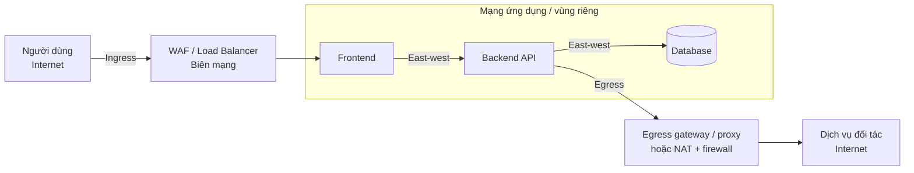

# Ingress, egress và east-west traffic

Trong một hệ thống có nhiều vùng mạng, **luồng đi vào**, **luồng đi ra** và **luồng trao đổi giữa các thành phần nội bộ** có đặc điểm bảo mật khác nhau. Ba khái niệm *ingress*, *egress* và *east-west traffic* giúp mô tả những luồng đó, lựa chọn vị trí kiểm soát và phát hiện hành vi bất thường. Đây là nền tảng để thiết kế phân đoạn mạng, firewall, VPN, IDS/IPS, kiểm soát kết nối và kiến trúc mạng an toàn trong hạ tầng doanh nghiệp, trung tâm dữ liệu, Kubernetes và cloud.

Sau bài học, bạn có thể:

- Phân loại lưu lượng dựa trên **ranh giới đang xét** và chiều khởi tạo kết nối.
- Xác định các điểm thực thi chính sách cho ingress, egress và east-west traffic.
- Đọc sơ đồ giao tiếp dịch vụ, đề xuất quy tắc cho phép/từ chối và hiểu giới hạn của từng lớp kiểm soát.
- Sử dụng dữ liệu luồng, log và dấu hiệu kết nối để phân tích mối đe dọa như xâm nhập, di chuyển ngang và rò rỉ dữ liệu.

## 1. Ba khái niệm và một nguyên tắc cốt lõi

**Ingress traffic** là lưu lượng **đi vào** một đối tượng hoặc vùng mạng đang xét, chẳng hạn từ Internet tới ứng dụng công khai hoặc từ một subnet khác tới máy chủ. Ở biên Internet, ingress thường thuộc nhóm luồng *north-south*.

**Egress traffic** là lưu lượng **đi ra** khỏi đối tượng hoặc vùng mạng đang xét, chẳng hạn ứng dụng gọi API của đối tác, máy chủ tải bản vá hoặc workload gửi truy vấn tới DNS resolver nằm bên ngoài vùng mạng đó. Ở biên Internet, egress cũng thường thuộc nhóm *north-south*.

**East-west traffic** là lưu lượng **giữa các máy chủ, dịch vụ hoặc vùng nội bộ** trong cùng môi trường vận hành: frontend gọi backend, backend truy vấn database, service liên lạc service, hoặc các hệ thống trao đổi qua mạng riêng giữa các cụm/hạ tầng. Luồng này có thể đi qua nhiều subnet, VLAN, VPC hay cluster; “nội bộ” không có nghĩa là an toàn mặc định.

> **Nguyên tắc:** ingress và egress luôn được xác định **tương đối với một ranh giới** (pod, máy chủ, subnet, VPC, mạng doanh nghiệp, vùng tin cậy...). Một gói tin có thể là egress đối với workload nguồn và ingress đối với workload đích, đồng thời được xem là east-west khi xét kiến trúc tổng thể.

Ví dụ, dịch vụ A trong subnet ứng dụng kết nối tới cơ sở dữ liệu B trong subnet dữ liệu: đây là **egress của A**, **ingress của B** và **east-west giữa hai subnet nội bộ**. Không nên gán một nhãn duy nhất cho toàn bộ hành trình mà bỏ qua ranh giới áp dụng chính sách.

### Bảng nhận diện nhanh

| Luồng giao tiếp | Khi xét ranh giới nào? | Cách gọi phù hợp | Điểm cần bảo vệ |
|---|---|---|---|
| Người dùng Internet → cổng API công khai | Biên hệ thống | Ingress / north-south | Dịch vụ công khai, xác thực, WAF, giới hạn truy cập |
| Backend → API thanh toán bên ngoài | Biên hệ thống | Egress / north-south | Đích được phép, thông tin gửi ra, DNS, proxy |
| Frontend → backend | Giữa các dịch vụ nội bộ | East-west | Danh tính dịch vụ, cổng đích, phân đoạn |
| Backend → database nội bộ | Giữa vùng ứng dụng và vùng dữ liệu | East-west | Quyền truy cập dữ liệu, giới hạn nguồn, mã hóa |
| Máy chủ → DNS nội bộ ở subnet khác | Từng máy chủ/subnet | Egress ở nguồn, ingress ở đích; thường là east-west toàn hệ thống | Chỉ cho phép resolver được quản lý |
| Database → Internet khi không có nhu cầu nghiệp vụ | Biên hệ thống | Egress bất thường | Chặn kết nối và điều tra |

## 2. Minh họa một đường đi có đủ ba loại lưu lượng



Luồng được đọc theo **chiều khởi tạo kết nối**:

1. Trình duyệt mở kết nối HTTPS tới địa chỉ công khai: ingress tại biên.
2. Frontend gọi API và API truy vấn database: east-west giữa các dịch vụ nội bộ.
3. API gọi một dịch vụ ngoài qua đường ra được quản lý: egress tại biên.
4. Các gói phản hồi đi ngược chiều thuộc **kết nối đã thiết lập**; chúng không tự động trở thành một yêu cầu truy cập mới. Với firewall *stateful*, trạng thái kết nối thường cho phép phản hồi hợp lệ quay về. Với bộ lọc *stateless*, cần tính đến quy tắc cho cả hai chiều.

Sơ đồ dùng cổng logic để dễ hiểu. Trong thực tế, ingress có thể đi qua CDN, WAF, thiết bị cân bằng tải, reverse proxy và nhiều lớp firewall; egress có thể đi qua proxy, gateway, firewall hoặc đường kết nối riêng. Một sơ đồ mạng chính xác cần thể hiện **điểm mã hóa kết thúc TLS**, ranh giới tin cậy và nơi chính sách thực sự được thực thi.

## 3. Ingress: quản lý bề mặt bị truy cập từ bên ngoài

Ingress quyết định **ai có thể kết nối đến tài nguyên nào**, qua giao thức, cổng và đường dẫn nào. Mở cổng 443 tới một API không có nghĩa là mọi đường dẫn, danh tính và thao tác của API đều được phép.

Các lớp phòng vệ thường phối hợp:

| Lớp | Ví dụ kiểm soát | Vai trò |
|---|---|---|
| Mạng L3/L4 | Firewall, security group, ACL, hạn chế CIDR nguồn/cổng | Thu hẹp đường kết nối tới tài nguyên |
| Giao thức và ứng dụng L7 | Reverse proxy, WAF, API gateway, rate limiting | Phát hiện/chặn yêu cầu HTTP bất thường và lạm dụng |
| Danh tính | TLS, mTLS, OAuth/OIDC, xác thực người dùng hoặc dịch vụ | Xác minh bên gọi và quyền thao tác |
| Phát hiện | IDS/IPS, log truy cập, cảnh báo thất bại xác thực | Phát hiện dò quét, khai thác hoặc lạm dụng |
| Tính sẵn sàng | Cân bằng tải, kiểm soát lưu lượng, bảo vệ DDoS | Giảm nguy cơ nghẽn hoặc gián đoạn dịch vụ |

**Tình huống:** một website cần công khai HTTPS nhưng database không được truy cập trực tiếp từ Internet. Kiến trúc nên đưa HTTPS vào load balancer/gateway, chỉ cho phép gateway truy cập ứng dụng theo cổng đã định và chỉ cho phép tầng ứng dụng truy cập database. Không gắn địa chỉ công khai cho database chỉ vì việc vận hành sẽ thuận tiện hơn.

**Phân biệt:** *ingress traffic* là hướng lưu lượng; *Ingress* trong Kubernetes là tài nguyên cấu hình định tuyến HTTP/HTTPS vào Service thông qua một Ingress controller. Tạo đối tượng Ingress không tự động thay thế firewall, xác thực, NetworkPolicy hay cơ chế bảo vệ ứng dụng.

## 4. Egress: kiểm soát dữ liệu và kết nối đi ra

Egress thường bị bỏ qua vì nhiều mạng cho phép kết nối ra ngoài theo mặc định. Tuy nhiên, mã độc hoặc tài khoản bị chiếm quyền có thể dùng đường ra để liên lạc với máy chủ điều khiển (*command and control*), tải công cụ, hoặc đưa dữ liệu ra ngoài (*exfiltration*).

Chính sách egress nên dựa trên **nhu cầu kết nối thực tế**:

- **Danh tính nguồn:** workload, tài khoản dịch vụ, namespace, subnet hoặc nhóm máy nào được phép đi ra.
- **Đích:** hệ thống nội bộ, endpoint của đối tác, DNS resolver, máy chủ cập nhật; xác định tên miền/IP và khả năng thay đổi của chúng.
- **Giao thức và cổng:** ví dụ HTTPS/TCP 443, DNS/UDP hoặc TCP 53, cùng cơ chế bảo đảm đúng đích.
- **Khả năng kiểm tra:** log kết nối, phân giải DNS, proxy, phân tích lưu lượng và quy tắc phát hiện bất thường.
- **Quyền tối thiểu:** database hoặc dịch vụ chỉ giao tiếp nội bộ thường không cần Internet egress trực tiếp.

**NAT không phải chính sách cho phép truy cập.** NAT thay đổi thông tin địa chỉ/port khi chuyển tiếp gói tin; nó không tự xác thực người gọi, giới hạn endpoint hợp lệ hay ngăn gửi dữ liệu nhạy cảm. Muốn kiểm soát đường ra cần firewall, gateway/proxy, chính sách danh tính và theo dõi tương ứng.

Lọc tên miền qua DNS có ích nhưng **không đủ nếu dùng riêng lẻ**: client có thể truy cập trực tiếp IP, sử dụng resolver khác hoặc DNS-over-HTTPS nếu môi trường cho phép. Tương tự, cho phép mọi đích trên cổng 443 chưa phải allowlist vì rất nhiều dịch vụ không liên quan cũng dùng HTTPS.

**Tình huống:** backend thanh toán chỉ cần gọi một API bên ngoài và truy vấn DNS nội bộ. Có thể cho phép backend tới egress proxy, cho proxy thực thi danh sách đích được duyệt, ghi log, đồng thời chặn kết nối Internet trực tiếp từ backend. Cần xem xét cơ chế cập nhật địa chỉ/tên miền và chứng chỉ của đối tác để tránh làm gián đoạn dịch vụ.

## 5. East-west: bảo vệ giao tiếp và hạn chế di chuyển ngang

East-west traffic thường chiếm phần lớn số kết nối trong hệ thống có nhiều dịch vụ. Một máy bị chiếm quyền có thể trở thành điểm xuất phát để dò tìm các máy khác, tìm cổng quản trị, truy cập database hoặc lợi dụng quan hệ tin cậy giữa các dịch vụ (*lateral movement*).

Ba nguyên tắc thiết kế:

1. **Phân đoạn theo vai trò hoặc mức tin cậy:** tách lớp web, ứng dụng, database, quản trị, giám sát, môi trường phát triển và sản xuất khi cần.
2. **Giới hạn đường giao tiếp:** chỉ cho phép nguồn được duyệt tới đúng đích và cổng cần thiết. “Trong mạng riêng” không phải lý do để mở mọi cổng.
3. **Xác thực từng kết nối quan trọng:** kiểm tra danh tính dịch vụ, phân quyền theo nghiệp vụ, mã hóa kênh (thường TLS/mTLS), kể cả khi gói tin chạy qua mạng nội bộ.

Ví dụ quy tắc cho ứng dụng có ba tầng:

| Nguồn | Đích | Cho phép | Lý do |
|---|---|---|---|
| Frontend | Backend API | TCP 8080 | Gọi nghiệp vụ |
| Backend API | PostgreSQL | TCP 5432 | Truy cập dữ liệu |
| Frontend | PostgreSQL | Không | Frontend không có nhiệm vụ kết nối trực tiếp DB |
| Database | Cổng quản trị của các máy khác | Không | Ngăn truy cập ngang không phục vụ nghiệp vụ |
| Workload | DNS resolver quản lý | UDP/TCP 53 khi cần | Phân giải tên dịch vụ |

Lưu ý các quy tắc này là **mẫu thiết kế**, không phải cấu hình có thể áp dụng nguyên xi cho mọi hệ thống. Quy tắc phải được đối chiếu với dependency thực tế, cổng lắng nghe và yêu cầu cập nhật, sao lưu, giám sát hoặc điều hành.

**Các cơ chế phổ biến:** VLAN/subnet và firewall giữa phân đoạn; security group ở NIC/VM; NetworkPolicy ở Kubernetes; service mesh với chính sách danh tính và mTLS; host firewall; ACL ở các lớp mạng. Mỗi cơ chế có phạm vi và mức nhận biết khác nhau. NetworkPolicy cơ bản kiểm soát phần lớn ở L3/L4, còn chính sách nghiệp vụ như “chỉ cho phép role này gọi thao tác thanh toán” phải được thực thi ở lớp ứng dụng hoặc cổng chính sách thích hợp.

## 6. Stateful, stateless và chiều phản hồi

Khi đọc một quy tắc, cần xác định nó áp dụng cho **kết nối mới** hay **mọi gói tin**.

- **Stateful firewall** theo dõi trạng thái kết nối. Nếu kết nối từ backend tới database được phép và được thiết lập hợp lệ, gói phản hồi thường được chấp nhận dựa trên trạng thái đã biết.
- **Stateless ACL** kiểm tra từng gói dựa trên tiêu chí cấu hình. Đường phản hồi có thể cần thêm quy tắc phù hợp cho chiều ngược lại, gồm cổng nguồn/đích và dải cổng tạm thời (*ephemeral ports*).
- **Chính sách lớp ứng dụng** còn phải xét danh tính, nội dung yêu cầu và quyền nghiệp vụ; việc TCP kết nối thành công không chứng minh rằng lời gọi API hợp lệ.

Đặc tính *stateful/stateless* khác nhau theo sản phẩm và vị trí áp dụng. Ví dụ, nhiều cloud cung cấp security group theo trạng thái và network ACL kiểm tra độc lập từng chiều. Không nên suy ra hành vi trả lời gói tin chỉ từ chữ “ingress” hoặc “egress” của một cấu hình.

## 7. Ví dụ thực thi với Kubernetes NetworkPolicy

Giả sử namespace `app` có pod `app=frontend`, `app=backend` và `app=postgres`. Backend phải nhận lưu lượng từ frontend trên TCP 8080, truy cập PostgreSQL trên TCP 5432 và gọi DNS của cluster.

Chính sách dưới đây **chỉ chọn các pod backend**:

```yaml
apiVersion: networking.k8s.io/v1
kind: NetworkPolicy
metadata:
  name: backend-allowed-flows
  namespace: app
spec:
  podSelector:
    matchLabels:
      app: backend
  policyTypes:
    - Ingress
    - Egress
  ingress:
    - from:
        - podSelector:
            matchLabels:
              app: frontend
      ports:
        - protocol: TCP
          port: 8080
  egress:
    - to:
        - podSelector:
            matchLabels:
              app: postgres
      ports:
        - protocol: TCP
          port: 5432
    - to:
        - namespaceSelector:
            matchLabels:
              kubernetes.io/metadata.name: kube-system
          podSelector:
            matchLabels:
              k8s-app: kube-dns
      ports:
        - protocol: UDP
          port: 53
        - protocol: TCP
          port: 53
```

Giải thích và giới hạn:

- Quy tắc ingress cho backend chỉ nhận **kết nối mới phù hợp** từ pod gắn nhãn `app=frontend` cùng namespace trên cổng 8080. Quy tắc egress cho phép tới pod `app=postgres` cùng namespace trên cổng 5432.
- Khối egress DNS minh họa trường hợp DNS pod có nhãn `k8s-app=kube-dns` tại `kube-system`. **Nhãn và đường đi DNS thay đổi giữa các cụm** (CoreDNS, NodeLocal DNSCache, IP Service, cơ chế CNI...). Cần kiểm tra topology và nhãn thực tế trước khi áp dụng.
- Pod backend bị cô lập theo cả hai hướng bởi NetworkPolicy này; **pod frontend, database và các pod khác chưa được bảo vệ** chỉ nhờ quy tắc trên. Cần xây dựng chính sách tương ứng cho từng nhóm.
- NetworkPolicy có hiệu lực khi **plugin mạng (CNI) hỗ trợ thực thi**; nhiều NetworkPolicy cùng chọn một pod có tập quy tắc cho phép được **cộng gộp**. Một chính sách cho phép rộng khác có thể mở thêm đường giao tiếp.
- Đối với kết nối giữa hai pod, cả egress ở nguồn và ingress ở đích (nếu được cô lập) phải cho phép; trả lời trên kết nối được phép được xử lý theo cơ chế của hệ thống, không phải khai báo thủ công một kết nối mới cho mỗi gói phản hồi.

Ở cloud VM, tư duy tương tự được chuyển thành quy tắc security group gắn với workload, firewall tại ranh giới subnet/VPC và egress gateway. Ở môi trường on-premises có thể dùng firewall theo zone, microsegmentation hoặc host firewall. Điều quan trọng là **cùng một ma trận kết nối**, được áp dụng đúng nơi có thể cưỡng chế.

## 8. Quan sát luồng mạng và tìm dấu hiệu bất thường

Để phân tích lưu lượng, trước tiên hãy thu thập **5-tuple** của kết nối: IP nguồn, cổng nguồn, IP đích, cổng đích và giao thức. Kết hợp với thời gian, chiều, kết quả cho phép/từ chối, byte truyền, thông tin danh tính workload và ánh xạ DNS để hiểu mục đích của kết nối.

Ví dụ một bản ghi đã giản lược:

```text
time=10:15:28Z
src=10.20.1.15:50314  dst=10.20.2.8:5432
protocol=TCP  action=ALLOW  bytes_out=1820  bytes_in=10422
src_workload=orders-api  dst_workload=postgres
```

Giải thích: dịch vụ `orders-api` khởi tạo kết nối đến PostgreSQL. Nếu hai workload đều trong vùng ứng dụng riêng, đây là east-west; đối với pod nguồn đó là egress và đối với pod database là ingress. Cổng nguồn `50314` là cổng tạm thời của client trong ví dụ, không phải “cổng cần mở cho database”.

**Nguồn dữ liệu hữu ích:** flow logs của VPC/subnet/NIC, log firewall, truy vấn DNS, access log từ WAF/API gateway, telemetry của service mesh, IDS/IPS, NetFlow/IPFIX và packet capture khi cần điều tra sâu. Flow logs thường ghi **metadata**, không chứa toàn bộ payload; lưu lượng TLS được mã hóa không thể đọc nội dung ứng dụng chỉ từ bản ghi flow.

Trong môi trường Linux được phép kiểm tra, có thể dùng các lệnh quan sát sau:

```bash
# Danh sách socket TCP/UDP đang dùng
ss -tuna

# Bắt gói trên interface phù hợp (cần quyền và được cấp phép)
sudo tcpdump -ni eth0 'tcp port 5432 or udp port 53'
```

Chọn đúng interface và phạm vi thu thập; lưu lượng giữa container/pod có thể đi qua interface ảo hoặc được xử lý bởi datapath của CNI. Bắt gói tại một điểm không đảm bảo nhìn thấy toàn bộ hành trình. Không lưu payload nhạy cảm vào môi trường không được kiểm soát.

Những tín hiệu nên điều tra:

| Dấu hiệu | Giả thuyết cần kiểm tra | Bằng chứng bổ sung |
|---|---|---|
Nhiều kết nối tới nhiều IP/cổng nội bộ trong thời gian ngắn | Dò quét hoặc di chuyển ngang | Firewall denies, danh tính nguồn, nhật ký host |
| Database bắt đầu kết nối Internet dù trước đây không có | Egress trái nhu cầu nghiệp vụ, có thể liên quan rò rỉ dữ liệu | Thay đổi triển khai, DNS/proxy, khối lượng dữ liệu |
| Tăng đột biến ingress bị từ chối hoặc HTTP 401/403 | Dò quét, thử mật khẩu, cấu hình client lỗi | WAF, access log, log xác thực |
| Service gọi địa chỉ đích không thuộc dependency được duyệt | Cấu hình sai, thay đổi ứng dụng hoặc bị chiếm quyền | Thông tin release, inventory, log DNS |
| Kết nối east-west đi đường khác dự kiến | Phân đoạn chưa đầy đủ, route khác hoặc chính sách bị bỏ qua | Route table, chính sách, thông tin CNI, network path |

Không kết luận “có tấn công” chỉ từ một kết nối lạ. So sánh với lịch triển khai, traffic baseline, quy tắc mạng và danh tính đã xác thực trước khi phân loại sự kiện.

## 9. Mô hình hóa mối đe dọa theo hướng lưu lượng

Xét hệ thống thương mại điện tử có **người dùng → frontend → orders API → database**, cùng một API thanh toán bên ngoài. Đặt câu hỏi cho từng đường:

1. **Ingress:** thành phần nào có địa chỉ công khai; ai được kết nối; đầu vào có xác thực, kiểm tra và giới hạn tốc độ không? Nếu gateway bị khai thác, kẻ tấn công có vào được mạng quản trị không?
2. **East-west:** sau khi frontend bị chiếm quyền, có thể kết nối trực tiếp database, Redis, hệ thống quản trị hoặc service khác không? Những kết nối cần thiết có xác thực/mTLS và phân quyền tại đích không?
3. **Egress:** orders API có được gọi bất kỳ địa chỉ Internet nào không? Nếu khóa dịch vụ bị lộ, dữ liệu có thể bị đưa ra một đích tùy ý không? Có log và cảnh báo khi xuất hiện đích mới không?

Từ đó, ưu tiên các hành động: giới hạn ingress đến tài nguyên công khai, áp dụng ma trận east-west theo nhu cầu thật, giới hạn egress tới đích được duyệt, quản lý danh tính/secret và thu log tại các ranh giới quan trọng. Đây là một cách triển khai tư duy **Zero Trust**: xác minh kết nối dựa trên danh tính và ngữ cảnh thay vì tin rằng “cùng mạng nội bộ” đồng nghĩa đáng tin.

## 10. Quy trình thiết kế chính sách trong thực tế

1. **Vẽ ranh giới:** liệt kê Internet, VPN/kết nối riêng, vùng DMZ, subnet ứng dụng, dữ liệu, quản trị, cluster và tài nguyên cloud. Ghi rõ hướng luồng ở từng điểm biên.
2. **Lập ma trận kết nối:** với mỗi luồng, ghi nguồn, đích, giao thức/cổng, mục đích nghiệp vụ, chủ sở hữu, danh tính và mức nhạy cảm.
3. **Phân loại:** ingress/egress theo biên tương ứng và east-west giữa thành phần nội bộ. Gắn nhãn “trả lời kết nối đã thiết lập” khi phù hợp.
4. **Chọn điểm thực thi:** firewall và security group cho L3/L4; WAF, proxy, API gateway cho L7; NetworkPolicy, service mesh và xác thực ứng dụng cho kết nối giữa dịch vụ.
5. **Áp dụng quyền tối thiểu:** dựa vào các dependency được xác minh; cân nhắc mặc định từ chối ở vùng nhạy cảm và cho phép các ngoại lệ cần thiết như DNS, giám sát hoặc cập nhật.
6. **Kiểm chứng:** thử luồng hợp lệ và luồng phải bị chặn theo cả hai hướng; xem log, đường phản hồi, DNS, tải cân bằng và thay đổi route. Bật cảnh báo cho những kết nối lệch baseline.
7. **Duy trì:** theo dõi thay đổi dịch vụ, dải IP đối tác, nhãn workload, phiên bản triển khai và các quy tắc đã không còn sử dụng.

### Những nhầm lẫn thường gặp

- **“East-west không cần bảo vệ vì ở nội bộ.”** Sai: chính east-west có thể tạo đường di chuyển ngang sau một sự cố ban đầu.
- **“Có NAT là đã chặn được exfiltration.”** Sai: NAT chủ yếu xử lý địa chỉ; cần chính sách đích, danh tính và khả năng quan sát.
- **“Ingress/egress luôn đồng nghĩa Internet.”** Sai: hai thuật ngữ có thể mô tả hướng vào/ra của pod, NIC hay subnet nội bộ.
- **“Mở TCP 443 là chỉ cho phép dịch vụ đáng tin.”** Sai: cổng chỉ xác định một phần giao thức, không xác minh đích hoặc quyền nghiệp vụ.
- **“Đã có NetworkPolicy là mọi pod được bảo vệ.”** Sai: phải xét pod được chọn, khả năng thực thi của CNI và các chính sách cho phép đang cộng gộp.
- **“Ghi flow log là đọc được nội dung HTTPS.”** Sai: metadata kết nối không tương đương nội dung payload đã mã hóa.

## 11. Bài tập tự kiểm tra

Một hệ thống có các thành phần: Internet, public load balancer, frontend, backend, PostgreSQL, DNS nội bộ và API vận chuyển bên ngoài.

**Yêu cầu:** phân loại các kết nối sau và chọn một kiểm soát chính: (a) người dùng đến load balancer; (b) frontend gọi backend; (c) backend truy vấn PostgreSQL; (d) backend gọi API vận chuyển; (e) PostgreSQL cố gắng kết nối một IP Internet không được biết đến.

**Gợi ý đáp án:** (a) ingress ở biên: WAF/firewall và xác thực ứng dụng; (b), (c) east-west: phân đoạn/NetworkPolicy hoặc security group, kèm xác thực dịch vụ và phân quyền dữ liệu; (d) egress: allowlist qua gateway/proxy và log; (e) egress bất thường: mặc định chặn nếu không có nhu cầu nghiệp vụ và điều tra log. Với (b) và (c), vẫn phải xét egress tại nguồn và ingress tại đích khi cấu hình quy tắc cụ thể.

## Ghi nhớ

Ingress và egress nói về **hướng đi qua một ranh giới cụ thể**; east-west mô tả **giao tiếp giữa các thành phần nội bộ**. Thiết kế an toàn cần kết hợp cả ba góc nhìn với ma trận kết nối, phân đoạn, xác thực, quyền tối thiểu và giám sát. Mỗi kết nối được phép phải có mục đích rõ ràng, điểm kiểm soát có hiệu lực và bằng chứng quan sát đủ để phát hiện khi hành vi thay đổi.
