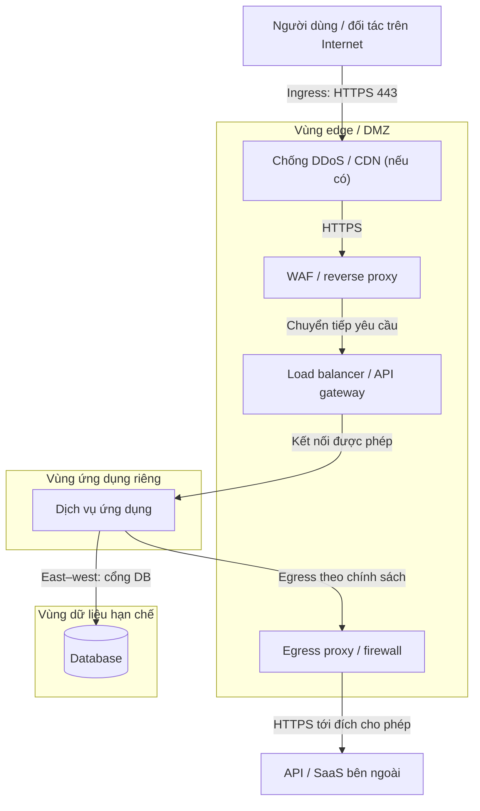

# North–south traffic và ranh giới hệ thống

Bài học thuộc chương **Mô hình mạng** của lĩnh vực **bảo mật mạng**. Việc nhận diện ranh giới giúp nối kiến thức phân đoạn, firewall, VPN, xác thực kết nối, bảo vệ DNS, giám sát xâm nhập và kiến trúc cloud thành một cách nhìn thống nhất về đường đi và độ tin cậy của lưu lượng.

## 1. Mục tiêu học tập

Trong bảo mật mạng, một kiến trúc tốt không chỉ trả lời “gói tin đi qua thiết bị nào?” mà còn phải trả lời **ai được kết nối tới đâu, bằng giao thức gì, dựa trên mức độ tin cậy nào và bằng chứng nào cho thấy chính sách đang được thực thi**. Sau bài này, bạn có thể:

- Phân biệt *north–south traffic* (lưu lượng đi vào/đi ra ranh giới hệ thống) với *east–west traffic* (lưu lượng giữa các thành phần bên trong một phạm vi đang xét).
- Nhận diện các **ranh giới mạng** và **ranh giới tin cậy** trong hạ tầng on-premise, cloud, môi trường hybrid và Kubernetes.
- Lần theo đường đi của một kết nối từ Internet vào ứng dụng và từ ứng dụng ra dịch vụ bên ngoài; xác định các điểm kiểm soát ingress, egress và các bước chuyển vùng.
- Xây dựng ma trận luồng kết nối tối thiểu, đề xuất các lớp phòng vệ và xác định log cần thu thập để giám sát, điều tra.
- Tránh những giả định sai như “nằm trong mạng riêng là đáng tin”, “có NAT là đã có firewall”, hoặc “đã đặt WAF thì toàn bộ hệ thống được bảo vệ”.

## 2. North–south traffic là gì?

**North–south traffic** là lưu lượng đi **qua ranh giới của một hệ thống hoặc vùng mạng đang được bảo vệ**, thường giữa mạng bên ngoài (Internet, đối tác, người dùng từ xa) và dịch vụ bên trong. Có hai chiều quan trọng:

- **Ingress (inbound):** lưu lượng từ bên ngoài **đi vào** vùng được bảo vệ, ví dụ khách hàng truy cập API công khai qua HTTPS.
- **Egress (outbound):** lưu lượng từ bên trong **đi ra** vùng bên ngoài, ví dụ máy chủ ứng dụng gọi API thanh toán của bên thứ ba.

**East–west traffic** là lưu lượng giữa các thành phần nằm trong phạm vi đang xét, ví dụ API gọi dịch vụ nghiệp vụ hoặc cơ sở dữ liệu nằm cùng mạng ứng dụng. East–west vẫn có thể vượt **ranh giới tin cậy**; không được mặc nhiên coi nó an toàn.

| Luồng kết nối | Cách phân loại khi xem toàn bộ hệ thống | Vấn đề bảo mật chính |
|---|---|---|
| Người dùng Internet → API công khai | North–south ingress | Bề mặt tấn công công khai, xác thực, DDoS, lạm dụng API |
| Backend → API của nhà cung cấp ngoài | North–south egress | Rò rỉ dữ liệu, SSRF, tên miền/đích đến được phép |
| API → database nội bộ | East–west | Phân đoạn, danh tính dịch vụ, quyền truy cập dữ liệu |
| Nhân viên qua VPN → ứng dụng nội bộ | North–south tại ranh giới truy cập từ xa | Danh tính thiết bị/người dùng, phân quyền sau VPN |
| Pod A → Pod B trong một cluster | East–west khi xét cluster | Chính sách pod-to-pod, service identity, mTLS |
| Mạng chi nhánh → mạng trung tâm | Qua ranh giới giữa hai mạng; thường được quản trị như north–south tại điểm vào | Chính sách liên vùng, đường hầm và định tuyến |

> **Lưu ý về hệ quy chiếu:** “North–south” và “east–west” là cách mô tả *hướng lưu lượng tương đối với ranh giới được chọn*, không phải thuộc tính cố định của một gói tin. Một kết nối giữa hai VPC có thể được xem là east–west ở quy mô toàn doanh nghiệp nhưng đi qua ranh giới ingress/egress của từng VPC. Vì vậy, khi phân loại, luôn nói rõ **đang xét hệ thống/vùng nào**.

Trong một số tài liệu về SDN, “northbound/southbound interface” lại mô tả giao diện giữa bộ điều khiển và các tầng khác. Thuật ngữ đó không đồng nhất với north–south traffic trong phân tích luồng bảo mật.

## 3. Ranh giới mạng khác ranh giới tin cậy như thế nào?

**Ranh giới mạng (network boundary)** là nơi thay đổi phạm vi kết nối hoặc chính sách định tuyến: Internet ↔ VPC, subnet công khai ↔ subnet riêng, VLAN người dùng ↔ VLAN máy chủ, mạng chi nhánh ↔ trung tâm dữ liệu, namespace/workload ↔ thành phần khác trong cluster. Thiết bị hoặc dịch vụ ở ranh giới có thể là router, firewall, security group, proxy, load balancer, API gateway hoặc VPN gateway.

**Ranh giới tin cậy (trust boundary)** là nơi các giả định về **danh tính, quyền hạn, dữ liệu hoặc khả năng kiểm soát** thay đổi. Một packet có thể đi trong cùng subnet nhưng vẫn vượt ranh giới tin cậy, chẳng hạn ứng dụng thường truy cập hệ thống lưu trữ chứa dữ liệu nhạy cảm. Ngược lại, một tunnel VPN mã hóa có thể vượt mạng công cộng nhưng **không tự động** làm thiết bị hoặc người dùng phía bên kia đáng tin.

Ví dụ mô hình hóa các vùng:

| Vùng | Đặc điểm | Quy tắc thường áp dụng |
|---|---|---|
| Internet / mạng không quản lý | Danh tính nguồn và thiết bị chưa được xác minh | Chỉ mở endpoint công khai có chủ đích; hạn chế tấn công ở edge |
| Edge / DMZ | Nhận kết nối ngoài, đứng trước ứng dụng | Chỉ cho phép các luồng cụ thể vào backend; giới hạn quyền quản trị |
| Vùng ứng dụng riêng | Chạy dịch vụ nghiệp vụ | Chỉ nhận từ gateway/dịch vụ được phép; tách quyền cho từng workload |
| Vùng dữ liệu hạn chế | Database, lưu trữ thông tin nhạy cảm | Không cho Internet truy cập trực tiếp; giới hạn nguồn và tài khoản |
| Vùng quản trị | Bastion, thiết bị quản lý, kênh vận hành | SSO/MFA, phân quyền, ghi lại hoạt động; giới hạn đích quản trị |
| Vùng egress | Proxy/firewall/DNS resolver điều phối kết nối ra ngoài | Allowlist, kiểm soát tên miền, ghi log và cảnh báo bất thường |

Các vùng trên là mô hình logic. Chúng có thể được triển khai bằng VLAN, subnet, security group, firewall policy, Kubernetes NetworkPolicy và cơ chế phân quyền ứng dụng. **Một subnet “private” chỉ mô tả khả năng định tuyến/địa chỉ theo thiết kế; không thay thế xác thực và phân quyền**.

## 4. Đọc đường đi của lưu lượng qua ranh giới



Sơ đồ là mô hình minh họa, **không phải yêu cầu bắt buộc** phải có từng thiết bị. WAF có thể tích hợp vào CDN hoặc gateway; load balancer có thể chấm dứt TLS hoặc chỉ chuyển tiếp kết nối; proxy và firewall có thể là dịch vụ quản lý. Với mỗi đường nối, hãy ghi rõ:

1. **Nguồn và đích:** workload, nhóm máy, subnet, danh tính người dùng/dịch vụ; tránh chỉ ghi “internal”.
2. **Giao thức và cổng:** TCP/443, UDP/53, kết nối database, VPN tunnel…; ở tầng ứng dụng cần biết HTTP method/path hoặc API nào được phép.
3. **Điểm xác thực/ủy quyền:** nơi xác thực user, workload, certificate hoặc token; ai quyết định quyền truy cập tài nguyên.
4. **Điểm áp dụng chính sách:** firewall, security group, network policy, gateway, proxy, ứng dụng.
5. **Điểm quan sát:** flow log, access log, DNS log, WAF event, audit log và trace.
6. **Người sở hữu chính sách và mục đích nghiệp vụ:** để kiểm tra một rule còn cần thiết hay không.

## 5. Hành trình ingress: từ Internet vào ứng dụng

Xét yêu cầu `GET https://api.example.com/orders` gửi từ điện thoại của khách hàng:

1. **Phân giải DNS:** thiết bị tìm địa chỉ IP của endpoint công khai. DNS điều hướng đến CDN, load balancer hoặc IP edge; bản ghi DNS không phải là cơ chế cấp quyền.
2. **Đến edge:** lớp chống DDoS/CDN (nếu triển khai) xử lý lưu lượng lớn, bot hoặc giới hạn tần suất theo khả năng của sản phẩm. Firewall tầng mạng chỉ mở các cổng cần thiết, thông thường HTTPS/TCP 443.
3. **Thiết lập TLS:** chứng chỉ giúp client kiểm tra danh tính server theo tên miền; dữ liệu được bảo vệ trên chặng TLS đó. Nếu TLS kết thúc tại proxy/WAF, chặng từ proxy tới ứng dụng phải được bảo vệ riêng theo yêu cầu rủi ro, thường bằng TLS hoặc mTLS.
4. **Kiểm soát tầng ứng dụng:** WAF xử lý một số mẫu tấn công HTTP; API gateway hoặc ứng dụng kiểm tra token, quota, schema và chính sách truy cập. WAF không thay thế kiểm tra quyền trên đối tượng `orders`.
5. **Chuyển vào vùng riêng:** backend chỉ nhận kết nối từ gateway/load balancer hoặc nguồn đã xác định qua cổng dịch vụ. Không công bố trực tiếp IP/cổng của máy ứng dụng hay database.
6. **Ứng dụng truy cập dữ liệu:** luồng từ API đến database là east–west trong mô hình này, nhưng vẫn cần firewall/ACL riêng, tài khoản DB ít quyền, TLS nếu cần và log truy cập phù hợp.
7. **Trả kết quả:** với firewall có trạng thái (*stateful*), gói phản hồi của kết nối đã được cho phép thường được theo dõi qua bảng trạng thái. Không cần mở một rule ingress rộng cho toàn bộ traffic phản hồi.

**Điểm dễ bỏ sót:** nếu ứng dụng gốc (*origin*) vẫn có địa chỉ công khai và chấp nhận truy cập trực tiếp, kẻ tấn công có thể bỏ qua CDN/WAF. Cần giới hạn nguồn vào origin theo cơ chế được nhà cung cấp hỗ trợ, kiểm tra host/TLS hợp lệ và xác nhận không có đường vòng qua IP/port khác.

**Địa chỉ IP của client qua proxy:** backend thường chỉ nhìn thấy IP của reverse proxy. Các header như `X-Forwarded-For` có thể bị client giả mạo nếu chấp nhận tùy tiện. Chỉ tin metadata từ proxy đã xác thực/được phép, cấu hình proxy ghi đè hoặc chuẩn hóa header đầu vào và xác định đúng chuỗi proxy tin cậy.

## 6. Hành trình egress: từ ứng dụng ra Internet

Một backend cần gọi API thanh toán của nhà cung cấp. Dù backend không mở cổng công khai, kết nối outbound vẫn tạo ra bề mặt rủi ro:

1. **Xác định nhu cầu nghiệp vụ:** dịch vụ nào gọi, endpoint nào, giao thức gì, dữ liệu nào được gửi và tần suất dự kiến.
2. **Phân giải tên:** ưu tiên DNS resolver được quản lý; ghi DNS log và kiểm soát truy vấn bất thường. Chặn các đường DNS ngoài chính sách khi phù hợp, nhưng nhớ rằng riêng việc kiểm soát DNS không đủ để giới hạn mọi kết nối IP hoặc tên miền.
3. **Định tuyến ra ngoài:** subnet riêng có thể đi qua egress gateway, firewall, proxy và NAT. NAT dịch địa chỉ nguồn để kết nối ra Internet; **NAT tự nó không phải chính sách cho phép/chặn**. Kiểm soát phải có ở firewall, proxy, ACL và/hoặc cơ chế có khả năng thực thi rule.
4. **Áp dụng allowlist:** chỉ cho phép dịch vụ gọi tới nhà cung cấp đã phê duyệt, đúng cổng/giao thức. Với SaaS dùng IP thay đổi hoặc CDN, có thể cần proxy hỗ trợ chính sách theo tên miền và kiểm tra danh tính đích qua TLS. Allowlist IP đơn thuần có giới hạn và phải được bảo trì.
5. **Bảo vệ dữ liệu/danh tính:** xác thực certificate của server, dùng credential theo nguyên tắc ít quyền, quản lý secret, giới hạn dữ liệu gửi đi và đặt timeout/retry phù hợp.
6. **Ghi nhận kết quả:** log các kết nối được phép/bị chặn, đích, lưu lượng, nguyên nhân từ chối và định danh workload; tránh ghi token, payload nhạy cảm hoặc thông tin cá nhân không cần thiết.

Egress quan trọng khi phòng **SSRF**: nếu ứng dụng cho phép gọi URL do người dùng kiểm soát, nó có thể bị lợi dụng truy cập dịch vụ nội bộ hoặc metadata endpoint của cloud. Cần xác thực URL/đích tại ứng dụng, cấm các đích đặc quyền (loopback, link-local, địa chỉ nội bộ không được phép, metadata service), kiểm tra lại sau DNS resolution/redirect và áp dụng chính sách egress độc lập ở mạng.

Đừng nhầm “mở TCP/443 ra Internet” với “chỉ được gọi API thanh toán”: trên cùng cổng HTTPS có rất nhiều tên miền và dịch vụ khác nhau. Ngược lại, khi có TLS (đặc biệt với TLS hiện đại), firewall chỉ nhìn thấy một phần metadata; nội dung HTTP thường không thể phân tích nếu không có điểm giải mã được phép.

## 7. Tạo ma trận lưu lượng và chính sách tối thiểu

Giả sử hệ thống bán hàng có API công khai, service backend, PostgreSQL riêng, một cổng egress và kênh quản trị qua VPN. Ma trận thiết kế tham khảo:

| Nguồn → Đích | Hướng / ranh giới | Giao thức | Quyết định | Ghi chú |
|---|---|---|---|---|
| Internet → Edge/API gateway | Ingress vào DMZ | TCP/443 | **Allow** | HTTPS, WAF/rate limiting theo nhu cầu |
| API gateway → Backend | DMZ → vùng ứng dụng | TCP/8443 | **Allow** | Chỉ nguồn gateway; TLS/mTLS nếu triển khai |
| Backend → PostgreSQL | East–west, vượt ranh giới dữ liệu | TCP/5432 | **Allow** | Chỉ identity/subnet backend, DB ít quyền |
| Backend → Egress proxy | Vùng ứng dụng → vùng egress | TCP/8443 (ví dụ) | **Allow** | Dịch vụ proxy xác thực và có log |
| Egress proxy → API nhà cung cấp | Egress → bên ngoài | TCP/443 | **Allow có điều kiện** | Chỉ đích nhà cung cấp đã duyệt |
| Máy quản trị qua VPN → Bastion | Qua ranh giới quản trị | Theo giao thức quản trị được phê duyệt | **Allow có điều kiện** | MFA, kiểm tra thiết bị, phân quyền |
| Internet → Backend/PostgreSQL | Truy cập trực tiếp vùng riêng | Mọi cổng | **Deny** | Không cấp đường vào trực tiếp |
| Backend → Internet trực tiếp, ngoài proxy | Egress không qua kiểm soát | Mọi cổng | **Deny** | Ngăn đường đi vòng |
| Các luồng chưa được định nghĩa | Mọi ranh giới | Mọi cổng | **Deny mặc định** | Tạo ngoại lệ có hạn, có chủ sở hữu |

Các cổng ở trên chỉ là **ví dụ kiến trúc**, không phải cấu hình áp dụng ngay cho mọi sản phẩm. Một policy thực tế phải xác định đúng nguồn/đích theo workload, subnet, security group hoặc service identity, hướng rule, mức ưu tiên, môi trường, thời hạn ngoại lệ và hình thức ghi log. Kiểm tra cả IPv4 lẫn IPv6 nếu được bật; quên IPv6 có thể tạo đường vượt chính sách chỉ áp dụng cho IPv4.

**Nguyên tắc triển khai:** bắt đầu bằng danh sách luồng cần có từ nghiệp vụ; dùng *default deny* tại các ranh giới thích hợp; chỉ mở theo nguyên tắc ít quyền; đo thực tế trước và sau thay đổi. Tránh cấu hình `0.0.0.0/0` trên cổng quản trị hoặc mở tất cả cổng “cho dễ chạy”.

## 8. Chọn lớp phòng vệ phù hợp với từng ranh giới

| Kiểm soát | Thấy/kiểm tra được gì | Vai trò và giới hạn |
|---|---|---|
| Router, route table, subnet | Đường đi IP | Quyết định *có tuyến*; không tự xác thực user hay API |
| Firewall L3/L4, security group, NACL | IP, cổng, giao thức, trạng thái (tùy công cụ) | Giới hạn kết nối; ít ngữ cảnh về HTTP hoặc quyền nghiệp vụ |
| VPN / ZTNA | Kênh truy cập, danh tính, posture tùy giải pháp | Bảo vệ truy cập từ xa; sau khi kết nối vẫn phải phân quyền theo tài nguyên |
| TLS / mTLS | Mã hóa, xác minh một hoặc hai đầu kết nối | Bảo vệ chặng kết nối; chưa xác định user được phép đọc/sửa dữ liệu nào |
| Reverse proxy, API gateway | HTTP route, xác thực, quota, policy | Tập trung ingress; cần bảo vệ backend khỏi bypass |
| WAF | Một phần nội dung/yêu cầu HTTP khi có thể xử lý | Giảm một số lớp tấn công web; không thay kiểm tra quyền ứng dụng |
| IDS / IPS, NDR | Metadata và mẫu lưu lượng; có thể xem payload nếu không mã hóa hoặc được giải mã hợp lệ | Phát hiện/chặn dấu hiệu tấn công; phải điều chỉnh cảnh báo sai và độ phủ quan sát |
| Egress proxy / DNS security | Đích, tên miền, luồng outbound theo khả năng hệ thống | Giới hạn gọi ra ngoài, hỗ trợ điều tra; không thay chống SSRF trong mã ứng dụng |
| Logging, SIEM, flow telemetry | Sự kiện, xu hướng, tương quan liên nguồn | Cung cấp bằng chứng và cảnh báo; cần định danh đúng, đồng bộ thời gian, retention |

**Phòng vệ nhiều lớp** nghĩa là nếu một lớp bị vượt qua, lớp khác vẫn giới hạn phạm vi thiệt hại. Ví dụ WAF có thể bỏ sót lỗi kiểm soát truy cập ở API; ứng dụng phải tự xác minh user có quyền xem đơn hàng; database còn phải giới hạn credential. Tương tự, IPS không kiểm tra được nội dung TLS chưa giải mã chỉ từ bản sao packet trên đường truyền.

## 9. Đặc thù cloud, Kubernetes và môi trường hybrid

### Cloud/VPC

- **Public subnet** thường có route phù hợp tới Internet gateway và địa chỉ công khai cho tài nguyên cần được truy cập; **private subnet** tránh truy cập inbound trực tiếp từ Internet theo thiết kế. Tuy nhiên, tên subnet không bảo đảm tài nguyên được bảo vệ nếu security group, load balancer hay route sai.
- **Security group** thường dùng cho giới hạn lưu lượng đến/từ tài nguyên (nhiều nền tảng là stateful); **network ACL** ở subnet có thể có hành vi stateless. Cần đọc hành vi cụ thể của nhà cung cấp trước khi đặt rule và cổng phản hồi.
- **NAT gateway** cho phép máy trong subnet riêng khởi tạo kết nối ra ngoài theo định tuyến; muốn chặn theo domain/identity hoặc giám sát sâu vẫn cần giải pháp bổ sung.
- **Private endpoint/service endpoint** có thể giảm nhu cầu đi qua Internet cho dịch vụ cloud, song vẫn cần policy truy cập dịch vụ, quyền IAM và kiểm soát dữ liệu.
- Không quên các đường vào khác như load balancer thứ hai, IP public trên instance, peering/transit hub, VPN, private link hoặc kết nối giữa account/project.

### Kubernetes

- Kubernetes **Ingress/Gateway API** mô tả cách định tuyến lưu lượng vào Service; bản thân resource định tuyến không đồng nghĩa đã có WAF, xác thực hoặc firewall.
- **NetworkPolicy** có thể giới hạn lưu lượng giữa pod/namespace và luồng ra ngoài nếu CNI thực thi hỗ trợ; phải kiểm tra cả ingress và egress policy, và cách DNS hoạt động khi dùng default deny.
- **Service mesh/mTLS** có thể xác minh danh tính workload và mã hóa giữa các service; vẫn cần authorization và chính sách egress cho lưu lượng đi ngoài mesh.
- Một pod gọi Internet vẫn là north–south ở ranh giới cluster/VPC dù traffic ban đầu đi qua Service hoặc node nội bộ. Quan sát tại pod, node và gateway có thể cho các địa chỉ nguồn khác nhau do SNAT.

### Hybrid và truy cập từ xa

Tunnel site-to-site VPN hoặc đường riêng kết nối các mạng, nhưng hai bên vẫn có quyền sở hữu và mức tin cậy khác nhau. Phải quy định CIDR/route được công bố, dịch vụ nào được truy cập, policy hai chiều, đường phản hồi và log tại điểm tập trung. Người dùng vào qua VPN/ZTNA chỉ nên được cấp đúng ứng dụng cần sử dụng, tránh mặc định toàn quyền trên mạng nội bộ.

### Mạng không dây

Wi-Fi khách và Wi-Fi doanh nghiệp là hai vùng với mức tin cậy khác nhau, dù cùng dùng hạ tầng điểm truy cập. Mạng khách thường chỉ nên được định tuyến ra Internet và bị chặn truy cập mạng quản trị/nội bộ; mạng doanh nghiệp có thể áp dụng xác thực 802.1X, phân quyền theo người dùng hoặc thiết bị và chính sách truy cập tới từng ứng dụng. Khi khách truy cập Internet, đó là **egress của vùng Wi-Fi khách**; khi thiết bị kết nối ứng dụng nội bộ, lưu lượng đã vượt ranh giới truy cập từ thiết bị đầu cuối vào mạng dịch vụ. Bảo mật Wi-Fi và phân đoạn đều cần thiết vì một thiết bị đã tham gia SSID vẫn có thể bị xâm nhập.

## 10. Mô hình hóa mối đe dọa tại các điểm giao cắt

Khi vẽ kiến trúc, đánh dấu mỗi lần lưu lượng đi từ một vùng sang vùng khác và hỏi: “Điều gì xảy ra nếu **nguồn bị chiếm quyền**, **yêu cầu bị giả mạo**, hoặc **dịch vụ trung gian cấu hình sai**?”

| Kịch bản | Đường tấn công | Biện pháp chính | Điều cần kiểm chứng |
|---|---|---|---|
| Quét cổng, khai thác dịch vụ công khai | Internet → edge hoặc origin | Chỉ xuất bản cổng cần thiết, hardening, WAF nếu phù hợp | Backend/DB không thể bị truy cập trực tiếp |
| DDoS và bot gây cạn tài nguyên | Internet → endpoint công khai | Chống DDoS, rate limit, cache, autoscaling có giới hạn | Khả năng chịu tải và phương án ứng cứu |
| Truy cập đơn hàng của người khác | Client → API hợp lệ | Authentication + authorization theo object | API kiểm quyền trên từng tài nguyên |
| Giả mạo IP qua forwarding header | Client → reverse proxy → backend | Chỉ tin proxy được chỉ định, chuẩn hóa header | Backend không tin header client tự gửi |
| SSRF gọi metadata hoặc mạng quản trị | Backend → đích không mong muốn | Kiểm tra URL/redirect/DNS, deny egress, bảo vệ metadata | Không gọi được địa chỉ đặc quyền |
| Dữ liệu bị gửi tới domain lạ | Workload → Internet | Egress allowlist, DLP theo nhu cầu, log | Cảnh báo đích mới/lưu lượng tăng đột biến |
| Kẻ tấn công di chuyển từ web sang DB | Backend bị chiếm → vùng dữ liệu | Phân đoạn east–west, quyền DB tối thiểu, audit | Chỉ cổng/credential cần thiết hoạt động |
| Lưu lượng đi vòng lớp kiểm soát | Internet hoặc backend → đường phụ | Rà soát public IP, route, peering, IPv6, policy | Không tồn tại đường bypass WAF/egress |

Đánh giá rủi ro không kết thúc tại ranh giới “Internet → DMZ”. Những kết nối **east–west** sau khi ứng dụng bị xâm nhập thường quyết định khả năng lan rộng và mức độ mất dữ liệu. Do đó, cần xây cả ingress, egress và phân đoạn nội bộ như một hệ thống chính sách thống nhất.

## 11. Quan sát và xử lý sự cố

Một bản ghi flow lý tưởng cho điều tra có: timestamp, vùng/nguồn/đích, IP và cổng nguồn/đích, giao thức, action (allow/deny), rule ID, số byte/gói, danh tính workload khi có, trạng thái/kết quả và nơi thu thập. Với HTTP, bổ sung host/path (phù hợp chính sách bảo vệ dữ liệu), request ID, status code, thời gian xử lý, user/service identity. Với DNS, ghi tên truy vấn và kết quả; với TLS có thể ghi phiên bản/chứng chỉ/SNI **nếu thông tin đó quan sát được**.

Ví dụ khi API public trả lỗi kết nối:

1. Xác minh DNS trỏ tới edge đúng, rồi kiểm tra TLS và chứng chỉ ở từng chặng.
2. Đối chiếu access log CDN/WAF/gateway với request ID; tìm rule chặn, HTTP status và upstream timeout.
3. Kiểm tra route table, firewall/security group/network policy giữa gateway và backend; xác minh cổng đích thực sự lắng nghe.
4. Nếu backend kết nối tới bên thứ ba thất bại, kiểm tra DNS resolver, egress proxy, NAT, allowlist và kết nối TLS outbound.
5. So sánh log ở **trước và sau ranh giới**; lưu ý SNAT/DNAT làm thay đổi IP/port quan sát được. Đồng bộ đồng hồ giữa các thành phần để nối chuỗi sự kiện.

Trên máy Linux trong **môi trường lab được phép**, có thể quan sát tuyến và metadata kết nối:

```bash
# Kiểm tra tuyến đi tới một IP đích ví dụ
ip route get 1.1.1.1

# Quan sát DNS thông thường và TCP/443 tại host
# (cần quyền phù hợp; HTTPS không hiện nội dung HTTP đã mã hóa)
sudo tcpdump -ni any 'udp port 53 or tcp port 443'
```

Các công cụ này chỉ thấy lưu lượng tại điểm bắt gói. Trong cloud/Kubernetes, packet có thể bị thay đổi địa chỉ hoặc xử lý ở hạ tầng mạng ngoài host; cần đối chiếu với flow log của nền tảng. Khi lưu PCAP, giới hạn phạm vi, thời gian, quyền truy cập và bảo vệ dữ liệu nhạy cảm.

**Chỉ số nên theo dõi:** số kết nối bị từ chối theo rule/zone, lượng request ingress và mã lỗi, latency qua gateway, số đích egress mới, traffic outbound bất thường, tỷ lệ cảnh báo WAF/IPS sai và các kết nối trái với ma trận đã duyệt. Một rule có log “allow” không chứng minh ứng dụng đã xác thực người dùng thành công; phải tương quan cả log ứng dụng.

## 12. Bài tập thiết kế: dịch vụ đặt hàng

Hệ thống gồm bốn thành phần: ứng dụng web công khai, API trong subnet riêng, PostgreSQL trong vùng dữ liệu và dịch vụ thanh toán bên thứ ba. Nhóm vận hành kết nối từ xa.

**Yêu cầu:** người dùng chỉ truy cập HTTPS; database không được kết nối trực tiếp từ Internet; API chỉ gọi API thanh toán đã được duyệt; quản trị viên truy cập qua kênh có xác thực mạnh. Hãy thực hiện:

1. Vẽ sơ đồ các vùng Internet, edge, ứng dụng, dữ liệu, egress và quản trị; đánh dấu mọi ranh giới tin cậy.
2. Lập ma trận với nguồn/đích, cổng, danh tính, quyết định allow/deny, rule owner và log cần có.
3. Chỉ rõ nơi TLS kết thúc, nơi token được xác minh, cách giới hạn quyền database và cách tránh truy cập origin bỏ qua WAF.
4. Liệt kê các test tích cực và tiêu cực: HTTPS vào edge hoạt động; Internet không tới DB; API không gọi được domain ngoài allowlist; user A không đọc được đơn hàng của user B; thiết bị không đủ điều kiện không thể vào kênh quản trị.
5. Xác định log nào giúp chứng minh từng test; giải thích vì sao NAT, VPN hoặc một rule security group đơn lẻ chưa đủ để đáp ứng mọi yêu cầu.

**Gợi ý đáp án:** Internet → HTTPS edge/gateway → API riêng → PostgreSQL riêng; API → proxy/firewall egress → nhà cung cấp; người vận hành → VPN/ZTNA → bastion/ứng dụng quản trị được phân quyền. Rule mở theo nguồn và đích cụ thể; chặn direct-origin, direct-to-DB và direct egress; xác thực/ủy quyền vẫn thực hiện tại ứng dụng và DB. Kiểm chứng bằng access log, authentication/audit log, flow log, DNS log và log egress tương ứng.

## 13. Những lỗi tư duy thường gặp và ghi nhớ

- **“Có firewall biên là đủ”:** ingress chỉ là một phần; egress, kết nối east–west và quyền truy cập ứng dụng cũng cần kiểm soát.
- **“Tất cả lưu lượng trong VPC đều tin cậy”:** mạng riêng không bảo đảm danh tính hoặc mục đích của workload; nguy cơ di chuyển ngang vẫn tồn tại.
- **“NAT hoặc VPN tương đương policy bảo mật”:** NAT xử lý địa chỉ; VPN xử lý kết nối/tunnel; rule truy cập, xác thực và phân quyền là các việc riêng.
- **“443 nghĩa là HTTPS an toàn”:** cổng không chứng minh ứng dụng hoặc đích hợp lệ; cần kiểm tra TLS, danh tính, chính sách đích và quyền nghiệp vụ.
- **“WAF nhìn thấy mọi yêu cầu”:** phụ thuộc vị trí chấm dứt TLS, đường traffic thực tế và cấu hình; cần chống bypass và kiểm soát ở ứng dụng.
- **“Chỉ cần log ở firewall”:** điều tra thường phải tương quan route, NAT, proxy, DNS, WAF, danh tính và application audit.

Khi đánh giá một luồng north–south, hãy luôn trả lời được **năm câu hỏi**: *Nó bắt đầu ở đâu? Đi qua ranh giới nào? Ai được phép thực hiện? Kiểm soát nằm ở đâu? Log nào chứng minh kết quả?* Đây là nền tảng để phân tích lưu lượng, mô hình hóa mối đe dọa, giám sát xâm nhập và thiết kế kiến trúc mạng an toàn từ firewall, VPN, IDS/IPS đến cloud và hạ tầng ứng dụng hiện đại.
