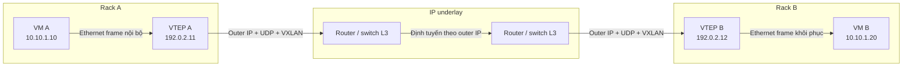
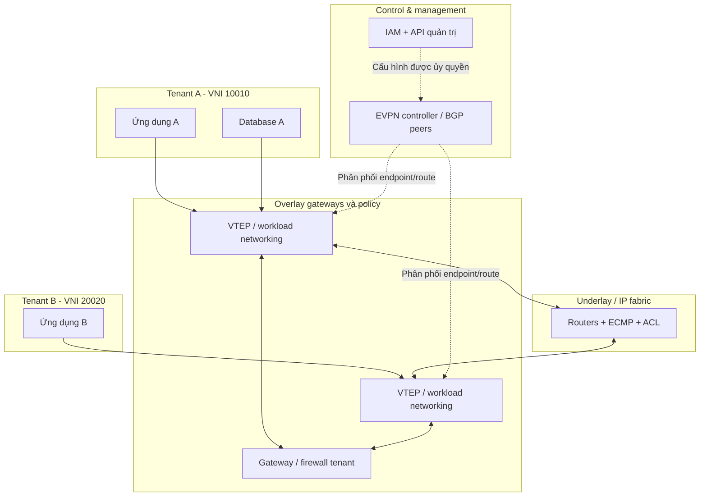

# Overlay network và underlay network

Trong một hệ thống kết nối mạng hiện đại, đường đi mà ứng dụng **nhìn thấy** không nhất thiết trùng với đường đi mà thiết bị vật lý **thực sự chuyển gói tin**. Một máy ảo ở rack A và một máy ảo ở rack B có thể được đặt trong cùng mạng logic dù hai rack kết nối qua nhiều router. Một chi nhánh cũng có thể truy cập ứng dụng trung tâm qua một đường hầm VPN chạy trên Internet.

Hai khái niệm giúp giải thích các kiến trúc này là **underlay network** (mạng nền vận chuyển) và **overlay network** (mạng logic được xây dựng bên trên mạng nền). Với module **SECURITY_NETWORK_SECURITY**, điều quan trọng không chỉ là gói tin đi được từ nguồn tới đích, mà còn là **ai có thể tạo đường kết nối, dữ liệu được bảo vệ ở lớp nào, chính sách phân đoạn được thực thi ở đâu và khi xảy ra sự cố phải quan sát lớp nào**.

## Mục tiêu học tập

Hoàn thành bài này, bạn có thể:

1. Phân biệt underlay với overlay theo chức năng, địa chỉ, phạm vi định tuyến và khả năng quan sát.
2. Mô tả cách gói tin được đóng gói, định tuyến qua underlay rồi được giải đóng gói tại đầu cuối đường hầm.
3. Giải thích vai trò của tunnel endpoint, VTEP, VNI, control plane và data plane trong mạng VXLAN/EVPN.
4. Nhận biết sự khác nhau giữa **kết nối logic**, **phân đoạn bảo mật** và **mã hóa đường truyền**.
5. Phân tích chi phí encapsulation, MTU, ECMP, độ trễ, đường đi bất đối xứng và các điểm lỗi của hai lớp.
6. Xây dựng cách kiểm tra, giám sát và mô hình hóa mối đe dọa cho hệ thống dùng overlay.

## 1. Định nghĩa: hai góc nhìn về cùng một luồng mạng

**Underlay network** là hạ tầng chuyển tiếp bên dưới, cung cấp khả năng kết nối IP/L2 thực tế giữa các điểm có thể tạo hoặc kết thúc tunnel. Underlay có thể bao gồm switch, router, cáp quang, Wi-Fi, kết nối nhà mạng, fabric trung tâm dữ liệu và các chính sách định tuyến/ACL áp dụng trên các chặng đó. Trong nhiều mạng hiện đại, underlay thường là IP fabric định tuyến L3, nhưng underlay không bắt buộc phải có một thiết kế duy nhất.

**Overlay network** là một mạng logic được tạo trên nền kết nối đó. Overlay định nghĩa những endpoint logic, subnet, tenant hoặc thành phần nào được coi là cùng mạng; nó có thể sử dụng encapsulation/tunnel để đưa lưu lượng đi qua underlay. Overlay có thể mang L2 qua mạng L3 (ví dụ VXLAN) hoặc tạo các kết nối L3 logic được bảo vệ (ví dụ một mạng VPN IPsec hoặc WireGuard).

| Tiêu chí | Underlay | Overlay |
| --- | --- | --- |
| Vai trò chính | Đảm bảo các điểm tunnel/thiết bị có thể trao đổi gói tin qua hạ tầng. | Tạo topology, phân đoạn hoặc tuyến kết nối logic phục vụ ứng dụng/tenant. |
| Địa chỉ phổ biến | IP của router, interface, loopback, địa chỉ tunnel endpoint. | IP/MAC của workload, subnet tenant, địa chỉ trong VPN. |
| Cơ chế chuyển tiếp | Switching/routing, ARP/ND, IGP/BGP, ECMP, ACL trên fabric. | Mapping endpoint, tunnel, encapsulation, VRF/VNI, route/policy logic. |
| Một điểm lỗi thường gặp | Không tới được IP tunnel endpoint, lỗi route, link, MTU hoặc mất gói. | Sai mapping/VNI, sai route tenant, policy nội bộ, tunnel hoặc control plane. |
| Nhìn từ ứng dụng | Thường bị che phía dưới. | Thường là mạng ứng dụng tưởng mình đang sử dụng. |
| Kiểm soát bảo mật | Chặn nguồn không hợp lệ tới tunnel endpoint; bảo vệ thiết bị, hạ tầng và định tuyến. | Cách ly tenant/workload, kiểm soát quyền và lưu lượng nội bộ, mã hóa nếu chọn đúng công nghệ. |

**Không có một quan hệ 1–1 cố định:** nhiều overlay có thể dùng chung một underlay; một overlay có thể dùng nhiều đường underlay; overlay này cũng có thể trở thành mạng nền cho một overlay khác. Vì vậy cần xác định rõ *lớp nào được gọi là underlay* trong sơ đồ đang phân tích.

### Ví dụ đơn giản

- Máy A có IP ứng dụng `10.10.1.10` đặt tại rack A; máy B có IP ứng dụng `10.10.1.20` đặt tại rack B.
- Host hoặc thiết bị mạng ở rack A có điểm kết thúc VXLAN (VTEP) `192.0.2.11`; phía rack B là `192.0.2.12`.
- Hai máy được gắn vào cùng phân đoạn logic có **VNI 10010**.
- Underlay chỉ cần chuyển tiếp được IP từ `192.0.2.11` tới `192.0.2.12`. Nó không nhất thiết biết địa chỉ `10.10.1.10` hoặc `10.10.1.20`.

Các địa chỉ `192.0.2.0/24` trong ví dụ thuộc dải dành cho tài liệu. Khi học kiến trúc, nên phân biệt **địa chỉ bên ngoài của tunnel (outer IP)** và **địa chỉ bên trong của workload (inner IP)**.

## 2. Gói tin đi qua underlay và overlay như thế nào?

Một luồng đi từ máy A đến máy B trong VXLAN Ethernet-over-IP có thể được mô tả như sau:



Quy trình chuyển tiếp điển hình:

1. **Máy A phát frame:** ứng dụng gửi dữ liệu theo mạng logic của nó. Frame mang địa chỉ IP nguồn/đích của workload.
2. **VTEP A tìm điểm đến:** VTEP cần biết MAC/IP đích của tenant tương ứng nằm tại local port hay tại remote VTEP nào. Thông tin có thể đến từ bảng học MAC hoặc control plane như BGP EVPN, tùy kiến trúc.
3. **VTEP A đóng gói:** thêm VXLAN header có VNI và thêm UDP/IP header ngoài; đích outer IP là `192.0.2.12`.
4. **Underlay chuyển tiếp:** các router/switch nền chọn next hop bằng outer destination IP. Underlay có thể có nhiều tuyến ECMP và không nhất thiết hiểu địa chỉ workload nằm trong frame.
5. **VTEP B giải đóng gói:** kiểm tra header, VNI và mapping, rồi chuyển frame tới máy B trong phân đoạn logic phù hợp.
6. **Chính sách bảo mật có thể áp dụng ở nhiều điểm:** tại workload, tại VTEP, tại firewall giữa phân đoạn và tại fabric. Phải xác định chính xác thứ tự áp dụng theo nền tảng triển khai.

Từ góc nhìn máy A, nó trao đổi với một máy cùng mạng logic. Từ góc nhìn fabric, nó chuyển tiếp lưu lượng UDP giữa hai VTEP. **Hai góc nhìn đều đúng**, và đều cần thiết khi điều tra sự cố hoặc tấn công.

### 2.1. Cấu trúc gói VXLAN

Minh họa giản lược cho IPv4 underlay, VXLAN chuẩn và Ethernet phía trong:

```text
| Ethernet ngoài | IPv4 ngoài | UDP ngoài | VXLAN | Ethernet trong | IP trong | TCP/UDP + dữ liệu |
|<--------------- gói được vận chuyển qua underlay ------------------------------->|
                                    VNI          MAC VM A/VM B       10.10.1.x
                     192.0.2.11 -> 192.0.2.12
```

Với VXLAN thông dụng, UDP destination port là **4789** và trường VNI dài **24 bit**. VNI xác định một phân đoạn logic ở cấp overlay; **không phải khóa mã hóa hoặc cơ chế xác thực**. Nếu một thiết bị được cấu hình sai mapping VNI/tenant, tính cô lập có thể bị phá vỡ dù đường underlay hoàn toàn hoạt động.

### 2.2. Phân biệt ba mặt phẳng

- **Underlay forwarding plane:** chuyển gói IP giữa các VTEP, phụ thuộc route, link, next hop, MTU và chính sách của fabric.
- **Overlay data plane:** đóng/gỡ tunnel, vận chuyển frame/packet theo VNI, tunnel ID hoặc route logic.
- **Overlay control plane:** phân phối hoặc xác định thông tin endpoint, MAC/IP, VNI, tuyến tenant; trong EVPN-VXLAN thường sử dụng BGP EVPN.

Nhiều hệ thống có thêm **management plane**: API, controller, cloud console, tài khoản điều hành, công cụ IaC. Người kiểm soát được management plane có thể thay đổi cả phân đoạn logic và chính sách underlay dù không truy cập trực tiếp máy ứng dụng. Vì thế đây là thành phần bắt buộc trong threat model bảo mật mạng.

## 3. Những công nghệ thường gặp và mục đích sử dụng

| Công nghệ / mô hình | Vận chuyển qua mạng nền | Điều cần hiểu về bảo mật |
| --- | --- | --- |
| **VXLAN** | Ethernet frame trong UDP/IP; thường dùng trong data center, virtualized networking. | Mang phân đoạn theo VNI; **không tự mã hóa hoặc xác thực** dữ liệu. Cần bảo vệ VTEP, underlay và quyền cấu hình. |
| **BGP EVPN + VXLAN** | BGP EVPN phân phối thông tin endpoint/route; VXLAN mang lưu lượng. | An toàn của BGP peering, route import/export, RT/VRF và mapping VNI ảnh hưởng trực tiếp đến cô lập tenant. |
| **Geneve** | Encapsulation linh hoạt qua UDP/IP; có các trường tùy chọn để mang metadata. | Metadata có thể phục vụ chính sách; không suy ra rằng mọi triển khai Geneve đều mã hóa. UDP port mặc định theo chuẩn là **6081**. |
| **GRE** | Đóng gói giao thức khác trong IP, thường dùng cho tunnel L3. | GRE thuần không cung cấp mã hóa/bảo đảm nguồn gốc; khi cần bảo mật có thể dùng với IPsec. |
| **IPsec VPN** | Bảo vệ lưu lượng IP giữa peer/host qua underlay, thường tạo đường hầm L3. | Có thể cung cấp mã hóa, toàn vẹn và xác thực peer nếu cấu hình và quản lý khóa đúng. Phân quyền truy cập vẫn cần riêng. |
| **WireGuard** | Tunnel L3 qua UDP với mã hóa và xác thực bằng khóa. | Phải quản lý khóa, AllowedIPs và policy host/firewall; kết nối đã mã hóa không đồng nghĩa mọi truy cập bên trong đều hợp lệ. |
| **MPLS L3VPN / EVPN** | Dùng nhãn và định tuyến của nhà mạng/fabric để tách dịch vụ logic. | Phân tách forwarding/VRF **không mặc nhiên cung cấp mã hóa** dữ liệu khi đi qua miền không tin cậy. |
| **SD-WAN** | Xây kết nối logic giữa site trên nhiều đường Internet/MPLS/LTE tùy sản phẩm. | Phải kiểm tra cơ chế mã hóa, danh tính site, policy application-aware và bảo vệ controller cụ thể. |
| **Container/Kubernetes overlay CNI** | Một số CNI dùng VXLAN/Geneve/IP-in-IP; một số dùng route L3 trực tiếp. | **Không mặc định Kubernetes dùng overlay**; NetworkPolicy chỉ có hiệu lực khi CNI thực thi chính sách. |

Một công nghệ có thể có nhiều chế độ hoặc cấu hình. Chẳng hạn **EVPN là cách phân phối thông tin điều khiển**, không phải tên gọi đồng nghĩa của VXLAN; EVPN có thể dùng với các data plane khác. Cũng cần phân biệt VPN phục vụ bảo mật kết nối với mạng overlay phục vụ topology và multi-tenancy: chúng có thể kết hợp nhưng giải quyết các yêu cầu khác nhau.

## 4. Tại sao cần overlay thay vì chỉ dùng underlay?

### 4.1. Tách topology ứng dụng khỏi topology thiết bị

Ứng dụng có thể mở rộng từ rack này sang rack khác mà không đòi hỏi mỗi switch underlay phải mang cấu hình L2/VLAN của tất cả tenant. Các VTEP tạo và hủy tunnel/mapping theo vòng đời workload. Với môi trường nhiều tenant, những mạng logic có thể dùng dải IP trùng nhau khi được cách ly bằng VRF/VNI và chính sách tương ứng.

### 4.2. Di chuyển workload và mở rộng phân đoạn

Máy ảo di chuyển sang host khác có thể giữ địa chỉ logic nếu kiến trúc overlay hỗ trợ. Điều này hữu ích cho môi trường ảo hóa và data center fabric. Tuy nhiên kéo dài L2 không phải lựa chọn luôn tốt: broadcast domain lớn, sự kiện MAC mobility và các vấn đề ARP/ND có thể gây khó vận hành. Khi có thể, thiết kế L3 và phân đoạn rõ ràng thường dễ mở rộng và quan sát hơn.

### 4.3. Tối ưu đường vật lý độc lập

Underlay có thể dùng ECMP để trải lưu lượng qua nhiều đường giữa VTEP. Overlay quyết định quan hệ logic; underlay quyết định cách vận chuyển. Tính dự phòng của underlay giúp các tunnel tồn tại khi một đường vật lý hỏng, **nếu** routing hội tụ và các tuyến thay thế hoạt động.

### 4.4. Triển khai nhanh từ phần mềm

Cloud và hạ tầng ảo hóa thường tạo subnet, mạng workload, gateway và policy theo API mà không cần cấu hình thủ công từng dây mạng. Mặt trái là cấu hình logic có thể thay đổi nhanh hơn quy trình kiểm kê và đánh giá bảo mật truyền thống. Cần giám sát thay đổi controller, định danh API và cấu hình IaC.

## 5. Underlay tốt cần đáp ứng điều gì?

Overlay phụ thuộc vào mạng nền. Những yếu tố chính:

- **Reachability:** các VTEP/tunnel peer được phép và định tuyến tới nhau theo đúng địa chỉ nguồn/đích.
- **Ổn định định tuyến:** hội tụ khi link hoặc thiết bị lỗi; tránh blackhole, vòng lặp và route bất đối xứng gây lỗi với stateful firewall.
- **MTU đồng nhất trên đường đi:** chứa được gói ngoài sau encapsulation, tránh bị rơi gói lớn hoặc fragment không mong muốn.
- **ECMP và hashing:** phân tải các luồng tunnel qua nhiều đường; cần quan sát mất cân bằng, reordering và tác động của NAT/tunnel port.
- **Độ trễ và jitter:** tunnel không loại bỏ giới hạn vật lý. Trải qua nhiều hop hoặc mã hóa sẽ tăng công việc xử lý và có thể ảnh hưởng ứng dụng.
- **Kiểm soát lưu lượng:** chỉ cho phép tunnel port và peer cần thiết; tách control plane và management plane; chống thay đổi route trái phép.
- **Quan sát:** có log, flow telemetry, packet capture được cấp quyền và khả năng liên hệ outer flow với tenant/inner workload.

Underlay hoạt động không ổn định có thể làm mọi tenant trên cùng fabric bị ảnh hưởng, dù cấu hình từng overlay chính xác. Đây là lý do không nên phân tích hiệu năng hoặc sự cố an ninh chỉ từ dấu hiệu bên trong máy ảo.

## 6. MTU và chi phí đóng gói

Encapsulation thêm header. Nếu bỏ qua phần tăng kích thước này, ứng dụng có thể gặp hiện tượng **gói nhỏ đi được, gói lớn bị mất**. Lỗi thường xuất hiện với file upload, TLS record lớn hoặc kết nối đi qua nhiều tunnel.

Với **VXLAN chuẩn, IPv4 outer và Ethernet inner không có tag bổ sung**, phần tăng kích thước của gói IP khi truyền trên underlay thường được tính:

| Thành phần thêm | Số byte |
| --- | ---: |
| IPv4 header ngoài (không option) | 20 |
| UDP header ngoài | 8 |
| VXLAN header | 8 |
| Ethernet header bên trong | 14 |
| **Tổng tăng so với inner IP packet** | **50** |

Ví dụ, nếu một link underlay có IP MTU **1500 byte** thì để giữ toàn bộ VXLAN packet trong giới hạn, inner IP MTU tối đa khoảng **1450 byte** theo các giả định trên: `1500 − 50 = 1450`. Dùng outer IPv6 cơ bản thay cho IPv4 làm header ngoài tăng thêm 20 byte, nên giới hạn tương ứng khoảng **1430 byte**. Outer VLAN tag, Ethernet/FCS và những cơ chế tunnel khác có các quy ước tính kích thước riêng; Geneve có thể chứa option header thay đổi độ dài. Không sao chép một con số MTU cho mọi kiến trúc.

Nếu muốn giữ MTU 1500 cho workload, underlay cần hỗ trợ tối thiểu IP MTU 1550 trên toàn tuyến trong ví dụ VXLAN/IPv4 này, hoặc dùng một mức MTU lớn hơn phù hợp chính sách thiết bị. Các mạng data center có thể cấu hình jumbo frame, nhưng **cả đường đi phải hỗ trợ**; tăng MTU tại một interface đơn lẻ không giải quyết được đường hầm.

Các nguyên tắc vận hành:

1. Kiểm tra MTU trên interface workload, VTEP và từng đoạn underlay; đối chiếu các lớp đóng gói bổ sung.
2. Bảo đảm **Path MTU Discovery** hoạt động; tránh chặn toàn bộ ICMP cần thiết cho PMTUD (như IPv4 fragmentation-needed và ICMPv6 Packet Too Big).
3. Nếu dùng MSS clamping cho TCP, xem đó là biện pháp phù hợp với thiết kế chứ không phải cách chữa mọi lỗi MTU; UDP cũng cần được xem xét.
4. Giám sát dropped packets, fragmentation, ICMP báo lỗi, retransmission và tunnel counters; đừng kết luận chỉ vì ping payload nhỏ thành công.

## 7. Ba điều thường bị nhầm: overlay, segmentation và encryption

**Overlay** trả lời: *tạo và vận chuyển mạng logic như thế nào?*

**Segmentation** trả lời: *những nhóm workload/tài khoản nào được phép liên lạc?*

**Encryption** trả lời: *người quan sát trên đường truyền có thể đọc hoặc sửa dữ liệu mà không bị phát hiện không?*

Ba mục tiêu liên quan nhưng không đồng nhất.

Ví dụ, VXLAN với VNI 10010 và 20020 có thể chia traffic của hai tenant thành hai phân đoạn logic. Nhưng nếu policy tại VTEP, gateway, VRF hoặc route leak cho phép lưu lượng không mong muốn, việc có hai VNI không đủ để chứng minh an toàn. Ngược lại, tunnel WireGuard có mã hóa tốt vẫn có thể cấp cho người dùng quyền tới cả subnet quản trị nếu firewall/AllowedIPs cấu hình quá rộng.

| Câu hỏi an ninh | Tính năng liên quan | Cần kiểm chứng thêm |
| --- | --- | --- |
| Hai tenant dùng cùng dải `10.0.0.0/8` nhưng không nhìn thấy nhau? | VNI/VRF và route isolation. | Route import/export, gateway, ACL và thử nghiệm lưu lượng chéo tenant. |
| VTEP A trao đổi gói với VTEP B qua mạng không tin cậy? | Đường tunnel/underlay có thể được bảo vệ bằng IPsec hoặc giải pháp mã hóa khác. | Danh tính peer, quản lý khóa, thuật toán và thực tế traffic có đi qua tunnel bảo vệ. |
| Nhân viên được dùng app nhưng không được chạm SSH database? | Firewall, zero trust policy, identity-aware gateway. | Quyền từng vai trò và reachability thực tế từ nhiều nguồn. |
| Thiết bị giám sát có nhìn thấy lưu lượng ứng dụng? | Sensor trước/sau điểm encapsulation hoặc tại endpoint/VTEP. | Lưu lượng mã hóa, độ phủ mirror, quyền truy cập telemetry. |
| Một VTEP lạ gửi gói VXLAN giả vào fabric? | ACL/chặn nguồn tới UDP 4789, xác thực hạ tầng, bảo vệ control plane. | Danh sách peer hợp lệ và kiểm tra spoofing trên underlay. |

Đừng dùng **VNI làm tín hiệu định danh người dùng** hoặc **tồn tại tunnel làm bằng chứng đã mã hóa**. Chính sách Zero Trust cần xác minh danh tính, trạng thái thiết bị, quyền truy cập tài nguyên và ngữ cảnh phiên ngay cả khi traffic được vận chuyển trong một mạng overlay riêng.

## 8. Mô hình hóa mối đe dọa cho kiến trúc overlay/underlay

Một sơ đồ kiến trúc phải nêu rõ các ranh giới: endpoint/workload → VTEP, VTEP → underlay, underlay → VTEP đích, giữa các VNI/VRF, controller → thiết bị mạng, và giao diện quản trị → người quản trị.



Đường giữa tenant A và B chỉ hợp lệ khi có **chính sách cho phép rõ ràng** tại gateway/firewall tương ứng. Sơ đồ cho thấy điểm kiểm tra, không hàm ý controller, gateway và VTEP phải là các thiết bị vật lý riêng trong mọi sản phẩm.

| Mối đe dọa | Điều kiện hoặc tác động có thể xảy ra | Kiểm soát/đối chứng |
| --- | --- | --- |
| **Giả mạo VTEP hoặc gửi tunnel packet trái phép** | Nguồn không hợp lệ chạm được tunnel endpoint, có thể thử tiêm frame/packet vào VNI. | Chỉ cho VTEP được quản lý trao đổi tunnel, chống IP spoofing, xác minh peer và sự kiện drop. |
| **Lộ dữ liệu trên underlay** | Encapsulation thuần (VXLAN/GRE) truyền payload không mã hóa qua miền không tin cậy. | Dùng tunnel có bảo vệ mật mã khi threat model yêu cầu, kết hợp TLS/mTLS cấp ứng dụng nếu phù hợp. |
| **Route leak giữa tenant** | Sai import/export route target, VRF, policy hoặc map VNI gây mất cô lập. | Template chuẩn, kiểm thử kết nối chéo tenant, review và cảnh báo thay đổi route. |
| **Chiếm management/control plane** | Token quản trị, BGP peering hoặc controller bị lạm dụng để đổi mapping/route/policy. | IAM tối thiểu, MFA quản trị, bảo vệ kênh/peering, audit log, kiểm soát thay đổi. |
| **Lateral movement trong cùng VNI** | Workload bị chiếm có thể kết nối sang máy khác cùng segment khi không có policy east-west. | Microsegmentation, host firewall, identity-based authorization và detection. |
| **DoS hoặc quá tải VTEP** | Flood traffic/unknown unicast, bảng MAC lớn, quá tải encapsulation hay CPU. | Rate limit theo thiết kế, giới hạn BUM, capacity planning, giám sát control/data plane. |
| **Điểm mù IDS/IPS** | Sensor tại underlay thấy outer header mà không giải mã/giải đóng gói inner traffic. | Đặt sensor tại endpoint/VTEP hoặc dùng giải pháp nhận biết tunnel; kết hợp log ứng dụng. |
| **MTU blackhole** | Gói có encapsulation vượt MTU, ICMP PMTUD bị chặn. | Kiểm tra MTU toàn tuyến, cho phép ICMP cần thiết, giám sát packet drop. |

### 8.1. STRIDE đặt vào từng ranh giới

- **Spoofing:** ai có thể giả mạo tunnel peer, MAC/IP workload hoặc danh tính quản trị?
- **Tampering:** route/VNI/policy hoặc dữ liệu trong tunnel có thể bị thay đổi ở đâu?
- **Repudiation:** log có ghi ai tạo overlay, thay đổi route target, mở tunnel port hay cấp quyền không?
- **Information disclosure:** payload có lộ trên fabric/nhà mạng? Route leak có làm lộ tenant khác không?
- **Denial of service:** bão BUM, lỗi fabric hoặc controller có ảnh hưởng đồng thời nhiều tenant không?
- **Elevation of privilege:** từ một máy trong VNI có vượt qua gateway hoặc chiếm quyền cấu hình hạ tầng được không?

Mô hình hóa phải bắt đầu từ một năng lực thực tế của tác nhân: người ngoài Internet, đối tác có tài khoản VPN, workload đã bị xâm nhập hoặc người quản trị có quyền giới hạn. Không mặc định mọi tác nhân đều điều khiển được underlay hoặc control plane.

### 8.2. Phòng vệ nhiều lớp

Một kiến trúc thực tế có thể dùng đồng thời: underlay ACL giới hạn peer, thiết lập kênh tunnel bảo mật khi cần, VRF/VNI phân tách forwarding, firewall/NetworkPolicy kiểm soát east-west, TLS/mTLS cho dịch vụ nhạy cảm, MFA/IAM cho management plane, và IDS/IPS/flow log để phát hiện bất thường. **Mỗi lớp phải có phạm vi và bằng chứng thực thi**, tránh coi nhiều cấu hình trên giấy là nhiều lớp phòng vệ có hiệu lực.

## 9. Thiết kế phân đoạn và giám sát ở đâu?

Đặt chính sách chỉ ở một nơi có thể để lại đường vòng. Ví dụ workload cùng VNI chuyển tiếp tại VTEP mà không đi qua firewall trung tâm, do đó policy firewall giữa VLAN/VRF ở gateway không tự động chặn giao tiếp trong cùng segment.

Một cách suy nghĩ theo luồng:

| Điểm triển khai | Nhìn thấy loại lưu lượng | Việc nên kiểm tra |
| --- | --- | --- |
| Workload/host firewall | IP và port của ứng dụng trước đóng gói hoặc sau giải đóng gói. | Quyền từng dịch vụ, east-west traffic, quy tắc theo workload. |
| VTEP / distributed firewall | Mapping tenant/VNI và thông tin inner traffic tùy nền tảng. | Phân đoạn tenant, chống spoofing, policy trước/sau encapsulation. |
| Underlay switch/router | Outer IP, outer UDP port, ECMP next hop, MTU và thống kê flow. | Peer VTEP hợp lệ, khả năng định tuyến, drop và congestion. |
| Inter-VRF/tenant gateway | Lưu lượng được định tuyến qua ranh giới tenant. | Chính sách truy cập chéo tenant và ghi log; kiểm tra đường bypass. |
| Controller/BGP EVPN | Thông tin phân phối endpoint, MAC/IP, route, RT/VRF. | Thay đổi mapping bất thường, sai route import/export, bảo mật peering. |
| Cloud/API/IaC | Ý định cấu hình và quyền tạo/chỉnh sửa overlay, policy. | Audit thay đổi public endpoint, VNI/route/security rule và tài khoản cấp quyền. |

Ví dụ cơ bản: muốn ngăn database tenant A truy cập từ tenant B, cần đặt policy ở **đường kết nối thực sự được dùng**. Nếu traffic liên tenant đi qua gateway, firewall tại gateway rất có giá trị. Nếu có một route, interface hoặc tunneling path khác đi thẳng giữa hai mạng, phải kiểm tra và loại bỏ đường vòng đó.

## 10. Những tình huống triển khai phổ biến

### 10.1. Data center: EVPN-VXLAN trên IP fabric

Spine-leaf cung cấp underlay IP với ECMP. Leaf hoặc hypervisor đóng vai trò VTEP. VXLAN mang những phân đoạn tenant qua fabric; BGP EVPN có thể phân phối MAC/IP reachability và prefix. Các rack có thể chứa workload cùng tenant mà không cần kéo mọi VLAN qua từng cổng vật lý.

Bảo mật cần tập trung vào việc chỉ cho phép VTEP hợp lệ, kiểm soát inter-VRF routing, quản lý BGP peering, áp dụng policy east-west và bảo vệ hệ thống automation. Khi một tenant mất kết nối, phải phân biệt lỗi underlay tới VTEP với lỗi EVPN/VNI mapping.

### 10.2. Kubernetes và container networking

Pod có thể mang địa chỉ mạng riêng của cluster; tùy CNI, luồng giữa pod ở hai node được tunnel bằng VXLAN/Geneve, route L3 trực tiếp hoặc chuyển tiếp theo cơ chế khác. **Pod network không đồng nghĩa chắc chắn với overlay**.

Bài toán an ninh là xác định:

1. Pod CIDR, node IP, gateway và đường thực tế giữa các node.
2. CNI có tạo tunnel không, giao thức gì và pod-to-pod traffic được xử lý ở chỗ nào.
3. NetworkPolicy có được CNI thực thi không; policy mặc định cho ingress/egress và namespace có đáp ứng yêu cầu không.
4. Có traffic đi vòng qua policy qua hostNetwork, NodePort, Service, gateway hay đường quản trị không; kết luận phải dựa trên triển khai cụ thể.
5. Quan sát được pod-to-pod flow ở đâu khi underlay chỉ thấy node IP hoặc tunnel packet.

### 10.3. Kết nối chi nhánh qua VPN hoặc SD-WAN

Hai site có thể dùng Internet, leased line và LTE làm underlay, đồng thời thiết lập tunnel có mã hóa cho lưu lượng nghiệp vụ. Chính sách chọn đường có thể phụ thuộc độ trễ, mất gói và ứng dụng; thay đổi underlay route có thể không làm thay đổi địa chỉ logic bên trong VPN.

Cần xác thực từng thiết bị/site, giới hạn subnet được phép đi qua tunnel, tách mạng khách/IoT/máy trạm và giám sát cả thiết lập tunnel lẫn trạng thái từng ISP. VPN hoạt động không bảo đảm ứng dụng đầu cuối có quyền truy cập đúng.

### 10.4. Cloud và hybrid cloud

VPC/VNet, virtual router, endpoint/private link, cloud load balancer và kết nối site-to-site tạo ra các mạng logic được điều khiển bằng API; cơ chế underlay/overlay nội bộ tùy nhà cung cấp. Không nên suy diễn rằng mọi VPC thực thi bằng VXLAN hay mọi mạng private đều không có đường ra Internet.

Bên cạnh sơ đồ subnet, phải kiểm tra route table, security group, network ACL, peering/transit gateway, private/public endpoint và IAM. Kết nối hybrid đòi hỏi xem cả định tuyến site-to-site, DNS hai phía và phạm vi traffic được cho phép trên từng hướng.

## 11. Hướng dẫn phân tích lưu lượng và xử lý sự cố theo từng lớp

Hãy dùng thứ tự điều tra sau để tránh nhầm triệu chứng ở overlay với nguyên nhân tại underlay.

### Bước 1 — Mô tả luồng nghiệp vụ

Ghi rõ `workload A -> workload B`, IP và port phía trong, VNI/VRF, tenant, tên service, thời điểm và lỗi ứng dụng. Phân biệt không kết nối được, kết nối chậm, chỉ lỗi payload lớn hay truy cập bị từ chối do policy.

### Bước 2 — Xác định tunnel và đường dưới

Xem hai workload nằm cùng node, cùng VNI, liên VNI hay liên site. Tìm IP VTEP ở hai đầu và giao thức tunnel; kiểm tra reachability và route giữa peer theo hướng đi và hướng về. **Đừng kiểm tra chỉ route tới inner IP trên router underlay** nếu nó không tham gia định tuyến các prefix đó.

Các lệnh minh họa trên Linux, chỉ trên thiết bị bạn được phép quản trị:

```bash
# Xem interface, route và MTU của host/VTEP
ip -br address
ip route
ip -d link show

# Nếu VTEP đích trong bài tập là 192.0.2.12
ip route get 192.0.2.12

# Kiểm tra các interface VXLAN do Linux network stack quản lý
ip -d link show type vxlan

# Bảng forwarding L2 trên bridge; một số nền tảng không dùng bridge Linux
bridge fdb show
```

Các lệnh trên có thể không thể hiện đầy đủ trạng thái của thiết bị switch phần cứng, giải pháp eBPF hoặc CNI riêng. Khi đó phải dùng telemetry hoặc giao diện quan sát được hỗ trợ bởi nền tảng tương ứng.

### Bước 3 — Kiểm tra data plane của tunnel

Nếu dùng VXLAN chuẩn, có thể quan sát outer UDP 4789 tại interface underlay; ví dụ về cách lọc gói trong môi trường lab và được phê duyệt:

```bash
# Chỉ capture tại interface và hệ thống thuộc phạm vi bạn có quyền kiểm tra
sudo tcpdump -ni eth0 'udp port 4789'

# Nếu ứng dụng dùng IPsec/WireGuard/Geneve, điều chỉnh bộ lọc
# theo giao thức và cổng thực tế thay vì giả định mọi tunnel dùng 4789.
```

Bản capture ở underlay có thể chứa thông tin nhạy cảm và chưa chắc thấy inner payload vì thiết bị, offload, encapsulation hoặc mã hóa; chỉ thu thập khi có quyền và bảo vệ file capture. Sự xuất hiện của outer UDP **không chứng minh** frame được đưa tới đúng tenant hoặc được ứng dụng chấp nhận.

### Bước 4 — Kiểm tra control plane và mapping tenant

Nếu kiến trúc dùng BGP EVPN, kiểm tra session/neighbor, route type liên quan, MAC/IP advertisement, next hop, VNI/VRF và route target bằng công cụ đọc trạng thái của thiết bị. Nếu overlay dùng controller khác, kiểm tra trạng thái endpoint và chính sách trong controller đó. Một đường underlay thông suốt vẫn không sửa được lỗi thiếu route overlay hoặc mapping VNI sai.

### Bước 5 — Kiểm tra firewall và danh tính

Tìm policy thực sự được áp trên đường đi: host firewall, network policy, distributed firewall, security group, gateway liên tenant, ACL ở VTEP. Đối chiếu deny log với nguồn, đích, port và định danh workload. Với VPN, xác minh peer đã xác thực và route/AllowedIPs đúng; với API, tiếp tục kiểm tra xác thực và ủy quyền ở ứng dụng.

### Bước 6 — Loại trừ MTU và vấn đề chất lượng đường

So sánh tải gói nhỏ/lớn trong phạm vi kiểm thử được phép; kiểm tra counters dropped, ECMP link, PMTUD, congestion và những path chỉ lỗi khi một link bị thay đổi. Xác minh kết quả **theo từng chiều** vì route bất đối xứng có thể làm stateful inspection và troubleshooting khó hơn.

### Ma trận triệu chứng

| Hiện tượng | Nơi nên kiểm tra đầu tiên | Lý do |
| --- | --- | --- |
| Tất cả tenant trên hai rack đều gián đoạn | Underlay route, link, VTEP reachability, UDP tunnel ACL. | Vấn đề chung thường nằm trên đường vận chuyển hoặc tunnel endpoint. |
| Chỉ một VNI không liên lạc được | VNI mapping, EVPN routes, VRF/RT, tenant ACL. | Underlay vẫn có thể hoạt động cho những VNI khác. |
| Gói nhỏ được, tải lớn thất bại | End-to-end MTU, encapsulation overhead, PMTUD. | Header ngoài làm tăng kích thước gói qua fabric. |
| Hai tenant bất ngờ truy cập được nhau | Inter-VRF routes, route leak, gateway/firewall, bypass path. | VNI riêng không tự chứng minh có cách ly quyền. |
| VPN hiển thị up nhưng không mở được API | Inner route, AllowedIPs, DNS, firewall, API auth. | Tunnel handshake thành công chỉ xác nhận một phần đường kết nối. |
| IDS underlay không có cảnh báo dù workload gặp sự cố | Sensor placement, tunnel awareness, endpoint và application logs. | Sensor có thể chỉ nhìn thấy outer header hoặc payload đã mã hóa. |

## 12. Checklist thiết kế an toàn cho overlay và underlay

| Hạng mục | Câu hỏi xác minh | Bằng chứng mong đợi |
| --- | --- | --- |
| **Sơ đồ mạng** | Đâu là underlay, đâu là overlay, điểm terminate tunnel nằm ở đâu? | Sơ đồ hiển thị VTEP/peer, tenant, giao thức và ranh giới tin cậy. |
| **Danh tính tunnel peer** | Ai được phép tạo tunnel tới VTEP/endpoint? | Allowlist peer, ACL, cấu hình xác thực/mã hóa khi cần. |
| **Ranh giới tenant** | VNI/VRF nào có thể trao đổi và theo policy nào? | Route/RT mapping, firewall rules và kiểm tra chéo tenant. |
| **Mặt phẳng điều khiển** | Ai được thêm endpoint, chỉnh route, sửa policy? | IAM/MFA, BGP/controller protection, audit log. |
| **Bảo vệ dữ liệu** | Có phải đi qua miền không tin cậy? Có yêu cầu confidentiality/integrity? | TLS/mTLS, IPsec/WireGuard hoặc cơ chế bảo vệ phù hợp với mô hình đe dọa. |
| **MTU và định tuyến** | Đã tính đủ encapsulation? Có nhiều đường và hỗ trợ PMTUD? | Sơ đồ MTU, route/ECMP, counters và bài kiểm chứng gói lớn. |
| **Quan sát hai lớp** | Có liên kết được outer flow với inner workload/VNI? | Tunnel logs, flow logs, endpoint logs, telemetry và thời gian đồng bộ. |
| **Lỗi chung và dự phòng** | Nếu VTEP, controller hoặc underlay link lỗi, tenant nào bị ảnh hưởng? | Failure-domain map, cảnh báo và kết quả diễn tập chuyển đường. |
| **Quản lý thay đổi** | Thêm VNI/peer/subnet có qua review và tự động kiểm tra policy không? | IaC, change record, kiểm tra trước/sau và kế hoạch rollback. |

Một kiến trúc tốt cần chứng minh cả **kết nối đúng**, **cách ly đúng** và **khả năng phát hiện/sửa lỗi đúng lớp**. Lưu lượng chạy thông không tự chứng minh rằng dữ liệu được mã hóa hoặc quyền truy cập đã được giới hạn.

## 13. Bài tập tình huống: hai tenant trên cùng IP fabric

Một doanh nghiệp có hai nhóm dịch vụ được triển khai trên bốn host trong hai rack:

- **Tenant A** xử lý thanh toán, dùng mạng logic `10.10.1.0/24`, VNI `10010`.
- **Tenant B** quản lý marketing, dùng mạng logic `10.20.1.0/24`, VNI `20020`.
- Hai rack dùng underlay IP với hai VTEP `192.0.2.11` và `192.0.2.12`; UDP 4789 được phép đi giữa chúng.
- Ứng dụng thanh toán cần gọi một API thuộc Tenant B trên TCP 443, nhưng không được truy cập SSH hoặc database của Tenant B.
- Nhóm vận hành phát hiện traffic giữa hai rack chỉ ổn định với payload nhỏ; đồng thời một máy thuộc Tenant B kết nối được TCP 22 tới máy của Tenant A.

**Yêu cầu:** (1) Chỉ ra phân đoạn overlay và hạ tầng underlay; (2) xác định hai vấn đề có thể độc lập; (3) đề xuất vị trí đặt policy; (4) nêu cách thu thập bằng chứng; (5) xác định mức độ ưu tiên xử lý.

### Gợi ý lời giải

**Vấn đề 1 — payload lớn thất bại:** kiểm tra MTU của VTEP và tất cả link underlay, kết quả PMTUD và tunnel drop. Với VXLAN IPv4 không option, nếu outer IP MTU 1500 mà inner IP MTU 1500, gói có thể vượt giới hạn do chi phí khoảng 50 byte. Cần giảm inner MTU phù hợp hoặc tăng MTU underlay toàn tuyến theo thiết kế, rồi xác minh kết quả. Đừng coi tình trạng này là bằng chứng của tấn công.

**Vấn đề 2 — Tenant B truy cập SSH của Tenant A:** đây là lỗi có thể liên quan đến **phân đoạn/ủy quyền**, dù VXLAN đang chuyển gói đúng. Kiểm tra inter-VRF routing, gateway ACL, distributed firewall/host firewall và các đường vòng cho traffic chéo tenant. Mô tả rõ source IP, destination IP, đường thực tế và rule cho phép; hạn chế SSH, chỉ cho phép API TCP 443 trong luồng nghiệp vụ được phê duyệt. Ưu tiên điều tra ngay vì có thể tạo đường lateral movement đến một tenant nhạy cảm.

**Bằng chứng cần thu thập:** cấu hình VNI/VRF, VTEP peer và route import/export; log kết nối TCP 22/443; rule/firewall hit counters; MTU và interface drops; capture outer tunnel khi được cấp phép; thử nghiệm traffic từ hai phía sau khi sửa. Những kết luận về isolation phải dựa trên **kiểm thử kết nối thực tế cộng với cấu hình**.

### Câu hỏi tự kiểm tra

1. Vì sao router underlay có thể chuyển gói cho hai workload mà không có route tới IP riêng của chúng?
2. VTEP, VNI, outer IP và inner IP giữ vai trò khác nhau như thế nào?
3. EVPN và VXLAN có phải là cùng một giao thức không?
4. VXLAN có tự cung cấp mã hóa và xác thực giữa hai VTEP không?
5. Tại sao hệ thống vẫn có thể mất cô lập tenant khi VNI đã tách riêng?
6. Khi chỉ gói lớn lỗi, vì sao nên nghi ngờ MTU và PMTUD?
7. Với IDS đặt trên underlay, loại dữ liệu nào có thể bị che bởi encapsulation hoặc mã hóa?
8. Tại sao cần bảo vệ controller/IaC và BGP EVPN bên cạnh firewall của workload?

**Ghi nhớ:** Underlay trả lời **gói ngoài đi qua hạ tầng nào**; overlay trả lời **mạng logic và điểm cuối nào đang trao đổi**; security policy trả lời **ai thực sự được phép trao đổi**; và encryption trả lời **dữ liệu có được bảo vệ trên đoạn truyền tương ứng hay không**. Phân biệt bốn câu hỏi này giúp thiết kế phân đoạn, phân tích lưu lượng, giám sát xâm nhập và xây dựng mạng an toàn ngay cả khi hệ thống gồm nhiều data center, cloud hoặc chi nhánh.

