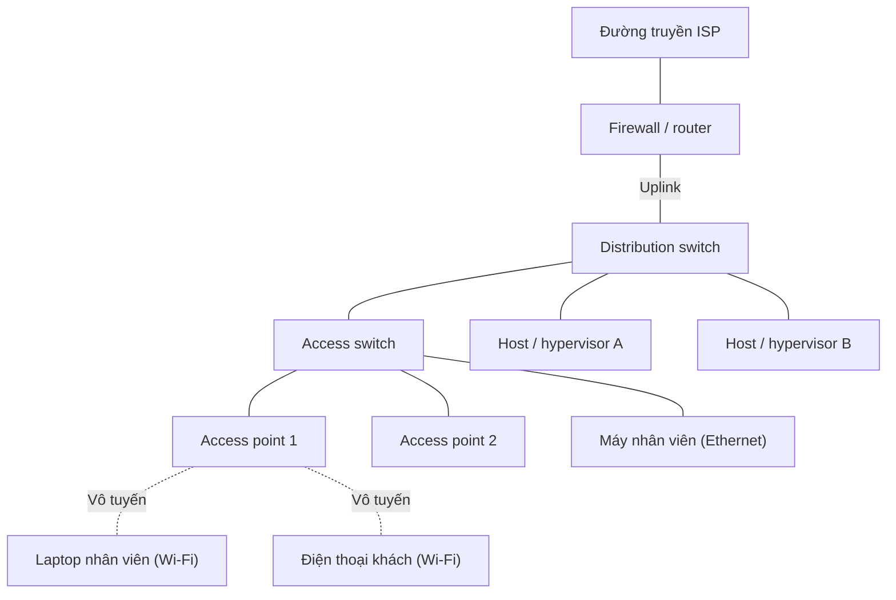
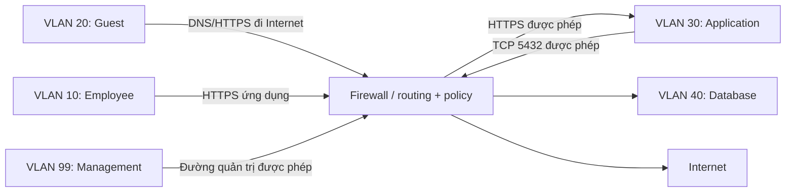
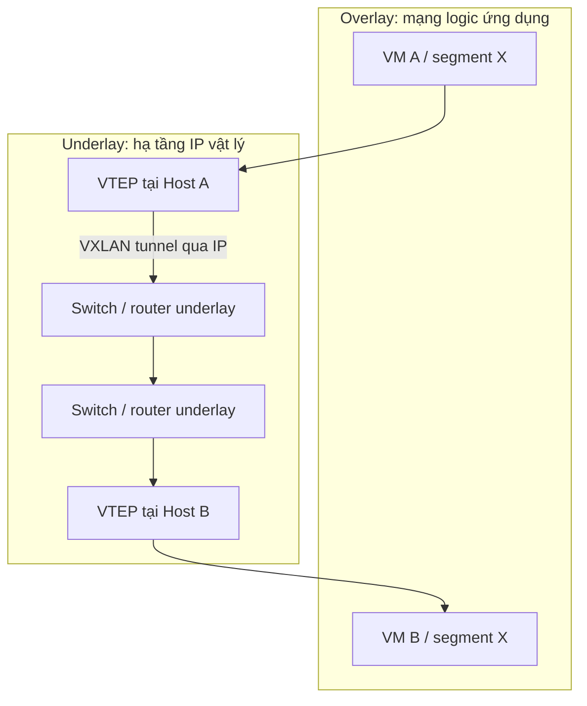

# Mạng vật lý và mạng logic

Một doanh nghiệp có thể sử dụng cùng một hệ thống cáp quang, switch và điểm truy cập Wi-Fi để cung cấp mạng cho nhân viên, khách, ứng dụng nội bộ và máy chủ dữ liệu. Các thiết bị chia sẻ hạ tầng **vật lý** nhưng được tổ chức thành nhiều mạng **logic** với đường đi, địa chỉ và chính sách truy cập khác nhau. Hiểu hai góc nhìn này là điều kiện để thiết kế phân đoạn mạng đúng, phân tích lưu lượng thực tế và xác định nơi cần đặt các lớp phòng vệ.

Trong chương **Mô hình mạng** của **SECURITY_NETWORK_SECURITY**, bài học giải thích cách liên hệ topology vật lý với topology logic; từ đó áp dụng firewall, VPN, IDS/IPS, xác thực kết nối, DNS, Wi-Fi và các cơ chế bảo vệ mạng trên hạ tầng vật lý, ảo hóa và đám mây. Mục tiêu không phải chỉ gọi tên hai mô hình, mà là có thể trả lời: *một gói tin thật sự đi qua đâu, được phép đi tới đâu và ai đang thực thi giới hạn đó?*

## 1. Kết quả học tập

Sau bài này, bạn có thể:

1. Phân biệt **physical network/topology** và **logical network/topology** bằng thành phần, mục đích và cách quan sát.
2. Vẽ hai sơ đồ cho cùng một hệ thống, nhận diện các thiết bị dùng chung và các miền kết nối được tách riêng.
3. Giải thích quan hệ giữa switch port, VLAN, subnet, routing, firewall zone, VRF, VPN, VXLAN và mạng ảo trên cloud.
4. Phân tích một luồng truy cập từ người dùng tới service theo cả đường truyền vật lý lẫn đường đi logic.
5. Thiết kế ma trận kết nối tối thiểu và kiểm chứng việc phân đoạn mạng, kể cả đường đi ngang (*east–west*).
6. Chẩn đoán sự cố theo lớp, tránh nhầm lỗi cáp/cổng với lỗi route, DNS, firewall, xác thực hoặc phân quyền.

## 2. Hai cách nhìn cùng một hệ thống

### 2.1. Mạng vật lý là gì?

**Mạng vật lý** mô tả các tài nguyên và liên kết thực: cáp đồng, cáp quang, sóng vô tuyến, patch panel, switch, router, firewall appliance, access point, NIC, server, máy chủ ảo hóa, rack, nguồn điện và các điểm kết nối đến nhà mạng. **Topology vật lý** trả lời những câu hỏi như:

- Máy tính cắm vào cổng nào trên access switch? Switch nối lên distribution/core bằng các uplink nào?
- Đường đi có dây hay vô tuyến? Chạy qua cáp quang, bộ chuyển đổi quang điện, thiết bị trung gian hay đường truyền WAN nào?
- Những thành phần nào chia sẻ cùng một thiết bị, đường truyền, nguồn điện hoặc vị trí địa lý?
- Nếu đứt một sợi cáp, hỏng switch hoặc mất điện rack, các dịch vụ nào bị ảnh hưởng?

Mạng vật lý bao gồm cả mạng không dây: Wi-Fi dùng sóng vô tuyến, kênh tần số, vị trí AP, công suất phát và vùng phủ sóng. Nó không nhất thiết có hình dạng một đồ thị cáp hoàn toàn hữu hình.

### 2.2. Mạng logic là gì?

**Mạng logic** mô tả cách thiết bị và workload được nhóm, định địa chỉ, định tuyến và cho phép kết nối với nhau. **Topology logic** thể hiện các miền quảng bá hoặc định tuyến, các kết nối ảo và các ranh giới chính sách, bất kể tài nguyên nằm trên phần cứng cụ thể nào.

Ví dụ: hai laptop cùng kết nối một access point nhưng thuộc hai SSID được ánh xạ tới hai VLAN khác nhau; hai VM cùng một hypervisor nhưng nằm ở hai mạng ảo khác nhau; một microservice ở hai máy vật lý khác nhau có thể thuộc cùng overlay network. Những trường hợp đó có **liên kết vật lý dùng chung** nhưng **tổ chức logic khác nhau**.

Thành phần logic thường gặp: MAC address và miền Ethernet ở lớp liên kết, VLAN, IP address/subnet, bảng định tuyến, VRF, virtual switch, VXLAN/overlay, VPN tunnel, VPC/VNet, route table, security group, ACL, Kubernetes pod/service network và chính sách phân đoạn.

### 2.3. Logical topology khác security boundary

Việc hai đối tượng được đặt ở **hai subnet** hoặc **hai VLAN** giúp định nghĩa miền kết nối và nơi có thể áp chính sách; điều đó **chưa bảo đảm** chúng không truy cập nhau. Nếu router cho phép định tuyến giữa hai subnet mà không lọc, chúng vẫn có thể giao tiếp. Ngược lại, hai ứng dụng cùng subnet có thể bị kiểm soát bằng host firewall hoặc chính sách workload.

Do đó cần phân biệt:

- **Phân chia logic:** hệ thống được chia thành những miền địa chỉ và đường truyền nào?
- **Ranh giới tin cậy:** từ miền nào sang miền nào xuất hiện thay đổi về danh tính, đặc quyền hoặc dữ liệu?
- **Điểm thực thi:** firewall, switch ACL, cloud security group, host firewall, service mesh policy hoặc ứng dụng nào thực sự chặn truy cập trái phép?

Một thiết kế mạng an toàn phải chỉ rõ cả ba.

## 3. So sánh nhanh

| Tiêu chí | Mạng vật lý | Mạng logic |
|---|---|---|
| Đối tượng biểu diễn | Thiết bị, cổng, đường cáp, liên kết vô tuyến, vị trí | VLAN, subnet, tuyến đường, zone, tunnel, mạng ảo, policy |
| Câu hỏi chính | “Đã cắm/nối qua đâu?” | “Ai có thể truyền đến ai và qua đường nào?” |
| Đơn vị thường thấy | Switch, router, AP, NIC, fiber, rack, uplink | L2 broadcast domain, L3 network, VRF, VPC, overlay, security policy |
| Thay đổi điển hình | Chuyển cáp, thay switch, bổ sung uplink | Đổi VLAN, route, IP, ACL, virtual network hoặc tunnel |
| Sự cố đặc trưng | Mất link, hỏng transceiver, nhiễu Wi-Fi, mất nguồn | Sai VLAN, route thiếu, DNS lỗi, firewall chặn, policy mở quá rộng |
| Bảo mật đặc trưng | Khóa rack, bảo vệ cổng, chống cắm thiết bị lạ, dự phòng | Least privilege, segmentation, IAM, ACL, TLS/mTLS, logging |
| Khả năng quan sát | Sơ đồ rack/cáp, LLDP, trạng thái interface, đo quang, RF survey | MAC/ARP/ND, bảng VLAN, FIB/route, flow log, firewall log, service policy |
| Rủi ro khi đọc sai | Bỏ sót điểm hỏng chung, đường cáp/đường phát sóng thực | Tưởng “cùng switch là cùng quyền”, hoặc “khác subnet là đã an toàn” |

Hai mô hình **không loại trừ** nhau; cùng một thiết kế cần cả hai để vận hành và kiểm chứng bảo mật.

## 4. Ví dụ: hai sơ đồ của cùng một văn phòng

Giả sử doanh nghiệp có kết nối Internet, firewall, một distribution switch, một access switch, hai access point và hai máy chủ chạy ứng dụng, cơ sở dữ liệu. Nhân viên và khách truy cập Wi-Fi, nhưng khách không được truy cập mạng máy chủ nội bộ.

### 4.1. Sơ đồ vật lý



Sơ đồ cho thấy AP có thể phục vụ cả hai nhóm người dùng, còn máy chủ được nối về cùng distribution switch. Nó cho biết các **điểm hỏng chung** và đường truyền cần dự phòng, nhưng chưa nói ai được truy cập cơ sở dữ liệu.

### 4.2. Sơ đồ logic

Giả sử nhóm mạng được phân chia như sau (địa chỉ thuộc dải ví dụ riêng tư, cần thay bằng quy hoạch thực tế):

| Zone logic | VLAN | Subnet minh họa | Mục đích |
|---|---:|---|---|
| Employee | 10 | `10.20.10.0/24` | Thiết bị nhân viên đã được xác thực |
| Guest | 20 | `10.20.20.0/24` | Internet cho khách, không vào tài nguyên nội bộ |
| Application | 30 | `10.20.30.0/24` | API và dịch vụ ứng dụng |
| Database | 40 | `10.20.40.0/24` | Cơ sở dữ liệu; chỉ nhận kết nối cần thiết |
| Management | 99 | `10.20.99.0/24` | Quản trị hạ tầng có kiểm soát |



Các mũi tên mô tả **luồng dự kiến** chứ không khẳng định mọi packet luôn đi qua cùng một firewall: đường đi thực tế tùy vị trí default gateway, SVI, route và policy trong hạ tầng. Nếu định tuyến giữa VLAN nằm ngay trên L3 switch, cần triển khai ACL hoặc policy tương đương tại chính thiết bị đó, hoặc chuyển các luồng nhạy cảm qua firewall để kiểm tra.

Một switch vật lý có thể đồng thời chuyển tiếp lưu lượng của cả năm VLAN. Về mặt logic, đây là năm nhóm cần chính sách riêng. Chia VLAN không tự động có nghĩa là “đã có firewall” giữa các VLAN.

### 4.3. Ánh xạ vật lý ↔ logic

| Tài nguyên vật lý | Cấu hình logic | Nhận xét bảo mật |
|---|---|---|
| Port nối máy nhân viên | Access port VLAN 10 | Khóa cấu hình port; cân nhắc 802.1X/NAC |
| Port nối AP | Trunk/ánh xạ VLAN 10 và 20 nếu thiết kế hỗ trợ | SSID Employee và Guest phải đi về đúng miền riêng |
| Uplink access ↔ distribution switch | Trunk mang các VLAN được phép | Giới hạn danh sách VLAN; kiểm tra native VLAN và cấu hình hai đầu |
| NIC vật lý của hypervisor | Virtual switch/uplink phục vụ mạng VM | Quản lý port group, VLAN tag, uplink và quyền thay cấu hình |
| NIC máy chủ ứng dụng | VLAN 30; IP thuộc subnet ứng dụng | Chỉ mở cổng cần thiết từ nguồn phù hợp |
| NIC máy chủ dữ liệu | VLAN 40; IP thuộc subnet dữ liệu | Không mở public ingress; DB dùng tài khoản tối thiểu |
| Cổng quản trị switch/firewall/hypervisor | Management VLAN 99 hoặc mạng quản trị riêng | Hạn chế thiết bị, người dùng, giao thức và audit |

Khi triển khai, hãy ghi lại **chủ sở hữu chính sách** cho từng luồng: firewall trung tâm, ACL trên switch, cloud security group hay host firewall. Không thể kết luận một luồng bị chặn chỉ bằng cách nhìn tên VLAN.

## 5. VLAN, subnet và routing: ba khái niệm dễ nhầm

### 5.1. VLAN: phân nhóm ở lớp liên kết dữ liệu

**VLAN (Virtual LAN)** thường tạo các miền Ethernet logic riêng trên một hoặc nhiều switch. Trong Ethernet 802.1Q, frame có thể mang thông tin VLAN tag khi đi qua đường trunk. Port dạng **access** thường gắn các frame chưa tag của một thiết bị với VLAN xác định; port dạng **trunk** mang nhiều VLAN theo cấu hình.

Trong mô hình thông thường, các frame broadcast lớp 2 thuộc VLAN này không tự được chuyển vào VLAN khác. Tuy nhiên, thiết bị có chức năng định tuyến hoặc bridge đặc biệt có thể kết nối các miền, và cấu hình sai trunk/port sẽ làm mất khả năng cô lập mong muốn.

Các điểm cần kiểm tra: VLAN nào được phép trên trunk, mapping port/SSID/VM tới VLAN, cấu hình native/untagged VLAN, cơ chế chống loop như STP khi phù hợp, và quyền thay đổi cấu hình switch. **VLAN tag không phải danh tính bảo mật của người dùng**.

### 5.2. Subnet: phân vùng địa chỉ IP

**IP subnet** mô tả tập địa chỉ và tiền tố mạng, ví dụ `10.20.30.0/24`. Thiết bị dựa vào địa chỉ, tiền tố và bảng định tuyến để quyết định đích được coi là trực tiếp hay cần đi qua gateway. Trong triển khai Ethernet thông thường, một VLAN hay đi với một IP subnet để dễ quản lý, **nhưng hai khái niệm không đồng nhất**.

- Một VLAN có thể chứa nhiều IP subnet (dù không phải lúc nào cũng là thiết kế nên chọn).
- Một mạng IP có thể được kéo qua nhiều liên kết vật lý nhờ cơ chế L2/overlay phù hợp.
- Cùng tiền tố IP ở hai VRF khác nhau có thể được sử dụng độc lập vì VRF có bảng route riêng.
- Chỉ cùng `/24` trên giấy không chứng minh hai thiết bị thực sự cùng miền L2; còn phải kiểm tra đường đi và cấu hình thực tế.

Subnet không tự ngăn việc một máy ở subnet khác truy cập vào máy đích. Quyết định này nằm ở routing và security policy.

### 5.3. Routing: nối các miền IP logic

**Router** hoặc **Layer-3 switch** chuyển tiếp gói giữa các mạng IP theo bảng định tuyến và các quy tắc liên quan. **Inter-VLAN routing** cho phép host ở VLAN 10 truy cập một dịch vụ ở VLAN 30 nếu có route và policy cho phép. Vì vậy:

1. **VLAN** trả lời “frame thuộc miền L2 nào?”.
2. **Subnet/route** trả lời “gói IP đi tới mạng đích qua đâu?”.
3. **Firewall/ACL/IAM** trả lời “nguồn đó có được giao tiếp với đích và chức năng đó không?”.

**NAT** thay đổi cách ánh xạ địa chỉ/cổng trong một luồng; NAT không phải cơ chế phân quyền hoàn chỉnh và cũng không đồng nghĩa với firewall. Đừng suy từ “không có public IP” rằng hệ thống không thể bị truy cập qua peering, VPN, proxy, NAT/forwarding hoặc một workload bị xâm nhập.

### 5.4. VRF: tách miền định tuyến

**VRF (Virtual Routing and Forwarding)** cho phép tạo nhiều bảng định tuyến logic trên cùng router/switch. Hai tenant có thể dùng cùng không gian địa chỉ private trong các VRF khác nhau, tùy thiết kế. Muốn trao đổi giữa hai VRF cần cơ chế liên kết/route leaking hoặc thiết bị trung gian phù hợp. Cấu hình route leaking không kiểm soát có thể làm mất mục đích phân tách.

VRF là phân tách **mạng và đường định tuyến**; yêu cầu xác thực, mã hóa và phân quyền ứng dụng vẫn tồn tại.

## 6. Underlay và overlay: mạng ảo nằm trên hạ tầng vật lý

Trong trung tâm dữ liệu và cloud, một **underlay network** thường cung cấp khả năng IP reachability giữa các thiết bị vật lý hoặc các điểm kết thúc tunnel. **Overlay network** tạo kết nối logic trên underlay bằng cơ chế đóng gói. Ví dụ, VXLAN có thể mang frame Ethernet của một mạng logic qua hạ tầng IP và dùng VNI để nhận diện các segment overlay.



Trong triển khai hiện đại, EVPN có thể được dùng làm control plane phân phối thông tin reachability/endpoint cho VXLAN. Đó là cơ chế hoạt động khác với policy bảo mật: **có VNI riêng không thay thế firewall, ACL hoặc kiểm soát danh tính**.

**Vấn đề vận hành thường gặp:**

- MTU không đủ cho phần header đóng gói, khiến một số luồng lớn gặp lỗi dù ping nhỏ vẫn thành công.
- Underlay vẫn có route nhưng overlay lỗi do VTEP, control plane, mapping VNI hoặc policy.
- Một cấu hình overlay sai có thể làm hai tenant lộ traffic hoặc reachability ngoài dự kiến.
- Một lỗi ở switch/uplink vật lý có thể làm gián đoạn nhiều mạng logic chạy trên nó.
- Telemetry của underlay và overlay cần được đối chiếu; chỉ quan sát một lớp sẽ thiếu bối cảnh.

**VPN** cũng tạo một dạng đường truyền logic qua hạ tầng khác: tunnel IPsec/WireGuard hoặc giải pháp phù hợp nối các điểm ở xa. Mục tiêu, bảo đảm mật mã và chính sách định tuyến của từng VPN khác nhau. Có tunnel hoạt động không đồng nghĩa mọi người dùng hoặc thiết bị bên trong đã được cấp quyền truy cập toàn bộ mạng đích.

## 7. Mạng logic trong Wi-Fi, cloud và Kubernetes

### 7.1. Wi-Fi: một AP, nhiều miền logic

Một AP có thể phát hai SSID, ví dụ `Corp` và `Guest`, trên cùng phần cứng, băng tần và liên kết uplink. Mỗi SSID có thể được ánh xạ tới VLAN, policy hoặc tunnel khác nhau. Nhân viên có thể dùng WPA2/WPA3-Enterprise với 802.1X/EAP và RADIUS; khách có thể dùng mạng tách biệt với client isolation và chính sách chỉ ra Internet.

Tuy nhiên **SSID không tự là security boundary mạnh**. Phải kiểm tra cách AP/controller bridge hoặc tunnel traffic, VLAN gắn vào uplink, ACL/firewall giữa các mạng, quyền truy cập từ thiết bị khách tới tài nguyên nội bộ và từ khách này tới khách khác. Về vật lý, hai nhóm vẫn chia sẻ phổ vô tuyến và năng lực AP, nên nhiễu hoặc quá tải có thể ảnh hưởng cả hai.

### 7.2. Cloud: VPC/VNet trên hạ tầng do nhà cung cấp quản lý

Trong cloud, người dùng ít nhìn thấy switch/cáp bên dưới; họ thiết kế VPC/VNet, subnet, route table, internet/NAT gateway, peering, transit gateway, firewall, security group và network ACL theo dịch vụ của nhà cung cấp. VPC hoặc VNet là **miền mạng logic** trên hạ tầng vật lý dùng chung có cơ chế cô lập của nhà cung cấp.

Ví dụ một kiến trúc ứng dụng phổ biến:

| Nhóm tài nguyên | Network placement | Đường truy cập dự kiến |
|---|---|---|
| Public load balancer | Subnet/điểm truy cập public theo thiết kế | Nhận HTTPS từ Internet |
| Application service | Subnet private | Chỉ nhận từ load balancer và các service được phép |
| Database | Subnet private riêng | Chỉ nhận kết nối DB từ application service |
| Quản trị | Đường quản trị có danh tính và quyền được kiểm soát | Không mở SSH/RDP tùy ý từ Internet |

Một subnet được gọi là “private” chủ yếu mô tả đường định tuyến/khả năng công khai trong thiết kế, **không thay thế** security group, IAM, chính sách DB và xác minh ứng dụng. Peering, VPN site-to-site, gateway khác hoặc kết nối outbound có thể tạo thêm đường đi cần kiểm tra. Các tính năng và quy tắc cụ thể khác nhau giữa AWS, Azure, GCP và từng dịch vụ: phải xác minh trên nền tảng đang dùng.

### 7.3. Kubernetes: pod network và service abstraction

Pod có thể nhận địa chỉ IP theo CNI, được phân bố trên nhiều node vật lý, còn **Service** cung cấp địa chỉ/tên ổn định ở mức logic và chuyển tiếp tới endpoint phù hợp. Kubernetes namespace là phạm vi tổ chức và quản lý đối tượng; **không tự là hàng rào mạng**. `NetworkPolicy` mô tả các luồng được phép giữa pod/namespace/IP, nhưng khả năng thực thi phụ thuộc CNI và các policy khác.

Ví dụ hai pod cùng node vẫn có thể nằm ở các nhóm quyền khác nhau; hai pod ở hai node có thể giao tiếp qua overlay trên underlay. Ngược lại, cấu hình `hostNetwork`, host-level access, egress và các đường đi ngoài CNI có thể cần kiểm soát bổ sung. Cần kiểm tra cả bảo mật service-to-service (mTLS, identity và authorization), không chỉ network reachability.

## 8. Theo dấu một luồng qua cả hai mô hình

Hãy xem một nhân viên trên Wi-Fi truy cập `https://orders.example.test` để xem đơn hàng. Hệ thống có DNS resolver, gateway HTTPS, Order API và PostgreSQL.

**Giai đoạn 1 – Kết nối vật lý:** laptop liên lạc qua sóng Wi-Fi tới AP. Frame đi qua uplink Ethernet và switch đến thiết bị thực hiện routing/firewall. Nếu Wi-Fi nhiễu, AP mất nguồn hoặc trunk bị đứt, kết nối thất bại ngay cả khi mọi route và policy logic đều đúng.

**Giai đoạn 2 – Gia nhập mạng logic:** xác thực mạng 802.1X thành công có thể khiến client được gán vào VLAN Employee theo policy. Client nhận thông số IP/gateway/DNS qua DHCP hoặc cấu hình khác. Nếu bị gán nhầm VLAN Guest, truy cập ứng dụng nội bộ có thể bị chặn một cách đúng đắn.

**Giai đoạn 3 – Phân giải tên:** client hỏi DNS về `orders.example.test`. Kết quả và đường truy cập DNS phụ thuộc thiết kế (DNS nội bộ, split-horizon, resolver bảo mật, DNS over HTTPS...). Phân giải thành công chỉ chứng minh tên đã được ánh xạ thành địa chỉ theo resolver hiện dùng, **không chứng minh** endpoint là dịch vụ đáng tin.

**Giai đoạn 4 – Định tuyến và kết nối:** client tra route, gửi gói qua gateway nếu đích không thuộc phạm vi trực tiếp; gateway/firewall kiểm tra nguồn, đích, cổng và trạng thái kết nối. Tùy topology, HTTPS có thể đi qua Internet hoặc đường private tới reverse proxy/load balancer. Kiểm tra đường thực tế, không suy đoán từ tên zone.

**Giai đoạn 5 – TLS và danh tính:** TLS bảo vệ lưu lượng trên đường truyền và giúp client xác minh máy chủ qua chứng chỉ theo cấu hình. Gateway/API xác thực người dùng hoặc token. Một kết nối được mã hóa và có IP nhân viên vẫn có thể chứa request độc hại, nên kiểm tra input và phân quyền phải được duy trì.

**Giai đoạn 6 – Lưu lượng ngang tới backend:** gateway chuyển request tới Order API theo policy của application zone. API dùng kết nối DB có quyền cần thiết để đọc đơn hàng. Mỗi chặng có thể chạy trên VM khác host, container, overlay hoặc cùng máy vật lý; cần bảo vệ cả traffic east–west.

**Giai đoạn 7 – Quyết định truy cập dữ liệu:** API xác định người dùng có quyền đọc đơn hàng cụ thể hay không. Đây là **ranh giới logic ở tầng ứng dụng**; VLAN/subnet không thể tự đảm nhiệm logic sở hữu bản ghi.

**Giai đoạn 8 – Quan sát:** kết hợp Wi-Fi/AP telemetry, switch interface counters, routing table, firewall logs, DNS logs, flow logs và application traces theo thời gian/request ID. Một lỗi người dùng thấy là “không mở được trang” có thể nằm ở nhiều lớp khác nhau.

### Ma trận minh họa cho luồng hợp lệ

| Nguồn | Đích | Cổng/giao thức minh họa | Chính sách mong muốn | Nơi xác minh |
|---|---|---|---|---|
| Employee VLAN | DNS resolver được phép | UDP/TCP 53 hoặc DNS bảo mật theo thiết kế | Chỉ tới resolver đã chọn | ACL/firewall, DNS logs |
| Employee VLAN | HTTPS gateway | TCP 443 | Cho phép; cần TLS và kiểm soát user | Firewall, gateway, ứng dụng |
| Guest VLAN | HTTPS gateway nội bộ | TCP 443 | Từ chối nếu là ứng dụng chỉ dành cho nhân viên | Firewall/ACL và xác thực ứng dụng |
| Guest VLAN | Internet | HTTPS/DNS theo policy | Cho phép có kiểm soát | Edge firewall/NAT/DNS |
| Gateway | Order API | TCP 8443 | Chỉ nguồn gateway được gọi; TLS/mTLS khi phù hợp | SG/ACL và xác thực service |
| Order API | PostgreSQL | TCP 5432 | Chỉ API được kết nối; DB auth/role riêng | Network policy + DB |
| Employee VLAN | PostgreSQL | TCP 5432 | Từ chối trực tiếp | Firewall/ACL |
| Management zone | Thiết bị quản trị | SSH/HTTPS theo nhu cầu | MFA, RBAC, audit, nguồn được phép | IAM/ZTNA/bastion, host ACL |

Các cổng chỉ dùng để minh họa; hãy thay bằng cổng và giao thức thực tế. Mỗi dòng cần chủ sở hữu policy, nguồn/đích rõ ràng và kiểm thử cho cả luồng được phép lẫn luồng bị chặn.

## 9. Liên hệ với an toàn mạng: đe dọa ở từng lớp

Một mô hình mạng chỉ hữu ích cho bảo mật khi ta biết kẻ tấn công có thể kiểm soát thành phần nào và hậu quả khi một ranh giới không được thực thi.

| Tình huống | Góc nhìn vật lý | Góc nhìn logic / hành vi | Kiểm soát, bằng chứng cần có |
|---|---|---|---|
| Cắm thiết bị trái phép vào ổ mạng | Ổ cắm, access switch, cổng đang hoạt động | Thiết bị bị gán mạng nào, có quyền truy cập gì? | 802.1X/NAC, quản lý port, logging |
| Guest truy cập được file server | Dùng cùng AP/uplink | VLAN/ACL/gateway bị cấu hình rộng hoặc thiếu policy | SSID→VLAN mapping, route/ACL, negative test |
| Từ một VM bị xâm nhập quét các VM khác | VM có thể cùng hoặc khác host | East–west reachability quá rộng | Microsegmentation, host firewall, IDS/flow log |
| Mất Internet toàn văn phòng | Đường ISP, firewall hoặc nguồn mất | Route failover, DNS và policy có hoạt động sau chuyển tuyến? | Redundancy, theo dõi interface/BGP/health |
| Truy cập dữ liệu chéo tenant | Tenant có thể dùng chung hạ tầng | Routing/segmentation sai hoặc API thiếu phân quyền | VRF/VNI/SG phù hợp; authz theo tenant |
| Mất kết nối khi tăng MTU payload | Liên kết vật lý vẫn up | Overlay/tunnel đóng gói làm vượt MTU/PMTUD không hoạt động | Kiểm tra MTU end-to-end, counters, capture |
| Workload gửi request tới metadata cloud | Không có đường cáp mới | Egress route/policy cho phép vượt boundary không mong muốn | Chặn đích nhạy cảm, kiểm soát SSRF, egress log |
| Tấn công vào DNS resolver | Máy nguồn vẫn kết nối Wi-Fi/Ethernet | Kết quả phân giải bị giả mạo/sửa đổi hoặc policy resolver sai | DNS policy, xác minh nguồn, DNSSEC nơi phù hợp, logging |

**STRIDE** giúp đặt câu hỏi có hệ thống trên từng đường đi: giả mạo danh tính (*Spoofing*), sửa đổi (*Tampering*), chối bỏ (*Repudiation*), lộ thông tin (*Information disclosure*), từ chối dịch vụ (*Denial of service*) và leo thang quyền (*Elevation of privilege*). Ví dụ, việc thiết bị khách ở cùng AP không trực tiếp cho phép giả mạo nhân viên; rủi ro cụ thể xuất hiện nếu ánh xạ SSID/VLAN, xác thực thiết bị, route và policy cho phép truy cập trái phép.

### Phòng vệ nhiều lớp theo topology

- **Lớp vật lý:** kiểm soát truy cập phòng máy/rack, bảo vệ cáp và cổng, điện dự phòng, thiết bị và liên kết dự phòng, giám sát tình trạng AP/switch.
- **Lớp liên kết:** xác thực 802.1X/NAC, VLAN assignment, giới hạn trunk, bảo vệ chống loop và các tấn công L2 phù hợp khả năng switch.
- **Lớp mạng:** subnet/routing/VRF, firewall, ACL, phân đoạn nội bộ, kiểm soát VPN và egress, IPsec nếu cần.
- **Lớp transport/ứng dụng:** TLS/mTLS, xác thực chủ thể, phân quyền tài nguyên, xác thực input, chính sách API và log/audit.
- **Lớp quan sát và phản ứng:** IDS/IPS, flow logs, anomaly detection, inventory và kiểm thử định kỳ các đường đi.

Không lớp nào bù được mọi cấu hình sai ở lớp khác. Ví dụ, mã hóa TLS bảo vệ nội dung lưu lượng nhưng không ngăn dịch vụ gọi sai đích; VLAN giới hạn phạm vi L2 nhưng không tự xác minh người dùng có quyền xem một bản ghi.

## 10. Quan sát và gỡ lỗi theo thứ tự

Khi người dùng báo “mạng không vào được API”, hãy kiểm tra vấn đề theo hai sơ đồ và ghi kết quả có thể đối chiếu.

### 10.1. Trình tự đề xuất

1. **Tài sản và thời điểm:** xác định client, SSID/cổng, hostname/IP đích, giao thức/cổng, thời gian, thay đổi gần nhất.
2. **Physical/link:** kiểm tra nguồn, trạng thái NIC/interface, Wi-Fi RSSI/chất lượng kết nối, lỗi CRC, uplink và trạng thái thiết bị trung gian.
3. **L2/logical membership:** client được gán vào VLAN nào? Access/trunk đúng chưa? AP map SSID tới VLAN nào? Có MAC học trên cổng kỳ vọng không?
4. **L3/routing:** địa chỉ IP, subnet mask/prefix, gateway, route, VRF, route table, đường trở về có đúng không? Có thay đổi NAT không?
5. **Name resolution:** tên được phân giải thành địa chỉ nào, resolver nào trả lời, có dùng split DNS hoặc proxy không?
6. **L4/network policy:** thử TCP đến đúng cổng; xem firewall/ACL/SG/NetworkPolicy/host firewall và trạng thái phiên. Lưu ý bất đối xứng định tuyến có thể làm stateful firewall chặn.
7. **TLS/auth/application:** kiểm tra chứng chỉ, hostname, TLS handshake, mã HTTP, log xác thực/phân quyền, health của service và DB.
8. **Đối chiếu telemetry:** dùng timestamp và correlation ID để xác định chính xác chặng lỗi; không tùy tiện nới ACL toàn mạng để “thử cho nhanh”.

### 10.2. Một số lệnh quan sát (Linux, chạy trên hệ thống được phép)

```bash
# Xem interface, địa chỉ và bảng định tuyến ở host hiện tại
ip -br link
ip -br addr
ip route
ip -6 route

# Kiểm tra phân giải DNS và đường kết nối ứng dụng
getent ahosts orders.example.test
curl -v --connect-timeout 5 https://orders.example.test/health

# Kiểm tra cổng TCP bằng công cụ phù hợp có sẵn ở máy
nc -vz -w 3 orders.example.test 443

# Nếu trên Linux bridge có VLAN filtering, kiểm tra VLAN port mapping
bridge vlan show
```

Kết quả `curl` có TLS/HTTP response chứng minh đã qua được một số lớp tương ứng, nhưng không tự chứng minh tất cả đường khác đều an toàn. `ping` không thành công cũng chưa đủ kết luận host mất kết nối: ICMP có thể bị chặn trong khi HTTPS hoạt động. Một route hiển thị trên máy nguồn không chứng minh policy ở mọi hop cho phép packet đi tới đích.

Trên switch quản lý, quan sát interface status, MAC address table, VLAN membership, LLDP neighbors và counters theo cú pháp của nhà sản xuất. Trên cloud, xem VPC flow logs, route tables, security group và network ACL. Với overlay, thêm trạng thái tunnel/VTEP, VNI, MTU và các policy workload; với Wi-Fi, thêm kết quả 802.1X/RADIUS và VLAN assignment. Việc đọc gói tin (packet capture) chỉ nên làm tại điểm quan sát được cấp quyền, đồng thời hạn chế thu thập thông tin nhạy cảm.

### 10.3. Phân biệt nhanh các biểu hiện

| Dấu hiệu | Giả thuyết nên kiểm tra trước | Không nên suy diễn |
|---|---|---|
| Interface `DOWN`, không thấy sóng AP | Cáp, nguồn, transceiver, RF/SSID | “Firewall đang chặn” |
| Có Wi-Fi nhưng sai dải IP | VLAN assignment, DHCP, 802.1X policy | “AP đã ổn nên mạng đúng” |
| DNS trả địa chỉ sai | Resolver, record, split-horizon/cache | “TCP 443 ở server bị lỗi” |
| DNS đúng, TCP timeout | Route, ACL, SG, service listener, đường về | “API đã từ chối quyền” |
| TCP thành công, TLS lỗi | Certificate/hostname, TLS policy, proxy | “Subnet không thông” |
| HTTP 401/403 | Xác thực, token, phân quyền, gateway policy | “Mất uplink” |
| Chỉ packet lớn thất bại | MTU/PMTUD, tunnel, fragmentation/encapsulation | “Ứng dụng hoàn toàn không reachable” |

## 11. Thiết kế phân đoạn: từ sơ đồ đến chính sách

Quy trình làm việc có thể áp dụng với LAN, trung tâm dữ liệu hoặc cloud:

**Bước 1 – Kiểm kê và gắn nhãn tài sản.** Liệt kê client, thiết bị mạng, workload, dữ liệu, môi trường, owner và mức nhạy cảm. Ghi cả IP/hostname, VLAN/VPC, vị trí vật lý, phụ thuộc DNS/NTP và đường quản trị.

**Bước 2 – Vẽ physical topology.** Đánh dấu ISP, cáp/uplink, switch/router/firewall, AP, host, nguồn điện và đường dự phòng. Nhận diện những thành phần mà nhiều zone cùng phụ thuộc.

**Bước 3 – Vẽ logical topology.** Đánh dấu VLAN/subnet, VRF, route tables, security zones, overlay/tunnel, network identities, gateway, DNS và các đường kết nối giữa service. Đừng quên luồng outbound và east–west.

**Bước 4 – Tạo ma trận kết nối.** Mỗi dòng ghi nguồn, đích, protocol/port, mục đích nghiệp vụ, danh tính, policy thực thi và cách kiểm thử. Mặc định từ chối các kết nối không có nhu cầu rõ ràng.

**Bước 5 – Đặt policy tại đúng điểm.** Nếu inter-VLAN routing trên L3 switch thì phải kiểm soát tại đó hoặc bắt buộc đi qua firewall thích hợp. Nếu microservice giao tiếp trực tiếp trong cluster, thêm network policy/identity tương ứng. Nếu dùng cloud, rà soát tất cả peering, gateway và route không hiển thị rõ ở sơ đồ đơn giản.

**Bước 6 – Kiểm tra thực tế.** Thực hiện cả positive test (luồng hợp lệ hoạt động) và negative test (luồng trái phép bị chặn). Thử từ nhiều điểm nguồn, cả IPv4/IPv6 nếu triển khai, và kiểm tra đường dự phòng khi có chuyển tuyến.

**Bước 7 – Theo dõi drift.** Sau thay đổi VLAN, SSID, router, firewall rule, hạ tầng ảo hoặc topology cloud, đối chiếu cấu hình thực tế với sơ đồ và kết quả kiểm thử; lưu bằng chứng thay đổi và log.

### Hai phép thử minh họa

**Positive test:** máy của nhân viên sau khi xác thực 802.1X vào Employee VLAN, có IP/DNS/gateway đúng, truy cập HTTPS gateway thành công; gateway gọi Order API; Order API kết nối DB với đúng quyền và trả kết quả cho tài khoản có quyền.

**Negative test:** máy khách thuộc Guest VLAN hoặc một pod không được phép thử mở TCP tới DB; kết nối bị chặn ở policy mạng. Nếu máy khách vẫn mở được TCP tới DB nhưng bị DB từ chối đăng nhập, nghĩa là **lớp xác thực DB có hoạt động nhưng policy phân đoạn chưa đạt yêu cầu**.

Đây là lý do phải kiểm thử kết quả ở từng lớp thay vì chỉ dựa vào việc “đăng nhập không thành công”.

## 12. Những hiểu lầm thường gặp

**“Cùng switch là cùng mạng.”** Một switch có thể mang nhiều VLAN hoặc VRF/virtual network ở các mức khác nhau. Muốn biết hai máy có chung miền L2 hay không cần xem port membership và cấu hình chuyển tiếp.

**“Khác VLAN là không giao tiếp được.”** Router/L3 switch có thể định tuyến giữa VLAN. Phải xem route và ACL/firewall để biết giao tiếp có được cho phép hay không.

**“Cùng subnet thì không có ranh giới bảo mật.”** Host firewall, network policy, IAM và phân quyền ứng dụng vẫn có thể phân tách mức truy cập, dù cùng subnet. Ngược lại, cùng subnet không bảo đảm hai host có reachability thực tế.

**“Mạng cloud không có topology vật lý.”** Cloud vẫn chạy trên thiết bị, đường truyền và vùng lỗi vật lý; nhà cung cấp trừu tượng hóa nhiều chi tiết. Thiết kế cần xét availability zone, vùng địa lý, đường kết nối riêng và giới hạn chung của hạ tầng.

**“VPN đã tạo mạng riêng nên mọi thiết bị trong đó đều đáng tin.”** VPN cung cấp kết nối logic với mức bảo vệ kênh tùy giải pháp. Danh tính người dùng, tình trạng thiết bị, phân quyền từng service và audit vẫn phải được thực thi.

**“Có VLAN/NetworkPolicy là đã xử lý toàn bộ bảo mật.”** Phân đoạn giảm phạm vi kết nối và khả năng di chuyển ngang nhưng không tự ngăn lỗi dữ liệu, API thiếu phân quyền, token bị lộ, DNS bị lạm dụng hoặc quyền quản trị quá rộng.

## 13. Bài tập tình huống

**Đề bài:** một công ty có 60 nhân viên, Wi-Fi cho khách, hai host chạy sáu VM ứng dụng, một máy DB và một VPN cho nhân viên làm từ xa. Tất cả hiện cùng một subnet; các VM trên hai host dùng chung switch. Một số máy nhân viên có thể kết nối trực tiếp tới DB. Công ty cần mở thêm môi trường staging nhưng không muốn staging truy cập production DB.

Hãy:

1. Vẽ **một sơ đồ vật lý** chỉ rõ access point, switch, uplink, firewall, hai host, DB và đường VPN.
2. Vẽ **một sơ đồ logic** có ít nhất Employee, Guest, Application Production, Database Production, Staging và Management. Chọn VLAN/subnet hoặc mạng ảo phù hợp và ghi nơi routing giữa các zone diễn ra.
3. Lập **ma trận allowlist** giữa các zone, gồm ít nhất HTTPS tới application, kết nối DB từ production API, DNS cần thiết và truy cập quản trị có xác thực.
4. Chỉ ra ba đường phải chặn: Guest → Production DB, Employee → Production DB trực tiếp, Staging → Production DB.
5. Trình bày hai phép kiểm thử: một positive và một negative; giải thích vì sao kiểm thử “DB từ chối mật khẩu” chưa đủ chứng minh network isolation.

**Gợi ý cách giải:** hạ tầng switch/uplink có thể vẫn dùng chung nhưng tách VLAN/port group và subnet cho từng nhóm. Default gateway/inter-VLAN routing phải có policy thực thi, không chỉ có route. Guest chỉ đi Internet theo nhu cầu; production API được kết nối production DB trên cổng DB cần thiết; staging không có route/policy truy cập production DB; quản trị đi qua identity-aware access/VPN cộng MFA và role. Kiểm tra kết nối TCP bị chặn ở lớp mạng từ nguồn trái phép, sau đó kiểm tra xác thực và phân quyền ở lớp ứng dụng/DB từ nguồn được phép.

### Câu hỏi tự kiểm tra

1. Hai VM cùng một hypervisor nhưng thuộc hai VLAN khác nhau có nhất thiết giao tiếp được không? **Không.** Khả năng giao tiếp phụ thuộc virtual switch, routing và policy.
2. Một VLAN có thể kéo qua nhiều switch vật lý không? **Có**, nếu hạ tầng L2/overlay và trunk được cấu hình phù hợp.
3. Hai VLAN khác nhau có thể truy cập nhau không? **Có**, nếu có inter-VLAN routing và policy cho phép.
4. VLAN khác subnet ở đâu? **VLAN** là phân đoạn logic L2; **subnet** là phân đoạn địa chỉ IP L3; chúng thường được ánh xạ 1-1 nhưng là hai khái niệm khác nhau.
5. Chuyển một service sang private subnet đã bảo đảm dữ liệu an toàn chưa? **Chưa.** Cần xem mọi đường route, security policy, service identity, phân quyền, egress và giám sát.
6. Vì sao cần giữ cả physical topology và logical topology? **Vì** một mô hình cho biết điểm kết nối/hỏng chung, mô hình kia cho biết reachability và ranh giới chính sách; hai mô hình cùng cần để giải thích và kiểm chứng một luồng thực tế.

## 14. Tổng kết kiến thức

**Mạng vật lý** nói về thiết bị và phương tiện thật mang lưu lượng. **Mạng logic** nói về phân nhóm, định địa chỉ, định tuyến và quy tắc để lưu lượng đi qua hạ tầng đó. Một topology vật lý có thể phục vụ nhiều topology logic; một mạng logic có thể trải qua nhiều switch, host hoặc vùng địa lý. 

Để xây dựng kiến trúc mạng an toàn, hãy luôn nối ba câu hỏi: **thiết bị được kết nối vật lý ở đâu → gói tin đi theo miền/route logic nào → chính sách nào thực sự chặn hoặc cho phép nó?** Khi câu trả lời được thể hiện thành sơ đồ, ma trận luồng, cấu hình có thể kiểm tra và kết quả kiểm thử, phân đoạn mạng mới trở thành một biện pháp phòng vệ có thể tin cậy và vận hành lâu dài.

**Thuật ngữ cần nhớ:** physical topology, logical topology, VLAN, subnet, routing, inter-VLAN routing, VRF, underlay, overlay, VXLAN, VTEP, VPC/VNet, security zone, firewall/ACL, microsegmentation, ingress/egress, east–west traffic và trust boundary.
