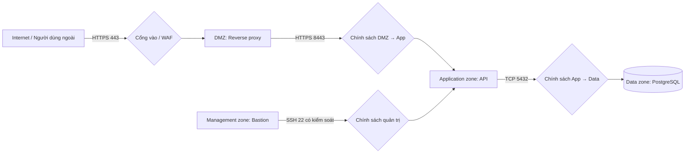

# Điểm giao nhau của các trust zone

Trong một hệ thống mạng, máy chủ công khai, ứng dụng nội bộ, cơ sở dữ liệu và hệ thống quản trị thường không có cùng mức độ tin cậy. Chúng được đặt trong những **trust zone** (vùng tin cậy) khác nhau để giới hạn ai có thể kết nối tới tài nguyên nào. Tuy nhiên, hệ thống chỉ hoạt động khi một số luồng dữ liệu được phép đi từ vùng này sang vùng khác. Những nơi các luồng đó gặp ranh giới tin cậy chính là **điểm giao nhau của các trust zone**.

Đây là chủ đề cốt lõi của mô hình bảo mật mạng: phân đoạn mạng, firewall, VPN, kiểm soát truy cập, giám sát lưu lượng và phòng vệ nhiều lớp đều cần xác định đúng những điểm giao nhau này. Thiết kế tốt giúp các dịch vụ trao đổi dữ liệu cần thiết nhưng hạn chế khả năng kẻ tấn công di chuyển ngang khi một vùng bị xâm nhập.

## 1. Mục tiêu học tập

Sau bài học, bạn có thể:

- Phân biệt trust zone, ranh giới tin cậy và điểm giao nhau giữa các vùng.
- Nhận diện những điểm giao nhau trong hệ thống nhiều tầng, mạng nội bộ, kết nối đối tác và môi trường đám mây.
- Mô tả một luồng kết nối đi qua các ranh giới và xác định nơi phải thực thi chính sách bảo mật.
- Xây dựng ma trận truy cập tối thiểu cho các vùng mạng, bao gồm cả trường hợp cần từ chối.
- Phân tích nguy cơ khi một thiết bị hoặc dịch vụ kết nối với nhiều vùng tin cậy.
- Đề xuất cách kiểm thử và giám sát để phát hiện đường đi vượt qua ranh giới không được phép.

## 2. Trust zone, ranh giới và điểm giao nhau là gì?

### 2.1. Trust zone

**Trust zone** là tập hợp tài nguyên được quản lý theo các giả định tin cậy và yêu cầu bảo vệ tương đối giống nhau. Việc chia vùng có thể dựa trên độ nhạy cảm của dữ liệu, vai trò hệ thống, đối tượng được truy cập hoặc mức độ phơi lộ trước Internet.

Ví dụ, một doanh nghiệp có thể xác định:

| Trust zone | Tài nguyên điển hình | Đặc điểm bảo mật |
| --- | --- | --- |
| Internet / Untrusted | Người dùng bên ngoài, mạng không do doanh nghiệp quản lý | Không mặc định tin cậy nguồn kết nối |
| DMZ (vùng đệm) | Reverse proxy, web gateway, dịch vụ công khai | Tiếp nhận kết nối ngoài, giới hạn quyền vào mạng trong |
| Application zone | API, dịch vụ xử lý nghiệp vụ | Chỉ nhận kết nối từ các thành phần được chỉ định |
| Data zone | Cơ sở dữ liệu, kho dữ liệu nhạy cảm | Giới hạn chặt chẽ nguồn, cổng và danh tính truy cập |
| Management zone | Bastion, hệ thống quản trị, công cụ vận hành | Truy cập đặc quyền, yêu cầu xác thực mạnh và ghi nhận hoạt động |

Trust zone là **khái niệm chính sách**, không nhất thiết tương ứng một-một với VLAN, subnet hay thiết bị vật lý. Một subnet có thể được chia nhỏ bằng chính sách trên máy chủ hoặc workload; ngược lại, nhiều subnet có thể cùng thuộc một vùng nếu thực sự áp dụng chung các yêu cầu bảo vệ. Tên vùng như “nội bộ” cũng không đủ để chứng minh mọi thiết bị trong đó an toàn.

### 2.2. Ranh giới tin cậy

**Ranh giới tin cậy** (*trust boundary*) là nơi kết nối hoặc yêu cầu chuyển từ phạm vi áp dụng một bộ giả định/chính sách sang phạm vi khác. Tại đây cần đưa ra quyết định truy cập dựa trên nguồn, đích, dịch vụ, danh tính, trạng thái thiết bị hoặc các điều kiện thích hợp.

Chẳng hạn, yêu cầu từ reverse proxy trong DMZ đi đến API trong application zone phải được xét lại theo chính sách của application zone, dù reverse proxy đã nhận yêu cầu từ Internet một cách hợp lệ. Một lần đi qua firewall không tạo ra quyền truy cập mặc định tới tất cả các vùng phía sau.

### 2.3. Điểm giao nhau

**Điểm giao nhau của các trust zone** là nơi các vùng có quan hệ trao đổi lưu lượng, phụ thuộc dịch vụ hoặc dùng chung một thành phần kết nối. Trong thiết kế mạng, thường gặp hai tình huống:

1. **Luồng đi qua ranh giới:** dữ liệu từ vùng A đến vùng B thông qua firewall, gateway, proxy, API gateway, VPN gateway, service mesh hoặc một điểm thực thi chính sách khác.
2. **Thành phần tham gia nhiều vùng:** một bastion, máy chủ có nhiều card mạng, dịch vụ DNS dùng chung hoặc thành phần kết nối giữa hệ thống tại chỗ và đám mây có đường liên lạc với các vùng khác nhau.

Điểm giao nhau **không đồng nghĩa với việc hợp nhất mức độ tin cậy**. Một dịch vụ được phép trao đổi với hai vùng không có nghĩa hai vùng đó được phép tự do trao đổi trực tiếp với nhau. Trong trường hợp thành phần kết nối nhiều vùng, phải xác định rõ nó được chuyển tiếp những loại lưu lượng nào và ai có quyền sử dụng nó.

> **Nguyên tắc trọng tâm:** Mỗi lần vượt qua một ranh giới tin cậy là một quyết định truy cập riêng. Quyền từ A đến B và từ B đến C không tự tạo thành quyền từ A đến C.

## 3. Minh họa: hệ thống web nhiều tầng

Xét một hệ thống có giao diện công khai, API nghiệp vụ, cơ sở dữ liệu và đường quản trị riêng.



Trong sơ đồ này, mỗi hình thoi đại diện cho **điểm kiểm soát chính sách logic**. Ngoài thực tế, chúng có thể là firewall vật lý, firewall ảo, security group, ACL, host firewall hay một tổ hợp nhiều lớp. Không nhất thiết phải có một thiết bị độc lập ở từng hình thoi.

Một yêu cầu hợp lệ diễn ra như sau:

1. Người dùng bên ngoài truy cập HTTPS đến điểm vào công khai. Gateway chỉ chấp nhận dịch vụ cần công bố và áp dụng các kiểm soát phù hợp, chẳng hạn giới hạn tốc độ và kiểm tra yêu cầu web.
2. Reverse proxy trong DMZ chuyển yêu cầu tới API qua cổng dịch vụ được phép. Tại ranh giới DMZ → Application, hệ thống chỉ cho phép đúng nguồn proxy gọi đúng API; có thể dùng TLS hai chiều (*mTLS*) để xác thực hai dịch vụ.
3. API xử lý nghiệp vụ và truy cập cơ sở dữ liệu qua kết nối được phép từ application zone đến data zone. Tài khoản cơ sở dữ liệu chỉ được cấp quyền cần thiết cho nghiệp vụ.
4. Phản hồi đi ngược qua các phiên kết nối hợp lệ. Với firewall theo dõi trạng thái (*stateful firewall*), lưu lượng phản hồi của phiên đã thiết lập có thể được cho phép mà không cần mở quyền khởi tạo kết nối mới theo chiều ngược lại.
5. Quản trị viên truy cập hệ thống qua bastion và cơ chế kiểm soát danh tính riêng. Đường quản trị không được suy ra từ quyền sử dụng API của người dùng công khai.

Nếu reverse proxy bị chiếm quyền, kẻ tấn công **không nên** có thể kết nối trực tiếp tới PostgreSQL. Phân đoạn mạng phải chặn đường DMZ → Data; đồng thời ứng dụng và cơ sở dữ liệu vẫn phải kiểm tra yêu cầu vì kẻ tấn công có thể cố lợi dụng chính luồng DMZ → Application hợp lệ.

## 4. Thiết kế chính sách tại điểm giao nhau

### 4.1. Xác định luồng, không chỉ tên vùng

Chính sách “DMZ được vào mạng nội bộ” quá rộng vì không nói rõ máy nào, dịch vụ nào và lý do nghiệp vụ. Thay vào đó, nên xác định ít nhất: **nguồn, đích, chiều khởi tạo, giao thức/cổng, mục đích, điều kiện bổ sung và hành động**.

Giả sử các vùng ví dụ được đánh địa chỉ như sau:

| Vùng | Dải địa chỉ minh họa | Thành phần |
| --- | --- | --- |
| DMZ | `172.16.10.0/24` | Reverse proxy `172.16.10.10` |
| Application | `10.20.20.0/24` | API `10.20.20.15` |
| Data | `10.20.30.0/24` | PostgreSQL `10.20.30.5` |
| Management | `10.20.99.0/24` | Bastion `10.20.99.10` |

Các dải trên chỉ phục vụ bài học; khi triển khai cần dùng đúng kế hoạch địa chỉ và danh tính dịch vụ của hệ thống thực tế.

### 4.2. Ma trận luồng truy cập

| Nguồn khởi tạo | Đích | Dịch vụ | Quyết định | Lý do |
| --- | --- | --- | --- | --- |
| Internet | Reverse proxy DMZ | TCP 443 | Cho phép | Công bố HTTPS cho người dùng |
| Reverse proxy DMZ | API | TCP 8443 | Cho phép có điều kiện | Chỉ proxy được gọi API đã chỉ định; kiểm tra danh tính dịch vụ |
| API | PostgreSQL | TCP 5432 | Cho phép có điều kiện | Chỉ tài khoản ứng dụng và tác vụ được cấp quyền |
| Bastion quản trị | Máy chủ API | TCP 22 | Cho phép có điều kiện | Chỉ phiên quản trị được phê duyệt, xác thực mạnh, ghi log |
| Internet | PostgreSQL | Mọi dịch vụ | Từ chối | Cơ sở dữ liệu không công khai |
| Reverse proxy DMZ | PostgreSQL | Mọi dịch vụ | Từ chối | Ngăn bỏ qua tầng API |
| DMZ | Management zone | Mọi dịch vụ không được khai báo | Từ chối | Không cho đi từ vùng phơi lộ vào hệ quản trị |
| Các cặp nguồn–đích khác | Bất kỳ | Bất kỳ | Từ chối mặc định | Chỉ mở các luồng có nhu cầu đã xác minh |

Các dòng “cho phép có điều kiện” đòi hỏi **nhiều tầng kiểm soát**: firewall xử lý kết nối mạng; xác thực ứng dụng hoặc mTLS kiểm tra danh tính; phân quyền trong API và cơ sở dữ liệu giới hạn thao tác. Firewall mở `TCP 8443` không tự thực hiện kiểm tra người dùng hoặc phân quyền nghiệp vụ.

### 4.3. Biểu diễn chính sách minh họa

Đoạn YAML sau là **mô hình mô tả chính sách**, không phải cấu hình có thể nạp trực tiếp cho một sản phẩm firewall cụ thể:

```yaml
defaultAction: deny
rules:
  - name: public-to-reverse-proxy
    source: internet
    destination: dmz/reverse-proxy
    service: tcp/443
    action: allow

  - name: reverse-proxy-to-api
    source: dmz/reverse-proxy
    destination: application/api
    service: tcp/8443
    action: allow
    applicationControls: [mutual-tls, api-authorization]

  - name: api-to-database
    source: application/api
    destination: data/postgresql
    service: tcp/5432
    action: allow
    applicationControls: [database-authentication, least-privilege-role]

  - name: bastion-to-api-host
    source: management/bastion
    destination: application/api-host
    service: tcp/22
    action: allow
    applicationControls: [strong-admin-authentication, session-audit]
```

Khi chuyển mô hình này thành cấu hình vận hành, cần ánh xạ `source` và `destination` sang đối tượng thật, bảo đảm điểm thực thi nằm trên tuyến lưu lượng, làm rõ cách xử lý kết nối phản hồi và kiểm tra chính sách ở cả hai chiều phù hợp với từng công nghệ.

## 5. Những dạng điểm giao nhau thường gặp

### 5.1. Internet – DMZ – mạng ứng dụng

Đây là mô hình điển hình của lưu lượng **north–south** (giữa môi trường ngoài và hệ thống nội bộ). Điểm giao nhau thường là edge firewall, WAF, reverse proxy hoặc load balancer. Một thành phần công khai chỉ nên nhìn thấy các dịch vụ nội bộ thực sự cần thiết. Không nên dùng quy tắc “allow all” từ toàn bộ DMZ vào application zone vì một máy DMZ bị xâm nhập có thể trở thành bàn đạp tấn công.

### 5.2. Giữa các vùng nội bộ

Các kết nối giữa application zone, data zone, dịch vụ danh tính và hệ thống giám sát thường được xem là **east–west**. Chúng có thể không đi qua firewall biên Internet nhưng vẫn cần phân đoạn. Ví dụ, một dịch vụ phân tích chỉ đọc dữ liệu đã tổng hợp không nên có đường mạng hoặc tài khoản cho phép ghi trực tiếp vào cơ sở dữ liệu giao dịch.

### 5.3. VPN của nhân viên hoặc đối tác

VPN tạo kênh truyền được bảo vệ, nhưng **không biến thiết bị từ xa thành thiết bị được tin cậy hoàn toàn**. Điểm kết thúc VPN là nơi lưu lượng từ mạng bên ngoài gặp chính sách truy cập tài nguyên nội bộ. Nên phân quyền theo nhóm người dùng, trạng thái thiết bị và hệ thống đích; tài khoản đối tác chỉ nên truy cập đúng dịch vụ phục vụ hợp đồng. Cần kiểm tra cả tuyến mạng và cơ chế xác thực ứng dụng ở phía sau VPN.

### 5.4. Hệ thống tại chỗ – đám mây – nhiều VPC/VNet

VPN site-to-site, đường kết nối riêng, cloud transit gateway, peering và các hub định tuyến có thể nối nhiều vùng. Việc **có tuyến đường** không đồng nghĩa **được phép truy cập**: route table xác định khả năng chuyển tiếp; firewall, security group, network ACL và các điểm kiểm soát khác quyết định luồng nào được thông qua. Phải hiểu cơ chế thực tế của từng nền tảng để tránh một kết nối trung tâm vô tình mở quyền từ mạng đối tác sang vùng dữ liệu nhạy cảm.

### 5.5. Dịch vụ chung và máy chủ nối nhiều vùng

DNS, hệ thống định danh, logging, giám sát và bastion có thể phục vụ nhiều zone. Đây là những tài nguyên có **mức ảnh hưởng lan rộng** nếu bị xâm nhập. Cần bảo vệ đặc biệt tài khoản và giao diện quản trị, giới hạn nguồn kết nối, tách quyền vận hành và không cho máy chủ trở thành router trung gian ngoài thiết kế.

Ví dụ, một máy có hai giao diện mạng kết nối DMZ và data zone có nguy cơ tạo đường đi bỏ qua firewall phân đoạn nếu được bật chuyển tiếp gói hoặc chạy proxy tự do. Giải pháp là loại bỏ kết nối trực tiếp không cần thiết; nếu bắt buộc phải dùng, cần giới hạn dịch vụ chuyển tiếp, kiểm soát cả hai giao diện, phân quyền tiến trình và ghi nhận đầy đủ các luồng.

## 6. Rủi ro tại điểm giao nhau và cách giảm thiểu

| Rủi ro | Tình huống | Biện pháp bảo vệ |
| --- | --- | --- |
| Tin cậy bắc cầu | Đối tác vào được bastion rồi mặc nhiên vào mọi subnet | Chính sách riêng cho từng đích và mỗi bước chuyển vùng; quyền tạm thời theo nhu cầu |
| Quy tắc quá rộng | `DMZ → Internal: any/any` | Danh sách cho phép theo workload, cổng và mục đích; mặc định từ chối |
| Bỏ qua điểm kiểm soát | Máy hai NIC, route phụ hoặc tunnel lạ nối hai zone | Kiểm kê đường đi, kiểm tra routing và host firewall, cấm chuyển tiếp trái phép |
| Chồng lấn địa chỉ / NAT | Hai mạng dùng cùng CIDR, log chỉ thấy IP sau NAT | Thiết kế định tuyến rõ ràng, nhận diện trước/sau NAT, bổ sung định danh người dùng và dịch vụ |
| Dịch vụ dùng chung bị chiếm quyền | DNS, bastion hoặc tài khoản quản trị phục vụ nhiều zone | Tách đặc quyền, MFA, hardening, vá lỗi, giám sát phiên và dự phòng phù hợp |
| Lưu lượng mã hóa khó quan sát | Kết nối HTTPS hợp lệ được dùng để gửi yêu cầu độc hại | Kiểm soát danh tính, hành vi API, metadata luồng và log ứng dụng; giải mã kiểm tra ở vị trí phù hợp nếu được phép |
| Thay đổi cấu hình ngoài quy trình | Quy tắc tạm thời mở quá rộng nhưng không được thu hồi | Quản lý thay đổi, thời hạn ngoại lệ, rà soát định kỳ và phát hiện sai lệch cấu hình |
| Điểm giao nhau bị quá tải hoặc lỗi | Firewall/gateway tập trung ngừng hoạt động | Dự phòng và kiểm thử khả năng chịu lỗi; xác định hành vi khi mất kết nối với hệ thống chính sách |

Phân đoạn mạng làm giảm **phạm vi ảnh hưởng** (*blast radius*), nhưng không thể thay thế xác thực, phân quyền, bảo vệ dữ liệu, cập nhật bản vá hay giám sát xâm nhập. Kẻ tấn công vẫn có thể lợi dụng luồng được phép, ví dụ gửi yêu cầu độc hại tới API từ một proxy đã bị chiếm quyền.

## 7. Kết hợp mô hình trust zone với Zero Trust

Trong mô hình bảo mật truyền thống, vị trí mạng đôi khi bị sử dụng như dấu hiệu tin cậy chính: “ở trong LAN nên được truy cập”. Cách tiếp cận **Zero Trust** yêu cầu không cấp quyền chỉ vì một yêu cầu xuất phát từ mạng nội bộ hay qua VPN. Quyết định truy cập phải dựa trên danh tính, quyền đối với tài nguyên, trạng thái thiết bị, rủi ro phiên làm việc và những tín hiệu có thể kiểm chứng.

Điều này không khiến trust zone trở nên vô dụng. Hai cách tiếp cận bổ sung cho nhau:

- **Trust zone và microsegmentation** hạn chế các đường mạng có thể đi được, nhờ đó thu hẹp phạm vi tấn công.
- **Kiểm soát danh tính và quyền tài nguyên** xác định ai hoặc dịch vụ nào được thực hiện hành động gì, ngay cả khi kết nối mạng đã được phép.
- **Giám sát liên tục** giúp phát hiện hành vi trái kỳ vọng và điều chỉnh quyền khi rủi ro thay đổi.

Ví dụ, API được phép kết nối đến PostgreSQL trên TCP 5432 không có nghĩa mọi tài khoản ứng dụng đều được đọc tất cả bảng. Chính sách mạng, tài khoản cơ sở dữ liệu và quyền SQL là các quyết định độc lập, cùng bảo vệ một điểm giao nhau quan trọng.

## 8. Quy trình phân tích và bảo vệ điểm giao nhau

Khi thiết kế mới hoặc rà soát một hệ thống, có thể thực hiện tuần tự:

1. **Lập danh mục tài sản và dữ liệu:** xác định dịch vụ công khai, nghiệp vụ, dữ liệu quan trọng, thành phần quản trị và bên thứ ba.
2. **Vẽ sơ đồ vùng và đường đi:** đánh dấu subnet, workload, gateway, tuyến VPN/đám mây, dịch vụ dùng chung và những đường quản trị. Tìm cả các tuyến phụ, kết nối trực tiếp hoặc máy nhiều giao diện.
3. **Lập ma trận luồng cần thiết:** ghi rõ nguồn khởi tạo, đích, giao thức/cổng, chủ sở hữu nghiệp vụ và điều kiện truy cập. Các luồng không có lý do rõ ràng phải được xem xét trước khi mở.
4. **Gắn kiểm soát với từng ranh giới:** bố trí firewall/ACL/security group đúng tuyến, kết hợp xác thực dịch vụ, phân quyền ứng dụng, MFA khi quản trị và mã hóa đường truyền thích hợp.
5. **Kiểm thử luồng được phép và bị cấm:** kiểm tra cả chiều khởi tạo, đường phản hồi, trường hợp qua NAT và các tuyến dự phòng. Đặc biệt thử các kết nối **DMZ → Data** và **Internet → Data** để chắc chắn chúng bị chặn.
6. **Ghi log và theo dõi:** thu thập sự kiện allow/deny tại điểm kiểm soát, log xác thực và log ứng dụng; liên kết bằng thời gian, nguồn/đích và định danh dịch vụ để nhận biết các chuỗi kết nối bất thường.
7. **Rà soát thay đổi:** so sánh cấu hình hiện tại với ma trận được phê duyệt, kiểm tra ngoại lệ hết hạn và cập nhật khi thêm ứng dụng, đối tác hoặc tuyến mới.

Kết quả mong muốn không chỉ là sơ đồ “có firewall”, mà là **chứng cứ kiểm thử** rằng mọi luồng cần thiết hoạt động và những đường đi không được phép bị ngăn chặn tại đúng ranh giới.

### Ví dụ kiểm thử trong môi trường được phép

Với hệ thống nhiều tầng ở mục 3, nhóm vận hành có thể tạo bộ kiểm thử sau:

| Điểm xuất phát kiểm thử | Đích kiểm thử | Kỳ vọng |
| --- | --- | --- |
| Máy khách ngoài Internet | HTTPS reverse proxy `:443` | Kết nối được, chứng thư TLS hợp lệ |
| Reverse proxy | API `10.20.20.15:8443` | Chỉ được khi dùng danh tính dịch vụ hợp lệ |
| Reverse proxy | PostgreSQL `10.20.30.5:5432` | Kết nối bị từ chối hoặc không thể thiết lập |
| API được cấp quyền | PostgreSQL `10.20.30.5:5432` | Kết nối và thao tác SQL đúng quyền |
| Máy bất kỳ trong DMZ | Bastion `10.20.99.10:22` | Không được truy cập |

Chỉ thực hiện các phép thử trên hệ thống được ủy quyền và sử dụng tài khoản kiểm thử có quyền phù hợp. Nếu một phép thử bị cấm vẫn kết nối được, cần kiểm tra tuyến thực tế và các chính sách đang áp dụng, thay vì chỉ nhìn vào một rule firewall dự kiến.

## 9. Tình huống phân tích: DMZ bị xâm nhập

Giả sử kẻ tấn công đã điều khiển được reverse proxy `172.16.10.10` và muốn lấy dữ liệu từ PostgreSQL `10.20.30.5`.

**Bước 1: Thử truy cập trực tiếp cơ sở dữ liệu.** Kẻ tấn công mở kết nối từ DMZ tới cổng 5432. Chính sách DMZ → Data từ chối, giúp giảm khả năng tiếp cận dữ liệu trực tiếp.

**Bước 2: Thử lợi dụng đường hợp lệ.** Reverse proxy vẫn được gọi API `10.20.20.15:8443`. Nếu API có lỗi phân quyền hoặc chấp nhận yêu cầu tùy ý, kẻ tấn công có thể trích xuất dữ liệu thông qua API dù không truy cập được PostgreSQL trực tiếp. Vì vậy phải có mTLS/xác thực dịch vụ, kiểm tra quyền của từng yêu cầu, giới hạn thao tác và theo dõi bất thường.

**Bước 3: Thử mở rộng sang quản trị.** Quy tắc DMZ → Management từ chối việc kết nối thẳng đến bastion. Đồng thời, tài khoản dịch vụ DMZ không được có đặc quyền quản trị API hoặc cơ sở dữ liệu.

**Bước 4: Điều tra và cô lập.** Sự kiện chặn kết nối, lưu lượng API bất thường, log truy cập và danh tính dịch vụ giúp xác định phạm vi. Nhóm vận hành có thể cô lập proxy bị ảnh hưởng, thay thông tin xác thực liên quan, khôi phục dịch vụ và kiểm tra các luồng đi qua ranh giới trong thời gian xảy ra sự cố.

Bài học của tình huống là: **chặn kết nối trái phép giữa các zone ngăn một con đường tấn công, còn bảo vệ những luồng được phép ngăn con đường tấn công tiếp theo**.

## 10. Câu hỏi tự kiểm tra

1. Một máy chủ có hai card mạng, một trong DMZ và một trong data zone. Vì sao đây là điểm giao nhau rủi ro cao, dù đã có firewall giữa hai subnet?
2. Nếu application zone được phép truy cập data zone, tại sao Internet → application zone không đồng nghĩa Internet → data zone được phép?
3. Khi một đối tác kết nối qua VPN, bạn cần tối thiểu những thông tin nào để quyết định quyền truy cập vào một API nội bộ?
4. Tại sao quy tắc firewall cho phép TCP 443 không thể thay thế xác thực và phân quyền của API?
5. Trong sơ đồ ở mục 3, bạn sẽ đặt kiểm thử âm tính (*negative test*) nào để xác nhận dữ liệu không bị truy cập trực tiếp từ DMZ?

**Gợi ý đối chiếu:** (1) Máy có thể chuyển tiếp hoặc proxy lưu lượng để bỏ qua tuyến kiểm soát dự kiến; (2) mỗi ranh giới có chính sách riêng, quyền không bắc cầu; (3) danh tính/ngữ cảnh của đối tác, tài nguyên đích, dịch vụ cần dùng, quyền nghiệp vụ và trạng thái thiết bị nếu áp dụng; (4) cổng 443 chỉ là kênh truyền, yêu cầu bên trong vẫn có thể trái phép; (5) thử kết nối từ DMZ tới `10.20.30.5:5432` và xác minh bị chặn cùng log tương ứng.

## 11. Ghi nhớ khi thiết kế mạng an toàn

- **Zone mô tả phạm vi kiểm soát; điểm giao nhau là nơi phải chứng minh quyền truy cập.** Không gán mức tin cậy cho một yêu cầu chỉ vì nó đã đi qua vùng khác.
- **Cho phép đúng luồng nghiệp vụ và mặc định từ chối phần còn lại.** Mỗi ngoại lệ cần có nguồn, đích, lý do và chủ sở hữu.
- **Kiểm soát cả đường mạng lẫn danh tính và ứng dụng.** Phân đoạn giảm khả năng di chuyển ngang nhưng không loại bỏ rủi ro từ các luồng hợp lệ bị lạm dụng.
- **Kiểm kê cả điểm giao nhau ít nhìn thấy:** VPN, dịch vụ dùng chung, gateway đám mây, máy nhiều card mạng và tuyến dự phòng.
- **Kiểm thử và giám sát thực tế.** Cấu hình được ghi trên sơ đồ chỉ có giá trị khi luồng trên mạng thực sự đi qua đúng điểm thực thi chính sách.
