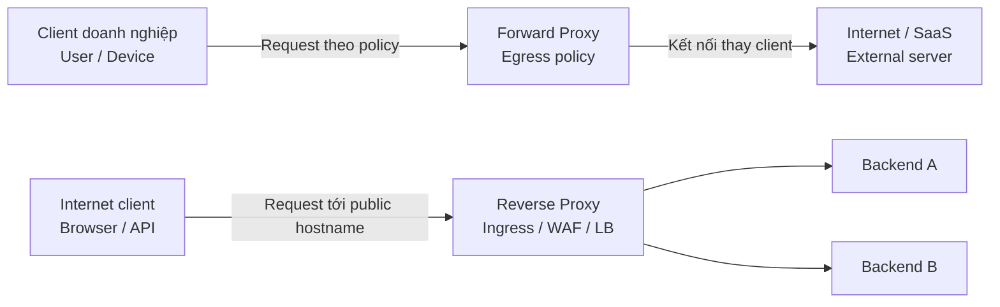
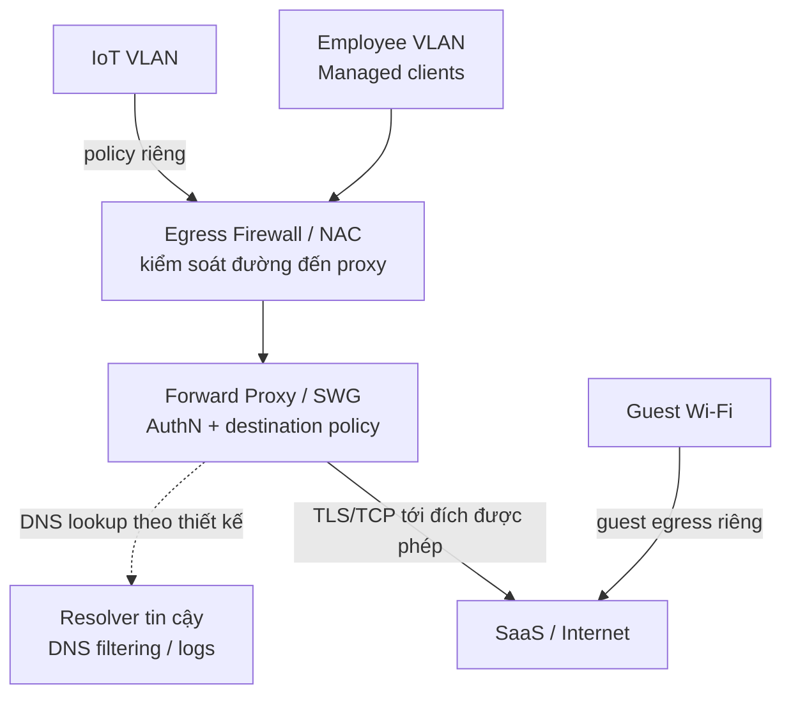
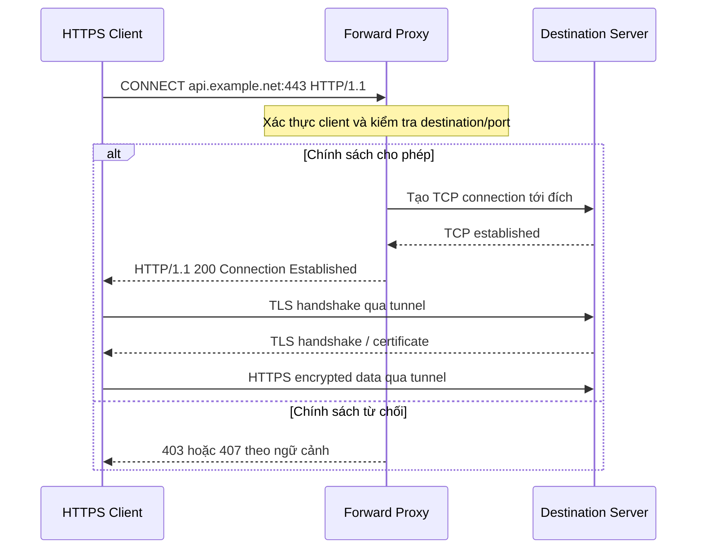
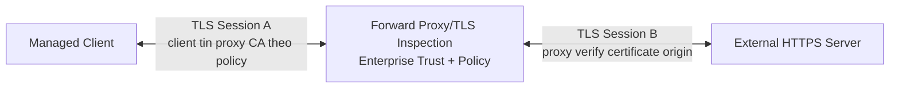
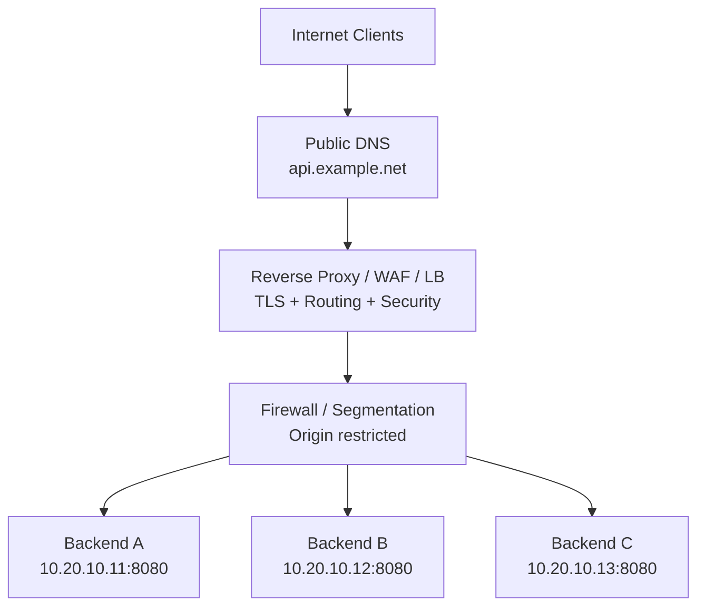
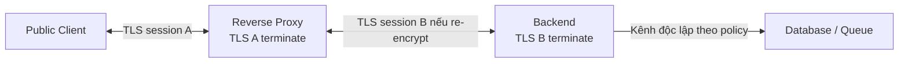
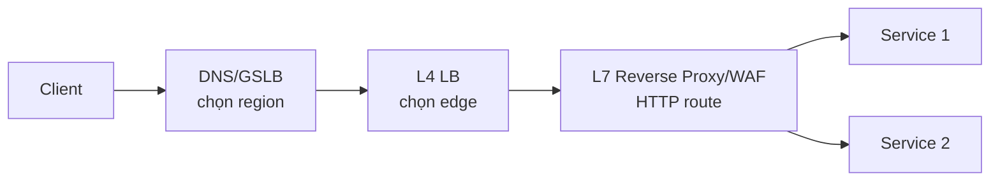
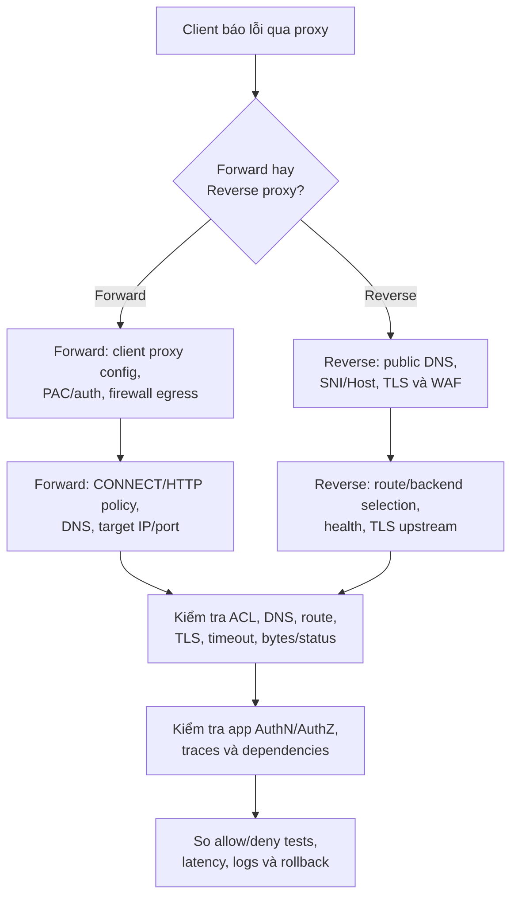

# Forward proxy và reverse proxy trong bảo mật mạng

**Proxy** là thành phần đứng giữa hai đầu trao đổi, nhận yêu cầu từ một phía và thực hiện kết nối hoặc chuyển tiếp tới phía kia theo chính sách. Hai mô hình thường gặp là **forward proxy** (proxy thay mặt client truy cập dịch vụ ở phía ngoài) và **reverse proxy** (proxy đứng trước các server, nhận kết nối của client và chuyển tiếp tới backend thích hợp). Chúng có thể cùng chạy trên một loại phần mềm, nhưng **vai trò, ranh giới tin cậy, thông tin định danh và biện pháp phòng vệ** không giống nhau.

Forward proxy thường xuất hiện ở đường **egress** của mạng doanh nghiệp: nhân viên/thiết bị cần truy cập Internet hoặc dịch vụ đối tác, proxy kiểm tra ai được đi đâu và bằng giao thức gì. Reverse proxy thường là điểm **ingress** của ứng dụng: người dùng truy cập một hostname/API công khai, proxy chọn backend, kết thúc hoặc chuyển tiếp TLS, áp WAF/rate limit và có thể cân bằng tải.

Trong mô-đun **SECURITY_NETWORK_SECURITY**, chủ đề này liên hệ trực tiếp với **phân đoạn mạng, firewall/NGFW, VPN, TLS/PKI, DNS, IDS/IPS, DDoS, WAF, Zero Trust, quản lý đám mây và giám sát lưu lượng**. Một proxy cấu hình đúng có thể giảm bề mặt tấn công và tăng khả năng quan sát; proxy cấu hình sai lại có thể biến thành **open proxy, điểm rò rỉ dữ liệu, cửa ngõ SSRF, nguồn tin cậy giả hoặc điểm nghẽn dịch vụ**.

Bài học dùng ví dụ kiến trúc, bảng so sánh, pseudo-policy và lệnh kiểm tra **chỉ đọc**. Các tên miền, địa chỉ IP và số liệu đều dùng để minh họa; không xem là cấu hình production có thể sao chép nguyên trạng.

## 1. Mục tiêu học tập

Sau bài học, người học có thể:

1. Phân biệt **forward proxy**, **reverse proxy**, **gateway**, **load balancer**, **NAT** và **firewall** theo chức năng thực tế.
2. Vẽ đường đi **client → forward proxy → Internet** và **client → reverse proxy → backend**, xác định trust boundary của từng đường.
3. Giải thích **explicit proxy**, **intercepting/transparent proxy**, **HTTP CONNECT**, SOCKS và các giới hạn khi traffic được mã hóa.
4. Thiết kế **egress policy** cho forward proxy theo user/device/destination/protocol và kiểm soát truy cập từ những vùng mạng không đáng tin.
5. Hiểu **virtual hosting, TLS termination/re-encryption, SNI, ALPN, upstream health và L4/L7 load balancing** ở reverse proxy.
6. Xử lý an toàn các trường **Forwarded, X-Forwarded-For, X-Forwarded-Proto, Host/:authority, PROXY protocol** và danh tính do trusted gateway cung cấp.
7. Giảm rủi ro **open proxy, SSRF, cache poisoning, header spoofing, HTTP request desynchronization và origin bypass**.
8. Quan sát đúng **client IP, proxy IP, upstream IP, status codes, TLS state, latency và trace identifiers**.
9. Phân biệt lỗi **407, 403, 502, 503, 504**, DNS, routing, MTU, timeout, auth và ứng dụng.
10. Xây dựng bộ kiểm thử xác nhận **đường được phép, đường bị chặn, failover và khả năng giữ kết nối hợp lệ**.

## 2. Proxy giải quyết vấn đề gì?

Một mạng doanh nghiệp thường có nhiều loại client và backend. Không phải client nào cũng nên tự do kết nối tới mọi IP/port; không phải mọi backend nên trực tiếp lộ ra Internet. Proxy giúp tạo **điểm trung gian thực thi chính sách**.

| Mục tiêu | Forward proxy | Reverse proxy |
| --- | --- | --- |
| Kiểm soát traffic | **Outbound/egress** từ client tới dịch vụ ngoài | **Inbound/ingress** từ client tới dịch vụ được công bố |
| Đại diện cho | Client hoặc nhóm người dùng/thiết bị | Backend service hoặc ứng dụng |
| Đối tượng được bảo vệ chính | Endpoint, dữ liệu outbound, chính sách mạng nội bộ | Backend/origin, ứng dụng và năng lực phục vụ |
| Chính sách thường gặp | Allowlist destination, user auth, DNS/category filtering, DLP | Routing theo host/path, WAF, TLS, rate limiting, health checks |
| Thông tin định danh trọng tâm | User/device/source zone và destination | Client identity, source IP đáng tin và hostname/application |
| Rủi ro đặc trưng | Open proxy, bypass egress, tunnel ngoài policy | Header spoofing, origin bypass, cache poisoning, SSRF tới upstream |
| Dịch vụ nền thường dùng | Explicit HTTP proxy, secure web gateway, SOCKS gateway | Web reverse proxy, API gateway, CDN edge, ingress controller |

**Không phải mọi proxy đều có khả năng phân tích nội dung HTTPS.** Nếu proxy chỉ chuyển tiếp một TCP tunnel mã hóa, nó có thể không thấy HTTP headers/body bên trong. Khả năng kiểm soát phụ thuộc **điểm giải mã, giao thức và quyền được cấp**.

### 2.1. Proxy không tự là firewall

Firewall/ACL thường quyết định một luồng mạng có được đi qua điểm thực thi hay không, theo địa chỉ, cổng, trạng thái, application identity hoặc tính năng bổ sung. Proxy có thể hiểu ngữ nghĩa HTTP và tạo **hai kết nối độc lập**. Trong thực tế, cùng một thiết bị NGFW có thể chạy proxy và firewall, nhưng khái niệm không đồng nghĩa.

Một proxy cấu hình “chỉ cho phép HTTPS tới domain X” không đủ nếu endpoint có thể **bypass proxy và đi Internet trực tiếp**. Ngược lại, firewall mở TCP/443 cho proxy không tự kiểm soát ứng dụng mà proxy sẽ phục vụ.

## 3. Sơ đồ hai chiều luồng: đứng trước client hay server?



Hai dấu hiệu nhận biết:

- **Forward proxy:** client biết hoặc bị chính sách mạng buộc sử dụng proxy; proxy lựa chọn **đích outbound** mà client muốn tới.
- **Reverse proxy:** client truy cập hostname/dịch vụ thông thường; DNS và routing đưa nó đến reverse proxy, proxy lựa chọn **backend/upstream** phía sau.

Một tổ chức có thể dùng **cả hai**. Chẳng hạn, người dùng mở một ứng dụng SaaS qua forward proxy của công ty; tại phía nhà cung cấp SaaS, yêu cầu lại đến **reverse proxy/CDN** trước khi vào backend của họ.

### 3.1. “Chiều” được xác định theo trách nhiệm, không theo địa chỉ IP

Reverse proxy có thể nằm ở mạng riêng và forward proxy có thể nằm trên dịch vụ cloud. Không nên định nghĩa “forward proxy luôn có private IP, reverse proxy luôn có public IP”. **Vai trò là đại diện cho ai và thực thi policy ở ranh giới nào**, không phải chỉ vị trí đặt thiết bị.

## 4. Forward proxy: kiến trúc và đường đi

Ví dụ doanh nghiệp có ba loại thiết bị: nhân viên, guest Wi-Fi và IoT. Nhân viên được dùng một forward proxy để truy cập các dịch vụ web đã phê duyệt; guest Wi-Fi đi Internet qua chính sách riêng; IoT chỉ được ra vài endpoint cập nhật.



Điểm thiết kế quan trọng là **không để client truy cập Internet trực tiếp ngoài chính sách** nếu mục tiêu bắt buộc phải qua forward proxy. Điều này có thể thực thi bằng **firewall egress ACL, thiết bị quản lý endpoint, proxy configuration, NAC hoặc secure web gateway**, tùy tổ chức.

### 4.1. Một forward proxy có thể làm gì?

- **Xác thực client** hoặc ánh xạ danh tính thông qua SSO/agent/certificate.
- **Cho phép/từ chối** theo nguồn, user/group, destination, domain/category, phương thức hoặc protocol.
- **Ghi log** kết nối được cho phép/bị chặn theo chính sách riêng tư.
- **Cache** một số tài nguyên đủ điều kiện.
- Thực hiện kiểm tra nội dung, malware scanning, DLP **khi có quyền truy cập nội dung** và khả năng công nghệ phù hợp.
- Kiểm soát **DNS resolution, egress IP và các đích nhạy cảm** ở ranh giới mạng.
- Giới hạn **concurrency, bandwidth hoặc rate** để bảo vệ tài nguyên chung.

Một forward proxy **không tự làm mọi chức năng**; danh sách là những năng lực có thể tồn tại ở một số sản phẩm, không phải yêu cầu của mọi proxy.

## 5. Explicit proxy, intercepting proxy và PAC/WPAD

### 5.1. Explicit forward proxy

**Explicit proxy** là mô hình client được cấu hình dùng proxy cụ thể, ví dụ proxy.example.net với port được phép. Cấu hình có thể được quản lý qua MDM, group policy, hệ điều hành, ứng dụng hoặc biến môi trường.

Khi dùng HTTP proxy thông thường, client có thể gửi request ở dạng **absolute-form target** cho proxy, ví dụ concept:

```http
GET http://www.example.net/resource HTTP/1.1
Host: www.example.net
```

Proxy nhận yêu cầu, xác định destination, kiểm tra policy rồi kết nối tới server. Với HTTPS, client thường dùng **HTTP CONNECT** để tạo tunnel, không gửi HTTP request plaintext như ví dụ trên tới forward proxy.

### 5.2. Intercepting/transparent proxy

**Intercepting proxy** nhận traffic nhờ routing/NAT hoặc cơ chế mạng khác mà client không cần khai báo một explicit proxy trong cấu hình. Một số tài liệu gọi là *transparent proxy*, nhưng mức “trong suốt” về giao thức/định danh phụ thuộc sản phẩm.

Rủi ro cần cân nhắc:

- TLS certificate validation có thể thất bại nếu interception cố giải mã mà không có thiết kế trust phù hợp.
- Không phải mọi giao thức ứng dụng và QUIC/HTTP3 đều hoạt động như HTTP/1.1 qua TCP.
- Client có thể không biết đường bị chuyển hướng, gây khó chẩn đoán DNS, timeout và certificate chain.
- Captive portal, VPN split tunnel và IPv6 có thể tạo các đường bypass ngoài dự kiến.
- Không nên **chuyển hướng HTTPS rồi phát chứng chỉ giả** nếu chưa có quyền quản trị, đánh giá riêng tư và trust model rõ.

**Explicit proxy** thường dễ xác định trách nhiệm và telemetry hơn; **intercepting proxy** có thể thuận tiện trong một số mạng nhưng đòi hỏi kiểm thử tương thích chặt chẽ.

### 5.3. PAC và WPAD

**Proxy Auto-Configuration (PAC)** cung cấp script xác định khi nào client dùng proxy, dùng proxy nào hoặc kết nối trực tiếp. **WPAD** là cơ chế khám phá cấu hình proxy tự động trong một số môi trường.

Cần kiểm soát:

1. Nguồn cấp PAC/WPAD là **nguồn được phê duyệt**, bảo vệ integrity và quyền chỉnh sửa.
2. Chính sách PAC không tự tạo **DIRECT fallback** cho dịch vụ nhạy cảm khi proxy lỗi nếu tổ chức không cho phép.
3. Cách PAC xử lý IPv4/IPv6, DNS, captive portal, VPN và nhiều mạng.
4. Proxy authentication có tương thích với trình duyệt và ứng dụng không.
5. Client có thể bị dụ dùng proxy lạ khi trên mạng không đáng tin không.

**Không mặc định WPAD là an toàn chỉ vì tự động.** Việc khám phá ở mạng ngoài doanh nghiệp cần được đánh giá theo hệ điều hành và chính sách endpoint.

## 6. HTTP CONNECT: forward proxy chuyển tiếp HTTPS thế nào?

Khi client muốn đến một HTTPS server qua HTTP forward proxy, một luồng phổ biến là **CONNECT**.



Các mũi tên client–server là **luồng logic chạy xuyên qua proxy**, không phải hai máy có TCP connection trực tiếp. Proxy đứng giữa và relay bytes sau khi tunnel được thiết lập.

### 6.1. Proxy nhìn thấy gì khi dùng CONNECT?

Nếu không can thiệp TLS, proxy thường biết **client identity/source, destination host/port yêu cầu CONNECT, thời gian, lượng byte và trạng thái tunnel**, nhưng **không đọc trực tiếp HTTP body hay cookies** bên trong kênh TLS.

Proxy có thể quan sát một số metadata TLS nếu triển khai, nhưng mức nhìn thấy thay đổi khi **TLS 1.3, ECH hoặc giao thức khác** được sử dụng. Không suy từ port 443 rằng tất cả traffic đều là HTTPS hợp lệ hay proxy có thể biết URL path.

### 6.2. CONNECT phải được giới hạn

Một **open CONNECT proxy** có thể bị lạm dụng để tạo tunnel tới nhiều đích/cổng khác, khiến máy chủ trở thành điểm trung chuyển ngoài ý muốn.

Chính sách an toàn cần xét:

- **Ai** được dùng proxy: authentication, source zone, device posture.
- **Đích** được cho phép: hostname/domain/service, dải IP, DNS result theo chính sách.
- **Cổng và giao thức** được phép: không cho tunnel tùy tiện vào dịch vụ nội bộ/management.
- **Kết nối lại và DNS changes**: tránh cho phép dựa trên hostname rồi chuyển tới địa chỉ không thuộc quyền theo cách ngoài policy.
- **Quota/rate/timeout** và logging để bảo vệ công suất.
- Cách xử lý private IP, loopback, link-local và metadata endpoints trong môi trường cloud.

**Chỉ chặn một danh sách hostname chưa đủ** nếu client có đường bypass trực tiếp hoặc proxy cho phép IP literal ngoài phạm vi.

## 7. HTTP proxy, SOCKS và NAT khác nhau

| Cơ chế | Lớp chức năng | Hiểu destination/application đến đâu? | Ví dụ |
| --- | --- | --- | --- |
| **HTTP forward proxy** | HTTP semantics, CONNECT tunneling | Có thể hiểu request HTTP; CONNECT có giới hạn khi TLS chưa được giải mã | Secure web gateway |
| **SOCKS proxy** | Trung gian kết nối ở tầng thấp hơn theo giao thức SOCKS | Không tự phân tích HTTP để áp WAF | Ứng dụng cần TCP proxy tổng quát |
| **NAT/PAT** | Dịch địa chỉ/cổng trong forwarding | Không tự có logic user/app policy của proxy | Internet egress NAT gateway |
| **Reverse HTTP proxy** | Nhận HTTP(S), chọn backend theo host/path/policy | Thường xử lý lớp HTTP sau termination | Ingress/API gateway |
| **L4 load balancer** | Phân phối connection/flow | Có thể không giải mã/hiểu HTTP | TCP/UDP load distribution |
| **Firewall/NGFW** | Kiểm soát luồng theo policy | Phụ thuộc tính năng L3–L7 và inspection | Zone-based egress restriction |

SOCKS không tự là “ẩn danh” hoặc “mã hóa” dữ liệu; điều đó phụ thuộc transport và ứng dụng. NAT thay địa chỉ IP không tự xác thực user hay lọc URL. Một doanh nghiệp thường dùng **NAT + firewall + forward proxy** cùng nhau.

## 8. Forward proxy và danh tính người dùng

Proxy egress có thể nhận lưu lượng từ nhiều máy qua cùng một IP NAT. Nếu policy chỉ dựa vào **source IP**, nó có thể không xác định được người dùng thật.

Các nguồn danh tính có thể gồm:

- Proxy authentication được ứng dụng/OS hỗ trợ.
- Tích hợp IdP/SSO, group membership và session lifecycle.
- Managed endpoint agent hoặc certificate theo mô hình được phê duyệt.
- Mapping từ NAC/VPN/MDM khi có nguồn dữ liệu đáng tin.
- Device identity, VLAN, role hoặc workload identity trong mạng nội bộ.

### 8.1. 407 khác 401

**HTTP 407 Proxy Authentication Required** là phản hồi liên quan xác thực với **forward proxy**. **HTTP 401 Unauthorized** thường do origin/application yêu cầu authentication (hoặc một reverse proxy hoạt động như application authentication gateway trả trong ngữ cảnh khác).

Một trình duyệt thấy **407** không có nghĩa tài khoản ứng dụng SaaS đã bị sai mật khẩu; cần kiểm tra **proxy credentials và policy** riêng với đăng nhập website.

### 8.2. Authentication khác authorization

User được xác thực tại proxy có thể vẫn bị **403 Forbidden** khi truy cập destination không được cho phép. Proxy cần giới hạn **user/group → service/domain → port/protocol** thay vì coi mọi authenticated user được ra toàn Internet.

Khi user nghỉ việc, đổi nhóm hoặc thiết bị bị mất, cần có quy trình **thu hồi session/certificate/agent policy** và kiểm thử client không tiếp tục sử dụng quyền cũ.

## 9. TLS interception: lợi ích, rủi ro và trách nhiệm

Một số secure web gateways thực hiện **TLS inspection**: proxy đóng vai trò endpoint TLS với client và mở một phiên TLS riêng tới destination, cho phép kiểm tra nội dung HTTP trong phạm vi được phê duyệt.



**Đây là hai TLS sessions độc lập**, không phải TLS end-to-end trực tiếp từ client tới origin.

### 9.1. Điều kiện tối thiểu nếu tổ chức triển khai

- Có **quyền quản trị thiết bị và cơ sở pháp lý/chính sách riêng tư** phù hợp; nêu rõ phạm vi lưu lượng được kiểm tra.
- Phân phối CA/trust anchor qua **MDM/quy trình đáng tin**, bảo vệ private key của issuing CA.
- Proxy phải **xác minh certificate/hostname của origin**, không tắt verification để né lỗi tương thích.
- Không áp interception bừa bãi vào ứng dụng nhạy cảm, client certificate, pinned certificates hoặc giao thức không tương thích.
- Dữ liệu đã giải mã và logs phải được **phân quyền, tối thiểu hóa, bảo vệ và lưu giữ theo chính sách**.
- Giám sát chính xác handshake errors, browser trust, performance và false positives.
- Có đường rollback an toàn nếu triển khai làm đứt kết nối hợp lệ.

**Không yêu cầu người dùng bỏ qua cảnh báo chứng chỉ** để “khắc phục” TLS inspection. Nếu client không tin proxy CA hoặc proxy không xác minh được upstream, phải sửa kiến trúc trust và policy.

### 9.2. TLS 1.3, mTLS, pinning và QUIC

- TLS 1.3 mã hóa nhiều metadata handshake sau ServerHello; khả năng passive inspection khác TLS 1.2.
- **mTLS** yêu cầu hai phía xác thực client/server certificates; interception có thể không tương thích nếu không có mô hình được thiết kế riêng.
- **Certificate pinning** ở một số ứng dụng có thể chặn kết nối qua proxy inspection ngay cả khi CA nội bộ được OS tin.
- **QUIC/HTTP3** thường chạy trên UDP; một HTTP forward proxy chỉ xử lý CONNECT TCP không mặc nhiên thấy hoặc xử lý QUIC như HTTPS/TCP.
- Tắt UDP/443 hoặc ép fallback không nên là hành động mặc định nếu chưa đánh giá **dịch vụ, quyền riêng tư, tải và tương thích**.

## 10. Kiểm soát egress: forward proxy cần phối hợp firewall và DNS

Một forward proxy chỉ có hiệu lực nếu luồng cần kiểm soát **thực sự đi qua nó**.

Một kiến trúc quản trị có thể yêu cầu:

1. Managed user VLAN chỉ truy cập **approved proxy endpoints** để đi web.
2. Firewall ngăn các đường **direct outbound** ngoài yêu cầu kinh doanh, xét IPv4 và IPv6.
3. DNS resolution theo policy: client dùng resolver được phép; proxy dùng resolver đáng tin cho destination.
4. Proxy kiểm tra destination và địa chỉ cuối cùng sẽ kết nối, đặc biệt với **private/link-local/loopback** và dịch vụ nội bộ.
5. VPN/ZTNA/split tunnel có chính sách rõ: traffic từ remote endpoint có bắt buộc đi qua proxy không?
6. Có ngoại lệ được phê duyệt cho ứng dụng không hỗ trợ HTTP proxy, kèm kiểm soát thay thế.
7. Event logs liên kết user/device/source zone/destination và policy version.

### 10.1. SSRF và proxy egress

**Server-Side Request Forgery (SSRF)** xảy ra khi ứng dụng/server bị dụ tạo request tới tài nguyên không được phép. Một proxy egress có thể hỗ trợ **giới hạn đích outbound** của workload, nhưng không tự sửa lỗi SSRF trong code.

Ứng dụng vẫn cần:

- Không tin URL tùy ý từ dữ liệu không đáng tin.
- Allowlist **destination và protocol** theo nhu cầu nghiệp vụ.
- Kiểm tra kết quả DNS và đích sau redirect khi áp dụng.
- Chặn địa chỉ nhạy cảm như loopback/link-local/metadata service nếu không cần.
- Áp **network segmentation và egress firewall** để giới hạn blast radius.
- Bảo vệ cả **IPv4 và IPv6**, không chỉ những chuỗi địa chỉ viết tay.

**Proxy không nên trở thành lối đi tắt cho workloads** đến database/metadata/management endpoints. Chỉ vì một service được gửi HTTPS qua proxy không có nghĩa nó được phép gọi mọi URL.

## 11. Forward proxy cache: tiết kiệm băng thông nhưng không được sai quyền

Caching có thể giảm thời gian tải và băng thông khi nhiều client truy vấn cùng tài nguyên. Tuy nhiên, **không phải mọi response HTTP có thể hoặc nên được cache**, nhất là nội dung cá nhân hóa hoặc dữ liệu nhạy cảm.

### 11.1. Những khái niệm cốt lõi

| Khái niệm | Ý nghĩa |
| --- | --- |
| **Cache key** | Những trường xác định một response được tái sử dụng cho request nào |
| **Cache-Control** | Chỉ dẫn lưu cache, phạm vi public/private, max-age hoặc no-store tùy ngữ cảnh |
| **Vary** | Tín hiệu rằng response phụ thuộc một hay nhiều request headers |
| **ETag / Last-Modified** | Hỗ trợ revalidation khi nội dung có thể đã thay đổi |
| **Shared cache** | Proxy phục vụ nhiều user, cần bảo vệ nội dung riêng tư |
| **Cache invalidation** | Loại bỏ/đánh dấu cũ dữ liệu khi không còn hợp lệ |

**Cache-Control: private** và **no-store** có ý nghĩa khác nhau; cũng không suy rằng mọi request có Authorization header đều được phép lưu trong shared cache. Cần áp ngữ nghĩa HTTP caching và chính sách sản phẩm.

### 11.2. Cache không được làm rò nội dung cá nhân

Một shared proxy cache sai **cache key hoặc response policy** có thể phục vụ trang tài khoản A cho user B. Do đó:

- Không cache những response chứa token, session cookie hoặc PII nếu không có chính sách/khả năng bảo vệ đúng.
- Tôn trọng các điều kiện HTTP caching; xét cả **Vary, Authorization, Cookie** và phân vùng tenant.
- Không dùng URL path đơn thuần làm cache key cho nội dung phụ thuộc identity.
- Kiểm thử request giữa hai người dùng/role khác nhau, kể cả sau session logout.
- Khi nghi cache poisoning/leak, thu thập bằng chứng trước khi xóa dữ liệu để có thể điều tra.

## 12. Reverse proxy: công bố dịch vụ nhưng che và quản trị origin

**Reverse proxy** đứng trước web server hoặc API backend. Client truy cập dịch vụ theo một **public hostname**, không cần biết backend nào được chọn.



Địa chỉ **10.20.10.x** là dải private minh họa. DNS có thể trỏ tới CDN/edge hoặc các LB có nhiều IP. Reverse proxy **không bắt buộc ẩn IP origin ở mức tuyệt đối**, nhưng nên **giới hạn đường truy cập trực tiếp** khi mô hình bảo mật yêu cầu.

### 12.1. Các công việc reverse proxy có thể thực hiện

- Nhận kết nối **TLS/HTTP(S)** từ client.
- Phân tuyến dựa trên **hostname, path, HTTP method hoặc header** theo policy.
- Chuyển tiếp request tới backend là TCP, HTTP, HTTPS hoặc giao thức phù hợp khác.
- Kiểm tra authentication/authorization ở lớp gateway khi được thiết kế.
- **WAF** và kiểm soát rate/bot/DDoS ở ứng dụng.
- Cân bằng tải giữa nhiều backend và loại node không khỏe khỏi vòng chọn.
- Cache nội dung có thể cache; nén/decompress theo policy.
- Quản lý **timeouts, retries, request buffering, connection pooling**.
- Ghi trace/log/metrics với định danh request xuyên nhiều lớp.

**Không phải mọi reverse proxy cũng là WAF hoặc API gateway.** Việc có thể route theo path không có nghĩa thiết bị tự phân tích SQLi/XSS hay có policy xác thực user.

## 13. Host, SNI, :authority và virtual hosting

Một reverse proxy có thể phục vụ nhiều ứng dụng:

```text
api.example.net   -> upstream api-service
www.example.net   -> upstream web-service
admin.example.net -> upstream admin-service (restricted)
```

Để chọn đúng virtual host/certificate, cần hiểu:

- **TLS SNI**: tên host client đề xuất trong handshake TLS, thường giúp chọn chứng chỉ.
- **HTTP/1.1 Host**: tên authority trong request HTTP.
- **HTTP/2/HTTP/3 :authority**: pseudo-header đại diện authority theo cơ chế giao thức.
- **URL path/method**: thông tin được sử dụng tiếp để phân tuyến theo application policy.

**SNI và HTTP Host/:authority không phải một trường.** Proxy nên xử lý sự không nhất quán theo chính sách rõ ràng, tránh chuyển request tới backend ngoài ý muốn.

### 13.1. Default virtual host phải an toàn

Nếu một request dùng **hostname lạ**, không nên tự động đưa vào **admin backend** hoặc một origin nhạy cảm chỉ vì đó là upstream đầu tiên được cấu hình. Một thiết kế thường dùng default route trả **404/421 hoặc từ chối theo policy**, có log phù hợp.

Các ứng dụng tự xây absolute URLs, redirects hoặc link đặt lại mật khẩu dựa trên **Host/forwarded host** cần kiểm tra đầu vào. Nếu dùng hostname do client cung cấp mà không kiểm soát, có thể tạo **Host header injection**, sai redirect hoặc link đến tên miền không mong muốn.

## 14. TLS ở reverse proxy: termination, passthrough và re-encryption

Có ba kiểu triển khai cần phân biệt:

| Mô hình | Proxy đọc HTTP? | Ai giữ certificate/key? | Điểm cần bảo vệ |
| --- | --- | --- | --- |
| **TLS termination** | Có, sau khi giải mã | Reverse proxy/edge | Key ở edge, HTTP nội bộ và quyền xem plaintext |
| **TLS passthrough** | Thường không đọc HTTP payload; có thể route theo metadata giới hạn | Backend hoặc endpoint TLS phía sau | Ít khả năng WAF L7, quản lý traffic theo protocol |
| **TLS re-encryption** | Có tại proxy; mở TLS mới đến upstream | Edge và backend với keys/trust riêng | Xác minh certificate backend, hostname/SNI và mTLS nếu cần |



Nếu Edge giải mã rồi gửi HTTP plaintext đến Backend, đoạn đó **không còn được TLS bảo vệ**. Một mạng private chưa chắc đáng tin tuyệt đối; yêu cầu bảo mật phụ thuộc phân loại dữ liệu và trust boundary.

### 14.1. Chứng chỉ upstream không phải tùy chọn trang trí

Khi re-encrypt, reverse proxy phải xác minh **backend certificate chain, SAN/hostname, thời hạn và trust anchor** theo cấu hình. Việc chỉ bật tùy chọn mã hóa tới backend nhưng **bỏ certificate verification** có thể khiến kết nối mã hóa nhầm đối tượng.

Với **mTLS** edge–backend, proxy còn chứng minh client identity cho backend theo trust model được phê duyệt. Identity của proxy không tự là identity người dùng cuối: nếu backend cần user identity, phải có cơ chế **signed token, trusted auth gateway/headers hoặc application session** thích hợp.

## 15. Client IP, X-Forwarded-For, Forwarded và PROXY protocol

Khi reverse proxy mở kết nối tới backend, **source IP của TCP connection phía backend thường là IP của proxy**, không phải IP của người dùng Internet. Ứng dụng cần biết client gốc để logging/rate limit/audit, nhưng phải sử dụng cơ chế đáng tin.

### 15.1. Những trường thường gặp

| Trường/cơ chế | Thông tin mục đích | Rủi ro |
| --- | --- | --- |
| **X-Forwarded-For** | Chuỗi địa chỉ client/proxy qua các hop | Có thể bị client tự gửi giả nếu proxy/ứng dụng không kiểm soát |
| **Forwarded** | Header chuẩn hóa mô tả for/by/host/proto trong HTTP | Tương tự: chỉ đáng tin khi nguồn và cách xử lý được xác định |
| **X-Forwarded-Proto** | Scheme gốc, thường http hoặc https | Có thể gây sai secure redirect/cookie policy nếu tin đầu vào tùy ý |
| **X-Forwarded-Host** | Hostname gốc theo convention của một số proxy | Rủi ro host header injection nếu dùng thiếu validation |
| **PROXY protocol** | Truyền metadata connection qua proxy/hop hỗ trợ | Phải giới hạn **trusted senders**, không expose tùy tiện cho Internet |
| **Remote socket IP** | IP trực tiếp kết nối backend | Thường là proxy/LB/NAT, chưa chắc client ban đầu |

### 15.2. Quy tắc trust boundary

Nếu **Internet client** có thể gửi sẵn X-Forwarded-For và backend tin **phần tử đầu tiên không kiểm tra**, client có thể điều khiển IP mà application dùng làm audit hoặc allowlist. Cách xử lý an toàn:

1. **Chặn đường truy cập trực tiếp** vào backend khi yêu cầu phải qua edge.
2. Chỉ **tin headers từ proxy/hop đã được xác nhận là trusted** bằng network policy và cấu hình framework.
3. Ở ranh giới untrusted ingress, proxy phải **loại bỏ/ghi đè/sanitize headers giả** theo thiết kế, thay vì truyền mù quáng.
4. Nếu có nhiều proxy, cấu hình **trusted proxy chain hoặc trusted CIDR** và quy tắc chọn client IP theo thứ tự đã kiểm thử.
5. Không dùng một giá trị X-Forwarded-For độc lập như bằng chứng xác thực user; sử dụng token/session/mTLS identity khi cần.
6. Bảo vệ **Forwarded host/proto** trước khi tạo absolute URLs, cookie flags và redirects.

**Không tồn tại một quy tắc “luôn lấy IP ngoài cùng bên trái” đúng cho mọi topology.** Việc chọn địa chỉ client phụ thuộc đường proxy đáng tin và cách proxy nối/ghi lại header.

### 15.3. PROXY protocol có cần dùng không?

Khi L4 load balancer không xử lý HTTP, **PROXY protocol** có thể mang địa chỉ nguồn/đích tới backend hỗ trợ. Nhưng nếu backend bật chế độ nhận PROXY protocol và cho client Internet trực tiếp kết nối đến port đó, client không đáng tin có thể gửi metadata giả. Hãy giới hạn **chỉ LB/trusted endpoints** tới port đó và kiểm thử tương thích.

## 16. Reverse proxy và phòng vệ WAF/API gateway

Reverse proxy thường là điểm đặt **Web Application Firewall (WAF)** hoặc application gateway. Các biện pháp có thể gồm:

- Kiểm tra request semantics sau khi **TLS được giải mã hợp lệ**.
- Áp **request size, header count, method, content type, path normalization** phù hợp với ứng dụng.
- Phân tích dấu hiệu SQLi/XSS, bot hoặc scanning theo engine và rule set.
- Thực thi **rate limit, quota, authentication precheck** cho route nhạy cảm.
- Chặn hoặc hạn chế đường vào **admin/debug/internal endpoints**.
- Gửi logs sang SIEM, phân biệt rule false positive với incident thật.
- Áp policy theo **Host, route, tenant, user identity** nếu nền tảng hỗ trợ.

### 16.1. WAF không thay secure coding

WAF có thể chặn một số mẫu payload hoặc request bất thường nhưng không sửa được:

- Broken Object Level Authorization (BOLA/IDOR).
- Lỗi business logic/race condition.
- SQL query được nối từ input thay vì prepared statements.
- SSRF khi server tự truy cập destination không được phép.
- API có tài khoản hợp lệ nhưng được cấp quyền quá rộng.

Cần **secure coding, kiểm tra quyền ở service, input validation theo ngữ cảnh, dependency patching và kiểm thử bảo mật**. WAF là một lớp giảm rủi ro, không phải giấy phép bỏ qua sửa root cause.

### 16.2. Origin bypass

Một kiến trúc đặt WAF trước ứng dụng có thể thất bại nếu **origin server vẫn có public IP/port và cho Internet truy cập trực tiếp**. Khi đó request đi đường khác bỏ qua WAF.

Cần:

- Chỉ cho **trusted edge addresses/private links** kết nối tới origin theo đúng sản phẩm.
- Bảo vệ secret/certificate của kết nối edge–origin nếu được dùng để xác minh nguồn.
- Xem lại **IPv6, DNS cũ, endpoint staging, management ports và cloud load balancer phụ**.
- Dùng application authentication/authorization ở origin, không chỉ dựa vào việc origin “ẩn IP”.
- Kiểm thử **đường hợp lệ qua WAF** và **đường trực tiếp bị chặn** trong phạm vi lab/tài sản được phép.

## 17. HTTP request desynchronization và parser discrepancies

Khi nhiều HTTP components xử lý một request, chúng cần **hiểu thống nhất ranh giới giữa các thông điệp**. Nếu reverse proxy và backend diễn giải khác nhau về framing/headers, có thể xảy ra lớp rủi ro thường được gọi là **HTTP request smuggling/desynchronization**.

Các nguồn khác biệt có thể liên quan:

- Xử lý **Content-Length** và **Transfer-Encoding** không nhất quán trong HTTP/1.x.
- Header trùng/lỗi định dạng, whitespace hoặc normalization khác nhau.
- Chuyển đổi giữa **HTTP/2/HTTP/3 và HTTP/1.1** tại gateway.
- Reuse một upstream connection có trạng thái không đồng bộ.
- URL/path/authority parsing khác nhau giữa WAF/proxy và application framework.

### 17.1. Phòng vệ thay vì tìm payload

1. Giữ **proxy, HTTP server và framework** ở phiên bản được vá.
2. Chọn cấu hình HTTP parsing/normalization phù hợp tiêu chuẩn, **từ chối request mơ hồ** khi sản phẩm hỗ trợ.
3. Xác minh header forwarding và h2→h1 translation theo khả năng của proxy.
4. Giới hạn request size/count, không tắt các kiểm tra chỉ để tương thích với client lỗi.
5. Dùng **regression tests** trên lab để bảo đảm edge/backend giải thích cùng một request.
6. Tương quan 4xx/5xx bất thường, request count mismatch và upstream connection errors.

Đừng tự thử các payload phá đồng bộ kết nối trên production không được phê duyệt; lỗi parser có thể làm ảnh hưởng request của người dùng khác.

## 18. Cân bằng tải: L4, L7 và vai trò của reverse proxy

**Load balancing** là kỹ thuật phân phối kết nối hoặc yêu cầu tới nhiều instance để tăng khả năng phục vụ và hỗ trợ bảo trì/failover. Reverse proxy thường làm **L7 load balancing**, nhưng một L4 load balancer cũng có thể đứng trước reverse proxies.

| Lớp | Dữ liệu thường dùng để phân phối | Ví dụ chức năng |
| --- | --- | --- |
| **L4** | TCP/UDP flow, IP/port, kết nối | Chọn endpoint TCP/UDP, pass-through, PROXY protocol |
| **L7** | Host/path/header, HTTP method, cookie, auth context khi giải mã | Route API versions, canary, WAF, header transformation |
| **DNS-level distribution** | DNS answers và health policy | Điều hướng region/site; còn phụ thuộc caching và TTL |
| **Service mesh / application routing** | Service identity, route metadata và policy | Retry/circuit breaker/traffic splitting theo workload |

**L4 LB không tự đọc HTTPS payload**, trừ khi có tính năng termination/inspection riêng. **L7 LB thường cần thấy HTTP** sau termination để route theo path; một TCP proxy passthrough không tự là L7 reverse proxy.

### 18.1. Một request có thể đi qua nhiều lớp



Mỗi lớp tạo một **failure domain** và có log/health check riêng. Nếu người dùng thấy 503, cần biết lỗi đến từ **DNS, L4, L7 hay application** chứ không chỉ nhìn màn hình LB đầu tiên.

## 19. Thuật toán load balancing và health checks

| Thuật toán | Ý tưởng | Lưu ý |
| --- | --- | --- |
| **Round robin** | Phân phối luân phiên giữa upstreams | Không phản ánh độ nặng từng request |
| **Weighted round robin** | Node có trọng số lớn nhận nhiều lượt hơn | Trọng số nên dựa trên năng lực/capacity |
| **Least connections** | Ưu tiên node có ít kết nối đang hoạt động | Kết nối dài và request ngắn làm metric khác nhau |
| **Weighted least connections** | Kết hợp số kết nối và trọng số | Phải hiểu cách sản phẩm ước lượng tải |
| **Hash / consistent hash** | Chọn node dựa trên một khóa | Có thể tạo lệch tải, cần bảo vệ key/identity |
| **Latency/response-time based** | Điều chỉnh dựa trên chỉ số thời gian | Dễ phản ứng sai nếu đo nhiễu hoặc node quá tải tạm thời |
| **Random / power of two choices** | Lấy ngẫu nhiên, có thể so sánh vài ứng viên | Hành vi phụ thuộc thuật toán sản phẩm |

Không có thuật toán tối ưu cho mọi ứng dụng. Với HTTP/2 một connection có thể mang **nhiều concurrent streams**; “least TCP connections” không luôn phản ánh tải request thực.

### 19.1. Liveness, readiness và health checks

Health check có thể đánh giá:

- **TCP port reachable:** kết nối được tới port, chưa chắc ứng dụng sẵn sàng.
- **TLS handshake:** certificate/trust có đúng không, nếu health checker xác minh?
- **HTTP readiness endpoint:** app có sẵn sàng phục vụ lưu lượng không?
- **Dependency-aware check:** kiểm tra DB/cache/queue tới mức phù hợp; tránh health endpoint tạo tải lớn hoặc gây cascading failure.
- **Passive health:** nhìn lỗi/timeouts của request thật nếu nền tảng hỗ trợ.

Health check nên có **interval, timeout, failure threshold, recovery threshold** để tránh loại/thêm node liên tục (*flapping*). Đồng thời, không nên phụ thuộc chỉ một endpoint trả HTTP 200 nếu dịch vụ chính vẫn lỗi.

### 19.2. Fail-open và fail-closed khi mọi upstream unhealthy

Nếu tất cả backend báo không khỏe:

- Một số LB có thể **trả 503** thay vì chuyển request vào node không sẵn sàng.
- Sản phẩm khác có thể có chế độ **fail-open** gửi traffic dù health checks không đạt.

Phải biết **cơ chế thật của nền tảng và rủi ro nghiệp vụ**, không mặc định một lựa chọn luôn đúng. Fail-open có thể duy trì một phần dịch vụ khi health check lỗi giả, nhưng cũng có thể làm tăng quá tải hoặc gửi request tới backend không an toàn.

## 20. Sticky sessions và thiết kế ứng dụng không trạng thái

**Session affinity/sticky session** cố giữ yêu cầu của một client/session ở cùng backend. Cơ chế thực thi có thể dựa vào cookie, source IP, route key hoặc session identifier do LB quản lý.

Lợi ích: giúp một ứng dụng cũ lưu session trong memory của backend hoạt động khi có nhiều node.

Hạn chế:

- Khi node lỗi, client có thể mất state.
- Tải phân phối lệch nếu một số client/session nặng.
- Source IP affinity không ổn định khi nhiều user đi qua cùng proxy/CGNAT.
- Cookie affinity phải có chính sách **Secure/HttpOnly/SameSite**, scope và chữ ký phù hợp tùy thiết kế.
- Client reconnect/WebSocket/long-polling có thể cần xử lý đặc biệt.

**Ưu tiên thiết kế session phù hợp với phân tán**: external session store, token có kiểm soát, database hoặc state replication, thay vì phụ thuộc vĩnh viễn vào một node. Tuy nhiên cũng không mặc định mọi ứng dụng bắt buộc hoàn toàn stateless; quyết định theo workload.

## 21. Timeouts, retries, circuit breakers và idempotency

Một reverse proxy có thể kết nối upstream thất bại hoặc chờ quá lâu. Cách xử lý quyết định cả **availability** lẫn rủi ro lặp nghiệp vụ.

| Cơ chế | Ý nghĩa | Rủi ro |
| --- | --- | --- |
| **Connect timeout** | Giới hạn thời gian tạo kết nối tới upstream | Quá ngắn gây lỗi giả khi network chậm |
| **Read/response timeout** | Chờ dữ liệu từ upstream trong phạm vi đã định nghĩa | Thời gian dài giữ tài nguyên và che app hung |
| **Idle timeout** | Đóng connection không hoạt động | Có thể cắt WebSocket/streaming nếu không thiết kế |
| **Retry** | Thử lại với upstream/connection khác | **Gửi lặp thao tác có side effects** |
| **Circuit breaker** | Giảm gửi traffic vào dependency đang lỗi | Thiết kế sai làm chặn quá lâu hoặc tạo thác lỗi |
| **Connection pooling** | Tái sử dụng upstream connections | Có thể làm lộ vấn đề parser/identity nếu reuse sai |
| **Backpressure** | Điều chỉnh tốc độ/đệm khi upstream chậm | Thiếu giới hạn buffer gây hết bộ nhớ |

### 21.1. Vì sao retry POST có thể nguy hiểm?

Một request tạo đơn hàng có thể đã được backend thực thi thành công nhưng response bị mất trước khi tới proxy. Nếu proxy tự **retry POST** không có cơ chế idempotency, hai đơn có thể được tạo.

Cần:

- Chỉ retry khi **ngữ cảnh phương thức, response state và nghiệp vụ** cho phép.
- Thiết kế **idempotency key/transaction guarantees** khi cần cho API thay đổi trạng thái.
- Giới hạn retry count, retry budget và jitter/backoff theo sản phẩm.
- Không để retry đồng thời từ **client + proxy + service mesh** nhân tải quá mức.
- Có metrics cho request attempts, duplicate operations và upstream error.

**HTTP method an toàn/idempotent theo ngữ nghĩa tiêu chuẩn** là chỉ dẫn quan trọng, nhưng ứng dụng triển khai sai vẫn có thể tạo side effects. Cần kiểm thử với backend thực.

## 22. Reverse proxy caching, CDN và nguy cơ cache poisoning

Reverse proxy/CDN có thể cache response để tăng tốc nội dung tĩnh hoặc API phù hợp. Nhưng chia sẻ cache sai giữa client/tenant có thể làm rò dữ liệu.

### 22.1. Cache key và normalization

Cache key thường liên quan **scheme, host, path, query, phương thức và các header/biến thể** theo chính sách. Nếu proxy và backend diễn giải khác nhau về hostname, query parameters hoặc headers, một response được tạo cho điều kiện A có thể được trả cho điều kiện B.

Biện pháp cần thiết:

1. Chỉ cache route và status codes được phê duyệt.
2. Tuân **Cache-Control, Vary, Authorization, Set-Cookie** theo cách HTTP caching hợp lệ.
3. Không cache response có dữ liệu riêng tư trừ khi thiết kế **cache partitioning và access control** đầy đủ.
4. Có cache key versioning/invalidations khi thay ứng dụng.
5. Xác minh rằng Host/Forwarded headers từ client không thể thay cache namespace ngoài chính sách.
6. Kiểm thử cùng URL dưới **hai user/tenant**; bảo đảm không xuất hiện dữ liệu chéo.
7. Trong sự cố, xem cache logs, proxy config và response headers trước khi purge diện rộng nếu cần giữ bằng chứng.

### 22.2. CDN có phải reverse proxy?

Một CDN cung cấp HTTP edge, caching, TLS/WAF và origin fetch thường **đóng vai trò reverse proxy ở tầng edge**. Nhưng CDN có thể gồm nhiều dịch vụ, tính năng và điểm kết thúc khác nhau; không nên đồng nhất **mọi CDN là một cấu hình reverse proxy duy nhất**.

Khi xác định sự cố, cần phân biệt **edge POP, regional cache, origin shield, reverse proxy nội bộ và backend app**.

## 23. WebSocket, gRPC, HTTP/2 và HTTP/3 qua proxy

Không phải mọi ứng dụng là HTTP/1.1 request ngắn:

- **WebSocket** có một giai đoạn thiết lập/upgrade hoặc cơ chế tương ứng rồi trao đổi dữ liệu hai chiều lâu dài.
- **gRPC** thường dùng HTTP/2 và nhiều concurrent streams; có thể cần hỗ trợ trailer, streaming và long-lived connections.
- **HTTP/2** multiplex nhiều request trên một TCP connection.
- **HTTP/3/QUIC** dùng UDP và cơ chế TLS 1.3 tích hợp với QUIC, không giống HTTP/TCP.

### 23.1. Những vấn đề thường gặp

| Hiện tượng | Giả thuyết cần kiểm tra |
| --- | --- |
| REST API hoạt động, WebSocket ngắt sau idle | Proxy/LB idle timeout hoặc không hỗ trợ upgrade/persistent connection đúng |
| gRPC trả lỗi qua LB L7 | HTTP/2, authority/trailer, upstream protocol hoặc gRPC-aware health check |
| Client HTTP/3 fallback xuống HTTP/2 | UDP/443 bị chặn, QUIC không được hỗ trợ hoặc policy endpoint |
| Nhiều stream trên một connection nhưng load lệch | LB phân phối theo connection thay vì request/stream |
| Kết nối streaming bị buffer đầy | Proxy buffering/backpressure và limits không phù hợp |
| WebSocket được mở nhưng không có AuthZ | Chỉ xác thực handshake, không phân quyền message/session đúng |

**Không coi thông báo “proxy hỗ trợ HTTPS” là đảm bảo hỗ trợ mọi transport/giao thức ứng dụng**. Cần kiểm thử từng dạng traffic thực tế và chính sách timeout/stream.

## 24. DNS, routing, SNI, IPv6 và proxy trong cloud/hybrid

### 24.1. DNS resolution ở forward proxy

Khi client gửi **CONNECT hostname:port**, proxy có thể là thành phần thực hiện DNS lookup theo thiết kế; nếu client gửi IP hoặc dùng SOCKS/HTTP proxy với cơ chế khác, phạm vi DNS ở client/proxy có thể thay đổi.

Cần biết:

- Resolver nào được dùng để quyết định IP destination.
- Split DNS/private zones có được áp cho proxy không?
- Hostname có thể thay đổi RRset do CDN/geo-DNS hoặc TTL hợp lệ không?
- Proxy có kiểm tra IP sau DNS resolution theo **network egress allowlist** không?
- Khi destination đổi IP hoặc redirect, policy có được kiểm tra lại theo ngữ cảnh?
- IPv6 AAAA có được xem xét như IPv4 A hay không?

### 24.2. DNS và reverse proxy

Public DNS có thể trỏ hostname tới **CDN/WAF/LB** thay vì origin. Reverse proxy sau đó lựa chọn backend dựa trên **routing/service discovery**. Một DNS record đúng không bảo đảm upstream khỏe, TLS certificate đúng hoặc app trả dữ liệu đúng.

### 24.3. Cloud service mesh, ingress và egress

Trong môi trường Kubernetes/microservices:

- **Ingress controller/Gateway API implementation** có thể đóng vai trò reverse proxy cho traffic vào cluster.
- **Egress gateway** hoặc outbound proxy có thể thực thi chính sách truy cập dịch vụ bên ngoài.
- **Service mesh sidecar/proxy** có thể đứng giữa workloads và xử lý mTLS, traffic policy, retries, telemetry.
- **Cloud LB/managed API Gateway** có thể kết hợp L4/L7, rate limit và authorization tùy dịch vụ.

Cần kiểm tra **đường bypass trực tiếp**, Service/Ingress/Gateway routes, security groups, network policies, IAM, cert trust và danh tính workload. Một sidecar proxy không đảm bảo mọi traffic trong cluster đều đi qua sidecar nếu topology/policy có ngoại lệ.

## 25. Pseudopolicy cho forward proxy an toàn

Dưới đây là mẫu **ý định chính sách**, không phải cú pháp có thể dán vào Squid, Envoy, NGINX hay cloud product.

```yaml
policy_id: EGRESS-WEB-STAFF
purpose: "Control employee web access"
source:
  network_zone: managed-employee
  require_device_posture: compliant
  require_user_authentication: true
destination:
  allowed_protocols: [http, https]
  connect_ports: [443]
  allowed_categories: [business-approved, collaboration]
  deny_networks:
    - loopback
    - link-local
    - private-management
    - cloud-metadata
  validate_resolved_ip_against_policy: true
  recheck_redirects_when_applicable: true
traffic:
  log_policy_decision: true
  tls_interception:
    enabled: false
    exception_process: security-review
  maximum_concurrent_connections: reviewed-capacity
exceptions:
  owner_required: true
  expiry_required: true
  deny_bypass_without_approval: true
monitoring:
  send_to: siem
  protect_user_privacy: true
  alert_on_unknown_proxy_or_direct_egress: true
```

Giá trị như **private-management** là một nhãn policy, không phải dải mạng theo cú pháp của engine. Những hệ thống thật cần kiểm tra cách server biểu diễn URL/cổng, regex, CIDR, DNS pinning và auth.

### 25.1. Những giả định không được bỏ qua

- Client xác thực với proxy **không có nghĩa** mọi egress destination hợp lệ.
- Proxy có ACL tốt vẫn cần **firewall ngăn direct egress** nếu policy bắt buộc.
- “Cho phép domain” phải xét **DNS result/redirect/IPv6** theo sản phẩm.
- Tránh cho proxy tự gửi request tới **management/metadata/loopback** chỉ vì client đưa tên hợp lệ bên ngoài.
- TLS inspection phải được quyết định riêng theo **policy riêng tư, bảo mật khóa và tương thích**.

## 26. Pseudopolicy cho reverse proxy và cân bằng tải

```yaml
policy_id: INGRESS-PUBLIC-API
asset: api.example.net
listener:
  protocol: https
  tls_certificate: managed-public-certificate
  require_sni_hostname_match: true
  default_virtual_host_action: reject
  supported_application_protocols: [http1, http2]
network:
  origin_access:
    only_from_trusted_edge: true
  trusted_forwarding_peers:
    - "10.20.0.0/24"  # ví dụ private LB subnet, không mặc định tin mọi private IP
identity_headers:
  strip_untrusted_forwarded_headers: true
  set_canonical_client_ip_from_trusted_chain: true
  reject_unapproved_hostnames: true
security:
  waf_policy: approved-api-ruleset
  request_size_limit: reviewed
  rate_limit: per-identity-and-source-policy
  resource_authorization: enforced-by-app
upstream:
  service: api-backend
  protocol: https
  tls_verify_peer_certificate: true
  expected_server_name: api.internal.example.net
  load_balance: weighted-round-robin
  health_check:
    type: application-readiness
    interval: reviewed
  retry:
    only_when_safe: true
    budget: reviewed
observability:
  request_id: generated-at-edge
  log_upstream_latency: true
  redact_credentials_and_tokens: true
change:
  require_positive_and_negative_tests: true
  rollback_artifact: previously-reviewed-config
```

Đây là **mô hình ý định**, không phải schema chuẩn của bất kỳ proxy nào. Trong triển khai thật, cần kiểm tra điểm dùng **TLS public/private CA, trusted CIDR, WAF exclusions, gRPC/HTTP3, health checks, retry semantics và backend route**.

## 27. Giám sát và logging qua nhiều hop

Khi ứng dụng đi qua nhiều proxy, một request có thể tạo **nhiều connection IDs, IPs, status codes và thời điểm**. Cần có trường tương quan xuyên suốt.

| Trường log | Câu hỏi giải đáp | Lưu ý |
| --- | --- | --- |
| **Timestamp/zone** | Xảy ra lúc nào? | Đồng bộ giờ, timezone/UTC |
| **Request ID/trace ID** | Cùng request đi qua những hop nào? | Chống client tự điều khiển ID trong ngữ cảnh tin cậy |
| **Client observed IP** | Proxy nhận request từ đâu? | Có thể là LB/CDN hoặc NAT |
| **Canonical client IP** | IP nguồn suy từ trusted proxy chain là gì? | Chỉ đáng tin theo topology/cấu hình |
| **Authenticated identity** | User/service/device nào? | Không ghi password/token nhạy cảm |
| **Proxy decision** | Allow, deny, require auth, WAF action? | Log policy/rule ID |
| **Host/SNI/ALPN** | Client yêu cầu dịch vụ/giao thức nào? | Metadata TLS có thể giới hạn nếu không terminate |
| **Upstream target** | Backend nào được chọn? | Dùng service ID và IP/port khi cần |
| **HTTP status** | Proxy trả gì cho client? | Phân biệt proxy status và upstream status |
| **Upstream status** | Backend trả gì cho proxy? | 502 có thể do lỗi proxy–backend |
| **Connect/TLS/TTFB latency** | Nghẽn ở DNS, TCP, TLS hay app? | Định nghĩa metric theo sản phẩm |
| **Bytes/packets** | Lưu lượng và dấu hiệu bất thường? | Không tự đồng nghĩa nội dung hợp lệ |
| **Cache status** | HIT/MISS/BYPASS/REVALIDATED? | Sai cache key có thể lộ dữ liệu |
| **Retry count** | Request đã được gửi đến backend mấy lần? | Bảo vệ nghiệp vụ idempotency |

### 27.1. Mẫu log minh họa

```json
{
  "timestamp": "2026-11-28T07:00:00Z",
  "edge_request_id": "req-demo-001",
  "role": "reverse-proxy",
  "public_host": "api.example.net",
  "client_ip_from_trusted_chain": "198.51.100.25",
  "upstream": "api-backend-02",
  "tls_frontend": "tls1.3",
  "tls_upstream_validated": true,
  "http_status_to_client": 200,
  "http_status_from_upstream": 200,
  "upstream_connect_ms": 8,
  "total_duration_ms": 42,
  "cache_action": "bypass",
  "waf_action": "allow",
  "policy_id": "INGRESS-PUBLIC-API",
  "sensitive_fields_logged": false
}
```

Các giá trị là **dữ liệu minh họa**; **198.51.100.0/24** là dải địa chỉ dành cho tài liệu. Log phải được bảo vệ vì hostname, URL, user ID, client IP và dấu thời gian có thể tiết lộ thông tin cá nhân/nhạy cảm.

### 27.2. Tách logs theo từng hop

Một HTTP **504** ở reverse proxy có thể xảy ra khi backend **chưa trả response trong thời gian chờ**, chứ không phải backend thực sự gửi HTTP 504. Khi điều tra, cần đối chiếu:

- Proxy trả status gì cho client?
- Có mở kết nối upstream không?
- Backend có nhận request không và log trạng thái gì?
- Có retries làm request đến nhiều node không?
- Deadline/timeouts áp ở client, L7 proxy, LB hay service mesh?
- Có queue/pool/CPU hoặc database dependency quá tải không?

## 28. Các mã lỗi thường gặp và cách phân biệt

| Mã/trạng thái | Ý nghĩa thường gặp | Giả thuyết cần kiểm tra |
| --- | --- | --- |
| **407 Proxy Authentication Required** | Forward proxy yêu cầu xác thực | Proxy auth/session/identity policy |
| **401 Unauthorized** | Origin/app hoặc auth gateway yêu cầu xác thực | Token/cookie/IdP hoặc app auth |
| **403 Forbidden** | Chính sách từ chối truy cập | Forward proxy deny, WAF, authorization hoặc backend |
| **404 Not Found** | Route/resource không tồn tại | Virtual host, path rewrite hoặc app endpoint |
| **421 Misdirected Request** | Request tới endpoint không phù hợp với authority | SNI/:authority, connection reuse và virtual hosting |
| **429 Too Many Requests** | Rate limit hoặc quota | Proxy/gateway hoặc ứng dụng |
| **502 Bad Gateway** | Proxy nhận phản hồi lỗi/không hợp lệ từ upstream hoặc không thể giao tiếp đúng | TLS trust upstream, connection reset, protocol mismatch |
| **503 Service Unavailable** | Service chưa sẵn sàng/quá tải, không có healthy backend hoặc policy khác | Health checks, capacity, draining |
| **504 Gateway Timeout** | Gateway không nhận phản hồi kịp thời từ upstream | Connect/read timeout, backend slow, network loss |
| **TLS alert / cert error** | TLS handshake/verification thất bại | SNI, SAN, CA trust, expiry, cipher/version |
| **DNS resolution error** | Không tìm được hoặc không sử dụng được IP đích | Resolver, split DNS, private zone, IPv6 |

**Một status code không chỉ có một nguyên nhân.** Mã được trả bởi proxy hay application cần được xác minh từ header/log/timeline; các sản phẩm cũng có internal error codes riêng.

## 29. Quy trình chẩn đoán: kiểm tra theo từng ranh giới



### 29.1. Bước 1 — Xác định đúng vai trò

Hỏi: request **từ client đi ra ngoài** hay **từ Internet đi vào ứng dụng**? Client nào, hostname nào, proxy nào, destination/backend nào, port và giao thức nào? Có TLS termination không?

### 29.2. Bước 2 — Xác định điểm lỗi đầu tiên

Với forward proxy: kiểm tra client có dùng đúng proxy không, **407/403**, DNS do ai thực hiện và destination có bị egress ACL deny không.

Với reverse proxy: kiểm tra DNS public, **SNI/certificate, Host/path rule, WAF decision, backend health/route**. Nếu proxy nhận request nhưng backend không, điều tra ranh giới proxy–backend.

### 29.3. Bước 3 — Kiểm chứng kết nối, không chỉ dashboard

Một giao diện báo "healthy" không chứng minh đủ. Kiểm tra **truy cập ứng dụng thật** bằng danh tính hợp lệ, đồng thời kiểm tra **đường không được phép** vẫn bị chặn.

### 29.4. Bước 4 — Khôi phục có kiểm soát

Thay đổi một tầng tại một thời điểm khi khả thi; có baseline và rollback. Không tắt toàn bộ TLS verification, WAF hoặc firewall chỉ vì một dịch vụ lỗi; xác định chính xác rule, dependency và tác động của exception.

## 30. Lệnh kiểm tra an toàn trong phạm vi được phép

Các lệnh dưới đây **không sửa proxy config**, chỉ quan sát kết nối đến endpoint bạn sở hữu hoặc được cho phép kiểm thử. Dùng hostname, IP và URL minh họa; không chạy với hệ thống của bên thứ ba ngoài phạm vi.

### 30.1. Dùng curl qua explicit forward proxy

```bash
# Chỉ xem HTTP headers và thông tin kết nối qua proxy lab
curl -I -v --proxy http://proxy.corp.example.net:3128 \
  https://www.example.net/

# Kiểm tra phản hồi khi truy cập dịch vụ HTTP (không phải HTTPS)
curl -I -v --proxy http://proxy.corp.example.net:3128 \
  http://www.example.net/

# Xem thông tin kết nối HTTPS tới reverse proxy
curl -I -v https://api.example.net/
```

Lưu ý:

- Địa chỉ proxy và hostname đều là ví dụ; **proxy.corp.example.net** có thể không phân giải được ngoài mạng doanh nghiệp.
- **curl -I** dùng HEAD; một ứng dụng không hỗ trợ HEAD có thể trả **405** dù proxy/TLS hoạt động.
- **Không** đưa mật khẩu proxy bằng chuỗi trực tiếp trên command line được ghi log/lịch sử; dùng credential mechanism được môi trường quản trị hỗ trợ.
- Không sử dụng tùy chọn bỏ xác minh certificate để làm “test thành công” trong vận hành bảo mật.

### 30.2. Kiểm tra HTTP response headers và TLS

```bash
# Xem HTTP status và response headers của reverse proxy
curl -I -v https://api.example.net/health

# Quan sát certificate mà TLS endpoint thực sự gửi, có SNI/verify hostname
openssl s_client -connect api.example.net:443 \
  -servername api.example.net \
  -verify_hostname api.example.net \
  -verify_return_error
```

Kết quả này phản ánh **endpoint client kết nối tới**, có thể là CDN/LB/WAF chứ không phải backend phía sau. Nếu cần kiểm tra backend TLS, phải làm từ **hạ tầng/đường truy cập được phép**, có trust store phù hợp, không bypass bảo mật production.

### 30.3. Quan sát DNS và route trên Linux

```bash
# Địa chỉ, routing và DNS của máy kiểm thử
ip -br address
ip -4 route show
ip -6 route show
resolvectl status

# Xem câu trả lời DNS nếu có dig
dig api.example.net A
dig api.example.net AAAA
```

Lệnh **resolvectl** chỉ phù hợp khi hệ thống dùng systemd-resolved; một số trình duyệt/ứng dụng có DoH resolver riêng. Cần biết **DNS lookup diễn ra tại client hay tại proxy** trước khi kết luận.

### 30.4. Windows PowerShell

```powershell
# Proxy và mạng theo cơ chế Windows hỗ trợ
netsh winhttp show proxy
Get-NetIPConfiguration
Get-DnsClientServerAddress
Get-NetRoute -AddressFamily IPv4

# Kiểm tra kết nối TCP của ứng dụng được phép
Test-NetConnection -ComputerName api.example.net -Port 443
```

**WinHTTP proxy setting không mặc định phản ánh proxy của mọi trình duyệt/ứng dụng**, do WinINET, PAC, environment variables và client riêng có thể khác. **Test-NetConnection** chứng minh khả năng TCP ở phạm vi đó, không chứng minh request đã qua proxy hay backend trả thành công.

### 30.5. Packet capture có giới hạn

Trong lab hoặc môi trường được phép:

```bash
# Chỉ ghi tối đa 100 gói giữa client và proxy trên interface được chỉ định
sudo tcpdump -ni eth0 -c 100 'host 192.0.2.10 and tcp port 3128'
```

**192.0.2.0/24** là dải tài liệu. Capture có thể chứa HTTP request plaintext, hostname và metadata nhạy cảm; chỉ thu theo quyền, bảo vệ pcap và không ghi raw credentials. Với HTTPS tunnel, pcap tại proxy không tự giải mã HTTP body.

## 31. Tình huống thực tế A — Forward proxy xác thực nhưng SaaS không truy cập được

**Bối cảnh:** một nhân viên đã đăng nhập SSO và kết nối VPN thành công nhưng mở **https://collab.example.net/** thì bị lỗi.

**Biểu hiện:** browser báo proxy authentication hoặc truy cập bị từ chối.

**Điều tra:**

1. Xác định client có dùng đúng **PAC/explicit proxy** sau khi bật VPN không.
2. Nếu thấy **407**, kiểm tra proxy session/SSO/group mapping, không sửa password SaaS một cách vô căn cứ.
3. Nếu thấy **403**, xem rule egress, category/destination allowlist và redirect đã được phê duyệt.
4. So dữ liệu **DNS tại proxy**, IP đích, IPv6 và CONNECT port.
5. Kiểm tra firewall có chặn đường tới proxy hoặc proxy ra Internet không.
6. Nếu TLS inspection được phép và đang bật, kiểm tra CA trust và origin certificate verification.

**Khắc phục:** sửa đúng identity/policy/DNS/route, kiểm tra bằng một tài khoản có quyền, không cấp phép toàn Internet hoặc bật DIRECT bypass chỉ để một ứng dụng hoạt động.

## 32. Tình huống thực tế B — Reverse proxy 502 vì backend TLS

**Bối cảnh:** client hoàn thành TLS 1.3 tới WAF của **api.example.net**, nhưng request trả **502 Bad Gateway**.

**Giả thuyết:** proxy không xác minh được chứng chỉ upstream vì SAN không khớp **api.internal.example.net**, thiếu intermediate CA hoặc upstream có cấu hình mTLS sai.

**Điều tra:**

- Tách **client → WAF** và **WAF → backend** thành hai TLS sessions.
- Kiểm tra certificate/SNI/trust store của **chặng lỗi**.
- Đọc proxy upstream connection logs và app logs có nhận request không.
- So health check có thực hiện TLS verification đúng như request thật không.
- Kiểm tra route/firewall giữa proxy và backend trước khi quy hết lỗi cho certificate.

**Khắc phục:** sửa upstream identity/PKI/mTLS và thử lại. **Không tắt verify upstream** hoặc chuyển HTTP plaintext nếu chính sách bắt buộc bảo mật chặng backend.

## 33. Tình huống thực tế C — Rate limit sai do X-Forwarded-For

**Bối cảnh:** một số người dùng Internet bị chặn 429, trong khi audit log của backend có IP kỳ lạ do client gửi trong header.

**Giả thuyết:** backend hoặc reverse proxy **tin X-Forwarded-For do client tự cung cấp**; thuật toán rate limiting dùng client IP không được chuẩn hóa.

**Điều tra:** kiểm tra vị trí của CDN/LB/WAF, những hop nào **trusted**, edge có strip/append/overwrite headers theo policy không, backend framework đã bật trusted proxies/CIDR ra sao.

**Khắc phục:** cố định trust boundary, không tin headers từ Internet trực tiếp, dùng canonical client IP do edge đáng tin xác nhận hoặc rate limit theo **authenticated identity** khi thích hợp. Kiểm thử false positives với người dùng sau CGNAT/proxy chung.

## 34. Tình huống thực tế D — Deploy mới làm WebSocket rớt sau 60 giây

**Bối cảnh:** request REST bình thường, nhưng chức năng realtime qua WebSocket rớt sau một khoảng idle.

**Khả năng:** proxy/LB idle timeout, WebSocket upgrade, upstream keepalive hoặc firewall/NAT state. Các giá trị timeout trong thực tế tùy sản phẩm và cấu hình; **60 giây chỉ là giá trị tình huống**.

**Điều tra:** xem protocol được thương lượng, Upgrade/Connection semantics của HTTP/1.1 khi áp dụng, trạng thái HTTP/2 stream nếu dùng, idle timeout của từng hop và app heartbeat.

**Khắc phục:** điều chỉnh timeout/keepalive/backpressure có kiểm thử và bảo vệ tài nguyên, xác nhận các client hợp lệ vẫn reconnect an toàn. Không mở unlimited timeouts hoặc vô hạn connection count.

## 35. Tình huống thực tế E — Proxy không ngăn được traffic tới origin

**Bối cảnh:** ứng dụng đã được bảo vệ bằng CDN/WAF, nhưng kiểm thử được phép cho thấy origin vẫn nhận kết nối trực tiếp ngoài edge.

**Rủi ro:** request có thể **bypass WAF, rate limiting hoặc access logs tại edge**; có thể khác certificate, auth hoặc security headers.

**Điều tra:** kiểm tra public IP/DNS lịch sử, IPv6, security groups, load balancers phụ, NAT, firewall rules và private link configuration. Không tiến hành quét/khai thác ngoài danh sách tài sản được phép.

**Khắc phục:** giới hạn đường tới origin theo **trusted edges/private networks**, giữ application authentication/authorization riêng và kiểm thử traffic qua WAF vẫn hoạt động trong khi đường trực tiếp bị chặn.

## 36. Ma trận kiểm thử forward proxy và reverse proxy

| Test | Phạm vi | Điều kiện thử trong lab/được phép | Kết quả mong đợi |
| --- | --- | --- | --- |
| **T01** | Forward | Managed user dùng explicit proxy đúng | Proxy xác thực và cho đích được phép |
| **T02** | Forward | User chưa xác thực | 407/deny đúng policy |
| **T03** | Forward | User hợp lệ nhưng destination ngoài allowlist | Bị từ chối, ghi policy ID |
| **T04** | Forward | Client thử direct egress khi bắt buộc dùng proxy | Firewall ngăn đường bypass |
| **T05** | Forward | CONNECT tới cổng ngoài chính sách | Bị từ chối |
| **T06** | Forward | Destination resolve vào private/loopback/link-local ngoài policy | Không được tunnel tới tài nguyên nhạy cảm |
| **T07** | Forward | PAC source không đáng tin hoặc bị thay trong lab | Client/MDM policy không nhận ngoài nguồn duyệt |
| **T08** | Forward | TLS inspection nếu được phê duyệt | Client và origin được xác minh, dữ liệu log đúng phạm vi |
| **T09** | Forward | App pinned cert/mTLS không tương thích inspection | Được xử lý qua policy exception rõ, không tắt verify |
| **T10** | Forward | IPv4/IPv6/DoH/QUIC theo chính sách | Không có bypass ngoài thiết kế |
| **T11** | Reverse | SNI/Host hợp lệ | Đúng TLS certificate và backend |
| **T12** | Reverse | Unknown/mismatched hostname | Default route deny; không chuyển admin backend |
| **T13** | Reverse | Request trực tiếp tới origin ngoài edge | Bị firewall/ingress policy chặn |
| **T14** | Reverse | Client tự gửi X-Forwarded-For giả | Canonical IP không bị thao túng |
| **T15** | Reverse | PROXY protocol chỉ từ trusted LB | Backend từ chối metadata từ nguồn lạ |
| **T16** | Reverse | Backend certificate sai SAN/CA | Re-encryption thất bại an toàn, có cảnh báo |
| **T17** | Reverse | Backend không khỏe | LB loại node và điều hướng node khỏe |
| **T18** | Reverse | Tất cả upstream unhealthy | Phản hồi đúng fail-open/closed policy, không gửi bừa |
| **T19** | Reverse | HTTP 401/403 từ app | Proxy không nhầm với lỗi TLS/route |
| **T20** | Reverse | Rate limit theo identity/IP đáng tin | Bảo vệ tải và tránh false positive CGNAT |
| **T21** | Reverse | Retry request thay đổi trạng thái trong lab | Không tạo bản ghi/transaction trùng |
| **T22** | Reverse | Two-tenant cache test | Không rò response từ tenant A sang tenant B |
| **T23** | Reverse | WebSocket/gRPC/HTTP2 streaming | Idle timeout, trailers, stream và upstream policy đúng |
| **T24** | Both | Connection loss/recovery/failover | Dịch vụ hợp lệ phục hồi, log đúng, không mở bypass |
| **T25** | Both | Config rollback sau thử nghiệm lỗi | Khôi phục đường đúng và deny rules còn hiệu lực |
| **T26** | Both | API authz deny dù proxy cho route | Ứng dụng vẫn từ chối hành động không có quyền |

**Phép thử âm tính phải thực hiện ở phạm vi được phép** với dữ liệu, endpoint và tài khoản test. Không tạo traffic phá hoại, không thử payload desync trên traffic thật hoặc quét origin của bên không được ủy quyền.

## 37. Những hiểu lầm phổ biến

| Hiểu lầm | Vì sao sai | Cách hiểu đúng |
| --- | --- | --- |
| “Proxy và NAT giống nhau” | NAT dịch IP/port, proxy có thể tạo phiên ứng dụng riêng | Phân biệt lớp và chức năng |
| “Forward proxy luôn ở mạng nội bộ” | Có thể là cloud secure web gateway | Xác định đại diện cho client và egress boundary |
| “Reverse proxy luôn công khai trên Internet” | Có thể là internal gateway giữa services | Xác định đại diện cho backend |
| “Port 443 nghĩa proxy đọc được HTTP” | TLS có thể chỉ được tunnel | Xem termination/inspection |
| “HTTPS qua proxy luôn end-to-end TLS” | TLS inspection tạo hai sessions | Kiểm tra từng hop |
| “Bật TLS inspection là tự an toàn” | Cần CA/trust, upstream verify, quyền riêng tư | Hardening và governance |
| “Chỉ dùng PAC đủ buộc client qua proxy” | Client/app có thể bypass hoặc dùng IPv6 | Firewall/MDM/network enforcement |
| “Chặn domain là chặn mọi địa chỉ của nó” | DNS, redirect, IP literal, CDN thay đổi | Kiểm tra destination thực và policy |
| “Có reverse proxy là backend không truy cập trực tiếp được” | Origin có thể còn public IP/port | Ingress restrictions và negative tests |
| “X-Forwarded-For luôn là IP thật” | Header do client có thể tự gửi | Trusted proxy chain, canonicalization |
| “HTTP Host luôn trùng TLS SNI” | Hai tầng/protocol fields khác nhau | Validate SNI/authority theo route |
| “L4 load balancer tự hiểu URL path” | Không nhất thiết thấy HTTP | Cần L7 termination/routing |
| “Least connections luôn cân tải tối ưu” | HTTP/2 stream, request weight khác nhau | Chọn thuật toán theo workload |
| “Node TCP healthy thì app healthy” | Port mở nhưng DB/app lỗi | Readiness/application checks |
| “Retry mọi 5xx là an toàn” | Có thể lặp thao tác nghiệp vụ | Idempotency/retry budgets |
| “Proxy cache không thể lộ PII” | Cache key/headers sai có thể rò chéo user | Shared cache policy/tenant partition |
| “Proxy hỗ trợ HTTP nghĩa WebSocket/gRPC chắc chạy” | Timeout/protocol/trailers khác | Test long-lived/streaming traffic |
| “Forward proxy xác thực rồi thì được truy cập mọi URL” | AuthN không phải AuthZ | Destination policy per role |
| “Reverse proxy WAF thay secure coding” | WAF không sửa BOLA/logic/SSRF | Phòng vệ nhiều lớp |
| “502 luôn nghĩa backend đang down” | Có thể upstream TLS, protocol hoặc route | Correlate gateway/upstream logs |
| “VPN thành công thì traffic đã qua proxy doanh nghiệp” | Split tunneling và client config có thể khác | Kiểm tra route, DNS và proxy policy |
| “Chặn mọi UDP/443 luôn tăng bảo mật” | Có thể ảnh hưởng QUIC hợp lệ và fallback | Thiết kế theo risk và SLO |
| “Proxy tăng bảo mật nên không cần monitoring” | Proxy là điểm tập trung và failure domain | Log, capacity, HA, alerts, DR |

## 38. Checklist triển khai và vận hành

- [ ] Phân biệt rõ forward proxy, reverse proxy, NAT, firewall và L4/L7 LB.
- [ ] Mỗi luồng có owner, source, destination, protocol, trust boundary và lý do kinh doanh.
- [ ] Forward proxy có user/device/zone authentication và destination authorization.
- [ ] Firewall ngăn **direct egress bypass** ở những vùng bắt buộc đi qua proxy.
- [ ] PAC/MDM/WPAD/proxy configuration có nguồn được phê duyệt, audit và failover policy.
- [ ] HTTP CONNECT/SOCKS tunnel chỉ cho target port/network/service hợp lệ.
- [ ] DNS A/AAAA, IPv4/IPv6, redirect và địa chỉ cuối cùng được xét trong egress policy.
- [ ] Proxy không tự truy cập được loopback/link-local/metadata/management ngoài nhu cầu được phép.
- [ ] Nếu dùng TLS inspection, đã có chính sách riêng tư, CA trust, upstream verification và exception process.
- [ ] Không tắt certificate validation hoặc lộ private CA keys để sửa lỗi TLS.
- [ ] Reverse proxy có default virtual host từ chối unknown hostname.
- [ ] SNI/Host/:authority được xác minh theo virtual host và routing policy.
- [ ] Backend/origin chỉ nhận kết nối từ trusted proxies/approved paths theo yêu cầu.
- [ ] Forwarded/X-Forwarded-For/Proto/Host được sanitize và chỉ tin trusted hops.
- [ ] Nếu dùng PROXY protocol, port backend chỉ cho trusted LB truy cập.
- [ ] Edge → upstream TLS có SAN/CA/trust/mTLS được kiểm tra theo thiết kế.
- [ ] WAF/rate limiting được kiểm thử, không thay thế application AuthZ/secure coding.
- [ ] Các proxies/backends được cập nhật để giảm parser mismatch/request desync.
- [ ] L4/L7 load balancing algorithm và health checks phù hợp workload thực.
- [ ] Timeout/retry/circuit breaker/connection pooling có giới hạn và test idempotency.
- [ ] Cache key, Cache-Control/Vary và tenant isolation có kiểm thử chống rò dữ liệu.
- [ ] WebSocket, gRPC, HTTP/2 và HTTP/3 có compatibility tests khi dùng.
- [ ] Có HA, capacity baseline, upstream DDoS controls, CPU/memory/FD metrics và failover runbook.
- [ ] Logs có trace ID, client canonical IP, upstream status/latency, policy decision và không ghi secrets.
- [ ] Theo dõi 407/403/429/502/503/504, DNS, TLS, route và upstream health cùng timeline.
- [ ] Có negative tests cho proxy bypass, unknown host, header spoofing, cache cross-tenant và origin direct access.
- [ ] Mọi thay đổi có review, canary/staging, rollback và kiểm chứng luồng allow/deny sau deploy.
- [ ] Ngoại lệ tạm thời có owner, thời hạn và kế hoạch thu hồi.
- [ ] Các phép thử/pcap chỉ ở phạm vi tài sản, endpoint và người dùng được phép.

## 39. Tổng kết

**Forward proxy** và **reverse proxy** đều trung gian hóa kết nối, nhưng bảo vệ hai chiều khác nhau. **Forward proxy đứng về phía client**, giúp kiểm soát outbound egress, xác thực người dùng/thiết bị, giới hạn destination và ghi log theo chính sách. **Reverse proxy đứng về phía backend**, giúp công bố dịch vụ qua một ingress được quản lý, xử lý TLS, định tuyến HTTP, tích hợp WAF/rate limit, cache và cân bằng tải.

Để vận hành an toàn, cần hiểu **HTTP CONNECT, SOCKS, explicit/transparent proxy, TLS termination/re-encryption, SNI/Host, danh tính client qua trusted headers, L4/L7 load balancing, health checks, retry/idempotency, cache key và các giao thức streaming**. Bảo mật không đạt được chỉ bằng việc “đặt một proxy vào đường truyền”: **đường bypass, header giả, origin public, kiểm tra certificate bị tắt và policy quá rộng** đều có thể vô hiệu hóa mục tiêu ban đầu.

Trong kiến trúc **SECURITY_NETWORK_SECURITY**, proxy phát huy hiệu quả nhất khi phối hợp với **firewall/NGFW, DNS security, TLS/PKI, VPN/NAC, WAF, phân đoạn mạng, IDS/IPS, cloud IAM và giám sát đa nguồn**. Tiêu chí nghiệm thu là **đường hợp lệ hoạt động ổn định, đường không được phép bị từ chối, danh tính/nguồn truy cập được xác minh đúng và mỗi sự cố có đủ bằng chứng để tìm đúng ranh giới lỗi**.
