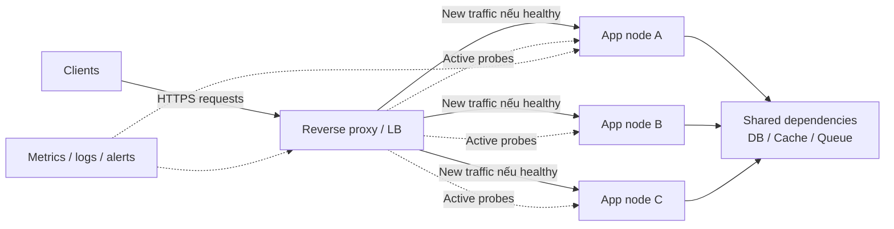
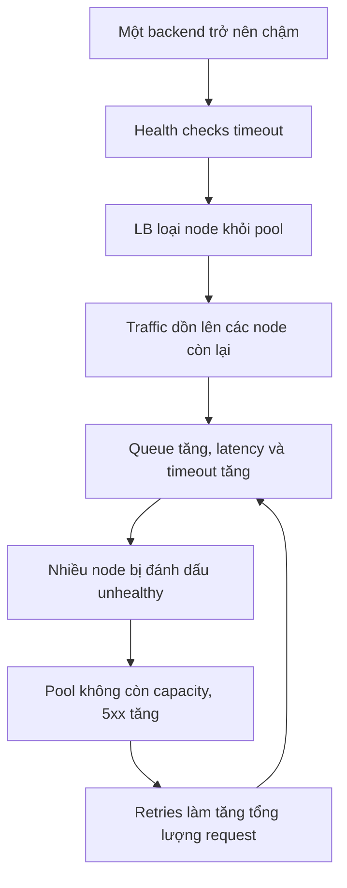
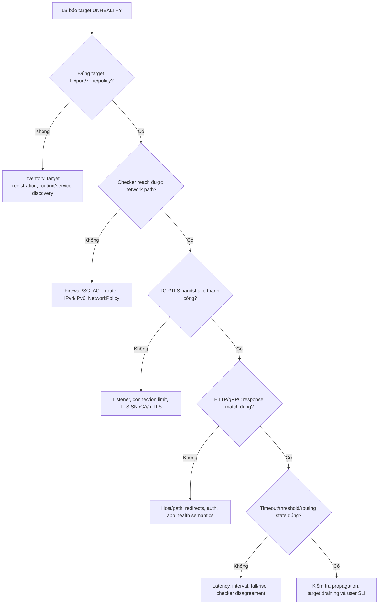

# Health check và tác động đến tính sẵn sàng của proxy, reverse proxy và load balancer

Một hệ thống API có ba application servers phía sau load balancer (LB). Một server vẫn mở TCP port `8080`, nhưng các request ứng dụng trả `500` do worker bị treo. Nếu LB chỉ kiểm tra cổng TCP, nó có thể tiếp tục phân phối traffic tới server đó. Ngược lại, nếu health check kiểm tra mọi dependency quá nghiêm ngặt, một sự cố database chung có thể khiến **cả ba server đồng loạt bị đánh dấu unhealthy**, dù ứng dụng vẫn có thể trả trang thông báo hoặc xử lý một số chức năng còn hoạt động.

**Health check** là cơ chế quan sát tình trạng một endpoint hoặc backend theo những điều kiện được định nghĩa trước, từ đó hỗ trợ quyết định **có tiếp tục đưa traffic tới endpoint đó hay không**. Nó ảnh hưởng trực tiếp tới **availability (tính sẵn sàng), latency, error rate, capacity, failover và tốc độ phục hồi**. Health check tốt phát hiện node thật sự không còn phục vụ được; health check sai có thể tạo một outage lớn hơn lỗi ban đầu.

Trong chương **Proxy reverse proxy và cân bằng tải**, bài học thuộc module **SECURITY_NETWORK_SECURITY**: thiết kế mạng phòng vệ nhiều lớp, phân đoạn, firewall, VPN, IDS/IPS, xác thực kết nối, giám sát và kiến trúc an toàn. Health checking không phải cơ chế xác thực người dùng hay IDS, nhưng nằm trên **ranh giới chuyển tiếp traffic** và có thể ảnh hưởng đến độ tin cậy của chính hệ thống bảo mật. Một health endpoint mở sai hoặc bị thao túng có thể làm LB định tuyến sai; một health checker không có quyền/đường route phù hợp có thể loại bỏ backend vẫn khỏe.

Sau bài học, bạn có thể:

1. Phân biệt **active và passive health checks**, **liveness**, **readiness**, **startup** và **synthetic end-to-end checks**.
2. Lựa chọn probe theo TCP, HTTP/HTTPS, gRPC và logic ứng dụng; phân tích ý nghĩa của trạng thái `200`, timeout, TCP connect và TLS certificate validation.
3. Giải thích ảnh hưởng của `interval`, `timeout`, **failure threshold**, **success threshold**, slow start và hysteresis đến phát hiện lỗi/khôi phục.
4. Thiết kế health endpoints không tạo tác dụng phụ, không lộ secrets, có timeout/budget rõ ràng và phản ánh khả năng phục vụ thực tế.
5. Hiểu cách load balancer loại backend khỏi **new connections/requests**, trong khi kết nối đang tồn tại cần cơ chế **draining/graceful shutdown** riêng.
6. Giữ hệ thống hoạt động khi có lỗi riêng lẻ, lỗi theo zone, overload hoặc dependency chung; tránh **cascading failure**.
7. Đọc ví dụ HAProxy, NGINX và Kubernetes probes; nhận biết giới hạn khác nhau giữa các nền tảng/cloud providers.
8. Phân tích availability bằng capacity planning, SLI/SLO, giám sát, runbook và kiểm thử positive/negative trong lab.

> **Quy ước:** IP `10.20.40.x`, hostname `.example.test` và path `/live`, `/ready`, `/startup` là giả lập cho môi trường học. Các cấu hình chỉ là điểm khởi đầu; không sao chép vào production nếu chưa kiểm tra phiên bản sản phẩm, đường mạng, chính sách xác thực, năng lực backend và phương án rollback.

## 1. Health check đứng ở đâu trong kiến trúc?

Một reverse proxy hoặc L7 load balancer thường nhận request của client, chọn một backend trong **pool/target group**, rồi chuyển request tới đó. Một L4 load balancer chọn đích cho các luồng TCP/UDP hoặc các đơn vị chuyển tiếp mà sản phẩm hỗ trợ.



Trong mô hình có active checks, LB gửi probe theo chu kỳ và duy trì **health state** cho từng target. Nếu target không đạt điều kiện, LB có thể ngừng chọn target cho traffic mới. Tuy nhiên:

- Health check không tự sửa ứng dụng bị lỗi.
- Trạng thái healthy **không đảm bảo mọi request thành công**.
- Trạng thái unhealthy không có nghĩa máy chủ đã tắt; nó có thể bị mất quyền truy cập từ chính LB hoặc thiếu một dependency.
- Những kết nối đã tạo có thể tiếp tục, bị hủy hoặc được drain tùy giao thức và LB.
- Mỗi LB/controller có thể tự giữ health state; các node không nhất thiết quan sát giống nhau tại một thời điểm.

### 1.1. Health check là một phép đo, không phải “sự thật tuyệt đối”

Khi LB gửi `GET /ready`, nó kiểm tra **một điều kiện từ một điểm quan sát** trong một thời điểm. Kết quả không tự xác minh mọi API path, mọi tenant, mọi database query hoặc mọi kết nối HTTPS từ client.

Ví dụ:

```text
LB → App :8080 /ready = 200 OK
Client → LB → App /orders/checkout = 500
```

Điều này có thể xảy ra nếu endpoint `/ready` chỉ kiểm tra event loop/HTTP handler, còn `/orders/checkout` cần hệ thống thanh toán đang lỗi. Không có probe đơn lẻ nào bao quát mọi hành vi; cần kết hợp **target health, request error metrics và end-to-end synthetic monitoring**.

### 1.2. Tính sẵn sàng của service khác trạng thái process

Một process có thể:

1. **Alive:** vẫn đang chạy và có thể phản hồi một phép kiểm cơ bản.
2. **Ready:** có khả năng nhận traffic phục vụ một tập chức năng được định nghĩa.
3. **Serving successfully:** request thật đáp ứng SLO về lỗi và độ trễ.
4. **Healthy from a particular LB:** LB nhận được probe qua mạng của chính nó.

Đây là bốn khái niệm liên quan nhưng không đồng nhất. Một ứng dụng còn alive nhưng không ready; một ứng dụng ready vẫn có thể chậm hoặc có lỗi nghiệp vụ; một node hoàn toàn khỏe có thể bị LB đánh dấu down nếu firewall chặn IP của health checker.

## 2. Những loại health check cần phân biệt

### 2.1. Active health check

**Active check** là phép thử **chủ động**, được thực hiện định kỳ ngay cả khi chưa có request của người dùng.

```text
          t=0        t=5s       t=10s       t=15s
LB        GET /ready GET /ready  GET /ready  GET /ready
App A       200        200         503         503
App B       200        200         200         200
```

**Ưu điểm:** phát hiện backend chết hoặc unready ngay cả khi lưu lượng nhỏ; có thể kiểm tra chính xác path, status, TLS và response nếu sản phẩm hỗ trợ.

**Giới hạn:** thêm tải định kỳ; kết quả chỉ là ảnh chụp theo thời điểm; có thể đánh giá sai nếu probe endpoint khác biệt so với đường ứng dụng thật; interval dài gây trễ phát hiện.

### 2.2. Passive health check

**Passive check** quan sát **kết quả traffic thật** mà proxy đã gửi đến backend: connection errors, timeout, reset, HTTP error codes hoặc các tín hiệu khác tùy cấu hình.

Ví dụ:

```text
Client 1 ──> LB ──> App A : connection refused
Client 2 ──> LB ──> App A : timeout
Client 3 ──> LB ──> App A : timeout
                         └─> LB có thể đánh dấu App A unavailable
```

**Ưu điểm:** dựa trên luồng thực tế, không nhất thiết cần một endpoint probe riêng; có thể phát hiện lỗi mà một probe quá nông bỏ sót.

**Giới hạn:**

- Khi không có traffic, không có đủ dữ liệu để phát hiện hoặc phục hồi.
- Một số lỗi nghiệp vụ như HTTP `409`, `422`, `429` hoặc thậm chí `500` có thể có ý nghĩa khác nhau theo API.
- Nếu LB tính mọi `5xx` là backend failure, một lỗi database chung có thể làm **tất cả targets bị đẩy ra khỏi pool**.
- Cơ chế chọn thời gian phạt, retry, probation và số lỗi phụ thuộc sản phẩm.

### 2.3. Kết hợp active + passive

Một thiết kế mạnh thường:

- Dùng active check cho **khả năng nhận request mới**.
- Dùng passive signals cho **lỗi phát sinh trên request thật** và điều chỉnh theo ngữ nghĩa.
- Dùng SLI/service monitoring cho **tỷ lệ request thành công và latency**.
- Dùng synthetic probe từ một hoặc nhiều vùng bên ngoài để phát hiện các lỗi mà LB nội bộ không thấy.

Không tự kết luận active + passive luôn tốt hơn: nếu mỗi cơ chế có false positive và không đồng bộ, việc kết hợp thiếu thiết kế có thể tăng flapping.

### 2.4. Liveness, readiness và startup

| Loại | Câu hỏi chính | Hành động thường được dùng | Điều không nên làm |
|---|---|---|---|
| **Liveness** | Process còn có thể tiếp tục chạy hay đã kẹt tới mức cần khởi động lại? | Orchestrator có thể restart container khi thất bại đủ ngưỡng | Lệ thuộc trực tiếp một shared DB chập chờn để rồi restart mọi Pod |
| **Readiness** | Instance có **thể nhận traffic mới** theo tiêu chí đã định không? | LB/orchestrator loại target khỏi danh sách endpoints | Đánh dấu ready trước khi khởi tạo critical components xong |
| **Startup** | Ứng dụng đã có đủ thời gian hoàn thành khởi động ban đầu chưa? | Hoãn đánh giá liveness/readiness trong giai đoạn startup theo nền tảng | Đặt thời gian quá ngắn khiến app khởi động lâu bị restart liên tục |
| **Synthetic end-to-end** | Từ góc nhìn người dùng, luồng nghiệp vụ có thành công không? | Alert/SLO/incident, có thể kích hoạt policy theo thiết kế | Dùng giao dịch có side effects trên production không có dữ liệu thử |

**Liveness không phải readiness.** Nếu database tạm mất kết nối trong vài giây nhưng app vẫn chạy và có khả năng khôi phục, restart hàng loạt process có thể làm database chịu thêm áp lực khi nó vừa trở lại.

### 2.5. Ai có quyền thực thi health state?

Kubernetes có probes riêng, load balancer cloud có target health riêng, service mesh có endpoint discovery và outlier detection, ứng dụng có internal health metrics. Một Pod `Ready=True` trong Kubernetes **không tự đảm bảo** cloud LB đang thấy target healthy; propagation qua service/endpoints/controller và các chu kỳ check tạo độ trễ.

Khi debug, ghi rõ **health check của hệ thống nào, target nào, qua path/port/scheme gì và timestamp nào**.

## 3. Health check tầng 4, tầng 7 và logic nghiệp vụ

### 3.1. TCP connect check

Một probe TCP có thể thử mở kết nối tới `10.20.40.11:8080`:

```text
LB → TCP SYN → Backend
LB ← SYN/ACK ← Backend
```

Nếu handshake thành công, nó cho biết **port có thể tiếp nhận kết nối TCP tại thời điểm đó**. Nó **không chứng minh**:

- Application handler xử lý request đúng.
- Database/queue khỏe.
- TLS certificate hợp lệ.
- HTTP status codes hoặc body phù hợp.
- Backend không đang quá tải ở một nhóm request cụ thể.

TCP check phù hợp khi **mở cổng đã là điều kiện cần và đủ theo SLO của một service đơn giản**, hoặc dùng làm phép đo bổ sung. Đối với API HTTP, TCP-only thường quá nông.

### 3.2. TLS handshake check

Một số LB có khả năng thực hiện **TLS handshake** tới backend. Khi kiểm tra:

- SNI có đúng service hostname không?
- LB có **xác minh CA chain và hostname/SAN** thật không, hay chỉ thử bắt tay thành công?
- Có yêu cầu mTLS client certificate không?
- TLS version, cipher và ALPN có phù hợp với backend production không?

**TLS handshake thành công chưa chứng minh application request thành công.** Đồng thời, tùy sản phẩm, một “HTTPS health check” có thể có chính sách xác minh certificate khác hẳn kết nối backend thông thường; không giả định tự động tương đương.

### 3.3. HTTP/HTTPS check

HTTP check thường gửi request như:

```http
GET /ready HTTP/1.1
Host: app.internal.example.test
```

Sau đó đánh giá response status và, nếu cần, body/header theo khả năng sản phẩm. Với ví dụ:

```http
HTTP/1.1 200 OK
Content-Type: application/json
Cache-Control: no-store

{"status":"ready"}
```

**Không phải mọi health checker mặc định chỉ chấp nhận 200.** Có sản phẩm nhận một tập status, có sản phẩm cho cấu hình matcher hoặc body. Chính sách nên xác định **rõ trạng thái nào là healthy**, tránh `302` redirect login, `401` unauthorized, `404` sai path hoặc `503` quá tải bị hiểu nhầm.

### 3.4. gRPC Health Checking

Với gRPC, chuẩn **gRPC Health Checking Protocol** hỗ trợ method check/streaming watch, với những trạng thái như `SERVING` và `NOT_SERVING`. Proxy hoặc orchestrator có thể dùng protocol-aware health check nếu được hỗ trợ.

Nếu chỉ dùng HTTP GET `/health` trên một gRPC-only endpoint:

- Server có thể từ chối vì HTTP version/content type không phù hợp.
- LB có thể nhầm backend down dù gRPC hoàn toàn hoạt động.
- Một HTTP probe thành công qua sidecar cũng chưa chứng minh gRPC handler ứng dụng đang sẵn sàng.

Kiểm tra đúng **ALPN/HTTP2**, TLS/mTLS, service name và path tương ứng. Một gRPC health endpoint công khai cũng cần giới hạn quyền truy cập theo chính sách.

### 3.5. Deep health check: nên sâu đến đâu?

Ví dụ `/ready` kiểm tra **một query SQL thật** và **một request tới payment provider** mỗi 5 giây:

```text
100 app nodes × 1 check / 5s × 2 dependencies
  → 40 dependency probes/second (trong ví dụ đơn giản)
```

Chưa kể các LB nodes riêng biệt, retries, nhiều zones và autoscaling. Một phép thử “sâu” có thể vô tình gây thêm tải đúng lúc dependency đang yếu. Nếu health endpoint gọi API bên ngoài và không có timeout, chính health checking có thể làm cạn thread/connection pool.

Nguyên tắc:

1. **Liveness:** cực kỳ nhẹ, ưu tiên tín hiệu process không thể tự khôi phục.
2. **Readiness:** đo khả năng nhận traffic mới, những dependency thực sự bắt buộc, với timeout ngắn và kết quả có ngữ nghĩa.
3. **Deep checks:** tập trung ở synthetic monitoring có budget, tần suất và test data riêng; không bắt mọi instance chạy mọi giao dịch nghiệp vụ mỗi vài giây.

### 3.6. Không dùng health check có side effects

Không nên để `/ready`:

- Ghi một order hay charge thật để “kiểm tra DB/payment”.
- Tạo/xóa dữ liệu khách hàng.
- Gửi email/SMS, rotate secrets hoặc gọi admin API không cần thiết.
- Chạy migration hoặc thao tác tự sửa hệ thống trong mỗi probe.
- Chạy query không có giới hạn tải, timeout hoặc quyền.

Nếu cần xác minh khả năng ghi, dùng một synthetic transaction riêng, dữ liệu thử và cơ chế cleanup/idempotency được kiểm soát, với tần suất thấp và policy rõ. **Health endpoint nên deterministic, side-effect-free và rẻ**.

## 4. Định nghĩa “ready” phù hợp từng ứng dụng

Một backend được coi là ready khi **có thể nhận request mới theo tiêu chí service đã công bố**, không phải khi mọi dependency trên thế giới đều hoàn hảo.

### 4.1. Ba lớp tín hiệu

| Nhóm kiểm tra | Ví dụ | Cần được đưa vào readiness? |
|---|---|---|
| **Process state** | HTTP server đang nhận request, event loop không bị deadlock | Thường cần |
| **Critical local state** | Startup hoàn tất, migrations tương thích, route handlers và cấu hình thiết yếu đã nạp | Thường cần |
| **Critical dependency** | Database không thể thiếu cho **mọi** request, secret/cert không khả dụng | Cân nhắc kỹ, có timeout/caching/scope phù hợp |
| **Optional dependency** | Recommendations, avatar, analytics, một dịch vụ email có fallback | Thường không nên khiến toàn instance unready |
| **Global dependency** | Shared DB hoặc SaaS mà mọi replicas cùng dùng | Cẩn trọng vì có thể loại **toàn bộ** pool cùng lúc |
| **Capacity/load signal** | Queue local quá tải, concurrency quá cao, không còn chỗ nhận request | Có thể dùng với hysteresis và control riêng |

### 4.2. Khi database chung hỏng, có nên đánh dấu mọi server unready?

Không có một đáp án đúng trong mọi hệ thống:

- Nếu **mọi chức năng** thực sự không thể đáp ứng SLO khi DB mất và hạ tầng có một tầng fallback được thiết kế, trả unready có thể giúp chuyển traffic tới vùng/cụm còn độc lập.
- Nếu mọi node dùng **cùng database đang lỗi**, làm tất cả unready có thể khiến LB không còn target, tạo lỗi tổng thể rõ hơn thay vì cải thiện dịch vụ.
- Nếu một phần chức năng còn phục vụ cache/read-only, nên có **health theo capability** hoặc điều khiển suy giảm chất lượng thay vì tắt mọi request.
- Nếu backend vẫn có thể khôi phục kết nối DB sau vài giây, restart liveness vì DB failure thường làm tình hình xấu đi.

**Phân biệt lỗi local của node với lỗi chung của service.** Một phép kiểm nên trả lời câu hỏi hành động: “loại riêng node này khỏi pool có giúp client được phục vụ tốt hơn không?” Nếu câu trả lời thường là không, cần điều chỉnh readiness hoặc tầng điều phối.

### 4.3. Khả năng phục vụ theo chức năng

Một API có thể gồm:

```text
/catalog      → có cache, vẫn phục vụ khi DB primary gặp vấn đề
/checkout     → cần DB và payment provider
/health/live  → chỉ xác nhận process không chết
/health/ready → xác nhận instance có thể nhận request theo policy
```

Thay vì để tất cả nodes rời pool chỉ do payment provider hỏng, có thể:

- Trả lỗi có kiểm soát cho `/checkout` và giữ `/catalog`.
- Dùng circuit breaker, timeout, bulkhead, retry budgets.
- Tách các services/pools theo capability để health check phản ánh từng workload.
- Giám sát user-facing SLI theo API category thay vì dùng một health boolean cho toàn sản phẩm.

### 4.4. Readiness và deploy mới

Instance vừa start có thể mở socket ngay nhưng còn:

- Nạp cấu hình, secrets, certificate.
- Kết nối tới dependency bắt buộc.
- Warm cache/JIT/classloader, tạo thread pools.
- Khởi tạo model dữ liệu hoặc cấu hình định tuyến.

Nếu đánh dấu ready trước các bước thiết yếu, LB gửi traffic quá sớm tạo 5xx và latency spike. **Startup probe** hoặc delayed readiness giúp tránh điều này, nhưng không nên trì hoãn vô hạn một node bị lỗi cấu hình: phải có timeout/alert.

## 5. Interval, timeout, fall, rise và độ trễ phát hiện lỗi

Một health checker phải cân bằng giữa **phát hiện nhanh** và **ổn định trước nhiễu tạm thời**.

| Tham số | Ví dụ | Ý nghĩa |
|---|---|---|
| `interval` / `inter` | `5s` | Khoảng cách lên lịch giữa probes theo semantics sản phẩm |
| `timeout` | `2s` | Tối đa chờ kết quả một probe theo cấu hình |
| `fall` / unhealthy threshold | `3` | Số lần kiểm tra thất bại cần thiết trước khi đánh dấu down |
| `rise` / healthy threshold | `2` | Số lần thành công cần thiết trước khi đánh dấu up |
| `initialDelaySeconds` | `5s` | Hoãn bắt đầu probes sau thời điểm quy định |
| `startupProbe` | Đủ cho startup lâu | Kiểm tra startup và có thể hoãn liveness/readiness |
| `slowstart` / warmup | `30s` | Một số LB tăng dần tải khi backend vừa phục hồi |
| `downinter` / backoff | `10s` | Một số checker thăm dò backend down ít thường xuyên hơn |

Tên tham số và cách đếm **phụ thuộc HAProxy, NGINX, Envoy, Kubernetes, cloud LB**. Không sao chép một giá trị sang tất cả hệ thống mà không đọc cách chúng áp dụng.

### 5.1. Ước lượng thời gian phát hiện

Giả sử:

```text
Interval I = 5 giây
Failure threshold F = 3
Timeout T = 2 giây
```

Nếu backend bị lỗi ngay **sau một lần probe thành công** và các probe mới thất bại nhanh, các lần thất bại có thể được quan sát khoảng ở `t=5s`, `t=10s`, `t=15s`. Nếu phải chờ timeout, kết quả có thể đến muộn hơn.

Ước lượng đơn giản:

\[
T_{\mathrm{detect}} \approx T_{\mathrm{wait\ to\ first\ failure}} + (F-1)I + T_{\mathrm{probe}}
\]

Trong đó:

- `T_wait to first failure` phụ thuộc pha lên lịch, nằm trong khoảng liên quan tới chu kỳ probe.
- `T_probe` là thời gian để probe cuối được ghi nhận thất bại, có thể gần `0` khi connection refused hoặc gần timeout khi backend treo.
- Sau khi đánh dấu down còn có **control-plane propagation delay** tới các LB nodes, target groups, caches hoặc clients.

**Không coi `F × I` là một SLA phát hiện chính xác.** Các sản phẩm có cách lên lịch song song/tuần tự, jitter, fast interval, timeout, lần probe ban đầu và quãng downcheck khác nhau.

### 5.2. Tại sao không đặt mọi threshold bằng 1?

Nếu `fall=1` và LB lập tức loại backend sau một timeout rất ngắn, các yếu tố tạm thời như:

- GC pause/JIT warmup.
- Chậm xử lý của local scheduler.
- Packet loss ngắn hoặc jitter network.
- Bảo trì nhỏ ở host.
- Một spike CPU kéo dài vài trăm mili giây.

có thể gây **false down** và đẩy traffic qua node khác, làm node khác quá tải rồi cũng down. `fall`/`rise` tạo **hysteresis**: không đổi trạng thái chỉ vì một lần probe nhiễu.

Ở phía ngược lại, threshold quá lớn sẽ khiến LB tiếp tục gửi request vào node đã chết trong nhiều chu kỳ, làm tăng error rate. Lựa chọn phụ thuộc SLO, retry behavior, node count, capacity và failure mode.

### 5.3. Xác suất và tính tương quan

Nếu xác suất một probe **thất bại giả** là `p` và mỗi kết quả **độc lập**, xác suất có ba lần thất bại giả liên tiếp xấp xỉ \(p^3\). Với `p=0.02`, con số minh họa là `0.000008` (0,0008%) cho **một chuỗi ba kết quả** theo giả định đó.

Nhưng trong sản xuất, lỗi thường **có tương quan**: một network flap, pause chung trên host, shared DNS outage hoặc control-plane issue có thể làm nhiều probes thất bại liên tiếp. Do đó, không dùng phép tính độc lập này để bảo đảm độ tin cậy thực tế.

### 5.4. Hysteresis cho hồi phục

`rise=2` thường đòi ít nhất hai kết quả probe tốt trước khi bật lại target, theo semantics sản phẩm. Điều này tránh trạng thái up/down lặp lại khi node chưa ổn định.

Khi target vừa trở lại, nó có thể còn cache lạnh hoặc connection pools chưa sẵn sàng. Nếu LB lập tức chuyển lượng lớn traffic, node có thể quá tải và down lần nữa. **Slow start**, weighted ramp-up hoặc giới hạn concurrency khi node mới phục hồi giúp giảm rủi ro.

### 5.5. Health check flapping

```text
UP → DOWN → UP → DOWN → UP
```

Flapping có thể đến từ:

- Threshold quá nhạy.
- `/ready` phụ thuộc một service lúc được lúc không.
- LB health checker dùng đường mạng/identity không ổn định.
- Node chưa warmup nhưng đã được phân phối nhiều traffic.
- Connection limits/retries làm tăng tải sau mỗi lần trở lại.

Xử lý bằng **bằng chứng** về probe latency, reason, backend saturation, dependency status và config version. Không chỉ tăng threshold để che mất một sự cố thực.

## 6. Health check thay đổi capacity và availability như thế nào?

Một LB loại node lỗi giúp **giảm request vào node không phục vụ được**, nhưng cũng làm mất một phần capacity. Nếu phần capacity còn lại không đủ, traffic được dồn sang những node khỏe rồi chúng trở nên quá tải.

### 6.1. Ví dụ capacity sau khi mất node

Giả sử một API có:

```text
4 backend nodes
Capacity ổn định đã đo: 100 requests/second mỗi node
Load bình thường:        250 requests/second
```

Đây là phép tính minh họa tuyến tính, chỉ dùng khi các node và workload tương đối đồng nhất.

| Trạng thái | Capacity lý thuyết | Utilization tại 250 rps | Rủi ro |
|---|---:|---:|---|
| 4/4 nodes up | 400 rps | 62,5% | Có headroom |
| 3/4 nodes up | 300 rps | 83,3% | Còn phục vụ nhưng ít dự phòng |
| 2/4 nodes up | 200 rps | 125% | Thiếu capacity, latency/error tăng |
| 1/4 node up | 100 rps | 250% | Quá tải nặng nếu không load shed |

**Health check không tạo thêm capacity.** Nó chỉ thay quyết định routing. Khi số node khỏe giảm, cần **autoscaling, request shedding, prioritization, admission control hoặc giảm traffic** theo thiết kế.

### 6.2. Một hệ thống “tất cả healthy” vẫn có thể không available

Ví dụ một backend trả `200 /ready`, nhưng `/checkout` mất 20 giây vì queue bottleneck. LB không loại nó vì health check trả trong 10 ms, trong khi user-facing latency SLO thất bại.

Availability của dịch vụ là **mức độ thành công của hành vi được người dùng yêu cầu**, không đơn thuần là số lượng targets xanh. Cần theo dõi **request success rate**, **latency percentiles** và **error budget**, kết hợp synthetic probes.

### 6.3. Common-mode failures phá vỡ giả định dự phòng

Nếu cả 4 nodes dùng một database, một load balancer hoặc một identity service chung, số node nhiều **không xóa được single point of failure**. Theo mô hình đơn giản có xác suất độc lập, nhiều replicas có thể cải thiện availability; nhưng khi lỗi có tương quan do shared dependency, không được áp công thức độc lập một cách máy móc.

Hãy phân loại:

- **Node failure:** chỉ một instance bị treo, ổ đĩa lỗi hoặc crash.
- **Zone/AZ failure:** mạng/nguồn/một vùng không thể phục vụ.
- **Regional failure:** toàn vùng hạ tầng/cloud bị ảnh hưởng.
- **Shared dependency failure:** DB, DNS, PKI, IAM hoặc cache chung.
- **Control-plane failure:** LB configuration, endpoint discovery hoặc health state propagation sai.

Một hệ thống đủ replicas nhưng tất cả ở cùng zone không có dự phòng trước zone outage. Một health check chạy ở đúng một vùng cũng có thể tạo **false global outage** nếu chỉ vùng kiểm tra mất đường mạng.

## 7. Health check và số phận của kết nối đang tồn tại

Đánh dấu một backend **unhealthy** thường nhằm ngừng gửi **traffic mới**; nó **không nhất thiết cắt ngay mọi kết nối hiện hữu**.

### 7.1. New requests khác existing connections

```text
T0: App A healthy → LB gửi kết nối/request mới tới A
T1: App A health check liên tiếp thất bại
T2: LB loại A khỏi lựa chọn mới (theo state/policy)
T3: Các kết nối đã tồn tại tới A:
    - có thể tiếp tục,
    - có thể bị đóng/reset,
    - hoặc được drain đến deadline,
    tùy LB và protocol.
T4: App A được sửa, probe thành công đủ ngưỡng, trở lại pool
```

Với HTTP/1.1 keep-alive, HTTP/2 multiplexing, gRPC stream và WebSocket, một **connection** có thể mang nhiều request hoặc sống rất lâu. Cơ chế retry/rebalance trên connection đã mở khác với request mới; không thể mặc nhiên chuyển một stream đang xử lý sang backend khác.

### 7.2. Graceful shutdown / connection draining

Khi deploy hoặc bảo trì:

1. Ứng dụng chuyển trạng thái **not ready** cho traffic mới.
2. LB/orchestrator nhận thông tin và **ngừng chọn node** sau propagation delay.
3. Ứng dụng tiếp tục xử lý in-flight requests/streams trong một khoảng drain có giới hạn.
4. Ứng dụng ngừng nhận kết nối, release resources và thoát theo cơ chế nền tảng.
5. LB/controller xác nhận target đã rời pool; deployment mới nhận traffic sau warmup.

**Readiness=false không tự drain mọi request**. Graceful shutdown cần khớp `terminationGracePeriod`, preStop hooks, LB deregistration delay, app shutdown timeout và thời gian sống của connection. Nếu kill process trước khi LB nhận cập nhật, client có thể thấy reset/502 dù node “bị loại đúng” về mặt health.

### 7.3. Sticky sessions và traffic rebalance

Khi dùng session affinity:

- Một số clients có thể tiếp tục dính vào node sắp lỗi.
- Khi node bị loại, user session lưu **trong bộ nhớ node** có thể mất.
- LB cần chính sách failover/redistribution và app nên dùng session store chung hoặc stateless tokens theo nghiệp vụ.

Không dùng sticky session như phương án thay health check. Một session cookie routing đúng vẫn có thể đưa user vào backend không còn khả năng xử lý nếu proxy thiếu cơ chế kiểm soát trạng thái.

### 7.4. Retries và nguy cơ nhân đôi request

Khi backend lỗi giữa request, proxy có thể thử node khác. Nhưng **retry không luôn an toàn**: nếu backend đã ghi dữ liệu rồi mất response, retry `POST /payment` có thể tạo giao dịch lặp nếu không có idempotency.

Nên:

- Retry chỉ khi hiểu trạng thái request, HTTP method, dữ liệu đã gửi và khả năng side effects.
- Dùng **idempotency keys** cho các operation cần bảo đảm một hiệu ứng nghiệp vụ.
- Đặt timeout, max attempts, retry budgets và backoff/jitter.
- Tránh tất cả tầng (client, LB, service mesh, app) cùng retry không kiểm soát.
- Tách **proxy retry policy** khỏi **health state policy**, không giả định một bên tự sửa toàn bộ vấn đề.

**Một health check tốt làm giảm request gửi tới node lỗi; retry tốt chỉ giúp trong các điều kiện có thể phục hồi an toàn.** Cả hai đều phải được giới hạn để tránh khuếch đại sự cố.

## 8. Thiết kế health endpoint của application

Health endpoint nên **đơn giản, nhanh, ổn định và diễn giải được**. Nó cung cấp một tín hiệu vận hành cho các thành phần được cấp quyền, không phải một API công khai chứa thông tin nội bộ.

### 8.1. Tách `/live`, `/ready`, `/startup`

Một hợp đồng endpoint minh họa:

| Endpoint | Trả healthy khi | Trả unhealthy khi | Người dùng tín hiệu |
|---|---|---|---|
| `GET /live` | Process và HTTP handler cơ bản có thể tiến triển | Deadlock hoặc lỗi process không tự phục hồi theo policy | Kubernetes liveness, giám sát local process |
| `GET /ready` | App đã khởi tạo xong và có đủ khả năng phục vụ traffic mới | Đang drain, warmup chưa xong, local resource cạn hoặc dependency **thật sự thiết yếu** không sẵn sàng | LB, ingress/controller, service registry |
| `GET /startup` | Initialization đã hoàn tất | Chưa hoàn tất startup hoặc fatal init issue | Kubernetes startup probe, deployment system |
| `GET /health/details` | Tùy trạng thái từng component | Tùy ngữ nghĩa | Monitoring nội bộ **được xác thực**, không dành cho public LB probe |

**Không có chuẩn toàn cầu bắt buộc ba path trên**; chúng là hợp đồng minh họa. Với framework/cloud khác nhau, default paths khác nhau; phải ghép đường đi và ngữ nghĩa của ứng dụng với checker thực tế.

### 8.2. Response contract

Một ứng dụng có thể chọn:

```http
HTTP/1.1 200 OK
Content-Type: application/json
Cache-Control: no-store

{"status":"ready"}
```

Khi không ready:

```http
HTTP/1.1 503 Service Unavailable
Content-Type: application/json
Cache-Control: no-store

{"status":"not_ready"}
```

**Không để một CDN hoặc cache trả lại `200 /ready` đã lưu** thay vì trạng thái instance hiện tại. Khi L7 health checker kiểm tra qua cache, nó có thể bỏ lỡ node bị lỗi. Tốt nhất LB đi vào **đúng per-target endpoint** qua đường dữ liệu phù hợp và tránh cache/proxy trung gian không cần thiết.

`503` ở đây là ví dụ phổ biến, nhưng phải đọc matcher của LB: nếu checker nhận bất kỳ `2xx–3xx`, một redirect `302 /login` có thể bị coi là khỏe; nếu checker yêu cầu chính xác `200`, response `204` có thể bị coi là lỗi dù handler không có vấn đề.

### 8.3. Vì sao `/ready` không nên làm việc nặng?

Nếu mỗi LB instance kiểm tra một backend mỗi 2 giây, trong hệ thống có 10 LB instances và 200 backend targets, tổng số requests có thể rất lớn. Việc check một database query đắt đỏ trên mỗi request có thể gây **thundering herd** lên dependency.

Khuyến nghị:

- Handler không gọi API có side effects.
- Dùng kết quả local về dependency health đã được đo theo một cadence có kiểm soát.
- Có deadline/timeout, trả kết quả nhanh ngay cả khi backend quá tải.
- Không giữ nhiều locks hoặc đợi một worker pool vốn đang saturated.
- Chọn HTTP headers/body tối giản; status code làm tín hiệu chính.
- Phân biệt tình trạng **local node** và **global dependency**, không tự đồng loạt loại mọi node.
- Bảo đảm CPU/threads đủ để health endpoint trả lời khi app bận nhưng còn có thể phục vụ.

### 8.4. Một ví dụ pseudocode về trạng thái readiness

```text
function readiness():
    if shutting_down:
        return 503 "draining"
    if not initialization_complete:
        return 503 "starting"
    if local_worker_queue_above_safe_limit_for_sustained_window:
        return 503 "overloaded"
    if critical_local_resource_unavailable:
        return 503 "not_ready"
    return 200 "ready"
```

Đây là pseudocode, **không phải code framework sẵn chạy**. Cơ chế `overloaded` cần hysteresis; nếu mọi node cùng vượt ngưỡng rồi chuyển not-ready, hệ thống có thể gặp blackout. Một số kiến trúc phù hợp hơn với **admission control / load shedding** thay vì rút toàn bộ node khỏi pool.

### 8.5. Deep check riêng có giới hạn

Thay vì mỗi instance truy vấn DB nặng, có thể:

```text
/ready          → đánh giá readiness local, không làm side effects
/health/details → quản trị nội bộ, metadata được giới hạn
Synthetic job   → từ ngoài gọi API test và kiểm chứng SLO
```

Synthetic checks nên có service identity, test data, rate limit và hệ thống làm sạch riêng. Không để một synthetic user có quyền quản trị rộng chỉ để đánh giá tính sẵn sàng.

## 9. Ví dụ cấu hình HAProxy: active HTTP health checks

HAProxy hỗ trợ **active health checks** trong các chế độ phù hợp. Đoạn sau minh họa một proxy HTTP cho hai application nodes; chỉ nên áp trong lab vì port và network policy cần thay theo hệ thống thật.

### 9.1. Cấu hình minh họa

```haproxy
global
    log stdout format raw local0

defaults
    mode http
    log global
    option httplog
    timeout connect 3s
    timeout client 30s
    timeout server 30s
    timeout check 2s

frontend fe_app
    bind *:8080
    default_backend be_app

backend be_app
    balance roundrobin

    # HTTP check thay vì chỉ TCP connect.
    option httpchk
    http-check send meth GET uri /ready ver HTTP/1.1 hdr Host app.internal.example.test
    http-check expect status 200

    # 5s giữa checks, 3 thất bại để down, 2 thành công để up.
    # Có thể hỗ trợ fastinter/downinter tùy phiên bản.
    default-server inter 5s fall 3 rise 2

    server app01 10.20.40.11:8080 check
    server app02 10.20.40.12:8080 check
```

Điều xảy ra:

1. `option httpchk` chọn HTTP health checking.
2. `http-check send` yêu cầu `GET /ready` với `Host` minh họa.
3. `http-check expect status 200` đòi HTTP status `200`.
4. `inter 5s fall 3 rise 2` định nghĩa chu kỳ và hysteresis của các checks theo HAProxy.
5. `check` ở mỗi `server` kích hoạt active health check cho target tương ứng.
6. Khi một node bị đánh dấu down, HAProxy thường không chọn nó cho **new traffic**; behavior của existing connections, retry và persistence cần cấu hình riêng.

**Cảnh báo quan trọng:** Ví dụ này dùng **HTTP plaintext** giữa proxy và backend. Nếu kiến trúc yêu cầu TLS/mTLS, phải cấu hình upstream TLS, CA trust, hostname/SNI verification và chính sách transport tương ứng. Bật `check` không tự xác minh certificate hay bảo vệ dữ liệu.

### 9.2. Đọc kết quả để tránh hiểu lầm

Một server chỉ TCP connect được nhưng trả `503 /ready` sẽ bị xem là thất bại theo matcher ở ví dụ. Nếu app trả redirect `302`, nó cũng không đạt yêu cầu `status 200`.

Ngược lại, nếu app trả `200 /ready` trong khi `/orders` bị lỗi theo chức năng, LB vẫn có thể xem target healthy. Khi đó cần cải thiện **application readiness semantics**, SLI và synthetic checks thay vì chỉ đổi HAProxy threshold.

### 9.3. Tăng độ tin cậy trong môi trường thật

- Giới hạn health endpoint tại mạng quản trị/service network; không mở public nếu không cần.
- Cấu hình HAProxy logging/metrics và kiểm tra events khi server chuyển UP/DOWN.
- Xem `rise/fall`, `fastinter/downinter`, warmup, stickiness và health state persistence theo version thật.
- Với các app có request dài, điều chỉnh timeouts/draining sau khi đo SLO.
- Cân nhắc health checks độc lập trên **nhiều LB instances**; monitor sự bất đồng health state.
- Không kết luận hai LB có cùng health state nếu network paths/timeout/cadence khác nhau.

### 9.4. Lệnh quan sát trên máy có quyền

```bash
# Kiểm tra cấu hình HAProxy, không khởi động hoặc thay đổi traffic.
haproxy -c -f /etc/haproxy/haproxy.cfg

# Thử đúng health endpoint qua mạng được phép.
curl --max-time 3 -i \
  -H 'Host: app.internal.example.test' \
  http://10.20.40.11:8080/ready
```

Kết quả lệnh trên không đại diện toàn bộ sự thành công của health checker, vì HAProxy có thể dùng **source IP, DNS target, TLS/proxy protocol, Host header, port hoặc network namespace khác**. Cần đối chiếu config và logs của chính HAProxy.

## 10. NGINX: passive failure detection và giới hạn active checking

NGINX là một lựa chọn reverse proxy phổ biến, nhưng **không nên nhầm tính năng của NGINX Open Source với NGINX Plus hoặc module bổ sung**.

Trong các cấu hình HTTP upstream phổ biến của **NGINX Open Source**, tính năng `max_fails` và `fail_timeout` liên quan **passive health checks** theo các unsuccessful attempts quan sát được. NGINX Plus có khả năng active health checks trong những context được hỗ trợ.

### 10.1. Ví dụ passive checks ở upstream

```nginx
http {
    upstream app_pool {
        server 10.20.40.11:8080 max_fails=3 fail_timeout=10s;
        server 10.20.40.12:8080 max_fails=3 fail_timeout=10s;
    }

    server {
        listen 8081;
        server_name app-gateway.internal.example.test;

        location / {
            proxy_pass http://app_pool;
            proxy_connect_timeout 2s;
            proxy_read_timeout 30s;
            proxy_next_upstream error timeout http_502 http_503 http_504;
            proxy_next_upstream_tries 2;

            proxy_set_header Host app.internal.example.test;
        }
    }
}
```

**Ý nghĩa và giới hạn:**

- `max_fails=3` và `fail_timeout=10s` xác định điều kiện **unsuccessful attempts** và khoảng thời gian theo NGINX semantics, không nhất thiết có nghĩa “3 active probes/10s”.
- Những lỗi nào được tính làm unsuccessful attempt phụ thuộc `proxy_next_upstream` và ngữ nghĩa NGINX. `http_500`, `http_502`, `http_503`, `http_504`, `http_429`, v.v. không nên được gom tùy tiện thành một loại.
- `proxy_next_upstream_tries 2` cho phép có thể thử upstream khác trong những điều kiện hỗ trợ; **không tự đảm bảo replay một POST có side effects sẽ an toàn**.
- Đây là HTTP plaintext; nếu kết nối backend cần TLS thì phải cấu hình riêng, gồm CA/hostname validation.
- Với **chỉ một server trong upstream**, cơ chế đánh dấu unavailable bằng `max_fails`/`fail_timeout` có hành vi đặc biệt (thường bị bỏ qua); không dựa vào nó như HA cho một backend duy nhất.
- Các lệnh/minh họa có thể khác theo NGINX version/build và context đang dùng.

### 10.2. Passive detection khác việc gọi `/ready` định kỳ

Trong ví dụ trên, NGINX Open Source không tự gửi `GET /ready` tới mọi backend khi rảnh. Một node không nhận traffic có thể không bộc lộ trạng thái lỗi qua passive mechanism.

Nếu muốn active checking:

- Dùng sản phẩm/version có chức năng active health check và xác nhận cách cấu hình/giới hạn.
- Dùng một tầng orchestration hoặc service discovery chỉ cung cấp **ready endpoints**.
- Hoặc triển khai health checking ngoài theo chính sách, nhưng phải xử lý consistency và độ trễ propagation, không chỉ tự viết script đổi upstream mà thiếu rollback.

**Không lấy cú pháp `health_check` của NGINX Plus rồi mặc định NGINX OSS sẽ nhận.**

### 10.3. Kiểm tra cấu hình và lỗi thật

```bash
# Cú pháp và khả năng nạp cấu hình; không chứng minh backend healthy.
sudo nginx -t

# Quan sát một target được phép; dùng path/status giống checker thật.
curl -i --max-time 3 http://10.20.40.12:8080/ready
```

Một HTTP `200` trả từ phép thử trực tiếp không xác nhận NGINX `proxy_next_upstream` đang đúng hoặc client từ Internet có route/TLS tới LB. Phải kiểm tra lần lượt **client → LB, LB → backend, app behavior**.

## 11. Kubernetes: startup, readiness và liveness probes

Trong Kubernetes, các probes do **kubelet** trên node thực hiện đối với container. Chúng không hoàn toàn giống cloud LB target health, dù readiness có ảnh hưởng đến việc Pod được đưa vào danh sách endpoints cho Service.

### 11.1. Ví dụ Pod/Deployment probes

Đoạn sau tập trung vào **cấu hình health probes** cho một application HTTP giả lập. Ứng dụng phải có thật các endpoints được đặt trong ví dụ.

```yaml
apiVersion: apps/v1
kind: Deployment
metadata:
  name: demo-api
spec:
  replicas: 3
  strategy:
    type: RollingUpdate
    rollingUpdate:
      maxSurge: 1
      maxUnavailable: 1
  selector:
    matchLabels:
      app: demo-api
  template:
    metadata:
      labels:
        app: demo-api
    spec:
      terminationGracePeriodSeconds: 45
      containers:
        - name: api
          image: registry.example.test/demo-api:1.0.0
          ports:
            - name: http
              containerPort: 8080

          startupProbe:
            httpGet:
              path: /startup
              port: http
            periodSeconds: 5
            timeoutSeconds: 2
            failureThreshold: 24

          readinessProbe:
            httpGet:
              path: /ready
              port: http
            periodSeconds: 5
            timeoutSeconds: 2
            successThreshold: 1
            failureThreshold: 2

          livenessProbe:
            httpGet:
              path: /live
              port: http
            periodSeconds: 10
            timeoutSeconds: 2
            failureThreshold: 3
```

Các điểm cần hiểu:

1. **Startup probe** được đánh giá trước, làm chậm việc thực thi liveness/readiness cho đến khi startup thành công. Với `periodSeconds=5`, `failureThreshold=24`, cửa sổ tối đa thường được ước lượng **khoảng 120 giây**, nhưng không phải SLA chính xác vì có thời gian khởi tạo/scheduling và timeout.
2. **Readiness probe** giúp Pod không được nhận traffic Service khi chưa đáp ứng điều kiện. Nó **không tự restart** container khi thất bại.
3. **Liveness probe** khi thất bại đủ ngưỡng có thể khiến kubelet restart container theo policy; một lỗi shared database tạm thời không nên làm restart mọi instance.
4. `successThreshold` của liveness/startup trong Kubernetes không thể được cấu hình tùy ý như một cơ chế HAProxy `rise`; cần kiểm tra schema/default/valid ranges của probe.
5. `terminationGracePeriodSeconds: 45` giới hạn khoảng dành cho shutdown theo semantics Kubernetes, **không bảo đảm** LB ngoài cluster đã rút target trước khi process dừng.
6. Container image, registry và tên endpoints là ví dụ; **không có artifact thật** tại `registry.example.test`.

### 11.2. Readiness ảnh hưởng tới Service endpoints

```text
Deployment tạo Pods
       |
       v
Kubelet kiểm tra /ready từng Pod
       |
       v
Pod readiness condition / EndpointSlice state
       |
       v
Service / ingress / controller xử lý danh sách endpoints
       |
       v
Traffic tới Pods được chọn
```

Trạng thái readiness có thể cần **thời gian lan truyền** qua kubelet, API server, EndpointSlice, kube-proxy/eBPF dataplane và ingress/controller. Khi Pod chuyển not-ready, không thể mặc định mọi kết nối đã mở bị đóng ngay hoặc cloud LB đã cập nhật target.

### 11.3. Một liveness probe gọi database có thể làm hỏng cả cluster

Kịch bản:

```text
Shared DB latency spike
      ↓
Tất cả liveness handlers chờ DB rồi timeout
      ↓
Kubelet restart hàng chục Pods
      ↓
Connection storm + cold caches + CPU spikes
      ↓
Database càng quá tải, service outage kéo dài
```

Đây là **cascading failure** do probe semantics sai. Cần chuyển dependency inspection vào readiness/monitoring phù hợp, dùng timeouts/circuit breakers và giữ liveness nhẹ. Nếu DB down làm mọi API thật sự không phục vụ, có thể trả lỗi ứng dụng/đưa policy traffic tới fallback thay vì giết tất cả Pods.

### 11.4. Readiness khi termination

Khi ứng dụng nhận tín hiệu cần drain:

- Chuyển sang **không sẵn sàng cho traffic mới** nếu app có thể chủ động làm việc đó.
- Chờ endpoint/ingress/LB propagation theo deadline đo được.
- Kết thúc in-flight requests đúng cách; tránh kill ngay các HTTP/2/gRPC streams dài.
- Dùng `preStop`/termination hooks khi cần với cơ chế được kiểm chứng, nhưng không đặt `sleep` tùy tiện như “bảo đảm” mọi LB đã rút traffic.
- Quan sát 502/connection resets và request durations trong mỗi deployment.

`preStop` được tính vào khoảng termination grace của Pod; nếu hook dùng hết thời gian, application có thể không còn đủ thời gian shutdown. Cần đo theo workload.

### 11.5. Lệnh kiểm tra Kubernetes

```bash
# Read-only troubleshooting trong cluster được phép.
kubectl get pods -l app=demo-api -o wide
kubectl describe pod <pod-name>
kubectl get endpointslices -l kubernetes.io/service-name=demo-api
kubectl get events --sort-by=.lastTimestamp

# Trạng thái rollout.
kubectl rollout status deployment/demo-api
```

Ký hiệu `<pod-name>` là **placeholder cần thay**, không chạy nguyên văn. Những lệnh này cần RBAC hợp lệ và đúng namespace/context; tránh thu gom logs/secrets của workloads khác. `Pod Ready=True` không có nghĩa toàn bộ đường từ Internet qua cloud LB/ingress, WAF, TLS và app authorization đã thành công.

## 12. Cloud load balancer và sự khác biệt với health ứng dụng

Cloud LBs thường có khái niệm **target group**, **backend service**, **health probe**, **listener** hoặc tương đương. Nhưng hành vi failover, target health và routing khi mọi targets unhealthy **không giống nhau** giữa nhà cung cấp hoặc loại LB.

### 12.1. Những thuộc tính cần kiểm tra

| Thuộc tính | Câu hỏi |
|---|---|
| Health check scheme/protocol | TCP, HTTP, HTTPS, gRPC? HTTP/2/QUIC có thực sự được checker hỗ trợ? |
| Port và path | Kiểm tra port traffic thật, port management hay port riêng? Có thể bypass application? |
| Host/SNI | Probe gửi Host/SNI nào, certificate backend được verify không? |
| Source IP / security group | Health checker từ IP/subnet nào? Firewall có cho phép? |
| Response matcher | Chính xác `200`, tập `2xx`, `2xx–3xx` hay body matcher? |
| Interval, timeout, thresholds | Bao lâu phát hiện down/up? Có jitter hoặc multi-prober quorum không? |
| Target registration | Khi thêm/xóa target, có delay và slow start không? |
| Cross-zone behavior | LB phân phối traffic/cân nhắc healthy target theo zone ra sao? |
| All-unhealthy behavior | Fail closed, fail open, send traffic to unhealthy targets, hoặc lỗi gateway? |
| Deregistration delay | Kết nối/request đang xử lý được drain trong bao lâu? |
| Observability | Reason code, per-target metrics, regional health, log access và configuration version? |

**Không khẳng định một cloud LB luôn fail closed khi tất cả targets unhealthy.** Một số dịch vụ có cơ chế fail-open, lựa chọn traffic behavior hoặc hành vi theo từng tầng backend; phải kiểm tra tài liệu và test của **loại LB cụ thể**. Đây là một phần của threat model và SLO.

### 12.2. Cẩn thận khi dùng health check qua HTTPS

Một cloud LB có thể dùng **HTTPS health check** nhưng có lựa chọn xác minh chứng chỉ khác với backend data-plane traffic. Có nền tảng kiểm tra được TLS handshake nhưng không kiểm tra hostname giống browser; có nền tảng hỗ trợ backend certificate validation với tính năng riêng.

Vì vậy tách hai câu hỏi:

1. Probe có khả năng đánh giá backend **sẵn sàng** không?
2. Traffic thực từ LB tới backend có được **mã hóa và xác thực đúng service identity** không?

Không lấy dấu xanh “healthy” làm chứng minh **TLS backend đang được xác minh** hoặc network policy chống origin bypass đang đúng.

### 12.3. Cross-zone và vùng sự cố

Trong mô hình multi-AZ:

```text
                 Load balancer
                 /      |      \
             Zone A   Zone B   Zone C
              App A    App B    App C
```

Nếu Zone B lỗi:

- Health check tại các LB nodes/locations cần xác định App B unhealthy.
- Chính sách cross-zone và target registration phải cho phép traffic được chuyển tới A/C theo thiết kế.
- **A/C phải có capacity đủ** để xử lý load tăng; nếu không, lỗi có thể lan rộng.
- Shared database, DNS hoặc certificate service không được có một điểm lỗi chung bị bỏ quên.
- DNS failover/global traffic steering có TTL/cache và propagation riêng; nó không thực hiện ngay chỉ vì một target down.

### 12.4. Hai tầng kiểm tra độc lập: cloud LB và ingress

Một request có thể đi:

```text
Client → Cloud LB → Kubernetes Ingress Controller → Service → Pod
```

Cloud LB có thể kiểm tra **Ingress Controller pod/node**, trong khi Ingress Controller chỉ route tới **application Pod endpoints** đang ready. Vì vậy:

- Ingress khỏe nhưng tất cả app Pods unready: cloud LB vẫn có thể báo healthy cho ingress.
- App Pod ready nhưng ingress route/service discovery lỗi: client vẫn có thể nhận 502.
- Cloud LB không reach được ingress health port: target down dù app pods khỏe.

Phải có **end-to-end synthetic checks** để thấy trải nghiệm người dùng và logs tại mỗi tầng để chỉ rõ nơi mất tính sẵn sàng.

## 13. Khi health check trở thành nguyên nhân của outage

### 13.1. Cascading failure do loại node liên tiếp



Để tránh vòng lặp:

- Duy trì **capacity headroom** và kế hoạch failover theo zone.
- Giới hạn concurrency, queue length, request timeouts và retries.
- Sử dụng **load shedding** thay vì để queue tăng vô hạn.
- Tách liveness khỏi dependency health; readiness đủ nhẹ và có hysteresis.
- Cân nhắc slow start/weighted ramp-up.
- Đo **application latency** và trạng thái backend, không chỉ probe success.

### 13.2. Shared dependency failure và “all-unhealthy”

Nếu `/ready` gọi cùng một Redis/DB cho mọi backend, một lỗi Redis có thể làm mọi targets down. Trong một số kiến trúc, đây là kết quả hợp lệ vì service thật sự không thể hoạt động; trong kiến trúc khác, nó là outage nhân tạo vì endpoints read-only hoặc cached còn phục vụ.

Khi không còn healthy target, các sản phẩm có thể:

- Trả lỗi ngay từ LB/ingress.
- Dùng fallback hoặc tập targets dự phòng.
- Chuyển sang vùng/region khác theo policy.
- Fail open và gửi tới targets từng bị coi unhealthy.

**All-unhealthy behavior là một quyết định kiến trúc**, phải được kiểm thử, ghi nhận và giám sát. Không dựa vào một nhãn `unhealthy` để suy kết quả người dùng sẽ nhận được.

### 13.3. Probe overload

Một lỗi thiết kế khác: LB gửi probe rất thường xuyên, mỗi probe đọc database và gọi các dịch vụ nội bộ. Khi autoscaling từ 20 lên 200 instances, số check nhân lên, phụ thuộc vào số checker nodes và số target.

Để tránh:

- Đặt **probe budget** (tần suất × số targets × số checker).
- Đảm bảo endpoint có thời gian xử lý nhỏ và giới hạn tài nguyên.
- Dùng precomputed/locally cached health state cho dependency thay vì gọi trực tiếp mỗi request.
- Sử dụng jitter hoặc phân tán schedule khi nền tảng hỗ trợ.
- Không dùng `fall=1, interval=100ms` cho dịch vụ không được thiết kế cho tần suất ấy.

### 13.4. Health check false positive do đường mạng

Một node có thể khỏe nhưng checker không tới được vì:

- Firewall/security group chưa cho source health checker.
- Health checker truy cập **IPv6** nhưng backend chỉ listen IPv4, hoặc ngược lại.
- Probe dùng Host header/SNI sai, TLS certificate không khớp.
- Route/ACL giữa LB và backend bị thay đổi.
- NetworkPolicy/Kubernetes namespace chặn health port.
- Proxy protocol yêu cầu ở backend nhưng checker gửi TCP/HTTP bình thường.
- Health check sử dụng hostname DNS stale hoặc một address family không hoạt động.

Để tránh kết luận sai, chạy phép thử **từ đúng network namespace hoặc source path** gần với checker, không chỉ `curl localhost` trên máy backend rồi tuyên bố mạng ổn.

### 13.5. Khi monitoring khỏe nhưng khách hàng vẫn lỗi

Một LB có thể trả healthy trên `/ready` nhưng:

- TLS certificate public đã hết hạn.
- DNS client trỏ tới VIP cũ.
- Firewall chặn client traffic đến port HTTPS.
- JWT/SSO hết hiệu lực hoặc API authorization lỗi.
- HTTP/2/gRPC upstream version mismatch.
- Static assets từ CDN bị lỗi.

Đó là lý do **end-to-end synthetic monitoring và SLI** cần tồn tại bên cạnh LB health checks. Health checking chỉ là một phần của tổng thể khả dụng.

## 14. Health check cho reverse proxy cũng có vấn đề bảo mật

Một health endpoint không được kiểm soát có thể tiết lộ trạng thái nội bộ hoặc trở thành đường tấn công. Trong module **SECURITY_NETWORK_SECURITY**, nó phải được thiết kế cùng firewall, segmentation, TLS, IAM và quan sát xâm nhập.

### 14.1. Không mở thông tin nội bộ trên endpoint công khai

Một endpoint public trả:

```json
{
  "status": "UP",
  "database_host": "prod-db-01.internal.example.test",
  "connection_string": "postgres://user:secret@db/internal",
  "all_components": ["vault", "payment", "admin-api"]
}
```

là **thiết kế không an toàn**: nó tiết lộ topology, dependency names và thậm chí credentials. Health endpoint dùng cho LB chỉ nên trả dữ liệu tối thiểu (status code hoặc trạng thái ngắn), không xuất secrets, stack traces, danh sách services nội bộ hay thông tin chi tiết hệ thống.

**Không đưa ví dụ JSON trên vào ứng dụng thật**; chuỗi secret chỉ là dữ liệu giả minh họa.

### 14.2. Xác thực và network restriction cho probes

Các lựa chọn:

- Chỉ mở `/ready` ở **private interface/private subnet** được LB truy cập.
- Firewall/security group allowlist IP/subnet **health checker thực tế**, không cho Internet.
- Nếu health endpoint cần authentication, dùng phương thức checker hỗ trợ: token riêng được quản lý, mTLS hoặc service identity. Không bắt checker dùng login form/bearer user token không phù hợp.
- Tách **read-only `/health/details`** dành cho monitoring quản trị, áp RBAC và không để public.
- TLS certificate validation đúng nếu health checker và backend hỗ trợ; không `skip verify` chỉ để nhận status xanh.

**Giới hạn:** Một số cloud LB health probes không hỗ trợ gửi custom auth header hoặc client certificate. Cần thiết kế **đường kiểm tra được bảo vệ bằng mạng** và endpoint không chứa dữ liệu nhạy cảm, thay vì đòi checker có khả năng sản phẩm không hỗ trợ.

### 14.3. Không cho user tự quyết định trạng thái health

Những mô hình nguy hiểm:

- Public request có query `?healthy=true` làm `/ready` trả `200`.
- Header do client tự khai khiến app bỏ qua dependency check.
- Một health endpoint nhận `POST /reset` để restart database hoặc clear cache.
- Probe đi qua CDN cache tạo kết quả giả, khác với per-backend state.
- Một service có thể giả response của backend khác vì trust boundary kiểm tra thiếu.

Health state phải được quyết định từ **tín hiệu nội bộ đủ tin cậy**, với thao tác thay đổi/pause/drain có authorization và audit riêng. Đừng trộn API health read-only với API quản trị mutation.

### 14.4. Đường management khác đường client

Một số backend giữ health endpoint tại cổng quản trị riêng để giảm bề mặt tấn công. Điều đó hữu ích cho bảo mật, nhưng:

- Kiểm tra cổng quản trị khỏe **không chứng minh listener ứng dụng đang phục vụ**.
- Policy/route khác có thể khiến probe tới cổng quản trị vẫn thành công trong khi data plane đã hỏng.
- Nếu health check đi qua một node agent khác ứng dụng, state có thể stale.

Tốt nhất probe phải phản ánh **đường phục vụ request thật** ở mức cần thiết, trong khi vẫn giới hạn information disclosure và quyền truy cập.

### 14.5. Security monitoring cho health checking

Các sự kiện cần chú ý:

- External sources truy cập path `/ready`/`/health/details` bất thường.
- Nhiều targets chuyển state đồng loạt sau một policy/config change.
- Một IP không thuộc LB health checker gửi probe và nhận response chi tiết.
- Health checker credential/certificate bị lỗi hoặc cấp quyền quá rộng.
- App audit phát hiện request health làm thay đổi dữ liệu.
- LB đánh dấu node down nhưng synthetic monitor thấy node vẫn phục vụ qua đường quản trị khác.

Không nên gửi thông tin `healthy=true` từ client vào hệ thống điều phối để thay thế xác minh từ checker đủ quyền.

## 15. Health trong ứng dụng Java/Spring Boot và các framework khác

Trong ứng dụng Java, một health endpoint thường được triển khai bằng framework/library hoặc một HTTP handler riêng. Quan trọng nhất là **hợp đồng về trạng thái** và **hành động của hệ thống bên ngoài**, không phải tên thư viện.

### 15.1. Spring Boot Actuator: liveness và readiness

Với Spring Boot có **Actuator** và phiên bản hỗ trợ availability probes, một cấu hình minh họa:

```yaml
# application.yml - cấu hình cho môi trường được quản lý.
management:
  endpoint:
    health:
      probes:
        enabled: true
      show-details: never
  endpoints:
    web:
      exposure:
        include: health
```

Khi được hỗ trợ và enable đúng, framework cung cấp các health groups như:

```text
GET /actuator/health/liveness
GET /actuator/health/readiness
```

Spring Boot có thể tự kích hoạt availability probes khi chạy trong Kubernetes tùy version; ví dụ `probes.enabled: true` làm rõ ý định ở các môi trường phù hợp. **Cần kiểm tra phiên bản Spring Boot/Actuator, management port, base path và security filter chain thực tế** trước khi lấy các URL này làm giá trị Kubernetes probes hoặc LB health path.

**Cảnh báo khi dùng management port khác application port:** Một phép đo trên management port có thể trả healthy dù listener chính không thể nhận request. Nếu mục tiêu là đánh giá data-plane serving, cần cân nhắc expose availability path trên **cùng cổng ứng dụng** theo tính năng framework/version hoặc xây dựng phép kiểm tương đương, nhưng vẫn giới hạn quyền truy cập.

### 15.2. Đừng để liveness phụ thuộc DB chung

Trong Spring Boot, nếu đưa một health indicator kiểm tra database vào **liveness group**, DB outage có thể làm ứng dụng bị restart hàng loạt bởi orchestrator. Tình huống này không cải thiện DB availability.

Tương tự, đưa toàn bộ dependency indicators vào **readiness** có thể gây all-unhealthy khi một dependency không phải bắt buộc cho mọi request bị mất. Cần cấu hình health groups theo **mục đích phục vụ** và kiểm tra kết quả thật.

### 15.3. Một custom local readiness indicator minh họa

Ví dụ Java/Spring Boot nhằm biểu diễn điều kiện **chỉ dựa trên trạng thái local**:

```java
import java.util.concurrent.atomic.AtomicBoolean;

import org.springframework.boot.actuate.health.Health;
import org.springframework.boot.actuate.health.HealthIndicator;
import org.springframework.context.event.ContextClosedEvent;
import org.springframework.context.event.EventListener;
import org.springframework.boot.context.event.ApplicationReadyEvent;
import org.springframework.stereotype.Component;

@Component("localCapacity")
public class LocalCapacityHealthIndicator implements HealthIndicator {
    private final AtomicBoolean acceptingNewWork = new AtomicBoolean(false);

    @EventListener(ApplicationReadyEvent.class)
    public void whenStarted() {
        acceptingNewWork.set(true);
    }

    @EventListener(ContextClosedEvent.class)
    public void whenStopping() {
        acceptingNewWork.set(false);
    }

    @Override
    public Health health() {
        return acceptingNewWork.get()
                ? Health.up().build()
                : Health.down().build();
    }
}
```

**Cách hiểu đúng:**

- Đây là mẫu học thuật về cách cung cấp một tín hiệu health, **không phải cơ chế complete graceful shutdown**.
- Một indicator tùy chỉnh **không tự thuộc readiness group**; phải cấu hình group/registration cho phù hợp phiên bản Spring Boot. Không đổi global health thành readiness một cách vô điều kiện.
- `ContextClosedEvent` được phát trong quá trình shutdown, có thể đã quá muộn để LB rút traffic trước khi process dừng. Cần thiết kế drain phase **trước khi shutdown** hoặc phối hợp lifecycle của orchestrator.
- `AtomicBoolean` không kiểm tra queue, DB hay network, nên **không đủ** để quyết định readiness trong mọi ứng dụng.
- Code không tự giới hạn access đến Actuator; reverse proxy, firewall và framework security vẫn phải bảo vệ endpoint chi tiết.

Nếu chỉ cần Kubernetes liveness/readiness cơ bản, hãy ưu tiên cơ chế availability có sẵn và điều chỉnh health groups thay vì viết lại hệ thống health checking trong app.

### 15.4. Deadline và tránh nghẽn thread pool

Với Java web server, một readiness handler không nên tạo nhiều blocking tasks chờ I/O không timeout hoặc phụ thuộc chính request thread pool đã đầy. Trong các tình huống overload, handler không trả lời không phải lúc nào cũng tương đương deadlock; cần nhìn CPU, request queue, connection pool và downstream latency.

**Timeout kiểm tra phải nhỏ hơn hoặc phù hợp thời hạn của checker** theo cấu trúc: nếu LB timeout sau 2 giây mà endpoint đợi 5 giây rồi mới trả `200`, trên thực tế checker luôn có thể coi probe đã thất bại.

## 16. Observability: từ health state đến SLI/SLO

Một dashboard chỉ có “3/3 targets healthy” chưa đủ đánh giá tính sẵn sàng. Cần quan sát **trạng thái health** lẫn **tác động đối với request người dùng**.

### 16.1. SLI cần theo dõi

| SLI / metric | Ý nghĩa | Cảnh báo khi |
|---|---|---|
| `healthy_target_count` | Số targets được LB coi healthy tại thời điểm cụ thể | Thấp hơn mức duy trì capacity yêu cầu |
| `health_check_failures` | Các probe thất bại theo reason/path/zone | Bất thường theo một node hoặc đồng loạt |
| `health_check_latency` | Độ trễ probe và tỷ lệ gần timeout | Tăng dần trước khi down |
| `target_state_transitions` | Số lần UP/DOWN và flapping | Vượt baseline, đặc biệt sau deploy |
| `request_success_rate` | Tỷ lệ request thành công theo định nghĩa user-facing | Vi phạm SLO, dù targets còn healthy |
| `5xx_rate` | Lỗi server/backend/gateway | Bùng phát sau target removal/route change |
| `request_latency_p95/p99` | Độ trễ ở percentile | Phần lớn trải nghiệm xấu dù trung bình thấp |
| `in_flight_requests` | Số request/streams đang xử lý | Tăng bất thường, nguy cơ quá tải |
| `upstream_connect_errors` | Lỗi network/TLS/connect tới backend | Node/zone hoặc trust/route sai |
| `active_connections` | Load trên từng backend/LB node | Rebalance không đều, sticky sessions |
| `available_capacity/headroom` | Khả năng hấp thụ thêm load khi một node/zone mất | Headroom thấp hơn mức failover yêu cầu |
| `rollout/target_drain_duration` | Thời gian rời pool và kết thúc request | Spike resets/502 trong deployment |

Tên metric trong bảng là **mô tả logic**, không mặc định có sẵn cùng tên trong Prometheus, HAProxy, NGINX hoặc cloud metrics. Hãy map chúng đến telemetry có thật của sản phẩm và ghi đơn vị, labels, nguồn và độ trễ đo.

### 16.2. Định nghĩa availability từ góc nhìn khách hàng

Một SLI mẫu:

\[
\mathrm{Availability\ SLI}
 = \frac{\text{số request hợp lệ được phục vụ thành công}}
        {\text{tổng request hợp lệ trong cửa sổ đo}}
\]

Phải định nghĩa rõ **request hợp lệ**, ví dụ có loại bỏ các yêu cầu sai cú pháp, user bị từ chối đúng policy hoặc health probes khỏi mẫu số không. Một API trả `403` đúng quyền **có thể là hành vi thành công về mặt bảo mật** nhưng là thất bại theo một synthetic test nếu nó cần được cấp quyền.

Với mục tiêu SLO 99,9% trong một cửa sổ cố định, **error budget** là phần request/gián đoạn được phép theo định nghĩa SLI/SLO đó. Không đồng nhất một SLO về request với “thời gian down bằng chính xác 0,1% tổng thời gian” nếu workload phân bố không đều.

### 16.3. Một record health-state event hữu ích

```json
{
  "timestamp": "2026-11-28T08:30:00Z",
  "checker_id": "lb-zone-a-01",
  "target_id": "app-zone-b-02",
  "address": "10.20.40.12:8080",
  "probe": "GET /ready",
  "previous_state": "UP",
  "current_state": "DOWN",
  "reason": "HTTP_STATUS_503",
  "consecutive_failures": 3,
  "policy_version": "health-policy-7",
  "deployment_id": "release-42"
}
```

Đây là **schema ví dụ do tài liệu tạo**, không phải log có sẵn của sản phẩm. Trong môi trường thực tế, có thể không đọc được đầy đủ `consecutive_failures` hoặc `checker_id`; không tự chế log rồi coi như bằng chứng.

Các trường nên có khi nền tảng hỗ trợ:

- Checker/LB instance, region/zone và source IP.
- Target ID/IP/port, service/pool và health rule version.
- Thời điểm, latency, reason code, HTTP status hoặc TLS result.
- State transition và số lần liên tiếp dẫn tới quyết định.
- Deployment/config change/auto-scaling event gần đó.
- Correlation tới request errors, queue, CPU/memory và application logs.

### 16.4. Sự bất đồng giữa nhiều LB nodes

Ví dụ:

```text
LB zone A thấy App X = UP
LB zone B thấy App X = DOWN
```

Điều này có thể bắt nguồn từ **đường mạng khác nhau**, security group, connection limit, health checker source IP, shared backend route hoặc dữ liệu health chưa hội tụ. Đừng chỉ nhìn “global target healthy” đã tổng hợp rồi bỏ qua từng checker.

Nếu một backend ở Zone C bị checker Zone A coi down, cần xác minh đó là **failure của backend**, **failure của đường A→C** hay **failure của checker A**. Đây là điểm quan trọng để tránh chuyển traffic sai vùng.

### 16.5. Synthetic monitoring xuyên qua toàn bộ đường

Một synthetic test từ vị trí được phép có thể:

1. Resolve hostname public.
2. Thiết lập HTTPS/TLS với certificate validation.
3. Đăng nhập bằng tài khoản/service identity thử nghiệm có quyền hạn tối thiểu khi cần.
4. Gọi một API read-only hoặc transaction thử phù hợp.
5. Kiểm tra response/latency và ghi correlation ID.

Synthetic test không nên **gọi `/ready` công khai rồi coi là giám sát trải nghiệm người dùng**. Nó phải đo đúng các lớp mà LB health check có thể không thấy: DNS, CDN, WAF, TLS, SSO, ingress, route và application.

## 17. Troubleshooting: target báo unhealthy nhưng chưa rõ nguyên nhân

### 17.1. Quy trình từng lớp



### 17.2. Lệnh quan sát không phá hoại trên Linux

```bash
# Target có đang listen trên port ứng dụng?
ss -ltn

# Địa chỉ, route và các interface liên quan.
ip -br address
ip route
ip -6 route

# Local HTTP check (chỉ kiểm tra local handler, không thay LB probe path).
curl -i --max-time 3 http://127.0.0.1:8080/ready

# Test từ host/bastion có đường mạng được phép giống checker.
curl -i --max-time 3 \
  -H 'Host: app.internal.example.test' \
  http://10.20.40.11:8080/ready
```

`localhost` thành công nhưng LB health failed thường gợi ý **network path, listener binding (`127.0.0.1` vs `0.0.0.0`), firewall, Host header, TLS hoặc nguồn checker**. Tuy nhiên cũng có thể do checker đang dùng path/port/version hoàn toàn khác.

Đối với backend HTTPS, phép thử phải giữ xác minh certificate:

```bash
# Ví dụ từ mạng được phép, cần CA test hợp lệ.
curl -i --max-time 5 \
  --cacert ./approved-internal-ca.pem \
  --resolve app.internal.example.test:8443:10.20.40.11 \
  https://app.internal.example.test:8443/ready
```

`--resolve` giúp chọn IP thử nghiệm nhưng giữ hostname trong URL cho SNI/hostname verification. Đừng dùng `-k`/`--insecure` để kết luận backend HTTPS khỏe về mặt bảo mật.

### 17.3. Packet capture và firewall logs

Nếu có quyền:

```bash
# Bắt TCP traffic trên interface thực, trong khoảng ngắn và phạm vi kiểm soát.
sudo tcpdump -ni eth0 'host 10.20.40.11 and tcp port 8080'
```

Capture ở target có thể phân biệt:

- **Không thấy SYN:** có thể bị chặn hoặc đi đường khác trước khi tới target.
- **SYN đến nhưng không trả SYN/ACK:** listener/kernel/firewall local hoặc resource issue.
- **TCP established, không thấy HTTP response đúng thời hạn:** app handler, overload hoặc HTTP parsing.
- **TLS alert:** trust/protocol/mTLS, cần đọc TLS logs để biết nguyên nhân thay vì chỉ nhìn ciphertext.

**Một packet capture không chứng minh lưu lượng không tồn tại ở mọi điểm mạng**. Nếu traffic đi qua NAT, proxy hoặc interface khác, filter phải phù hợp. PCAP có thể chứa địa chỉ và dữ liệu nhạy cảm, nên bảo vệ theo policy.

### 17.4. Phân biệt LB-health và application-health

| Trạng thái | LB | App local | User requests | Khả năng |
|---|---|---|---|---|
| A | Down | Ready | Lỗi hoặc reroute | Đường checker tới app lỗi hoặc policy mismatch |
| B | Up | Not ready | Lỗi một phần | Probe quá nông, path khác hoặc state stale |
| C | Up | Ready | Lỗi | Dependency/ứng dụng/authorization hoặc client path lỗi |
| D | Down | Not ready | Reroute hoặc service outage | App thực sự không sẵn sàng, cần đánh giá capacity còn lại |
| E | Up theo node A, down theo node B | Ready | Lỗi theo zone | Path asymmetry/checker disagreement |

Không sửa một vấn đề bằng cách bật `always healthy` hoặc tăng timeout vô hạn. Cần xác minh các state tại **cùng timestamp** và **đúng path**.

### 17.5. Mất route sau deploy không giống app down

Một Deployment mới có readiness `200`, nhưng cloud LB báo target unreachable. Khả năng:

- Service selector/EndpointSlice sai labels.
- Pod healthy, nhưng ingress/controller không có route cho Host/path.
- NetworkPolicy chặn traffic từ ingress hoặc LB source.
- Security group/target group chưa đăng ký đúng port/node mode.
- IPv6 VIP chuyển tới một backend không listen IPv6.
- Connection draining/deregistration delay khiến trạng thái hiển thị khác lưu lượng thật.

Luôn bắt đầu với **end-to-end path và identities của các thành phần** thay vì restart toàn cluster.

## 18. Tám tình huống sự cố thực tế

### Tình huống A — Backend TCP khỏe, API liên tục HTTP 500

**Triệu chứng:** LB TCP health check pass, nhưng mỗi request tới một node trả `500`.

**Nguyên nhân khả dĩ:** Worker pool/app logic hỏng, listener vẫn chấp nhận TCP.

**Xử lý:** Chuyển sang HTTP readiness phù hợp, phân tích error rate theo target, giảm traffic tới node lỗi, sửa app. Không bật checker gọi database/transaction nặng một cách vô điều kiện.

### Tình huống B — Database chung chậm làm toàn bộ Pods restart

**Triệu chứng:** DB latency spike → liveness timeout hàng loạt → Pod restart storm.

**Nguyên nhân:** Liveness dùng DB query thay vì process health.

**Xử lý:** Tách liveness và readiness, thêm dependency timeouts/bulkheads, đo app recovery, hạn chế retries và xác định fallback. Đảm bảo restart chỉ diễn ra khi process thực sự không thể tự phục hồi.

### Tình huống C — Một AP/LB zone đánh dấu target down, zone khác báo up

**Triệu chứng:** Request từ một vùng bị lỗi theo tỷ lệ cao, mục tiêu vẫn phục vụ từ vùng còn lại.

**Nguyên nhân khả dĩ:** ACL/route, health checker source IP, NAT, DNS hoặc network path giữa zones khác nhau.

**Xử lý:** So `checker_id`, source IP, target port, firewall log và capture ở hai vùng; không ép tất cả health state đồng nhất bằng cấu hình thủ công trước khi hiểu đường mạng.

### Tình huống D — Sau khi thêm mTLS backend, health check thất bại

**Triệu chứng:** Data-plane LB trình diện client certificate hợp lệ, nhưng checker chưa có client certificate nên bị backend TLS từ chối.

**Xử lý:** Xem tính năng health checker, certificate trust, SNI, policy và khả năng dùng một health path được bảo vệ phù hợp. **Không tắt mTLS cho toàn bộ backend** để probe pass.

### Tình huống E — Deploy mới gây 502 trong vài giây

**Triệu chứng:** Pods cũ rời pool chậm, application nhận SIGTERM và thoát ngay, in-flight connections bị reset.

**Xử lý:** Điều chỉnh readiness/drain/termination grace và ingress/cloud LB deregistration delay theo đo đạc; đảm bảo app ngừng nhận traffic mới nhưng vẫn xử lý request đang chạy. Test HTTP/2, gRPC và WebSocket nếu có.

### Tình huống F — Autoscaling tạo thêm nodes nhưng latency tăng

**Triệu chứng:** Nodes mới được đánh dấu ready ngay khi socket mở; cache/cold startup khiến chúng phản hồi chậm.

**Xử lý:** Readiness chỉ trở healthy sau critical initialization; startup probe đủ thời gian; cân nhắc slow start hoặc weighted ramp-up và cache warmup có giới hạn.

### Tình huống G — Hệ thống báo “all targets unhealthy” nhưng vẫn có request

**Triệu chứng:** Monitoring hiển thị không còn target healthy, nhưng LB đôi lúc vẫn gửi traffic.

**Nguyên nhân khả dĩ:** Hành vi **all-unhealthy fail-open** hoặc fallback đặc thù sản phẩm, dữ liệu health state stale, connection đã tồn tại hoặc có đường traffic khác.

**Xử lý:** Đọc chính sách cụ thể, kiểm tra per-node state, traffic logs và đường route. Không suy rằng “down” tự động đồng nghĩa không còn request.

### Tình huống H — Một instance unhealthy vì trả 302 đến login

**Triệu chứng:** HTTP health check của LB yêu cầu `/ready`, ứng dụng chuyển mọi request chưa đăng nhập tới `/login`.

**Nguyên nhân:** Health path nằm sau authentication middleware, checker không có cách xác thực tương ứng; matcher yêu cầu 200.

**Xử lý:** Thiết kế health endpoint tối giản trên mạng quản trị, exempt có kiểm soát khỏi luồng login chung, giới hạn source bằng firewall/route và không lộ details. Không đổi matcher thành “accept any 3xx” nếu không hiểu redirect.

## 19. Lab: kiểm chứng health checking có thực sự cải thiện availability?

### 19.1. Mô hình và giả định

Xây dựng một lab cô lập, dùng HAProxy (hoặc LB tương đương) trước ba application instances:

```text
                  Load Generator / Client
                            |
                            v
                    HAProxy :8080
                    /      |       \
                   /       |        \
                  v        v         v
             App A      App B       App C
          10.20.40.11 10.20.40.12 10.20.40.13
               |          |          |
             /ready     /ready     /ready
               \          |          /
               Optional Shared Dependency
```

Mục tiêu:

1. Kiểm chứng LB loại App B khi App B không còn ready nhưng A/C vẫn phục vụ.
2. Đo **thời gian phát hiện**, **thời gian khôi phục**, request errors và sự tăng tải trên các backend còn lại.
3. Kiểm chứng health checker không tự tạo một outage với những lỗi ngắn hoặc dependency chung.
4. Test **graceful drain** và hồi phục khi đưa node vào pool.
5. Test **chặn đường direct access** hoặc health endpoint không được phép từ mạng client.

Đặt mức tải **thấp hơn capacity A+C**, nếu không việc loại B có thể làm hệ thống thiếu capacity và che mất mục tiêu của test.

### 19.2. Hợp đồng ứng dụng thử nghiệm

Mỗi App có:

```text
GET /ready
  200 nếu instance sẵn sàng nhận request mới
  503 nếu instance chủ động draining hoặc local state không ready

GET /live
  200 khi process có thể tiến triển

GET /work
  200 + instance ID trong trường hợp bình thường
  Có thể mô phỏng latency/error trong lab được cấp phép
```

Không dùng một endpoint chung `GET /work` làm health probe khi response cố ý lỗi để thử một chức năng đặc biệt; biết rõ lý do kiểm tra khác nhau. Mọi cơ chế **fault injection** phải chạy ở lab, có giới hạn thời gian/tải và rollback.

### 19.3. Ma trận kiểm thử

| Test ID | Thao tác trong lab | Kỳ vọng | Bằng chứng |
|---|---|---|---|
| **HC-01 Baseline** | Cả A/B/C ready, gửi request hợp lệ | LB phân phối tới các targets theo thuật toán đã chọn | Per-target request count, status, latency |
| **HC-02 One-node failure** | B trả `503 /ready` liên tiếp | B bị loại sau threshold, A/C tiếp tục nhận traffic mới | Health events, target state, user errors |
| **HC-03 Recovery** | B trả `200 /ready` lại | B trở UP sau success threshold | State transition, latency, request distribution |
| **HC-04 Transient timeout** | Một probe ngẫu nhiên của B timeout trong lab | Không tự down nếu threshold thiết kế yêu cầu nhiều failures | Consecutive count, no unnecessary state change |
| **HC-05 Slow startup** | Một App mất thời gian initialize | Không nhận traffic quá sớm; có startup policy | Deployment events, ready timestamp |
| **HC-06 Shared dependency** | Dependency dùng chung chậm trong môi trường test | Không restart storm hoặc all-unhealthy ngoài thiết kế | Pod restarts, health states, user SLI |
| **HC-07 Wrong health path** | LB gọi `/missing` thay vì `/ready` | Checker từ chối theo matcher; alert chỉ rõ path/config | Probe HTTP status, config version |
| **HC-08 Host/SNI mismatch** | Sử dụng Host/SNI sai trong lab HTTPS | Probe lỗi có lý do; không nới trust bừa bãi | TLS error, certificate identity |
| **HC-09 Firewall source blocked** | Chặn riêng IP test health checker theo mô hình được phép | LB thấy path failure; từ backend khác có thể vẫn up | Firewall log, TCP observations |
| **HC-10 Graceful drain** | Chuyển B sang draining khi request dài đang chạy | Không chọn B cho request mới; request cũ được xử lý theo deadline | In-flight requests, 5xx/resets |
| **HC-11 Insufficient capacity** | Giảm số nodes khỏe trong khi tăng test load có giới hạn | Đo latency/5xx và kích hoạt load shedding/autoscale theo policy | Capacity, request SLI, queue |
| **HC-12 Checker disagreement** | Thử các đường source khác nhau trong lab | Phát hiện sự khác biệt health theo path/zone | Per-checker logs, source, route |
| **HC-13 Health endpoint exposure** | Client ngoài trust boundary thử `/health/details` | Không được xem metadata/secret nội bộ | Firewall/access logs và HTTP status |
| **HC-14 Passive-only idle target** | NGINX passive proxy không có traffic tới B | Không kỳ vọng tự động active probe phát hiện B chết | Proxy metrics/logs, state |
| **HC-15 Retry safety** | Mô phỏng request có side effects, mất response theo lab | Không tạo xử lý nghiệp vụ trùng ngoài policy/idempotency | Request IDs, idempotency store, app logs |
| **HC-16 Full-path synthetic** | Từ điểm quan sát ngoài gọi API test qua DNS/TLS/LB | Phát hiện lỗi mà target health không thấy | Synthetic result, correlation ID |

**HC-15** chỉ được dùng với dữ liệu **giả lập, giao dịch không gây tác động thực**. Không cố tình retry thao tác tài chính thật, email thật hoặc xóa dữ liệu sản xuất để kiểm tra idempotency.

### 19.4. Cách tính thời gian và kết quả

Ghi rõ:

```text
t0 = thời điểm bắt đầu lỗi backend (injected)
t1 = thời điểm checker nhận lần thất bại đầu tiên
t2 = thời điểm LB đánh dấu target DOWN
t3 = thời điểm target không còn nhận NEW request
t4 = thời điểm ứng dụng bắt đầu phục hồi
t5 = thời điểm LB đánh dấu target UP
t6 = thời điểm target nhận NEW request trở lại
```

Các chỉ số minh họa:

\[
T_{\mathrm{detect}} = t_2 - t_0
\]

\[
T_{\mathrm{reroute}} = t_3 - t_0
\]

\[
T_{\mathrm{return}} = t_6 - t_4
\]

Không gộp những giá trị này thành “health interval” hoặc chỉ tính từ lúc app báo crash. Nếu LB state đổi ở `t2` nhưng một connection keep-alive vẫn gửi request tới B, phải làm rõ cơ chế connection handling để giải thích `t3`.

### 19.5. Báo cáo lab mẫu

```text
Test: HC-02 - One node becomes not ready
Environment: isolated lab
Proxy: HAProxy / be_app
Target: app02 / 10.20.40.12:8080
Check: GET /ready, status=200
Policy: inter=5s, fall=3, rise=2

Expected:
  App02 excluded from new traffic after failed checks.
  App01/App03 serve requests within configured SLO.
  No unexpected duplicated side-effect operations.

Evidence:
  [ ] HAProxy state transitions with timestamp
  [ ] App02 readiness responses
  [ ] Per-target traffic distribution
  [ ] Client error rate and latency
  [ ] Rollback/recovery observation

Result: PASS / FAIL / INCONCLUSIVE
Reviewer: ...
```

Nếu không có đủ bằng chứng per-target hoặc không phân biệt new/existing requests được, ghi **INCONCLUSIVE** cho phần chưa kiểm chứng. Đừng chỉ nhìn UI “green/red” rồi gán kết luận toàn bộ đường dữ liệu.

## 20. Runbook khi nhiều targets đồng thời chuyển DOWN

### 20.1. Xác minh tác động và phạm vi

1. **Xác nhận hiện tượng:** chỉ một target, một zone, một pool hay toàn dịch vụ?
2. **Xem SLI của người dùng:** HTTP 5xx, latency, synthetic checks, gRPC status; không chỉ nhìn healthy count.
3. **Liên kết thời gian:** config/deploy, certificate rotation, firewall change, dependency incident, scaling event.
4. **Kiểm tra nguồn checker:** LB instance/zone, source IP, protocol/path/port, response matcher.
5. **Phân biệt lỗi local và shared:** nếu mọi target down cùng lúc, kiểm tra dependency chung và control plane trước khi restart từng app.
6. **Đánh giá capacity còn lại:** có thể giữ một phần service bằng read-only/degraded mode hoặc traffic shedding không?
7. **Bảo vệ dữ liệu và quyền:** không mở firewall toàn Internet hoặc tắt mTLS/auth chỉ để health chuyển xanh.
8. **Khôi phục có kiểm soát:** rollback thay đổi gây lỗi, thêm capacity, sửa dependency/path/trust hoặc điều chỉnh policy có chứng cứ.
9. **Giám sát recovery:** healthy targets, traffic distribution, error rate, SLO, cold starts, retries, caches.
10. **Post-incident review:** nguyên nhân, false-positive/false-negative, thời gian phát hiện/phục hồi, phòng tái phát.

### 20.2. Những phản ứng nguy hiểm nên tránh

**Không** mặc định:

- Chỉnh tất cả health checks thành luôn trả `200` để chữa outage.
- Tắt liveness/readiness toàn bộ cluster và bỏ qua alert.
- Tăng timeout rất lớn khi backend đang chết thật.
- Giảm `fall` xuống 1 trên mọi target mà không đánh giá false positives.
- Restart toàn bộ Pods vì shared DB hỏng.
- Bật proxy retry không giới hạn để che 5xx.
- Mở firewall/security group `0.0.0.0/0` tới health/admin port.
- Tắt TLS backend verification hoặc mTLS để probe pass.
- Fail-open traffic tới mọi targets khi không hiểu sản phẩm có hỗ trợ cách này an toàn hay không.

Khi cần ngoại lệ khẩn cấp, phải có **phạm vi, thời hạn, phê duyệt, giám sát và rollback**. Khôi phục availability bằng cách làm mất hoàn toàn cơ chế kiểm soát bảo mật có thể tạo sự cố nghiêm trọng hơn.

### 20.3. Khi nào nên tạm drain một backend?

Một backend có memory leak hoặc CPU saturation cục bộ có thể được chủ động drain để tránh ảnh hưởng client. Nhưng trước khi drain:

1. Còn đủ healthy capacity không?
2. Backend có đang giữ long-lived connections không?
3. App có trạng thái session local mà cần chuyển/dùng store chung không?
4. LB đã nhận trạng thái draining và ngừng new requests chưa?
5. Cần giữ log, heap dump hoặc những bằng chứng nào trước restart?
6. Khi node quay lại có cần warmup/slow start không?

Một node được loại **đúng** nhưng làm load các node còn lại vượt năng lực vẫn có thể khiến SLO hỏng. Readiness decision phải đi cùng capacity/circuit-breaking strategy.

## 21. Bài tập ôn tập và tư duy thiết kế

### Câu 1. Health check TCP thành công nhưng API `/checkout` trả 500 liên tục. Vì sao?

**Gợi ý:** TCP chỉ kiểm tra khả năng mở kết nối; app handler hoặc dependency có thể hỏng. Cần HTTP/gRPC readiness semantics và request SLI phù hợp.

### Câu 2. Có nên cho liveness chạy query SQL mỗi 5 giây?

**Gợi ý:** Thường không. Shared DB outage có thể restart tất cả Pods, tăng tải và kéo dài sự cố. Liveness nên tập trung trạng thái process không thể tự phục hồi.

### Câu 3. `fall=3`, `inter=5s` có nghĩa chắc chắn phát hiện lỗi sau 15 giây không?

**Gợi ý:** Không. Phụ thuộc pha probe, thời gian timeout, lịch, jitter, fast/down intervals, và control-plane propagation. Chỉ tính ước lượng sau khi biết semantics của LB.

### Câu 4. Vì sao phải có `rise` thay vì bật target ngay sau một phép kiểm thành công?

**Gợi ý:** Để tránh flapping và giảm rủi ro node chưa ổn định. Có thể kết hợp slow start/capacity ramp-up, nhưng không đặt threshold quá cao khiến phục hồi chậm không cần thiết.

### Câu 5. Một API có 4 nodes, mỗi node 100 rps, lưu lượng 250 rps. Mất 2 nodes sẽ xảy ra gì?

**Gợi ý:** Capacity lý thuyết còn 200 rps, nhỏ hơn 250 rps, nên hệ thống cần load shedding/autoscaling/giảm traffic; health check không tạo capacity mới.

### Câu 6. Tất cả Pods cùng DB chung chuyển not-ready khi DB chậm. Điều này có luôn giúp service không?

**Gợi ý:** Không. Nếu không có backend độc lập hay fallback, có thể thành all-unhealthy và làm mất cả chức năng vẫn còn dùng được. Xét business capabilities và SLO.

### Câu 7. Readiness=false có bảo đảm Pod đã dừng mọi in-flight request không?

**Gợi ý:** Không. Readiness chủ yếu tác động endpoint routing; cần application drain, grace period và đồng bộ với ingress/LB.

### Câu 8. Vì sao cloud LB báo healthy nhưng người dùng không resolve được hostname public?

**Gợi ý:** LB target health đo backend path; DNS public thuộc lớp khác. Cần synthetic end-to-end monitoring từ user perspective.

### Câu 9. HTTPS health probe thành công có đủ chứng minh TLS backend certificate được xác minh không?

**Gợi ý:** Chưa chắc. Một số LB có semantics riêng cho verification; cần xác minh chính sách CA/SAN/SNI của checker và data plane.

### Câu 10. NGINX Open Source với hai servers dùng `max_fails` có chủ động gọi `/ready` khi idle không?

**Gợi ý:** Không mặc định trong passive setup. Hãy phân biệt passive health với NGINX Plus active checks hoặc external service discovery.

### Câu 11. Vì sao `302 /login` có thể làm HTTP health check thất bại?

**Gợi ý:** Checker cần `200` nhưng path bị authentication middleware redirect. Cần health path tối giản với network restriction, không tùy tiện cho mọi `3xx` là healthy.

### Câu 12. Một backend có TLS/mTLS đúng nhưng health checker bị firewall chặn. Backend có “hỏng” không?

**Gợi ý:** Không nhất thiết. Khả năng phục vụ theo đường của checker khác trạng thái local; phải kiểm tra source IP, security group, route/port và đường client thật.

### Câu 13. Một node vừa up sau khi restart nhưng bị quá tải rồi lại down. Biện pháp nào có ích?

**Gợi ý:** Warmup readiness, slow start, limits/concurrency, capacity planning và giảm retries/cold cache pressure. Không chỉ tăng threshold.

### Câu 14. Vì sao passive health dựa trên 5xx có thể loại tất cả nodes sau DB outage?

**Gợi ý:** Mọi backend có thể trả 5xx do cùng dependency dù node local vẫn sống. Nếu tính 5xx thành lỗi target và remove toàn bộ, không có nơi nhận request; cần phân biệt local failure và shared dependency, matcher phù hợp.

### Câu 15. Có nên dùng status `GET /ready` để tiết lộ database host, connection string và stack trace?

**Gợi ý:** Không. Giới hạn thông tin, giữ metadata ở endpoint quản trị được kiểm soát, không đưa secrets vào body/logs; bảo vệ đường probe và source.

### Câu 16. Nếu cloud LB và Kubernetes cùng có health checking, điều gì phải xác minh?

**Gợi ý:** Kubernetes readiness/EndpointSlices và health target của cloud LB kiểm tra những đối tượng khác nhau; cần map propagation và user-facing synthetic path.

### Câu 17. Proxy retry `POST /payment` sang backend khác sau timeout có an toàn không?

**Gợi ý:** Không thể khẳng định. Backend có thể đã xử lý nhưng response bị mất. Cần idempotency key, retry policy và giới hạn request attempts phù hợp.

### Câu 18. Có phải `HTTP 200 /ready` đồng nghĩa dịch vụ đã đạt 99,9% availability?

**Gợi ý:** Không. Health chỉ là tín hiệu một endpoint; availability SLI đo user requests theo cửa sổ và tiêu chí đã định, bao gồm lỗi DNS/TLS/auth/app mà probe có thể không thấy.

## 22. Checklist thiết kế health check an toàn và duy trì tính sẵn sàng

- [ ] Có sơ đồ đầy đủ client → CDN/WAF → LB → ingress/service mesh → backend → dependencies, cùng từng trust boundary.
- [ ] Đã xác định health check nào được thực hiện ở từng tầng, **kiểm tra target nào, từ nguồn nào và vì mục tiêu gì**.
- [ ] Phân biệt rõ active và passive checks; không giả định mọi proxy có tính năng active check mặc định.
- [ ] Phân biệt liveness, readiness và startup; liveness không phụ thuộc shared DB/network một cách không cần thiết.
- [ ] Probe protocol/port/path/Host/SNI/TLS/mTLS phù hợp đường phục vụ traffic thật và khả năng checker.
- [ ] HTTP/gRPC status matcher có ngữ nghĩa chính xác; redirect `302`, unauthorized `401`, `503` được kiểm tra theo policy.
- [ ] Endpoint `/ready` phản ánh khả năng **nhận traffic mới**, không chỉ trả 200 cố định.
- [ ] Health handler nhẹ, có timeout, side-effect-free, không làm query/giao dịch nặng theo mỗi probe.
- [ ] Các dependency optional không làm toàn bộ instance unready nếu vẫn có chức năng hữu ích.
- [ ] Có chính sách cho **shared dependency failure** và khả năng all-unhealthy/fail-open/fail-closed được kiểm chứng.
- [ ] `interval`, timeout, failure/success thresholds, startup window và hysteresis được tính theo SLO và tính chất nhiễu.
- [ ] Có capacity headroom để chịu mất một node hoặc zone; không coi health check thay autoscaling/load shedding.
- [ ] Có slow start/warmup hoặc giới hạn tăng tải khi backend mới/khôi phục trở lại pool.
- [ ] Có graceful shutdown/draining cho request đang xử lý, HTTP/2, gRPC, WebSocket và sticky sessions.
- [ ] Retry policy có timeout, max attempts, idempotency và retry budgets; không khuếch đại sự cố dependency.
- [ ] Kubernetes probe state, EndpointSlice, ingress/cloud LB target health và propagation delays được phân biệt rõ.
- [ ] Cloud LB per-zone checker state, cross-zone routing, target registration và health state reason codes được giám sát.
- [ ] NGINX OSS/Plus, HAProxy và orchestrator được cấu hình theo **khả năng và phiên bản thật**, không sao chép syntax giữa sản phẩm.
- [ ] Health endpoints được giới hạn về network, authentication/identity khi hỗ trợ; endpoint public không lộ topology/secrets.
- [ ] TLS backend verification, trusted CA/SAN/SNI và firewall policy không bị tắt để health check chuyển xanh.
- [ ] Có đo `healthy targets`, probe failures/latency, state transitions, 5xx, per-target latency, capacity và deployment events.
- [ ] Có synthetic end-to-end checks kiểm tra DNS/TLS/LB/app, không chỉ `/ready` của backend.
- [ ] Log có timestamp, checker ID, target, reason, policy version và correlation theo khả năng sản phẩm.
- [ ] Có playbook cho single-node, multi-zone, shared dependency, false-negative/false-positive và all-unhealthy.
- [ ] Đã kiểm thử negative cases: sai path/Host/SNI, firewall block, certificate lỗi, target down và health flapping.
- [ ] Đã kiểm tra hành vi khi không còn healthy targets và khi có connection đã mở/sticky session.
- [ ] Deploy có staged rollout/canary, rollback, out-of-band management và thời gian quan sát sau thay đổi.
- [ ] Kết quả validation ghi PASS/FAIL/INCONCLUSIVE dựa trên bằng chứng, không suy từ màu UI hoặc HTTP 200 đơn lẻ.
- [ ] Mọi thay đổi health policy đều được review cùng security, capacity planning và incident response, không chỉ đội ứng dụng.

**Ghi nhớ:** Health check là một **tín hiệu để điều phối traffic**, không phải phép đo tuyệt đối rằng ứng dụng đang hoạt động hoàn hảo. Nó cải thiện tính sẵn sàng khi **phát hiện đúng node không thể phục vụ**, loại node ấy trong khoảng thời gian phù hợp và chuyển tải sang các node **còn đủ capacity**. Nó có thể làm tính sẵn sàng tệ hơn nếu quá nhạy, gọi dependency chung, tạo restart storm, gây all-unhealthy hoặc cắt kết nối đang xử lý. Thiết kế tốt kết hợp **health semantics đúng, hysteresis, graceful drain, capacity headroom, bảo vệ health endpoint, quan sát đa tầng và synthetic SLO tests** để giữ dịch vụ vừa sẵn sàng vừa an toàn.
