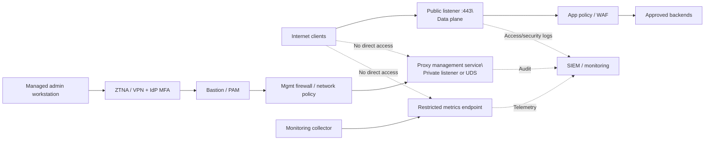

# Bảo vệ admin endpoint của proxy và bộ cân bằng tải

## Mục tiêu học tập

Sau bài học, bạn có thể:

1. Nhận diện các **admin endpoint, dashboard, API quản trị, command socket, metrics và diagnostic interface** của proxy, reverse proxy, load balancer, ingress controller và gateway; phân biệt chúng với **đường phục vụ người dùng (data plane)**.
2. Giải thích vì sao **bảo vệ bằng mật khẩu trên một URL admin không thay thế network isolation**, và vì sao bind vào `localhost` chưa đủ nếu có SSRF, port-forward hoặc tiến trình cùng host bị xâm nhập.
3. Thiết kế kiến trúc **management plane riêng**, chỉ cho phép điểm vào quản trị đã được kiểm soát qua bastion, VPN/ZTNA, xác thực mạnh, phân quyền và audit.
4. Xây chính sách khác nhau cho **read-only status, metrics, config introspection, runtime control và thay đổi cấu hình**, tránh cấp quyền quản trị chỉ để thu thập health/monitoring.
5. Đánh giá rủi ro **Host/SNI misrouting, trust sai proxy headers, IPv6/HTTP/3, cloud API, Kubernetes NodePort/port-forward, firewall bypass và shared listener**.
6. Viết các mẫu cấu hình **Nginx, HAProxy, Envoy** ở phạm vi lab và xác định điểm cần điều chỉnh đối với **Traefik, cloud load balancer và Kubernetes ingress/gateway**.
7. Thiết kế telemetry, phát hiện phơi lộ, quản lý thay đổi, xử lý sự cố và bộ kiểm thử **positive/negative**; thực hành quy tắc truy cập với **mô hình Python ngoại tuyến**.

## 1. Admin endpoint của proxy là gì?

Proxy và bộ cân bằng tải là điểm đi qua của rất nhiều ứng dụng. Ngoài cổng phục vụ HTTP, TCP hoặc UDP của người dùng, chúng còn có những bề mặt **vận hành và điều khiển**:

- **Web dashboard:** theo dõi số kết nối, backend health, thống kê và đôi khi thay đổi cấu hình.
- **Admin/API endpoint:** xem hoặc thay đổi runtime, listeners, upstreams, route, certificate, policy, session.
- **Command/control socket:** Unix domain socket hoặc TCP socket cho tác vụ điều khiển, thống kê hay cập nhật trạng thái.
- **Metrics endpoint:** exporter, Prometheus scrape, counters, histograms.
- **Health/liveness/readiness:** cung cấp trạng thái phục vụ cho orchestration hoặc load balancer.
- **Diagnostic/debug endpoint:** hiển thị cấu hình đang chạy, thông tin cluster/upstream, cert, log level, trạng thái kết nối.
- **Control-plane cloud API:** thay policy của managed load balancer dù không có trang dashboard ngay trên máy LB.
- **Admin endpoints của ingress/controller:** giao diện điều khiển thường nằm ở process, pod, service hoặc cluster khác với listener lưu lượng công cộng.

Nhóm chức năng này có quyền và mức nhạy cảm **khác nhau**: một endpoint chỉ trả `healthy` có thể ít rủi ro hơn API làm thay đổi listener hoặc socket có quyền disable backend.

**Đề bài “Bảo vệ admin endpoint của proxy” không chỉ là đặt một HTTP Basic Auth trước `/admin`.** Mục tiêu là ngăn tác nhân không có quyền **nhìn thấy thông tin nhạy cảm, sửa cấu hình, thao túng luồng traffic hoặc làm gián đoạn dịch vụ** thông qua toàn bộ đường quản trị.

Trong module `SECURITY_NETWORK_SECURITY`, nội dung thuộc chương **Proxy reverse proxy và cân bằng tải**, gắn với **segmentation, firewall, VPN/ZTNA, network access control, TLS/PKI, IDS/IPS, DNS protection và kiến trúc mạng cloud**.

> **Nguyên tắc:** Tách **data plane** khỏi **management/control plane** bằng ranh giới mạng và danh tính; chỉ đưa ra ngoài những chức năng cần thiết, dưới đúng quyền và thời hạn, và luôn xác minh cấu hình thực sự được thực thi.

### 1.1. Một số ví dụ bề mặt quản trị

| Thành phần | Ví dụ bề mặt | Rủi ro chính | Hướng bảo vệ |
|---|---|---|---|
| **Nginx OSS** | `stub_status` nếu bật; SSH, reload và file cấu hình trên host | Lộ thống kê; sửa cấu hình qua host | Loopback/internal binding, host ACL, quyền OS/CI |
| **Nginx Plus** | API/dashboard tùy phiên bản và module | Lộ trạng thái, thay đổi thao tác nếu có quyền | Quản trị mạng riêng, identity-aware access |
| **HAProxy** | Stats web page, stats Runtime API socket | Thông tin backend; thao tác runtime tùy cấp quyền socket | Bind private/UDS, socket mode/level, RBAC ngoại vi |
| **Envoy** | Admin interface, `/stats`, `/config_dump`, `/certs` và control endpoints | Rò cấu hình hoặc điều khiển runtime/process | Bind loopback/UDS, không public, broker/OS ACL |
| **Traefik** | Dashboard và API quản trị/nội bộ | Lộ dynamic configuration/topology, route sai | Không bật insecure exposure; secured router + auth |
| **Kubernetes ingress controller** | Admin/metrics/health ports, controller Service, API của Kubernetes | Truy cập config/secret/controller | Namespace/network policy, RBAC, control-plane auth |
| **Cloud load balancer** | Provider console/API, IAM và audit events | Thay listener, target group, cert và ACL | IAM least privilege, MFA/PAM, change audit |
| **Service mesh gateway** | Control xDS/admin socket, metrics, certificate state | Sửa routing, lộ topology và service identity | Workload identity, private control network, RBAC |

Các đường dẫn/cổng cụ thể **phụ thuộc sản phẩm và phiên bản**; bảng là bề mặt cần kiểm kê, không phải danh sách cổng mặc định của mọi sản phẩm.

## 2. Data plane, management plane và control plane

### 2.1. Không đồng nhất các luồng

- **Data plane:** nhận, định tuyến và chuyển tiếp traffic của người dùng; ví dụ HTTPS từ khách hàng qua edge đến web backend.
- **Management plane:** người và automation vận hành truy cập vào dashboard, shell, config API, certificate store hoặc monitor.
- **Control plane:** thành phần phân phối và quyết định cấu hình/policy, service discovery, xDS, Kubernetes controller, cloud APIs, v.v.
- **Telemetry/observability plane:** metrics, logs, traces, health signals, debug snapshots.

Những plane này có thể nằm **cùng process hoặc host**, nhưng **không được đồng nghĩa cùng trust zone**.

### 2.2. Sơ đồ phân tách tham chiếu



Hình chỉ là **kiến trúc logic**, không bắt buộc metrics phải có một kết nối ngược về collector. Quan trọng là quyền đọc metrics có scope riêng, admin operations chỉ nhận qua **đường kiểm soát có xác thực** và data plane không tạo đường vòng tới control plane.

### 2.3. Tại sao admin endpoint quan trọng hơn một URL thông thường?

Admin endpoint có thể tác động đến **nhiều ứng dụng và tenant cùng lúc**:

1. Xem backend IP, internal hostname, certificate metadata, route, listener, cluster.
2. Tăng log verbosity, thay health/drain trạng thái hoặc điều khiển process.
3. Thay cấu hình backend, redirect/route, header, WAF/firewall integration, mTLS policy.
4. Đọc hoặc dẫn đến nơi lưu bí mật nếu chẩn đoán/config không được lọc đúng.
5. Làm gián đoạn dịch vụ bằng restart/shutdown/drain hoặc sửa health.
6. Tạo sai lệch điều tra bằng thay log và traffic path.

**Lộ read-only endpoint cũng có thể có ý nghĩa an ninh** nếu nó tiết lộ internal topology, software version, tenant names hoặc metadata cấu hình. Tuy nhiên, không nên gán mọi `/healthz` đơn giản cùng mức rủi ro với một control socket có quyền thay runtime.

## 3. Threat modeling cho admin endpoint

### 3.1. Những tác nhân và đường tiếp cận

Các tình huống cần tính tới:

- Internet client vô tình hoặc cố ý truy cập URL dashboard do misconfiguration.
- User trên guest/BYOD/IoT VLAN đi tới management subnet vì thiếu firewall rule.
- Đối tác có VPN chỉ được phép app A nhưng lại có route tới admin listener.
- Một workload bị SSRF hoặc RCE gọi tới `127.0.0.1` hoặc private IP quản trị có thể reach.
- Developer/automation có quyền quá rộng trên Kubernetes hoặc cloud provider.
- Một ứng dụng chung reverse proxy vô tình forward `/admin` tới **endpoint control plane**.
- Một pod chạy với `hostNetwork` hoặc container chia network namespace làm hỏng giả định cô lập.
- Thay đổi cấu hình phiên bản mới tạo NodePort, Service, Ingress hoặc IPv6 listener phơi bày admin.
- Cloud IAM credential bị lộ, dù LB hoàn toàn không mở admin port tới Internet.
- Monitoring credential bị lộ hoặc exporter cho truy cập tới API điều khiển ngoài mục đích.

Cần phân biệt **khả năng reach**, **được xác thực**, **được cấp quyền** và **thực sự thi hành thành công tác vụ**.

### 3.2. Phân tích theo STRIDE

| Nhóm | Ví dụ với admin endpoint | Kiểm soát phù hợp |
|---|---|---|
| **Spoofing** | Mạo danh admin/automation, đánh cắp cookie, header tự khai | MFA chống phishing, mTLS/workload identity, IdP/PAM |
| **Tampering** | Đổi route, upstream, TLS, ACL hoặc drain status | Authorization theo tác vụ, signed/config-reviewed changes |
| **Repudiation** | Không xác định được ai sửa backend | Named identity, audit trail, immutable/central logs |
| **Information disclosure** | Dump config, stats, cert names, internal endpoints | Không public, hạn chế read scope, redaction, RBAC |
| **Denial of service** | Shutdown listener, tắt backend, debug quá nặng | Không lộ control verbs, approval, rate limits và HA |
| **Elevation of privilege** | Từ user read-only tới API mutate qua role sai | Least privilege, tách token/endpoint, kiểm thử deny |

Phân loại STRIDE chỉ giúp **đặt câu hỏi**, không thay thế việc kiểm tra product-specific configuration và đường đi packet thực tế.

### 3.3. Tài sản và bất biến bảo vệ

Tài sản cần được bảo vệ:

- Tính sẵn có của frontend listener và backend pools.
- Cấu hình route, TLS certificates, rate-limit/WAF và security controls.
- Admin credentials, private keys, cloud API tokens, Kubernetes ServiceAccount tokens.
- Thông tin nội bộ: hostnames, IPs, cluster topology, route, service identities.
- Audit trail và danh tính người thực hiện thay đổi.
- Sự tách biệt giữa tenant, network zone và application owner.

Bất biến an ninh mẫu:

1. **Internet/Guest/BYOD/IoT không có đường trực tiếp** đến admin/control interface.
2. **Chỉ admin đã được xác thực và phê duyệt** có thể thay route/cert/backend; monitoring account không được mutate.
3. Mọi thay đổi có **ticket, owner, thời điểm, phạm vi, bản cấu hình, bằng chứng hiệu lực và rollback**.
4. Không có đường qua **IPv6, default vhost, QUIC, ingress khác, port-forward hoặc cloud control API** bypass chính sách.
5. Khi failover/restore, **cùng policy management isolation** vẫn được giữ.
6. Compromise một application backend **không mặc nhiên cho phép thao tác proxy control plane**.

## 4. Kiểm kê bề mặt quản trị trước khi bảo vệ

### 4.1. Những thông tin cần thu

| Nhóm | Trường inventory |
|---|---|
| **Service** | Proxy ID, product/version, owner, business criticality |
| **Listener** | IP address, IPv4/IPv6, port, protocol, Unix socket path, bind interface |
| **Routing** | FQDN/SNI/Host, Ingress/Service, load balancer/forwarder, firewall/VRF/VLAN |
| **Chức năng** | Read-only stats, health, metrics, debug, config read, runtime mutate |
| **Danh tính** | Admin users/groups, service accounts, IdP, certificate identity |
| **Quyền** | RBAC scopes, API verbs, socket privilege level, OS ACL |
| **Bí mật** | Token/credential reference, key custody; **không lưu secret raw** |
| **Phụ thuộc** | SSH/bastion, VPN/ZTNA, DNS, PKI, cloud IAM, Kubernetes API |
| **Telemetry** | Access log, control audit, config revision, policy events |
| **Vòng đời** | Last reviewed, next review, change ticket, break-glass owner |
| **Kiểm thử** | Expected allow sources, denied sources, result và mốc đo |
| **Deployment** | Site, region, node, container, namespace, HA/DR peer |

**Một sản phẩm có thể có nhiều admin surfaces**, ví dụ vừa có status page trên HTTP, vừa có Unix control socket, vừa chịu quản lý bởi cloud/Kubernetes API. Bảo vệ một UI chưa đủ.

### 4.2. Phương pháp inventory được ủy quyền

Ưu tiên:

- Đọc cấu hình/deployment metadata đang được **quản trị trong quyền sở hữu**.
- Tra CMDB/IPAM/cloud asset inventory và listener/Service/Ingress chính thức.
- Đối chiếu firewall/flow và reverse proxy logs.
- Kiểm tra quyền socket và process dưới quyền admin được cấp.
- Xác minh endpoint bằng probe **đúng IP/port đã xác định trong lab**, không quét mạng của bên khác.

Dữ liệu cấu hình trả lời **dự định**; kiểm thử từ network path cho biết **reachability thực tế**. Một admin port có thể chỉ bind private IP nhưng bị **load balancer/NAT/Ingress** đưa ra ngoài theo đường gián tiếp.

### 4.3. Public DNS không phải chỉ dấu đủ

Không có DNS record công khai cho `admin.internal.example.test` **không có nghĩa endpoint không thể truy cập từ Internet**. Người dùng có thể kết nối IP trực tiếp hoặc gửi `Host` tùy ý tới listener đang lộ.

Ngược lại, một FQDN tồn tại trong DNS không chứng minh API admin đang được route thực tế. Cần kết hợp **DNS, listener, route, PEP policy và kiểm thử**.

## 5. Thiết kế ranh giới mạng cho management plane

### 5.1. Ba mức phổ biến

| Mức | Tổ chức truy cập | Khuyến nghị sử dụng |
|---|---|---|
| **Local Unix socket / loopback** | Chỉ tiến trình local, công cụ vận hành qua kênh kiểm soát | Phù hợp admin API nguy hiểm, nhất là khi không có auth built-in |
| **Private management interface/VRF** | Chỉ từ bastion/VPN/ZTNA/admin zone, firewall allowlist | Hệ phân tán cần quản lý từ xa và audit |
| **Internet-facing admin gateway có kiểm soát** | Identity-aware gateway, MFA, authorization, device posture, TLS | Chỉ khi thật sự cần, không expose raw admin API trực tiếp |

**Lựa chọn mặc định nên là không public**, sau đó thiết kế đường truy cập có kiểm soát cho admin và automation.

### 5.2. Loopback không phải bức tường tuyệt đối

Bind `127.0.0.1` hoặc `[::1]` giảm bề mặt **remote network exposure**, nhưng không ngăn:

- SSRF/RCE ở một dịch vụ cùng host gọi tới loopback.
- Container/pod chia sẻ network namespace với admin API.
- Local unprivileged process nếu endpoint không có thêm OS ACL/authorization.
- Port-forward/reverse tunnel được tạo bởi người có quyền hoặc malware.
- Sidecar/proxy route nội bộ vô tình mở ra một endpoint public.
- Misconfiguration tạo listener thứ hai trên `0.0.0.0` hoặc `::`.

Do đó, cần **process isolation, Unix socket permissions, container security context, least privilege và kiểm soát quyền port-forward**, không chỉ dựa vào bind address.

### 5.3. Management VLAN/VRF và firewall

Kiến trúc một site có thể là:

```text
Internet / Guest / IoT -----------------------X----> Mgmt API
Corporate users -----------------------------X----> Mgmt API
Managed admin endpoint -> VPN/ZTNA -> Bastion/PAM
                                      |
                               Mgmt firewall
                                      |
                              Proxy admin listener
                                      |
                             Local control socket
```

Một VLAN/VRF riêng giúp **giới hạn tuyến**, nhưng nếu router leak route hoặc firewall cho `any-any` thì vẫn không có phân đoạn an toàn. Kiểm tra cả **inter-VLAN routing, IPv6, VPN pools, SD-WAN, cloud peering, overlay và NAT**.

### 5.4. Điểm kiểm soát phải nằm đúng trên đường traffic

Nếu admin API dùng `172.20.0.10:9901`, ACL trên public VIP `203.0.113.10:443` **không đủ** nếu client bên trong hoặc workload compromised có thể kết nối trực tiếp admin IP.

Cần đặt kiểm soát tại:

1. **Listener binding**: không mở admin trên interface không cần.
2. **Host/network firewall**: deny mọi nguồn ngoài quản trị được duyệt.
3. **Overlay/cluster network policy**: chỉ cho service account/namespace cần thiết nếu pod có listener.
4. **Admin access gateway**: xác thực người và thiết bị, giới hạn tài nguyên/tác vụ.
5. **Ứng dụng/socket privileges**: kiểm soát cả read và mutate khi sản phẩm hỗ trợ.
6. **Cloud IAM/Kubernetes RBAC**: bảo vệ khả năng thay đổi listener, expose service hoặc lấy secret.

## 6. Xác thực và phân quyền quản trị

### 6.1. Phân tách role rõ ràng

| Role | Nhiệm vụ | Quyền mẫu |
|---|---|---|
| **Monitoring reader** | Scrape metrics, kiểm tra health | Đọc metric giới hạn, không xem secret/config nhạy cảm |
| **Support read-only** | Điều tra backend health, request errors | Xem dashboard/log cần thiết, không mutate |
| **Traffic operator** | Drain một backend, thay trọng số theo change được duyệt | Quyền runtime giới hạn, có log |
| **Configuration maintainer** | Thay routing/listener/timeout và rollout | Phải qua review, validation, change control |
| **PKI/certificate operator** | Cập nhật certificate theo scope | Không tự có quyền thay arbitrary backend |
| **Privileged administrator** | Xử lý sự cố đặc biệt và khôi phục | PAM/JIT, strong MFA, session logging |
| **Automation/service identity** | Thực hiện tác vụ đã định nghĩa | Credential riêng, scope API hẹp, rotation |
| **Break-glass** | Khôi phục khi IdP/management gateway lỗi | Hạn quyền/thời hạn, kiểm toán và hậu kiểm |

**Read-only và mutate phải được tách bằng quyền được thực thi thật.** Một dashboard trông chỉ đọc nhưng có đường gọi API điều khiển không bảo vệ riêng vẫn là bề mặt quản trị nguy hiểm.

### 6.2. Nhận diện admin

- Tài khoản **định danh riêng**, không dùng chung `admin/admin` hoặc credentials trên wiki.
- **IdP/SSO và MFA chống phishing** khi phù hợp, nhất là production management.
- Thiết bị quản trị **managed và compliant** theo yêu cầu rủi ro.
- **PAM/JIT access** cho tác vụ đặc quyền và giới hạn session.
- Kênh VPN/ZTNA/bastion có RBAC theo tài nguyên đích.
- Service accounts dùng **mTLS/workload identity** hoặc token riêng theo scope, không dùng tài khoản cá nhân.
- Tách quyền **xem metrics**, **xem config**, **thay runtime**, **thay secret/cert**.
- Không dùng IP allowlist **làm bằng chứng danh tính admin**; VPN pool hay NAT có thể dùng chung.

### 6.3. Basic Auth có thể là lớp phụ nhưng không phải ranh giới duy nhất

HTTP Basic Auth gửi credential theo mỗi request (bảo vệ bằng TLS khi dùng) và có những hạn chế về rotation, MFA, logout và phân quyền. Với admin endpoint nhạy cảm, **chỉ Basic Auth trước public URL là không đủ**.

Nếu sử dụng Basic Auth cho dashboard trong **lab hoặc mạng private**:

- Chỉ đưa qua HTTPS/management network hoặc local tunnel bảo vệ.
- Giữ credential trong secret manager, hash/password policy phù hợp.
- Không chia password cho toàn đội, không đặt thẳng trong Git.
- Thêm gateway identity/RBAC, rate limit và access log nếu triển khai.
- Xác minh mọi API route/debug path cũng được bảo vệ như UI.
- Có phương án revoke session/credential ngay khi phát hiện lộ.

### 6.4. mTLS không thay thế authorization

mTLS có thể xác thực **khóa/chứng thư client** tại reverse proxy/gateway hoặc service mesh. Nhưng nếu tất cả automation cùng dùng một certificate và admin API cho toàn quyền, đó vẫn là cấp quyền quá rộng.

Cần xác minh danh tính cấp cho **từng workload/thiết bị**, EKU/chain và trạng thái thu hồi, sau đó map đến quyền **đọc trạng thái hoặc thao tác cấu hình**. Một cert hợp lệ **không chứng minh yêu cầu mutation được phê duyệt**.

## 7. TLS, PKI và bí mật trong admin channel

### 7.1. Bảo vệ kênh quản trị

- Ưu tiên **TLS với hostname validation** ở các kết nối qua mạng; có thể thêm mTLS.
- Quản lý certificate SAN, issuer, expiration, truststore và rotation.
- Không tắt certificate verification khi kết nối management API hoặc backend.
- Với SSH/bastion, xác minh host key và quản trị keys theo quy trình.
- Nếu chỉ dùng UDS nội bộ, tập trung vào **file ownership/mode, process privilege** và bảo vệ host; không suy UDS tự xác thực mọi caller.
- Cloud console/API cần MFA, điều khiển session và role chính xác; TLS chỉ là một lớp.

### 7.2. Không để secrets xuất hiện trong diagnostic

Một số endpoints debug/config có thể chứa:

- Backend hostnames, internal IP/ports, headers, TLS metadata.
- Route rules, certificate paths, client identity hints.
- Runtime flags, environment values, health states.
- Authorization headers hoặc dữ liệu liên quan token nếu logs/config bị thiết kế kém.
- Payload cấu hình mà bản thân proxy không tự redaction đầy đủ.

Ngay cả API đã có xác thực, **không cấp `config_dump` chỉ vì cần `/stats`**. Hạn chế mức dữ liệu, áp redact ở nơi cần và giới hạn lưu trữ.

### 7.3. Vòng đời credential quản trị

```text
Provision (identity + scope) -> Use (audited)
    -> Rotate/renew -> Review/expire
    -> Revoke -> Verify no active access
```

Khi nhân sự nghỉ việc, thiết bị admin bị mất hoặc token automation lộ, cần revoke tại **IdP/PAM/API/secret store** và xác minh session hiện tại/port-forward còn hiệu lực không. Xóa một dòng inventory chưa chắc cắt được access.

## 8. Tin cậy HTTP headers và nguồn client IP

### 8.1. `X-Forwarded-For` không phải bằng chứng tự thân

Một kiến trúc có thể gồm:

```text
Client -> CDN/WAF -> Reverse proxy -> Admin access gateway -> API
```

Nếu backend chọn cho phép dựa trên `X-Forwarded-For: 10.0.0.1` **do bất kỳ client nào tự gửi**, attacker có thể khai IP khác với peer IP thật.

Thiết kế đúng:

1. Xác định **proxy hops được tin** bằng địa chỉ/kênh được quản lý.
2. Ở **trust boundary**, remove/overwrite header do client kiểm soát trước khi chuyển tiếp.
3. Cấu hình real-client-IP parsing theo **trusted source list** ở product tương ứng.
4. Không dùng `X-Forwarded-Host`, `Forwarded` hoặc `X-Forwarded-User` chưa xác thực để cấp admin role.
5. Nếu dùng **PROXY protocol**, chỉ chấp nhận từ upstream được tin và giới hạn network peer; header PROXY cũng không tự xác thực.
6. Lưu cả **immediate peer** và **verified client identity** khi điều tra.

**Dùng IP allowlist sau proxy cần cẩn trọng** vì IP nhìn thấy có thể là IP của CDN/LB; nếu không xử lý trust chain đúng thì rule có thể cho phép mọi người đi qua CDN.

### 8.2. SNI và Host header không phải “chìa khóa admin”

Một reverse proxy có thể chọn TLS certificate theo SNI, rồi route HTTP theo `Host`/`:authority`. Hai giá trị có thể khác nhau do client/proxy hoặc HTTP/2 coalescing phù hợp. Không được dùng tên `admin.internal` chưa được xác thực để tự mở quyền.

Với admin endpoint:

- Không map một **default virtual host** công khai về admin service.
- Không route `/admin` trên public listener chỉ vì đường dẫn khó đoán.
- Có **allowed origin/host** và tenant binding rõ trên ingress.
- Nếu có HTTP/2/3, bảo đảm routing/authority policy nhất quán; 421/reject khi connection không được phép phục vụ origin.
- Admin auth được **thực thi độc lập với URL, SNI hoặc Host**.
- Kiểm tra cả **HTTP và HTTPS**, redirects, IPv4/IPv6 và các listener khác.

### 8.3. Không lẫn mục tiêu proxy admin với app admin

Ví dụ `https://customer.example.test/admin` có thể là **trang quản trị của ứng dụng**, không phải admin API điều khiển Nginx/Envoy. Cần bảo vệ cả hai theo mức rủi ro, nhưng khác ownership và phạm vi quyền. Đừng dùng một path chung khiến request ứng dụng vô tình tới socket/API proxy.

## 9. Unix socket, quyền hệ điều hành và container isolation

### 9.1. Unix domain socket (UDS)

Một admin API được gắn vào UDS có thể tránh mở TCP listener. Ví dụ đường dẫn `/run/proxy/admin.sock` (không phải đường dẫn mặc định của mọi sản phẩm).

Các kiểm soát:

- Directory cha chỉ có quyền traversal cho account/nhóm thật sự cần.
- Socket ownership/mode theo nhóm vận hành đã duyệt.
- Process phục vụ proxy chạy **ít đặc quyền nhất**, tránh root không cần thiết.
- Không mount socket admin vào container ứng dụng, sidecar hoặc pod không liên quan.
- Không map UDS qua HTTP proxy public hoặc quyền Kubernetes port-forward tùy tiện.
- Phân biệt socket **read-only** và socket có thể điều khiển runtime khi product hỗ trợ.
- Kiểm tra quyền từ **process/container namespace thực**, không chỉ nhìn `ls -l` trên host.

**Nếu một workload cùng host có khả năng đọc/ghi socket**, UDS có thể trở thành đường leo thang đặc quyền dù không có cổng TCP nào bị expose.

### 9.2. TCP admin listener

Khi bắt buộc dùng TCP admin:

- Bind địa chỉ management/private phù hợp hoặc loopback.
- Không dùng `0.0.0.0` hoặc `::` cho admin listener nếu không có yêu cầu được thẩm định và nhiều lớp bảo vệ.
- Dùng host firewall/network policy và gateway được xác thực.
- Kiểm tra **IPv6 dual-stack socket semantics** theo nền tảng, tránh chỉ lọc IPv4.
- Không đặt admin port trên default Kubernetes Service/Ingress/LoadBalancer.
- Kiểm tra việc container runtime publish port ra host/NodePort.
- Duy trì audit của mọi kết nối/điều khiển và cảnh báo khi cấu hình thay đổi.

### 9.3. Rủi ro khác khi chạy trong container/pod

- Container cùng **pod network namespace** thường có thể kết nối tới loopback của nhau.
- `hostNetwork` làm giảm giả định cô lập giữa pod và host.
- `privileged`, mount Docker socket/container runtime hoặc secret volume quá rộng tạo đường tới control plane.
- Kubernetes NetworkPolicy có giới hạn phụ thuộc CNI và không tự kiểm soát **loopback cùng pod**.
- Port-forward là quyền thao tác thông qua Kubernetes API/identity; không phải vì Service không public mà mọi người đều không thể reach.
- Sidecar/ingress có thể tự route traffic tới pod port nội bộ dù admin listener không có Service riêng nếu cấu hình sai.

**Luôn phân tích đường tấn công từ workload đã bị compromise** và kiểm thử bằng quyền được cấp trong lab, thay vì tin một giả định “private port là an toàn”.

## 10. Ví dụ Nginx: status nội bộ và không mở đường quản trị

### 10.1. Phân biệt Nginx OSS và các sản phẩm khác

Nginx Open Source có module `stub_status` (khi được build/hỗ trợ), thường cung cấp thống kê connection. **`stub_status` không phải đầy đủ admin API có quyền chỉnh runtime**. Nginx Plus có API/dashboard tùy phiên bản và cần chính sách riêng; thay cấu hình Nginx OSS thường dựa vào filesystem/process và pipeline deployment.

### 10.2. Cấu hình lab chỉ bind loopback

```nginx
# Minh họa cho môi trường lab và phiên bản Nginx có stub_status.
# Đặt trong khối http { ... } của cấu hình thích hợp.
server {
    listen 127.0.0.1:8081;
    listen [::1]:8081;
    server_name localhost;

    # Chỉ expose đúng endpoint read-only cần thiết trong local network.
    location = /nginx_status {
        stub_status;
        allow 127.0.0.1;
        allow ::1;
        deny all;
        access_log off;
    }

    # Các URL khác không được phục vụ bởi listener này.
    location / {
        return 404;
    }
}
```

Các điểm cần hiểu:

1. `listen 127.0.0.1` và `listen [::1]` chỉ cho phép TCP loopback theo cấu hình này.
2. `location = /nginx_status` chỉ matching đúng path, không tự mở `/nginx_status/admin`.
3. `allow/deny` là lớp phụ; **không thay thế listener isolation**.
4. `access_log off` là lựa chọn ví dụ hạn chế log cho một status đọc cục bộ; nếu cần audit truy cập hoặc giám sát lạm dụng, **phải bật logging phù hợp ở tầng được quản trị**.
5. Status read-only vẫn cần kiểm tra SSRF, quyền local và container namespace.
6. Đừng copy ví dụ sang public `listen 443` rồi nghĩ rằng `allow 127.0.0.1` sẽ đáp ứng mọi kịch bản proxy-chain.

### 10.3. Những thay đổi thường làm lộ trạng thái

- Thêm `proxy_pass http://127.0.0.1:8081` trên một public location do nhầm route.
- Chuyển bind sang `0.0.0.0:8081` để “Prometheus scrape dễ hơn”.
- Mở container `-p 8081:8081` ra host mà không giới hạn.
- Tạo Kubernetes Service `type: LoadBalancer` hoặc Ingress cho `/nginx_status`.
- Dùng `X-Forwarded-For` do client tự khai để vượt allowlist.
- Kiểm thử từ localhost thành công nhưng không thử các nguồn bị deny.

**Muốn monitoring từ xa?** Dùng exporter/collector có quyền hạn hẹp, private network và policy rõ, không đưa status endpoint ra Internet.

## 11. Ví dụ HAProxy: phân biệt stats HTTP và Runtime API socket

### 11.1. Stats page và quyền runtime

HAProxy có các chức năng thống kê và **Runtime API** qua socket, có thể cấp các mức quyền như `user`, `operator` và `admin` tùy lệnh/triển khai. Cấp quyền socket cao hơn nhu cầu có thể cho phép thao tác backend hoặc hoạt động nhạy cảm.

Một dashboard chỉ hiển thị trạng thái **khác với** socket có khả năng chỉnh trạng thái server và các giá trị runtime. Nên tách rõ loại nhu cầu.

### 11.2. Ví dụ chỉ đọc trong lab

```haproxy
# PHẦN cấu hình HAProxy LAB - cần ghép vào config thực tế và
# kiểm tra cú pháp/phiên bản; không áp nguyên xi lên production.
global
    # UDS status chỉ đọc với quyền hạn hẹp.
    stats socket /run/haproxy/stats-readonly.sock mode 660 level user

listen stats_local
    bind 127.0.0.1:8404
    mode http
    stats enable
    stats uri /stats
    stats hide-version
    stats refresh 10s
    # Cố ý KHÔNG bật stats admin.
```

Cần bảo đảm:

- Thư mục `/run/haproxy` và socket có **owner/group và OS permissions đúng**; `mode 660` không tự giới hạn nhóm được truy cập.
- Stats listener trên loopback không bị một proxy public forward nhầm.
- Nếu cần metrics collector ở host khác, dùng **mạng management hoặc exporter có isolation**, không chuyển thẳng bind sang wildcard.
- Read-only operational account không được quyền truy cập **socket admin khác** trên cùng host.
- Kiểm tra default config có mở thêm stats page/listener không.
- Không coi `stats hide-version` là security boundary; nó chỉ giảm một phần thông tin hiển thị.

### 11.3. Khi cần thao tác runtime

Một người vận hành có thể cần thao tác theo runbook như **drain một backend** để bảo trì. Nên:

1. Dùng identity riêng, PAM/JIT và change approval.
2. Tiếp cận socket/Runtime API qua bastion hoặc automation controller đã bảo vệ.
3. Cấp level đúng tác vụ, không dùng `admin` cho monitoring.
4. Ghi **người, lý do, backend, trước/sau, timestamp, outcome và rollback**.
5. Xác minh thao tác ở data plane thực (drain/routing đã thay đổi).
6. Không để socket runtime control ở volume mà ứng dụng không tin cậy có thể mount.

## 12. Ví dụ Envoy: admin interface phải là bề mặt đặc biệt nhạy cảm

### 12.1. Những đường dẫn đáng chú ý

Tùy phiên bản và cấu hình, Envoy admin interface có thể cung cấp:

- `/stats` và thông tin metrics.
- `/clusters`, `/listeners`, `/server_info`.
- `/config_dump` và `/certs` phục vụ chẩn đoán.
- `/logging` hoặc các endpoint thao tác log level.
- Một số control endpoints như `/drain_listeners`, `/healthcheck/fail`, `/quitquitquit`, `/runtime_modify`.

Danh sách này **chỉ để nhận diện quyền và ưu tiên bảo vệ**, không phải hướng dẫn gọi lệnh thay đổi proxy. Những endpoint cụ thể và phương thức HTTP có thể khác giữa phiên bản; cần đối chiếu tài liệu Envoy đang chạy.

### 12.2. Pattern cấu hình mạng

```yaml
# Phần cấu hình minh họa; cần phù hợp version Envoy và hệ log.
admin:
  access_log_path: /var/log/envoy/admin-access.log
  address:
    socket_address:
      address: 127.0.0.1
      port_value: 9901
```

Mục tiêu là **không bind admin ra network công cộng**. Cần thêm:

- Quyền log directory và rotation phù hợp.
- Không expose port admin qua Service/NodePort/Ingress/sidecar route.
- Phân quyền local/sidecar/container; nếu product/deployment hỗ trợ UDS thì có thể cân nhắc UDS và ACL.
- Cung cấp metrics bằng exporter hoặc endpoint có scope hẹp hơn, không giao toàn bộ admin API cho monitoring.
- Xem khả năng SSRF từ các workload cùng namespace/host.
- Với nhiều Envoy replicas, xác minh **mọi replica** giữ admin interface private, không chỉ một node.

### 12.3. Vì sao không bảo vệ bằng “secret path”?

Một attacker biết URL admin có thể thử các endpoint chẩn đoán hoặc điều khiển khác nếu routing mở. **Đổi đường dẫn `/stats` thành một chuỗi khó đoán không thay authorization**. Bản chất rủi ro nằm ở **reachability và năng lực endpoint**.

Nếu frontend đưa ra trang public diagnostics riêng, chỉ nên tạo **tập dữ liệu đã lọc**, không reverse proxy tất cả yêu cầu vào admin listener.

## 13. Traefik và dashboard/API: insecure exposure là điểm cần kiểm soát

Với Traefik, dashboard/API có thể được truy cập thông qua một service nội bộ của Traefik và các router/middleware theo cấu hình. Một số mẫu triển khai hỗ trợ tùy chọn **`api.insecure`** để expose giao diện theo cách phục vụ phát triển.

Trong production:

1. **Không bật insecure dashboard/API public** như một cách quản trị thường lệ.
2. Nếu dùng dashboard/API, định tuyến **qua entrypoint quản trị** riêng, không qua public frontend mặc định.
3. Dùng TLS, IdP/gateway auth, RBAC nếu khả dụng, MFA/managed device và firewall private network.
4. Áp policy cho **toàn bộ dashboard và API paths**, không chỉ trang HTML; một dashboard hiển thị dữ liệu có thể gọi API phía sau.
5. Không dùng **quy tắc Host theo tên** làm biện pháp truy cập duy nhất; HTTP Host do client khai và không phải danh tính.
6. Không dùng middleware `BasicAuth` làm lớp duy nhất cho endpoint mutation nhạy cảm trên Internet.
7. Kiểm tra `api@internal`, IngressRoute, router priority, entrypoints và TCP/UDP/IPv6 listeners theo phiên bản sản phẩm.
8. Tách quyền quan sát và quyền thay cấu hình thông qua GitOps/cloud/CI pipeline khi có thể.

**Cấu hình vendor-specific cần được kiểm chứng theo phiên bản Traefik đang triển khai**; bài học chủ yếu thiết kế trust boundary và cách xác minh thay vì đưa file cấu hình giả định hoạt động ở mọi release.

## 14. Health checks, metrics và debug: mức bảo vệ không như nhau

### 14.1. Phân loại theo quyền và dữ liệu

| Loại endpoint | Ví dụ nội dung | Rủi ro | Bảo vệ điển hình |
|---|---|---|---|
| **Liveness** | Process có sống không | Thấp hơn nếu chỉ trả boolean/tối thiểu | Probe nội bộ; không cần expose public |
| **Readiness** | Instance có sẵn sàng nhận traffic | Có thể làm lộ topology/operation | Orchestrator/monitoring-only |
| **Minimal health** | `OK` hoặc code trạng thái | Ít thông tin nhưng có thể bị lạm dụng | Rate limit, service scope, path riêng |
| **Metrics** | Counters, labels, backend names, client stats | Có thể tiết lộ nội bộ, tenant, traffic | Private collector, read-only, label hygiene |
| **Detailed stats** | Pool membership, IP và failure reason | Lộ topology hoặc capacity | Authenticated support role |
| **Config dump** | Listener/cluster/cert metadata và các tùy chọn | Rất nhạy cảm; khả năng lộ secret | Không expose; admin JIT và redaction |
| **Runtime mutation** | Thay backend, drain, config flags, shutdown | Mất dịch vụ / tampering | Quyền cao, audit/change control |
| **Debug/profiling** | Heap/profile/stack hoặc runtime info | Rò dữ liệu, DoS, overhead | Local/time-limited, approval |

Không phải mọi probe đều có thể dùng user login/mTLS: kubelet hoặc load balancer có thể cần gọi tự động. **Ngoại lệ cho health** nên giới hạn đến **nguồn hạ tầng, endpoint chỉ đọc, payload tối thiểu và network path xác định**, thay vì mở toàn bộ management listener.

### 14.2. Metrics thường bị phơi quá rộng

Metrics có thể chứa:

- Tên backend và địa chỉ IP trong zone nội bộ.
- Tenant labels, request volume, error spikes và throughput.
- Software version, config revision, certificate expiry.
- Tên route, method/path class và môi trường deployment.

Cần quản trị label cardinality và dữ liệu nhạy cảm; không đưa token, customer IDs hoặc full URLs chứa bí mật vào metrics. Với endpoint scrape, dùng **monitoring identity và private endpoint**, và tránh gắn quyền mutation chỉ vì exporter cần stats.

### 14.3. Readiness không phải auth gateway

Một orchestration platform có thể probe `/ready` mà không có user auth, nhưng **đường readiness không được trở thành proxy vào `/admin`**. Phân tách listener/route và xác minh các handler không dùng chung quyền với control API.

**Xác minh health probe hoạt động** sau khi khóa admin; nếu vô tình chặn cả liveness/readiness, hệ thống có thể tự restart hoặc remove backend hàng loạt.

## 15. Kubernetes, ingress controller và đường tới admin port

### 15.1. Những đối tượng cần phân biệt

Trong Kubernetes, đường điều khiển có thể xuất hiện ở:

- **Pod/container port**: Envoy/HAProxy/Traefik/Nginx metrics hoặc admin server mở trong network namespace của pod.
- **Service ClusterIP**: đưa một cổng nội bộ tới các pod khác trong cluster.
- **Service NodePort/LoadBalancer**: có thể làm cổng xuất hiện ngoài cluster tùy hạ tầng và firewall.
- **Ingress/Gateway API route**: đưa HTTP/TLS service tới client qua gateway.
- **Control API của Kubernetes**: cho phép người có quyền thay Deployment, Service, Secret, ConfigMap, Ingress và policy.
- **Port-forward/exec**: quyền đi qua API server để tương tác với pod; đây là một đường truy cập **khác** với internet-facing ingress.
- **Service mesh/xDS controller**: có khả năng phân phối routing/policy xuống proxy sidecar hoặc gateway.

**Không suy “port không được expose qua Ingress” đồng nghĩa “chỉ admin mới dùng được”.** Các pod cùng namespace, workload khác hoặc người được cấp quyền port-forward có thể vẫn reach.

### 15.2. Một ví dụ lỗi kiến trúc

```text
Deployment:
  container:
    443  = public HTTPS data plane
    9901 = Envoy admin

Service:
  ports:
    - 443  -> 443
    - 9901 -> 9901

Ingress:
  public hostname -> Service:443

Những điều cần hỏi:
- Workload khác có thể truy cập Service:9901 không?
- Port 9901 có bị NodePort/LoadBalancer expose ở đâu không?
- Quyền port-forward/exec của người dùng đã được giới hạn chưa?
- Admin còn được bind trên localhost và các interface khác không?
```

Mặc dù ingress chỉ trỏ 443, một Service nội bộ cho 9901 vẫn có thể lộ control surface cho nhiều pod nếu **network policy không giới hạn**.

### 15.3. Các lớp bảo vệ trong cluster

1. **Không khai báo admin port trong Service/Ingress public**, trừ thiết kế quản trị được thẩm định đầy đủ.
2. Bind admin loopback hoặc UDS khi kiến trúc cho phép; cân nhắc thực tế **pod network namespace**.
3. Tách workload controller/admin vào **namespace/security zone** thích hợp, không kỳ vọng namespace tự là firewall.
4. Cấu hình **Kubernetes NetworkPolicy/CNI policy** hỗ trợ, với default deny và allow từ monitoring/controller thực sự cần.
5. Giới hạn Kubernetes **RBAC** đối với thay Deployment/Service/Ingress, đọc Secret, `pods/exec` và `pods/portforward`.
6. Giảm quyền **ServiceAccount token** và workload identity, không mount token không cần thiết.
7. Không chạy proxy/container với `privileged` hoặc `hostNetwork` nếu không có yêu cầu được duyệt.
8. Tách secret chứa admin token/TLS key khỏi container ứng dụng và exporter không cần.
9. Quản lý qua **GitOps/CI** với review/audit, không sửa trực tiếp cấu hình production khi không có change.
10. Theo dõi network policy và config drift sau khi Helm/chart/CRD/controller được nâng cấp.

**NetworkPolicy không phải biện pháp đủ cho tất cả lưu lượng** (ví dụ loopback cùng pod hoặc trường hợp CNI không triển khai đúng). Cần thử từ những vị trí **được phép trong lab** và kiểm tra hiệu quả thực tế.

## 16. Admin endpoint trong cloud và hệ thống cân bằng tải managed

### 16.1. Không phải cloud LB nào cũng có một admin URL

Với managed load balancer, control plane có thể là **cloud API/console** thay vì một socket trên appliance. Dù listener HTTPS phục vụ khách hàng đã an toàn, người có quyền cloud API rộng có thể:

- Thay listener, TLS certificate hoặc default action.
- Chuyển target group hoặc backend sang hạ tầng khác.
- Sửa firewall/security group/network ACL hoặc private endpoint.
- Bỏ health check, thay routing, WAF/security policies.
- Đọc thông tin topology, logging hoặc cấu hình nhạy cảm.
- Tạo access key/service principal mới nếu IAM cho phép.

Vì vậy, phạm vi bảo vệ gồm **cloud identity/control plane**, không chỉ inbound firewall đến proxy process.

### 16.2. Kiểm soát cloud API và console

| Kiểm soát | Mục đích |
|---|---|
| **IAM least privilege** | Chỉ cho read-only monitoring, change approver hoặc automation đúng tài nguyên |
| **MFA/SSO và conditional access** | Xác minh admin, thiết bị và ngữ cảnh rủi ro |
| **PAM/JIT** | Giới hạn đặc quyền thay LB/cert/route theo thời gian |
| **IaC/GitOps + review** | Chống config drift và cho rollback có audit |
| **Private connectivity khi có** | Hạn chế đường gọi API/quản trị theo yêu cầu kiến trúc |
| **Change/audit logs** | Biết ai đổi listener, target, cert, security group |
| **Key/service account rotation** | Hạn chế tuổi thọ credential quản trị |
| **Guardrails/policy-as-code** | Phát hiện hoặc từ chối public exposure ngoài ý muốn |
| **Cross-account/tenant review** | Đảm bảo principal ở tài khoản khác không có quyền quá mức |

**Không dùng thuật ngữ “cloud-managed” để mặc định nhà cung cấp tự lo phân quyền của tổ chức.** Tổ chức vẫn phải quản lý IAM, secret, network route, configuration và audit.

### 16.3. Các failure mode của HA và DR

- Standby LB có **admin policy khác** với active.
- DR site còn API key hoặc mật khẩu đã được thu hồi ở site chính.
- Một node được restore từ backup và mở lại wildcard admin listener.
- IaC áp lại template cũ chứa `api.insecure=true` hoặc stats endpoint công cộng.
- Cập nhật routing để cứu outage vô tình vượt qua WAF/ZTNA.
- Monitoring chỉ kiểm tra primary, bỏ sót admin listener ở region phụ.

Nghiệm thu phải kiểm tra **mọi node, site, region, standby và đường quản trị dự phòng**, không chỉ frontend đang chịu traffic.

## 17. Những đường bypass cần kiểm tra

### 17.1. Default vhost, SNI và HTTP routing

Giả sử proxy có:

```text
public.example.test -> public app
admin.internal.test -> admin UI
Default listener  :443
```

Nếu default vhost hoặc wildcard host route tới admin, việc **không xuất bản DNS `admin.internal.test`** không bảo vệ endpoint. SNI là metadata trong TLS ClientHello, còn HTTP `Host`/`:authority` có thể do client gửi; cả hai không phải bằng chứng user được quyền admin.

Khi bảo vệ một admin UI qua ingress:

- Chỉ route qua **management entrypoint** tách biệt khi có thể.
- Không có public default route tới admin.
- Bảo vệ **cả UI lẫn API/action endpoints** bằng cùng chính sách.
- Giới hạn Host/authority, nhưng không coi đó là authorization.
- Kiểm thử HTTP/1.1, HTTP/2 và HTTP/3/QUIC khi có hỗ trợ.
- Tránh để path rewrite, redirect hoặc upstream fallback đi tới admin listener sai.
- Với HTTP/2 connection coalescing, đánh giá các origin được phép thay vì ép SNI luôn bằng authority một cách không phù hợp.
- Xem khả năng ECH che inner SNI: một TCP middlebox không thể luôn phân loại origin dựa trên cleartext SNI.

### 17.2. IPv4, IPv6, NAT và overlay

Nếu chặn `127.0.0.1` khỏi public không đồng nghĩa đã kiểm soát:

- `::1` và IPv6 global/ULA của host.
- Docker/Kubernetes published port và host firewall.
- Public LB/NAT mapping tới private management IP.
- VPN remote-user pool được route vào MGMT VLAN rộng hơn dự kiến.
- Cloud VPC peering, private link, transit gateway và service mesh.
- Jump host có quyền forward TCP vào admin port cho mọi user.
- Unix socket bị mount vào container/sidecar có thể bị compromise.

Cần lập sơ đồ **tất cả đường khả dĩ từ source zone tới admin endpoint**, rồi kiểm tra bằng PEP logs và các phiên thử nghiệm đã được cấp phép.

### 17.3. SSRF và request proxying tới admin

**Server-Side Request Forgery (SSRF)** có thể làm server gửi request tới địa chỉ mà client trực tiếp không reach. Ví dụ một ứng dụng nhận URL của người dùng rồi **fetch URL tùy ý**; nếu ứng dụng chạy trên cùng host/pod hoặc có route tới admin API, nó có thể trở thành đường vòng.

Giảm thiểu:

1. Không đặt admin API ở mạng mà workload internet-facing không đáng tin có thể reach.
2. Dùng UDS permissions, process isolation và container policy.
3. Đối với chức năng fetch URL, dùng **destination allowlist**, chặn loopback/private/link-local/metadata endpoints theo ngữ cảnh, xác thực lại sau redirect và xử lý DNS/IP resolution cẩn thận.
4. Không cho public proxy/URL fetcher hỗ trợ arbitrary HTTP methods tới nội bộ.
5. Hạn chế quyền của workload service accounts và chặn outbound tới management plane.
6. Theo dõi các kết nối bất thường từ app workload tới admin interface.
7. Không coi SSRF là đã xử lý chỉ bằng chặn dải RFC1918 — còn IPv6, DNS rebinding, overlay, UDS/metadata và đường đặc thù nền tảng.

**Đây là hướng phòng vệ**, không yêu cầu tạo payload SSRF hoặc thực hiện kiểm thử xâm nhập trên hệ thống ngoài phạm vi.

## 18. Runtime mutation và thay đổi cấu hình: kiểm soát riêng

### 18.1. Phân loại quyền theo tác động

| Nhóm thao tác | Tác động | Quyền khuyến nghị |
|---|---|---|
| Xem liveness cơ bản | Cung cấp trạng thái đơn giản | Probe identity với scope hẹp |
| Đọc counters/metrics | Lộ một phần thông tin vận hành | Monitoring-only |
| Đọc config dump/certs | Lộ topology, identity, metadata nhạy cảm | Support/JIT hoặc forensic role |
| Thay logging verbosity | Có thể tăng tải và lộ thêm thông tin | Operator có audit/thời hạn |
| Thay trọng số/disable/drain backend | Ảnh hưởng traffic routing/availability | Change-approved operator |
| Reload/restart/terminate process | Có thể làm gián đoạn nhiều dịch vụ | Privileged operator/automation có HA |
| Thay listener/certificate/route | Có thể lộ app hoặc chuyển traffic sai | Reviewed configuration pipeline |
| Thay identity/rule/WAF | Có thể tạo security bypass | Security change approval riêng |

Một số sản phẩm không có RBAC chi tiết cho từng API verb. Khi đó **không cấp direct access** cho nhóm read-only; dùng exporter/filtering API/gateway tách biệt hoặc automation broker chỉ cung cấp tập thao tác được duyệt.

### 18.2. Thao tác runtime phải có “ý định và thực thi”

Giả sử operator muốn drain một backend trước khi bảo trì:

```text
Change ticket -> Authorized operator -> Approved action broker
       -> Proxy runtime control -> Data-plane state readback
       -> Connection/application health check -> Audit/rollback
```

Không chỉ ghi “command accepted”. Cần xác minh:

- Backend thực sự đang drain hay đã bị disable?
- Các connection/session hiện hữu được xử lý đúng như kỳ vọng?
- Traffic mới chuyển đi theo load-balancing policy?
- Có tăng lỗi 502/503/timeout hoặc giảm capacity?
- Thao tác có bị ghi đè khi control-plane config sync/redeploy không?
- Có thể rollback an toàn và đúng phiên bản không?

**Không chạy trực tiếp các admin mutation commands trong ví dụ học tập.** Mọi thao tác thực tế cần change được phê duyệt và chính sách an toàn sản phẩm.

## 19. Cấu hình bất biến, CI/CD và chống config drift

### 19.1. Vì sao không nên “sửa tay cho nhanh”?

Nếu một admin API cho phép sửa runtime, nhưng repo cấu hình vẫn giữ trạng thái cũ, lần restart/rollout tiếp theo có thể:

- Mất hotfix vì IaC áp lại bản cũ.
- Mở lại listener/dashboard từng được khóa.
- Thay target group hoặc bỏ mất route/mTLS policy.
- Tạo khác biệt giữa node active và standby.
- Khiến SOC khó xác định ai chịu trách nhiệm thay đổi.

### 19.2. Quy trình thay đổi an toàn

1. Xác định **business owner, traffic impact, admin-control impact** của thay đổi.
2. Tạo cấu hình/proposal trên hệ quản lý version, có code review.
3. Chạy **static validation**: syntax, policy-as-code, secret scanning và check lộ admin listener.
4. Mô phỏng/lab kiểm tra **allow + deny**, HTTP/TLS, HA, IPv4/IPv6.
5. Staging và canary dưới điều kiện có rollback.
6. Rolling deployment trên nhiều node, giữ health/capacity.
7. So **desired state với observed state** trên cả data và admin plane.
8. Ghi audit, change ticket, policy version, certificates và owner.
9. Theo dõi sau deploy: TLS handshake, 4xx/5xx, latency, health, admin access attempts.
10. Thu hồi JIT grant/tạm mở firewall rule và đóng ticket khi đủ bằng chứng.

### 19.3. Mẫu policy-as-code mang tính minh họa

```yaml
# PSEUDOCODE; không phải chính sách chạy trực tiếp trên firewall.
policy_id: proxy-admin-protection-v1
invariants:
  public_admin_listeners: 0
  unknown_admin_ingress_routes: 0
  admin_sockets_mounted_to_app_workloads: 0
  management_ipv6_coverage: true
  runtime_mutation_requires_jit: true
  admin_tls_server_verification: required

allow:
  - source_identity: managed-admin
    via: approved-bastion
    destination: proxy-admin
    action: read-status
    require: [mfa, device-compliance]
  - source_identity: approved-ops
    via: approved-bastion
    destination: proxy-admin
    action: runtime-change
    require: [mfa, jit-grant, change-ticket]
  - source_identity: monitoring-agent
    destination: metrics-only
    action: read-metrics
    require: [workload-identity]

default: deny
```

**Không có một firewall nào tự hiểu các trường `mfa` hay `jit-grant` chỉ từ YAML này.** Cần IdP/PAM/PEP tích hợp và bằng chứng enforcement. Đây là **ý định bảo mật**, không thay thế product-specific configuration.

## 20. Logging, audit và phát hiện bất thường

### 20.1. Cần log điều gì?

| Nguồn | Bằng chứng hữu ích | Lưu ý |
|---|---|---|
| Bastion/ZTNA/PAM | User/device, MFA, session ID, JIT grant, destination | Không ghi mật khẩu/token thô |
| Admin access gateway | Request path/method, authenticated identity, decision, policy version | Mọi UI và API route phải có protection |
| Proxy admin API/socket | Action type, target backend/listener, result, caller identity khi có | Local socket có thể không tự ghi named user; cần broker |
| Proxy config pipeline | Commit/revision, reviewer, approval, deploy timestamp | Liên kết revision với instance thực |
| OS/container audit | Process identity, socket access, secret mount, service restart | Giới hạn dữ liệu nhạy cảm |
| Kubernetes audit | RBAC principal, port-forward, exec, Service/Ingress/Secret edits | Không suy một API call đã thay data plane |
| Cloud audit | IAM principal, LB listener/cert/target/policy change | Xem cả cross-account roles |
| Firewall/flow | Source/dest zone/IP/port, allow/deny, timestamp | Mapping NAT/VPN và IPv6 đầy đủ |
| TLS/PKI | Admin certificate/issuer, handshake errors, cert rotation | Không ghi private key |
| SIEM/NDR | Correlation giữa public requests và control plane reachability | Tránh suy từ IP NAT đơn lẻ |

### 20.2. Cảnh báo ưu tiên

- Admin endpoint có **listener trên interface công cộng** hoặc route Internet bất ngờ.
- Thay `api.insecure`, `stats admin`, runtime privilege hoặc default listener ngoài change.
- Tài khoản không đủ quyền gọi **mutation operations**.
- Admin login ngoài cửa sổ JIT hoặc từ thiết bị không managed.
- Khối lượng request tăng vào `/config_dump` hoặc các diagnostic nhạy cảm.
- Một ứng dụng public backend bất ngờ kết nối tới loopback/admin subnet.
- Kubernetes port-forward/exec hoặc cloud API control từ principal lạ.
- Runtime config khác IaC desired state hoặc revision mới không có phê duyệt.
- Admin endpoint vẫn reachable sau khi firewall/quarantine được áp.
- HA/DR node xuất hiện một admin listener không có trong inventory.
- **Mất log** từ access gateway/sock broker/cloud audit khi hệ thống vẫn đang chạy.

Đừng gắn nhãn malicious cho mọi admin request lạ. Một security scanner hợp lệ hoặc vận hành viên thay đổi khẩn cấp cũng có thể sinh tín hiệu; cần audit, change context và triage.

### 20.3. Mẫu alert SIEM

```json
{
  "alert_id": "proxy-admin-exposure-lab-021",
  "event_type": "proxy.admin_path_exposure_suspected",
  "observed_at": "2026-11-28T10:00:00Z",
  "proxy_id": "edge-proxy-lab-01",
  "endpoint_class": "management_api",
  "listener": "198.51.100.10:9901",
  "source_zone": "guest",
  "reported_reachability": "unexpected",
  "evidence_sources": ["config-inventory", "firewall-flow"],
  "policy_id": "proxy-admin-protection-v1",
  "risk_priority": "high",
  "identity_confidence": "unattributed-network-path",
  "action_taken": "investigation_only",
  "owner": "network-platform",
  "next_step": "verify listener and PEP path before applying scoped containment"
}
```

Địa chỉ `198.51.100.0/24` dùng cho **tài liệu**, không phải IP của một proxy đang tồn tại. Alert phải phân biệt rõ “config có vẻ lộ”, “network reachability xác nhận” và “admin authorization bypass xác nhận”.

## 21. Runbook khi phát hiện admin endpoint bị lộ

### Giai đoạn A — Xác nhận mà không gây thay đổi

1. Ghi proxy ID, sản phẩm/phiên bản, owner, listener **IP:port/UDS**, FQDN, route và timestamp UTC.
2. Thu thập cấu hình, cloud/Kubernetes inventory, firewall/flow logs, không thử mutation endpoints.
3. Xác định nguồn nào có thể reach: Internet, guest, internal user, BYOD, VPN, workload, monitoring.
4. Xác định endpoint là **health, metrics, read-only, config dump hay runtime mutation**.
5. Kiểm tra đường **public LB/NAT/Ingress/IPv6/QUIC/port-forward/overlay** và default virtual host.
6. Đọc admin/gateway logs để biết có truy cập trái quyền, dữ liệu nhạy cảm được trả hoặc thay đổi runtime không.
7. Tách **confirmed exposure** khỏi **confirmed compromise**; không gộp chung.

### Giai đoạn B — Giảm rủi ro có kiểm soát

8. Với endpoint đang lộ, ưu tiên chặn **đường không được phép** ở đúng điểm (listener/network policy/firewall/Ingress) mà không làm hỏng data plane.
9. Nếu có lộ credential/token, revoke/rotate theo chính sách; kiểm tra session/port-forward hiện hữu.
10. Nếu nghi config tampering, so với version được duyệt và thực thi change/restore có kiểm soát.
11. Nếu có runtime command gây ảnh hưởng backend, phối hợp incident commander và operations để cân bằng bảo mật với availability.
12. Với product không có auth built-in, **không tạm “bật Basic Auth ở public gateway” và coi như xong** nếu vẫn có đường direct tới admin.
13. Bảo toàn audit/change logs, hạn chế thao tác làm mất chứng cứ.
14. Xác minh health của proxy và các backend sau thay đổi, tránh sự cố diện rộng.

### Giai đoạn C — Xác minh khôi phục

15. Kiểm tra **đường cho phép**: authorized admin/bastion vẫn dùng được chức năng hợp lệ.
16. Kiểm tra **đường bị cấm**: guest/public/ordinary VPN/user workload không reach hoặc không có quyền.
17. Kiểm tra **read-only monitor** vẫn scrape metrics ở phạm vi được cấp, không có mutation.
18. Xem lại toàn bộ **IPv4/IPv6, cloud control API, K8s RBAC, socket mounts, HA/DR**.
19. Đối chiếu config desired vs observed, audit principal và policy version.
20. Đóng incident chỉ khi có bằng chứng không còn exposure trái chính sách và dịch vụ ổn định.
21. Cập nhật template/IaC, CI checks, owner và alert để ngăn tái diễn.

**Không xóa log hoặc restart hàng loạt proxy chỉ để làm biến mất trang admin** nếu chưa đánh giá tác động vận hành; cần có change/incident coordination và phương án khôi phục.

## 22. Lab ngoại tuyến: mô hình hóa quyết định truy cập

Bài lab dùng dữ liệu **hoàn toàn giả lập**, không mở socket, không gửi HTTP request tới admin API thật và không thay đổi proxy.

### 22.1. Mô hình chính sách

Giả sử có:

```text
Nguồn truy cập:
  public_client      -> INTERNET
  employee           -> CORP
  monitoring_agent   -> MONITORING
  managed_admin      -> BASTION
  operator           -> BASTION
  compromised_app    -> APP_WORKLOAD

Tài nguyên:
  public_app
  health_minimal
  metrics_read
  proxy_admin_status
  proxy_admin_mutate

Điều kiện:
  Admin read: managed device + MFA + qua bastion.
  Admin mutate: các điều kiện trên + JIT grant + ticket.
  Monitor: workload identity, chỉ metrics_read.
  Public app: cho client công cộng qua data plane.
  Unknown/other: deny.
```

Chú ý: `managed_admin` là nhãn vai trò mô phỏng. Trong production, **không tin role do client tự gửi**; PEP lấy identity assertion từ IdP/bastion/PAM hoặc workload PKI tin cậy.

### 22.2. Python minh họa

```python
from dataclasses import dataclass

@dataclass(frozen=True)
class Request:
    identity: str
    zone: str
    resource: str
    action: str
    device_managed: bool = False
    mfa: bool = False
    jit_grant: bool = False
    change_ticket: bool = False
    workload_attested: bool = False

def policy(req):
    # Lab minh họa: các trường identity/zone đã được giả định
    # kiểm chứng tại PEP, không do client tùy ý khai.
    if req.resource == "public_app" and req.action == "read":
        return "ALLOW_DATA_PLANE"

    if req.resource == "metrics_read":
        if (req.zone == "MONITORING"
                and req.identity == "monitoring_agent"
                and req.workload_attested
                and req.action == "read"):
            return "ALLOW_METRICS"
        return "DENY"

    if req.resource.startswith("proxy_admin_"):
        trusted_admin_path = (
            req.zone == "BASTION"
            and req.identity in {"managed_admin", "operator"}
            and req.device_managed
            and req.mfa
        )
        if not trusted_admin_path:
            return "DENY"

        if req.resource == "proxy_admin_status" and req.action == "read":
            return "ALLOW_ADMIN_READ"

        if (req.resource == "proxy_admin_mutate"
                and req.identity == "operator"
                and req.action == "change"
                and req.jit_grant
                and req.change_ticket):
            return "ALLOW_ADMIN_CHANGE"

    return "DENY"

cases = [
    (Request("public_client", "INTERNET", "public_app", "read"),
     "ALLOW_DATA_PLANE"),
    (Request("public_client", "INTERNET", "proxy_admin_status", "read"),
     "DENY"),
    (Request("employee", "CORP", "proxy_admin_status", "read"),
     "DENY"),
    (Request("monitoring_agent", "MONITORING", "metrics_read", "read",
             workload_attested=True), "ALLOW_METRICS"),
    (Request("monitoring_agent", "MONITORING", "proxy_admin_mutate",
             "change", workload_attested=True), "DENY"),
    (Request("managed_admin", "BASTION", "proxy_admin_status", "read",
             device_managed=True, mfa=True), "ALLOW_ADMIN_READ"),
    (Request("managed_admin", "BASTION", "proxy_admin_mutate", "change",
             device_managed=True, mfa=True), "DENY"),
    (Request("operator", "BASTION", "proxy_admin_mutate", "change",
             device_managed=True, mfa=True, jit_grant=True,
             change_ticket=True), "ALLOW_ADMIN_CHANGE"),
    (Request("operator", "BASTION", "proxy_admin_mutate", "change",
             device_managed=True, mfa=True, jit_grant=False,
             change_ticket=True), "DENY"),
    (Request("compromised_app", "APP_WORKLOAD", "proxy_admin_status",
             "read"), "DENY"),
]

for request, expected in cases:
    observed = policy(request)
    assert observed == expected, (request, observed, expected)
    print(request.identity, request.resource, observed)
```

Kết quả: tất cả assertion đều đạt nếu mã chạy như đã viết. Trường hợp public client chỉ được vào **data plane**, monitoring chỉ đọc metrics, operator chỉ mutation khi có MFA/JIT/ticket, còn ứng dụng bị compromise vẫn **không có quyền truy cập admin**.

**Giới hạn:** Đây là logic kiểm tra policy giả lập, **không mô phỏng network reachability, HTTP routing, TLS, Kubernetes RBAC, socket privileges hay proxy implementation**. Trong production phải chứng minh các điều kiện bằng identity có xác thực và PEP logs.

### 22.3. Bài tập mở rộng

1. Thêm trạng thái `device_posture_stale` và yêu cầu deny mutate khi posture không đủ mới.
2. Thêm source zone `GUEST` dù user có MFA: có nên mở admin trực tiếp không?
3. Thêm TTL của JIT grant và kiểm tra khi quyền hết hạn.
4. Thêm `resource=health_minimal` và chỉ cho kubelet/LB health identity tương ứng.
5. Thêm `proxy_admin_config_dump` với role cao hơn admin read.
6. Thêm service identity bằng certificate thay vì tên account string.
7. Tạo test “monitoring_agent có quyền mutation do config sai”, xác nhận test FAIL.
8. Mô phỏng hai node proxy với policy version khác nhau, từ chối rollout khi drift.
9. Thêm IPv6 path trong inventory, so positive/negative test coverage.
10. Phân biệt control-plane API cloud với local admin port và tạo rule IAM riêng.

## 23. Kiểm thử thực địa trong lab được cấp phép

Phần này chỉ thao tác **read-only và trên endpoint thuộc quyền quản lý**, không gọi các API mutation/shutdown/debug nguy hiểm trong môi trường thật.

### 23.1. Kiểm tra listener local trên Linux lab

```bash
# Chỉ trên host/container LAB được phép, không quét Internet.
ss -lnt

# Nếu có UDS của HAProxy trong lab: xem quyền file/socket.
ls -ld /run/haproxy
ls -l /run/haproxy/stats-readonly.sock

# Read-only Nginx stub_status của lab:
curl --noproxy '*' --max-time 3 \
  http://127.0.0.1:8081/nginx_status

# Chỉ đọc endpoint metrics/health được chỉ định trong lab:
curl --noproxy '*' --max-time 3 \
  http://127.0.0.1:8404/stats
```

Các lệnh trên **không chứng minh endpoint không thể reach từ ngoài**. `ss` chỉ cho biết socket local; còn có thể có NAT, port-forward, UDS mounts, ingress route hoặc cloud control plane. Cần kiểm thử từ **các vùng nguồn hợp lệ trong lab** với phương thức được phê duyệt.

### 23.2. Kiểm tra cấu hình Nginx/HAProxy

```bash
# Chỉ trong lab, dùng quyền đọc cấu hình phù hợp.
nginx -t

# Kiểm tra cú pháp trước khi cho phép change HAProxy trong lab.
haproxy -c -f ./haproxy-lab.cfg
```

`nginx -t` có thể truy cập file/secret cần thiết để kiểm tra cấu hình; chỉ chạy khi được cấp quyền phù hợp. **Không tự reload/restart production** chỉ vì cú pháp kiểm tra đạt.

### 23.3. Kiểm tra Kubernetes metadata mà không xem secret raw

```bash
# Chỉ trên namespace/cluster được phép.
kubectl get pods -n lab -o wide
kubectl get services -n lab
kubectl get ingress -n lab
kubectl get networkpolicy -n lab

# Không thực hiện port-forward tới admin socket trong bài lab cơ bản.
# Rà soát quyền pods/portforward, pods/exec, secrets và workloads
# qua quy trình review RBAC được tổ chức phê duyệt.
```

Kiểm tra Service `ClusterIP` chưa đủ để khẳng định an toàn; phải xem **network policy enforcement, pod port binding và khả năng reach từ workload khác**.

### 23.4. Định nghĩa PASS/FAIL đúng

- **PASS cho allow case:** authorized admin truy cập được đúng tài nguyên/tác vụ qua bastion, chứng thực và policy đáp ứng.
- **PASS cho deny case:** nguồn không được phép bị chặn tại PEP hoặc bị từ chối authorization có bằng chứng, không chỉ timeout.
- **INCONCLUSIVE:** probe timeout nhưng health listener không biết, DNS/route lỗi hoặc collector không có log.
- **FAIL:** public/guest/workload không được phép vẫn reach API, hoặc monitoring có thể mutate.
- **FAIL về availability:** bảo vệ admin làm app/data plane/probe hợp lệ bị ngắt ngoài mục tiêu.

Với source bị cấm ở lớp mạng, kết quả có thể là timeout/drop; nên kết hợp **firewall counters, route observation và listener health**. Với HTTP auth deny, có thể thấy `401/403`; nhưng nếu chỉ dựa 403 ở một path, API khác có thể còn mở.

## 24. Ma trận nghiệm thu end-to-end

| Case | Kiểm tra | Kết quả mong đợi |
|---|---|---|
| Public data plane | Internet client → public HTTPS | Ứng dụng hoạt động bình thường |
| Public admin TCP | Internet client → admin IP:port | Không có route hoặc bị chặn theo policy |
| Guest admin | Guest VLAN → MGMT listener | Deny |
| BYOD/VPN user | User remote thường → proxy admin | Deny dù VPN đã kết nối |
| Authenticated read-only | Support qua bastion → stats được duyệt | Read đúng phạm vi, không mutate |
| Monitoring metrics | Collector identity → metrics | Read-only, không có admin API |
| Monitoring mutate | Collector → runtime control API | Deny |
| Admin runtime change | Operator MFA + JIT + ticket | Allow đúng thao tác/phạm vi |
| JIT expired | Operator đã hết grant → runtime mutate | Deny hoặc terminate session |
| Unmanaged admin device | Admin role từ laptop không compliant | Deny/limited theo policy |
| Unknown SNI/default Host | Public VIP với SNI/Host lạ | Không route tới admin |
| Admin URL path rewrite | Public route vô tình rewrite tới admin | Reject và audit |
| HTTP/2/3 path parity | Cùng origin qua h2/h3/QUIC | Policy tương đương hoặc chặn giao thức ngoài scope |
| IPv6 management | Public/guest IPv6 → admin IPv6 | Deny như IPv4 |
| Admin socket permissions | Unprivileged local account → UDS | Deny khi ngoài nhóm |
| SSRF boundary | Workload không tin cậy → admin loopback/private | Network/process policy ngăn đường đến; kiểm thử lab an toàn |
| Host header spoof | Client tự khai internal Host/XFF | Không được nâng quyền hoặc route tới control plane |
| PROXY protocol trust | Upstream không thuộc trusted list | Không tin metadata nguồn giả |
| Kubernetes Service | Admin container port không được public Service | Không có LB/NodePort/Ingress route |
| Kubernetes port-forward | User không có quyền phù hợp | Kubernetes API từ chối |
| Kubernetes secret access | Monitoring role → admin secret | Deny |
| Cloud IAM view | Read-only IAM principal → LB configuration | Chỉ đọc cần thiết |
| Cloud IAM mutation | Read-only IAM principal → change listener | Deny |
| Envoy admin config dump | User monitoring → config introspection | Deny |
| HAProxy stats level | Read-only socket user → mutation command | Deny |
| Traefik insecure API | Production config review | Không bật insecure public exposure |
| LB health probe | Kubelet/LB → minimal health | Allow đúng nguồn, không làm lộ config |
| Proxy app health | Sau hardening admin | Application SLO trong giới hạn |
| HA failover | Active mất, standby lên | Isolation, IAM, listener policy không đổi |
| DR restore | Restore cấu hình backup | Không khôi phục public admin exposure |
| Metrics availability | Collector hợp lệ scrape sau hardening | Vẫn có telemetry theo scope |
| Audit trail | Operator change route | Truy ra principal/ticket/config/revision |
| Misconfiguration rollback | Phát hiện admin public | Rollback scoped, giữ data plane khỏe |
| Certificate rotation | Admin mTLS/TLS cert mới | Client verify đúng, không bỏ hostname check |
| Incident revoke | Admin credential bị lộ | Revoke token/session/port-forward, xác minh |

**Một bộ test tốt phải có trường hợp được phép và bị cấm**; chỉ thấy admin URL trả 404 qua một public hostname chưa chứng minh tất cả listener/route đã được cô lập.

## 25. Anti-pattern và cách sửa

| Anti-pattern | Rủi ro | Cách sửa |
|---|---|---|
| Admin dashboard dùng chung public VIP | Tạo attack surface trực tiếp | Private management entrypoint |
| Chỉ dựa “URL admin bí mật” | Path có thể bị lộ qua log/link/guessing | Authentication + authorization + isolation |
| Chỉ dùng Basic Auth qua Internet | Thiếu MFA, RBAC, JIT và session controls | IdP/PAM/ZTNA, private route và read/write separation |
| Dùng một token cho mọi monitoring/admin | Compromise monitoring thành quyền control plane | Credential riêng và scope hẹp |
| `X-Forwarded-For` tự khai làm IP allowlist | Client có thể spoof dữ liệu proxy header | Trusted proxy chain và real-peer verification |
| Mọi người có VPN đều vào MGMT VLAN | Một tài khoản compromised thấy nhiều admin API | Per-role/asset ZTNA, firewall least privilege |
| Bind loopback coi là an toàn tuyệt đối | SSRF, pod sharing, port-forward, local user risk | OS ACL/container isolation, egress policy |
| Open `0.0.0.0` để exporter scrape | Expose debug/config/control APIs | Private metrics endpoint/exporter |
| Cho metrics role quyền admin socket | Nâng quyền không cần thiết | Runtime API level/read-only identity |
| Default vhost public → admin | Bypass tên/đường dẫn dự kiến | Default deny, mgmt listener riêng |
| Chỉ khóa HTTP/1.1 | HTTP/2/3 hoặc QUIC route khác | Policy parity và kiểm thử protocol |
| Chỉ lọc IPv4 | IPv6 admin listener còn mở | Dual-stack firewall/config tests |
| Public Ingress không có admin path nên “an toàn” | Service/port-forward/NodePort vẫn có đường | Cluster network policy + RBAC + inventory |
| Cloud IAM có quyền `*` | Có thể thay LB/cert/policy không cần port admin | IAM least privilege, PAM/JIT, audit |
| App container mount UDS admin | RCE/SSRF có thể tới control API | Tách process/volume/service account |
| Giữ debug/config dump public | Rò topology/cert/secret metadata | JIT admin only; redact |
| Tắt TLS verify cho admin API | Mất xác thực server | PKI/SAN/CA đúng, cert rotation |
| HTTP 403 ở một route là đủ | API khác hoặc TCP socket vẫn mở | Inventory toàn bộ surface + PEP tests |
| Đổi runtime không lưu config | Restart hoàn nguyên thay đổi ngoài kiểm soát | GitOps/IaC reconciliation |
| Chỉ làm hardening primary node | Failover/DR lộ admin | Test toàn bộ node/region/standby |
| Chặn admin rồi bỏ monitor | Mất alert, tăng MTTR | Metrics route riêng và health tests |
| Ghi token/cookie vào audit log | Biến SIEM thành kho bí mật | Redaction, RBAC, retention |
| Disable port khi chưa xem data plane | Có thể gây outage diện rộng | Scoped containment, change+rollback |

## 26. Câu hỏi ôn tập và đáp án

**Câu 1 — Tách SSID và VLAN.** Một HAProxy stats page chỉ bind vào `10.0.90.10` trong management VLAN, nhưng mọi laptop từ corporate VLAN đều có route tới đó. Đã có isolation đủ chưa?

**Đáp án:** **Chưa**. Private IP/VLAN không tự chặn traffic. Cần firewall/PEP theo danh tính/zone và kiểm thử chỉ nguồn admin được phép có thể reach.

**Câu 2 — Nginx status.** Một Nginx OSS dùng `stub_status`. Có thể mặc định coi `stub_status` là API chỉnh backend?

**Đáp án:** Không. `stub_status` thường cung cấp chỉ số kết nối; chức năng quản trị của Nginx OSS còn nằm ở config/process/OS, sản phẩm khác có API riêng.

**Câu 3 — Envoy admin.** Vì sao một admin interface trên loopback vẫn cần bảo vệ container và SSRF?

**Đáp án:** Workload cùng host/pod network namespace hoặc ứng dụng bị SSRF/RCE có thể reach loopback. Cần process isolation, UDS ACL và ngăn ứng dụng không tin cậy tiếp cận control interface.

**Câu 4 — HAProxy socket.** Monitoring agent cần đọc stats. Có nên cấp stats socket `level admin`?

**Đáp án:** Không. Chỉ cấp mức **read-only** đủ nhu cầu và OS permissions thích hợp. Tác vụ mutation nên dùng identity/quyền riêng, có audit và JIT.

**Câu 5 — Basic Auth.** Dashboard trên Internet chỉ có Basic Auth qua HTTPS. Đã đáp ứng thiết kế access control chưa?

**Đáp án:** **Chưa đủ** cho admin endpoint nhạy cảm. Cần hạn chế đường mạng, xác thực mạnh, role/action policy, thiết bị và audit, không chỉ password.

**Câu 6 — X-Forwarded-For.** Backend thấy header `X-Forwarded-For: 10.0.0.5` và coi là admin IP. Có an toàn không?

**Đáp án:** Không nếu header do client tự khai hoặc proxy-chain chưa được kiểm chứng. Chỉ tin metadata từ upstream đáng tin và không dùng IP thay user authorization.

**Câu 7 — Default vhost.** Admin endpoint không có public DNS nhưng default HTTPS vhost chuyển mọi request chưa khớp đến admin. Có nguy hiểm?

**Đáp án:** Có. Public client có thể đi qua IP/default route không cần biết DNS chính thức. Tách listener và default deny.

**Câu 8 — K8s port-forward.** Không có Service type LoadBalancer cho Envoy admin. Có thể mọi người trong cluster đều bị ngăn truy cập không?

**Đáp án:** Không mặc định. Service ClusterIP, pod network, hostNetwork, permissions `pods/portforward` và socket namespace vẫn phải được xem xét.

**Câu 9 — Cloud LB.** Managed load balancer không có cổng admin public. Có còn cần bảo vệ admin endpoint?

**Đáp án:** Có. Cloud console/API và IAM là **control plane** có thể thay listener, targets, cert và policy. Cần RBAC, MFA, JIT, audit và guardrails.

**Câu 10 — Read-only metrics.** Vì sao một metrics endpoint chỉ đọc vẫn nên private?

**Đáp án:** Nó có thể lộ backend IP, topology, tenant/traffic volume hoặc software details. Chỉ collector đáng tin cần quyền đọc, không nên công khai nếu không có mục đích.

**Câu 11 — Revoke.** Token của operator bị lộ và đã bị xóa khỏi vault. Đã thu hồi quyền chưa?

**Đáp án:** Chưa thể khẳng định. Cần revoke token tại issuer/PEP, terminate sessions/port-forward còn sống, thay credential liên quan và kiểm tra log.

**Câu 12 — False positive.** Một public probe tới admin trả timeout, analyst đánh dấu “isolation PASS”. Đủ chưa?

**Đáp án:** Không. Listener có thể down hoặc route bị lỗi. Cần positive test từ admin path hợp lệ và PEP logs/route evidence để chứng minh deny đúng.

**Câu 13 — Failover.** Primary proxy được harden nhưng standby dùng config backup cũ bật `api.insecure`. Có thể chấp nhận không?

**Đáp án:** Không. Failover/DR là một đường khôi phục lộ control plane. Kiểm thử policy parity và IaC reconciliation cho mọi node.

**Câu 14 — Client cert.** Monitoring agent có mTLS cert hợp lệ nhưng được phép gọi admin mutate API. Cần sửa gì?

**Đáp án:** mTLS xác thực identity nhưng không tự giới hạn quyền. Phải tách certificate/service identity của monitoring và authorization chỉ đọc.

**Câu 15 — Logs.** Audit ghi “change succeeded” nhưng backend còn nhận traffic như trước. Xác minh tiếp?

**Đáp án:** Kiểm tra data-plane readback, route/health/flow, config revision và có controller nào ghi đè runtime không. API response không đủ làm bằng chứng enforcement.

**Câu 16 — IPv6.** Firewall chặn public IPv4 tới dashboard nhưng một IPv6 listener vẫn hoạt động. Security objective đạt chưa?

**Đáp án:** Chưa. Phải kiểm tra và áp chính sách dual-stack trên listener và đường mạng thực.

**Câu 17 — Health probe.** Sau khi chặn admin, hệ thống LB liên tục loại backend vì readiness probe thất bại. Bài học?

**Đáp án:** Cần **tách endpoint probe tối thiểu** và cho đúng identity/network path của LB. Hardening admin không được vô tình phá availability hoặc mở API quản trị để cứu health.

**Câu 18 — Truy cập quản trị không qua bastion.** Một admin managed có MFA nhưng trực tiếp dùng private IP trên corporate subnet để gọi runtime API. Có nên allow?

**Đáp án:** Theo policy minh họa là **deny**, vì yêu cầu qua bastion/PAM. Danh tính hợp lệ không xóa điều kiện đường đi và phiên JIT được phê duyệt.

## 27. Checklist bảo vệ admin endpoint

- [ ] Lập inventory mọi **dashboard/API/socket/metrics/health/debug/cloud control interface** và owner.
- [ ] Ghi listener, FQDN, SNI, IP:port, Unix socket, IPv4/IPv6 và deployment node/region.
- [ ] Phân biệt read-only health/metrics, config introspection và runtime mutation.
- [ ] **Data plane và management plane** có đường đi, zone và PEP riêng.
- [ ] Không có admin listener trên public/wildcard interface khi không được thẩm định.
- [ ] Không map admin API vào public default vhost/Ingress/Service/NodePort.
- [ ] Loopback/UDS có OS ACL, container isolation; không coi localhost là bảo vệ tuyệt đối.
- [ ] Firewall/VRF/NetworkPolicy deny Internet, guest, BYOD, IoT và app workloads không được phép.
- [ ] Có đường admin qua bastion/VPN/ZTNA và thiết bị managed/compliant theo risk.
- [ ] Admin có named identity, MFA mạnh, RBAC, PAM/JIT và session expiry.
- [ ] Monitoring chỉ được đọc metrics/status cần thiết, không có runtime mutation.
- [ ] Socket Runtime API có privilege level và file ownership đúng, không mount cho ứng dụng lạ.
- [ ] Header trust chain `X-Forwarded-For`/`Forwarded`/PROXY protocol được cấu hình đúng.
- [ ] SNI/Host/`:authority` không được dùng làm bằng chứng danh tính hoặc authorization.
- [ ] Default virtual host/HTTP/2/3/QUIC/IPv6 không route vòng vào admin.
- [ ] Có biện pháp hạn chế SSRF từ public workloads tới admin/private/loopback.
- [ ] Kubernetes RBAC bao gồm quyền `pods/portforward`, `pods/exec`, Secrets và quyền thay Service/Ingress.
- [ ] Cloud IAM/service account có least privilege, MFA/JIT, audit và policy-as-code.
- [ ] Health probes và metrics collectors hoạt động đúng sau hardening, không expose thêm admin functions.
- [ ] TLS/mTLS của kênh admin được xác minh hostname/trust chain, có rotation và thu hồi.
- [ ] Secrets/tokens/private keys không xuất hiện trong repo, diagnostics hay SIEM logs.
- [ ] Có config review, staged rollout, canary, rollback và chống drift.
- [ ] Kiểm thử **allow và deny** cho mọi nguồn và vai trò, không chỉ dựa HTTP status một path.
- [ ] Kiểm tra production, staging, DR, HA/standby và nhiều region/edge nodes.
- [ ] Audit nối principal → action → target → config revision → PEP result → ticket.
- [ ] Giám sát exposure changes, unauthorized access, mutation, config drift và telemetry loss.
- [ ] Có runbook incident khi API admin bị lộ hoặc credential bị compromise.
- [ ] Định kỳ rà soát unused status ports, debug endpoints, admin accounts và expired exceptions.

## 28. Tài liệu tham khảo

- [NIST SP 800-207 — Zero Trust Architecture](https://csrc.nist.gov/pubs/sp/800/207/final): truy cập theo danh tính và tài nguyên, PDP/PEP, không mặc định tin cậy vì vị trí mạng.
- [NIST SP 800-53 Rev. 5 — Security and Privacy Controls](https://csrc.nist.gov/pubs/sp/800/53/r5/upd1/final): kiểm soát truy cập, quản trị cấu hình, audit và an ninh hệ thống.
- [NIST SP 800-41 Rev. 1 — Guidelines on Firewalls and Firewall Policy](https://csrc.nist.gov/pubs/sp/800/41/r1/final): phân vùng/đường đi và chính sách firewall.
- [NIST SP 800-61 Rev. 2 — Computer Security Incident Handling Guide](https://csrc.nist.gov/pubs/sp/800/61/r2/final): khái niệm xử lý sự cố, chuẩn bị, phát hiện và khôi phục (đối chiếu với quy trình hiện hành của tổ chức).
- [RFC 8446 — TLS 1.3](https://www.rfc-editor.org/rfc/rfc8446): bảo vệ kênh truyền và xác thực server.
- [RFC 9110 — HTTP Semantics](https://www.rfc-editor.org/rfc/rfc9110): HTTP authority, status codes, request semantics.
- [RFC 9113 — HTTP/2](https://www.rfc-editor.org/rfc/rfc9113): stream, authority và connection reuse.
- [RFC 9114 — HTTP/3](https://www.rfc-editor.org/rfc/rfc9114): giao thức HTTP/3 trên QUIC.
- [RFC 7239 — Forwarded HTTP Extension](https://www.rfc-editor.org/rfc/rfc7239): header `Forwarded` và ý nghĩa của metadata qua proxy.
- [NGINX — ngx_http_stub_status_module](https://nginx.org/en/docs/http/ngx_http_stub_status_module.html): cách bật trạng thái cơ bản trong Nginx OSS.
- [HAProxy Configuration Manual](https://docs.haproxy.org/): stats, Runtime API/socket và quyền truy cập, cần chọn phiên bản tài liệu phù hợp.
- [Envoy — Administration Interface](https://www.envoyproxy.io/docs/envoy/latest/operations/admin): nhóm admin endpoints và cảnh báo về mức quyền truy cập.
- [Traefik — API & Dashboard](https://doc.traefik.io/traefik/operations/api/): cấu hình API/dashboard và các chế độ truy cập.
- [Kubernetes — Network Policies](https://kubernetes.io/docs/concepts/services-networking/network-policies/): giới hạn traffic pod theo khả năng của CNI.
- [Kubernetes — Role Based Access Control](https://kubernetes.io/docs/reference/access-authn-authz/rbac/): kiểm soát quyền API trong cluster.
- [OWASP — API Security Top 10](https://owasp.org/API-Security/): các rủi ro authorization, authentication và cấu hình API.
- **Tài liệu sản phẩm reverse proxy/load balancer, ingress controller, cloud IAM và CNI đang dùng:** phải kiểm chứng chức năng và cú pháp theo phiên bản đang vận hành; các cấu hình trong bài là ví dụ, không phải mẫu production có thể áp nguyên xi.

**Ghi nhớ:** **Admin endpoint của proxy là control surface có quyền và tác động rộng hơn nhiều so với một trang web thông thường.** Bảo vệ đúng đòi hỏi **kiểm kê toàn bộ bề mặt, không phơi listener công cộng, cô lập management plane, xác thực người và thiết bị, phân quyền read/mutate, bảo vệ socket và secret, chặn các đường bypass, audit thay đổi và kiểm thử thực tế cả đường allow lẫn deny**. An toàn chỉ được xác nhận khi **policy thực sự được thực thi và data plane vẫn khỏe**.
