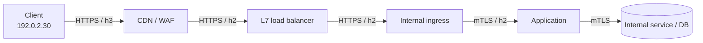
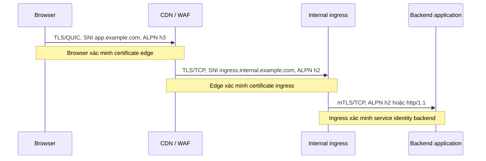
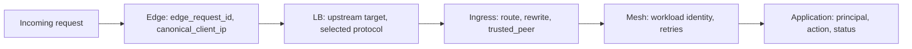

# Cấu hình proxy khi có nhiều lớp trung gian: ranh giới tin cậy, định tuyến và bảo mật

## 1. Vì sao chuỗi nhiều proxy khó hơn một reverse proxy đơn lẻ?

Một website doanh nghiệp hiếm khi chỉ có **client → application server**. Đường đi thực tế có thể là:

```text
Browser / Mobile App
    ↓ Internet
CDN / DDoS protection
    ↓
WAF / API gateway
    ↓
Public load balancer
    ↓
Internal ingress / reverse proxy
    ↓
Service mesh / sidecar
    ↓
Backend application
    ↓
Database / internal service
```

Mỗi thành phần có thể **chuyển tiếp, kết thúc TLS, thay đổi địa chỉ nguồn, chuyển phiên bản HTTP, thêm hoặc xóa header, cân bằng tải và thực thi chính sách bảo mật**. Nếu các lớp không thống nhất cách hiểu một request, hệ thống có thể gặp cả **lỗi vận hành** lẫn **lỗ hổng an ninh**.

Ví dụ: CDN đặt địa chỉ IP khách hàng trong `X-Forwarded-For`; ingress lại tin giá trị header do client tự đưa vào; ứng dụng dựa vào “client IP” đó để bỏ qua MFA cho nhóm quản trị. Khi ấy đường truyền có TLS và WAF nhưng **quyết định danh tính ở ứng dụng vẫn sai**.

Ở mô-đun **SECURITY_NETWORK_SECURITY**, chủ đề này liên hệ trực tiếp với **firewall, phân đoạn mạng, TLS/mTLS, VPN, IDS/IPS, DNS, giám sát xâm nhập, mô hình hóa mối đe dọa và kiến trúc bảo vệ nhiều lớp**. Hiểu đúng chuỗi proxy giúp tổ chức biết **thông tin nào đáng tin, chặng nào đã được xác thực và lớp nào chịu trách nhiệm thực thi**.

### Mục tiêu học tập

Sau bài này, người học có thể:

1. Vẽ chính xác các **hop**, giao thức và **trust boundary** giữa client, CDN, WAF, load balancer, ingress, mesh và ứng dụng.
2. Cấu hình và giải thích **`X-Forwarded-For`, `Forwarded`, `X-Forwarded-Proto`, `Host`, SNI, PROXY protocol** theo nguồn tin cậy.
3. Thiết kế **TLS/mTLS cho từng chặng**, kiểm soát direct-origin bypass, xác thực và phân quyền ở nơi thích hợp.
4. Tránh lỗi **HTTP request desynchronization, header spoofing, redirect/cookie sai, cache poisoning** và policy drift giữa các proxy.
5. Đặt **timeout, retry, health check, connection pooling, observability** và quy trình rollout có thể kiểm chứng.

## 2. Phân biệt forward proxy, reverse proxy, gateway và load balancer

| Thành phần | Ai thường chủ động dùng? | Trách nhiệm phổ biến | Góc nhìn an ninh |
|---|---|---|---|
| **Forward proxy** | client hoặc doanh nghiệp cấu hình đường ra | kiểm soát egress, caching, filtering, access logs | xác thực proxy user, chống truy cập đích không được phép, bảo vệ metadata |
| **Reverse proxy** | client truy cập một hostname dịch vụ, proxy đứng trước backend | routing, TLS termination, header normalization, caching | bảo vệ origin và thực thi trust policy |
| **Load balancer L4** | client kết nối một địa chỉ dịch vụ | phân phối TCP/UDP flow giữa backend | thường không hiểu đầy đủ HTTP; có thể dùng PROXY protocol |
| **Load balancer L7** | client gửi HTTP/gRPC request | routing theo host/path/header, retry, TLS termination | cần parser chính xác, chống spoofing và giữ nguyên semantics |
| **CDN/edge** | người dùng Internet tới edge gần nhất | cache, TLS, bảo vệ DDoS/bot, HTTP/3 | edge là public trust boundary; không mặc định origin được che |
| **WAF/API gateway** | lưu lượng HTTP/API | kiểm tra request, policy, authentication/rate limiting nếu hỗ trợ | hiệu lực tùy **chặng terminate và parser** |
| **Ingress controller** | route traffic vào cluster | ánh xạ host/path tới service/pod | phụ thuộc Kubernetes RBAC, ingress policy và network segmentation |
| **Service mesh sidecar/gateway** | workload-to-workload | mTLS, service identity, traffic policy và telemetry | workload identity và authorization cần cấu hình rõ |

**Các nhãn chỉ mô tả chức năng, không phải các hộp bắt buộc riêng biệt.** Một sản phẩm có thể làm CDN, WAF và load balancer đồng thời. Một L4 LB có thể giữ TLS đầu cuối; một L7 proxy thường kết thúc và mở một HTTP/TLS connection khác. Khi audit, phải xem **trạng thái triển khai thật**, không suy ra từ tên thành phần.

### 2.1. Một request có nhiều phiên kết nối

Ví dụ giả định:



IP `192.0.2.30` thuộc dải ví dụ RFC 5737, **không phải địa chỉ người dùng thật**. Mỗi mũi tên thể hiện một **chặng riêng**, có thể có protocol/certificate khác nhau. Nếu chặng CDN→LB dùng một kết nối TLS mới, TLS của browser **đã kết thúc ở CDN**; không thể gọi các chặng này là một TLS session end-to-end.

## 3. Vẽ trust boundary trước khi sửa cấu hình

Một **trust boundary** là vị trí thông tin hoặc request chuyển từ mức độ tin cậy này sang mức khác. Trong chuỗi proxy, cần ghi rõ:

- **Ai trực tiếp kết nối (socket peer)?** Client Internet, CDN egress, internal LB hay pod?
- **Ai có thể sửa HTTP headers?** Client có thể tự gửi hầu hết header; trusted edge có thể **xóa và tạo lại** chúng.
- **Ai xác thực kết nối?** TLS server authentication, mTLS, network allowlist, service identity?
- **Ai quyết định route?** DNS, SNI, HTTP `Host`/`:authority`, path, ingress rule, service discovery?
- **Ai xác thực người dùng và cấp quyền?** IdP, WAF/API gateway, ứng dụng, workload policy?
- **Chặng nào ghi log và theo dõi phiên?** CDN, LB, ingress, sidecar, app, IDS/IPS?

### 3.1. Bảng giao kèo cho từng hop

| Chặng | Transport và TLS | Thông tin được tin | Chịu trách nhiệm |
|---|---|---|---|
| Client → CDN | HTTPS/TLS hoặc QUIC/TLS | chỉ thông tin **tự xác minh** từ client; header đầu vào chưa tin | xác minh request cơ bản, làm sạch header, chống bot/DDoS |
| CDN → WAF/LB | TLS/mTLS theo thiết kế | peer là CDN **nếu đã xác thực**, các header do CDN tạo theo contract | bảo vệ origin, xác định client IP |
| LB → ingress | private network + TLS/mTLS khi yêu cầu | peer là LB đã được kiểm soát | chọn virtual host, route, normalize metadata |
| Ingress → backend | TLS/mTLS hoặc mesh transport | service identity/route do ingress/mesh chứng minh | service access policy, forwarding đúng |
| Backend → DB | TLS/mTLS, database auth | identity của service và principal ứng dụng | quyền trên dữ liệu |

**“Tin subnet nội bộ” không tự đồng nghĩa tin mọi header**. Một máy bị xâm nhập trong cùng subnet có thể tạo request với `X-Forwarded-For`, `X-Forwarded-Proto` hoặc `X-Forwarded-Host` bất kỳ. Trust cần ràng buộc **đúng peer, đường kết nối và control plane được bảo vệ**.

### 3.2. Source of truth của thông tin

- **TLS endpoint:** nguồn xác nhận certificate, TLS version, ALPN và peer identity của chặng đó.
- **Gateway nhận request:** nguồn xác nhận socket peer và request đã được parse.
- **Trusted edge:** nguồn xác nhận metadata client quan sát được ở ranh giới Internet.
- **IdP/ứng dụng:** nguồn xác thực user/service principal và action authorization.
- **IPAM/DHCP/NAT/VPN logs:** nguồn liên kết IP với session tại **thời điểm và network scope**.

Không gộp mọi nguồn thành một chuỗi `client_ip` rồi sử dụng nó như một user ID bất biến.

## 4. Địa chỉ IP nào là “client IP” khi qua nhiều proxy?

Giả sử:

```text
Client:           192.0.2.30
CDN egress:       198.51.100.20
Internal LB:      10.20.0.11
Ingress:          10.20.0.12
Application:      10.20.1.8
```

Đây là **địa chỉ ví dụ**; dải `192.0.2.0/24` và `198.51.100.0/24` được dành cho tài liệu. Ở backend application, **TCP source IP** có thể là `10.20.0.12` (ingress), **không phải** `192.0.2.30`.

Nếu ứng dụng cần biết nguồn Internet ban đầu cho phân tích abuse/rate-limit, chuỗi proxy phải có **giao kèo chuyển tiếp địa chỉ** được bảo vệ. Giao kèo đó gồm:

1. **Ranh giới public đầu tiên** xác định peer thực nó nhìn thấy.
2. Edge **loại bỏ hoặc chuẩn hóa** mọi header client IP đầu vào không đáng tin.
3. Các proxy sau chỉ chấp nhận metadata từ **các hop đã xác thực và được cấu hình tin cậy**.
4. Backend dùng client IP đã được chuẩn hóa cho mục đích thích hợp; **không coi đó là danh tính người dùng**.

### 4.1. Một IP có thể chỉ là proxy phía trước

Nếu người dùng dùng VPN, forward proxy, mạng di động CGNAT hoặc một forward proxy của công ty, địa chỉ mà CDN nhìn thấy có thể là **egress IP** của hệ thống đó, không thể hiện chính xác máy hoặc người dùng. Truy vết cần **thời gian, port, session ID và nguồn log hợp lệ** của bên quản lý đường mạng.

**Client IP quan sát ở edge là một thuộc tính của kết nối**, không phải bằng chứng pháp lý hoặc xác thực cá nhân.

## 5. `X-Forwarded-For` (XFF): chuỗi địa chỉ và khả năng giả mạo

`X-Forwarded-For` là header được nhiều proxy sử dụng để chuyển thông tin về địa chỉ client và các proxy trung gian. Một ví dụ chuỗi:

```http
X-Forwarded-For: 192.0.2.30, 198.51.100.20, 10.20.0.11
```

Trong nhiều deployment, địa chỉ phía **trái** gần client hơn, còn các proxy thêm thông tin về peer họ nhận ở phía **phải**. Tuy nhiên, chuỗi này **không được TLS tự xác minh** và **không có một authority bảo đảm** tất cả hop tuân cùng quy tắc.

### 5.1. Vì sao lấy địa chỉ đầu tiên bên trái là sai?

Một client ngoài Internet có thể tự gửi:

```http
X-Forwarded-For: 10.0.0.9
```

Nếu edge chỉ append địa chỉ mà nó thấy, backend có thể nhận chuỗi chứa **giá trị giả do client tạo**. Nếu ứng dụng luôn lấy “địa chỉ đầu tiên”, nó có thể gán client thành `10.0.0.9` và làm sai:

- IP-based rate limiting hoặc abuse detection.
- Audit và forensics.
- Geo-risk assessment.
- Network allowlist dựa trên header.
- Chính sách yêu cầu MFA bổ sung nếu thiết kế sai.

**Không dùng raw `X-Forwarded-For` để bỏ qua authentication hoặc cấp đặc quyền.**

### 5.2. Hai mô hình đáng cân nhắc

**Mô hình A — Edge chuẩn hóa:** tại public trust boundary, edge **xóa giá trị XFF do client gửi** và tạo header mới chỉ chứa địa chỉ peer được edge quan sát. Các proxy sau có thể append thông tin hop của chính mình theo contract, hoặc chuyển **một trường canonical client IP** riêng được bảo vệ.

**Mô hình B — Trusted proxy chain:** nếu edge cần giữ một chuỗi được nhiều hop bổ sung, từng proxy chỉ **tin những địa chỉ đến từ danh sách trusted peers**; có thể duyệt theo hướng từ **phải sang trái** và dừng ở địa chỉ đầu tiên không thuộc tập trusted proxies. Quy tắc cụ thể phụ thuộc sản phẩm, topology, NAT và cách từng hop append/reset.

**Không lấy thuật toán minh họa thay cho cấu hình của framework/proxy.** Nếu sai số lượng hop tin cậy, nhầm subnet, có một đường đi không qua CDN hoặc IPv6 bị xử lý khác, việc suy ra địa chỉ client có thể sai.

### 5.3. Quy tắc triển khai

- Xác minh **địa chỉ nguồn kết nối thực** trước khi tin header.
- Danh sách trusted proxies phải **nhỏ và theo đúng network path**; không cấu hình toàn bộ RFC1918 hoặc `0.0.0.0/0` là trusted.
- Nếu edge công cộng **overwrite** header, bảo đảm ứng dụng không còn đường **direct-origin bypass**.
- Không sử dụng danh sách IP CDN đã cũ; tự động đồng bộ nếu provider công bố dải thay đổi, có quy trình review.
- Nếu địa chỉ không xác thực được, ghi **unknown/untrusted** thay vì dựng một client IP giả chính xác.

## 6. Header `Forwarded` chuẩn hóa theo RFC 7239

**RFC 7239** định nghĩa header `Forwarded` với các tham số như `for`, `by`, `host` và `proto`. Ví dụ:

```http
Forwarded: for=192.0.2.30;proto=https;host=app.example.com
```

Qua nhiều proxy có thể có nhiều **forwarded-elements** phân tách bằng dấu phẩy:

```http
Forwarded: for=192.0.2.30;proto=https, for=198.51.100.20;proto=https
```

Với IPv6, giá trị phải được biểu diễn **đúng cú pháp**, thường cần dấu quote/bracket theo RFC:

```http
Forwarded: for="[2001:db8::1234]";proto=https
```

`2001:db8::/32` là dải IPv6 dành cho tài liệu. Header `Forwarded` cũng có thể dùng **obfuscated identifiers** hoặc `unknown`; không phải mọi giá trị `for` đều là một IP parse được.

### 6.1. `Forwarded` có tự đáng tin hơn XFF không?

**Không.** Nó có cú pháp chuẩn hơn nhưng vẫn là **HTTP metadata mà client có thể tự gửi**. Chỉ tin khi được proxy có thẩm quyền **tạo hoặc chuẩn hóa** và chặng truyền được kiểm soát. Một hệ thống nhận đồng thời `Forwarded` và `X-Forwarded-*` phải có **quy tắc ưu tiên duy nhất**, không để mỗi thành phần chọn một nguồn khác nhau.

### 6.2. Parser cần làm gì?

- Parse đúng multiple elements, quotes, escape, IPv4/IPv6 và các giá trị `unknown`.
- Giới hạn độ dài/số lượng phần tử để tránh log flooding hoặc resource exhaustion.
- Không suy ra client IP từ một chuỗi không parse được.
- Không tin `host`, `proto` nếu nguồn chưa xác thực.
- Lưu **raw value** khi cần điều tra và một **normalized value** có trạng thái tin cậy riêng, nhưng phải bảo vệ dữ liệu nhạy cảm.

## 7. `X-Real-IP`, header tùy nhà cung cấp và canonical client IP

Ngoài XFF và `Forwarded`, một số proxy cung cấp `X-Real-IP` hoặc tên header riêng mô tả IP client quan sát được. Không có một quy tắc toàn cầu rằng `X-Real-IP` luôn chính xác hơn `X-Forwarded-For`.

Để giảm sai lệch:

1. Chọn **một canonical client-IP field** ở ingress của vùng tin cậy.
2. Chỉ tạo trường này sau khi xác nhận **peer nguồn** và chuẩn hóa metadata từ hop trước.
3. **Overwrite** header không đáng tin ở public edge.
4. Không cho ứng dụng tự chọn giữa ba header dựa vào cái nào có giá trị trước.
5. Log nguồn của canonical field và **proxy chain version** nếu có.
6. Nếu cần rate limit theo IP, thực thi tại **edge** nơi quan sát peer đáng tin hơn; vẫn đánh giá NAT/CGNAT.

### 7.1. Nhiều ứng dụng có “trust proxy” switch

Framework thường có lựa chọn tương đương “trust proxies”, “forwarded headers”, “known proxies” hoặc “forward limit”. Tên và ngữ nghĩa khác nhau giữa ASP.NET Core, Spring/Tomcat, Express, Django, Rails và các ingress controllers.

**Bật “trust all proxies”** ở dịch vụ Internet-facing có thể khiến client tự khai scheme/host/IP. Đúng hơn là cấu hình **trusted hop addresses, header sources và phạm vi kết nối** dựa trên kiến trúc thật, rồi thử nghiệm âm tính với request giả header.

## 8. PROXY protocol ở lớp kết nối: khác HTTP header

**PROXY protocol** là cơ chế mà một proxy/load balancer có thể gửi thông tin kết nối nguồn/đích cho backend ở đầu **connection** theo một định dạng được thỏa thuận (có phiên bản text và binary). Nó thường xuất hiện khi một **L4 load balancer** chuyển TCP connection và backend cần biết metadata nguồn.

Khác với HTTP `X-Forwarded-For`:

| Thuộc tính | X-Forwarded-For / Forwarded | PROXY protocol |
|---|---|---|
| Tầng | metadata trong HTTP request headers | phần metadata ở đầu connection trước payload ứng dụng |
| Đối tượng sử dụng | HTTP proxies/ingress/backend | L4 load balancer, listeners hỗ trợ |
| Có dùng trên mọi connection không? | chỉ khi HTTP component thêm/đọc | **sender và receiver phải cấu hình khớp** |
| Có tự xác thực peer không? | không | **không**; cần trusted transport/peer |
| Nếu client tự gửi dữ liệu giả | header có thể bị spoof | listener công khai chấp nhận PROXY protocol từ bất kỳ peer cũng có rủi ro spoof |
| Gắn trực tiếp với HTTP Host/URL? | có thể có thêm các metadata | chủ yếu kết nối; không thay Host, TLS hoặc app identity |

**Không mở một listener có chấp nhận PROXY protocol cho client Internet không tin cậy**. Chỉ bật ở đường từ **load balancer được kiểm soát**, có firewall/ACL/mTLS hoặc cơ chế xác thực đường kết nối phù hợp.

### 8.1. Lỗi hay gặp

- Load balancer gửi PROXY v2, backend chỉ mong đợi TCP/TLS thuần → handshake fail.
- Backend chờ PROXY header nhưng một số đường health check không gửi → false-negative.
- Một L7 proxy chuyển HTTP đã parse mà backend lại xử lý nó như PROXY protocol → sai tầng.
- Kiểm thử bên trong thành công nhưng một đường kết nối khác **bỏ qua LB**, làm nhận metadata không đáng tin.

**PROXY protocol không thay application authentication hoặc certificate verification**; nó chuyển metadata từ **proxy mà bạn đã quyết định tin**.

## 9. Scheme và host: `X-Forwarded-Proto`, `X-Forwarded-Host`, `Host`

Một ứng dụng sau TLS termination có thể nhận request **HTTP từ reverse proxy** hoặc một kết nối TLS khác. Nếu framework chỉ nhìn local socket, nó có thể tưởng request từ người dùng ban đầu là `http://` thay vì `https://`.

Các trường thường gặp:

- `X-Forwarded-Proto: https` — scheme mà proxy tin cậy quan sát ở ranh giới đã định.
- `X-Forwarded-Host: app.example.com` — hostname ban đầu nếu proxy được thiết kế chuyển tiếp.
- `Forwarded: proto=https;host=app.example.com` — cú pháp chuẩn.
- HTTP/1.1 `Host` hoặc HTTP/2/3 `:authority` — authority của request.

### 9.1. Các lỗi phát sinh nếu tin sai

| Thuộc tính sai | Biểu hiện | Nguy cơ |
|---|---|---|
| Scheme bị hiểu thành `http` | redirect loop giữa HTTP/HTTPS | mất khả dụng, mixed content |
| Header `X-Forwarded-Proto` bị giả | ứng dụng tưởng request bảo mật hoặc không bảo mật sai | sai cookie `Secure`, redirect, OAuth URL |
| `Host` không được kiểm tra | ứng dụng dùng hostname do client tự đặt tạo link | **Host-header poisoning**, email reset link sai |
| `X-Forwarded-Host` được tin vô điều kiện | callback hoặc absolute URL xuất sang domain ngoài | phishing, cache poisoning, token leakage tùy ứng dụng |
| Port/host của origin bị thay | SSO redirect URI không khớp | lỗi đăng nhập hoặc đường redirect sai |

**TLS tại một chặng không bảo đảm `X-Forwarded-Proto` do client gửi là đúng.** Chỉ gateway tin cậy có trách nhiệm đặt trường này dựa trên **đường kết nối thực của chặng public/được chỉ định**.

### 9.2. Canonical public URL nên do cấu hình quyết định

Với hệ thống nhạy cảm, thay vì xây liên kết reset mật khẩu từ header `Host` chưa tin, ứng dụng nên có cấu hình **canonical external origin** như:

```yaml
# Ví dụ khái niệm, không phải file cấu hình ứng dụng thật
service: customer-portal
external_origin: "https://app.example.com"
allowed_hosts:
  - app.example.com
trusted_ingress:
  - internal-ingress-service-identity
require_https_external: true
```

Nguyên tắc là **allowlist hostname + kiểm soát đường ingress + canonical origin được phê duyệt**. Header là ngữ cảnh bổ sung, không phải quyền tự đặt tên của client.

## 10. SNI, TLS certificate và ALPN ở từng chặng

Mỗi reverse proxy có thể:

1. **TLS pass-through**: chuyển TCP mà không tự terminate TLS, tùy thiết kế L4/SNI routing.
2. **TLS termination**: xác minh/giải mã request tại proxy.
3. **TLS re-encryption**: mở **kết nối TLS mới** tới upstream.
4. **mTLS**: xác minh cả hai peer trên một chặng có kiểm soát.



**TLS của client không xuyên qua mọi hop khi có termination.** Vì vậy:

- Certificate ở edge phải hợp lệ cho hostname người dùng.
- Edge khi làm TLS client tới origin phải kiểm tra **issuer, SAN, hostname, validity và policy** của origin.
- Ingress khi làm TLS client tới backend cần kiểm tra **identity của backend**, không chỉ bật mã hóa.
- Nếu dùng mTLS, server cần kiểm tra **client identity được phép**; ký bởi một CA bất kỳ trong trust bundle là chưa đủ cho authorization.
- **ALPN là thương lượng riêng cho mỗi connection**: client có thể dùng `h3`, origin dùng `h2`.

### 10.1. Một chặng plaintext có chấp nhận được không?

Đánh giá theo threat model, network isolation, compliance và khả năng thực thi chính sách. Nội bộ chạy plaintext không tự động an toàn; sidecar, hypervisor, shared cluster hoặc traffic qua các vùng có thể khiến thông tin nhạy cảm bị lộ.

**Không tắt xác minh certificate ở upstream** chỉ vì gặp lỗi PKI. Cần sửa trust store, SNI, SAN/chain và listener thật; các tùy chọn tương đương `insecureSkipVerify` hoặc `proxy_ssl_verify off` không phải giải pháp production lâu dài.

## 11. Bảo vệ origin khỏi đường bỏ qua CDN/WAF

Một lỗi kiến trúc thường gặp: người dùng đi bình thường qua CDN/WAF, nhưng **origin IP hoặc hostname vẫn public** và cho phép kết nối trực tiếp, khiến các kiểm soát tại edge có thể bị bỏ qua.

```text
Đường mong muốn:
Internet → CDN/WAF → Origin firewall → Internal LB → Application

Đường không mong muốn:
Internet ────────────────────────→ Origin public listener
                                     (bypass CDN/WAF)
```

### 11.1. Các lớp bảo vệ

- **Origin network ACL/security group** chỉ cho nhận lưu lượng từ những địa chỉ/đường **CDN, private tunnel hoặc upstream** được phê duyệt.
- Khi hỗ trợ, **authenticated origin pull/mTLS** hoặc cơ chế xác thực mạnh để xác minh edge là chủ thể được phép kết nối.
- Dịch vụ origin không expose hostname/port quản trị trái mục đích; có **inventory** cho alternate hostnames và IPv6.
- Xác minh **WAF/bot/rate-limit policy parity** với mọi đường truy cập vào ứng dụng, không chỉ hostname chính.
- Quản lý IP ranges và certificate/credential của CDN provider theo vòng đời có audit.
- Kiểm tra deployment staging/DR/alternate region không tạo **đường bypass phụ**.

### 11.2. IP allowlist có đủ không?

IP allowlist giảm phạm vi nguồn có thể kết nối nhưng chưa phải xác thực **từng tenant, ứng dụng hoặc request** trong các môi trường provider dùng hạ tầng chia sẻ. Nếu threat model yêu cầu, kết hợp **mTLS/secret-based origin authentication có bảo vệ, signed requests hoặc private connectivity** phù hợp. Không dùng một header HTTP dễ giả như `X-Origin-Trusted: yes` làm bằng chứng origin đã được CDN xác thực.

**DNS không phải lớp chặn truy cập**. Giấu origin IP trong DNS không đồng nghĩa một IP đang public sẽ không thể bị kết nối trực tiếp.

## 12. Chuẩn hóa header ở ranh giới Internet

Header từ client **không đáng tin chỉ vì tên bắt đầu bằng `X-Forwarded`**. Public edge nên có chính sách rõ:

1. **Xóa/overwrite** những trường mà edge có thẩm quyền khởi tạo: client IP, external scheme/host, request ID nếu cần.
2. **Kiểm tra `Host`/`:authority`** theo các hostname được phục vụ; từ chối giá trị bất thường theo policy.
3. Chuẩn hóa hoặc từ chối request **không hợp lệ về cú pháp** trước khi chuyển tới backend.
4. Giới hạn **số lượng/độ dài headers, URI, body** và thời gian đọc, phù hợp client hợp lệ.
5. Tránh chuyển tiếp những **hop-by-hop headers** sai tầng.
6. Không để trusted metadata chứa dữ liệu client chưa xác thực chỉ vì proxy append nó vào cuối chuỗi.
7. Ghi log **giá trị đã chuẩn hóa và nguồn tin cậy** mà không tiết lộ token/cookie.

### 12.1. Những trường cần policy cụ thể

| Trường | Nguy cơ nếu không chuẩn hóa |
|---|---|
| `X-Forwarded-For` / `Forwarded` | giả mạo IP, đánh lừa rate-limit/log |
| `X-Forwarded-Proto` | redirect loop, sai cookie Secure, callback |
| `X-Forwarded-Host` / `Host` | host-header poisoning, cache confusion, link giả |
| `X-Request-ID` | chèn giá trị dài/sai định dạng, nhầm correlation |
| `X-Forwarded-Prefix` | sai đường dẫn, redirect, routing |
| `Authorization` | lộ bearer token vào log hoặc service không có quyền |
| `Cookie` / `Set-Cookie` | nhầm scope/session, lộ dữ liệu |
| `Traceparent` / `Tracestate` | trace context không đáng tin, nhiễu telemetry |
| `Content-Length` / `Transfer-Encoding` | framing ambiguity nếu các parser khác nhau |
| `Connection` / `Upgrade` | sai hop-by-hop semantics hoặc WebSocket handling |

Mỗi header có **nguồn, owner, người tiêu thụ và kiểm soát khác nhau**; không lập một “global sanitize” chung chung rồi coi đủ.

## 13. Hop-by-hop và end-to-end header khi đổi HTTP version

Một số HTTP fields chỉ có ý nghĩa **trên một connection/hop** và không được chuyển tiếp như metadata end-to-end. Những trường thường cần chú ý gồm `Connection` và những field được nó liệt kê; trong HTTP/1.x có thể gặp `Keep-Alive`, `Proxy-Authenticate`, `Proxy-Authorization`, `TE`, `Trailer`, `Transfer-Encoding`, `Upgrade`.

**Danh sách và cách xử lý phụ thuộc ngữ cảnh/phiên bản chuẩn**: không áp quy tắc “xóa mọi trường có tên này” mà không xét các trường hợp được giao thức cho phép, như `TE: trailers` trong HTTP/2 theo điều kiện chuẩn. Proxy phải **parse và tuân ngữ nghĩa** HTTP/1.1, HTTP/2 và HTTP/3 ở mỗi hop.

### 13.1. HTTP/2 và HTTP/3 không giống HTTP/1.1 trên wire

- HTTP/2 sử dụng **binary frames, multiplexing và HPACK**.
- HTTP/3 sử dụng **QUIC streams và QPACK**, thường qua UDP/443.
- Các cơ chế header/pseudo-header như `:method`, `:scheme`, `:authority`, `:path` có quy tắc khác HTTP/1.1 request line.
- Một proxy đổi **h3 → h2 → h1** phải xây biểu diễn hợp lệ cho từng hop.

**Không sao chép trực tiếp bytes HTTP/1.1 vào HTTP/2 stream** hoặc cho rằng `Transfer-Encoding: chunked` được mang nguyên vẹn qua mọi phiên bản. Đây là công việc của một HTTP stack/proxy được triển khai và kiểm thử đúng.

### 13.2. HTTP request smuggling / desynchronization

Nếu hai tầng proxy **hiểu khác nhau về ranh giới một request**, hoặc xử lý header trùng/không hợp lệ khác nhau, một request có thể bị diễn giải lệch giữa frontend và backend. Hậu quả tùy điều kiện có thể gồm bypass policy, cache poisoning, request routing sai hoặc ảnh hưởng dữ liệu giữa các phiên.

Phòng vệ:

1. Cập nhật **HTTP parsers** tại WAF, gateway, ingress và application.
2. Từ chối request không hợp lệ hoặc **mơ hồ về framing** thay vì tự “đoán đúng”.
3. Đảm bảo frontend/backend thống nhất xử lý `Content-Length`, `Transfer-Encoding` và duplicate headers.
4. Chuẩn hóa `Host`/`:authority`, path và encoding trước khi áp routing/access policy.
5. Kiểm thử protocol translation tại chặng thực có h2/h3 và h1 backend.
6. So sánh hiệu lực WAF/rate-limit cho **cùng request semantic** qua các phiên bản HTTP.

Không cần gửi request smuggling độc hại tới bên thứ ba để học bài này; nên dùng **test suite được phê duyệt trong môi trường lab** và các kiểm thử parser hợp lệ/negative đã kiểm soát.

## 14. Path, prefix và URL rewrite qua nhiều lớp proxy

Khi một reverse proxy mount ứng dụng dưới tiền tố, ví dụ `https://app.example.com/reports/`, nhưng backend vốn chỉ phục vụ `/`, proxy có thể rewrite:

```text
Public URL:   /reports/dashboard
Ingress path: /reports/dashboard
Backend path: /dashboard
```

Vấn đề phát sinh khi **WAF, ingress, application, authorization middleware và cache** không thống nhất xem path trước hay sau rewrite là nguồn quyết định.

### 14.1. Quy tắc cấu hình

- Ghi rõ **original path**, normalized path, rewritten path và component nào thực hiện.
- Chỉ tin `X-Forwarded-Prefix` từ proxy đã được xác thực; không để client tự quyết định mount point.
- Xác định cách xử lý **trailing slash, URL encoding, percent decoding, case sensitivity và path segments**.
- Đảm bảo routing/authorization áp trên **cùng một biểu diễn path được chuẩn hóa**.
- Kiểm tra absolute redirects, relative links, static assets, API URLs và cookie path sau rewrite.
- Đặt policy riêng cho admin routes và không phụ thuộc “đường dẫn khó đoán” như lớp bảo vệ.

### 14.2. Một lỗi logic thường gặp

WAF chỉ kiểm tra `/admin` ở URL bên ngoài, còn ingress rewrite `/internal/admin` thành `/admin` ở backend. Nếu chính sách không có mô hình canonical path, hai lớp có thể đánh giá **hai tài nguyên khác nhau**.

**Không giả định mỗi tầng đều thấy cùng URL**. Đưa **routing table và rewrite rule** vào kiểm thử bảo mật, không chỉ kiểm thử chức năng.

## 15. Redirect, HSTS, cookies và SSO qua chuỗi proxy

### 15.1. HTTPS redirect và scheme

Nếu TLS kết thúc tại edge rồi backend nhận HTTP từ ingress, framework có thể trả `Location: http://...` dựa trên local scheme. Client bị redirect về HTTP hoặc vào vòng lặp `http↔https`.

Cần:

- Một **canonical external origin** được kiểm soát.
- Chỉ nhận external scheme từ **trusted forwarded metadata**, hoặc cấu hình HTTPS origin cố định.
- Chính sách redirect HTTP→HTTPS tại đúng public endpoint.
- Test `Location` qua các đường vào, proxy/region khác nhau.

**HSTS** giúp browser ghi nhớ chính sách dùng HTTPS cho hostname/phạm vi phù hợp, nhưng phải triển khai với đánh giá tác động; `includeSubDomains` và `preload` có hệ quả tới nhiều subdomain và quy trình rollback. HSTS không sửa được **upstream TLS thiếu xác minh**.

### 15.2. Cookies

Cookie có `Secure`, `HttpOnly`, `SameSite`, `Domain` và `Path`. Những thuộc tính này do ứng dụng/HTTP response quy định và được browser thực thi; proxy không nên tùy tiện làm thay đổi scope mà không hiểu ứng dụng.

Ví dụ rủi ro:

- Backend tưởng external request là HTTP, tạo session cookie thiếu `Secure`.
- Proxy rewrite path nhưng cookie `Path` không còn tương thích, gây login loop.
- Hai ứng dụng khác nhau bị gắn chung `Domain` quá rộng, tăng nguy cơ nhầm phạm vi.
- SameSite/cross-site callback không hoạt động do HTTPS và origin bị xây sai.

**Reverse proxy không thay trình duyệt trong quyết định cookie policy**, nhưng nó có thể làm ứng dụng tạo response sai nếu truyền scheme/host không đáng tin hoặc không nhất quán.

### 15.3. OAuth/OIDC và SAML callbacks

Các hệ thống SSO thường dùng **redirect URI/ACS URL** được cấu hình trước. Nếu backend xây callback dựa trên `X-Forwarded-Host` giả hoặc sai scheme, có thể gây:

- Redirect mismatch và lỗi đăng nhập.
- Open redirect trong những điều kiện ứng dụng kiểm tra sai.
- Rò rỉ mã ủy quyền/token qua URI ngoài phạm vi nếu có lỗi xác thực redirect.
- Vòng lặp authentication giữa LB và IdP.

Chính sách tốt dùng **allowlist chính xác cho external callback origins**, bảo vệ `state`/`nonce` và kiểm tra token đúng theo protocol, không tin header tự khai là quyền đổi redirect URI.

## 16. Cache, CDN và nguy cơ cache key không đồng nhất

CDN/reverse proxy cache có thể phân biệt request theo **hostname, path, query, headers, cookies, encoding hoặc Vary** theo cấu hình. Nếu các tầng định nghĩa key khác nhau, dữ liệu có thể bị phục vụ sai người dùng hoặc sai tenant.

### 16.1. Điều kiện gây sai lệch

- CDN cache theo path đã được chuẩn hóa khác backend.
- Proxy đưa `Host` không đáng tin vào key hoặc response redirect.
- Ứng dụng sinh nội dung riêng theo session nhưng edge cache công khai.
- Header `Vary` không được xử lý đúng.
- Query string có nhiều dạng encoding/ordering khác nhưng backend coi cùng tài nguyên, hoặc ngược lại.
- Một lớp bỏ `Authorization`/`Cookie` trước khi đánh giá cacheability.

### 16.2. Chính sách khuyến nghị

1. Phân loại response **public, private, no-store** theo dữ liệu và application semantics.
2. Không cache response cá nhân/nhạy cảm trừ khi cơ chế cache được chứng minh cô lập đúng principal/tenant.
3. Dùng canonical hostname và routing trước khi tạo cache key.
4. Đánh giá `Cache-Control`, `Vary`, cookies và authorization headers theo protocol.
5. Có cơ chế purge có audit và xác minh mỗi PoP/node.
6. Kiểm thử các request tương đương qua h1/h2/h3 và các đường cache hit/miss.

**WAF đứng trước cache hay sau cache** cũng ảnh hưởng việc request/response nào được kiểm tra. Phải hiểu vị trí thực thi, không cho rằng CDN luôn kiểm mọi request dù kết quả đến từ cache.

## 17. Xác thực, ủy quyền và identity ở từng lớp

Một request đi qua WAF, API gateway và service mesh có thể gặp **nhiều quyết định bảo mật**:

- Edge: bot/rate-limit, một số authentication hoặc abuse checks.
- Gateway: OIDC/JWT validation, API keys, mTLS client identity hoặc policy theo route.
- Ingress/mesh: xác thực workload/peer và network/service authorization.
- Application: business logic, user/tenant/object-level authorization.

### 17.1. Không chuyển một header “user=admin” thành danh tính

Một số kiến trúc cho gateway xác thực người dùng rồi chuyển claims đã xác minh tới backend. Nếu client cũng được gửi chính header `X-User`/`X-Roles` và backend không phân biệt **ai tạo header**, attacker có thể mạo danh principal.

Biện pháp:

1. Gateway **xóa header identity** do client cung cấp trước khi xác thực.
2. Gateway tạo claims sau khi xác minh bằng chứng: token/SSO/mTLS phù hợp.
3. Dùng **kênh xác thực giữa gateway và backend** hoặc signed/asserted identity theo thiết kế.
4. Backend chỉ tin claims từ **đúng gateway identity** và kiểm tra scope/audience/freshness phù hợp.
5. Backend vẫn thực hiện **per-action/per-object authorization**.

**JWT xuất hiện trong một header không có nghĩa nó đã được xác thực.** Verifier phải kiểm chữ ký, issuer, audience, thời hạn, mục đích, thuật toán theo policy; không chỉ base64-decode rồi tin claims.

### 17.2. Một lần authentication không tự lan truyền

User có thể được xác thực ở edge, nhưng backend vẫn cần biết **principal nào** và **hành động gì** được phép. Nếu edge chỉ chuyển một cookie opaque, backend có thể không có cơ sở xác thực nó. Cần chọn **session/token handoff** có mô hình tin cậy và revocation rõ, hoặc xác thực riêng ở ứng dụng.

### 17.3. Đường health check và admin bypass

Health endpoint hoặc actuator không được trở thành **đường truy cập admin không xác thực**. Các đường internal admin/debug cần mạng và identity policy phù hợp, không chỉ ẩn dưới prefix ít người biết.

## 18. Forward proxy và egress: mặt còn lại của chuỗi trung gian

Không phải mọi proxy đứng trước application. Một workload có thể đi ra Internet qua **forward proxy**, egress gateway hoặc secure web gateway:

```text
Application service
  → outbound HTTP proxy / egress gateway
  → DNS / Internet / third-party API
```

Các rủi ro khác biệt:

- Proxy có thể nhìn thấy URL/host theo giao thức và cấu hình; cần bảo vệ privacy/logs.
- `HTTP CONNECT` tạo tunnel tới đích; proxy phải giới hạn **destination/port/identity** khi cần.
- Nếu ứng dụng dùng egress proxy sai, traffic có thể đi thẳng Internet và bỏ qua DLP/DNS/IDS.
- Một proxy chấp nhận URL do người dùng điều khiển có thể góp phần vào **SSRF**, dẫn tới truy cập tài nguyên nội bộ/metadata endpoints.
- TLS interception chỉ được thực hiện theo **ủy quyền và chính sách**; root CA riêng cho interception phải được bảo vệ, không lạm dụng.

### 18.1. Egress allowlist không chỉ dựa trên hostname string

DNS rebinding, redirect, CNAME, IP literal và các hostname trùng/khác encoding có thể khiến kiểm tra đích sai nếu proxy chỉ so chuỗi URL thô. Chính sách egress nên đánh giá **destination thực, DNS resolution, redirect chain, private/link-local ranges và các ngoại lệ được phê duyệt** theo công nghệ sử dụng.

Không chặn ngẫu nhiên mọi private IP đối với một proxy phục vụ nghiệp vụ nội bộ; cần chia **proxy cho Internet** và **proxy cho service nội bộ** với các trust rules khác nhau.

## 19. Mẫu cấu hình Nginx tại public edge: chuẩn hóa ở hop đầu

Đoạn dưới là **ví dụ học thuật**, giả định edge **trực tiếp nhận TLS từ client** và mở TLS mới tới ingress. Nó **không phải cấu hình production hoàn chỉnh**: thiếu quản lý certificate files, server mặc định chặn host lạ, timeout/rate-limit/WAF, DNS/upstream HA và logging policy riêng.

```nginx
# Edge proxy: chỉ mô tả server được phép.
server {
    listen 443 ssl;
    server_name app.example.com;

    ssl_certificate     /etc/nginx/tls/edge-fullchain.pem;
    ssl_certificate_key /etc/nginx/tls/edge-key.pem;

    location / {
        # Host trên hop nội bộ là virtual host mà ingress thực sự phục vụ.
        # Tên public được giữ riêng trong X-Forwarded-Host do edge đặt.
        proxy_set_header Host ingress.internal.example.com;

        # Edge là public trust boundary: KHÔNG giữ XFF do client tự gửi.
        proxy_set_header X-Forwarded-For $remote_addr;
        proxy_set_header X-Forwarded-Proto https;
        proxy_set_header X-Forwarded-Host app.example.com;
        proxy_set_header Forwarded "";
        proxy_set_header X-Request-ID $request_id;

        # Xác thực TLS của upstream; không chỉ mã hóa hình thức.
        proxy_ssl_server_name on;
        proxy_ssl_name ingress.internal.example.com;
        proxy_ssl_verify on;
        proxy_ssl_trusted_certificate /etc/nginx/trust/internal-ca.pem;
        proxy_ssl_verify_depth 3;

        proxy_pass https://ingress.internal.example.com:8443;
    }
}
```

**Điều kiện giả định quan trọng:**

- Edge **đứng đầu chuỗi tin cậy**. Nếu phía trước nó còn CDN, `$remote_addr` là **CDN IP**, không nhất thiết là IP người dùng. Khi ấy phải xây trust contract riêng.
- `Host` được đặt theo **virtual host của ingress** (`ingress.internal.example.com`), còn `X-Forwarded-Host` giữ **public origin canonical** (`app.example.com`) do edge tạo. Ingress chỉ được tin trường đó từ edge đã xác minh; deployment nhiều virtual hosts cần policy host riêng và default server từ chối host lạ.
- `proxy_set_header Forwarded "";` bỏ giá trị `Forwarded` đầu vào thay vì chuyển nguyên giá trị không đáng tin.
- `proxy_ssl_verify on` dùng trust store nội bộ và đúng `proxy_ssl_name`; phải provision PKI phù hợp trước.
- Chỉ ghi `X-Forwarded-Proto=https` vì listener ví dụ nhận TLS. Với các listener HTTP khác phải có chính sách riêng.
- **Chặn truy cập thẳng ingress** từ phía ngoài. Nếu ingress cũng cho public client tự kết nối, không thể tin các metadata nói trên.
- Không có `proxy_http_version` ở đây thì protocol upstream phải được đánh giá theo phiên bản/cấu hình Nginx thực; **không suy ra h2 hay h3** từ phía client.

### 19.1. Vì sao không dùng `$proxy_add_x_forwarded_for` ở public boundary?

Trong nhiều cấu hình Nginx, biến đó **append** địa chỉ peer hiện tại vào giá trị `X-Forwarded-For` đã có. Nếu client có thể tự gửi header, giữ nguyên tiền tố chưa tin sẽ khiến một số ứng dụng chọn nhầm giá trị đó làm client IP.

Tại edge trực tiếp nhận traffic chưa tin cậy, đặt `X-Forwarded-For $remote_addr` thường đơn giản và an toàn hơn **theo mô hình đã nêu**. Nhưng nếu trước edge có proxy được tin, cần cấu hình đúng **real IP/trust chain** trước khi chuẩn hóa.

## 20. Mẫu ingress sau edge: chỉ tin metadata từ peer đã xác minh

Giả sử edge có địa chỉ nguồn thực `10.20.0.11` khi kết nối đến ingress; ingress chỉ nhận traffic từ edge (qua firewall, TLS và kiểm soát nền tảng). Ví dụ Nginx:

```nginx
# Ingress nội bộ: chỉ trích phần cần minh họa.
# Không triển khai nếu 10.20.0.11 không đúng là peer đã xác thực.
set_real_ip_from 10.20.0.11;
real_ip_header X-Forwarded-For;
real_ip_recursive on;

server {
    listen 8443 ssl;
    server_name ingress.internal.example.com;

    ssl_certificate     /etc/nginx/tls/ingress-fullchain.pem;
    ssl_certificate_key /etc/nginx/tls/ingress-key.pem;

    location / {
        proxy_set_header Host app.example.com;

        # $remote_addr chỉ có ý nghĩa client đã xác minh theo trusted edge.
        proxy_set_header X-Forwarded-For $remote_addr;
        proxy_set_header X-Forwarded-Proto https;
        proxy_set_header X-Forwarded-Host app.example.com;
        proxy_set_header Forwarded "";

        # Truyền request id từ edge chỉ vì edge đã overwrite header
        # và ingress không có đường tiếp nhận client không tin cậy.
        proxy_set_header X-Request-ID $http_x_request_id;

        proxy_ssl_server_name on;
        proxy_ssl_name api.internal.example.com;
        proxy_ssl_verify on;
        proxy_ssl_trusted_certificate /etc/nginx/trust/internal-ca.pem;
        proxy_ssl_verify_depth 3;
        proxy_pass https://api.internal.example.com:8443;
    }
}
```

**Đây là mô hình đơn giản hóa hai hop**, không phải giải pháp copy-paste cho hệ thống nhiều CDN. `set_real_ip_from` chỉ áp dụng an toàn nếu thực tế **peer kết nối đến ingress** đúng như đã giả định và mạng không cho một peer không tin giả làm edge. Nginx `real_ip_module` thay đổi cách `$remote_addr` được hiểu; log nên giữ cả địa chỉ peer thực khi khả dụng (ví dụ `$realip_remote_addr`) để forensic investigation.

Nếu có **L4 LB/SNAT giữa edge và ingress**, ingress có thể thấy IP của LB chứ không phải `10.20.0.11`. Khi đó cần thiết kế riêng danh sách trusted peers, XFF contract hoặc PROXY protocol. **Đừng sửa bằng cách tin toàn bộ mạng private.**

### 20.1. Phân biệt ví dụ an ninh với cấu hình vận hành đầy đủ

Trước khi deploy Nginx thật còn phải có:

- Default virtual server từ chối hostname ngoài phạm vi; cấu hình SNI/Host đúng.
- TLS version, cipher, key storage, certificate rotation, mTLS nếu yêu cầu.
- Upstream discovery, readiness/health checks, timeout và retries.
- Request size/header limits, buffering, cache, compression, WebSocket/gRPC policies.
- Logging và redaction, rate limit/WAF, policy IPv4/IPv6.
- Network ACL, security group, container networking và đường quản trị bảo vệ.

Không coi một code snippet học thuật là chứng nhận đã harden production.

## 21. Sticky sessions, load balancing và session state

Lớp load balancing có thể chọn backend theo round-robin, least connections, consistent hashing hoặc thuật toán khác. Một số ứng dụng giữ session trên một node nên dựa vào **session affinity/sticky session**:

- Cookie-based affinity do LB tạo/quản lý.
- Source-IP hashing (có giới hạn lớn sau NAT/CGNAT).
- Routing theo request/path/tenant khi ứng dụng được thiết kế hỗ trợ.

### 21.1. Rủi ro của source-IP affinity

Nếu hàng trăm nhân viên đi qua một public NAT IP, một thuật toán phân phối dựa IP có thể dồn họ vào **cùng backend**. Nếu một người đổi VPN/ISP, họ có thể chuyển backend dù session chưa hết hạn.

**Source IP không phải session identity.** Hệ thống có state nhạy cảm nên ưu tiên session management rõ, shared store hoặc stateless session theo chính sách, thay vì tin affinity sẽ bảo đảm đúng người dùng.

### 21.2. Sticky cookie không phải quyền admin

Cookie do LB tạo để giữ affinity **không thay thế application authentication cookie** và không cấp quyền. Cần bảo vệ nó khỏi các tác động không mong muốn theo thiết kế, tránh dùng cùng một giá trị vừa làm routing key vừa làm bí mật xác thực nếu không có mô hình an toàn.

### 21.3. Cân bằng tải ở nhiều tầng

Khi CDN, L7 LB và service mesh cùng retry/rebalance, một request có thể đi nhiều backend tại các thời điểm khác nhau. Muốn điều tra đúng phải có **request ID, upstream selection, retry count và span/trace** ở từng hop.

## 22. Timeout, retry, circuit breaker và lỗi nhân lên giữa các proxy

Giả sử client chờ tối đa **4 giây** nhưng mỗi tầng lại cho timeout **10 giây** và retry ba lần, toàn bộ hệ thống có thể tạo ra **nhiều request nội bộ** sau khi client đã bỏ cuộc.

### 22.1. Timeout budget xuyên suốt

```text
Client overall request budget: 4.0 s
  ├─ DNS + connect/TLS:        0.6 s
  ├─ CDN/WAF/network:         0.4 s
  ├─ LB/ingress/mesh:         0.5 s
  ├─ Application processing:  2.0 s
  └─ Buffer/response:         0.5 s
```

Các con số là **minh họa**, không phải giá trị tối ưu chung. Quan trọng là quy định **end-to-end deadline** và phân bổ phù hợp SLO, thay vì mỗi hop tự chờ quá dài.

### 22.2. Retry amplification

Nếu cả ba lớp đều retry tối đa **2 lần bổ sung** sau lần đầu, trong tình huống xấu một request có thể tạo tới **3 × 3 × 3 = 27 attempts** vào một số đường bên dưới nếu không kiểm soát chính sách. Đây chỉ là minh họa toán học về **nhân số lần thử**, không khẳng định mọi proxy sẽ tạo đúng 27 attempts.

Giảm rủi ro:

1. Chỉ định **lớp nào chịu trách nhiệm retry** cho từng loại lỗi/request.
2. Đặt **retry budget**, số attempt và jitter/backoff phù hợp.
3. Không tự động replay **POST/transaction có side effect** nếu thiếu idempotency controls.
4. Truyền deadline/cancellation ở các giao thức hỗ trợ.
5. Cấu hình circuit breaker, overload protection, queue limits và backpressure.
6. Giám sát **upstream request attempts**, không chỉ client-facing requests.

### 22.3. `502`, `503`, `504` không chỉ nói một nguyên nhân

| HTTP status | Ý nghĩa thường gặp ở proxy | Cần kiểm tra |
|---|---|---|
| **502 Bad Gateway** | upstream response/connection không hợp lệ theo proxy | TLS handshake, protocol mismatch, backend reset, parser error |
| **503 Service Unavailable** | không có healthy backends, overload hoặc bảo trì | LB health, capacity, autoscaling, readiness |
| **504 Gateway Timeout** | proxy không nhận phản hồi kịp thời | timeout budget, upstream latency, DNS/connect, retry |

Mỗi tầng có thể **tự tạo mã lỗi hoặc chuyển tiếp mã của tầng khác**. Log phải cho biết **response source**, upstream status và request ID để không đổ lỗi sai cho application.

## 23. Health checks và đường kiểm tra readiness

LB thường cần biết backend có thể nhận traffic. Có hai lớp kiểm tra:

- **Liveness:** process/service còn sống theo điều kiện nhất định?
- **Readiness:** instance đã sẵn sàng xử lý request thật?

Không phải mọi sản phẩm dùng đúng tên gọi này, nhưng phân biệt giúp tránh đưa traffic vào một node chưa sẵn sàng.

### 23.1. Những sai lầm phổ biến

- Health check chỉ thấy TCP port mở, trong khi app không xử lý request được.
- Health check bỏ qua TLS validation hoặc yêu cầu hostname sai; đường thật lỗi.
- Gateway health check không đi qua cùng route/Host/SNI mà client dùng.
- Endpoint `/health` public tiết lộ phiên bản, credentials hoặc trạng thái chi tiết hạ tầng.
- Một proxy đánh dấu backend healthy nhưng downstream DB unavailable, tạo 5xx hàng loạt.
- Health check bị WAF/rate limit chặn vì không có policy đặc biệt đúng phạm vi.

### 23.2. Nguyên tắc thiết kế

1. Định nghĩa **what healthy means** cho mỗi LB hop.
2. Dùng Host/SNI và TLS/mTLS phù hợp nếu thực tế client đến backend qua TLS.
3. Giới hạn thông tin trả về; health endpoint không phải trang debug admin.
4. Đánh giá tải của checks, cadence, thresholds và tránh flapping.
5. Phân biệt lỗi **một backend** với lỗi **shared dependency** khi autoscale/evict.
6. Kiểm thử khi thay cert, DNS, ingress route và policy WAF.

## 24. HTTP/2, HTTP/3, WebSocket và gRPC qua nhiều tầng

### 24.1. HTTP/2/HTTP/3 từng chặng

Browser có thể kết nối CDN bằng **HTTP/3 qua QUIC/UDP**, CDN kết thúc QUIC rồi mở **HTTP/2/TCP/TLS** tới origin. Đây là thiết kế bình thường. ALPN chỉ cho biết protocol **của connection tương ứng**, không chứng minh mọi hop dùng cùng phiên bản.

### 24.2. WebSocket

WebSocket qua HTTP/1.1 thường sử dụng cơ chế **Upgrade**; trên HTTP/2/HTTP/3 có các cơ chế **extended CONNECT/semantic tương ứng** khi được client/proxy hỗ trợ. Cần kiểm tra:

- Proxy nào terminate TLS và support kiểu WebSocket tương ứng?
- Upgrade/CONNECT xử lý đúng **hop-by-hop** không?
- Idle timeout, keepalive, connection draining và buffering có làm mất phiên dài không?
- Chính sách authentication/authorization có áp tại handshake và các hoạt động sau đó không?

**Một request GET thành công không chứng minh WebSocket streaming hoạt động**.

### 24.3. gRPC

gRPC thông dụng dựa trên **HTTP/2** và metadata/trailers; một số proxy có cấu hình upstream riêng cho gRPC. Nếu frontend h3 nhưng backend gRPC cần h2, proxy phải **chuyển đổi/giao tiếp đúng**, không suy ra từ `proxy_pass` HTTP/1.1 là tương đương gRPC.

Kiểm tra **deadlines, streaming, status/trailers, mTLS service identity và flow control**. Sửa timeout cho gRPC không chỉ kéo dài HTTP read timeout vô hạn.

### 24.4. QUIC/UDP path và firewall

Nếu dùng HTTP/3 tới edge, cần quan sát **UDP/443**, nhưng nếu origin chỉ h2/TLS có thể vẫn dùng TCP/443. Không nên mở UDP/443 tới tất cả backends “để hỗ trợ HTTP/3”; chỉ listener **thật sự terminate QUIC** cần chính sách tương ứng.

## 25. Client IP và rate limiting ở nhiều lớp

Giới hạn theo IP có thể hữu ích cho chống abuse, nhưng **một IP không phải một người dùng**:

- NAT/CGNAT có thể khiến hàng nghìn người chia sẻ địa chỉ.
- IPv6 temporary addresses có thể thay đổi.
- Proxy/VPN pool tái cấp địa chỉ theo thời gian.
- Header client IP có thể bị giả nếu trusted chain sai.

### 25.1. Rate limit ở đâu?

| Điểm kiểm soát | Tín hiệu phù hợp | Giới hạn |
|---|---|---|
| CDN/WAF public edge | peer IP, bot signals, path, token đã xác minh nếu có | shared NAT và false positive |
| API gateway | authenticated principal, API key identity, client IP đã chuẩn hóa | phải kiểm token/claims; tránh đánh đồng bearer token tự khai |
| Ingress/mesh | service/workload identity, route, concurrency | khó suy toàn bộ user khi nhiều client chia sẻ service |
| Application | user/tenant/action, idempotency và business quota | cần dữ liệu nghiệp vụ, chịu tải ứng dụng |

Nên phối hợp **rate control theo IP + principal + route/tenant + concurrency** theo khả năng kỹ thuật. Không đặt tất cả quyết định ở một proxy dựa vào raw `X-Forwarded-For`.

### 25.2. Tránh rate-limit nhân đôi ngoài dự kiến

Nếu CDN giới hạn 100 request/phút và gateway giới hạn 100 request/phút nhưng hai lớp đếm **đơn vị khác nhau** (request gốc, retry, cached requests), người dùng có thể bị `429` dù chưa đạt ngưỡng mong đợi.

Tài liệu cần nêu **window, key, nơi áp, burst policy, Retry-After khi hỗ trợ và cơ chế phân loại requests/retries**. Điều này quan trọng với khách hàng dùng NAT và các ứng dụng có polling.

## 26. Observability: giữ correlation qua nhiều proxy

### 26.1. Một request cần truy vết được qua các tầng



Một schema log khái niệm:

```json
{
  "timestamp_utc": "2026-11-28T08:15:30Z",
  "request_id": "req-example-001",
  "trace_id": "trace-placeholder",
  "public_host": "app.example.com",
  "external_scheme": "https",
  "edge_client_ip": "192.0.2.30",
  "client_ip_provenance": "edge-socket-peer",
  "immediate_peer_ip": "10.20.0.11",
  "ingress_id": "ingress-a",
  "route_id": "customer-api",
  "client_alpn": "h3",
  "origin_alpn": "h2",
  "tls_verified_upstream": true,
  "user_principal": "subject-123",
  "http_method": "GET",
  "http_path_template": "/orders/{id}",
  "waf_action": "allow",
  "upstream_attempts": 1,
  "upstream_status": 200,
  "http_status": 200,
  "duration_ms": 84,
  "source": "illustrative-log-only"
}
```

Toàn bộ dữ liệu **chỉ minh họa**. Ở hệ thống thực, một log có thể chỉ mang một phần các trường; cần correlation qua **request ID/trace ID** và xác định nguồn/giới hạn độ tin cậy.

### 26.2. Request ID: sinh ở đâu?

**Public edge** nên sinh hoặc chuẩn hóa một correlation ID đủ chặt, không tin request ID dài/tùy ý do client gửi làm định danh chính thức nếu dễ gây spoof/log injection. Các proxy sau có thể truyền ID đã được kiểm soát, đồng thời lưu **mỗi hop local ID** nếu cần.

Với **W3C Trace Context (`traceparent`/`tracestate`)**, cần quy tắc sampling, propagation và trust boundary. Client có thể tự gửi trace context; không cho nó quyết định quyền truy cập hoặc tạo trace vô hạn gây quá tải.

### 26.3. Log cả hai chiều

Hữu ích khi có:

- **Accepted/denied** decision và policy version tại WAF/firewall.
- **Immediate peer** và **canonical client IP + provenance**.
- TLS certificate/identity và ALPN ở **chặng tương ứng**.
- Request normalized host/path và route/backend chọn.
- Upstream status, retry count, thời lượng từng phase và health status.
- IdP/principal/app action audit khi có authorization.
- Connection/tunnel session ở VPN/NAT nếu liên quan.

Không log **password, bearer token, session cookie, private key, body nhạy cảm hoặc dữ liệu cá nhân** vượt nhu cầu; có redaction, RBAC và retention phù hợp.

## 27. Threat modeling với STRIDE cho chuỗi proxy

### 27.1. Tài sản và biên tin cậy

Các tài sản chính: **DNS/public hostnames, TLS keys, CDN/WAF policy, proxy trust list, backend routing, client/user identity, authentication tokens, data APIs và logs**. Ranh giới quan trọng là **Internet → edge**, **edge → origin**, **ingress → service**, **service → database** và **control plane quản trị → proxy configs**.

| STRIDE | Tình huống | Điều kiện phát sinh | Kiểm soát phù hợp |
|---|---|---|---|
| **Spoofing** | client tự khai XFF là IP quản trị | backend tin raw header | edge overwrite, trusted peers, application AuthN |
| **Spoofing** | kẻ xấu truy cập origin trực tiếp | origin public và không xác thực edge | origin ACL/private connectivity/mTLS |
| **Tampering** | sửa Host/X-Forwarded-Proto để đổi redirect | ứng dụng dùng header chưa tin | canonical origin, sanitize, allowlist |
| **Tampering** | thay ingress route hoặc WAF config | control plane quá quyền | RBAC/MFA, IaC review, audit và drift detection |
| **Repudiation** | không thể đối chiếu request h3 ở edge với h2 ở backend | thiếu correlation ID | trace/request ID, per-hop logs |
| **Information Disclosure** | cache trả dữ liệu của tenant khác | cache key/private response sai | Cache-Control, Vary, tenant isolation và tests |
| **Information Disclosure** | backend plaintext trên đường không tin cậy | TLS termination nhưng origin thiếu xác minh | TLS/mTLS từng hop, certificate validation |
| **Denial of Service** | nhiều lớp retry khuếch đại tải | không có retry budget | deadlines, circuit breakers, overload protection |
| **Denial of Service** | connection draining/timeouts sai | WebSocket/gRPC bị cắt hàng loạt | streaming-aware timeouts và graceful drain |
| **Elevation of Privilege** | gateway chuyển `X-User=admin` do client gửi | backend tin identity header | xóa header, signed claims/mTLS, per-action AuthZ |
| **Elevation of Privilege** | WAF/backend parse request khác nhau | HTTP framing/normalization không nhất quán | parser hardening, reject ambiguity, regression tests |

### 27.2. Residual risk

Ngay cả khi header, mTLS và WAF đúng:

- Một principal đã xác thực có thể bị lộ credential/session.
- Ứng dụng vẫn có lỗi authorization và SSRF.
- Hạ tầng CDN/CA/DNS/IdP có thể bị gián đoạn.
- Proxy có thể bị DDoS ở packet/network layer.
- Configuration drift có thể tạo đường bypass mới sau rollout.

Vì vậy cần **phòng vệ nhiều lớp và giám sát liên tục**, không chỉ một bộ snippet.

## 28. Quy trình triển khai thay đổi an toàn

### Bước 1 — Inventory và sơ đồ dữ liệu thực

Liệt kê public hostname, DNS/CDN, WAF, LB, ingress, sidecar, backend, environment và owner. Với **mỗi hop**, ghi IP/network peer, protocol, TLS termination, certificate validation, forwarded headers, request rewriting và nơi enforce authentication.

### Bước 2 — Định nghĩa trust contract

Đặt rõ:

- Public edge nào **xóa/overwrite client-supplied forwarding/identity headers**?
- Downstream proxy nào được tin, bằng **IP subnet hẹp, mTLS identity, private connectivity hoặc cơ chế khác**?
- Canonical client IP, scheme, host, path và request ID được tính ở đâu?
- Nếu không xác minh được nguồn, hệ thống **từ chối hay gắn nhãn unknown** theo policy?
- Những đường **DR/staging/direct-origin** có cùng kiểm soát không?

### Bước 3 — Chuẩn bị certificate và network ACL

Xác minh TLS/mTLS và hostname verification ở từng chặng; hạn chế direct origin; áp firewall cho IPv4/IPv6; bảo vệ proxy admin plane bằng MFA/RBAC và change approval.

### Bước 4 — Test trong môi trường tương đương

Thử request hợp lệ và **negative tests an toàn** cho forged XFF/Host/Proto, unknown hostname, protocol translation, cookie/redirect, WebSocket/gRPC, cache, retries và failover.

### Bước 5 — Canary theo traffic thật có kiểm soát

Triển khai một phần lưu lượng, đo 4xx/5xx, 502/503/504, h3→h2 fallback, timeout, retries, WAF actions, cache hit/miss và error budget. Không kéo dài canary nếu thấy mất dữ liệu hoặc bypass authentication.

### Bước 6 — Rollback và hậu kiểm

Có cấu hình trước/sau, chứng minh rollback không mở lại origin bypass hoặc TLS verification off. Rà soát logs, policy drift và cập nhật runbook/CMDB. Một rollback hoàn tất phải được **kiểm chứng từ client đến ứng dụng**, không chỉ thông báo “config reload success”.

## 29. Ma trận kiểm thử chấp nhận

| Test case | Kỳ vọng | Bằng chứng |
|---|---|---|
| Client không gửi XFF, qua edge hợp lệ | canonical client IP theo peer edge quan sát | edge + ingress logs |
| Client tự gửi XFF giả | metadata giả bị xóa hoặc không được tin | normalized header/log + policy |
| Client tự gửi `Forwarded: proto=http` | external scheme vẫn phản ánh TLS edge thật | redirects/cookies + gateway logs |
| Request dùng Host ngoài allowlist | bị từ chối/routed theo default policy an toàn | vhost/routing logs |
| Truy cập trực tiếp origin từ Internet | không tạo phiên được phép vào ứng dụng | firewall/network + mTLS checks |
| CDN gọi origin bằng certificate hợp lệ | TLS verification thành công | edge origin TLS logs |
| Origin certificate không hợp lệ | không bypass xác minh và không serve dữ liệu sai | TLS failure + alert |
| Edge HTTP/3 → origin HTTP/2 | request semantic và AuthZ giữ nguyên | request IDs, ALPN/route logs |
| Request với HTTP framing không hợp lệ trong lab | bị từ chối nhất quán | proxy/parser negative-test result |
| OAuth login/callback qua path rewrite | không tạo open redirect, callback đúng origin | IdP/app test logs |
| Session cookie sau HTTPS termination | `Secure`/`SameSite`/`Path` đúng policy | response headers + browser behavior |
| Cached authenticated content | không phục vụ nhầm tenant/session | cache tests và audit |
| WebSocket/gRPC stream dài | timeout/drain/trailers hoạt động đúng | streaming tests, spans |
| Backend unhealthy | LB ngừng route tới instance sai | health telemetry + request results |
| Một proxy hết thời gian timeout | deadline/fallback đúng SLO, không retry storm | upstream_attempts + latency |
| IP khách NAT dùng chung | rate limit không khóa nhầm quá mức theo policy | controlled load test + metrics |
| Gateway failover | trust headers/TLS/ACL không bị nới lỏng | DR test, config hash/audit |
| Đổi IPv4 sang IPv6 | same trust/host policies, không tạo bypass | dual-stack routing/firewall logs |
| Tạo request ID từ client | edge kiểm soát độ dài/định dạng, logs không bị giả | trace/log tests |
| Service account có mTLS sai identity | bị từ chối theo policy | TLS + authorization logs |

### 29.1. Nguyên tắc kiểm thử

Chỉ thực hiện trên **tài sản và tài khoản được cấp phép**, không gửi request smuggling hay tải DDoS tới bên thứ ba. Với kiểm thử an ninh proxy, dùng môi trường lab/staging có log được phân quyền, dữ liệu giả và kịch bản negative test theo quy trình phê duyệt.

## 30. Case study: CDN, WAF và ingress hiểu sai client IP

### 30.1. Bối cảnh

Một API doanh nghiệp có đường:

```text
Internet → CDN/WAF → Public LB → Ingress → Backend API
```

Đội vận hành muốn chặn request quản trị từ ngoài office IP nên ứng dụng đang kiểm tra **địa chỉ đầu tiên trong `X-Forwarded-For`**. Trong khi đó, CDN **append** địa chỉ mà nó nhìn thấy nhưng không xóa các XFF fields người dùng gửi trước. Khi người dùng được cấp quyền chạy kiểm thử negative trên staging, backend nhìn thấy client IP “thuộc văn phòng” dù kết nối thực từ nguồn test khác.

### 30.2. Root cause

- **Trust boundary sai:** backend tin metadata do client Internet có thể ghi.
- **XFF policy thiếu:** edge giữ tiền tố XFF chưa được xác minh.
- **Application AuthZ sai:** dùng IP trong HTTP header như bằng chứng “nhân viên/admin”.
- **Logging thiếu provenance:** không có cặp `edge_observed_peer` và `normalized_client_ip` để đối chiếu.

### 30.3. Phương án khắc phục

1. Tạm bỏ **IP-only privileged bypass**, yêu cầu user authentication và authorization thật tại admin API.
2. Cấu hình CDN/edge **overwrite** forwarding metadata theo policy; proxy sau chỉ tin peer đã xác minh.
3. Chặn đường **direct-origin** và kiểm tra mọi region/DR profile.
4. Phân biệt canonical client IP (để rate-limit/forensics) với **authenticated principal** (để cấp quyền).
5. Bổ sung log edge peer, ingress peer, routing, user principal và request ID.
6. Test các trường hợp header giả, client NAT/VPN, IPv6 và region khác; chỉ đóng sự cố khi chứng minh policy hiệu lực.

### 30.4. Tình huống phát sinh khác

Sau khi sửa XFF, một số người dùng gặp **redirect loop** vì ứng dụng vẫn nhận `X-Forwarded-Proto=http` từ một proxy nội bộ. Cần xử lý **canonical external HTTPS scheme** và xem origin TLS termination; không sửa bằng cách tắt `Secure` của cookie hoặc tắt HTTPS redirect.

### 30.5. Bài học vận hành

Một chuỗi proxy có thể vừa có **bảo mật tốt ở từng sản phẩm**, vừa có **lỗ hổng tại giao diện giữa các sản phẩm**. Điều quan trọng là giao kèo về danh tính, đường đi, headers và quyền **được thống nhất end-to-end**.

## 31. Playbook khi xảy ra sự cố nhiều lớp proxy

### A — Triage

1. Xác định hostname, client group, thời điểm, region và request ID.
2. Đánh dấu chuỗi **CDN/WAF → LB → ingress → mesh → app** thực của request.
3. Kiểm tra HTTP protocol/TLS/ALPN, Host/SNI và external scheme ở từng hop.
4. So sánh edge-observed peer với client IP chuẩn hóa; tìm đường direct origin.
5. Phân biệt lỗi **connect/TLS, parser, routing, upstream health, timeout, application authorization**.
6. Kiểm tra change window, config drift, certificate rotation và CDN/ISP incident.

### B — Containment

- Nếu có **header spoofing ảnh hưởng authentication**, tắt bypass sai và áp AuthN/AuthZ đúng; không chỉ sửa log.
- Nếu có **origin bypass**, áp network ACL/private connectivity/mTLS phù hợp và rà soát các đường khác.
- Nếu có **WAF/parser inconsistency**, hạn chế protocol/route bị ảnh hưởng theo policy, vá parser và test trước khi mở lại.
- Nếu **retry storm**, giảm retry budget, áp backpressure/circuit breaker và giám sát downstream.
- Nếu **TLS validation failure**, sửa chain/hostname/CA; không tắt verification.
- Bảo toàn log và config/version theo quy trình, tránh thu thập bí mật không cần.

### C — Recovery

- Rollout canary config sửa, kiểm chứng từ client tới backend và tài nguyên nhạy cảm.
- So sánh 4xx/5xx, WAF action, IP provenance, cache và trace sau sửa.
- Xác minh fallback/protocol và định tuyến IPv4/IPv6.
- Cập nhật runbook, trusted peer lists, chính sách change/review và regression tests.
- Ghi rõ bằng chứng, mức ảnh hưởng và rủi ro còn lại; không kết luận “đã sửa” chỉ vì một URL hoạt động.

## 32. Những hiểu lầm phổ biến

1. **“XFF có IP đầu tiên là IP khách thật.”** Client có thể tự điền; cần trusted chain.
2. **“RFC 7239 Forwarded là chuẩn nên tự đáng tin.”** Chuẩn cú pháp không xác thực tác giả header.
3. **“PROXY protocol không thể bị giả.”** Listener phải chỉ nhận từ trusted peer.
4. **“Mọi IP private đều là proxy được tin.”** Một máy bị xâm nhập trong subnet vẫn có thể gửi header sai.
5. **“Dùng CDN thì origin chắc chắn không truy cập trực tiếp được.”** Phải kiểm tra ACL/identity ở origin.
6. **“Có mTLS rồi mọi HTTP header đều an toàn.”** mTLS xác thực peer, vẫn cần kiểm header provenance.
7. **“TLS đã terminate ở edge thì origin được phép plaintext mọi lúc.”** Phải xem ranh giới và yêu cầu bảo mật từng hop.
8. **“SNI và Host luôn bằng nhau.”** Có thể khác; mỗi trường phục vụ mục đích riêng.
9. **“Host/X-Forwarded-Host chỉ ảnh hưởng routing.”** Có thể ảnh hưởng reset links, redirects và cache.
10. **“X-Forwarded-Proto=https do client gửi là bằng chứng đã dùng HTTPS.”** Chỉ tin từ proxy được xác minh.
11. **“Một lần login ở gateway cho phép mọi backend action.”** Phải enforce per-resource AuthZ.
12. **“Dùng IP allowlist là identity admin.”** NAT/CGNAT/VPN và IP reuse phá giả định.
13. **“WAF inspect HTTP/2 thì tự inspect được HTTP/3.”** Cần protocol support tại điểm QUIC termination.
14. **“CDN h3 nghĩa là backend h3.”** Mỗi hop có protocol/ALPN riêng.
15. **“Retries ở mỗi proxy làm hệ thống bền hơn.”** Có thể gây retry amplification và overload.
16. **“Health check TCP thành công thì ứng dụng sẵn sàng.”** Readiness và app dependencies cần test.
17. **“Sticky session dựa IP luôn giữ đúng user.”** NAT và mobility làm IP không ổn định.
18. **“Cache được mọi GET có authenticated cookie.”** Cache phải tuân nguyên tắc riêng tư và response semantics.
19. **“Đổi prefix chỉ là URL rewrite, không ảnh hưởng security.”** WAF/AuthZ có thể đánh giá path khác backend.
20. **“CORS header do proxy thêm là authentication.”** CORS là chính sách trình duyệt, không xác thực API client.
21. **“Request ID do client gửi là bằng chứng.”** Nó có thể bị giả hoặc dùng để nhiễu log.
22. **“Chỉ cần debug application logs.”** Sự cố có thể xảy ra trước application tại edge/TLS/route.
23. **“Rollback thành công thì không còn lỗ hổng.”** Cần xác minh policy ở mọi path, region và DR.
24. **“Có WAF nên không cần patch HTTP parser.”** Các tầng parser phải đồng nhất và được cập nhật.

## 33. Câu hỏi tự kiểm tra và bài tập

**Câu 1.** Vẽ chuỗi CDN → WAF → LB → ingress → service mesh → backend. Với mỗi hop, cho biết **TLS được terminate ở đâu**, HTTP version và trust boundary tương ứng.

**Câu 2.** Vì sao `X-Forwarded-For` không được dùng trực tiếp làm cơ sở cấp quyền admin? Khi nào nó hữu ích cho logging/rate limiting?

**Câu 3.** Phân biệt `Forwarded` của RFC 7239, `X-Forwarded-For`, `X-Real-IP` và PROXY protocol theo tầng giao thức và trust model.

**Câu 4.** Một client gửi `X-Forwarded-Proto: https` qua kết nối HTTP chưa bảo mật. Tại sao ứng dụng không nên coi đó là bằng chứng TLS?

**Câu 5.** Tại sao phải kiểm soát cả SNI và HTTP Host? Giải thích nguy cơ khi một trong hai được tự khai và sử dụng để dựng URL reset password.

**Câu 6.** Đâu là khác biệt giữa **TLS pass-through**, **TLS termination** và **TLS re-encryption/mTLS**? Chứng thư máy chủ cần được xác minh ở hop nào?

**Câu 7.** Một website dùng CDN/WAF nhưng origin public vẫn cho kết nối trực tiếp. Các kiểm soát nào có thể ngăn bỏ qua WAF?

**Câu 8.** Nếu proxy frontend và backend parse request framing khác nhau, loại rủi ro nào có thể xuất hiện và nguyên tắc phòng thủ là gì?

**Câu 9.** Một ứng dụng được mount ở `/reports` nhưng backend route `/`. Cần bảo đảm WAF, cache, AuthZ, redirects và cookie Path nhất quán thế nào?

**Câu 10.** Vì sao một HTTP/3 connection ở CDN không chứng minh origin đã dùng HTTP/3? Kiểm tra ở log nào?

**Câu 11.** Ba tầng proxy cùng retry có thể khiến số attempts tăng mạnh ra sao? Cần retry/deadline budget như thế nào?

**Câu 12.** Vì sao một health endpoint trả 200 không đủ kết luận backend sẵn sàng phục vụ request thật?

**Câu 13.** Một API gateway đặt `X-User` sau SSO. Làm thế nào để backend phân biệt claim đã được xác thực với header do client tự gửi?

**Câu 14.** Khi nhiều khách đi Internet qua CGNAT, rate limit theo IP ở CDN có rủi ro gì và nên bổ sung tín hiệu nào?

**Câu 15.** Nêu ít nhất tám trường log cần ghép một request từ browser đến database khi qua nhiều proxy.

**Bài tập A — sơ đồ và hợp đồng header:** tạo diagram ba tới năm tầng proxy với địa chỉ ví dụ, ghi **immediate peer, trusted client IP, Host, scheme, request ID, TLS identity và nơi overwrite headers** ở từng hop. Thiết kế negative test cho forged forwarding headers.

**Bài tập B — TLS/origin protection:** mô tả cách đưa origin từ public Internet sang chỉ nhận từ CDN/LB được phê duyệt; kết hợp firewall, mTLS, SNI/hostname verification và monitoring. Kiểm thử đường direct-origin bị từ chối và đường hợp lệ vẫn hoạt động.

**Bài tập C — API gateway/h2/h3:** frontend dùng HTTP/3, API backend dùng HTTP/2 hoặc HTTP/1.1. Lập test matrix cho headers, path rewrite, Host/authority, caching, body limits, WAF và streaming. Không thực hiện thử nghiệm nguy hiểm lên môi trường bên ngoài.

**Bài tập D — timeout/retry:** đặt SLO 3 giây cho một API; thiết kế end-to-end deadline, retry ownership và circuit breaker. Mô phỏng trên lab phản hồi chậm/502/503/504; đo attempts và thời gian thực.

**Bài tập E — forensic investigation:** cho một loạt log CDN, LB, ingress và app có client IP khác nhau. Xây correlation theo **timestamp + request ID + trusted peer + principal**, đánh dấu dữ liệu thiếu và không gán identity từ IP đơn lẻ.

**Bài tập F — threat modeling STRIDE:** chọn một website có WAF, CDN, LB, ingress và authentication gateway. Xác định các threat **host-header poisoning, XFF spoofing, origin bypass, inconsistent HTTP parsing, cache mix-up và retry amplification** cùng bằng chứng phát hiện, owner và cách khắc phục.

## 34. Tổng kết

**Cấu hình proxy khi có nhiều lớp trung gian** không chỉ là chọn backend hay thêm header. Vấn đề cốt lõi là **mỗi hop có một đường kết nối, tập thông tin được tin và trách nhiệm bảo mật riêng**. IP socket peer, `X-Forwarded-For`, `Forwarded`, PROXY protocol, SNI, Host, external scheme và identity claims phải được đánh giá dựa trên **nguồn gốc đã xác minh**, không tự động tin vì chúng xuất hiện trong request.

Một kiến trúc an toàn cần **làm sạch header ở public boundary, chỉ tin đúng proxy, bảo vệ origin khỏi bypass, xác minh TLS/mTLS tại chặng cần thiết, chuẩn hóa HTTP request/URL, kiểm soát authentication/authorization, cache và cookies**, đồng thời phối hợp **firewall/segmentation, VPN, DNS security, WAF và IDS/IPS**. Ở tầng vận hành, các lớp proxy phải có **deadline/retry budget, health checking, protocol awareness, request tracing và test failover/rollback**.

Hiệu quả không được chứng minh bằng việc “mọi proxy đều báo healthy”, mà bằng **kết quả request thực, ngữ nghĩa nhất quán, quyền truy cập đúng, khả năng truy vết và SLO người dùng**. Khi có sự cố, hãy tìm **ranh giới đầu tiên nơi thông tin hoặc policy đổi ý nghĩa** thay vì chỉ sửa log cuối chuỗi.

**Tài liệu tham khảo để học sâu:** RFC 9110 (*HTTP Semantics*); RFC 9112 (*HTTP/1.1*); RFC 9113 (*HTTP/2*); RFC 9114 (*HTTP/3*); RFC 7239 (*Forwarded HTTP Extension*); RFC 8446 (*TLS 1.3*); RFC 7301 (*ALPN*); RFC 9000/9001 (*QUIC / Using TLS to Secure QUIC*); RFC 9204 (*QPACK*); RFC 7234 và RFC 9111 (*HTTP Caching*); RFC 6265 (*HTTP State Management Mechanism*, xem thêm cập nhật liên quan); W3C *Trace Context*; tài liệu chính thức về Nginx `real_ip_module`/`proxy_set_header`/`proxy_ssl_*`, HAProxy PROXY protocol, Envoy, Kubernetes Ingress/Gateway API, service mesh, CDN/WAF của nền tảng thực tế; OWASP guidance về Host header injection, HTTP request smuggling, SSRF và API authorization.
