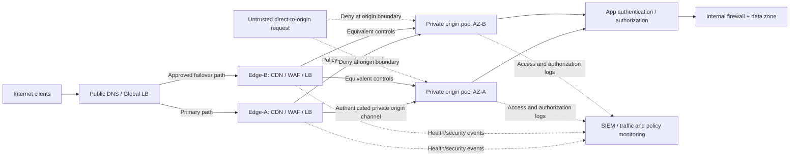
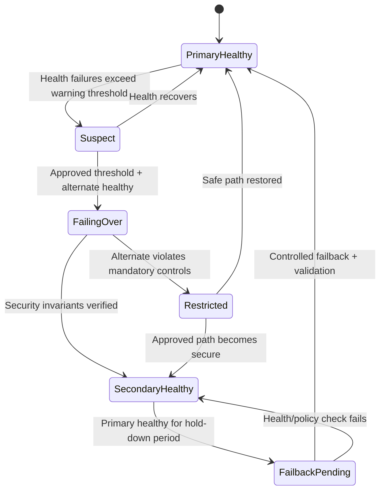
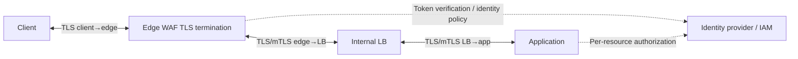
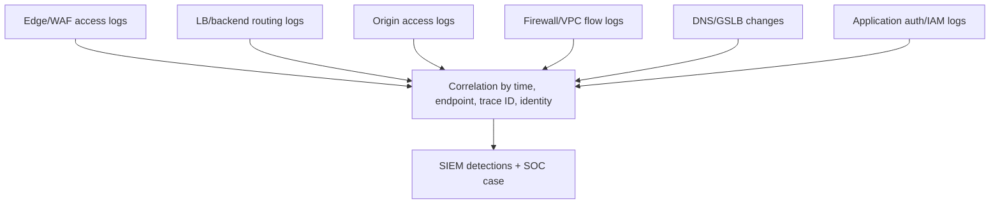

# Failover và tránh bypass proxy

> **Học phần:** `SECURITY_NETWORK_SECURITY`  
> **Chương:** Proxy reverse proxy và cân bằng tải  
> **Trọng tâm:** Thiết kế **failover** cho reverse proxy, load balancer, CDN/WAF và các tuyến đến origin sao cho dịch vụ vẫn có thể phục hồi **mà không tạo đường vòng vượt kiểm soát an ninh**. Kết nối kiến thức về phân đoạn mạng, firewall, VPN, IDS/IPS, xác thực kết nối, TLS, DNS, hạ tầng đám mây và giám sát lưu lượng.

## Mục tiêu học tập

Sau bài này, người học có thể:

1. Phân biệt **reverse proxy**, **forward proxy**, **load balancer**, **WAF**, **origin**, **upstream**, **health check**, **failover** và **failback**.
2. Phân biệt **high availability (HA)** với tính đúng đắn của **security path**: dịch vụ còn trả HTTP 200 chưa chắc còn đi qua WAF, xác thực hoặc chính sách truy cập bắt buộc.
3. Thiết kế đường active/standby, active/active, multi-AZ/multi-region và DNS/GSLB failover có khả năng kiểm chứng.
4. Nhận biết **origin bypass** qua IP trực tiếp, DNS phụ, IPv6, cổng phụ, endpoint quản trị, DR site, cloud public IP, ingress/NodePort và route nội bộ.
5. Phối hợp biện pháp **private origin, firewall/ACL, mTLS/Authenticated Origin Pull, xác thực ứng dụng và chuẩn hóa trusted proxy headers**.
6. Áp dụng health check đa lớp, timeout, retry, circuit breaker, capacity planning và failback có kiểm soát mà không gây lặp giao dịch.
7. Viết kiểm thử âm/dương và playbook ứng phó, lưu telemetry ở cả control plane và data plane, xác minh security invariants trong mọi trạng thái chuyển đổi.

## 1. Vì sao failover có thể trở thành lỗ hổng bảo mật?

**Failover** là việc chuyển traffic hoặc trách nhiệm phục vụ từ một thành phần/đường đi không sẵn sàng sang thành phần/đường thay thế. Trong kiến trúc proxy/LB, thao tác này giúp giảm gián đoạn khi node, zone, region, network link hoặc phần mềm gặp lỗi.

Tuy nhiên, nếu phương án dự phòng **không áp cùng chính sách bảo vệ**, failover có thể biến thành đường **bypass**:

- Hệ thống chính: Internet → CDN/WAF → reverse proxy → ứng dụng.
- Hệ thống dự phòng cấu hình vội: Internet → public IP origin dự phòng → ứng dụng.
- Kết quả: trang web vẫn hoạt động, nhưng WAF, rate limiting, bot mitigation hoặc authentication ở proxy chính **không còn nằm trên đường đi**.

**Nguyên tắc cốt lõi:** *Không đánh đổi kiểm soát truy cập bắt buộc lấy tính sẵn sàng mà không có quyết định rủi ro, thẩm quyền, phạm vi và thời hạn rõ ràng.* Tình trạng “site up” chỉ là một phần của thành công.

### Định nghĩa bảo mật cần giữ

Giả sử tổ chức yêu cầu:

1. Mọi request public tới API đi qua **điểm thực thi chính sách (Policy Enforcement Point – PEP)**.
2. Origin không được tiếp nhận traffic trực tiếp từ Internet không có xác thực.
3. Mỗi request nhạy cảm có **identity và authorization** được xác minh ở tầng phù hợp.
4. TLS được duy trì đúng trust boundary, kể cả edge → origin.
5. Rate limits, logging và điều kiện chống DoS tiếp tục hoạt động hoặc có cơ chế giảm rủi ro đã được duyệt.
6. Các đường dự phòng đáp ứng cùng các thuộc tính kiểm soát cốt lõi.

Những điều kiện này gọi là **security invariants**: những thuộc tính phải còn đúng trước, trong và sau failover.

## 2. Reverse proxy, load balancer và các vai trò liên quan

| Thành phần | Vai trò thường gặp | Điều không nên mặc định |
|---|---|---|
| **Forward proxy** | Đại diện client ra ngoài, có thể áp egress filtering hoặc danh tính | Không đồng nghĩa reverse proxy bảo vệ origin |
| **Reverse proxy** | Nhận request phía dịch vụ, chuyển tới upstream; có thể termination TLS, auth, header normalization | Không mặc định có WAF hoặc anti-DDoS đầy đủ |
| **L4 load balancer** | Phân phối flow theo địa chỉ/port/transport và trạng thái backend | Không mặc định hiểu HTTP path hoặc authorization |
| **L7 load balancer** | Phân phối dựa HTTP host/path/header theo quy tắc được phép | Không mặc định chứng thực header do client tự khai |
| **WAF** | Áp các kiểm soát cho HTTP/application traffic nhìn thấy được | Không thể chặn request đi đường khác không qua WAF |
| **CDN** | Cache và phân phối nội dung gần client; có thể đi kèm WAF/DoS | Không tự ngăn truy cập IP origin trực tiếp |
| **API gateway** | Route, xác thực, quota, policy cho API khi được cấu hình | Không thay authorization của từng tài nguyên |
| **Origin/upstream** | Dịch vụ cuối hoặc backend trả nội dung | Không nên coi mọi nguồn đến từ internal IP là đáng tin |

**Failover** có thể diễn ra ở một hoặc nhiều tầng: client DNS sang region khác, edge CDN đổi origin, load balancer bỏ node lỗi, gateway đổi upstream hoặc service mesh đổi endpoint. Mỗi tầng có **cách phát hiện lỗi, phạm vi blast radius và thời gian hội tụ** khác nhau.

### Proxy chain

Một request có thể đi qua nhiều proxy:

```text
Client → CDN/WAF → Public L7 LB → API Gateway → Service mesh → Application
                                       ↓
                                 AuthN/AuthZ/Quota
```

Nếu một tầng bị bypass, các tầng còn lại **có thể** vẫn giảm tác động, nhưng không bảo đảm. Cần biết **policy nào thực thi ở tầng nào**, không chỉ số lượng proxy trong sơ đồ.

## 3. Kiến trúc chuẩn: hai đường phục vụ, cùng ranh giới an ninh



**Mục tiêu của sơ đồ:** Chuyển route khi một edge hoặc origin lỗi **không được biến một origin thành public endpoint không kiểm soát**. Điều quan trọng là cả tuyến dự phòng vẫn áp **WAF/PEP, kiểm tra danh tính origin, TLS, segmentation và observability** đã yêu cầu.

### Những điều cần ghi trong tài liệu kiến trúc

- Đường *normal*, *degraded*, *failover*, *failback*, *maintenance* và *disaster recovery*.
- Điều kiện node được coi là healthy, ai phê duyệt chuyển tuyến và thành phần nào đổi DNS/route.
- Kết nối edge → origin cụ thể theo **IP/FQDN/port/identity**; không chỉ vẽ mũi tên chung chung.
- Từng đường đi có TLS termination ở đâu, WAF ở đâu và nguồn nào xác thực user/device.
- Quyền truy cập dữ liệu và audit **được thực thi ở đâu** nếu đường đi đổi.
- Đường nào **cố tình không được phép** tồn tại: Internet → origin, Internet → admin, guest → data.

## 4. Các mô hình failover và đánh đổi bảo mật

| Mô hình | Cách hoạt động | Rủi ro đặc thù |
|---|---|---|
| **Active–passive** | Standby nhận traffic khi active lỗi | Standby lâu không chạy, policy/cert/rule bị drift |
| **Active–active** | Nhiều node/region nhận traffic cùng lúc | Rule phiên bản khác, shared rate-limit/session state lệch |
| **Load balancing pool** | LB loại backend unhealthy, chuyển request sang backend khác | Check nông, retry không idempotent, overload phần còn lại |
| **VIP/anycast/route failover** | Chuyển next hop hoặc thông báo định tuyến | Bypass PEP/sensor do đường đi mới; bất đối xứng đường về |
| **DNS/GSLB failover** | Trả hostname/IP khác theo policy và health | Cache DNS, TTL, resolver behaviour, bypass qua IP cũ |
| **CDN origin failover** | CDN đổi upstream/secondary origin | Origin phụ thiếu mTLS, whitelist, xác thực hoặc log |
| **Multi-region DR** | Traffic chuyển sang site/region DR | Security group, secrets, WAF rules, IAM khác production |
| **Service mesh failover** | Proxy/sidecar đổi endpoint hoặc locality | mTLS policy, authorization, egress route hoặc circuit breaker lệch |

**Không có mô hình nào bảo đảm an toàn chỉ từ tên gọi.** *Active–active* không tự tốt hơn *active–passive*: nếu 2 region đều cho phép trực tiếp vào origin, có 2 đường bypass thay vì một.

### Trường hợp stateful và stateless

- **Stateless gateway** dễ thay thế hơn, nhưng token/cache/rate-limit có thể vẫn có state ngoài gateway.
- **Session affinity (sticky session)** có thể giảm churn nhưng làm failover khó khi backend chứa session in-memory.
- **Stateful firewall** cần xem connection tracking và return path khi HA đổi node.
- **Database/quorum** có failover riêng, ảnh hưởng tính nhất quán dữ liệu; proxy up không có nghĩa transaction được commit đúng.

## 5. Định nghĩa “healthy” ở những tầng khác nhau

Một backend trả TCP SYN-ACK **không đồng nghĩa** có thể xử lý request nghiệp vụ an toàn.

| Kiểu check | Kiểm chứng được | Không bảo đảm |
|---|---|---|
| **TCP connect (L4)** | Port/listener nhận kết nối | TLS cert, HTTP route, auth, DB dependency |
| **TLS handshake** | Có giao điểm protocol/cipher, có thể kiểm cert khi cấu hình | API business readiness hoặc quyền ứng dụng |
| **HTTP liveness** | Process HTTP còn đáp một endpoint | Dependency và request thực có hoạt động không |
| **HTTP readiness** | Backend cho biết đã sẵn sàng nhận traffic theo logic triển khai | Mọi transaction hoặc toàn bộ vùng dữ liệu đều hoạt động |
| **Synthetic application probe** | Một luồng nghiệp vụ đại diện thành công | Không bao phủ tất cả tenant/region |
| **Security-policy probe** | Luồng không được phép bị chặn đúng; origin chỉ chấp nhận nguồn xác thực | Không bao trùm mọi đường bypass nếu phạm vi probe hẹp |
| **End-to-end user check** | Chuỗi DNS → edge → origin → app phục vụ luồng thử | Không tự chứng minh mọi security invariant |

### Tách liveness và readiness

- **Liveness:** process có tiếp tục chạy hoặc cần restart không?
- **Readiness:** node có nên nhận traffic mới không?
- **Startup probe:** ở các nền tảng có hỗ trợ, cho ứng dụng đủ thời gian khởi động trước khi áp liveness.

Nếu readiness dùng query database đắt tiền ở tần suất cao, health checker có thể góp phần **tạo tải**. Nếu readiness luôn trả 200 bất kể DB chết, LB sẽ tiếp tục gửi traffic tới backend không phục vụ được.

### Health check an toàn

- Dùng endpoint chuyên biệt như `/health/ready` hoặc kiểm tra tổng hợp phù hợp.
- **Không trả secret**, thông tin topology nhạy cảm hoặc danh sách user trên health endpoint public.
- Có ngưỡng thành công/thất bại, hysteresis và timeout phù hợp.
- Health endpoint không được trở thành **đường bypass authentication** tới API nghiệp vụ.
- Kiểm tra rằng **check đúng SNI/Host/TLS/cert** khi upstream yêu cầu.
- Synthetic check ở nhiều lớp, nhưng không dùng một lệnh “GET /” làm bằng chứng bảo mật tuyệt đối.

## 6. Nguyên nhân failover sai và flapping

Không phải mọi lỗi đều cần chuyển toàn bộ traffic.

| Nhóm lỗi | Ví dụ | Phản ứng nên xem |
|---|---|---|
| Node/pod lỗi đơn lẻ | Process crash, node restart | Loại node, giữ các node khỏe |
| Upstream quá tải | Queue, CPU, DB pool cạn | Load shedding, giới hạn concurrency, scale, không đẩy tải sang node đã quá tải |
| Network partition | Edge–origin mất kết nối, route lỗi | Kiểm tra đường dự phòng theo policy và khả năng trở về |
| Authentication dependency lỗi | IdP/RADIUS/PKI unavailable | Không tự cho phép user chưa xác thực chỉ để giảm lỗi |
| Certificate expiration/mismatch | TLS upstream fail | Sửa certificate/trust hoặc dùng upstream hợp lệ, không tắt verify |
| WAF/rule deployment lỗi | False positive tăng mạnh | Rollback rule được duyệt, không tự bỏ qua WAF trên toàn bộ traffic |
| DDoS hoặc bot surge | Request tăng nhanh | Edge protection/rate limiting/scrubbing, không mở origin trực tiếp |
| Data plane không đồng bộ | Route hoặc NAT sai | Khôi phục route/policy, kiểm tra flow và return path |
| Storage/DB incident | Backend trả 503 dù process sống | Failover tới dữ liệu/replica hợp lệ, xem consistency và write policy |
| Control plane lỗi | Controller cloud/API bị lỗi nhưng data plane còn chạy | Giữ cấu hình known-good, tránh phản ứng gây disruption |

### Hysteresis

Để tránh chuyển đi–chuyển lại khi health giao động:

- Chỉ coi backend down sau **n** lần check thất bại trong cửa sổ.
- Chỉ coi backend phục hồi khi vượt ngưỡng **m** lần healthy liên tiếp.
- Dùng **minimum dwell time/cooldown** trước khi failback.
- Phân biệt outage rộng với lỗi mạng giữa một probe và backend.
- Tránh dùng tần suất kiểm tra lớn đến mức tạo DoS nội bộ.

Các ngưỡng `n`, `m`, timeout, interval **không có giá trị chung**; phải đo theo latency và SLO của hệ thống thật.

## 7. Failover state machine và nguyên tắc giữ nguyên policy



Trong sơ đồ:

- **PrimaryHealthy:** đường chính hoạt động và đáp ứng policy.
- **Suspect:** chỉ có vài chỉ dấu suy giảm; chưa tự kích hoạt chuyển đổi rộng.
- **FailingOver:** kiểm tra trước đường thay thế, năng lực nhận traffic và chính sách.
- **SecondaryHealthy:** traffic chạy trên đường dự phòng **vẫn có PEP, identity, firewall, TLS, log**.
- **Restricted:** đường thay thế không đáp ứng các kiểm soát bắt buộc; hệ thống có thể từ chối một phần traffic hoặc chuyển sang chế độ giới hạn thay vì mở mọi kết nối.
- **FailbackPending:** primary hồi phục nhưng chưa chắc ổn định; yêu cầu soak/hysteresis.

Đây là **mô hình học tập**, không phải state machine của bất kỳ vendor nào. Trong thực tế cần quy định rõ trạng thái **data plane** và **security control** chứ không chỉ trạng thái node.

### Security invariants cần máy móc kiểm tra khi chuyển tuyến

```text
Invariant A: public request -> approved WAF/API PEP
Invariant B: origin accepts only authenticated, approved paths
Invariant C: client identity comes from trusted verification, not caller header
Invariant D: TLS validation remains enabled at each required hop
Invariant E: authorization continues per operation/resource
Invariant F: firewall/segmentation and audit remain in effect
Invariant G: the failover target has enough healthy capacity
```

Không nên ghi `failover_success=true` nếu chỉ thấy HTTP 200 nhưng A–F chưa được xác minh trong phạm vi phù hợp.

## 8. Fail-open và fail-closed: lựa chọn dựa trên chính sách

**Fail-open** ở một kiểm soát nghĩa là khi kiểm soát lỗi, traffic được cho qua; **fail-closed** nghĩa là không cho qua hoặc hạn chế theo policy. Hai khái niệm này khác với việc đưa request sang một **đường dự phòng an toàn**.

| Tình huống | Cách tiếp cận mặc định thường phù hợp | Lưu ý |
|---|---|---|
| Gateway không xác minh được mTLS client | **Không cấp quyền cho client chưa xác thực** | Tránh tạo principal mặc định hoặc trust header |
| WAF chính lỗi, WAF dự phòng cùng policy sẵn sàng | **Failover sang WAF dự phòng** | Không phải fail-open |
| WAF không có đường an toàn thay thế | Deny/degrade những luồng bắt buộc kiểm soát; xử lý theo risk acceptance | Không mở origin vô điều kiện |
| Rate-limit datastore unavailable | Định nghĩa fallback theo tài nguyên/độ rủi ro | Có thể cần local conservative limits, không “unlimited” |
| Readiness backend down | Loại backend khỏi pool khi có lựa chọn khỏe | Nếu hết pool, trả 503 thay vì chọn origin lạ |
| IdP không sẵn sàng | Duy trì hoặc từ chối theo chính sách session đã xác thực | Không chấp nhận bất kỳ token nào |
| Dịch vụ y tế/OT an toàn tính mạng | Thiết kế quy trình an toàn vận hành chuyên biệt | Không áp khẩu hiệu chung mà bỏ đánh giá safety |

**Không có câu trả lời đơn giản “mọi hệ phải luôn fail-closed”.** Tính sẵn sàng, an toàn con người và nghiệp vụ có thể tạo yêu cầu đặc biệt. Nhưng nếu nới kiểm soát bắt buộc, cần **phê duyệt, bù trừ, phạm vi hẹp, giám sát và thời hạn**, không chuyển sang allow-all tự động.

## 9. Bypass proxy là gì? Những đường đi thường bị quên

**Proxy bypass** xảy ra khi một request tới tài nguyên được bảo vệ **không đi qua hoặc không chịu chính sách của proxy/PEP mà kiến trúc yêu cầu**. Nó không nhất thiết là một khai thác kỹ thuật phức tạp; có thể do cấu hình route, DNS, listener hoặc firewall.

### Taxonomy kiểm tra

| Đường bypass | Cơ chế sai phổ biến | Điều cần chặn/kiểm tra |
|---|---|---|
| **Direct origin public IP** | Origin có IP public + listener cho mọi source | Private origin, firewall egress-source allowlist + origin authentication |
| **Origin FQDN cũ/ẩn** | DNS record phụ hoặc tên legacy trỏ tới origin | Inventory domain, route và policy tại origin |
| **Alternate port** | 80, 8080, 8443, debug/admin port mở ra ngoài | Security group/ACL/host firewall trên toàn bộ port |
| **IPv6** | Chỉ chặn IPv4; origin AAAA hoặc v6 listener vẫn public | Chính sách IPv6 tương đương |
| **Backup/DR origin** | Site DR không có WAF/mTLS/segmentation | Security baseline và negative tests cho DR |
| **Internal lateral path** | Workload/partner/guest tới backend không qua API gateway | Segmentation, service identity, authz ở backend |
| **Cloud public endpoint** | VM/managed service public access bật ngoài kiến trúc | Disable public exposure; private endpoints khi khả thi |
| **Kubernetes NodePort/LoadBalancer** | Service được expose song song với Ingress/WAF | NetworkPolicy, firewall, service types, cloud LB inventory |
| **Host/header ambiguity** | Gateway route khác nhau vì Host/Forwarded fields tin từ client | Canonical host, normalized headers, strict routing |
| **Proxy failure fallback** | Fallback trực tiếp từ client/load balancer tới app | Thiết kế alternate PEP, không bypass auth/WAF |
| **Management/debug ingress** | SSH/admin endpoint nằm cùng LB public | Management zone, identity-aware access, MFA/PAM |
| **CDN/DNS failover** | DNS chuyển sang public IP origin thay vì edge khác | Approved DR edge và origin firewall |

Một địa chỉ IP có thể phục vụ nhiều virtual hosts: **không tìm thấy tên origin qua DNS công khai không đồng nghĩa origin không thể truy cập bằng IP/SNI/Host**. Bảo vệ phải nằm ở **network/transport/application boundary**, không dựa vào “bí mật tên miền”.

## 10. Origin isolation: lớp bảo vệ cơ bản nhất

### 10.1 Mạng riêng khi khả thi

Ưu tiên đặt origin trong subnet/VPC/VNet không có public ingress; chỉ cho phép kết nối từ **edge/LB/gateway hoặc private connectivity** đã được phê duyệt. Không gán public IP trực tiếp cho VM/pod app nếu không cần.

### 10.2 Firewall, security group và ACL

Định nghĩa **allowlist nguồn tới origin** theo:

- Peer/edge/subnet/ENI identity hoặc các cơ chế provider hỗ trợ;
- port và protocol cụ thể;
- môi trường, region, IPv4/IPv6;
- management plane tách biệt;
- cả đường **DR và failback**.

**Chỉ dựa vào IP allowlist không luôn đủ**, nhất là khi một CDN dùng địa chỉ nguồn chia sẻ giữa nhiều tenant. Origin có thể cần **mTLS/Authenticated Origin Pull** hoặc cơ chế authentication tương đương để biết request thực đến từ **đường edge của tổ chức**, không phải một khách hàng bất kỳ cùng mạng CDN.

### 10.3 TLS và xác thực edge–origin

- Edge xác minh certificate/hostname của origin; không bật `verify=false` khi failover.
- Origin xác minh **client credential của edge** nếu dùng mTLS và profile phù hợp.
- Key/certificate của edge standby được cấp, lưu và rotate như edge chính.
- Quyền origin chấp nhận phải **hẹp theo service và trust domain**.
- Nếu dùng gateway token hoặc signed request, phải chống replay/giả mạo và bảo vệ key; một **static header bí mật** có thể hỗ trợ hạn chế nhưng thường yếu hơn chứng thực kết nối và có rủi ro lộ/forward.

### 10.4 Ứng dụng không bỏ xác thực riêng

Backend cần authorization cho tài nguyên nhạy cảm. Kể cả có private subnet và mTLS, không nên biến mọi request từ “IP nội bộ” thành administrator.

**Defense in depth:** Chặn direct origin ở firewall, xác thực hop ở TLS/mTLS và kiểm soát API/user authorization giúp giảm blast radius khi một lớp cấu hình sai.

## 11. CDN/WAF failover: tránh “origin pull” bị bypass

Một luồng phổ biến:

```text
Browser → CDN/WAF edge → origin LB → application
```

Các điểm cần bảo vệ:

1. **Public DNS** trỏ tới edge/CDN đã được phê duyệt; khi chuyển vùng phải trỏ tới **edge khác có policy tương đương**.
2. **Origin** không tin request từ Internet chỉ vì mang Host giống domain production.
3. **Origin pull authentication**: edge → origin có mTLS hoặc cơ chế xác thực do provider hỗ trợ.
4. **WAF rules/bot controls** được đồng bộ giữa edge chính và dự phòng.
5. **Cache policy** không cache thông tin riêng tư hoặc phản hồi authenticated sai phạm vi.
6. **Rate limits** không bị reset/mất hiệu lực khi traffic chuyển sang region khác.
7. **Origin shielding** và request queue không làm overload app khi edge failover.
8. **Visibility**: log xác định edge ID, WAF action và origin authentication result.

### Ví dụ đánh giá policy drift

| Control | Edge chính | Edge dự phòng | Rủi ro |
|---|---|---|---|
| WAF rule set | v42 | v39 | Một số request bị chặn ở edge chính có thể qua edge phụ |
| Bot control | Enforced | Monitor-only | Tải tấn công có thể tăng sau failover |
| Client auth | Required | Optional | Request thiếu danh tính có thể đi vào app |
| Origin mTLS | Enabled | Disabled | Origin phụ nhận traffic không được xác minh |
| Rate limit | Shared state | Local-only | Quota hiệu dụng tăng nhiều lần |
| Access logs | Centralized | Disabled | Mất bằng chứng ở DR |
| IPv6 exposure | Deny direct | Not configured | Public origin v6 có thể bị truy cập trực tiếp |

Nếu phát hiện một hàng lệch, **failover chưa bảo đảm security invariants** dù ứng dụng vẫn phản hồi.

## 12. TLS termination và tái mã hóa nhiều hop

Một request có thể đi qua nhiều kết nối độc lập:



**TLS 1.3 ở client→edge không chứng minh các hop khác được mã hóa.** Khi failover, các vấn đề thường xuất hiện:

- Edge phụ kết nối origin với TLS verification tắt để “tránh cert error”.
- Origin phụ có certificate SAN không khớp hostname được LB dùng.
- mTLS client certificate chỉ cấp cho edge chính; edge phụ không có credential hợp lệ.
- Điểm TLS termination mới làm WAF/IDS không nhìn thấy HTTP payload như thiết kế.
- HTTP plaintext bị đẩy qua một subnet mà trước đây được giả định chỉ chứa workload tin cậy.

**Hướng kiểm thử:** Đối chiếu certificate chain, hostname/SAN, trust store, TLS min version/cipher và client identity **cho từng hop và từng đường chuyển**. Một connection TCP thành công không phải là bằng chứng TLS đã kiểm tra server đúng.

## 13. Trusted proxy headers và nguồn IP thật

Reverse proxy thường gắn header như `X-Forwarded-For`, `X-Forwarded-Proto`, `X-Forwarded-Host` hoặc `Forwarded` (RFC 7239) để truyền thông tin request gốc.

**Vấn đề:** Client Internet cũng có thể gửi các header đó. Nếu backend **tin mọi giá trị header** để quyết định “client là admin”, “request qua HTTPS”, “IP này nằm trong allowlist”, có thể tạo lỗ hổng định danh hoặc vượt policy.

### Ranh giới tin cậy cho header

1. **Chỉ tin các proxy đã được xác minh** qua network boundary và identity.
2. Ở cạnh Internet, **strip/overwrite** những header mà client không có quyền quyết định.
3. Khi có nhiều proxy, xác định rõ parser của chain, **trusted hops** và thứ tự địa chỉ; không “lấy IP đầu tiên” trong chuỗi tùy ý.
4. Phân biệt **IP client dùng analytics/rate limit** với **principal xác thực**; IP không thay credential.
5. Nếu edge gửi identity metadata, gateway phải chứng thực và backend phải nhận từ kênh đáng tin.
6. Chuẩn hóa Host, scheme và forwarded headers để tránh route confusion, URL generation sai, open redirect hoặc bypass kiểm soát.

### Ví dụ không an toàn

```text
Client tự gửi: X-Forwarded-For: 10.0.0.1
Backend: nếu IP đầu trong XFF là 10.0.0.1 thì cho phép /admin
Kết quả: Cấu hình authorization dựa header không đáng tin.
```

### Thiết kế đúng hơn

- Proxy edge loại bỏ giá trị giả từ client hoặc xử lý theo danh sách trusted hops.
- Backend chỉ nhận đường network/identity từ gateway đã xác minh.
- Endpoint `/admin` vẫn cần **user/service authentication + authorization**.
- Failover edge phải có cùng hành vi header normalization, không dùng một trust-proxy list bao trùm Internet.

## 14. Host routing, virtual host và listener phụ

L7 proxy thường chọn route theo `Host`, path, method và một số header. Sai khác về thứ tự hoặc normalization có thể khiến request đi tới backend khác hoặc bypass policy.

### Các trường hợp cần xét

- `Host` không nằm trong allowlist nhưng đi vào default backend.
- SNI của TLS và HTTP Host không được ràng buộc theo routing policy khi cần.
- App có đường `/api` được bảo vệ nhưng `/internal/api` hoặc domain phụ trỏ cùng handler với policy khác.
- Admin/debug listener ở port khác, IPv6 hoặc một LB phụ không qua cùng PEP.
- Proxy chain chuẩn hóa đường dẫn/encoding khác nhau dẫn đến **request smuggling/routing discrepancy** hoặc policy mismatch.
- Traffic HTTP/2/HTTP/3 chuyển đổi qua HTTP/1.1 ở origin với xử lý framing khác.

**Không sửa bằng “cho qua mọi Host để failover không lỗi”.** Ưu tiên **canonical host allowlist, default deny/404**, route rõ ràng và cùng parser/validation policy giữa đường chính–dự phòng.

### Bảo vệ ở hai phía

- Proxy có strict host/routing policy.
- Origin có virtual host mặc định **không phục vụ ứng dụng nhạy cảm** cho Host lạ.
- App kiểm tra authorization theo resource không phụ thuộc solely vào URL đã được rewrite.
- Duy trì kiểm thử negative cho default vhost, alternate listener và các giao thức HTTP được hỗ trợ.

## 15. Health endpoint không phải đường truy cập ưu tiên

Đường `/health/ready` hoặc `/live` cần được thiết kế để **health checker** sử dụng mà không thành lối tắt đến endpoint khác.

### Các sai lầm phổ biến

- Whitelist cả `/health/*` rồi chứa endpoint quản trị dưới cùng prefix.
- Trả toàn bộ connection strings, secret, internal topology trong body.
- Check bằng request từ một mạng có quyền đặc biệt, khiến backend **chỉ khỏe với health checker**, còn user request thất bại.
- Check HTTP 200 khi app không thể xác minh JWT hoặc quyền DB đang lỗi, nhưng proxy vẫn gửi traffic.
- Health endpoint public cho phép các thao tác thay đổi trạng thái hoặc gây tải tốn kém.

### Gợi ý tách hai mục tiêu

**Health for routing:** kiểm tra backend có xử lý request hay không với chi phí thấp, tránh restart/failover thừa.

**Security readiness:** kiểm tra các thành phần cần để áp policy cốt lõi: CA/identity verifier, route policy, khả năng xác minh upstream, trạng thái rules; nếu thiếu, chọn restricted mode theo thiết kế.

Một health check **không cần tự truy cập mọi tài nguyên nhạy cảm**; có thể sử dụng bằng chứng cấu hình, token canary và synthetic transaction giới hạn để tránh làm lộ dữ liệu.

## 16. Timeout, retry, circuit breaker và load shedding

Failover thường kết hợp **retries**, nhưng retry không được kiểm soát có thể làm incident trầm trọng.

### Timeout và retry budget

- **Connect timeout:** giới hạn thời gian thiết lập kết nối upstream.
- **Response/read timeout:** giới hạn thời gian chờ phản hồi theo mục đích.
- **Overall deadline:** tổng thời gian request được phép chạy; phải phân bổ giữa các hop.
- **Retry budget:** số lần retry tối đa, có backoff/jitter khi phù hợp.
- **Concurrency limit:** giới hạn request/connection đồng thời vào backend.
- **Circuit breaker:** tạm ngừng gửi tới upstream liên tục lỗi, thử phục hồi có kiểm soát.
- **Load shedding:** từ chối/tạm hoãn request ít quan trọng khi thiếu capacity, tránh đẩy hệ thống vào resource exhaustion.

### Nguy cơ retry giao dịch

Nếu client gửi `POST /payments`, backend có thể **đã commit** thanh toán rồi mất kết nối trước khi gửi response. Nếu proxy retry sang backend dự phòng, có thể tạo giao dịch **lặp** nếu backend không có idempotency semantics.

**Không mặc định retry mọi POST/PUT/PATCH/DELETE.** HTTP method semantics có khác nhau; hệ thống thực cần **idempotency key, transaction ID, de-duplication, retry policy theo endpoint** và hiểu rõ state commit. GET cũng có thể tốn tài nguyên hoặc không thật sự safe nếu ứng dụng thiết kế sai.

### Retry amplification

Ví dụ client retry 3 lần, gateway retry 2 lần và service client retry 2 lần có thể tạo nhiều request hơn dự kiến. **Giảm retry ở tầng trên khi đã có tầng dưới retry**, đặt tổng ngân sách deadline và giám sát amplification.

## 17. Capacity planning khi mất một node, AZ hoặc region

Một hệ có 2 node, mỗi node chỉ đủ phục vụ 60% peak demand, **không** bảo đảm full capacity nếu một node chết. Cần tính N+1 (hoặc chính sách redundancy tương đương) theo load thật, bao gồm TLS handshakes, WAF rules, queue và backend dependencies.

### Ví dụ số học

Giả định traffic peak là **10.000 request/phút**, cần dự phòng khi mất một trong hai edge. Mỗi edge xử lý **6.000 request/phút** ổn định:

- Bình thường chia đều: 5.000/edge, còn dư 1.000/edge.
- Khi một edge mất: 10.000 request/phút đổ về edge còn lại.
- Capacity edge còn lại chỉ 6.000, thiếu **4.000 request/phút**.

Để giữ peak khi mất một edge, cần **công suất còn lại ít nhất bằng tải peak**, hoặc có scale-out/traffic shedding đã thiết kế, xét overhead và headroom an toàn.

### Little's Law và đồng thời

\[
L = \lambda W
\]

Trong trạng thái ổn định, số request/connection trung bình đang xử lý `L` phụ thuộc arrival rate `λ` và thời gian lưu trong hệ `W`. Khi failover, latency tăng → concurrency có thể tăng → pool/circuit breaker cạn nếu không có backpressure.

**Không chỉ đo CPU edge.** WAF rule evaluation, TLS crypto, rate-limit datastore, DB connection pool, service quotas, downstream dependencies và network links đều có thể thành điểm nghẽn.

## 18. Session persistence và authentication trong failover

### Sticky session

Load balancer có thể dùng cookie hoặc source-IP affinity để giữ client trên một backend. Nếu backend chứa session trong bộ nhớ, failover có thể khiến user đăng nhập lại hoặc mất trạng thái.

**Lựa chọn dài hạn:**

- Chuyển session state vào store được quản lý hoặc dùng token/session strategy phù hợp.
- Định nghĩa cách revoke session/credential trên mọi region.
- Cookie có `Secure`, `HttpOnly`, `SameSite` phù hợp; scope domain/path hẹp.
- Session key và signing/verification keys được đồng bộ an toàn, có rotation.
- Cân nhắc idle timeout/session lifetime và replay protection khi failover.

### Không dùng session persistence để thay authentication

Một cookie sticky do LB phát **không phải chứng cứ user đã xác thực**. Backend phải kiểm tra session/token và permissions; nếu failover tới vùng khác, **không bypass auth do session store không kết nối được**.

### Multi-region consistency

Hai region có thể dùng cache session, token revocation list và danh sách tài khoản bị khóa. Nếu dữ liệu này cập nhật chậm, region dự phòng có thể chấp nhận token đã thu hồi. Cần định nghĩa yêu cầu nhất quán, thời gian trễ tối đa và failover behavior theo mức độ nhạy cảm.

## 19. Rate limiting, quota và WAF state qua nhiều node

**Rate limit** là một kiểm soát dễ mất hiệu lực sau failover.

### Ví dụ quota bị nhân đôi

Một policy giới hạn `100 request/phút/principal` được lưu **local** trên hai edge độc lập. Nếu cùng client có thể gửi qua cả hai edge, quota hiệu dụng có thể tăng gần gấp đôi ngay cả khi mỗi edge cấu hình đúng theo mình.

### Hướng thiết kế

- Dùng **shared/distributed rate-limit service** khi cần quota toàn cục và đủ độ tin cậy.
- Hoặc partition limits theo region/edge, với tổng quyền tối đa đã tính toán.
- Khi datastore rate limit lỗi, dùng **conservative local fallback** hoặc policy giảm chức năng theo rủi ro.
- Định danh client dựa trên **verified principal**, token/tenant hoặc nguồn IP được xác thực qua trusted proxy chain.
- Đồng bộ WAF rules/bot classifications, API quota và origin rate limits.
- Bảo vệ rate-limit service khỏi bottleneck, cache poisoning và policy drift.
- Kiểm thử **trước, trong và sau failover**, không chỉ khi hệ thống bình thường.

**Đừng cho unlimited access** chỉ vì Redis/limit service không phản hồi, trừ khi có quyết định rủi ro cụ thể và các lớp bù trừ thích hợp.

## 20. DNS failover và GSLB: không phải chuyển đổi tức thì

Global Server Load Balancing (GSLB) hoặc DNS failover có thể đổi A/AAAA/CNAME/alias response để hướng request tới edge/region mới. Tuy nhiên:

- Resolver và client có thể **cache** theo TTL hoặc hành vi riêng.
- Connection/TLS session cũ có thể tiếp tục dùng IP cũ.
- Một số client giữ DNS lâu hơn hoặc có mạng/DNS path khác.
- Failover có thể không đồng nhất giữa IPv4 và IPv6.
- Health checker của DNS provider có vantage point, interval và policy riêng.
- DNS vừa đổi không đảm bảo **routing/data plane** tới origin đang hoạt động.
- Một số traffic vẫn tới endpoint cũ khi service đã đánh dấu unhealthy.

### Thiết kế an toàn

1. Chỉ công bố **đích failover đã được phê duyệt và áp tương đương WAF/PEP**.
2. Duy trì policy an toàn trên **đường cũ** trong giai đoạn hội tụ, không mở origin direct.
3. Kiểm thử IPv4/IPv6, nhiều resolver và thời gian thực tế hội tụ.
4. Đảm bảo TLS certificate/SNI/hostname hợp lệ ở mọi destination.
5. Không hạ TTL cực thấp như giải pháp thần kỳ; cân nhắc DNS provider load, cache và sai số.
6. Kiểm tra đường failback và session churn.
7. Có giám sát từ nhiều vantage point **và** log tại origin.

**Không dùng DNS ẩn như access control.** Một record private, ít người biết hoặc vừa bị xóa không ngăn kết nối IP trực tiếp nếu firewall origin vẫn mở.

## 21. Cloud và multi-region: các lớp không đồng nghĩa nhau

Trong cloud, một ứng dụng có thể có public CDN, regional L7 LB, private subnets, managed services, VPC/VNet peering và route qua hub/transit gateway.

### Những trường cần rà soát cho cả primary và DR

| Thành phần | Câu hỏi |
|---|---|
| CDN/Global LB | Region DR có WAF/security policy như primary? |
| Regional LB/Ingress | Có listeners phụ, default rules hoặc alternate hostnames? |
| Security group/NACL | Inbound origin chỉ từ đúng nguồn/identity; IPv4/IPv6 khớp? |
| VPC/VNet route table | Có route bypass firewall hoặc inspection subnet? |
| Managed origin service | Có public endpoint bật ngoài dự kiến? |
| PrivateLink/private endpoints | Origin có thể nhận private-only từ edge/gateway không? |
| IAM/service account | DR identity có quyền tối thiểu và audit không? |
| Secret/PKI manager | DR có cert/keys hợp lệ, đúng issuer, được rotate? |
| Logging/SIEM | Region DR có streaming log, retention và alert không? |
| DDoS protection | DR path có scrubbing/rate limiting tương đương? |

### DR không chỉ là copy dữ liệu

Sao chép VM hoặc database không tự sao chép chính sách **network access, edge WAF, IAM, route filtering, private DNS, cert issuance và logging**. Cần infrastructure-as-code và policy tests cho **cả primary lẫn DR**.

## 22. Kubernetes: Ingress, Gateway API, Service và NetworkPolicy

Ở Kubernetes, một ứng dụng có thể được expose qua:

- Ingress controller hoặc Gateway API implementation;
- Service loại `LoadBalancer`;
- Service loại `NodePort`;
- internal ingress/private gateway;
- port-forward/admin/debug trong phạm vi được phép.

**Chỉ cấu hình Ingress/WAF không bảo đảm pod không thể được truy cập qua một Service khác.**

### Kiểm soát nên kết hợp

1. **Service exposure:** Chỉ tạo public LoadBalancer/NodePort khi có nhu cầu rõ; dùng policy/admission để chặn loại service không được phép.
2. **NetworkPolicy:** Chặn ingress trực tiếp vào pod app, chỉ cho phép từ ingress/gateway hoặc các workload đã được duyệt. Lưu ý **phụ thuộc CNI/plugin và semantics thực tế**.
3. **Ingress/Gateway policy:** Host/path/method routing, TLS, authentication và WAF integration đúng.
4. **Service mesh mTLS:** Kiểm tra identity giữa gateway và workload; tránh đường ngoài mesh.
5. **Readiness/liveness:** Phân biệt khi node cần ngừng nhận request và khi cần restart.
6. **Namespace/tenant isolation:** Không cho namespace dev/guest đi trực tiếp vào prod sensitive service.
7. **Cloud security group:** Chặn direct exposure ở mức VPC và node/LB, không chỉ trong K8s.
8. **Admission/IaC review:** Rà soát thay đổi Service, Ingress/Gateway, annotations và hostNetwork.

### Manifest minh họa policy mục tiêu

```yaml
policyId: K8S-ORIGIN-ISOLATION-013
scope: "namespace:production, app:payments-api"
allowedEntryPaths:
  - "approved-private-ingress-controller"
  - "approved-mesh-gateway"
denyDirectExposure:
  serviceTypeLoadBalancer: true
  serviceTypeNodePort: true
  publicHostNetwork: true
networkControls:
  defaultDenyIngress: true
  allowFromApprovedGatewayIdentity: true
  enforceAtCloudSecurityBoundary: true
applicationControls:
  verifyAuthentication: true
  authorizeEachOperation: true
  rejectUntrustedForwardedIdentityHeaders: true
failover:
  targetsRequireEquivalentPolicies: true
  requireNegativeBypassTests: true
```

**Đây là YAML mang tính policy mô tả, không phải `NetworkPolicy`/Gatekeeper/Kyverno/Gateway API manifest chạy trực tiếp.** Một Kubernetes NetworkPolicy thuần không thể kiểm soát toàn bộ service types, host network, L7 authentication hoặc cloud public exposure; cần nhiều lớp và công cụ tương ứng.

## 23. Firewall, phân đoạn, VPN và network route failover

Failover có thể thay đổi **next hop, route priority, tunnel, NAT egress và đường hồi đáp**. Những thay đổi này ảnh hưởng điểm giám sát và stateful firewall.

### Các tình huống phải kiểm tra

- Failover từ region A sang B khiến traffic không còn đi qua network firewall A.
- VPN site-to-site dự phòng quảng bá prefix rộng hơn, mở đường tới management zone.
- ECMP/route asymmetry làm gói request và response qua các firewall khác nhau, mất connection state.
- NAT thay source IP làm upstream allowlist và audit ghi nhận principal sai.
- Secondary gateway dùng `0.0.0.0/0` hoặc default route khác policy làm traffic egress đi trực tiếp.
- IDS/IPS được đặt trước edge chính, nhưng đường DR đi trực tiếp backend không qua sensor đó.

### Nguyên tắc

**Route quyết định reachability; firewall quyết định chính sách lưu lượng; ứng dụng quyết định quyền nghiệp vụ.** Trong failover phải đánh giá cả ba. Một route tới database xuất hiện **không tự là bằng chứng** quyền DB bị lộ, nhưng có thể tăng bề mặt rủi ro nếu kiểm soát khác thiếu.

### Egress proxy cũng có thể bị bypass

Dù trọng tâm bài là reverse proxy, nguyên tắc tương tự cho forward proxy: một ứng dụng sau khi mất egress proxy có thể tự đi Internet qua direct route nếu firewall cho phép. Để bảo đảm policy, nên **chặn direct egress** ngoài gateway được duyệt và thiết kế **egress proxy standby** thay vì fail-open ra Internet.

## 24. Security policy parity: đồng bộ chính sách nhưng không nhân lỗi

**Policy parity** nghĩa các tuyến tương đương cần thực thi cùng mục tiêu bảo mật. Tuy nhiên copy nguyên cấu hình một cách mù quáng có thể sao chép sai sót.

### Các thành phần cần version hóa

- TLS minimum version, certificate/mTLS trust, hostname validation;
- WAF rule sets, exclusions, bot rules, IP reputation, rate limits;
- API gateway authentication, JWT issuer/audience, token lifetime;
- Authorization mapping, tenant policy và admin protections;
- Host/path routing và default virtual host;
- CDN cache keys, bypass cache rules, private content controls;
- Origin allowlist/identity, IPv4/IPv6 firewall rules;
- Request-size/timeouts và retry/circuit-breaker policy;
- Logging, alert routing, backup/DR configuration;
- Secret/PKI issuance/rotation với region/cluster riêng.

### Policy-as-code

1. Mô tả **bất biến và test** cùng cấu hình.
2. Mỗi thay đổi có code review, approval và version.
3. Deploy primary/DR qua pipeline có kiểm soát.
4. So sánh config effective, không chỉ file nguồn.
5. Canary/test cả **đường bị chặn** và **đường được phép**.
6. Không cho config drift tồn tại lâu nếu ảnh hưởng security invariants.
7. Có khả năng rollback **về cấu hình an toàn**, không rollback sang policy lỗi thời.

Một security control có thể áp cùng **ý định** nhưng không cùng syntax giữa hai nhà cung cấp cloud/CDN. Chứng minh tương đương bằng test và telemetry, không chỉ copy field names.

## 25. Thiết kế logging để phát hiện bypass

Khi traffic bypass proxy, **proxy log có thể không chứa request** — đây là điểm mù quan trọng. Vì vậy phải thu từ cả **edge và origin/network boundary**.

### Sơ đồ correlation



### Trường log gợi ý

| Trường | Mục đích |
|---|---|
| `event_time` + timezone | Timeline khi failover/route thay đổi |
| `edge_id`/`waf_policy_version` | Biết request có qua edge nào, policy nào |
| `origin_id`/`upstream_addr` | Backend thực được chọn |
| `client_identity` đã xác minh | Phân biệt principal với header giả |
| `src_ip` tại mỗi boundary | Kiểm tra có direct-to-origin không |
| `tls_peer_identity` / `origin_mtls_result` | Xác nhận hop được xác thực |
| `request_id`/`trace_id` | Nối edge ↔ gateway ↔ app trong phạm vi có thể |
| `route_host`/`route_id` | Xem default vhost và alternate host |
| `policy_action` | Allow/deny, WAF, auth, firewall |
| `response_code`/`latency_ms` | Khả dụng và chất lượng phục vụ |
| `failover_state`/`change_id` | Nối request với đợt chuyển tuyến |

**Không tự gán `passed_waf=true` theo một header client có thể sửa.** Kết quả policy phải đến từ hệ thống có quyền thực thi và đường log đáng tin cậy.

### Những detection đáng có

- Origin nhận traffic từ nguồn **không thuộc allowlist** hoặc thiếu client auth.
- Origin có request trong khi không có edge trace tương ứng **và** topology cho thấy edge bắt buộc phải có.
- Response từ default vhost hoặc port ngoài danh sách approved.
- WAF version/route policy thay đổi đột ngột ở secondary.
- Lưu lượng admin/data tăng bất thường sau DR failover.
- Rate-limit effectiveness giảm sau chuyển region.
- Security logs mất đồng thời với traffic tăng.
- IPv6 được truy cập trực tiếp dù IPv4 đã bị chặn.
- Connection to origin xuất phát từ source CDN shared pool nhưng **thiếu edge-specific authentication**.

**Cẩn trọng false positive:** Edge có thể cache hit và không gọi origin; request ID giữa các hop có thể bị đổi; sampling và async logging tạo khoảng trễ. Correlation nên dùng **nhiều bằng chứng** và ghi rõ coverage, không kết luận xâm nhập từ một trace bị thiếu.

## 26. Chỉ số đánh giá availability **và** security

| Chỉ số | Cách dùng | Không được đánh đồng |
|---|---|---|
| **Failover time** | Thời gian từ phát hiện lỗi tới dịch vụ đường mới ổn định | Không tự bảo đảm policy đúng |
| **RTO mục tiêu** | Thời gian phục hồi dịch vụ theo kế hoạch | Không phải SLA bảo mật |
| **Error rate/latency p95-p99** | Trải nghiệm client và backend | HTTP 200 không đồng nghĩa authorization đúng |
| **Healthy backend count** | Sức chứa pool còn lại | Health check nông có thể sai |
| **Connection resets/retries** | Theo dõi gián đoạn và amplification | Không tự là tấn công |
| **WAF inspected request ratio** | Phần request trong phạm vi đi qua WAF | Cần biết mẫu số và origin/edge visibility |
| **Direct-origin denied attempts** | Kiểm tra lớp isolation đang chặn | Không tự chứng minh không có đường phụ |
| **mTLS origin verification rate** | Kiểm soát danh tính edge→origin | TLS handshake success không phải user auth |
| **Authentication/authorization deny rates** | Chính sách còn được thực thi và lỗi sau failover | Có thể tăng do người dùng hợp lệ bị sai session |
| **Rate-limit utilization** | Có quota liên node/region | Không nên trộn principal/IP chưa xác thực |
| **Log coverage / ingestion lag** | Sensor có đủ dữ liệu khi incident | Không có alert ≠ không có bypass |
| **Config drift count** | Phát hiện policy parity bị lệch | Mọi diff không nhất thiết là security issue |

**Nên đo business transaction success** cùng kiểm soát an ninh, ví dụ “thanh toán hợp lệ hoàn tất qua secondary mà API quản trị không được cấp quyền vẫn bị chặn”.

## 27. Một ví dụ NGINX: primary và backup upstream

Ví dụ dưới đây minh họa **passive failover** trên một NGINX reverse proxy sử dụng module HTTP upstream phổ biến; cần kiểm tra phiên bản và khả năng build khi triển khai thật.

```nginx
upstream app_pool {
    # Backend chính nằm trong subnet private.
    server 10.20.10.11:8443 max_fails=3 fail_timeout=10s;

    # Backend dự phòng, cũng phải áp chính sách origin tương đương.
    server 10.20.20.12:8443 backup;

    keepalive 16;
}

server {
    listen 443 ssl;
    server_name api.example.test;

    ssl_certificate     /etc/nginx/tls/edge-fullchain.pem;
    ssl_certificate_key /etc/nginx/tls/edge-private.key;
    ssl_protocols TLSv1.2 TLSv1.3;

    # Route không khớp phải từ chối theo policy riêng.
    location / {
        proxy_pass https://app_pool;

        # Không dùng proxy_ssl_verify off để sửa lỗi failover.
        proxy_ssl_verify on;
        proxy_ssl_trusted_certificate /etc/nginx/tls/origin-ca.pem;
        proxy_ssl_verify_depth 3;
        proxy_ssl_server_name on;
        proxy_ssl_name app.internal.example.test;

        # Ví dụ cho một backend phục vụ cùng canonical Host.
        proxy_set_header Host app.internal.example.test;
        proxy_set_header X-Forwarded-Proto $scheme;

        # Tại edge trực tiếp: thay client-supplied XFF bằng peer IP thấy được.
        # Nếu đứng sau CDN, phải cấu hình trusted real-IP chain riêng.
        proxy_set_header X-Forwarded-For $remote_addr;

        proxy_connect_timeout 2s;
        proxy_read_timeout 15s;

        # Không retry tất cả tình huống trả lời ứng dụng;
        # đặc biệt không tự thêm non_idempotent.
        proxy_next_upstream error timeout http_502 http_503 http_504;
        proxy_next_upstream_tries 2;
    }
}
```

### Diễn giải và giới hạn của ví dụ

- `backup` cho biết backend dự phòng trong nhóm upstream; **không tự bảo đảm** nó healthy ở tầng ứng dụng.
- `max_fails` / `fail_timeout` liên quan **passive health checks**, kết quả chỉ phản ánh lỗi được module quan sát theo semantics thực tế; không phải monitor readiness đa chiều.
- `proxy_next_upstream` có những quy tắc cụ thể về khi nào request được retry, mức đã gửi sang upstream và loại HTTP method. **Không coi cấu hình ví dụ là bảo đảm exactly-once**; với giao dịch nhạy cảm phải có idempotency ở ứng dụng.
- Hai backend phải được cấp chứng thư hợp lệ cho tên `app.internal.example.test` (hoặc thay cách định danh upstream phù hợp) để `proxy_ssl_verify on` hoạt động.
- Chính sách **network firewall/mTLS** giữa NGINX và origin **không thể được chứng minh chỉ bằng cấu hình này**. `proxy_ssl_verify on` giúp NGINX xác minh origin, còn **origin xác minh NGINX** cần client credential hoặc cơ chế khác.
- Nếu NGINX đứng sau CDN, `$remote_addr` có thể là **CDN IP**, không phải browser IP; phải định nghĩa trusted real-IP policy theo provider và bảo đảm không tin header từ Internet.
- File cấu hình này **không bao gồm** WAF rule engine, JWT validation, client auth, host-default deny, DDoS policy hoặc HA cho chính node NGINX. Những lớp đó cần thiết kế bổ sung.

**Không copy vào production mà chưa kiểm thử** phiên bản NGINX, cert/key/trust, source ACL, performance, retries và hành vi tương thích ở DR.

## 28. Cấu hình policy mục tiêu cho hai đường

Một biểu diễn **trung lập sản phẩm** có thể dùng trong design review:

```yaml
policyId: SECURE-PROXY-FAILOVER-013
service: "api.example.test"
entryPoints:
  primary: "edge-az-a"
  secondary: "edge-az-b"
securityInvariants:
  requiresApprovedWaf: true
  requiresAuthnAuthz: true
  originDirectPublicAccess: false
  originPeerAuthentication: "mTLS-or-equivalent"
  verifyUpstreamCertificate: true
  rejectUntrustedForwardedIdentity: true
  blockUnapprovedHosts: true
  applyToIpv4AndIpv6: true
  rateLimitBehaviorDocumented: true
  loggingRequired: true
health:
  l4: "connectivity-check"
  l7: "bounded-readiness-check"
  security: "control-presence-and-origin-auth-test"
failover:
  eligibility:
    - "healthy-service"
    - "same-mandatory-security-invariants"
    - "capacity-available"
  policyOnSecurityControlUnavailable: "restricted-or-deny"
  automaticDirectOriginFallback: false
  requireHumanApprovalForException: true
  failbackHoldDown: "reviewed-time-window"
governance:
  owner: "network-and-platform-security"
  changeReviewRequired: true
  recordPolicyVersion: true
  preserveRollback: true
```

**Đây là hợp đồng thiết kế**, không phải policy runtime cho NGINX, Envoy, Kubernetes hay CDN. Một hệ thật nên chuyển từng điều kiện thành test và cấu hình của sản phẩm tương ứng.

## 29. Quy trình triển khai: từ kiểm kê đến failover drill

### Bước 1 — Inventory

Ghi lại toàn bộ public/private entry points, hostname, A/AAAA/CNAME, CDN distributions, LB listeners, origin IPs, ports, firewall/security groups, Ingress/Service Kubernetes, VPN/peering, DR site, certificate và control plane.

**Phải có cả IPv6, alternate port, default vhost và các đường kết nối nội bộ.** Những điểm này dễ bị bỏ sót khi chỉ test URL public.

### Bước 2 — Xác định security invariants

- Request public hợp lệ đi qua WAF/PEP;
- origin direct bị từ chối ở lớp phù hợp;
- TLS/mTLS/hop validation không bị tắt;
- authorization còn nguyên;
- request-id/identity/rate-limit/log được xử lý an toàn;
- admin/management traffic chỉ qua đường được phép;
- DR policy cùng mức bảo vệ cần thiết.

### Bước 3 — Kiểm thử cấu hình và năng lực

- So sánh effective policies primary–secondary và route/ACL.
- Kiểm thử certificate, SNI, origin auth, token/JWT, API authorization.
- Load test có kiểm soát khi một node/AZ/region bị loại, không để quá tải hệ thật.
- Kiểm thử data consistency/session/cookie/rate limit và backend dependencies.

### Bước 4 — Canary và game day

- Chuyển một lượng traffic hoặc một nhóm client thử đã cho phép.
- Theo dõi HTTP success, latency, WAF action, auth deny, origin flow và log coverage.
- Kiểm thử **negative**: request sai identity hoặc direct origin vẫn bị từ chối.
- Duy trì khả năng rollback về **đường đã được xác minh an toàn**.

### Bước 5 — Failback có kiểm soát

- Primary chỉ trở lại sau khi qua hold-down và test security readiness.
- Cân nhắc session draining, pending writes, queue và connection reuse.
- So sánh effective config và certificate trước–sau.
- Ghi nhận những thay đổi/diff cần khắc phục; không bỏ qua lỗi vì “đã trả 200”.

## 30. Playbook điều tra nghi ngờ bypass khi failover

### Bước 1 — Tạo timeline và xác nhận biến cố

Xác định thời điểm health check chuyển trạng thái, DNS/GSLB/route thay đổi, edge nào nhận request, phiên bản WAF policy và các thay đổi cloud/IaC gần nhất.

### Bước 2 — Xác minh đường đi thực

Đối chiếu:

- edge/WAF request logs với origin access logs;
- source IP/interface và mTLS result tại origin;
- firewall/VPC flow/switch/route telemetry;
- SNI/Host/port/IPv4/IPv6, đường DR;
- request IDs/trace context có nguồn gốc đáng tin.

Đặc biệt tìm **origin traffic không có bằng chứng PEP tương ứng** trong phạm vi nơi policy yêu cầu PEP; xác minh độ phủ log trước khi kết luận.

### Bước 3 — Ước lượng tác động

- Có request qua đường không được duyệt không?
- Đường bypass có cho qua endpoint nhạy cảm không?
- Có xác thực/authorization thất bại hoặc bị vô hiệu hóa không?
- Có dấu hiệu truy cập data/control plane, export, credential lộ không?
- Mức độ gián đoạn và số tenant/user chịu ảnh hưởng?
- Những lớp nào vẫn ngăn được tác động?

### Bước 4 — Containment theo quyền

- Đóng direct-origin ingress hoặc khôi phục allowlist/mTLS đúng nguồn;
- route traffic trở lại **approved edge** hoặc đường dự phòng bảo vệ tương đương;
- rollback chính sách WAF/gateway sai;
- giới hạn/chặn endpoint admin hoặc token bị lộ khi có bằng chứng;
- tránh cắt toàn bộ dịch vụ nếu có đường an toàn thay thế.

### Bước 5 — Bảo toàn bằng chứng

Lưu event timeline, effective configs, route/DNS changes, IAM changes, origin/WAF logs, policy versions và change tickets. Không xuất private keys, bearer tokens hoặc dữ liệu người dùng không cần thiết vào case.

### Bước 6 — Phục hồi và hậu kiểm

Xác minh **positive tests và negative bypass tests**, thêm regression coverage cho đường lách được tìm thấy, cải thiện inventory DR/IPv6/alternate ports và đánh giá incident severity dựa trên bằng chứng, không dựa vào giả định.

## 31. Case study: WAF chính lỗi, DR trả 200 nhưng origin public

**Bối cảnh giả lập:** Một nền tảng API thanh toán dùng CDN/WAF primary. Khi edge region A gặp sự cố, DNS tự chuyển tới load balancer region B có public IP. Region B có application healthy và phản hồi 200 nhưng **không bật WAF rule set**, origin LB cho phép inbound từ Internet.

### Sự kiện mô phỏng

| Thời điểm | Quan sát |
|---|---|
| 09:00 | WAF edge A lỗi, health check đưa A ra khỏi pool |
| 09:01 | GSLB chuyển một phần clients sang public LB B |
| 09:03 | API thành công trở lại với một số clients |
| 09:05 | Origin LB B ghi source IP đa dạng từ Internet, không có WAF action metadata |
| 09:08 | SOC phát hiện policy parity mismatch và direct-origin ingress |
| 09:12 | Network team đưa B sau edge B đã có WAF/mTLS và khóa direct ingress |

Đây là **tình huống giả định**, không phải thời gian chuẩn của mọi quy trình.

### Phân tích root cause

- Failover eligibility chỉ kiểm tra **HTTP health**, không kiểm security readiness.
- IaC/DR không sao chép WAF/edge policy theo ý định ban đầu.
- Firewall origin chấp nhận mọi nguồn thay vì chỉ authenticated edge.
- Monitoring chỉ dùng HTTP availability, không quan sát “WAF inspected ratio”.

### Thiết kế sửa

1. Dựng **edge B** với WAF policy, auth và TLS chính sách tương đương.
2. Đặt origin B private hoặc chỉ nhận từ authenticated edge.
3. Bổ sung kiểm thử direct-origin từ những nguồn ngoài allowlist phải bị chặn.
4. Kiểm tra IPv6, cổng phụ, domain DR và đường đi từ partner network.
5. Thêm security readiness vào điều kiện cho phép failover.
6. Tạo incident playbook khi “HTTP 200 nhưng PEP missing”.
7. Rà soát traffic xảy ra trong khoảng sai policy, chỉ kết luận tác động theo bằng chứng ứng dụng.

**Bài học:** Availability restoration **không đủ** để kết luận failover thành công.

## 32. Case study: retry sau failover tạo thanh toán lặp

**Bối cảnh giả lập:** Proxy mất kết nối tới primary backend ngay sau khi backend đã ghi nhận giao dịch. LB retry request sang secondary; secondary không có idempotency store chia sẻ và thực hiện giao dịch lần hai.

### Dấu hiệu

- Client nhận timeout hoặc 502 ở request đầu.
- Application logs có cùng business order ID với **hai transaction IDs**.
- HTTP retries tăng đồng thời với backend failover.
- Cả hai backends báo healthy, nhưng **dữ liệu trùng**.

### Vì sao đây cũng là rủi ro bảo mật/độ tin cậy?

- Failover làm sai tính toàn vẹn nghiệp vụ dù TLS/WAF vẫn đúng.
- Replay/request duplication có thể ảnh hưởng thanh toán, đơn hàng hoặc cấp quyền.
- Rate limiting và fraud detection có thể không nhìn thấy cùng operation nếu tách region.

### Cải thiện

- Thiết kế endpoint có **idempotency key gắn với principal + operation** và lưu trạng thái trong store phù hợp.
- Phân biệt retry cho error **trước khi request gửi** với trường hợp backend đã nhận/commit.
- Dùng transaction/outbox hoặc cơ chế business deduplication khi phù hợp.
- Đặt retry budget, deadline, circuit breaker và health policy.
- Kiểm thử failover ở thời điểm **sau commit trước response**, không chỉ mô phỏng process down.
- Giữ application authorization và audit ở cả hai backend.

**Không có cấu hình proxy đơn lẻ bảo đảm exactly-once execution** cho mọi giao dịch phân tán. Đây là vấn đề cần phối hợp giữa transport, app và database.

## 33. Case study: header trust sai trong đường secondary

**Bối cảnh giả lập:** Edge primary xóa header do client tự gửi trước khi tạo `X-Authenticated-User` từ kết quả SSO. Gateway secondary bỏ qua bước normalize và chuyển nguyên header từ Internet tới backend. Backend dùng header đó để phân quyền.

### Nguyên nhân

- Header được xem như **bằng chứng danh tính** thay vì metadata có nguồn xác thực.
- Secondary có policy drift so với primary.
- Origin không giới hạn đường đi hoặc backend không xác minh identity context.

### Phòng vệ

1. Không cho client Internet định nghĩa internal identity headers.
2. Gateway secondary phải strip/overwrite cùng primary.
3. Kết nối gateway→backend phải có bảo đảm tin cậy; backend chỉ chấp nhận từ gateway được duyệt.
4. Dùng signed identity context hoặc token có verifier/audience phù hợp khi cần.
5. Ứng dụng kiểm tra authorization per-resource.
6. Test negative khi gửi header giả **qua cả primary và secondary**.

**Bài học:** Tránh bypass không chỉ là khóa IP origin; còn là **bảo đảm ranh giới nguồn dữ liệu đáng tin** không đổi khi request đổi đường.

## 34. Kiểm thử an toàn bằng dữ liệu tổng hợp

Bài thực hành dùng **lab được cấp quyền** hoặc test runner trên topology mô phỏng. Không cần thực hiện quét origin của tổ chức khác hoặc tấn công WAF để xác minh thiết kế.

### Ma trận điều kiện và kết quả

| Kịch bản | Kỳ vọng availability | Kỳ vọng security |
|---|---|---|
| Primary healthy | Request hợp lệ thành công | Đi qua WAF/PEP và auth |
| Primary mất, secondary an toàn | Chuyển sang secondary theo SLO | Policy giữ nguyên, origin direct vẫn deny |
| Primary mất, secondary không có mTLS origin | Có thể hạn chế hoặc từ chối | Không cho đường không xác thực tự nhận traffic |
| HTTP readiness chính thất bại | Backend được loại theo policy | Không retry vô hạn/không mở bypass |
| Unknown Host/default vhost | Request bị từ chối hoặc route riêng đã định | Không rơi vào API admin |
| Direct-origin IPv4/IPv6 | Không phải đường được hỗ trợ | Bị firewall/identity boundary chặn |
| Client giả internal identity header | Không nhận quyền nâng cao | Header bị strip và authorization deny |
| JWT/token invalid | Không phục vụ protected API | 401/403 theo policy cả primary/secondary |
| Rate-limit service lỗi | Có thể giảm chức năng | Áp fallback hẹp, không unlimited |
| POST timeout sau commit | Client nhận trạng thái theo thiết kế | Không tạo giao dịch nhân đôi |
| DNS vẫn cache primary sau failover | Một số client còn lỗi có thể xảy ra | Primary không được mở origin direct |
| Edge B không ghi log | Không coi failover đạt security readiness | Báo coverage gap và xử lý theo policy |

### Gherkin — kiểm thử bảo toàn an ninh

```gherkin
Feature: Secure proxy failover never bypasses mandatory controls

  Scenario: Failover retains the approved WAF policy
    Given primary and secondary edges have reviewed WAF policy versions
    And a valid user is allowed to call a protected API
    When the primary edge is deliberately marked unhealthy in an isolated lab
    Then traffic moves only to a secondary edge satisfying mandatory controls
    And WAF, authentication and origin isolation remain enforced
    And the failover event is auditable

  Scenario: Unprotected secondary cannot receive privileged traffic
    Given the secondary endpoint lacks required origin peer authentication
    When the primary becomes unavailable
    Then protected requests do not fail open to the untrusted secondary
    And the service enters the documented restricted or unavailable state

  Scenario: Direct origin is denied via IPv4 and IPv6
    Given an origin is accessible only through authenticated edge connections
    When a test client outside the origin allowlist sends a request directly
    Then the origin boundary denies the request
    And no protected application action is performed

  Scenario: Untrusted identity headers never grant access
    Given the primary and secondary gateways strip untrusted client identity headers
    When a client supplies a forged X-Authenticated-User header
    Then both gateway paths reject or replace the untrusted identity
    And the backend does not grant privileged authorization

  Scenario: Default host does not reach administrative API
    Given a gateway has an explicit approved-host routing policy
    When a request uses an unknown Host or SNI destination
    Then it does not route to protected admin endpoints
    And the rejection is visible in logs

  Scenario: Origin TLS verification survives failover
    Given secondary origin certificate is invalid for the expected origin name
    When the edge attempts to use the secondary origin
    Then the TLS origin verification fails
    And the edge does not disable certificate validation to recover service

  Scenario: Shared quota is not doubled by active-active routing
    Given a principal has a globally documented request limit
    And traffic is split over two active edge nodes
    When the principal exceeds its allowed request budget
    Then the limit is enforced across the supported edge paths
    And the result does not rely on a spoofable client IP header

  Scenario: Failover does not duplicate non-idempotent transactions
    Given a backend commits a payment but its response is lost
    When the gateway fails over before the client sees a response
    Then the application deduplicates the repeated operation by its idempotency key
    And the business transaction is recorded once

  Scenario: DR ingress cannot bypass the security gateway
    Given disaster recovery workloads have a separate region and load balancer
    When the DR site is promoted
    Then direct public access to protected origins remains denied
    And equivalent WAF, auth, network policy and logging are verified

  Scenario: Failback waits for stable health and policy parity
    Given primary has recently recovered from a failure
    When the configured hold-down and health tests are incomplete
    Then traffic stays on the approved secondary
    And failback requires security checks before returning
```

### Dữ liệu kiểm thử giả lập

```json
{
  "test_id": "SECURE-FAILOVER-013",
  "primary": {
    "edge": "edge-a",
    "health": "unhealthy",
    "waf_policy": "policy-v42"
  },
  "secondary": {
    "edge": "edge-b",
    "health": "healthy",
    "waf_policy": "policy-v42",
    "origin_mtls": "verified",
    "direct_origin_ingress": "denied"
  },
  "request": {
    "host": "api.example.test",
    "method": "GET",
    "path": "/health/public",
    "authenticated_principal": "lab-client"
  },
  "expected": {
    "route": "edge-b",
    "application_access": "allowed-by-policy",
    "security_invariants": "passed",
    "audit": true
  }
}
```

**Mọi giá trị chỉ để minh họa.** Các khóa như `authenticated_principal` chỉ là nhãn ở bộ dữ liệu kiểm thử, không thay thế xác minh token/chứng thư thực trong hệ thống.

### Threat modeling STRIDE cho failover và proxy bypass

| Nhóm STRIDE | Kịch bản cụ thể | Kiểm soát phù hợp |
|---|---|---|
| **Spoofing** | Client giả mạo danh tính qua header hoặc gọi trực tiếp origin với Host giống production | Chứng thực edge–origin, trusted proxy headers, authn và authorization |
| **Tampering** | Policy WAF, default route, security group hoặc cấu hình DR bị sửa sai | IaC review, version/diff effective policy, RBAC/PAM, change audit |
| **Repudiation** | Không biết ai chuyển đường, mở cổng origin hoặc tắt WAF khi sự cố | Change ticket, immutable/auditable event log và principal mapping |
| **Information Disclosure** | Direct-origin hoặc đường plaintext nội bộ làm lộ dữ liệu ngoài PEP | Private origin, TLS/mTLS, firewall và kiểm tra quyền dữ liệu |
| **Denial of Service** | Node fail làm dồn tải, retry storm hoặc mất rate limit toàn cục | Capacity N+1, timeout/retry budget, backpressure, circuit breaker, DDoS protection |
| **Elevation of Privilege** | Secondary tin header do client tự đặt hoặc cấp quyền admin vì source ở LAN | Header normalization, identity verification, per-resource authorization và segmentation |

**Threat statement mẫu:** Một secondary load balancer có public listener và bỏ qua bước kiểm tra client identity khi primary WAF lỗi. Nếu failover tự động trỏ traffic vào secondary chỉ dựa vào HTTP readiness, request có thể tới API qua đường không có PEP bắt buộc. Giảm thiểu bằng private origin, alternate WAF đã được kiểm chứng, identity verification trên mọi đường và negative bypass tests trước khi chuyển tuyến. **Khả năng có đường bypass không tự chứng minh đã xảy ra truy cập trái phép**; tác động phải dựa trên request, auth và dữ liệu thực.

## 35. Những hiểu nhầm thường gặp

**“Có hai load balancer là high availability an toàn.”** Không. Phải kiểm tra failover path, capacity, security parity, data consistency và origin isolation.

**“Site trả 200 sau failover nghĩa failover thành công.”** Chưa đủ. Cần WAF/PEP, TLS identity, authentication, authorization, logging và chống direct origin.

**“Giấu IP origin là ngăn bypass.”** Không. IP có thể bị lộ qua DNS cũ, log, certificate hoặc khác; security boundary phải chặn truy cập không được duyệt.

**“Chỉ cần allowlist IP CDN là mọi request đều từ edge của mình.”** Không luôn đúng khi địa chỉ CDN được chia sẻ; dùng origin authentication phù hợp.

**“TLS edge đang mạnh thì backend cũng được bảo vệ.”** Không. Mỗi hop TLS termination/re-encryption phải được kiểm tra.

**“Header X-Forwarded-For luôn chứa IP client thật.”** Không. Nó có thể do client gửi, bị nối thêm hoặc thay đổi qua nhiều proxy; phải cấu hình trusted proxies và không dùng nó làm danh tính xác thực.

**“WAF bảo vệ tất cả API dù backend có public endpoint.”** Không. Request đi direct-to-origin không chịu rule WAF.

**“Secondary chỉ hoạt động lúc sự cố nên không cần thường xuyên test.”** Sai. Standby dễ drift cert/rule/IAM; cần drill định kỳ và monitoring.

**“DNS TTL rất thấp nghĩa failover tức thì.”** Không. Caching, existing connections, resolver behavior và đường mạng tạo trễ.

**“Health check HTTP 200 bảo đảm backend an toàn.”** Không. Nó chỉ phản ánh một phép thử cụ thể, có thể không kiểm auth/DB/readiness.

**“Fail-open để giữ uptime luôn là lựa chọn tốt.”** Không. Nó có thể phá ranh giới bắt buộc; cần policy theo mức rủi ro và sự an toàn của hệ.

**“Proxy retry luôn vô hại.”** Không. Non-idempotent operations có thể bị thực thi lặp và tạo sai dữ liệu.

**“Kubernetes Ingress đảm bảo không có đường vào pod khác.”** Không. Service type khác, hostNetwork, node port và cloud network rules có thể tạo bypass.

**“Một vùng DR đáp ứng security group giống tên primary là đủ.”** Không. Phải kiểm effective policy, route, trust, IAM, IPv6, mTLS và logging.

**“Có network route nghĩa truy cập được dữ liệu.”** Không. Route chỉ tăng reachability; application authorization vẫn phải enforce. Tuy nhiên mở route ngoài dự kiến vẫn là rủi ro cần chặn.

## 36. Checklist bảo vệ failover và chống bypass proxy

- [ ] Có sơ đồ **mọi** đường client → edge → LB/gateway → origin → app, gồm primary, secondary, DR và failback.
- [ ] Mỗi entry point có owner, hostname, IPv4/IPv6, port, WAF/PEP, TLS identity và mức độ phơi lộ rõ.
- [ ] Security invariants được định nghĩa dưới dạng có thể kiểm thử, không chỉ mô tả “proxy có WAF”.
- [ ] Direct-origin Internet access bị chặn ở network boundary và/hoặc origin peer authentication.
- [ ] Origin DR/secondary không được public do cấu hình cloud/LB/NodePort ngoài ý muốn.
- [ ] Origin allowlist tính tới CDN shared egress; cần mTLS/Authenticated Origin Pull theo kiến trúc.
- [ ] Từng TLS hop verify peer certificate/hostname, không tắt verify để tăng uptime.
- [ ] Proxy chuẩn hóa Host, scheme, XFF/Forwarded và identity headers theo trusted proxy chain.
- [ ] Backend không tin spoofable headers; authorization per-resource vẫn áp dụng sau failover.
- [ ] WAF rule sets, exceptions, bot rules, API auth, rate limits và logging có version/policy parity.
- [ ] Readiness tách liveness; health probes đủ tin cậy, không quá nặng hoặc lộ dữ liệu.
- [ ] Ngưỡng failover/failback có hysteresis/hold-down tránh flapping.
- [ ] Pool secondary đủ capacity trong sự cố N+1/AZ/region theo target SLO.
- [ ] Retry/deadline/concurrency/circuit breaker có giới hạn; non-idempotent flows có idempotency/dedup.
- [ ] Session/cookie/auth token/Revocation state và principal mapping được kiểm soát khi chuyển region.
- [ ] Fail-open/fail-closed/restricted behavior cho mỗi control được định nghĩa và duyệt.
- [ ] DNS/GSLB failover không trỏ thẳng protected origin; IPv4/IPv6 và cache effects được kiểm thử.
- [ ] Kubernetes Service exposure, NetworkPolicy, Ingress/Gateway API và cloud firewall được kiểm tra đồng thời.
- [ ] Route/VPN/peering failover không bỏ qua firewall, DDoS scrubbing hoặc IDS/IPS sensors cần thiết.
- [ ] Egress proxy standby tồn tại nếu policy yêu cầu bắt buộc qua egress PEP.
- [ ] Monitor cả **origin logs và edge logs**, có phát hiện direct-origin hoặc policy drift.
- [ ] SIEM có case khi origin traffic không khớp approved source/auth hoặc WAF coverage giảm.
- [ ] Có regression tests cho Host lạ, direct IP, IPv6, alternate port, admin endpoint và DR path.
- [ ] Có positive/negative tests cho authentication, mTLS, authorization và rate limiting khi failover.
- [ ] Chạy failover drill định kỳ trong môi trường có quyền, không gây ảnh hưởng traffic không được phép.
- [ ] Trước rollout có rollback an toàn, change ticket, owner và acceptance criteria.
- [ ] Trong failback, drain sessions, so effective policy và test end-to-end security trước khi chuyển lại.
- [ ] Incident response phân biệt sự cố availability với **security bypass confirmed/suspected**.
- [ ] Certificate, secret, WAF rules, monitoring và network routes DR có lifecycle và audit.
- [ ] Exception vì availability có phạm vi hẹp, expiry, compensating controls và phê duyệt rõ ràng.

## Kết luận

**Failover và tránh bypass proxy** là bài toán giữ **cả tính sẵn sàng lẫn tính đúng đắn của đường thực thi bảo mật**. Một proxy hoặc load balancer dự phòng chỉ hữu ích khi nó đáp ứng health, capacity, routing và **cùng các security invariants bắt buộc** như đường chính. Đặc biệt, phải chặn **direct-to-origin** qua IP/port/IPv6/cloud ingress/DR, bảo đảm **edge→origin authentication, TLS verification, trusted headers, WAF và authorization** không bị bỏ khi hệ thống suy giảm.

Kiến trúc đáng tin không chỉ hỏi “request còn được phục vụ không?” mà còn hỏi **“request đã đi qua đâu, ai xác minh danh tính, ai thực thi chính sách, có bằng chứng log không và đường dự phòng có mở thêm quyền không?”**. Cùng với phân đoạn, firewall, VPN, IDS/IPS, DNS, DDoS protection và cloud IAM, việc kiểm thử failover theo cả chiều **allow hợp lệ** lẫn **deny trái phép** giúp phục hồi dịch vụ mà không đánh đổi ranh giới an toàn.

**Tài liệu đọc thêm:** RFC 9110 (*HTTP Semantics*); RFC 9112 (*HTTP/1.1*); RFC 9113 (*HTTP/2*); RFC 9114 (*HTTP/3*); RFC 7239 (*Forwarded HTTP Extension*); RFC 8446 (*TLS 1.3*); RFC 9525 (*Service Identity in TLS*); RFC 6265 (*HTTP State Management Mechanism*); NIST SP 800-207 (*Zero Trust Architecture*); OWASP *Web Security Testing Guide*, *Transport Layer Security Cheat Sheet*, *HTTP Security Response Headers Cheat Sheet*, *API Security Top 10*; tài liệu chính thức của NGINX upstream/proxy, HAProxy health checks, Envoy retry/circuit breaking, Kubernetes NetworkPolicy/Gateway API và nhà cung cấp CDN/cloud đang vận hành. Khi áp dụng, phải xác minh hành vi thực của phiên bản proxy/LB, cloud provider, CNI, TLS library, WAF và cơ chế DNS/GSLB tại hệ thống.
