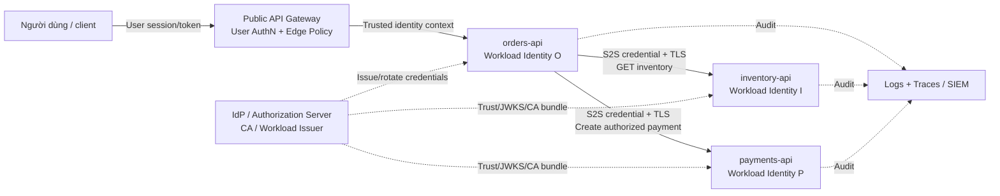
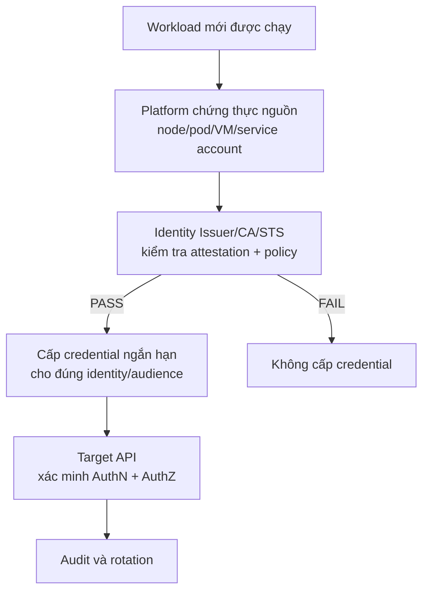
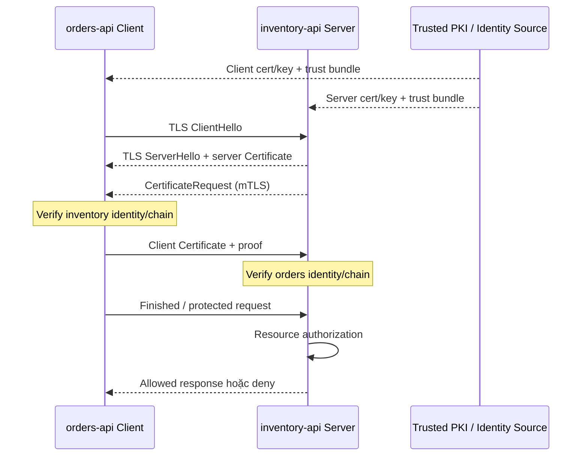
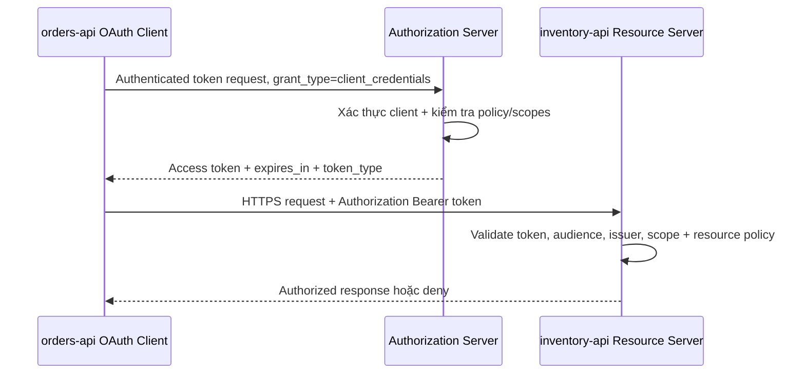
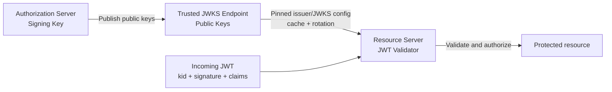
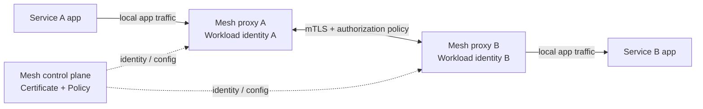
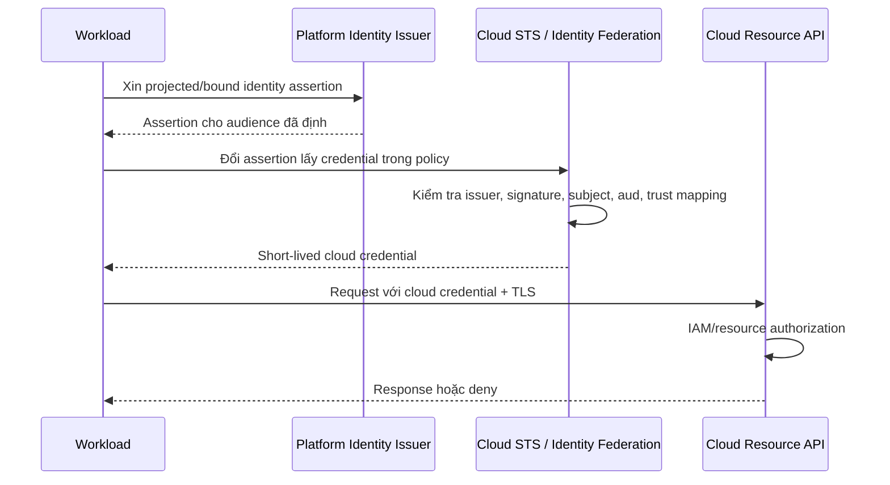
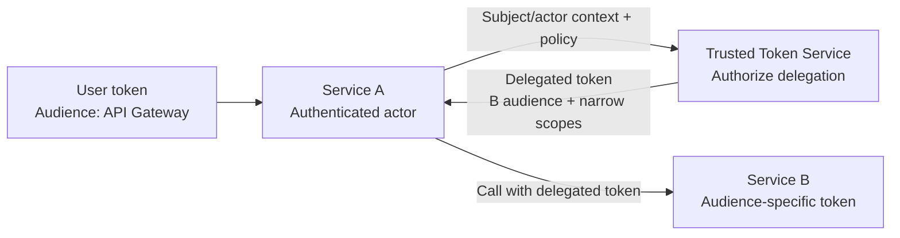
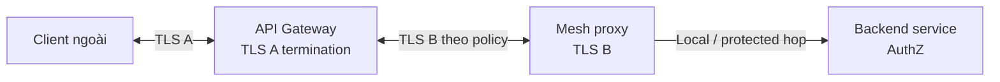
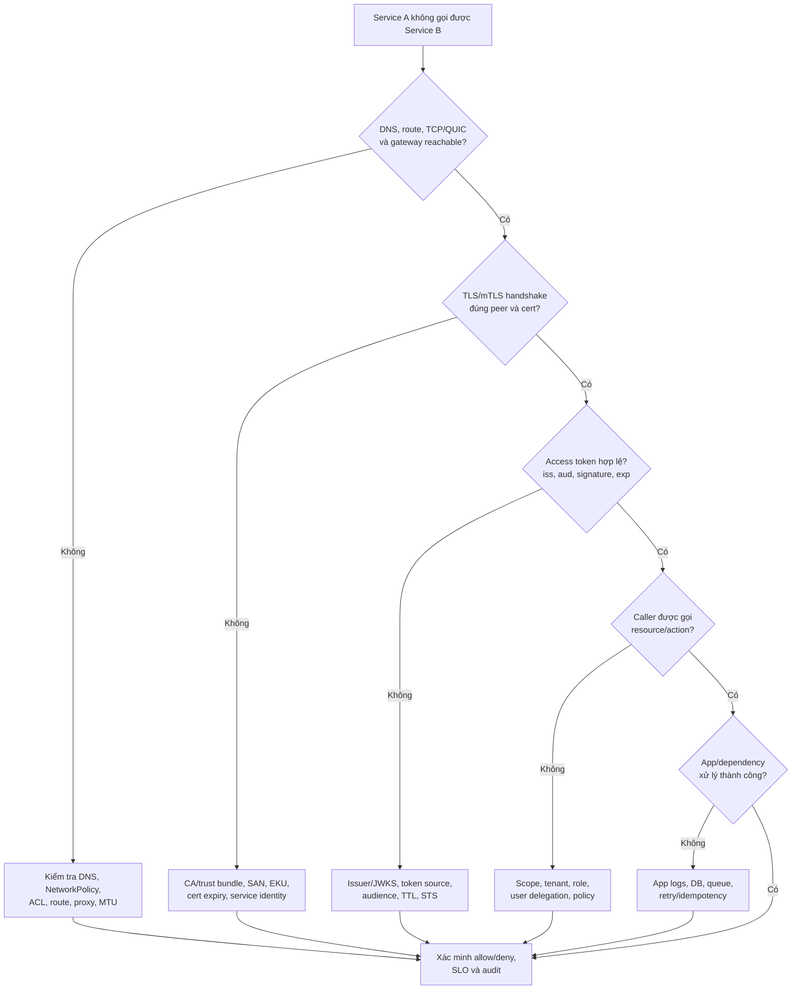

# Xác thực service-to-service trong bảo mật API và dịch vụ mạng

**Xác thực service-to-service (S2S authentication)** là quá trình một dịch vụ, workload, tác vụ tự động hoặc ứng dụng máy chủ **chứng minh danh tính của mình** khi kết nối tới dịch vụ khác. Khác với đăng nhập người dùng bằng mật khẩu/MFA, S2S thường hoạt động **không có người ngồi trước màn hình**: một API gọi API khác, job nền truy cập cơ sở dữ liệu qua gateway, microservice trao đổi thông điệp hoặc hệ thống on-prem kết nối dịch vụ cloud.

Trong mô-đun **SECURITY_NETWORK_SECURITY**, bảo mật kết nối không chỉ dựa vào địa chỉ IP, VLAN hoặc VPN. Các lớp **phân đoạn mạng, firewall, TLS/PKI, NAC, IDS/IPS, giám sát lưu lượng và hạ tầng cloud** giúp giới hạn đường đi và giảm rủi ro, nhưng khi hai ứng dụng thực sự trao đổi dữ liệu, chúng vẫn cần biết: **dịch vụ gọi là ai, có sở hữu thông tin xác thực hợp lệ không, và được phép thực hiện chính xác hành động nào**.

Ví dụ, một service xử lý đơn hàng có thể cần đọc tồn kho và tạo yêu cầu thanh toán. Nếu cả mạng nội bộ dùng chung một API key hoặc một token có quyền truy cập tất cả dịch vụ, kẻ tấn công chiếm được một workload có thể **di chuyển ngang**, gọi các API khác hoặc lấy dữ liệu vượt mục đích. Một thiết kế S2S tốt phải kết hợp **danh tính máy có thể kiểm chứng, kênh truyền được bảo vệ, quyền tối thiểu, vòng đời thông tin xác thực và khả năng truy vết**.

Bài học tập trung vào nguyên lý và vận hành phòng thủ: **mTLS, certificate workload, OAuth 2.0 client credentials, JWT/opaque access token, token exchange, workload identity federation, SPIFFE/SPIRE, Kubernetes service accounts, service mesh, API gateway, giám sát và kiểm thử**. Các cấu hình và định danh trong bài là minh họa độc lập nhà cung cấp; không dùng trực tiếp trên production khi chưa kiểm chứng sản phẩm và chính sách.

## 1. Mục tiêu học tập

Sau bài học, người học cần:

1. Phân biệt **xác thực người dùng**, **xác thực dịch vụ**, **xác thực thiết bị**, **phân quyền API** và **bảo vệ kênh truyền**.
2. Mô tả ranh giới tin cậy của một lời gọi **Service A → Service B → Service C** và dữ liệu định danh cần giữ ở mỗi chặng.
3. Giải thích các lựa chọn **mTLS, OAuth 2.0 client credentials, signed JWT assertions, API key, managed identity và SPIFFE/SVID**.
4. Thiết kế quy trình **cấp danh tính workload, bootstrap, phát hành credential, xoay vòng, thu hồi và offboarding**.
5. Kiểm tra đúng **certificate SAN/EKU/trust bundle** và **access token issuer, audience, signature, expiry, subject và scope**.
6. Nhận diện rủi ro **token replay, secret leakage, confused deputy, header spoofing, token forwarding, overly broad scopes và lateral movement**.
7. Hiểu tích hợp S2S với **Kubernetes, service mesh, cloud workload federation, API gateway, VPN và network segmentation**.
8. Xây dựng **policy least privilege**, quan sát luồng qua nhiều hop và phân biệt lỗi mạng/TLS/token/AuthZ.
9. Kiểm thử cả **kết nối được phép** lẫn **truy cập phải bị từ chối**, bao gồm rotation và failover.
10. Có runbook ứng phó khi token/khóa lộ, certificate hết hạn, identity provider lỗi hoặc quyền bị cấp sai.

## 2. Service-to-service authentication là gì?

Một hệ thống phân tán có thể có các thành phần:

- **Client service:** thành phần chủ động gửi yêu cầu.
- **Resource service/API:** thành phần nhận yêu cầu và cung cấp dữ liệu hoặc thực hiện hành động.
- **Identity/credential issuer:** CA, authorization server, workload identity provider hoặc hệ thống cấp khóa tin cậy.
- **Policy decision/enforcement:** API service, gateway, service mesh proxy hoặc IAM quyết định quyền.
- **Security telemetry:** log, trace, SIEM và kiểm kê danh tính.

Xác thực S2S trả lời câu hỏi **“Ai đang gọi?”** thông qua credential hoặc bằng chứng mật mã. Phân quyền trả lời **“Caller đó có được phép gọi API cụ thể này không?”**

| Khái niệm | Câu hỏi | Ví dụ |
| --- | --- | --- |
| **Workload identity** | Workload được tổ chức công nhận là ai? | orders-api trong namespace production |
| **Authentication (AuthN)** | Caller chứng minh danh tính bằng cách nào? | mTLS certificate hoặc OAuth client authentication |
| **Channel protection** | Dữ liệu trên đường truyền được bảo vệ? | TLS 1.3 hoặc IPsec theo kiến trúc |
| **Authorization (AuthZ)** | Caller có được gọi resource/action này? | orders-api được GET inventory nhưng không DELETE |
| **User delegation** | Dịch vụ gọi thay mặt người dùng nào, với quyền nào? | Frontend API gọi orders API theo phiên người dùng |
| **Audit** | Ai làm gì, ở đâu, lúc nào, theo policy nào? | Service identity, request ID, resource, outcome |

**Sai lầm nền tảng:** xem một API request xuất phát từ IP nội bộ hoặc chạy trên cùng cluster là đã xác thực. IP/namespace/VLAN chỉ là ngữ cảnh mạng; chúng có thể thay đổi theo NAT, autoscaling, proxy, pod restart hoặc bị lạm dụng khi một node bị chiếm quyền.

## 3. Kiến trúc mẫu: ba dịch vụ và một trust boundary

Giả sử ứng dụng gồm:

- **orders-api:** nhận yêu cầu đơn hàng.
- **inventory-api:** cung cấp trạng thái hàng tồn.
- **payments-api:** thực hiện giao dịch thanh toán.
- **Identity provider (IdP)/CA:** cấp danh tính hoặc thông tin xác thực máy.
- **Gateway/service mesh:** kiểm soát kết nối, route, mTLS và policy theo khả năng.



**Mỗi mũi tên là một ranh giới xác thực và phân quyền riêng.** Việc người dùng xác thực thành công ở public gateway **không tự chứng minh** orders-api được gọi bất kỳ endpoint nào ở inventory/payments. Ngược lại, mTLS hợp lệ giữa orders-api và payments-api **không chứng minh** khách hàng đã đồng ý trả khoản tiền đó.

### 3.1. Trust boundary ở đâu?

1. **Internet → API gateway:** xác thực người dùng/client ngoài và chống abuse.
2. **Gateway → orders-api:** chứng minh request thực sự đến từ gateway đáng tin; chuyển tiếp user context an toàn.
3. **orders-api → inventory-api:** xác thực danh tính orders-api và giới hạn quyền đọc tồn kho.
4. **orders-api → payments-api:** xác thực caller, kiểm tra quyền thao tác và ngữ cảnh nghiệp vụ.
5. **Workload → issuer:** đảm bảo chỉ workload phù hợp có thể xin credential cho danh tính của chính mình.

**Không mở quyền theo chuỗi:** “gateway đã xác thực user nên mọi downstream service đều tin mọi request”. Downstream phải đánh giá **caller identity, user delegation nếu có, resource và policy** của chính nó.

## 4. Danh tính máy khác danh tính người dùng

Một lời gọi S2S có thể mang **hai danh tính**:

- **Machine/service identity:** ứng dụng nào đang thực thi kết nối.
- **End-user identity:** người dùng cuối nào đã yêu cầu hành động, nếu đây là request thay mặt user.

Ví dụ: **orders-api** gọi **payments-api** để thanh toán cho đơn của **user-123**. payments-api cần biết:

- Caller là orders-api được triển khai hợp lệ.
- Orders-api được phép tạo yêu cầu thanh toán.
- Hành động có quan hệ với order thuộc user-123 và được nghiệp vụ cho phép.
- Dữ liệu về user-123 không phải chuỗi header tùy ý do client tự gửi.

### 4.1. Ba trường hợp khác nhau

| Luồng | Danh tính dùng để quyết định | Ví dụ |
| --- | --- | --- |
| **Machine-only** | Service identity và phạm vi app | Job nightly-sync → inventory-read API |
| **On-behalf-of user** | Service identity **và** user context được ủy quyền | Web/API → downstream user profile |
| **Administrative automation** | Workload identity đặc quyền, phê duyệt/policy riêng | Deployment-controller → infrastructure API |

Token theo **OAuth client credentials** thường mô tả quyền của **client application**, không tự đại diện cho một người dùng. Nếu thao tác phụ thuộc quyền người dùng, cần cơ chế **delegation hoặc token exchange** được thiết kế và xác minh riêng.

## 5. Các mô hình xác thực S2S thường gặp

| Mô hình | Bằng chứng nhận diện | Khi phù hợp | Giới hạn/rủi ro |
| --- | --- | --- | --- |
| **mTLS** | X.509 certificate + proof of private key | Nội bộ, service mesh, B2B | PKI/trust lifecycle, cert identity mapping |
| **OAuth 2.0 client credentials** | Client được xác thực tại authorization server và nhận access token | API-to-API, SaaS, cloud | Token bearer có thể bị đánh cắp; scope/audience phải đúng |
| **JWT client assertion/private_key_jwt** | Client dùng private key ký assertion để xác thực với issuer | Client confidential, không muốn shared secret dài hạn | Key registration, assertion validation, replay protection |
| **Managed workload identity/federation** | Assertion từ cloud/Kubernetes/workload platform được issuer tin | Cloud/hybrid, CI/CD, Kubernetes | Trust policy rộng hoặc sai audience/subject |
| **API key** | Chuỗi bí mật gắn với caller hoặc ứng dụng | Legacy/đơn giản, quota & identification | Dễ sao chép, shared keys, quyền thường quá rộng |
| **Static shared secret/HMAC request** | Shared key ký request hoặc challenge | Legacy/đặc thù có thiết kế nghiêm ngặt | Key distribution, canonicalization, replay, clock |
| **SPIFFE/SVID** | Danh tính chuẩn hóa workload với X.509-SVID/JWT-SVID | Hệ thống đa workload, mesh, platform identity | Cần attestation, trust bundle và AuthZ resource |
| **Network/IP allowlist** | Địa chỉ hoặc vị trí kết nối | Lớp bổ sung trong firewall | **Không đủ là AuthN của dịch vụ** |

Một hệ thống có thể kết hợp **mTLS + OAuth token + network policy**. Các lớp không thay thế nhau: mTLS giúp xác nhận kênh/peer; access token có thể mô tả **audience và quyền**; firewall/NAC hạn chế nơi kết nối xuất phát.

## 6. Nguyên tắc bảo mật: danh tính phải được cấp cho đúng workload

Rủi ro S2S bắt đầu từ bước đầu tiên: **ai được xin credential cho danh tính nào?**

Các định danh điển hình:

- **Service account name:** orders-api.
- **Namespace/environment:** production/orders.
- **Cluster/region:** prod-cluster-a.
- **Workload instance:** pod/VM/serverless task cụ thể.
- **Owner/team:** order-platform.
- **Trust domain:** domain tổ chức cấp danh tính có thể xác minh.

Một workload ở namespace **dev** không nên chỉ thay tên token request để nhận certificate hoặc token của **payments-prod**.

### 6.1. Chuỗi tin cậy khi bootstrap



**Bootstrap là trust anchor** của kiến trúc. Nếu kẻ tấn công có thể gắn service account có đặc quyền vào một workload tùy ý, thì chứng chỉ/token được cấp sau đó có thể vẫn hợp lệ về mật mã nhưng **sai quyền sở hữu**.

### 6.2. Điều kiện tối thiểu

- Workload identity gắn với một **asset/deployment/service account** đã được duyệt.
- Issuer dùng **attestation hoặc cơ chế xác minh platform** phù hợp, không nhận khai báo tùy ý từ client.
- Credential có **thời hạn, audience, namespace/tenant và quyền** vừa đủ.
- Key được lưu trong nơi phù hợp với vòng đời workload, ưu tiên không sao chép giữa workload.
- Có log issuance/rotation/revocation và owner chịu trách nhiệm.
- Khi workload bị retire, không còn cấp mới credential; những credential đang hoạt động được xử lý theo chính sách.

## 7. Mutual TLS (mTLS): hai phía xác thực bằng chứng chỉ

**TLS** giúp bảo vệ kết nối; TLS server-auth thông thường cho client xác minh **server certificate**. **Mutual TLS (mTLS)** bổ sung việc **server xác minh certificate của client**.

Trong một luồng nội bộ:

1. orders-api kết nối tới inventory-api bằng hostname/danh tính đích đã định.
2. orders-api kiểm tra **server certificate** của inventory-api: chain, SAN, thời hạn, mục đích và trust policy.
3. inventory-api yêu cầu và xác minh **client certificate** của orders-api theo chính sách mTLS.
4. Hai phía chứng minh quyền sử dụng private key phù hợp trong handshake.
5. Sau handshake, inventory-api ánh xạ **client identity** sang policy cho phép/từ chối API.
6. Request dữ liệu chạy trên kênh đã được bảo vệ và ghi log đúng danh tính.



Sơ đồ lược bớt key schedule, CertificateVerify, Finished của hai phía và chi tiết TLS 1.3. Trong thực tế có các phiên TLS khác nhau khi qua sidecar/gateway.

### 7.1. Có CA tin cậy chưa đủ

Một CA nội bộ có thể cấp hàng nghìn chứng chỉ cho các service. inventory-api không nên chỉ kiểm tra **“certificate được CA công ty ký”** rồi cho phép mọi API.

Cần đối chiếu:

- **Expected service identity** trong SAN, thường là DNS hoặc URI phù hợp.
- **Issuing CA/trust domain** được phép với loại danh tính đó.
- **EKU** như clientAuth/serverAuth khi hệ thống sử dụng và policy yêu cầu.
- **Key usage, validity và revocation/short-lived cert policy**.
- **Namespace/environment/tenant**, tránh dev dùng cert production.
- **Authorized action**: orders-api chỉ có thể GET một số route, không tự dùng quyền admin.

### 7.2. Client certificate khác user certificate

mTLS client cert có thể nhận diện **workload** chứ không phải người dùng cuối. Nếu client cert ghi orders-api, API không nên tự kết luận mọi request đều do một user nhất định yêu cầu. Cần user context được xác minh riêng nếu nghiệp vụ phụ thuộc user.

### 7.3. Chứng chỉ hết hạn và thay key

Các workload thường ngắn hạn, vì vậy mTLS cần **automatic issuance, renewal/rekey, trust bundle rotation và alert**. Một certificate bị lộ hoặc service đã ngừng hoạt động phải được xử lý theo vòng đời; không dựa vào việc certificate tự hết hạn vào ngày nào đó nếu mức rủi ro yêu cầu phản ứng nhanh.

## 8. OAuth 2.0 client credentials: ứng dụng xin access token

OAuth 2.0 **client credentials grant** cho một client phù hợp nhận access token để truy cập tài nguyên mà chính nó được quyền truy cập. Đây là mô hình S2S phổ biến cho **confidential clients**.

Luồng cơ bản:



**Authorization server** phải xác thực client. Việc chỉ đưa **client_id** trong request không phải bằng chứng danh tính; cách xác thực có thể dùng **client secret, mTLS client authentication hoặc signed client assertion** theo khả năng sản phẩm.

### 8.1. Một token request minh họa

```http
POST /oauth2/token HTTP/1.1
Host: auth.corp.example.net
Content-Type: application/x-www-form-urlencoded
Authorization: Basic <REDACTED-CLIENT-AUTHENTICATION>

grant_type=client_credentials&scope=inventory.read
```

Đây là **minh họa cấu trúc giao thức**, không phải request cần gửi thật. Trong ví dụ, client authentication đã được cấu hình với authorization server và mọi kết nối phải qua **TLS được xác minh danh tính**. Không đưa client secret vào URL, log, source code hoặc tài liệu công khai.

### 8.2. Access token trả về

```json
{
  "access_token": "<REDACTED-ACCESS-TOKEN>",
  "token_type": "Bearer",
  "expires_in": 900,
  "scope": "inventory.read"
}
```

Token response thực tế tùy issuer. Ví dụ dùng **expires_in = 900 giây** chỉ để minh họa; không phải thời hạn chuẩn bắt buộc.

### 8.3. Access token không phải lúc nào cũng là JWT

Một **access token** có thể:

- Là **opaque token**: API/resource server tra cứu trạng thái qua cơ chế được hỗ trợ, ví dụ introspection.
- Là **self-contained token** có chữ ký, thường dùng định dạng JWT/JWS.
- Có format riêng theo issuer/resource server.

**Không cố decode mọi token như JWT**. API phải biết issuer và validation profile mà nó hỗ trợ. Nếu issuer cấp opaque token, việc nhìn chuỗi không đọc được không phải dấu hiệu token sai.

### 8.4. Grant machine-only khác user delegation

Client credentials thường đại diện **ứng dụng/workload**. Nếu orders-api gọi inventory-api thay mặt user có quyền giới hạn, dùng machine token rộng rồi dựa trên một header user tự khai báo có thể dẫn đến **confused deputy**. Cần xem mô hình user delegation/token exchange ở phần sau.

## 9. Access token validation: chữ ký đúng chưa đủ

Khi API nhận một access token dạng JWT đã ký, cần **xác minh toàn bộ security context** chứ không chỉ giải mã payload hoặc kiểm tra có chữ ký.

Một tập claim minh họa:

```json
{
  "iss": "https://auth.corp.example.net/",
  "sub": "service-account:orders-api",
  "aud": "https://inventory.corp.example.net/",
  "exp": 1790000900,
  "nbf": 1790000000,
  "iat": 1790000000,
  "jti": "example-session-token-id",
  "scope": "inventory.read",
  "client_id": "orders-api"
}
```

Các giá trị là **dữ liệu mẫu**, không có chữ ký thật. Một JWT payload đọc được bằng Base64URL **không có nghĩa token được xác thực**. Những tên claim ngoài các registered claims có thể khác theo profile của issuer.

### 9.1. Kiểm tra ở resource server

| Kiểm tra | Phải xác minh | Lỗi nếu bỏ qua |
| --- | --- | --- |
| **Signature/MAC** | Dùng đúng khóa/thuật toán đã pin trong policy | Ai cũng tự tạo payload được |
| **Allowed algorithm** | Chỉ chấp nhận thuật toán phù hợp profile, không lấy tùy ý từ token | Algorithm confusion/accept invalid tokens |
| **Issuer (iss)** | Issuer đúng trong trust configuration | Token từ tenant/IdP khác được chấp nhận |
| **Audience (aud)** | Token được cấp **cho API này** | Token cho service A dùng lại ở service B |
| **Expiration (exp)** | Token chưa hết hạn theo policy | Token cũ tồn tại vô hạn |
| **Not before (nbf)/issued at (iat)** | Token có hiệu lực đúng thời điểm; chấp nhận clock skew có giới hạn | Token được dùng sai thời điểm |
| **Subject/client identity** | Đúng machine identity theo profile | Caller không tương ứng tài sản được duyệt |
| **Scope/roles/permissions** | Có quyền với route/action/resource | Token hợp lệ nhưng thao tác vượt quyền |
| **Tenant/environment** | Không lẫn prod/dev, customer/tenant | Truy cập chéo miền tin cậy |
| **Token type/profile** | Đây đúng loại access token resource server nhận | Nhầm ID token thành access token |
| **Replay policy** | Khi cần, kiểm soát jti/nonce/sender constraint | Token bị sao chép và dùng lại |
| **Key lifecycle** | Key còn được trust theo issuer/JWKS policy | Khóa đã thu hồi vẫn được nhận quá lâu |

**Kiểm tra chữ ký không thay thế kiểm tra audience và authorization.** Một access token hợp lệ cho **payments-api** không có nghĩa inventory-api được phép chấp nhận nó.

### 9.2. Header JWT là dữ liệu đầu vào không đáng tin

Khi dùng JWT/JWS, header có thể chứa **alg, kid, typ** và những trường khác. Chúng là dữ liệu nhận từ bên ngoài, phải được so sánh với policy.

Đặc biệt:

- Không chấp nhận **alg=none** hoặc algorithm không được cho phép với profile yêu cầu chữ ký.
- Không dùng **kid** làm đường dẫn file, SQL fragment hoặc URL tùy ý.
- Không tự tải khóa từ một **jku/x5u URL bất kỳ** do token đưa vào nếu không có trust policy đóng.
- Phân biệt key dùng cho **HS256** với public key dùng cho **RS256/ES256**, tránh algorithm/key confusion.
- Nếu thư viện hỗ trợ nhiều token profiles, **pin token type/issuer/audience** cho endpoint cụ thể.

Một parser có thể đọc JSON thành công nhưng **chưa thực hiện phép xác minh mật mã**; không gọi decode là verify.

## 10. JWKS, key rotation và độ tin cậy của issuer

Một authorization server phát JWT thường công bố public signing keys qua **JWKS (JSON Web Key Set)** ở endpoint được cấu hình. Resource server lấy/cached keys từ **issuer đáng tin** để xác minh chữ ký.



Các giới hạn quan trọng:

1. **JWKS URL phải đến từ cấu hình/issuer metadata đáng tin**, không lấy trực tiếp theo yêu cầu client.
2. Lấy JWKS qua **TLS và certificate validation** phù hợp.
3. Cache có **TTL và hành vi khi fetch lỗi** rõ ràng.
4. Khi key đổi, hệ thống cần khoảng **overlap** để token ký bằng khóa cũ còn hợp lệ không gây outage bất ngờ, nhưng vẫn có phương án emergency revoke.
5. Nếu key bị compromise, chỉ thêm key mới mà vẫn tin vô hạn key cũ **không đủ**.
6. Không log toàn bộ token để debug key mismatch; log issuer, key ID đã được sanitize và lỗi phù hợp.

### 10.1. Opaque tokens và introspection

Nếu access token là opaque, resource server có thể dùng **introspection** theo khả năng issuer để kiểm tra trạng thái/token metadata. Điều này thêm phụ thuộc mạng và latency tới authorization server hoặc cache.

Chính sách cần xác định: **có cache introspection không, cache bao lâu, token bị thu hồi có hiệu lực từ khi nào, điều gì xảy ra nếu introspection endpoint unavailable**. Không có quy tắc chung “opaque token luôn bị thu hồi ngay lập tức”; thực thi phụ thuộc cache và hệ thống.

## 11. Sender-constrained tokens: giảm rủi ro bearer bị lấy cắp

**Bearer token** có đặc tính: ai cầm được token có thể sử dụng nó **trong phạm vi, thời hạn và điều kiện mà resource server chấp nhận**. TLS bảo vệ đường truyền nhưng token vẫn có thể bị lộ qua log, memory dump, debug endpoint hoặc một workload bị chiếm quyền.

Có các cách giảm rủi ro:

- **Mục tiêu quyền và thời hạn ngắn**, audience giới hạn.
- Bảo vệ token khi lưu, trong memory, transport và log.
- **Sender-constrained access tokens** khi issuer/resource server hỗ trợ, ví dụ liên kết token với chứng chỉ mTLS hoặc cơ chế chứng minh sở hữu khóa phù hợp.
- Phân quyền theo service identity, resource và action; không chỉ kiểm tra token còn hiệu lực.

### 11.1. mTLS certificate-bound access token

Một số profile OAuth cho phép access token được ràng buộc với **chứng chỉ client mTLS**. Resource server cần xác minh **cả token lẫn chứng chỉ client** và phép liên kết phù hợp (ví dụ metadata cnf theo profile).

Nếu chỉ nhìn claim “token có ràng buộc” nhưng không kiểm tra kênh TLS và certificate thực tế, khả năng chống token theft **không được thực thi**.

### 11.2. DPoP và proof-of-possession khác

**DPoP** là một cơ chế chứng minh sở hữu khóa ở cấp yêu cầu HTTP trong những triển khai OAuth hỗ trợ; nó có các điều kiện về signature, method/URL binding, thời gian và chống replay theo profile.

DPoP **không tự thay thế mTLS**, và không phải dịch vụ nào cũng hỗ trợ. Dù dùng mTLS-bound token hay DPoP, vẫn phải xác minh **issuer, audience, scope, token expiry và resource authorization**.

### 11.3. Replay và clock skew

Để chống replay trong các giao thức/request yêu cầu tính duy nhất, có thể cần **nonce, jti, timestamp, idempotency key và replay cache** được thiết kế theo ngữ cảnh. Việc thêm jti claim **không tự chặn replay** nếu resource server không theo dõi/trói nó trong một cửa sổ phù hợp.

Clock skew nên được giới hạn; nới quá rộng giúp token hết hạn hoặc chưa hợp lệ tiếp tục được nhận lâu hơn mong muốn.

## 12. Signed client assertion và private_key_jwt

Thay vì gửi một client secret dài hạn tới token endpoint, client có thể chứng minh quyền sở hữu private key thông qua **signed client assertion** khi authorization server hỗ trợ.

Ý tưởng:

1. Client được đăng ký với **public key/certificate** đáng tin ở authorization server.
2. Khi xin token, client tạo assertion ký bằng private key của mình.
3. Authorization server xác minh signature, client identity, intended audience và thời gian/unique ID theo profile.
4. Nếu hợp lệ và policy cho phép, server cấp access token cho resource đã yêu cầu.

Ưu điểm: giảm nhu cầu chia sẻ một secret tĩnh tới nhiều nơi, hỗ trợ rotation nếu được quản lý đúng.

Giới hạn:

- Private key vẫn phải được bảo vệ.
- Assertion phải có **audience đúng token endpoint**, thời gian sống hợp lý, chống replay và client binding.
- Không dùng **JWT assertion tự ký** làm access token trực tiếp trừ khi resource server/issuer đã thỏa thuận profile xác minh thích hợp.
- Key registration/JWKS cũng là ranh giới tin cậy quan trọng.

**Client authentication tại token endpoint** và **access-token validation tại resource server** là hai bước khác nhau, có thể dùng hai key sets/identities khác nhau.

## 13. API keys và shared secrets: khi nào vẫn gặp?

Một số API nội bộ hoặc bên thứ ba sử dụng **API key** làm credential. Key có thể dễ triển khai nhưng thường có các nhược điểm:

- Nếu một key dùng chung giữa nhiều service, khó xác định workload nào đã gọi.
- Nếu key không có expiry/rotation, thiệt hại khi lộ có thể kéo dài.
- Nếu key được gắn vào URL query string, nó có thể lọt vào browser history, logs hoặc referrer.
- Nếu quyền quá rộng, một endpoint bị chiếm có thể gọi mọi API.
- Không cung cấp proof-of-possession của private key như certificate-based identity.

### 13.1. Khi buộc phải sử dụng

- Mỗi **client/workload có key riêng**, owner rõ.
- Chỉ cấp **quyền tối thiểu và quota** phù hợp.
- Truyền qua TLS; không log trực tiếp key.
- Lưu trong **secret manager/keystore** hoặc hệ quản trị secret thích hợp, không hard-code vào repo/image.
- Có **rotation và revoke** độc lập cho từng client.
- Đặt **network restrictions** khi có ý nghĩa, nhưng không xem IP allowlist là thay thế credential.
- Xác định status khi thiếu key, key hết hạn, key bị thu hồi và alert sử dụng bất thường.

Nếu cơ chế sử dụng **HMAC ký request**, phải xác định rõ canonical request format, timestamp, nonce, key ID và chống replay. Không tự phát minh một scheme với chuỗi nối tùy ý hoặc chấp nhận chữ ký mà không gắn với method/path/body/authority phù hợp.

## 14. SPIFFE/SPIRE: một mô hình chuẩn hóa danh tính workload

**SPIFFE (Secure Production Identity Framework For Everyone)** định nghĩa mô hình danh tính workload với dạng URI như:

```text
spiffe://corp.example/ns/orders/sa/orders-api
spiffe://corp.example/ns/inventory/sa/inventory-api
```

Đây là ví dụ **SPIFFE ID**, không phải DNS hostname đòi hỏi phải phân giải. Trust domain trong URI thể hiện miền tin cậy của hệ cấp danh tính, không tự cấp quyền.

**SPIRE** là một triển khai hệ thống cấp và xác thực danh tính workload theo SPIFFE, có thể cung cấp:

- **Node attestation:** xác minh node/agent theo policy.
- **Workload attestation:** xác định workload đang chạy thuộc danh tính nào.
- **X.509-SVID/JWT-SVID:** tài liệu định danh và bằng chứng có thể sử dụng cho mTLS hoặc cơ chế yêu cầu hỗ trợ.
- **Trust bundles:** thông tin gốc tin cậy để các workload xác minh peer.
- **Workload API:** cách các workload được phép nhận credential/trust material.

### 14.1. Danh tính SPIFFE không tự là quyền truy cập

Nếu service A có SPIFFE ID hợp lệ, B vẫn phải có policy:

- A được gọi endpoint nào?
- A thuộc trust domain/namespace nào?
- Request tới tenant/resource nào?
- Có cần quyền đặc biệt hay user delegation không?

**Attestation sai → chứng chỉ ký đúng cho sai workload.** Vì vậy phải bảo vệ selectors, service accounts, node identity, trust bundle và quyền đăng ký SPIFFE ID.

### 14.2. Federation giữa các trust domains

Khi hai cluster/đối tác có trust domain riêng, federation không có nghĩa **tin mọi identity của bên kia**. Cần xác định bundle, peer scope, identity patterns, authorization và cách thu hồi trust nếu quan hệ kết thúc.

## 15. Service mesh: tự động mTLS nhưng cần hiểu điểm thực thi

Service mesh có thể hỗ trợ mTLS giữa workloads thông qua **sidecar proxies, node-level proxies hoặc kiến trúc ambient** tùy sản phẩm. Workload đôi khi không trực tiếp thao tác certificate hay mTLS handshake.



### 15.1. Rủi ro cần kiểm tra

- Traffic có **bypass proxy/mesh** qua port, hostNetwork, node, path hoặc service discovery khác không?
- **mTLS mode** có bắt buộc ở mọi namespace/port cần bảo vệ hay chỉ “permissive”?
- Service identity được ánh xạ từ workload/namespace/service account **có đúng** không?
- Nếu mesh xác thực client ở proxy, backend app nhận identity qua **kênh đáng tin** nào?
- Khi proxy chết hoặc control plane mất liên lạc, dữ liệu có **fail-open** ngoài policy không?
- Trust bundle/cert rotation có được giám sát và rollback không?
- AuthZ ở ứng dụng có còn thực thi **resource-level checks** không?

### 15.2. Mesh mTLS khác với end-to-end app authentication

Mesh có thể bảo vệ proxy-to-proxy, nhưng application có thể thấy một connection **plaintext local** hoặc header từ proxy. Nếu local hop bị cấu hình cho phép bypass hoặc ứng dụng tin user identity header từ mọi nguồn, bảo mật đầu-cuối bị suy yếu.

Phải định nghĩa cụ thể **mTLS kết thúc ở đâu, ai có thể gắn identity, backend xác minh identity thế nào**, thay vì chỉ ghi “mesh mTLS enabled”.

## 16. Kubernetes ServiceAccount và projected tokens

Trong Kubernetes, workload có thể được gán **ServiceAccount**. Tùy cấu hình, pod có thể nhận **bound/projected service account token** với audience và lifetime phù hợp; token này phản ánh danh tính Kubernetes cho mục đích được cấp quyền.

Điểm cốt lõi:

- **ServiceAccount** là danh tính workload trong cluster, **không phải chứng nhận người dùng thật**.
- Token phục vụ **Kubernetes API** hoặc service khác chỉ nên dùng theo **audience cụ thể** và trust policy tương ứng.
- Không tự gửi Kubernetes token cho mọi SaaS/API mà không có **federation/trust integration** được thiết kế.
- Với workload cần nhiều audience, quản lý từng token/credential theo phạm vi.
- ServiceAccount và Kubernetes RBAC phải giới hạn quyền; account mặc định không nên có quyền rộng.

### 16.1. Mẫu deployment intent

```yaml
# Mô hình ý định, KHÔNG phải manifest Kubernetes áp trực tiếp.
workload:
  cluster: prod-cluster
  namespace: orders
  service_account: orders-api
identity:
  token_source: projected-service-account-token
  expected_audience: sts.corp.example.net
  lifetime: short-lived
  federated_issuer: "https://issuer.prod-cluster.example.net/"
permissions:
  allowed_cloud_role: inventory-reader
  deny_direct_admin_roles: true
controls:
  automount_unused_tokens: false
  restrict_secret_reads: true
  use_network_policy: true
  log_token_issuance_without_token_body: true
```

Các field là mô tả chính sách, không phải cấu trúc Kubernetes YAML hợp lệ. Với manifest thật, cần kiểm tra **serviceAccountName, projected volume/TokenRequest, audience, expirationSeconds, RBAC, admission controls** theo phiên bản Kubernetes và nền tảng.

### 16.2. Các lỗi thường gặp

- Một service account dùng chung cho **nhiều dịch vụ khác quyền**.
- Workload có quyền sửa deployment/pod và gán **service account đặc quyền**.
- Token không giới hạn audience hoặc quá dài hạn so với nhu cầu.
- Mounted token bị log hoặc gửi tới một endpoint không đáng tin.
- Container image/CI/CD lưu Kubernetes token từ build time.
- Workload có thể đọc secrets của namespace khác do RBAC quá rộng.
- Issuer tin cả cluster/namespace mà không ràng buộc **subject/service account** cụ thể.

## 17. Cloud workload identity federation và STS

Cloud cung cấp các cơ chế như **managed identity, instance/service identity, workload identity federation và Security Token Service (STS)**. Mục tiêu chung là để workload **nhận credential ngắn hạn bằng danh tính platform**, giảm nhu cầu đặt lâu dài một access key trong file.

Một luồng liên kết từ cluster đến cloud:



### 17.1. Trust policy ở federation quan trọng nhất

Một cloud role có đặc quyền không nên được gắn với điều kiện “bất kỳ token nào từ cluster X”. Cần ràng buộc tới **issuer + audience + subject/service account + namespace + environment/tenant**, và thêm điều kiện khi sản phẩm cho phép.

Rủi ro thường xuất phát từ **trust policy quá rộng**, chứ không nhất thiết do token có chữ ký sai.

### 17.2. Cloud metadata service không phải bí mật được phát miễn phí

Một số VM có thể lấy credential qua **instance metadata service**. Workload bị SSRF hoặc code execution có thể tìm cách sử dụng khả năng truy cập metadata mà VM được cấp.

Phòng vệ:

- IAM role theo least privilege; tách workloads theo trust domain.
- Sử dụng cơ chế bảo vệ metadata của nền tảng, hop/TTL/endpoint restrictions khi hỗ trợ.
- Đặt egress/network controls phù hợp; không cho proxy công cộng trở thành đường tới metadata.
- Không copy credential từ metadata vào logs hoặc artifacts.
- Giám sát credential usage từ vị trí/caller bất thường.

## 18. Token exchange và gọi downstream thay mặt người dùng

Trong ứng dụng có người dùng, một lời gọi **Gateway → Service A → Service B** dễ gặp câu hỏi: **Service B nên tin token nào?**

Hai lựa chọn thiếu an toàn:

1. Chuyển tiếp nguyên **user token** được cấp cho public gateway sang mọi backend, dù backend không thuộc audience.
2. Dùng một **machine token admin** để gọi mọi backend và nhận user ID qua header không xác minh.

### 18.1. Mô hình delegation đúng mục đích

Khi cần, một issuer/token service có thể hỗ trợ **token exchange** để Service A xin token dành cho Service B với quyền được phép, mang thông tin cần thiết về **actor/delegation** theo profile.



Không phải mọi hệ thống đều cần token exchange. Một luồng machine-only có thể dùng S2S token riêng và truyền context nghiệp vụ được xác minh tại ứng dụng. Quan trọng là **tách người dùng, service caller và quyền được ủy quyền**, không đánh tráo các danh tính.

### 18.2. Confused deputy

**Confused deputy** là tình huống một thành phần có quyền cao bị bên ít quyền hơn khiến nó thực hiện hành động ngoài phạm vi được phép.

Ví dụ: orders-api có quyền tạo yêu cầu thanh toán, nhưng nếu bất kỳ caller nào cũng cung cấp **arbitrary user_id và amount** rồi service dùng quyền riêng để gọi payments-api, service có thể bị lợi dụng làm thay.

Biện pháp:

- Kiểm tra **user/session và ownership** của đơn hàng.
- Ràng buộc quyền gọi payment vào **order state**, hạn mức, policy và hành động người dùng thực.
- Dùng **audience/scope** hẹp, không forward token tùy tiện.
- Audit cả **service actor** và **user/context** đã được xác minh.
- Chống replay ở các thao tác có side effects bằng **idempotency/transaction safeguards**.

## 19. Least privilege ở từng resource và action

**Xác thực thành công** chỉ nên là điều kiện đầu tiên. Một resource service phải xác định:

- Caller thuộc service identity nào?
- Environment/trust domain nào?
- Endpoint/method nào đang được gọi?
- Resource ID/tenant/owner nào?
- Có user delegation hoặc business approval phù hợp không?
- Lời gọi có vượt quota, giới hạn giờ, transaction state hoặc permission không?

### 19.1. Ma trận quyền minh họa

| Caller identity | Resource API | Method/action | Quyết định |
| --- | --- | --- | --- |
| **orders-api/prod** | inventory-api | GET /stock/{sku} | Allow có kiểm soát |
| **orders-api/prod** | inventory-api | DELETE /stock/{sku} | Deny |
| **orders-api/dev** | inventory-api/prod | GET /stock/{sku} | Deny |
| **billing-worker/prod** | payments-api | POST /settlements | Allow theo role và nghiệp vụ |
| **analytics-api/prod** | payments-api | POST /settlements | Deny |
| **unknown workload** | Tất cả API nhạy cảm | Bất kỳ | Deny |
| **orders-api/prod** | payments-api | POST /charge | Chỉ khi request đã được xác minh và ủy quyền nghiệp vụ |

Một chính sách tốt **không dùng wildcard quyền rộng** chỉ vì các service cùng team hoặc cùng namespace. Dùng role/resource-specific scopes và tests cho các endpoint quan trọng.

### 19.2. Authorization không chỉ dựa vào scope string

Một token có **payments.write** chưa đủ để tạo mọi khoản thanh toán. Resource server vẫn phải kiểm tra **amount, tenant, account ownership, order state, idempotency và hạn mức** theo nghiệp vụ. Đây là sự khác nhau giữa **coarse-grained policy ở gateway** và **fine-grained authorization ở ứng dụng**.

## 20. API gateway và reverse proxy: tin identity ở đâu?

Trong kiến trúc phổ biến, **API gateway** kết thúc TLS công khai, xác minh access token rồi chuyển request tới backend. Có thể backend chỉ thấy IP của gateway và một số headers đã được thêm.

Rủi ro: backend tin các header như **X-User-Id, X-Client-Id, X-Authenticated-Service** được gửi từ bất kỳ nguồn nào. Một client hoặc workload có đường truy cập backend trực tiếp có thể **giả mạo header**.

### 20.1. Ranh giới tin cậy cho identity propagation

1. **Chặn direct ingress tới backend** khi thiết kế yêu cầu mọi request đi qua gateway.
2. Gateway **loại bỏ/ghi đè** mọi identity headers do client không đáng tin gửi.
3. Kênh gateway–backend phải được **xác thực**, thường qua mTLS hoặc network + service identity có kiểm soát.
4. Backend chỉ tin metadata từ **trusted gateway identity** và nên có cơ chế xác thực/kiểm tra riêng khi cần.
5. Với user context nhạy cảm, dùng **signed token/assertion có audience đúng** hoặc phương án có kiểm tra integrity, không chỉ plaintext header.
6. Phân biệt **authenticated service** là gateway với **end-user** được gateway xác thực; không gộp hai trường thành một.

### 20.2. TLS termination tạo ra các kênh khác nhau



Nếu TLS kết thúc ở gateway/mesh proxy, **application có thể không tự thấy client certificate gốc**. Cần biết identity được truyền theo cách nào và đâu là nguồn mà application tin cậy. Không giả định “đã bật mTLS ở ingress” đồng nghĩa application nhận được danh tính user hoặc caller service chính xác.

## 21. Phân đoạn mạng và Zero Trust: lớp bổ trợ, không phải lựa chọn thay thế

**Zero Trust** thúc đẩy việc xác minh danh tính và quyền ở mỗi yêu cầu/ngữ cảnh, không coi kết nối từ “mạng trong” là đáng tin tuyệt đối.

Mạng vẫn cần:

- **Firewall/network policy:** chỉ cho luồng giữa các service cần thiết.
- **Namespace/tenant/VRF segmentation:** tách ranh giới bảo mật.
- **Egress restrictions:** tránh workload gọi ra Internet hoặc metadata không theo policy.
- **mTLS/TLS:** bảo vệ kênh và nhận diện peer.
- **Access token/identity:** biểu đạt quyền phù hợp với target API.
- **Application authorization:** đánh giá object/tenant/action.
- **Observability:** phát hiện hành vi bất thường, từ chối sai và credential abuse.

### 21.1. Không mở toàn mạng chỉ vì có mTLS

Nếu một cluster cho mọi pod truy cập TCP tới mọi service, một workload bị chiếm có thể tạo lượng lớn connection attempts hoặc đánh vào API chưa bảo vệ đúng. mTLS hạn chế peer chưa có credential, nhưng không ngăn toàn bộ **DoS, misconfiguration hoặc API flaws**.

Một kiến trúc tốt dùng **network policy deny-by-default + explicit service allowlist + workload identity + service-specific AuthZ**. Mỗi lớp có thể độc lập hạn chế một kiểu lỗi.

## 22. Vòng đời key, certificate và token

Credential S2S có thể gồm certificate private key, OAuth client secret, signing key, projected token, access token hoặc API key. Chúng không có cùng lifecycle.

| Credential | Nơi lưu/xử lý | Cần quản lý |
| --- | --- | --- |
| **mTLS private key** | Workload keystore/TPM/HSM/mesh agent | Ownership, rotation, revocation, access |
| **X.509 certificate** | Workload/proxy | SAN/EKU, trust bundle, NotAfter, chain |
| **OAuth client secret** | Secret manager | Scope, expiry, rotation, leak response |
| **JWT signing private key** | Authorization server/HSM | Key IDs, JWKS publication, emergency revoke |
| **Access token** | Client memory/cache | Audience, TTL, secrecy, retry/revocation |
| **Kubernetes projected token** | Pod-bound volume/runtime | Audience, lifetime, workload permissions |
| **Cloud temporary credential** | Runtime credential provider | Role policy, expiry, refresh, usage monitoring |
| **SPIFFE SVID** | Workload API/agent | Attestation, trust bundle, short-lived renewal |

### 22.1. Rotation phải tránh outage và tránh dùng key cũ vô hạn

Một quy trình thường có:

1. Phát hành **credential mới** cho đúng identity.
2. Cập nhật issuer, trust bundle/JWKS và các relying parties trong phạm vi cần thiết.
3. Thử trên một workload/canary.
4. Rollout theo nhóm, đo tỷ lệ AuthN/AuthZ thành công và độ trễ.
5. Gỡ bỏ key/certificate cũ theo kế hoạch overlap.
6. Xác minh **old credential không còn được chấp nhận** sau thời điểm đã duyệt.
7. Lưu bằng chứng audit và phương án khôi phục.

Nếu private key **đã bị compromise**, kế hoạch cần rút ngắn hoặc bỏ overlap tùy rủi ro. Chỉ cấp key mới mà tiếp tục tin key cũ vô thời hạn không phải xử lý sự cố.

### 22.2. Khác nhau giữa token expiration và immediate revoke

JWT có chữ ký có thể được API xác minh offline đến khi hết hạn; thu hồi account/secret tại IdP **không luôn làm token đã phát hành mất hiệu lực ngay**. Có thể cần:

- Token TTL ngắn.
- Denylist/revocation mechanism hoặc introspection theo policy.
- Key rotation trong tình huống compromise ở mức issuer.
- Chặn service identity qua policy ở gateway/mesh/backend.
- Terminate active sessions/connections khi phù hợp.

Mọi lựa chọn phải cân bằng **khả dụng, độ trễ và yêu cầu khẩn cấp**.

## 23. Secret management và CI/CD

Những vị trí thường gây rò thông tin S2S:

- Source code repository hoặc file cấu hình được commit.
- Docker image layer hoặc build artifacts.
- CI/CD environment logs, diagnostic dumps, job outputs.
- Kubernetes Secrets có quyền đọc quá rộng hoặc không có kiểm soát.
- URL query string/headers được log nguyên vẹn.
- Crash dumps, tracing baggage, monitoring metadata.
- Shared credential giữa staging và production.
- Người vận hành sao chép token vào ticket, chat hoặc dashboard.

### 23.1. Quy tắc vận hành

1. Ưu tiên **workload identity/temporary credential** thay cho secret tĩnh khi nền tảng hỗ trợ.
2. Nếu cần secret, lưu trong **secret manager**; hạn chế read permissions.
3. Tách **development/test/production** và từng service identity.
4. Không dùng **build-time credential** như runtime credential.
5. Có secret scanning trong pipeline, nhưng không xem scanning là biện pháp duy nhất.
6. Khi nghi rò: **revoke/rotate + xác minh sử dụng + điều tra log**, không chỉ xóa secret khỏi commit cuối.
7. Duy trì inventory credential, owner, purpose và cơ chế rotation.

### 23.2. Quyền thực thi của pipeline

CI/CD có thể cần quyền triển khai nhưng không nên tự động có quyền **đọc database production, cấp certificate cho mọi identity hoặc quản trị IAM toàn cloud**. Dùng federation để CI lấy credential ngắn hạn được ràng buộc **repo/branch/environment/workflow** khi nền tảng hỗ trợ; policy phải kiểm tra chính xác những điều kiện này.

## 24. Async messaging: service-to-service không chỉ là HTTP

S2S authentication cũng xảy ra khi service dùng **message broker, event bus, queue, Kafka hoặc RPC**.

Ví dụ:

- Producer **orders-api** ghi event tạo đơn.
- Consumer **fulfillment-worker** đọc event và xử lý.
- Broker xác thực producer/consumer qua mTLS, SASL hoặc cơ chế được hỗ trợ.
- Broker áp authorization theo **topic/queue/action**.
- Event có thể chứa user context/tenant và cần kiểm tra integrity/nguồn phát tùy trust boundary.

### 24.1. Hai lớp danh tính

1. **Connection identity:** producer/consumer nào được phép publish/subscribe.
2. **Message/business identity:** event do hành động nghiệp vụ nào tạo, nguồn và schema có hợp lệ không.

Nếu broker cho phép orders-api publish vào topic payments-admin, việc một kết nối mTLS hợp lệ **không làm hành động đó đúng**. Broker ACL và ứng dụng consumer phải kiểm soát role/resource.

### 24.2. Replay, retries và idempotency của message

Broker có thể giao lại cùng event khi consumer restart hoặc ack bị mất. Đây không nhất thiết là cuộc tấn công replay; hệ thống cần thiết kế **at-least-once/ordering/idempotency** phù hợp.

Với event nhạy cảm:

- Định nghĩa **event ID, producer identity, timestamp, tenant/resource**.
- Không tin tuyệt đối user ID do producer không đáng tin tự khai.
- Dùng quyền tối thiểu theo topic và consumer group.
- Chống thực thi nghiệp vụ trùng lặp, có audit đầy đủ.
- Giới hạn secrets trong message payload và event logs.

## 25. Pseudopolicy S2S an toàn

Dưới đây là một mẫu **intent model** cho inventory-api. Nó không phải file cấu hình của Envoy, Istio, Spring Security, Kubernetes, Keycloak hoặc nhà cung cấp cloud cụ thể.

```yaml
policy_id: INVENTORY-S2S-PROD
resource_service: inventory-api
environment: production
transport:
  require_tls: true
  require_authenticated_peer: true
identity:
  trusted_issuers:
    - "https://auth.corp.example.net/"
  trusted_mtls_domains:
    - "spiffe://corp.example"
  reject_dev_identities: true
token:
  accepted_type: access_token
  expected_audience: "https://inventory.corp.example.net/"
  accepted_algorithms: ["RS256", "ES256"] # chỉ ví dụ, phải hợp issuer
  max_clock_skew_seconds: 30
  reject_unsigned: true
authorization:
  rules:
    - caller: "spiffe://corp.example/ns/orders/sa/orders-api"
      method: GET
      route: "/v1/stock/*"
      required_permission: "inventory.read"
      decision: allow
    - caller: "*"
      route: "*"
      decision: deny
network:
  allow_only_approved_callers: true
  prohibit_direct_bypass_of_auth_gateway: true
lifecycle:
  rotate_identity_credentials: automated
  alert_on_failed_renewal: true
audit:
  log_identity_and_policy_decision: true
  redact_tokens_and_secrets: true
```

**Lưu ý quan trọng:** yêu cầu *cả* mTLS identity lẫn access token hay chỉ cần một trong hai phải được **định nghĩa cụ thể**. Một implementation mắc lỗi logic **OR** thay vì **AND** có thể mở đường truy cập ngoài ý định.

### 25.1. Chính sách cần khớp thực tế ứng dụng

Nếu một số workload không có SPIFFE ID và dùng OAuth token, không nên âm thầm cho phép mọi identity. Hãy khai báo profile riêng theo caller, route và audience, rồi kiểm thử các tổ hợp **có token/không cert, có cert/không token, sai token, sai cert**.

## 26. Mẫu logic ở resource server

Pseudocode sau minh họa thứ tự xử lý an toàn của một API nhận access token JWT, **không phải mã production hay thuật toán tự viết cryptography**.

```text
function authorizeS2S(request, trustedTransportIdentity):
    if transportPolicyRequiresMTLS:
        require verifiedClientCertificate(trustedTransportIdentity)
        require expectedWorkloadIdentity(trustedTransportIdentity)

    token = getAuthorizationBearerToken(request)
    require token exists

    claims = jwtLibrary.verifySignatureAndClaims(
        token,
        trustedIssuerConfig,       # pin issuer/JWKS và algorithms
        expectedAudience,          # chỉ API đang nhận request
        expiryAndClockPolicy,
        expectedAccessTokenProfile
    )
    require claims is valid

    caller = bindCallerIdentity(claims, trustedTransportIdentity)
    require caller is permitted by environment/tenant policy

    resource = resolveTargetResource(request)
    action = resolveAction(request.method, request.path)
    require authorizationEngine.allows(caller, action, resource)

    if request is user-delegated:
        require verifiedDelegationForUserAndResource(request, claims)

    auditMinimal(caller, action, resource, decision="allow")
    return processRequest()
```

Phải dùng **TLS/JWT/PKIX libraries đã được duy trì**, không tự cài thuật toán chữ ký, parsing JWT hoặc so sánh nonce. Kết quả thư viện không tự giải quyết tất cả policy doanh nghiệp; những kiểm tra **iss/aud/role/tenant** phải nằm đúng tầng.

### 26.1. Status HTTP phù hợp

- **401 Unauthorized:** thường sử dụng khi request thiếu hoặc không có authentication credential được chấp nhận theo cơ chế HTTP; phản hồi có thể kèm WWW-Authenticate theo giao thức.
- **403 Forbidden:** caller đã được nhận diện hoặc request được hiểu nhưng **không có quyền** đối với resource/action.
- **429 Too Many Requests:** rate limit/quota, không đồng nghĩa AuthN thất bại.
- **TLS handshake failure:** có thể xảy ra **trước HTTP** nếu certificate mTLS không hợp lệ.
- **502/503/504:** có thể do gateway/identity service/backend không sẵn sàng; không phải cứ thấy mã này là token sai.

Cách mapping cụ thể tùy OAuth bearer token profile, API gateway và ứng dụng; logs phải phân biệt **AuthN, AuthZ, policy và availability failures**.

## 27. Lệnh kiểm tra chỉ đọc và ví dụ request an toàn

Các ví dụ dưới đây chỉ dành cho **dịch vụ, certificate và danh tính bạn có quyền kiểm thử**. Không dùng token thật của production trong tài liệu hoặc đầu ra có thể chia sẻ.

### 27.1. Quan sát TLS certificate server

```bash
# Xác minh server certificate và hostname tới endpoint được phép
openssl s_client \
  -connect inventory.corp.example.net:443 \
  -servername inventory.corp.example.net \
  -verify_hostname inventory.corp.example.net \
  -verify_return_error
```

Với private PKI, client có thể cần cấu hình **CAfile/trust bundle được tổ chức phê duyệt**. Không dùng tùy chọn bỏ xác minh chứng chỉ để coi một kết nối là thành công về an ninh.

### 27.2. Quan sát certificate public của một workload

```bash
# Đọc metadata của certificate (KHÔNG đọc private key)
openssl x509 -in workload-cert.pem -noout -text
openssl x509 -in workload-cert.pem -noout -dates -issuer -subject
openssl x509 -in workload-cert.pem -noout -fingerprint -sha256
```

Xác minh **SAN (DNS/URI), EKU, issuer, validity, trust chain** và mapping trong policy. Certificate fingerprint chỉ định danh một certificate, không tự chứng minh quyền gọi API.

### 27.3. Ví dụ gọi HTTPS API qua mTLS trong lab

```bash
# Đường dẫn tới certificate/key của workload được cấp quyền;
# KHÔNG in hoặc chuyển private key vào log/chat.
curl --cert client-cert.pem \
  --key client-key.pem \
  --cacert trusted-ca-bundle.pem \
  -I https://inventory.corp.example.net/health
```

**curl -I** dùng HTTP HEAD và ứng dụng có thể không hỗ trợ HEAD. Một request trả 405 không nhất thiết là lỗi mTLS. Các file private key phải có quyền filesystem chặt; tránh cung cấp passphrase trong command-line history.

### 27.4. Quan sát response và tách lỗi HTTP

```bash
# Không truyền token thật trực tiếp trên CLI để tránh lộ vào lịch sử/process list.
# Chỉ kiểm tra endpoint không yêu cầu credential thật trong lab được phép.
curl -I -v https://inventory.corp.example.net/health
```

Nếu hệ thống bắt buộc token, dùng **cơ chế cung cấp token được platform phê duyệt** và lệnh đã thiết kế để không log token. Tránh bật verbose logging ở proxy/API khi có thể ghi toàn bộ Authorization header.

### 27.5. Quan sát Kubernetes metadata ở phạm vi được phép

```bash
# Chỉ đọc metadata ServiceAccount và pod trong namespace được quản trị
kubectl -n orders get serviceaccount orders-api -o yaml
kubectl -n orders get pods -o wide

# Kiểm tra quyền của danh tính Kubernetes hiện tại theo API RBAC
kubectl auth can-i get secrets -n orders
```

Các lệnh đọc metadata không chứng minh projected token được một cloud STS chấp nhận; phải kiểm tra **issuer/audience/subject/trust policy** ở đúng nơi. **Không in nội dung Secrets hoặc service account tokens** làm bằng chứng giám sát.

## 28. Logging và quan sát S2S qua nhiều hops

Một request có thể đi qua **gateway → mesh → service → queue → downstream**. Để điều tra AuthN/AuthZ, cần tương quan theo request/trace và danh tính ở từng hop.

| Trường | Vì sao cần | Không nên làm |
| --- | --- | --- |
| **timestamp + timezone** | Ghép timeline token expiry, rotation và request | Bỏ qua clock skew |
| **request_id / trace_id** | Ghép nhiều hop cho cùng giao dịch | Tin raw trace ID từ client không kiểm tra |
| **source workload identity** | Ai thực hiện kết nối | Chỉ dựa vào source IP |
| **destination service/resource** | API nào nhận yêu cầu | Chỉ log một hostname chung |
| **token issuer/audience** | Token thuộc đúng trust domain/API? | Ghi full access token |
| **token identifier đã sanitize** | Hỗ trợ correlation/revoke khi policy cho phép | Ghi secret, bearer credential nguyên văn |
| **mTLS peer SAN/URI/trust domain** | Phân tích chứng chỉ và mapping | Ghi private key hoặc khóa phiên |
| **AuthN result** | Credential hợp lệ không? | Trộn với 403 của AuthZ |
| **AuthZ decision + policy ID** | Vì sao allow/deny? | Không log lý do/rule |
| **route/response status** | 401/403/5xx đến từ hop nào? | Kết luận mọi lỗi là token |
| **identity/key rotation version** | Sai lệch sau rollout? | Phụ thuộc key material nguyên bản |
| **latency/retry count** | IdP/JWKS/STS hay backend quá tải? | Tự retry vô hạn |
| **tenant/actor/delegation** | Có gọi thay user và đúng tenant? | Chuyển user ID không xác thực |

### 28.1. Event log minh họa

```json
{
  "event_time": "2026-11-28T08:30:00Z",
  "trace_id": "trace-demo-001",
  "source_identity": "spiffe://corp.example/ns/orders/sa/orders-api",
  "destination_service": "inventory-api",
  "method": "GET",
  "resource_pattern": "/v1/stock/{sku}",
  "token_issuer": "https://auth.corp.example.net/",
  "token_audience": "https://inventory.corp.example.net/",
  "mtls_peer_validated": true,
  "token_signature_validated": true,
  "authorization_policy": "inventory-read-prod-v2",
  "decision": "allow",
  "response_status": 200,
  "credential_values_logged": false
}
```

Đây là **schema ví dụ**. Trong thực tế cần không log raw tokens, PII hoặc resource IDs nhạy cảm nếu không có nhu cầu; phải bảo vệ log bằng **RBAC, retention và audit**.

### 28.2. Các chỉ số quan trọng

- S2S authentication success/error rate theo caller, issuer và target.
- Certificate expiry/renewal failures và trust bundle age.
- JWKS cache/refresh failures, unknown key ID, token validation latency.
- Token issuer/audience mismatch, expired tokens và clock skew.
- Authorization deny rate theo policy/endpoint/tenant.
- Retry rate, 429/5xx, upstream timeout và service dependency latency.
- Workload identity issuance anomalies hoặc cloud role assumption bất thường.
- Direct bypass traffic ngoài gateway/mesh theo flow logs và network policy.

**Giám sát số lượng denied requests không đủ**; cần biết caller hợp lệ có còn truy cập ứng dụng theo SLO không và policy có chặn nhầm sau rotation không.

## 29. Chẩn đoán S2S: lỗi ở kênh, danh tính hay quyền?



### 29.1. Phân biệt các triệu chứng

| Triệu chứng | Khả năng | Bằng chứng cần tìm |
| --- | --- | --- |
| **Connection refused/timeout** | Endpoint, route, firewall, network policy | DNS, FIB, ACL hits, proxy upstream |
| **TLS unknown_ca** | Root/intermediate không được tin | Cert chain, trust store, mTLS logs |
| **TLS certificate_unknown** | Cert identity/EKU/expiry/policy không hợp lệ | SAN, EKU, NotAfter, CA trust |
| **401 invalid_token** | Token thiếu, sai chữ ký/issuer/audience, expired | OAuth bearer errors và validator logs |
| **403 insufficient_scope** | Credential có hiệu lực nhưng thiếu quyền | Scope/role + API resource policy |
| **Dev gọi prod bị deny** | Môi trường/tenant khác nhau | Service identity, trust domain, policy |
| **Chỉ lỗi sau key rotation** | JWKS/trust bundle stale, issuer change | Key IDs, cache TTL, rollout timeline |
| **Chỉ lỗi một replica** | Credential mount/cert refresh/config drift | Pod/VM identity, file generation/version |
| **Token valid nhưng API vẫn deny** | Resource-level AuthZ/ownership | Caller, tenant, endpoint, business rule |
| **mTLS proxy pass nhưng app ghi anonymous** | Identity propagation mất hoặc không đáng tin | Proxy-to-app trust, headers/tokens |
| **Lỗi khi IdP/STS outage** | Issuance/refresh dependency | Cache, TTL, issuer health, fail policy |
| **Nhiều 429/5xx** | Quota/retry/DoS/backend capacity | Metrics, upstream errors, token service load |

Lỗi **TLS handshake** có thể không tạo HTTP status; lỗi **API authorization** có thể trả HTTP 403 trong khi TLS và token đều hợp lệ.

## 30. Runbook ứng phó sự cố danh tính dịch vụ

### Bước 1 — Xác định sự cố và phạm vi

- Service caller/target, cluster/namespace, environment/tenant nào?
- Thời điểm bắt đầu, commit/deploy và identity/key/cert policy nào vừa thay?
- Có dấu hiệu token/secret/certificate key bị lộ hoặc một workload dùng credential ngoài vị trí dự kiến không?
- Service hợp lệ bị gián đoạn hay có truy cập trái phép?

### Bước 2 — Thu thập bằng chứng tối thiểu

- Log AuthN/AuthZ theo **trace ID, caller, resource, policy version**.
- TLS/mTLS peer SAN/issuer/certificate fingerprint, hạn dùng.
- JWT issuer/audience/key ID đã sanitize, validation result và token age.
- JWKS/trust bundle/config rollout, IdP/STS/CA availability.
- NetworkPolicy, firewall, gateway, route và DNS.
- Cloud audit khi credential được dùng từ môi trường lạ.

**Không sao chép bearer tokens, client secrets hoặc private keys** vào ticket để gửi cho nhóm điều tra.

### Bước 3 — Khoanh vùng

Nếu lỗi do **authorization**: xác minh policy và caller/service đúng trước khi chỉnh. Không mở toàn quyền cho service chỉ để hết 403.

Nếu có dấu hiệu **credential compromise**: vô hiệu/thu hồi credential hoặc chính sách cho caller, rotate keys, kiểm tra active sessions/issued tokens và giới hạn network paths. Việc revoke hiệu lực tức thời hay không tùy dạng credential.

Nếu lỗi do **issuer/STS**: khôi phục đường issuance/refresh với chính sách sẵn có, xem cache TTL và health, không tắt validation hoặc dùng token tự ký ngoài trust.

### Bước 4 — Phục hồi và kiểm thử

- Đúng caller, đúng certificate/token → truy cập resource đã cấp quyền.
- Sai caller/audience/expired token → bị deny.
- User delegation vẫn kiểm tra được quyền/ngữ cảnh nếu nghiệp vụ yêu cầu.
- Không có đường **direct bypass** ngoài gateway/mesh.
- Các replica và vùng cloud có trust bundles/keys đồng nhất.
- SLO/latency/denied-request rate trở lại baseline.

### Bước 5 — Hậu kiểm

Ghi root cause, blast radius, thời gian phát hiện, hành động, owner, policy/issuer version và những controls sẽ bổ sung. Cập nhật **rotation automation, negative tests, inventory, SOC alert** và quy trình offboarding.

## 31. Năm tình huống vận hành điển hình

### 31.1. Case A — Token hợp lệ nhưng sai audience

**Bối cảnh:** orders-api xin access token để gọi inventory-api, nhưng token thực tế có **aud = payments-api**. inventory-api trả 401.

**Sai lầm:** chỉ verify chữ ký và issuer rồi chấp nhận token vì cùng IdP cấp.

**Chẩn đoán:** đọc validation result, expected audience của API, token acquisition config và policy ở authorization server, không in raw token.

**Khắc phục:** orders-api xin đúng resource-specific token; inventory-api giữ audience validation. Thử cả token đúng và token sai.

### 31.2. Case B — mTLS pass nhưng một service dev được gọi prod

**Bối cảnh:** một client chứng chỉ hợp lệ do CA chung ký, nhưng caller là **orders-api/dev** gọi inventory-api/prod.

**Nguyên nhân:** backend chỉ kiểm tra CA trusted mà không map **service identity/environment**.

**Khắc phục:** giới hạn allowed SAN/SPIFFE ID, trust domain và authorization theo môi trường; tách CA/identities nếu kiến trúc yêu cầu. Xác minh service dev bị deny dù certificate hợp lệ.

### 31.3. Case C — Gateway xác thực nhưng backend bị header spoofing

**Bối cảnh:** gateway thêm header user ID; backend cũng có thể bị pod trong cluster gọi trực tiếp, pod này tự gửi header tương tự.

**Rủi ro:** backend tin user đã xác thực mà không xác minh request thực sự đến từ trusted gateway hoặc assertion được ký.

**Khắc phục:** network policy chặn direct bypass, mTLS gateway–backend, sanitize headers ở ingress, dùng token/context có integrity và kiểm tra resource-level AuthZ.

### 31.4. Case D — Rotation JWKS làm một phần replicas lỗi

**Bối cảnh:** authorization server chuyển signing key. Một số inventory-api replicas chấp nhận token mới, một số trả 401 do cache JWKS chưa làm mới.

**Điều tra:** so key ID, cache TTL/refresh, issuer metadata, rollout timestamp, token expiry và số node bị ảnh hưởng.

**Khắc phục:** sửa chính sách overlap/refresh đã được phê duyệt, đồng bộ JWKS validation và quan sát canary. Không tắt signature verification hoặc cho phép mọi key ID.

### 31.5. Case E — Workload cloud nhận quyền quá rộng

**Bối cảnh:** một job ở namespace staging có thể nhận credential cho cloud role production vì trust policy chỉ kiểm tra **issuer** mà không ràng buộc subject/audience.

**Rủi ro:** credential có chữ ký hợp lệ nhưng được cấp **cho sai workload**.

**Khắc phục:** thu hẹp federation trust đến service account/namespace/cluster được duyệt, đánh giá quyền role, audit credential usage và rotate khi có bằng chứng lộ. Kiểm thử staging không thể assume role production.

## 32. Ma trận kiểm thử S2S: dương tính và âm tính

| ID | Phạm vi | Điều kiện kiểm thử có phép | Kết quả kỳ vọng |
| --- | --- | --- | --- |
| **T01** | mTLS | Service A có cert hợp lệ đúng SAN/trust | Service B xác thực đúng identity |
| **T02** | mTLS | Client không có cert trong route bắt buộc mTLS | Handshake/ingress deny |
| **T03** | mTLS | Cert do CA tin cậy ký nhưng sai workload identity | Deny theo policy identity |
| **T04** | mTLS | Certificate hết hạn trong lab | Không chấp nhận peer |
| **T05** | mTLS | Trust bundle/cert rotation có kiểm soát | Các replica tiếp tục kết nối hợp lệ |
| **T06** | OAuth | Client credentials hợp lệ với scope hẹp | Nhận access token đúng resource |
| **T07** | OAuth | Client secret/cert/assertion sai | Token endpoint từ chối |
| **T08** | JWT | Token đúng chữ ký, issuer, audience, expiry, scope | API cho action đã phê duyệt |
| **T09** | JWT | Token sai audience | API từ chối, không forward tùy tiện |
| **T10** | JWT | Token hết hạn hoặc chưa hiệu lực | Từ chối theo clock policy |
| **T11** | JWT | Header alg không được phép/không có chữ ký | Không xác thực thành công |
| **T12** | JWT | Token ID thay bằng ID token sai profile | Resource server từ chối |
| **T13** | JWKS | Key rotation với overlap theo kế hoạch | Validation ổn định, key cũ hết hiệu lực đúng hạn |
| **T14** | Opaque token | Introspection active=false | API từ chối |
| **T15** | AuthZ | orders-api GET inventory | Allow theo role/resource |
| **T16** | AuthZ | orders-api DELETE inventory | Deny dù AuthN hợp lệ |
| **T17** | Isolation | dev workload gọi prod API | Deny theo env/namespace/tenant |
| **T18** | Gateway | Client tự gửi header X-Authenticated-Service | Header giả không quyết định AuthN |
| **T19** | Segmentation | Workload gọi trực tiếp backend bỏ gateway | Network/policy deny theo thiết kế |
| **T20** | Delegation | Service token hợp lệ nhưng user không sở hữu resource | Deny theo object-level AuthZ |
| **T21** | Replay | Lặp request thay đổi trạng thái trong lab | Không tạo giao dịch trùng ngoài policy |
| **T22** | Kubernetes | Pod dùng ServiceAccount ngoài danh tính được duyệt | Không nhận workload credential đặc quyền |
| **T23** | Federation | Token issuer đúng nhưng subject/audience sai | Cloud STS từ chối role assumption |
| **T24** | Messaging | Producer cố publish topic ngoài scope | Broker ACL deny |
| **T25** | Secrets | Credentials bị thu hồi/rotate trong lab | Credential cũ không tiếp tục được tin sau cutover |
| **T26** | HA | IdP/JWKS/CA tạm unavailable theo kịch bản | Xử lý fail behavior theo policy, không bỏ xác minh |
| **T27** | Observability | Request thành công và deny có trace | Log correlation đủ mà không ghi credential |
| **T28** | Load | Nhiều token refresh đồng thời theo mức thử hợp lệ | Không gây retry storm, giữ SLO |
| **T29** | Offboarding | Service identity bị retire | Không còn xin credential hoặc truy cập API |
| **T30** | Rollback | Thay policy gây lỗi giả trong lab | Phục hồi cấu hình đã duyệt mà không mở bypass |

**Các phép thử phải chạy trong lab/staging hoặc phạm vi production đã được phê duyệt.** Không dùng token của tổ chức khác, không cố chiếm service account thật và không phát request phá hoại để chứng minh policy.

## 33. Những hiểu lầm cần tránh

| Hiểu lầm | Vì sao sai | Cách hiểu đúng |
| --- | --- | --- |
| “Service cùng VPC/cluster thì không cần AuthN” | Network location không phải danh tính mạnh | mTLS/token/workload identity theo trust boundary |
| “Có TLS là biết service nào gọi” | Server-only TLS chỉ xác thực server | Cần client identity/mTLS/token |
| “mTLS xong thì được gọi mọi API” | AuthN không phải AuthZ | Kiểm tra caller + resource/action |
| “CA nội bộ ký là đủ” | CA có thể ký cert cho nhiều service | Kiểm tra SAN/SPIFFE ID/trust domain |
| “Access token luôn là JWT” | Có opaque tokens và định dạng khác | Theo issuer profile/introspection |
| “JWT decode được nghĩa là hợp lệ” | Decode không xác minh chữ ký | Dùng verifier và claim validation |
| “Chữ ký đúng nghĩa là đúng audience” | Token có thể dành cho API khác | Kiểm tra aud/iss/type |
| “Mọi user token có thể forward xuống mọi service” | Audience/delegation khác nhau | Dùng resource-specific tokens/exchange |
| “Client credentials có user identity” | Thường là machine identity | Tách user delegation |
| “API key trong private network đủ an toàn” | Key có thể lộ và bị tái sử dụng | Secret lifecycle + TLS + AuthZ |
| “Header X-User-Id là bằng chứng” | Client có thể tự gửi header | Chỉ tin trusted gateway/assertion |
| “Workload identity federation không cần policy chặt” | Issuer đúng nhưng subject sai vẫn nguy hiểm | Pin issuer/aud/sub/namespace |
| “Kubernetes ServiceAccount mặc định không có rủi ro” | RBAC/mounts và role bindings có thể quá rộng | Least privilege và token audience |
| “SPIFFE ID hợp lệ có quyền admin” | ID chỉ nhận diện workload | Service-to-resource policy riêng |
| “Mesh mTLS là end-to-end app AuthZ” | App có thể nằm sau proxy và trust header sai | Xác định termination/bypass |
| “Token không được gửi công khai nên không thể bị lộ” | Logs, memory, CI artifacts vẫn rò | Quản lý token như credential |
| “JWT revoke ngay khi tắt account” | JWT có thể còn hợp lệ đến exp | TTL, deny/revoke policy, session handling |
| “Đặt jti là tự chống replay” | Phải kiểm tra và theo dõi jti | Replay cache/nonce/transaction safeguards |
| “JWKS URL nào trong token cũng đáng tin” | Attacker-controlled key source | Pin issuer/JWKS config |
| “Đổi key ngay lập tức không ảnh hưởng hệ thống” | Trust cache/rollout có độ trễ | Overlap có kiểm soát, emergency revoke |
| “API 403 là TLS hỏng” | TLS có thể tốt nhưng AuthZ deny | Phân biệt từng layer |
| “Đã chặn bằng gateway thì backend không cần kiểm quyền” | Bypass/route sai hoặc logic nghiệp vụ | AuthZ tại resource service |
| “Có network policy nên không cần issuer audit” | Token/credential abuse vẫn có thể xảy ra | Phòng vệ nhiều lớp và logging |

## 34. Checklist xây dựng S2S authentication an toàn

- [ ] Có inventory caller service, target API, owner, environment, namespace/tenant và trust domain.
- [ ] Phân biệt workload identity, end-user identity và service actor/delegation.
- [ ] Không lấy source IP, VPN connection hoặc mạng nội bộ làm bằng chứng duy nhất cho AuthN.
- [ ] Mỗi workload có định danh riêng; không dùng chung credential giữa các service có quyền khác nhau.
- [ ] Bootstrap/attestation kiểm tra workload được quyền nhận identity đã khai báo.
- [ ] TLS server certificate được kiểm tra SAN/chain/expiry/trust; không dùng trust-all.
- [ ] mTLS client identity được kiểm tra cụ thể, không chỉ CA trusted.
- [ ] Authorization xác minh resource/action, tenant và business ownership.
- [ ] Client credentials chỉ xin token theo **resource audience** và scope cần thiết.
- [ ] Token validation có issuer, audience, expiry, signature, algorithm allowlist và token type/profile.
- [ ] JWT key/JWKS lấy từ issuer cấu hình đáng tin, không theo URL do client tùy ý đưa vào.
- [ ] Opaque tokens dùng cơ chế introspection/validation phù hợp.
- [ ] Bearer tokens được bảo vệ; ưu tiên TTL ngắn và sender constraint khi phù hợp.
- [ ] Các luồng có user context dùng delegation/token exchange được thiết kế rõ.
- [ ] Không tin identity headers từ nguồn không phải trusted gateway.
- [ ] Gateway và mesh có network policy chống direct bypass tới backend.
- [ ] Service mesh bảo vệ đúng ports/identities; không có plaintext fallback trái policy.
- [ ] Kubernetes ServiceAccount có RBAC, audience và vòng đời token phù hợp.
- [ ] Cloud federation pin issuer + audience + subject/workload điều kiện cần thiết.
- [ ] Secret manager/HSM/TPM/workload API bảo vệ keys; không log private secrets/tokens.
- [ ] Có automated renewal/rotation, trust bundle/JWKS refresh và canary.
- [ ] Credential bị compromise có phương án revoke/rotate/block/recover đã được duyệt.
- [ ] Dev/test/prod dùng identities, roles, keys và trust policy tách biệt khi cần.
- [ ] Broker/topic/queue authorization được kiểm tra riêng với connection authentication.
- [ ] API gateway WAF/rate limit và backend AuthZ phối hợp, không thay thế secure coding.
- [ ] Có log tối thiểu theo source identity, destination, policy ID và trace ID.
- [ ] Không ghi bearer token, client secret, private key, full assertion hoặc dữ liệu user nhạy cảm vào logs.
- [ ] Có alert AuthN/AuthZ anomalies, expiry, JWKS/key rotation, cloud role assumption.
- [ ] Đã kiểm thử positive/negative cho sai issuer/audience/scope/cert/tenant và direct bypass.
- [ ] Có kế hoạch HA cho IdP/STS/CA/JWKS và behavior khi dependency lỗi.
- [ ] Có runbook cho token compromise, certificate expiry, 401/403, trust drift và rotation.
- [ ] Offboarding service loại bỏ quyền xin credential, active access và policy cũ.
- [ ] Chính sách exception có owner, expiry, audit và bước thu hồi.
- [ ] Các kiểm thử chỉ thực hiện trên tài sản/identity được phép, không phá gián đoạn hệ thống thật.

## 35. Tổng kết

**Xác thực service-to-service** bảo vệ **danh tính và quyền của workload khi một dịch vụ gọi dịch vụ khác**. Nó khác với xác thực người dùng, khác với việc có một kết nối TLS và khác với việc các máy nằm chung mạng/VPN. Những công nghệ chủ chốt gồm **mTLS/X.509, OAuth 2.0 client credentials, access tokens, chữ ký/claims validation, workload identity federation, SPIFFE/SPIRE, Kubernetes ServiceAccounts và service mesh**.

Một triển khai an toàn không dừng ở “token có chữ ký hợp lệ” hoặc “certificate được CA ký”. **Resource server phải xác minh đúng issuer/trust domain, audience, caller identity, expiry, resource/action, tenant và user delegation khi có**. Khi qua API gateway hoặc mesh, phải xử lý đúng **TLS termination, identity propagation, headers đáng tin và đường bypass**.

Trong phạm vi **SECURITY_NETWORK_SECURITY**, S2S authentication phát huy hiệu quả khi kết hợp **TLS/PKI + firewall/NetworkPolicy + phân đoạn + API gateway/WAF + IAM/AuthZ + DNS/routing security + giám sát đa nguồn**. Chất lượng giải pháp được đánh giá bằng khả năng **cấp danh tính cho đúng workload, chỉ cho đúng service làm đúng việc, từ chối service không có quyền, xoay vòng/thu hồi credential an toàn và giải thích mọi quyết định bằng bằng chứng kiểm chứng được**.
