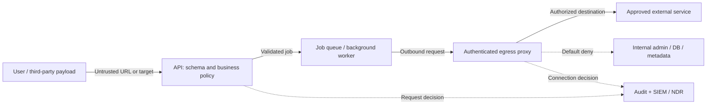
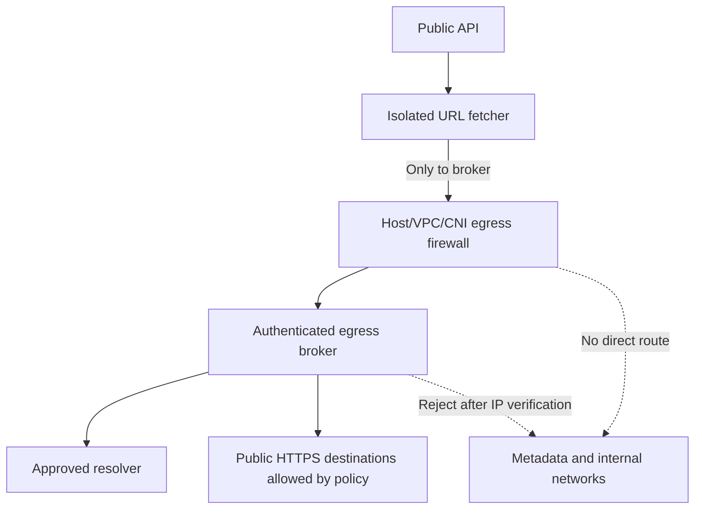
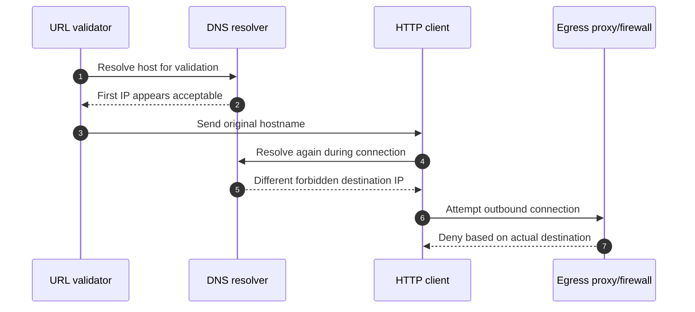
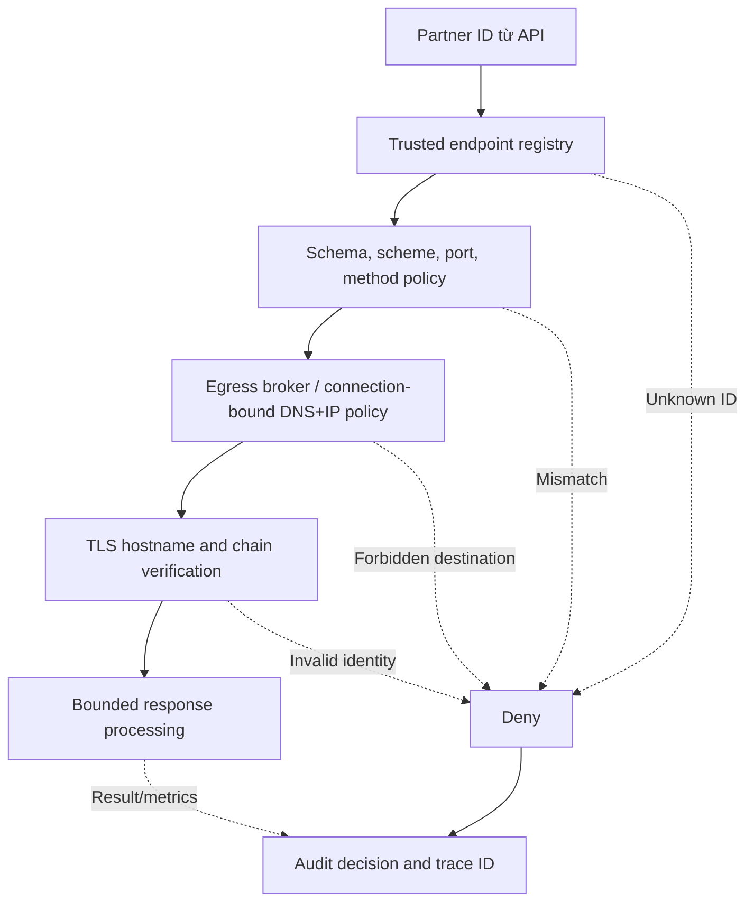
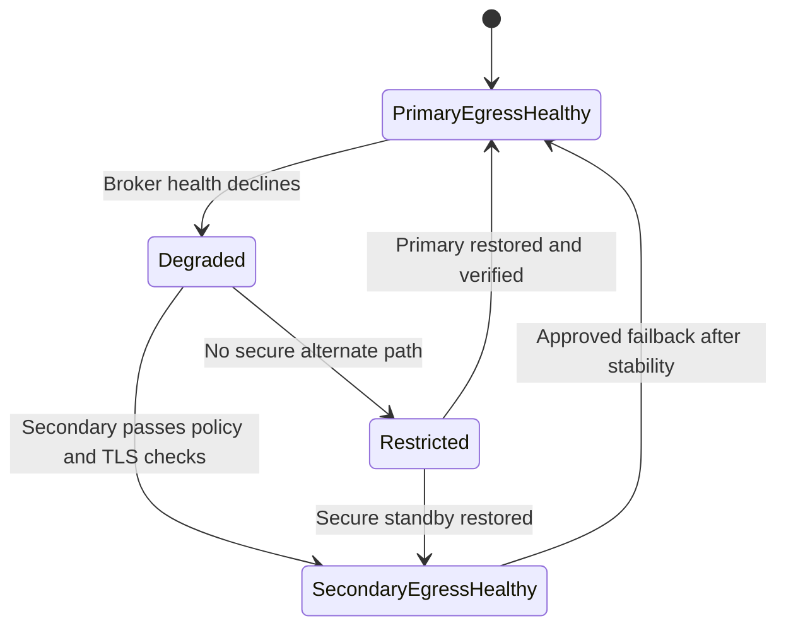
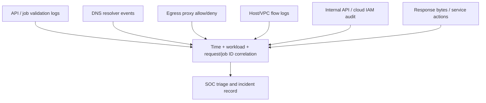

# Chống SSRF bằng kiểm soát outbound network

> **Học phần:** `SECURITY_NETWORK_SECURITY`  
> **Chương:** API và network service security  
> **Trọng tâm:** Ngăn **Server-Side Request Forgery (SSRF)** bằng chính sách **outbound/egress network**, quản lý URL–DNS–IP, proxy bắt buộc, phân đoạn mạng, cloud IAM và xác thực dịch vụ. Bài học liên kết với firewall, VPN, IDS/IPS, DNS security, zero trust và cloud/hybrid networking.

## Mục tiêu học tập

Sau bài học, người đọc có thể:

1. Mô tả SSRF và phân biệt với CSRF, open redirect, XXE, path traversal và lỗ hổng phân quyền.
2. Xác định điểm tiếp nhận input, điểm thực sự mở socket và trust boundary bị vượt.
3. Chọn chiến lược phù hợp cho **đích được biết trước** hoặc **URL công khai do user đề xuất**.
4. Thiết kế egress default-deny theo workload identity, đích, protocol, cổng và vùng mạng.
5. Nhận biết DNS rebinding, redirects, IPv4/IPv6 special-use, URL parser ambiguity, proxy bypass và giới hạn của việc kiểm URL một lần.
6. Thiết kế kiểm soát cloud metadata, Kubernetes, network firewall, proxy HA và least-privilege credentials.
7. Xây dựng kiểm thử, giám sát, runbook phản ứng sự cố và checklist phòng vệ theo nhiều lớp.

## 1. SSRF là gì?

**SSRF (Server-Side Request Forgery)** xảy ra khi một bên không được tin cậy tác động đến **request do ứng dụng server, worker hoặc thành phần backend gửi đi**, khiến nó truy xuất đích hoặc tài nguyên ngoài phạm vi được phép. Một API có tính năng lấy ảnh từ URL, tạo bản xem trước trang web hoặc thử webhook là ví dụ về **khả năng tạo request phía server**.

Nếu server đồng thời có đường mạng vào database, private API, cloud instance metadata, control plane hoặc thiết bị quản trị, input không tin cậy có thể khiến nó **thử kết nối vào vùng mà người dùng từ Internet không thể tự truy cập**.

Hậu quả có thể gồm:

- Đọc response từ dịch vụ chỉ mở nội bộ, nếu phản hồi được chuyển ra cho user (*readable SSRF*).
- Gây hiệu ứng phụ ở API nội bộ dù user không thấy body (*blind SSRF*).
- Chạm tới metadata/identity service hoặc credential nguồn khác khi quyền mạng cho phép.
- Dùng backend như một kênh gửi request không được ủy quyền tới public/private destinations.
- Thăm dò trạng thái host/port thông qua lỗi, timeout hoặc kết quả response.
- Lạm dụng token, mTLS client identity hoặc service account mà backend được phép dùng.

**Không phải mọi request sai đích đều thành công hoặc làm lộ dữ liệu.** Cần tách tín hiệu đầu vào, connection attempt, response nhận được và ảnh hưởng thực tế.

### Ví dụ khái niệm

Một endpoint `POST /preview` nhận trường `url`, worker tải URL để tạo thumbnail. Kiểm soát an toàn phải trả lời: “Ai chọn URL?”, “Tiến trình nào mở socket?”, “Socket có thể tới đâu?”, “URL sẽ bị redirect/resolve lại không?” và “Nếu đến nhầm đích thì có bị firewall hoặc authorization từ chối không?”.

## 2. Bản đồ trust boundary và data flow



Các ranh giới tách biệt:

- **Business boundary:** input có được phép tạo request loại này không?
- **Parsing boundary:** scheme, authority, host, port và encoding có được diễn giải thống nhất không?
- **DNS boundary:** tên miền sẽ được resolve thành những IP nào?
- **Connection boundary:** TCP/UDP socket hoặc proxy thực tế mở tới **IP nào**?
- **Identity boundary:** workload đang dùng service account/credential/CA nào?
- **Destination authorization:** service đích có kiểm quyền theo user/resource không?

**Network reachability không đồng nghĩa authorization.** SSRF có thể mở rộng khả năng tới một service nội bộ, nhưng service đó vẫn phải từ chối hành động mà caller không được phép thực hiện.

## 3. SSRF khác những khái niệm liên quan

| Thuật ngữ | Cơ chế chính | Quan hệ với SSRF |
|---|---|---|
| **CSRF** | Lừa browser người dùng gửi request dưới session của họ | SSRF lạm dụng quyền kết nối của **server** |
| **Open redirect** | Endpoint trả redirect tới URL khác | Một fetcher follow redirect có thể được đưa tới đích ngoài policy |
| **XXE** | XML parser xử lý entity ngoài ý muốn | Parser có thể gọi network URL dẫn tới SSRF |
| **Path traversal** | Truy cập file ngoài thư mục dự kiến | Có thể liên quan file scheme nhưng không đồng nhất |
| **IDOR/BOLA** | Truy cập object không đúng quyền | Internal API vẫn phải kiểm object ownership kể cả khi mạng cho phép |
| **DNS rebinding** | Tên miền đổi IP ở các thời điểm khác nhau | Có thể vượt URL/DNS pre-check trước khi mở socket |
| **Proxy bypass** | Traffic đi ngoài proxy/PEP bắt buộc | Khiến SSRF bỏ qua destination policy ở proxy |
| **Confused deputy** | Thành phần có quyền bị điều khiển dùng quyền sai mục đích | Mô hình rất hữu ích khi phân tích SSRF và credential |

Một lỗ hổng có thể bắt đầu từ tài liệu HTML, PDF, CSS hoặc XML được upload: trình render tải remote resources từ các liên kết trong tài liệu. Vì vậy **không chỉ những API có trường url rõ ràng** mới cần bảo vệ.

## 4. Inventory tất cả outbound sinks

Rà soát những nơi có thể mở kết nối:

- API image fetch, favicon/thumbnail, link preview, URL unfurl, website screenshot.
- Webhook delivery/test, callback verification, feed reader, URL monitor.
- PDF/HTML renderer tải font, ảnh, CSS, iframe và script.
- XML parser/JSON Schema/OpenAPI resolver có remote reference.
- Background jobs, ETL, package importer, plugin hoặc connector.
- HTTP libraries được gọi từ queue worker, serverless function hoặc headless browser.
- Forward proxy, HTTP CONNECT, service-mesh egress gateway.
- Dịch vụ dùng third-party SDK có redirect, discovery hoặc proxy fallback.
- DNS resolver và cloud SDK chạy trong workload có quyền IAM.

### Câu hỏi threat modeling

| Câu hỏi | Cần thu thập |
|---|---|
| Input do ai kiểm soát? | User, partner, file upload, job queue, DB row |
| Code nào mở network? | API, renderer, plugin, queue worker, SDK |
| Tiến trình có quyền mạng gì? | Loopback, private, link-local, VPN, peering, Internet |
| Có credentials nào? | Cloud role, API token, mTLS key, cookies, service principal |
| Response đi đâu? | User, cache, audit, queue, local file, downstream service |
| Chặn ở đâu nếu code lỗi? | Egress firewall, proxy, workload isolation, internal authz |
| Phạm vi liên quan IPv6 không? | AAAA, IPv6 routes, mapped addresses, dual-stack |

Đừng kết luận từ sơ đồ thiết kế cũ; phải kiểm tra **route table, CNI/VPC policy, DNS và quyền runtime thực tế**.

## 5. Hai trường hợp kiến trúc cần xử lý khác nhau

### A. Chỉ gọi các endpoint đã biết

Ví dụ backend gọi một số hãng vận chuyển, payment processor hoặc hệ thống ERP đã ký hợp đồng. **Cách tốt nhất thường là không cho người dùng chọn URL.**

```text
Input: partnerId = "shipping"
Server registry:
  shipping -> https://shipping-api.example.test/v1/status
  billing  -> https://billing-api.example.test/v1/status
Allowed: request tới endpoint được server/operator cấu hình
Denied: user đưa URL bất kỳ thay cho partnerId
```

Với mô hình này, kiểm soát exact hostname, port, method và path dễ hơn; dữ liệu registry phải được version hóa và chỉ operator được phê duyệt sửa.

### B. Bắt buộc truy xuất URL công khai do user cung cấp

Một dịch vụ preview có thể cần tải từ nhiều host chưa biết trước. Đây là trường hợp rủi ro cao hơn. Nên tách **isolated fetch worker**, chạy với IAM ít quyền và **không có đường tới nội bộ/metadata**, bắt buộc đi qua egress broker có kiểm URL/DNS/IP và resource limits.

Không xem “chặn chữ localhost” hoặc “chỉ URL bắt đầu bằng https” là đủ bảo vệ cho trường hợp này.

## 6. Defense in depth: ba lớp chống SSRF

| Lớp | Trách nhiệm | Nếu lớp này có lỗi |
|---|---|---|
| **Application/business allowlist** | Ai có quyền gọi đích gì, mục đích nào | Hạ tầng egress tiếp tục chặn đích cấm |
| **URL/DNS/connection validation** | Scheme/host/IP/port/redirect có thỏa policy | Firewall/route giảm tác động nếu validation sai |
| **Network enforcement** | Workload thực sự chỉ mở socket tới vùng đích được cấp | Internal service authentication vẫn chặn hành động trái quyền |

Nguyên tắc **default deny** nghĩa một workload chỉ có egress cần thiết cho nghiệp vụ. Không gán quyền Internet + tất cả private subnets chỉ vì “worker cần tải ảnh”.

### Security invariant

> Một process nhận URL không tin cậy không được mở kết nối thành công tới management, data zone, cloud metadata hoặc control plane nếu không có chức năng được phê duyệt, danh tính và tuyến network được kiểm soát riêng.

Đây là thuộc tính nên được kiểm thử ở **điểm thực sự mở socket**, không chỉ ở API input validator.

## 7. Egress proxy bắt buộc và cách ngăn đi vòng

**Egress proxy/broker** là thành phần thực thi chính sách outbound theo **workload identity + destination**; có thể là HTTP forward proxy, cloud network firewall, service-mesh egress gateway hoặc kết hợp các lớp này.



Bắt buộc proxy **không chỉ là** đặt biến môi trường `HTTP_PROXY`: thư viện có thể bỏ qua biến, dùng raw socket, custom resolver hoặc proxy fallback. Cần **chặn đường direct** ở firewall/CNI/VPC/host:

- Fetcher chỉ được kết nối tới broker và các dependencies tối thiểu.
- Broker xác thực client/workload; không trở thành open proxy.
- Broker quyết định đích và **IP thực tại connection**.
- CONNECT, TCP/UDP, HTTP/2, WebSocket hoặc protocol khác phải được kiểm soát riêng.
- Failover broker phải giữ nguyên security rules, không tự chuyển sang Internet direct.
- Ghi log policy decision, connected IP và workload principal.
- Có negative tests cho IPv4, IPv6, VPN/peered routes và vùng metadata.

**NAT gateway không tự là secure proxy.** NAT giải quyết địa chỉ/route, không mặc nhiên kiểm URL, host hay identity.

## 8. Phân tích cấu trúc URL thay vì so chuỗi

URL chứa `scheme://userinfo@host:port/path?query#fragment`. Kiểm soát phải dùng parser URI/URL đã được duy trì, sau đó kiểm những thuộc tính được parser trả ra.

### Quy tắc thực hành

1. Chỉ cho scheme cần thiết, thường `https`; không cho `file`/`ftp`/custom scheme khi không có yêu cầu.
2. Từ chối `userinfo` nếu nghiệp vụ không dùng; tránh nhầm phần trước `@` là host.
3. Host phải tồn tại, phù hợp profile DNS/IP và không chứa điều khiển.
4. Chuẩn hóa hostname theo **IDNA** khi cần, lower-case theo DNS semantics và xử lý dấu chấm cuối theo policy.
5. Giới hạn cổng; HTTPS không có nghĩa mọi cổng đều được duyệt.
6. Với known endpoint, so sánh **hostname canonical đúng tuyệt đối**.
7. Không cho caller tự đặt HTTP Host, credential/proxy target vượt policy.
8. Không forward Authorization/cookies sang host khác.
9. Tắt redirects khi không cần; nếu cần thì revalidate từng hop.
10. **Tại connect**, kiểm resolved IP cuối và firewall.

### Những cách kiểm sai

```text
host.includes("trusted.example.test")       // Sai: suffix giả
host.startsWith("api.trusted.example.test")  // Sai: có thể thêm label
inputUrl.startsWith("https://")              // Sai: mới chỉ kiểm chuỗi
inputUrl.contains("localhost")               // Sai: bỏ sót IP/private DNS
```

Hostname gần giống, userinfo, IDNA/Unicode, encoding, trailing dot, IPv4 dạng không chuẩn, IPv6 literal, mapped IPv4 và backslash có thể bị parser/proxy hiểu khác nhau.

**Không tự xây HTTP parser hoặc regex “phủ hết các biến thể”.** Nên dùng URL/HTTP library chuẩn và enforcement ở connection boundary.

## 9. Domain allowlist cần xét quyền kiểm soát domain

Nếu chỉ cho `api.partner.example.test`, sử dụng **exact hostname match** với canonical representation, không so substring. Nếu cho cả subdomains, yêu cầu **label boundary** chính xác và kiểm toàn quyền quản lý subdomain.

Các câu hỏi:

- Domain có subdomain delegation tới khách hàng/đối tác nào không?
- Có wildcard DNS và record `CNAME` tới host bên thứ ba không?
- Có subdomain takeover risk không?
- Có thể trỏ domain allowlisted tới IP private/link-local không?
- Hostname có thể đổi địa chỉ do CDN/DR không?
- Khi domain/IP thay, policy có được review và kiểm lại không?

**Cho phép hostname không tự cho phép IP kết nối cuối.** Domain allowlist cần phối hợp DNS/IP enforcement và TLS hostname verification.

## 10. IPv4/IPv6 và special-purpose destinations

Các address classes phổ biến phải nằm trong threat model:

| Dải | Ý nghĩa | Với public-URL fetcher |
|---|---|---|
| `127.0.0.0/8` và `::1/128` | Loopback | Deny |
| `10.0.0.0/8`, `172.16.0.0/12`, `192.168.0.0/16` | IPv4 private | Deny |
| `169.254.0.0/16` và `fe80::/10` | Link-local | Deny |
| `fc00::/7` | IPv6 unique-local | Deny |
| `0.0.0.0/8`, `::/128` | Unspecified/special | Deny |
| `100.64.0.0/10` | Shared address/CGNAT | Thường deny |
| `198.18.0.0/15` | Benchmark/test interconnect | Deny cho public fetch |
| `224.0.0.0/4`, `ff00::/8` | Multicast | Deny |
| `240.0.0.0/4` | Reserved/special IPv4 | Deny |
| `192.0.2.0/24`, `198.51.100.0/24`, `203.0.113.0/24` | Documentation TEST-NET | Chỉ ví dụ/lab |
| `2001:db8::/32` | IPv6 documentation | Chỉ ví dụ/lab |
| IPv4-mapped IPv6, translation/tunnel ranges | Có thể đại diện/nhúng IPv4 | Normalize và check real destination |

**Danh sách không đầy đủ.** Cần theo dõi *IANA IPv4/IPv6 Special-Purpose Address Registries*, cloud/provider ranges và chính sách routing nội bộ. Đặc biệt, có thể có **đích private hoàn toàn hợp lệ** cho một service chuyên dụng; hãy cấp quyền **riêng theo workload và service identity**, không mở toàn mạng private cho URL fetcher.

Không chỉ test IPv4. Một hostname trả cả A và AAAA, hoặc socket kết nối qua IPv6, có thể bỏ qua policy chỉ kiểm IPv4.

## 11. DNS rebinding: kiểm tra trước rồi kết nối sau

Một lỗi triển khai phổ biến:

1. API resolve hostname và xác nhận IP có vẻ public.
2. HTTP client nhận lại hostname rồi **tự resolve lại**.
3. Địa chỉ lần sau khác địa chỉ validation, có thể thuộc dải nội bộ.
4. Nếu không có control ở connection, request có thể tới nơi không được phép.



### Phòng vệ đúng trọng tâm

- Resolve/validate ở **thành phần thực sự mở connection**, hoặc dùng transport cho phép **pin IP đã kiểm tra** vào kết nối.
- Nếu pin IP, vẫn phải dùng **hostname gốc cho SNI và certificate hostname verification**; kết nối HTTPS tới IP rồi tắt hostname check là sai.
- Broker kiểm CIDR, IP literal, CNAME/records và connected IP; kiểm tra mọi A/AAAA đích có thể chọn.
- Giới hạn redirects và kiểm lại tại từng destination mới.
- Chặn private/link-local/metadata ở **network firewall** để giảm hậu quả nếu validator bị bypass.
- Đảm bảo DNS resolver dùng đúng trust boundary, xử lý cache/TTL và failover.
- Không dựa duy nhất vào hàm “is private” của một runtime vì phạm vi special-use có thể thiếu.

**Sai lầm cần tránh:** Gọi Java `InetAddress.getAllByName(host)` để precheck rồi đưa hostname gốc vào một HTTP client có thể tự resolve lại; cách đó chưa ràng buộc socket tới IP đã duyệt.

## 12. Redirect: điểm kiểm soát cần lặp lại

HTTP redirects 301, 302, 303, 307, 308 có thể thay đổi destination. Một URL ban đầu được duyệt **không đảm bảo** `Location` tiếp theo phù hợp policy.

### Khuyến nghị

- **Tắt automatic follow** nếu không bắt buộc về nghiệp vụ.
- Nếu phải follow, giới hạn số hops và thời gian toàn chuỗi.
- Mỗi URL đích mới phải kiểm đầy đủ scheme, host, port, DNS/IP/connection policy.
- Không cho chuyển HTTPS → HTTP khi policy yêu cầu HTTPS.
- Không tự forward Authorization, cookie hoặc mTLS credential đến origin mới.
- Chặn redirect loop và header/response quá lớn.
- Log destination decisions nhưng redact query/credentials.
- Không coi relative Location là an toàn mặc định; sau khi resolve phải revalidate.

**Open redirect** ở một website công khai có thể là **bước trung gian** dẫn tới SSRF. Không nên dùng allowlist domain đầu tiên để bỏ qua kiểm soát ở các bước tiếp theo.

## 13. Ngoài HTTP: file, FTP, CONNECT và nested requests

| Tính năng | Rủi ro nếu không phục vụ nghiệp vụ | Phòng vệ |
|---|---|---|
| `http://` | Plaintext; có thể gọi private endpoints | Chỉ bật nếu có nhu cầu và policy rõ |
| `https://` | HTTPS mạnh vẫn có thể gọi đích ngoài quyền | Destination + identity + network checks |
| `file://` | Truy cập file nội bộ | Không chấp nhận với user-controlled URLs |
| `ftp://`, `gopher://` và custom schemes | Khả năng network khác HTTP | Disable nếu không cần |
| HTTP CONNECT | Tunnel tới host/port tùy ý | Broker hạn chế target/port/identity |
| Raw TCP/UDP | Bỏ qua HTTP proxy | Chặn ở host/VPC/CNI firewall |
| WebSocket/HTTP upgrade | Kết nối lâu dài, policy khác HTTP request | Hạn chế và theo dõi |
| PDF/HTML/CSS nested fetch | Renderer tự tải nhiều subresources | Sandbox network toàn process |
| XML external entity/schema reference | Parser tự resolve URI | Tắt external resolution hoặc áp egress policy |

Không nên tự tin rằng “trang top-level đã qua validation” nếu renderer, browser engine hoặc parser có thể mở **hàng chục kết nối phụ** từ nội dung không tin cậy.

## 14. Cloud metadata và service identity

Cloud thường có **instance metadata service** hoặc endpoint nội bộ tương tự. Workload có thể lấy thông tin network và trong một số mô hình lấy credential tạm thời gắn với identity. Nếu public fetcher được phép gọi metadata, tác động có thể nghiêm trọng.

### Biện pháp nhiều lớp

1. **Không để fetcher có đường đến metadata** khi không cần.
2. Tách service xử lý URL do user nhập với cloud SDK/agent có IAM quyền cao.
3. Gắn IAM/service role **ít quyền**, scope tài nguyên hẹp và log identity actions.
4. Bật metadata protections của nhà cung cấp, ví dụ token/session mechanism, hop-limit và các tùy chọn hạn chế truy cập khi phù hợp.
5. Kiểm private/link-local/provider-specific metadata addresses ở firewall/egress.
6. Không chỉ chặn một IPv4 literal rồi cho rằng mọi metadata đã được bảo vệ; có thể có IPv6/provider-specific endpoints và topology khác.
7. Giám sát metadata calls bất thường theo **workload identity**.
8. Có runbook revoke/rotate credentials và điều tra cloud IAM nếu cần.

**IMDSv2** trong một số môi trường AWS giảm một số dạng SSRF nhờ yêu cầu token/session, nhưng **không phải thuốc chữa mọi SSRF**. Không gửi probe tới metadata production khi không có test scope/approval; dùng stub endpoint trong lab.

## 15. Internal APIs vẫn phải xác thực và phân quyền

Egress filter giảm **khả năng tới internal network**, còn internal API phải **tự bảo vệ** nếu request không mong muốn vẫn đến được.

- Không cấp quyền admin chỉ vì source IP thuộc subnet nội bộ.
- Dùng mTLS/service identity hoặc mechanism phù hợp để xác thực caller.
- Authorization theo role, resource, tenant và hành động, không “mọi service account có thể gọi mọi endpoint”.
- Đặt debug/management endpoints trong vùng quản trị riêng.
- Không chuyển token cloud/service rộng vào HTTP client chuyên fetch URL.
- Kết hợp network segmentation với IAM và application authorization.
- Ghi request/audit ở internal API, để có chứng cứ khi triage.

**Một HTTP 403 trả về từ internal API không chứng minh outbound policy đã đúng:** Request đã tới được API; đó là một lớp authorization đang hoạt động, nhưng network boundary vẫn cần sửa.

## 16. Kubernetes NetworkPolicy cho URL fetcher

Kubernetes NetworkPolicy tiêu chuẩn thường kiểm soát ingress/egress ở **L3/L4** khi được CNI hỗ trợ. Một manifest default-deny egress cho pod mang label `app=url-fetcher`:

```yaml
apiVersion: networking.k8s.io/v1
kind: NetworkPolicy
metadata:
  name: url-fetcher-deny-all-egress
spec:
  podSelector:
    matchLabels:
      app: url-fetcher
  policyTypes:
    - Egress
  egress: []
```

Nếu pod chỉ được gửi đến egress proxy trong namespace có label `security-zone=egress`:

```yaml
apiVersion: networking.k8s.io/v1
kind: NetworkPolicy
metadata:
  name: url-fetcher-to-approved-broker
spec:
  podSelector:
    matchLabels:
      app: url-fetcher
  policyTypes:
    - Egress
  egress:
    - to:
        - namespaceSelector:
            matchLabels:
              security-zone: egress
          podSelector:
            matchLabels:
              app: approved-egress-broker
      ports:
        - protocol: TCP
          port: 3128
```

### Những giới hạn phải nhớ

- NetworkPolicy **có tính additive**: một policy khác chọn cùng pod có thể cho thêm egress.
- Cần xác nhận **CNI thực thi**, không chỉ áp YAML thành công.
- DNS có thể cần rule riêng tới resolver được phép; nếu proxy tự resolve DNS, fetcher có thể không cần DNS direct.
- Traffic tới node/hostNetwork và một số cluster infrastructure phụ thuộc network implementation; cần thêm admission, host/cloud firewall.
- Policy này **không lọc hostname/URL/HTTP path**; broker chịu trách nhiệm tương ứng.
- Không cho fetcher có `hostNetwork`/privileged permissions ngoài nhu cầu, và kiểm những con đường bypass.

## 17. Cloud VPC, firewall, NAT và peering

| Thành phần | Vai trò | Đừng suy diễn |
|---|---|---|
| **Private subnet** | Giảm public ingress | Không tự chặn outbound Internet/private routes |
| **NAT gateway** | Translation và routing ra ngoài | Không tự là URL security proxy |
| **Security group / VPC firewall** | Allow/deny theo nguồn, đích, port, protocol | Outbound any tạo SSRF blast radius lớn |
| **Cloud network firewall** | Egress filters theo khả năng vendor | FQDN/SNI rules có giới hạn/coverage riêng |
| **DNS firewall/resolver** | Lọc một số domain và resolution | IP literal/cached IP/alternate resolver vẫn cần network policy |
| **Private endpoints** | Kết nối API cloud qua private network | Có thể tạo đường tới dịch vụ ngoài phạm vi của fetcher |
| **VPC peering, transit, VPN** | Mở reachability cross-network | Không đồng nghĩa tất cả subnet được phép |
| **Flow logs/IDS** | Quan sát quyết định và traffic | Sampling, NAT và encryption có thể gây thiếu bằng chứng |

Để tránh SSRF, đừng chỉ hỏi workload có public IP hay không. Phải xem **actual route tới link-local, private, VPN/peered networks và default Internet route**. Một VM ở private subnet vẫn có thể gọi metadata hoặc internal APIs.

## 18. Egress policy mẫu theo workload

```yaml
policyId: SSRF-EGRESS-008
workload: "public-preview-fetcher"
identity:
  requireAuthenticatedWorkload: true
  allowedPrincipals:
    - "workload:public-preview-fetcher"
defaultAction: "deny"
destinations:
  allowedSchemes: ["https"]
  allowedPorts: [443]
  userSpecifiedPublicHosts: true
  denyNonGlobalAndSpecialPurposeIPs: true
  normalizeIPv4AndIPv6: true
  validateAtActualConnect: true
  denyMetadataAndPrivateControlPlane: true
  requireTlsHostnameVerification: true
redirects:
  allow: false
  ifExplicitlyEnabled:
    maxHops: 3
    revalidateEveryHop: true
    stripCrossOriginCredentials: true
limits:
  connectionTimeoutSeconds: 2
  totalDeadlineSeconds: 8
  maxResponseBytes: 1048576
  maxConcurrentJobsPerIdentity: 8
  maxRedirects: 0
transport:
  requireEgressBroker: true
  denyDirectSocketFallback: true
  blockUnapprovedConnectAndRawProtocols: true
failureMode: "deny-or-restricted"
audit:
  logPolicyDecision: true
  logActualDestinationIP: true
  redactSecretQueryParameters: true
```

**Lưu ý:** Đây là tài liệu mục tiêu, không phải cấu hình runtime của Envoy, Squid, Cilium, NGINX, AWS/GCP/Azure hay Java HttpClient. Mỗi công cụ có phạm vi kiểm soát khác nhau; **policy phải được kiểm thử tại connection boundary và với cả IPv4/IPv6**.

## 19. HTTP client: những mặc định phải được kiểm chứng

Các HTTP libraries khác nhau về redirect, proxy, DNS cache, connection reuse, URL parsing, authentication headers, TLS verification và timeout. Khi đánh giá SSRF, không chỉ xem phiên bản thư viện mà cần xem **effective configuration của call path thực**.

| Hành vi | Câu hỏi kiểm tra |
|---|---|
| **Redirect** | Có auto-follow không? Đích mới có được kiểm tra lại? |
| **DNS** | Client tự resolve lại hostname sau khi validation? Cache và resolver nào? |
| **Proxy** | Có direct fallback? CONNECT cho mọi host/port? |
| **TLS** | Có xác minh CA, hostname/SAN và danh tính đối tác? |
| **Credentials** | Authorization/cookies được gắn với origin nào? Có chuyển theo redirect? |
| **IP literal** | Parser có chấp nhận IPv4 số nguyên, IPv6 literal, mapped address không? |
| **Connection reuse** | Pool/HTTP2 coalescing có ràng buộc đúng origin/policy? |
| **Response handling** | Có giới hạn bytes, decompression, redirect hops và thời gian? |
| **Network family** | IPv4/IPv6 có cùng chính sách? |
| **Error handling** | Khi proxy/DNS lỗi, SDK có đổi sang direct connection không? |

**Điểm dễ sai:** Dùng URL validator có vẻ an toàn nhưng để một SDK thực hiện call bằng **host gốc** và tự resolve, follow redirect hoặc dùng proxy khác. Cần xác minh **socket thực** qua proxy/firewall telemetry.

### Pipeline cho đích được biết trước



## 20. Java: loại bỏ URL do user chọn khi gọi đối tác cố định

Một thiết kế ít rủi ro là client gửi **business identifier**, còn đích được lấy từ cấu hình **đã được phê duyệt**. Ví dụ Java 17+ sử dụng hostname tài liệu `example.test` và không phải một ứng dụng có thể truy cập endpoint thật.

```java
import java.net.URI;
import java.net.http.HttpClient;
import java.net.http.HttpRequest;
import java.net.http.HttpResponse;
import java.time.Duration;
import java.util.Map;

public final class ApprovedOutboundCall {
    // Cấu hình chỉ operator được quyền cập nhật, không do user kiểm soát.
    private static final Map<String, URI> ENDPOINTS = Map.of(
        "shipping", URI.create("https://shipping-api.example.test/v1/status"),
        "billing", URI.create("https://billing-api.example.test/v1/status")
    );

    private final HttpClient http = HttpClient.newBuilder()
        .connectTimeout(Duration.ofSeconds(2))
        .followRedirects(HttpClient.Redirect.NEVER)
        .build();

    public int queryStatus(String integrationId) throws Exception {
        URI target = ENDPOINTS.get(integrationId);
        if (target == null) {
            throw new IllegalArgumentException("Unknown integrationId");
        }

        // Phương thức và path cũng cố định, không nhận URL tùy ý.
        HttpRequest request = HttpRequest.newBuilder(target)
            .timeout(Duration.ofSeconds(5))
            .method("HEAD", HttpRequest.BodyPublishers.noBody())
            .build();

        HttpResponse<Void> response = http.send(
            request, HttpResponse.BodyHandlers.discarding()
        );

        int code = response.statusCode();
        if (code >= 300 && code < 400) {
            throw new IllegalStateException("Redirect disabled by policy");
        }
        return code;
    }
}
```

### Đoạn code này bảo vệ gì?

- User không chọn hostname/port/scheme, chỉ chọn key đã đăng ký.
- Đích có method/path cố định.
- Không tự follow redirect.
- Có timeout ở mức connect/request.
- Không tải body vào bộ nhớ để phục vụ một lệnh HEAD.

### Nó chưa bảo vệ gì?

- **DNS rebinding khi endpoint trusted map bị thay DNS**, bởi Java HttpClient có thể tự resolve hostname trong lúc connect.
- Chưa enforce per-workload firewall/egress broker.
- Chưa có identity-to-destination mTLS hoặc token audience policy theo đối tác.
- Chưa có retry budget, rate limiting và request concurrency control.
- Chưa mô tả policy về IPv6, network zone, cloud metadata.
- Một endpoint thực tế có thể không hỗ trợ HEAD; phải chọn **approved method** đúng hợp đồng, không tự đổi sang GET và download body không giới hạn.

**Không dùng đoạn code này như một generic URL fetcher an toàn.** Đó là ví dụ cách **tránh nhận arbitrary URL** khi nghiệp vụ có danh sách đối tác hữu hạn; mạng vẫn cần default-deny/egress policy.

## 21. Fetcher nhận URL công khai: sandbox và connection-bound policy

Khi sản phẩm bắt buộc tạo preview từ URL người dùng cung cấp, nên xây một **dịch vụ riêng** có các đặc tính sau:

1. API xác thực user và xác nhận quota/permissions trước khi tạo job.
2. URL parser chuẩn chỉ chấp nhận scheme/port đã phê duyệt, từ chối userinfo và malformed authority.
3. Job không chứa cloud/admin secrets.
4. Fetch worker cô lập, không có service account hay network route vào data/management/metadata.
5. Egress broker thực thi DNS/IP policy ngay khi socket được tạo.
6. Redirect mặc định tắt; nếu cho phép, kiểm tra mỗi hop tại broker.
7. TLS xác minh expected peer hostname và certificate chain.
8. Có connect timeout, total deadline, response-byte cap và concurrency limit.
9. Response được xử lý như **dữ liệu không tin cậy**, không chạy script/macro hoặc remote subresource ngoài sandbox.
10. Return data qua storage/API boundary đã kiểm MIME/authorization; ghi trace đủ để điều tra.

### Bảo vệ nested requests

HTML, PDF và XML có thể tham chiếu CSS, ảnh, font, external entity hoặc remote schema. Một headless browser cũng có thể tạo WebSocket/fetch từ script.

**Đừng chỉ kiểm URL đầu tiên.** Toàn bộ process/worker cần bị ràng buộc vào cùng network sandbox; parser chỉ được tải tài nguyên cần thiết và theo policy. Nếu chức năng không yêu cầu remote assets, disable hẳn remote loading là phương án đơn giản hơn.

### MIME và kích thước

Header `Content-Type` từ bên ngoài không phải bằng chứng file an toàn. Dùng kiểm tra định dạng ở parser được bảo vệ; đặt giới hạn **compressed và decompressed bytes**, số redirect, recursion/depth và memory/CPU/time. Điều này phòng SSRF kết hợp **resource exhaustion**.

## 22. Secret forwarding và confused deputy

SSRF có thể nghiêm trọng vì backend đang giữ các quyền mà người dùng không có.

### Một số sai lầm

- Gắn cùng header `Authorization` vào mọi outbound URL.
- Dùng API token có scope rộng cho cả preview và payment integration.
- Dùng mTLS client certificate của service để kết nối tới bất kỳ hostname người dùng đưa.
- Cho redirect tự mang cookie/Authorization sang origin khác.
- Dùng workload cloud role có quyền đọc secret/storage/administration cho public fetch worker.
- Cho phép identity header từ caller quyết định proxy principal hoặc egress policy.

### Phòng vệ theo credential

| Thành phần | Thiết kế nên có |
|---|---|
| **API token** | Audience, scope, expiry và destination cụ thể |
| **mTLS client certificate** | Danh tính workload/peer, trust domain và vòng đời riêng |
| **Cloud IAM role** | Tách role public fetcher và role cần metadata/data access |
| **Proxy authentication** | Kiểm identity bằng cơ chế đáng tin, không từ header tự khai |
| **Redirect** | Không chuyển credential qua origin khác theo mặc định |
| **Logging** | Không ghi Authorization, token, private key hay secret query |
| **Internal API** | Authentication + authorization theo resource và principal |
| **Outbound policy** | Known integration chỉ tới host/port được phép, không chỉ “IP public” |

**Chặn địa chỉ private không tự chống được data exfiltration tới đích public.** Với token và dữ liệu nhạy cảm, cần **destination allowlist, authorization và data-handling policy**.

## 23. Redirect, DNS, caches và sai lệch giữa các tầng

Một đường request thực tế có thể gồm:

```text
Untrusted URL
  -> API parser/validation
  -> DNS resolver #1
  -> background worker/SDK
  -> proxy / DNS resolver #2
  -> HTTP redirect
  -> socket / connection pool
  -> external or internal destination
```

Nếu các thành phần không có **cùng ngữ nghĩa đích**, chỉ một pre-check không đủ.

| Sai lệch | Hậu quả | Khắc phục |
|---|---|---|
| API DNS khác proxy DNS | IP validate khác IP kết nối | Broker kiểm ở actual connect |
| DNS A hợp lệ, AAAA private | IPv6 bypass policy | Check IPv4/IPv6 và enforce firewall |
| URL đầu public, Location private | Redirect bypass | Tắt redirects hoặc revalidate mọi hop |
| Host allowlist bằng substring | Domain attacker được xem là trusted | Exact/label-boundary canonical host |
| IPv4 mapped qua IPv6 | Lách denylist IPv4 yếu | Normalize địa chỉ và firewall |
| Proxy chỉ kiểm port 443 | Có thể dùng HTTPS tới service sai đích | Ràng buộc host, IP, cert, identity |
| TLS cert validation tắt | Tin nhầm server | Không dùng trust-all trong production |
| Proxy lỗi rồi direct fallback | Bỏ qua policy | Firewall deny đường direct |
| HTTP client dùng connection reuse khác dự kiến | Policy check không khớp socket | Kiểm semantics của thư viện và broker |
| SDK tự gửi secret trên redirect | Credential disclosure | Scope secret và strip cross-origin |

**Defense in depth** làm các sai lệch này khó biến thành request có tác động: network default-deny chặn tầng thấp, còn internal API authz chặn hành động nếu có reachability.

## 24. Vì sao từng biện pháp đơn lẻ không đủ?

| Chỉ sử dụng một biện pháp | Giới hạn |
|---|---|
| Regex chặn `localhost` | Không chặn private DNS, IP alternative formats hoặc IPv6 |
| Kiểm `https://` | Không quyết định đích có được phép |
| DNS denylist | Không chặn IP literal hoặc DNS resolution qua đường khác |
| Check một lần `InetAddress` | HTTP client có thể resolve lại |
| NAT gateway | Không tự lọc host URL và nghiệp vụ |
| WAF inbound | Không quan sát mọi worker, parser hoặc raw outbound socket |
| Kubernetes Ingress policy | Không hạn chế egress của pod |
| Kubernetes NetworkPolicy chỉ ingress | Không chặn SSRF outbound |
| Private subnet | Có thể vẫn reach metadata, peering, VPN và Internet |
| TLS/mTLS | Xác thực một peer, không cấp quyền gọi mọi đích |
| Firewall chỉ IPv4 | Bỏ sót IPv6 route hoặc addresses |
| Chặn metadata IP phổ biến | Không bao phủ mọi provider/topology, và có thể bị bypass bởi quyền khác |
| Internal API trả 403 | Giảm tác động nhưng egress đã reach internal service |

Không chỉ “có firewall” là đạt; phải chứng minh **actual egress path, rule effective, direction, zone và identity**.

## 25. Egress broker HA và phản ứng khi chính sách lỗi

Nếu proxy là PEP bắt buộc, khi nó lỗi phải có **đường dự phòng an toàn**, không tự mở direct Internet.



### Security invariants khi failover

- Fetcher vẫn **không có direct socket route** tới Internet/private zones.
- Broker phụ nhận cùng policy theo workload identity, destination, port, DNS/IP, IPv6 và redirects.
- Proxy authentication, TLS verification và secret isolation không bị tắt.
- Log có correlation giữa request, decision và connected IP.
- Rate limit, timeout và byte caps còn hoạt động.
- Khi không có broker hợp lệ, tính năng có thể trả `503`/queue theo chính sách; không tự chuyển sang allow-any.

**Không đồng nhất fail-open với high availability.** Một đường dự phòng có cùng controls là HA an toàn; bỏ controls có thể biến sự cố khả dụng thành sự cố bảo mật.

## 26. Observability: xác định attempt, connection và impact

Để điều tra SSRF cần phân biệt:

- **Attempt:** input/payload hoặc URL được đề nghị đáng nghi; chưa chắc phát sinh socket.
- **Network connection:** proxy/firewall/flow log có bằng chứng kết nối/packet tới đích.
- **Application interaction:** internal service nhận request, có response và kết quả xác thực.
- **Confirmed impact:** chứng cứ dữ liệu bị truy xuất/chuyển đi hoặc state change, credential abuse.



### Nên ghi gì?

| Trường | Mục đích |
|---|---|
| `event_time`, timezone | Điều tra DNS/retry/redirect timeline |
| `workload_id`, `user_or_job_id` | Nối input với process thực |
| `canonical_host`, `scheme`, `port` | Kiểm policy destination |
| `dns_answers`, `connected_ip` | Kiểm resolution và connection path |
| `destination_zone` | Public/private/metadata/management |
| `proxy_id`, `policy_version` | Kiểm proxy bypass và policy drift |
| `decision`, `deny_reason` | Phân biệt block và network error |
| `redirect_count` | Nhận biết chuỗi đích đổi |
| `tls_identity_verified` | Chỉ ghi khi thành phần thực sự verify |
| `response_status`, `bytes` | Đánh giá phạm vi mà không lưu payload nhạy cảm |
| `trace_id`, `exception_id` | Tương quan và kiểm exception expiry |

**Không log nguyên URL query** nếu có tokens hoặc PII. Tránh lưu response body, cookies, Authorization và credential vào SIEM. Nếu log không bao phủ traffic direct-to-origin, phải bổ sung flow/host telemetry; **không có log proxy không chứng minh không có SSRF**.

## 27. Phát hiện bất thường SSRF ở SOC/IDS/NDR

Các phát hiện nên dựa **workload identity + hành vi egress**:

- URL fetch worker thử nối loopback, private, link-local, metadata, Kubernetes API hoặc management zone.
- Proxy deny tăng đột biến sau một request type/feature deployment.
- Workload có direct traffic không qua broker dù policy yêu cầu proxy bắt buộc.
- Hostname liên tục đổi IP giữa vùng public và vùng cấm; nhiều redirect hoặc resolution thất thường.
- Một public-facing job có outbound connections tới nhiều port nội bộ.
- Credential cloud được sử dụng từ bối cảnh bất thường sau một egress event.
- Policy/route/security group được mở rộng không có ticket.
- DNS requests tới resolver không được phê duyệt; IPv6 traffic tăng không có inventory.
- Nhiều background fetch jobs tạo timeout/concurrency spikes.

### False positives

Cloud SDK/agent được phép gọi metadata; monitoring có thể cần health check ở private IP; CDN/third-party có thể thay IP; K8s service discovery dùng private DNS; NAT/connection reuse và sampling làm log thiếu.

**Triage theo vai trò:** Metadata access bình thường với một cloud agent có thể không bình thường với public preview worker. Không gộp tất cả thành một denylist cảnh báo thiếu context.

## 28. Case study A: thumbnail worker nối được private network

**Bối cảnh giả định:** Một website cho nhập URL ảnh để tạo thumbnail. API chỉ kiểm scheme HTTPS rồi gửi job đến worker. Worker dùng VPC role của ứng dụng chính, egress allow-all và có thể tới internal service.

**Nguyên nhân:** URL pre-validation không có DNS/connection-bound check; không có broker; worker cùng IAM/network zone với dữ liệu nhạy cảm; không chặn nested requests.

**Tác động có thể:** Worker có thể mở request vào vùng không được phép. **Không tự kết luận dữ liệu bị đánh cắp** nếu chưa có bằng chứng response/credential/state change.

**Cách khắc phục:**

1. Tách worker với quyền tối thiểu, không vào metadata/data/management.
2. Bắt buộc outbound qua broker xác thực workload.
3. Disable redirects hoặc kiểm mỗi hop ở broker.
4. Chặn non-global/special IP trên IPv4/IPv6 thực tế.
5. Bảo vệ parser ảnh/PDF khỏi nested remote fetch và resource exhaustion.
6. Ghi job→proxy→firewall→internal service correlation.
7. Regression test DNS response từ public sang private trong lab.

## 29. Case study B: webhook test trên tenant admin portal

Một SaaS cho khách hàng đăng ký webhook URL và nhấn “Test connection”. **Customer admin** có quyền cấu hình webhooks nhưng không có quyền truy cập hạ tầng nội bộ của nhà cung cấp SaaS.

### Rủi ro

- Validation chỉ diễn ra lúc lưu URL; job chạy sau khi DNS đã thay đổi.
- Redirect tự động có thể đưa request sang endpoint khác.
- Webhook sender dùng chung token internal API.
- DNS/CDN động khiến nhóm vận hành ngại dùng allowlist.
- Worker có route tới peered networks và cloud metadata.

### Thiết kế tốt hơn

- Policy business xác định quyền tạo webhook, giới hạn mỗi tenant và rate.
- **Kiểm lại tại thời điểm gửi**, không dựa vào trạng thái lúc đăng ký.
- Egress broker kiểm actual connected IP, protocol/port/redirect policy.
- Dùng secret riêng của webhook/payload signatures nếu nghiệp vụ yêu cầu; không dùng internal admin credentials.
- Không gọi private IP trừ khi có **private integration** riêng, được phê duyệt và xác thực đích.
- Log principal, destination decision, bytes và status.
- Negative tests cho thay DNS, IPv6 và redirect.

## 30. Case study C: đã chặn private IP nhưng lộ token public

Một API tích hợp với đối tác cố định sử dụng HTTP client gắn token vào mọi request. URL đích sau một thay đổi config hoặc redirect trở thành một public host khác không được phê duyệt.

### Tại sao private-IP blocking chưa đủ?

- Đích ngoài policy vẫn có thể là **public IP hợp lệ**.
- Token có thể bị gửi sang nhầm origin nếu credential forwarding không được kiểm.
- Egress proxy cấu hình “cho mọi public IP trên 443” không bảo đảm đúng **business destination**.

### Cải thiện

- Exact allowlist cho integration cố định; host/port/URL được quản lý.
- Token riêng từng partner, scope/audience/expiry phù hợp.
- Không follow redirect hoặc strip credentials và revalidate đích.
- TLS hostname verification; xác thực đúng peer service.
- Egress policy theo workload identity và destination, không chỉ IP private/public.
- Audit token use và revoke/rotate nếu có bằng chứng bị tiết lộ.

**Bài học:** SSRF phòng vệ mạnh phải giới hạn **quyền outbound** và **quyền credential**, không chỉ chặn mạng nội bộ.

## 31. Lab an toàn: mock DNS, URL và outbound decisions

Bài thực hành dùng test runner/stub resolver trong **lab được cấp quyền**, không gửi request tới cloud metadata thật hoặc private/admin systems production.

### Dữ liệu giả lập

```yaml
lab: SSRF-EGRESS-008
workload: isolated-preview-fetcher
policy:
  scheme: "https"
  port: 443
  redirects: "deny"
  actualConnectValidation: true
cases:
  - name: documented-public-mock
    host: "public.example.test"
    dns: ["203.0.113.20"]
    expected: "mock-allow-only"
  - name: loopback
    host: "loopback.example.test"
    dns: ["127.0.0.1"]
    expected: "deny"
  - name: private
    host: "private.example.test"
    dns: ["10.20.10.10"]
    expected: "deny"
  - name: link-local
    host: "linklocal.example.test"
    dns: ["169.254.1.10"]
    expected: "deny"
  - name: ipv6-ula
    host: "ula.example.test"
    dns: ["fd00::1"]
    expected: "deny"
  - name: rebound
    host: "rebound.example.test"
    dnsAtValidation: ["203.0.113.20"]
    dnsAtConnection: ["10.10.10.10"]
    expected: "deny-at-connect"
  - name: redirect-to-private
    host: "redirect.example.test"
    location: "https://private.example.test/"
    expected: "deny"
```

**Quan trọng:** `203.0.113.0/24` là dải TEST-NET-3 chỉ dành cho tài liệu. `mock-allow-only` nghĩa **test harness giả định** một destination đã được cho phép, không phải classifier production được phép coi TEST-NET-3 là public reachable. Đối với hệ thật, dùng một endpoint Internet do tổ chức sở hữu, **trong phạm vi được phê duyệt**, hoặc mock connection hoàn toàn.

### Ma trận kết quả kỳ vọng

| Tình huống | Kết quả |
|---|---|
| Đối tác đã duyệt qua fixed registry | Allow khi TLS/cert/network policy hợp lệ |
| Input là `file://` hoặc scheme lạ | Reject trước network request |
| IP loopback/private/link-local | Deny trước connection |
| IPv6 ULA/loopback/mapped private | Deny |
| DNS có A public nhưng AAAA private | Không kết nối private, policy dual-stack nhất quán |
| DNS rebinding giữa validation và connect | Deny ở connection boundary |
| Redirect sang internal test service | Deny hoặc revalidate rồi deny |
| Broker lỗi | Không direct fallback |
| Untrusted Host/Authorization header | Không nâng quyền hoặc forward secret |
| Response vượt byte/time quota | Dừng theo limit và ghi log |
| Parser tải remote CSS/font/iframe ngoài scope | Sandbox/ngăn subrequest |
| Internal service vẫn được reach trong mock | Authentication/authorization từ chối hành động trái quyền |

## 32. Gherkin kiểm thử SSRF egress

```gherkin
Feature: Prevent SSRF using trusted destinations and mandatory egress policy

  Scenario: Approved integration uses a server-owned endpoint
    Given a partner registry is maintained by approved operators
    When a user selects an allowed partner identifier
    Then the application calls only the configured endpoint
    And an arbitrary URL cannot replace that endpoint

  Scenario: Private destination is blocked by egress policy
    Given the isolated worker receives an HTTPS URL
    And its hostname resolves to a private network address
    When the worker asks the broker to connect
    Then the connection is denied before reaching the internal destination
    And a policy decision is auditable

  Scenario: DNS rebinding cannot bypass the actual connection policy
    Given a hostname initially resolves to a test-approved address
    And its actual connect target later becomes a forbidden private IP
    When the socket connection is attempted
    Then the egress boundary rejects the forbidden IP
    And no request reaches the protected internal API

  Scenario: IPv6 is as restricted as IPv4
    Given the workload is denied access to internal destinations
    When a URL resolves to an IPv6 unique-local or link-local address
    Then outbound connection is denied
    And the decision is logged with the effective workload policy

  Scenario: Redirects cannot cross into another trust zone
    Given automatic redirects are disabled for the fetcher
    When a public test endpoint returns a redirect to a private target
    Then the worker does not open the redirected connection
    And no credentials are forwarded to the new origin

  Scenario: Broker failure never opens direct egress
    Given all fetcher sockets must go through an authenticated broker
    When the primary and secondary brokers are unavailable
    Then the fetch job is rejected or queued according to policy
    And no direct Internet or private-network connection is opened

  Scenario: Sensitive credentials remain bound to an approved partner
    Given the server holds a token scoped to a specific partner
    When an unapproved URL or redirect origin is requested
    Then the token is not attached to that request
    And the destination is rejected if outside the integration policy

  Scenario: Internal authorization remains effective
    Given an internal test API requires a service identity and resource scope
    And a simulated caller lacks that authorization
    When a request reaches that API in the controlled lab
    Then the protected operation is denied
    And network reachability does not grant authorization

  Scenario: Nested fetches are confined to the same sandbox
    Given a document renderer handles an untrusted HTML file
    When it attempts to fetch a remote font or image
    Then the subrequest follows the same outbound destination policy
    And resource limits prevent unbounded downloads

  Scenario: Upgrading a partner endpoint requires policy review
    Given an approved partner changes its API hostname
    When the owner proposes a new outbound destination
    Then its identity, DNS/IP behavior, TLS validation and business purpose are reviewed
    And positive and negative egress tests pass before production rollout
```

## 33. STRIDE cho SSRF và outbound policy

| STRIDE | Kịch bản | Biện pháp |
|---|---|---|
| **Spoofing** | Input hostname gần giống domain partner; proxy tin client identity header | Canonical exact allowlist, identity-aware proxy |
| **Tampering** | DNS rebinding, redirect sang IP khác, network rule bị nới | Connection-bound validation, redirect policy, IaC/audit |
| **Repudiation** | Không biết ai tạo job hay sửa allowlist | Job trace, workload principal, change ticket |
| **Information Disclosure** | Fetcher đọc internal/metadata hoặc gửi token ra host public lạ | Egress isolation, credential scoping, response/data controls |
| **Denial of Service** | Worker tải body lớn, retry storm, parser recursion | Timeouts, size/depth limits, quota, circuit breaker |
| **Elevation of Privilege** | Dùng cloud/admin role của backend để truy cập ngoài quyền user | IAM least privilege, internal authz, network segmentation |

### Threat statement mẫu

> Một chức năng public URL preview nhận URL từ user, trong khi background worker chia sẻ IAM role và VPC network với application data service. Nếu chỉ kiểm HTTPS scheme mà không kiểm DNS/IP tại connect và chặn egress đến metadata/private zone, input không tin cậy có thể khiến worker gửi request qua trust boundary ngoài quyền người gọi. Giảm thiểu bằng isolated fetcher, default-deny egress, authenticated broker và internal API authorization.

**Không suy từ việc có SSRF vulnerability rằng đã xảy ra data theft.** Cần network, app, identity và data logs để xác nhận.

## 34. Playbook xử lý nghi ngờ SSRF

### Bước 1 — Phân loại bằng chứng

- **Attempt:** input/URL hoặc alert đáng ngờ.
- **Connection:** network/proxy log xác nhận đích được gọi.
- **Interaction:** internal API/metadata service có request và phản hồi.
- **Impact:** credential bị lạm dụng, data exfiltration hoặc state changes có bằng chứng.

Đây là bốn mức khác nhau; severity cần dựa trên tài sản và tác động đã xác minh.

### Bước 2 — Xác định trust boundary

Thu request/job ID, user/tenant, workload, URL canonical, DNS records ở những thời điểm liên quan, connected IP, egress rules, route tables, proxy policy version, redirect chain và credential scope. Kiểm cả IPv6, VPN/peering, hostNetwork và DR path.

### Bước 3 — Containment

- Giới hạn/tạm tắt chức năng fetch không tin cậy, không tắt kiểm soát ở internal API.
- Khóa direct egress và private/metadata routes từ affected workload.
- Khôi phục proxy policy và security groups có owner.
- Giảm quyền và rotate/revoke credentials theo mức độ phơi lộ được xác minh.
- Rà soát service nội bộ nhận request và log state-changing actions.
- Bảo toàn evidence, giới hạn người xem và redact secrets.

### Bước 4 — Phục hồi

- Sửa root cause trong URL validation, DNS/redirect/transport, dependency hoặc egress policy.
- Kiểm chứng connected IP tại boundary và deny của firewall.
- Viết regression tests cho DNS rebinding/redirect/IPv6/special-use và proxy outage.
- So sánh before/after telemetry, kiểm tra legitimate integrations.
- Rà soát quyền IAM, exception expiry, network changes và incident report.

## 35. Những hiểu nhầm phổ biến

**“WAF đã chặn input SSRF nên không cần egress firewall.”** Không. Worker, redirect, parser và background jobs có thể tạo network request ngoài vùng WAF nhìn thấy.

**“Chặn localhost là đủ.”** Không. Có private, link-local, IPv6, metadata và nhiều dải special-use.

**“Chỉ cho HTTPS nghĩa không có SSRF.”** Không. TLS bảo vệ channel/peer, không quyết định đích nghiệp vụ được phép.

**“Regex tìm chuỗi localhost là URL validation.”** Không. Domain có thể resolve tới loopback/private, và URL có nhiều cách biểu diễn.

**“Tôi resolve DNS một lần rồi HttpClient gọi hostname, vậy không thể DNS rebinding.”** Không đúng khi socket dùng lần resolve khác. Cần enforce tại connect và network.

**“Domain allowlisted luôn đáng tin.”** Không. Subdomain delegation, DNS/CNAME, takeover hoặc cấu hình sai có thể đổi destination.

**“Kubernetes NetworkPolicy default-deny một file là đủ.”** Chưa chắc. CNI, additive policies, hostNetwork và cloud routes cần kiểm tra.

**“NAT gateway tự lọc SSRF.”** Không. NAT là dịch địa chỉ/route, không mặc nhiên là destination-aware proxy.

**“Private subnet không thể gọi metadata.”** Không. Link-local/private routes vẫn có thể tồn tại.

**“Chặn private IP là đủ để chống lộ token.”** Không. Public destination trái phép cũng có thể nhận credential.

**“Một internal API trả 403 nghĩa egress policy đã chặn.”** Không. Request đã tới được API; authorization chỉ là lớp khác.

**“Broker lỗi thì nên cho direct Internet để không mất dịch vụ.”** Không mặc định; như vậy có thể bypass mọi policy bắt buộc.

**“Không có proxy log nghĩa không có SSRF.”** Không. Direct socket, log sampling và route phụ có thể tạo điểm mù.

**“Tất cả metadata access đều độc hại.”** Không. Cloud agent/SDK có thể cần; đánh giá theo principal và nhiệm vụ.

**“Java snippet dùng exact allowlist chống mọi tấn công SSRF.”** Không. Vẫn phải quản lý DNS, library, connection path và firewall.

## 36. Checklist bảo vệ outbound network trước SSRF

- [ ] Có inventory URL/callback/webhook inputs, background fetchers, PDF/HTML renderers và dependencies mở network.
- [ ] Phân biệt **known destination** với **arbitrary public URL**; dùng business ID thay full URL khi khả thi.
- [ ] URL parsing chuẩn, chỉ scheme/port cần thiết, không userinfo hoặc unusual protocol ngoài policy.
- [ ] Known hosts được exact canonical allowlist, không regex substring và không wildcard quá rộng.
- [ ] Kiểm domain ownership, CNAME, DNS rebinding, duplicate/re-resolution và connected IP.
- [ ] Phân loại IPv4/IPv6, mapped addresses, private/link-local/loopback, metadata và IANA special-use ranges.
- [ ] Actual-connect enforcement, không chỉ DNS pre-check tách rời.
- [ ] Tắt redirect hoặc revalidate đầy đủ từng hop, không forward credentials qua origin.
- [ ] Fetch worker cô lập khỏi management, data, metadata, Kubernetes API và VPN/peered networks không cần thiết.
- [ ] Workload identity/IAM tối thiểu, không dùng chung admin role cho public fetcher.
- [ ] Egress firewall/CNI/VPC default-deny, không có direct fallback ngoài broker.
- [ ] Egress broker xác thực workload, hạn chế CONNECT/port/host/IP/IPv6 và có HA giữ nguyên policy.
- [ ] CNI thực sự enforce NetworkPolicy; không có additive allow-all hoặc hostNetwork bypass.
- [ ] Private endpoints, NAT, IPv6, DNS resolvers và route tables được kiểm tra đồng thời.
- [ ] TLS hostname/certificate validation bật cho outbound HTTPS; tránh trust-all.
- [ ] API tokens, cookies và mTLS credentials chỉ gửi cho đích đúng audience/scope.
- [ ] Response size, decompress, timeout, concurrency và retries bị giới hạn.
- [ ] Parser/renderer không tự tải nested remote resources ngoài egress sandbox.
- [ ] Internal APIs yêu cầu authentication/authorization theo principal và resource.
- [ ] Logs chứa job/workload/connected IP/policy decision nhưng không lưu secrets/PII không cần.
- [ ] SIEM/NDR có tín hiệu private/link-local egress, proxy bypass, DNS anomaly và metadata access bất thường.
- [ ] Có test positive cho integrations và negative cho redirect, DNS rebinding, IPv6, mapped IP, proxy failure.
- [ ] Không dùng metadata/admin endpoints production làm mục tiêu lab nếu không có phê duyệt rõ.
- [ ] Mỗi exception có owner, purpose, CIDR/FQDN scope, expiry, review và telemetry.
- [ ] Incident playbook phân biệt attempt, connection, interaction và confirmed impact.
- [ ] Rà soát lại policy khi thay HTTP client, DNS resolver, cloud networking, proxy, CNI hoặc VPN.

## Kết luận

**SSRF là vấn đề vượt trust boundary bởi request phía server.** Đầu vào không tin cậy có thể khiến một backend có nhiều quyền mạng hơn người gọi truy cập những đích ngoài dự kiến. Vì vậy, chỉ lọc chuỗi URL hoặc chặn vài IP không đủ; giải pháp cần **kiểm soát destination và thực thi network egress độc lập**.

Với hệ chỉ kết nối tới đối tác cố định, nên **ánh xạ business ID sang endpoint được server quản lý**. Với hệ phải tải URL công khai, nên tách **isolated fetcher**, dùng authenticated egress broker, **kiểm DNS/IP tại connection boundary**, từ chối địa chỉ private/link-local/metadata, quản lý redirects và giới hạn tài nguyên. **Firewall, phân đoạn, Kubernetes NetworkPolicy, cloud IAM, VPN và internal API authorization** giúp hạn chế ảnh hưởng khi một lớp thất bại.

Bảo mật chỉ đạt yêu cầu khi nhóm vận hành có thể chứng minh **request đi đâu, được cho phép vì sao, connection thực tới IP nào và đích đã kiểm quyền gì**, kể cả khi proxy/DNS/cloud gặp sự cố.

**Tài liệu đọc thêm:** OWASP *Server Side Request Forgery Prevention Cheat Sheet*; OWASP *API Security Top 10*; CWE-918 (*Server-Side Request Forgery*); RFC 3986 (*URI: Generic Syntax*); RFC 9110 (*HTTP Semantics*); RFC 1918 (*Private Internets*); RFC 3927 (*IPv4 Link-Local Addresses*); RFC 4193 (*IPv6 Unique Local Addresses*); RFC 6890 (*Special-Purpose Address Registries*); IDNA RFC 5890 và các tiêu chuẩn liên quan; RFC 8446 (*TLS 1.3*); NIST SP 800-207 (*Zero Trust Architecture*); tài liệu Kubernetes NetworkPolicy và cloud provider về egress firewall, instance metadata, workload identity. Khi triển khai thực tế, cần kiểm hành vi của DNS resolver, HTTP client library, CNI, proxy, TLS stack và dual-stack routing trên phiên bản đang dùng.
