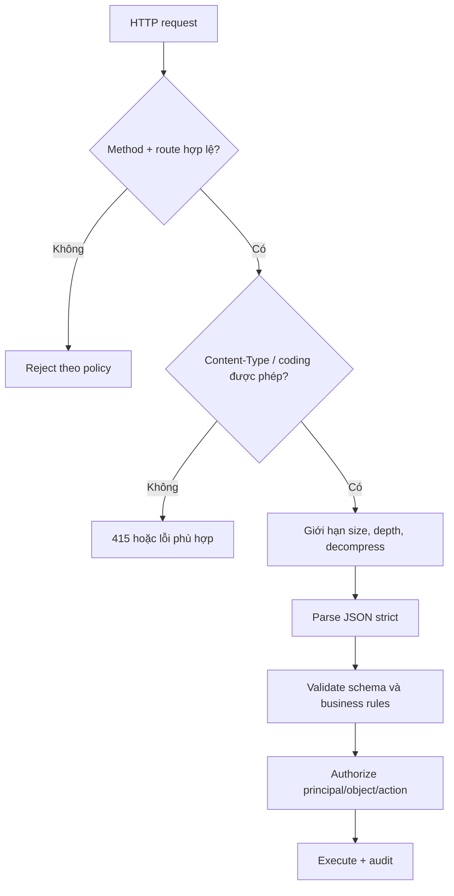
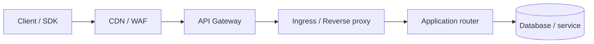
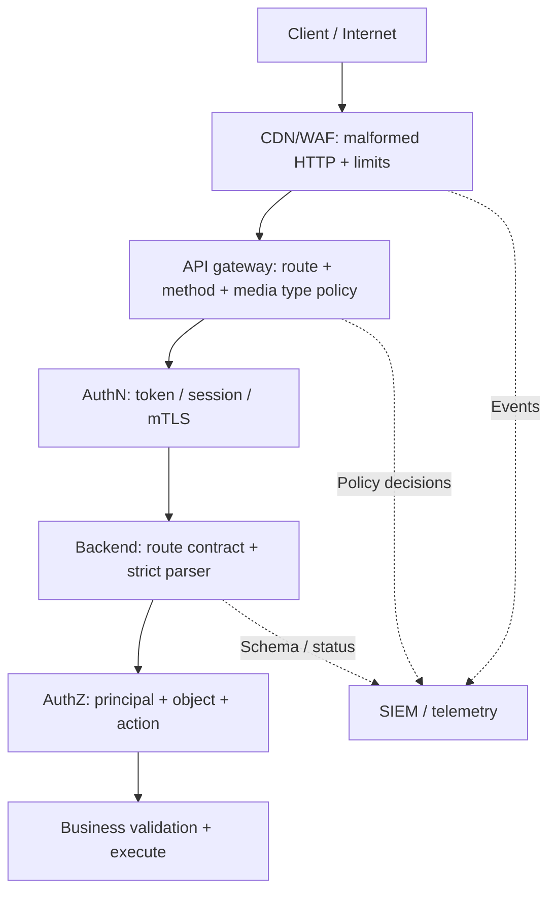

# Giới hạn phương thức HTTP và content type để bảo vệ API và network service

## 1. Vấn đề: một API không nên chấp nhận mọi cách gửi request

Một API nghiệp vụ có thể chỉ cần **`GET /orders/{id}`** để đọc đơn hàng và **`POST /orders`** để tạo đơn hàng. Nếu hệ thống còn nhận các phương thức không dùng tới, chấp nhận bất kỳ định dạng body nào hoặc để reverse proxy và backend hiểu request khác nhau, bề mặt tấn công và nguy cơ lỗi vận hành sẽ tăng lên.

Hai trục kiểm soát đơn giản nhưng rất quan trọng:

1. **HTTP method allowlist:** đối với **mỗi route/resource**, phương thức nào thực sự được hỗ trợ và được phép? `GET`, `POST`, `PUT`, `PATCH`, `DELETE`, `HEAD`, `OPTIONS` hay phương thức khác?
2. **Media type allowlist:** với từng phương thức có request body, backend chấp nhận **`Content-Type`** nào, sẽ parse nội dung bằng cơ chế nào và kiểm tra schema ra sao? Với response, client yêu cầu kiểu dữ liệu nào qua **`Accept`**?

Ví dụ thiết kế:

```http
POST /api/v1/orders HTTP/1.1
Host: api.example.com
Content-Type: application/json
Accept: application/json
Authorization: Bearer <redacted-token>

{"itemCode":"ABC-001","quantity":2}
```

Một API tạo đơn hàng có thể chấp nhận request này **nếu token được xác minh, người dùng có quyền, JSON đúng schema và trạng thái nghiệp vụ hợp lệ**. Nhưng cùng route không nhất thiết phải chấp nhận `PUT`, `TRACE`, `application/xml` hoặc body có kiểu dữ liệu không khai báo.

Trong mô-đun **SECURITY_NETWORK_SECURITY**, giới hạn HTTP methods/content types liên hệ với **WAF, reverse proxy, API gateway, TLS, firewall/segmentation, IDS/IPS, NAC, VPN và mô hình hóa mối đe dọa**. Đây là phòng vệ ở **tầng HTTP/API**: TLS bảo vệ kênh, firewall kiểm soát reachability, còn application/gateway phải hiểu và thực thi **ngữ nghĩa request**.

> **Nguyên tắc:** Chấp nhận **chỉ những phương thức và media types đã được thiết kế**, xác thực/ủy quyền cho từng thao tác, parse dữ liệu một cách nhất quán từ edge đến backend. Method và Content-Type **không phải bằng chứng danh tính**, cũng không thay thế kiểm tra dữ liệu sau khi parse.

### Mục tiêu học tập

Sau bài này, người học có thể:

- Giải thích method semantics, **safe**, **idempotent** và rủi ro method override.
- Phân biệt **`Content-Type`, `Accept`, `Content-Encoding`, `415`, `406`, `405` và `501`**.
- Thiết kế allowlist **theo route + method + request media type + response representation**, không chỉ theo domain.
- Phát hiện khác biệt giữa **CDN/WAF, gateway, reverse proxy và backend** về method, headers và parser.
- Áp chính sách cho **JSON, XML, form, multipart, PATCH, GraphQL/gRPC** với các giới hạn đúng ngữ cảnh.
- Viết kế hoạch kiểm thử, ghi log, rollout và ứng phó sự cố mà không làm gián đoạn traffic hợp lệ.

## 2. HTTP method không phải quyền truy cập

**HTTP method** mô tả **ngữ nghĩa mong muốn** của thao tác với target resource. Trong HTTP request, token method đi kèm URI, version hoặc pseudo-headers tùy phiên bản HTTP.

Một **method allowlist** trả lời: “Endpoint có triển khai và cho phép xử lý phương thức này hay không?” **Authentication/authorization** trả lời câu hỏi khác: “Principal cụ thể này có được thực hiện thao tác đó trên đối tượng đó không?”

Ví dụ:

```text
Method:     DELETE
Target:     /api/v1/orders/42
Principal:  user-123

Method policy:    DELETE /api/v1/orders/{id} được định nghĩa
Authentication:   token hợp lệ?
Authorization:    user-123 có quyền xóa order 42?
Business rule:    order 42 ở trạng thái cho phép xóa?
```

Việc endpoint hỗ trợ `DELETE` **không có nghĩa** mọi người dùng được xóa; ngược lại, một admin có quyền quản trị **không khiến** một route vốn không hỗ trợ `TRACE` trở thành hợp lệ.

### 2.1. Các lớp quyết định cần tách

| Lớp | Câu hỏi | Ví dụ kiểm soát |
|---|---|---|
| Network/firewall | request có thể tới gateway không? | TCP/443, private route, egress restrictions |
| TLS | endpoint có được xác minh và đường truyền được bảo vệ không? | certificate, SNI, TLS version |
| HTTP parser/router | method, path, headers và framing hợp lệ không? | strict parser, route matching |
| Method allowlist | route này hỗ trợ method nào? | `GET`/`POST` trên resource đã chỉ định |
| Media type policy | request body dùng định dạng nào? | `application/json` hoặc patch media type |
| Authentication | ai đang gửi request? | OIDC, mTLS, session, API key |
| Authorization | họ được làm gì với tài nguyên nào? | role/scope/tenant/object-level policy |
| Validation/business | body và trạng thái nghiệp vụ có hợp lệ không? | schema, constraints, invariants |
| Observability | quyết định được ghi nhận ra sao? | request ID, normalized method, route, status |

**Không giao toàn bộ quyền truy cập cho WAF chỉ vì WAF đã giới hạn phương thức.** Application vẫn là nơi kiểm tra business authorization và thao tác trên dữ liệu cụ thể.

## 3. Ý nghĩa các HTTP methods thường gặp

| Method | Mục đích thường gặp | Safe theo HTTP semantics? | Idempotent theo HTTP semantics? | Lưu ý bảo mật |
|---|---|---|---|---|
| **GET** | đọc representation | có | có | không tạo side effect do người dùng yêu cầu; không đặt bí mật vào query |
| **HEAD** | lấy metadata response giống GET nhưng không có response content | có | có | framework có thể tự hỗ trợ HEAD cho GET |
| **OPTIONS** | tìm thông tin về lựa chọn giao tiếp; thường dùng CORS preflight | có | có | cần scoped CORS policy, không biến thành bypass |
| **TRACE** | message loop-back chẩn đoán | có theo semantics chuẩn | có | thường không cần ở public API; cân nhắc tắt để tránh phản chiếu dữ liệu nhạy cảm |
| **POST** | xử lý request theo semantics của resource | không mặc định | không mặc định | tạo/đổi trạng thái; cần AuthZ, CSRF khi áp dụng, idempotency |
| **PUT** | tạo/thay representation tại target URI theo semantics | không | có | không cho phép ghi tùy ý ở mọi URI; validate toàn bộ object |
| **DELETE** | yêu cầu xóa liên kết của target resource | không | có | vẫn có thể gây side effect nghiệp vụ; cần quyền và audit |
| **PATCH** | áp một tập thay đổi lên resource | không | không mặc định | media type patch document phải được thỏa thuận và kiểm tra |
| **CONNECT** | thiết lập tunnel tới đích theo request-target/semantics được hỗ trợ | không | không | đặc biệt nhạy cảm ở proxy; không bật mặc định cho API business |
| **Extension methods** | WebDAV hoặc giao thức mở rộng | phụ thuộc định nghĩa | phụ thuộc định nghĩa | chỉ cho khi một ứng dụng cần và các tầng hỗ trợ đúng |

**Safe/idempotent là thuộc tính ngữ nghĩa của method**, không phải cam kết implementation không có bug. Một `GET` thực hiện chuyển tiền là **thiết kế sai**; một `PUT` có thể phát sinh log/audit mỗi lần thực hiện, nhưng ý nghĩa trạng thái mong muốn của request vẫn là idempotent theo HTTP.

### 3.1. Safe không đồng nghĩa vô hại trước DoS

Một `GET` trả về dữ liệu lớn, thực thi tìm kiếm tốn CPU hoặc quét bảng chưa có index vẫn có thể gây quá tải. Vì vậy phương thức safe vẫn cần **authorization, pagination, query limits, rate limits và resource budgets**.

### 3.2. Idempotent không có nghĩa mọi retry đều an toàn

Idempotence mô tả **tác động dự kiến của nhiều request giống nhau so với một request** trong semantics. Trong hệ thống phân tán:

- Proxy có thể retry khi upstream timeout.
- Một request có thể đã thực thi nhưng response bị mất.
- Application có thể gửi email, phát event hoặc trigger workflow ngoài thiết kế idempotent.

Với nghiệp vụ tạo đơn/thu tiền qua `POST`, cần cơ chế như **idempotency key, ràng buộc principal và payload, lưu kết quả và xử lý đồng thời** nếu muốn retry an toàn; đừng kỳ vọng `POST` tự có thuộc tính này.

## 4. Thiết kế allowlist theo route, không phải “GET và POST toàn site”

Chính sách chung như “chỉ cho GET/POST vào mọi đường dẫn” có thể là baseline đơn giản, nhưng thường **quá rộng ở route đọc** và **quá hẹp ở route thực sự cần PUT/PATCH/DELETE**.

Mẫu mapping:

| Route | Methods cho phép | Request Content-Type | Response type chính | Quyền bắt buộc |
|---|---|---|---|---|
| `/api/v1/products` | `GET`, có thể `HEAD` | không cần request body | `application/json` | read-public hoặc policy tương ứng |
| `/api/v1/orders` | `POST` | `application/json` | `application/json` | `orders:create` |
| `/api/v1/orders/{id}` | `GET`, `HEAD`, `PATCH` | PATCH: `application/merge-patch+json` | `application/json` | read/update + object ownership |
| `/api/v1/files` | `POST` | `multipart/form-data` | `application/json` | `files:upload` |
| `/api/v1/status` | `GET` hoặc `HEAD` | không | `application/json` | hạn chế theo mạng/role nếu nội bộ |
| `/api/v1/admin/reindex` | `POST` | `application/json` hoặc rỗng theo contract | `application/json` | admin + MFA/step-up nếu yêu cầu |

Đây là **contract minh họa**, không phải route đang tồn tại. Một resource có thể có các phương thức khác theo business design.

### 4.1. Dùng API contract làm nguồn để tạo chính sách

**OpenAPI** có thể mô tả từng operation theo method/path, `requestBody.content` và `responses.content`. Một quy trình có kiểm soát có thể so sánh hoặc sinh chính sách từ contract, nhưng:

1. **Contract và ứng dụng phải nhất quán**; spec bị bỏ quên sẽ cho rule sai.
2. Route templates, optional slash, versioning và URL rewrites phải có cách match tương đương.
3. Không dựa vào generated gateway rules để thay **per-object authorization**.
4. Mọi thay đổi cần regression tests và kiểm chứng runtime, không chỉ validate YAML/OpenAPI syntax.

### 4.2. Default deny đối với methods không định nghĩa

Với API được quản lý, khởi đầu từ **allowlist rõ ràng** giúp tránh vô tình bật:

- Debug endpoints.
- `TRACE`/`CONNECT` không phục vụ nghiệp vụ.
- WebDAV extension methods không cần.
- Endpoint do framework hoặc third-party plugin tự tạo.
- Method được rewrite/override qua header hoặc parameter.

Tuy nhiên, **deny ở gateway phải đồng bộ với phương thức hỗ trợ hợp lệ**, đặc biệt với `HEAD`, `OPTIONS`, gRPC, WebSocket và health checks. Default deny không đồng nghĩa chặn bừa mọi phương thức ở mọi nơi.

## 5. Chọn HTTP status code phù hợp khi từ chối method

Theo HTTP semantics (RFC 9110), các trường hợp thường gặp:

| Status | Nghĩa | Ví dụ |
|---|---|---|
| **405 Method Not Allowed** | server biết method, nhưng target resource hiện không hỗ trợ method đó | `DELETE /api/v1/products` trong khi route chỉ có GET |
| **501 Not Implemented** | server không nhận biết hoặc không hỗ trợ chức năng cần để xử lý method | method mở rộng mà server không có hỗ trợ |
| **403 Forbidden** | request được hiểu, nhưng quyền bị từ chối | user thiếu quyền gọi `POST /api/v1/admin` |
| **401 Unauthorized** | cần thông tin xác thực hợp lệ theo authentication scheme | token thiếu/hết hạn ở protected endpoint |
| **404 Not Found** | không tìm thấy target resource hoặc policy cố tình không công bố sự tồn tại | URI không tồn tại; một số thiết kế ẩn resource |
| **400 Bad Request** | request sai cú pháp hoặc không thể xử lý ở mức cấu trúc | HTTP request line/header không hợp lệ |
| **429 Too Many Requests** | vượt chính sách tốc độ request | rate limit theo principal/route |

**Không mặc định 403 = method bị chặn.** 403 là kết quả **quyết định quyền**; 405 trả lời về **method support của target resource**. Trong một số hệ thống, security filter từ chối trước router nên một request có thể nhận 401/403 thay vì 405; điều đó phụ thuộc kiến trúc và cân bằng giữa minh bạch/chống lộ thông tin.

### 5.1. `Allow` header khi trả 405

Theo RFC 9110, server **MUST** tạo trường `Allow` trong response **405 Method Not Allowed**, nêu các phương thức được hỗ trợ hiện tại của target resource:

```http
HTTP/1.1 405 Method Not Allowed
Allow: GET, HEAD
Content-Type: application/problem+json
Cache-Control: no-store

{"type":"about:blank","title":"Method Not Allowed","status":405}
```

`Allow` phải phản ánh **resource được nhắm tới** và có thể thay đổi theo trạng thái/server. Không trả `Allow: GET, POST, PUT, DELETE` cố định cho mọi URL chỉ vì ứng dụng có các methods đó ở những route khác nhau.

### 5.2. Phương thức phân biệt chữ hoa/chữ thường

Tên HTTP method là **case-sensitive**. `GET` khác `get` theo cú pháp chuẩn. Router có thể chỉ hỗ trợ uppercase conventions; proxy nên xử lý input **nhất quán** và không âm thầm đổi kiểu chữ làm thay đổi semantics ở backend.

## 6. `GET` và `HEAD`: chặn side effect do người dùng yêu cầu

`GET` được định nghĩa là safe: client không yêu cầu thay đổi trạng thái tài nguyên chỉ bằng việc đọc. Server có thể vẫn ghi access log, đếm metrics hoặc cache, nhưng không nên thiết kế **thao tác nguy hiểm** phụ thuộc vào GET.

**Thiết kế không nên có:**

```http
GET /admin/delete-user?id=42 HTTP/1.1
Host: api.example.com
```

Những thao tác như xóa user, đặt hàng, gửi tiền phải dùng method phù hợp (thường POST/DELETE tùy semantics) với **AuthN, AuthZ, CSRF controls khi áp dụng, validation, audit và chính sách retry**.

### 6.1. `HEAD` thường được framework xử lý thay cho GET

`HEAD` yêu cầu response metadata tương đương GET trong phạm vi phù hợp nhưng **không gửi response body**. Một số framework tự hỗ trợ `HEAD` cho route `GET`; do đó policy ghi “chỉ GET” có thể không phản ánh runtime.

Test cần xác minh:

- `HEAD` có được cho phép như mong muốn không?
- Status, headers và authorization có cùng phạm vi với GET không?
- Response không mang message body theo ngữ nghĩa HEAD.
- Proxy/cache không tạo side effect hay bypass auth chỉ vì “không có body”.

### 6.2. Request body với `GET`

Nội dung trong GET request **không có semantics chung được định nghĩa** trong HTTP. Việc client gửi body trong GET có thể gây khác biệt giữa HTTP clients, proxies và backends, thậm chí làm tăng rủi ro request desynchronization nếu parser không thống nhất.

Đối với API tiêu chuẩn, nên **không dựa vào GET body** để truyền điều kiện nghiệp vụ. Dùng query parameters có validation và giới hạn, hoặc thiết kế một operation khác (ví dụ POST tìm kiếm phức tạp với policy rõ). Query string cũng có rủi ro lộ dữ liệu qua URL/log nên không dùng để chứa token hoặc bí mật.

## 7. `OPTIONS` và CORS preflight: không chặn nhầm

Browser có thể gửi **CORS preflight** bằng method `OPTIONS` trước một cross-origin request có đặc tính yêu cầu preflight:

```http
OPTIONS /api/v1/orders HTTP/1.1
Host: api.example.com
Origin: https://app.example.com
Access-Control-Request-Method: POST
Access-Control-Request-Headers: authorization, content-type
```

Một gateway chặn **mọi OPTIONS** có thể làm web application không gửi được request thực, dù `POST` hợp lệ. Ngược lại, cho OPTIONS vô điều kiện trả CORS wildcard không tự an toàn.

### 7.1. Phân biệt preflight và request thực

- **Preflight** hỏi server/browser policy có cho cross-origin request với method/headers dự định không.
- **Actual request** vẫn phải được **xác thực và phân quyền** theo API.
- Header như `Origin` và `Access-Control-Request-Method` **không phải credential** và client không phải browser có thể tự tạo.
- CORS là cơ chế **được trình duyệt thực thi**, không phải firewall, user authentication hay API authorization.

### 7.2. Thiết kế CORS

Nên:

1. Allowlist **origins cụ thể** theo môi trường; chỉ dùng wildcard khi thực sự phù hợp public resource.
2. Khai báo `Access-Control-Allow-Methods` đúng scope route; không quảng bá methods không được phép.
3. Chỉ cho `Access-Control-Allow-Headers` cần thiết.
4. Xác định chính sách **credentials/cookies** đúng; `Access-Control-Allow-Origin: *` không dùng như một cách mở cross-origin credentials.
5. Dùng `Vary: Origin` khi server thay đổi response CORS theo request origin và caching cần phân biệt.
6. Kiểm thử preflight **không đòi một access token mà browser chưa gửi trong bước đó** nếu kiến trúc cần browser CORS flow; request thật vẫn kiểm tra token.

Không để API gateway trả CORS preflight success cho một route/method mà backend **vẫn không hỗ trợ**, gây lỗi khó hiểu hoặc mở ra sự khác biệt giữa các tầng.

## 8. `TRACE`, `CONNECT` và extension methods

### 8.1. TRACE

`TRACE` dùng cho chẩn đoán message loop-back theo HTTP semantics. Nhiều public API không cần nó. Vì các hệ thống có thể phản chiếu một phần request hoặc làm lộ metadata trong điều kiện nhất định, tổ chức thường **vô hiệu hóa TRACE ở những endpoint không có nhu cầu**.

Không tuyên bố mọi server cho TRACE đều có thể bị chiếm quyền: rủi ro còn phụ thuộc authentication, browser constraints, cách phản chiếu headers và cấu hình. **Giảm bề mặt tấn công** vẫn là lựa chọn có cơ sở khi không dùng.

### 8.2. CONNECT và proxy tunnel

`CONNECT` yêu cầu thiết lập tunnel tới đích theo ngữ nghĩa/điều kiện giao thức. Đây là tính năng của **forward proxy** hoặc gateway hỗ trợ tunneling, **không phải** method mặc định cho REST business API.

Một proxy cho CONNECT tới host/port bất kỳ có thể trở thành **open proxy** hoặc đường truy cập vượt egress policy. Chỉ bật khi cần, có **proxy authentication, destination allowlist, network controls, logging và rate limits**.

**HTTP/2/HTTP/3 extended CONNECT** phục vụ một số ứng dụng như WebSocket; đừng chặn toàn bộ CONNECT trên gateway có vai trò tunneling hợp lệ mà không phân loại **chế độ và đích**.

### 8.3. WebDAV và method mở rộng

Methods như `PROPFIND`, `MKCOL` hoặc `LOCK` có thể có ý nghĩa ở server WebDAV nhưng không cần trên đa số JSON REST APIs. Nếu không có tính năng WebDAV được phê duyệt, route nên từ chối theo policy và backend không được tự bật handlers cũ ngoài tầm kiểm soát của gateway.

## 9. HTTP method override và tunneling phải được kiểm soát

Một số framework hoặc hệ thống legacy hỗ trợ “method override” vì client/form cũ chỉ gửi được GET/POST. Ví dụ:

```http
POST /api/v1/orders/42 HTTP/1.1
Host: api.example.com
X-HTTP-Method-Override: DELETE
Content-Type: application/x-www-form-urlencoded

_method=DELETE
```

Header `X-HTTP-Method-Override` và form parameter `_method` **không phải cơ chế chuẩn chung bắt buộc**; việc hỗ trợ tùy framework/middleware. Nhưng nếu proxy cho phép `POST` mà backend lại **đổi thành DELETE** dựa trên dữ liệu client gửi, chính sách method ở edge có thể bị bỏ qua.

### 9.1. Quy tắc an toàn

- **Tắt method override nếu không cần**; không bật mặc định ở API hiện đại.
- Nếu cần cho legacy, giới hạn **route, principal, nguồn client và methods đích**.
- Chuẩn hóa/reject override **ở trust boundary trước khi áp method allowlist và AuthZ**; nếu hệ thống không thể thống nhất, thiết kế nên từ chối.
- Không để middleware khác nhau xử lý `_method`, header override và native method theo thứ tự không xác định.
- Log **wire_method** và **effective_method** riêng cho điều tra, nhưng quyền phải áp theo method thực được thực thi.
- Kiểm thử client đồng thời gửi native `GET` và override `DELETE`, header trùng hoặc trường override sai cú pháp.

**Đừng chỉ tìm `X-HTTP-Method-Override`:** các framework có thể dùng header/parameter khác. Kiểm kê middleware và config thực tế.

## 10. `Content-Type`, `Accept` và `Content-Encoding` khác nhau thế nào?

Ba trường dễ bị nhầm:

| Trường | Phía thường gửi | Mục đích | Ví dụ |
|---|---|---|---|
| **`Content-Type`** | bên gửi content (request hoặc response) | cho biết media type của **representation được mang trong message** | `application/json` |
| **`Accept`** | client/requester | mô tả các response media types mà client chấp nhận | `application/json`, `application/problem+json` |
| **`Content-Encoding`** | bên gửi representation có content coding | mô tả content coding như nén để giải mã representation | `gzip`, `br` theo hỗ trợ |
| **`Accept-Encoding`** | client | content codings mà client chấp nhận trong response | `gzip, br` |
| **`Content-Length`** | bên gửi khi phù hợp framing | kích thước phần content theo HTTP framing | `173` |
| **`Transfer-Encoding`** | cơ chế truyền ở HTTP/1.1 khi áp dụng | transfer coding/framing theo version | `chunked` |

Ví dụ:

```http
POST /api/v1/events HTTP/1.1
Host: api.example.com
Content-Type: application/json; charset=utf-8
Content-Encoding: gzip
Accept: application/json
```

Ở đây request là **JSON representation được mã hóa theo gzip**. Server phải kiểm tra **content coding được phép**, giải mã theo quy trình đúng, rồi parse JSON/validate schema. Không hiểu `Content-Encoding: gzip` là request `Content-Type: application/gzip` một cách tự động.

### 10.1. Các nhóm policy riêng biệt

1. **Allowed methods** per route.
2. **Accepted request media types** per method.
3. **Allowed content codings** per route và giới hạn giải nén.
4. **Response representations** theo `Accept` và contract.
5. **Limits & validation** sau decode, parse và xác thực.

Thiết kế một regex “chỉ cho application/json” mà không xét các lớp này có thể chặn request hợp lệ hoặc bỏ qua body đã nén/biến đổi.

## 11. Media type là gì và so khớp thế nào?

Media type có cấu trúc **`type/subtype`** và có thể có parameters:

```text
application/json
application/json; charset=utf-8
application/problem+json
application/merge-patch+json
application/json-patch+json
application/x-www-form-urlencoded
multipart/form-data; boundary=----form-boundary-example
application/xml
text/plain; charset=utf-8
application/octet-stream
```

### 11.1. Tránh hai cực đoan

**Quá rộng:**

```text
Accept every Content-Type
→ Parse everything as JSON or guess from first byte
```

**Quá cứng:**

```text
Compare raw header exactly to "application/json"
→ Reject valid permitted parameter variants
```

Chính sách phải dựa trên **media type parser theo chuẩn**, xử lý type/subtype, parameters và **supported charsets** hợp lệ. Ví dụ JSON có những quy tắc mã hóa riêng (RFC 8259); việc parser chấp nhận một `charset` không có nghĩa mọi cách mã hóa đều hợp lệ hoặc được policy cho phép.

### 11.2. Structured syntax suffix `+json`

`application/problem+json` và `application/merge-patch+json` có suffix `+json`, nhưng **không có nghĩa** chúng cùng semantics với `application/json` trên mọi endpoint.

- `application/json` thường đại diện JSON data theo schema riêng.
- `application/problem+json` thường dùng cho **problem details response**, không mặc nhiên là request body hợp lệ để tạo đơn hàng.
- `application/json-patch+json` mô tả **chuỗi operations JSON Patch**.
- `application/merge-patch+json` mô tả **merge patch document**.

**Chỉ cho `application/*+json` quá rộng** có thể khiến application parse một patch document như object thông thường hoặc bỏ qua validation. Phải liệt kê đúng **media types mà route triển khai**.

## 12. Các status code liên quan đến media type và nội dung

| Status | Lý do điển hình | Ví dụ |
|---|---|---|
| **415 Unsupported Media Type** | server không hỗ trợ **request content format** cho route/method, có thể kể cả content coding | `POST /orders` với `application/xml` khi chỉ nhận JSON |
| **406 Not Acceptable** | không có response representation chấp nhận được theo `Accept` và server không chọn được response phù hợp | client chỉ chấp nhận `application/xml`, API chỉ cung cấp JSON |
| **400 Bad Request** | request/body có lỗi cú pháp hoặc cấu trúc | JSON không parse được, framing sai |
| **422 Unprocessable Content** | media type/cú pháp hiểu được nhưng không thể xử lý instructions của content theo semantics | field hợp cú pháp nhưng vi phạm rule được mô hình hóa như 422 |
| **413 Content Too Large** | request content lớn hơn giới hạn mà server muốn/chấp nhận xử lý | upload vượt kích thước |
| **431 Request Header Fields Too Large** | request headers vượt giới hạn | header dài quá mức |
| **405 Method Not Allowed** | method không được target resource hỗ trợ | `DELETE` trên route read-only |
| **401/403** | chưa được xác thực hoặc không đủ quyền | token thiếu/sai scope |

**Các mã lỗi phản ánh tầng phát hiện lỗi.** Gateway có thể trả `413` trước backend; middleware auth có thể trả `401` trước khi controller nhận biết Content-Type; API có thể dùng `400` hoặc `422` tùy contract và framework. Hệ thống cần thống nhất **error handling contract**, không tự kết luận mọi lỗi validation đều bắt buộc 422.

### 12.1. Ví dụ `415`

```http
POST /api/v1/orders HTTP/1.1
Host: api.example.com
Content-Type: text/plain

{"itemCode":"ABC-001","quantity":2}
```

Nếu endpoint **chỉ chấp nhận `application/json`**, body có hình thức giống JSON **không khiến** `text/plain` tự được phép. Server nên từ chối rõ theo policy, thay vì đoán kiểu nội dung rồi parse.

### 12.2. Ví dụ `406`

```http
GET /api/v1/orders/42 HTTP/1.1
Host: api.example.com
Accept: application/xml
```

Nếu API chỉ cung cấp `application/json` và chính sách không cho gửi response khác, `406` có thể phù hợp. **Không đồng nhất `Content-Type` request với `Accept` response**.

### 12.3. Problem Details

Một API có thể chuẩn hóa lỗi theo **RFC 9457** bằng `application/problem+json`, chứa `type`, `title`, `status`, `detail` và `instance` khi phù hợp:

```http
HTTP/1.1 415 Unsupported Media Type
Content-Type: application/problem+json
Cache-Control: no-store

{
  "type": "about:blank",
  "title": "Unsupported Media Type",
  "status": 415,
  "detail": "This endpoint accepts application/json."
}
```

Không để error detail lộ **stack traces, internal network paths, service tokens, parsing internals nhạy cảm hoặc dữ liệu người dùng**. Response type cho lỗi cần được định nghĩa hợp lý cả khi `Accept` của client không khớp hoàn toàn.

## 13. JSON endpoint: kiểm tra kiểu và schema, không chỉ parse được

Đối với một API nhận JSON, các lớp xử lý:



Đây là **sơ đồ trách nhiệm logic**, không phải yêu cầu cố định về thứ tự thực thi filters: authentication có thể cần diễn ra trước body parsing để tránh tiêu tốn tài nguyên không cần hoặc ngăn tiết lộ thông tin. Bất kể thứ tự, các điều kiện bắt buộc **không được bỏ qua**.

### 13.1. Các thứ cần kiểm tra sau parse

- JSON hợp lệ theo cú pháp/encoding được hỗ trợ.
- Root type đúng: object hay array theo API contract.
- Required fields, types, min/max length, enum, pattern, numeric range.
- Không chấp nhận **unknown fields** nếu policy/schema đặt default deny.
- Giới hạn **nesting depth, number of elements, string length và total bytes**.
- Kiểm tra Unicode, canonical representation và logic chuỗi theo yêu cầu nghiệp vụ.
- Tránh nhầm `null`, missing field, empty string và zero.
- Validate **tenant/owner/object identity** lấy từ dữ liệu **được xác thực**, không tin các trường user gửi để tự tăng quyền.

### 13.2. Duplicate JSON keys

Một JSON object như:

```json
{"role":"viewer","role":"admin"}
```

có thể được các parsers hoặc ứng dụng xử lý **khác nhau** (giữ giá trị đầu, cuối hoặc báo lỗi). Nếu WAF xem một giá trị, backend xem giá trị khác, chính sách có thể lệch. Với API nhạy cảm, nên **từ chối duplicate keys** hoặc cấu hình **cùng semantics** tại WAF/gateway/backend và kiểm thử.

### 13.3. Content-Type không xác minh tính chân thực của client

Một client bất kỳ có thể tự gửi `Content-Type: application/json`. Đây là **thông báo định dạng**, không phải chứng cứ payload hợp lệ, danh tính người dùng hay tính toàn vẹn nghiệp vụ. TLS/mTLS và token authentication giải quyết những thuộc tính khác.

## 14. XML và những parser cần kiểm soát riêng

Nếu một route có yêu cầu nghiệp vụ chấp nhận `application/xml` hoặc `text/xml`, cần thiết kế parser policy phù hợp thay vì bật XML cho toàn API.

Rủi ro quan trọng:

- **External entity resolution (XXE)** khi parser hỗ trợ và không được harden: có thể dẫn tới đọc tài nguyên hoặc truy cập mạng ngoài ý muốn theo điều kiện.
- **Entity expansion/resource exhaustion** ở các parser cho phép xử lý cấu trúc lớn.
- Khác biệt namespace, schema, encoding hoặc cách chuẩn hóa giữa gateway/backend.
- Tình huống XML body được chấp nhận trong endpoint vốn thiết kế JSON nhưng không có validation tương ứng.

Biện pháp:

1. Chỉ enable XML cho route/consumer thật sự dùng.
2. Cấu hình parser vô hiệu hóa **external entity resolution/DTD** khi không cần, theo thư viện cụ thể.
3. Giới hạn bytes, depth và entity expansions.
4. Validate schema/required fields và business authorization.
5. Kiểm thử thông điệp malformed theo quy trình lab được phép.
6. Không coi WAF cho phép XML là bằng chứng thư viện XML backend đã được harden.

Nếu hệ thống **không hỗ trợ XML**, từ chối `application/xml` là lựa chọn đơn giản hơn việc tạo parser không có nhu cầu.

## 15. Form data và `application/x-www-form-urlencoded`

HTML forms truyền thống có thể gửi request dạng:

```http
POST /account/preferences HTTP/1.1
Host: app.example.com
Content-Type: application/x-www-form-urlencoded

theme=dark&notifications=on
```

Nếu route là browser form hợp lệ, việc cho phép `application/x-www-form-urlencoded` cần kèm:

- Authentication và **CSRF protection** phù hợp khi dùng cookie/session credentials.
- Giới hạn số lượng/độ dài form fields và tổng body size.
- Quy tắc xử lý **duplicate field names**, encoding và nested keys.
- Kiểm tra input types và authorization như JSON API.
- Không tự động coi form `_method=DELETE` là một thao tác được phép nếu method override chưa có policy.

**Một endpoint JSON-only không nhất thiết cần nhận form-encoded body.** Chấp nhận nhiều định dạng làm tăng số đường parser và khả năng khác biệt kiểm soát.

### 15.1. CORS không thay CSRF

Một số dạng HTML form và request được trình duyệt phân loại là **simple requests** có thể được gửi mà **không cần CORS preflight**. Nếu ứng dụng dùng cookie credentials và cho thay đổi trạng thái mà thiếu CSRF controls, chỉ cấu hình CORS không đủ.

CSRF token, `SameSite` cookies, Origin/Referer validation khi thích hợp và session controls cần được thiết kế theo ứng dụng. Không coi `Content-Type: application/json` là biện pháp chống CSRF duy nhất.

## 16. Multipart và upload: `multipart/form-data` cần policy riêng

Upload thường gửi content dạng multipart:

```http
POST /api/v1/files HTTP/1.1
Host: api.example.com
Content-Type: multipart/form-data; boundary=----demoBoundary
```

Một multipart body có thể gồm file và form fields, mỗi part có headers riêng. Vì vậy server không thể chỉ nhìn request-level `Content-Type` rồi coi mọi part an toàn.

### 16.1. Các giới hạn quan trọng

- Chỉ cho upload trên **route và role được phê duyệt**.
- Giới hạn **tổng request bytes, số parts, kích thước từng file, tên file và field**.
- Parse `boundary` đúng chuẩn; từ chối malformed multipart.
- **Không tin MIME type và filename do client tự khai** để quyết định file thực sự vô hại.
- Kiểm tra file signature/type ở mức phù hợp và quy trình scan/sandbox cho dữ liệu có nguy cơ.
- Bảo vệ khỏi **path traversal**, không lưu trực tiếp filename do client cung cấp làm path hệ thống.
- Lưu upload tại vùng tách khỏi executable web root khi cần, dùng tên/ID server-generated.
- Kiểm tra quyền tải/xem file theo user/tenant; không cho đường download public ngoài ý muốn.
- Áp quotas, retention và audit.

### 16.2. Đừng dùng `application/octet-stream` làm đường vòng

Một API nhận raw binary stream có thể hợp lệ nếu được thiết kế, nhưng việc chấp nhận `application/octet-stream` cho mọi endpoint chỉ để tránh 415 tạo đường parse không có contract. File upload, protobuf và object storage có thể cần media type riêng, với **schema/size/content validation** tương ứng.

### 16.3. Upload lớn và proxy

CDN, WAF, load balancer, ingress và backend có thể có **giới hạn body size khác nhau**; cần tài liệu hóa điểm enforce đầu tiên, streaming/buffering, timeout và phản hồi lỗi. Nếu gateway cho request 500 MB đi qua nhưng backend chỉ chấp nhận 10 MB, có thể tiêu tốn băng thông và tạo lỗi thiếu nhất quán.

## 17. `PUT`, `PATCH` và media types của patch document

### 17.1. PUT

`PUT /resource/{id}` yêu cầu tạo/thay representation của target resource theo semantics. Nếu ứng dụng dùng PUT để cập nhật, cần xác định rõ:

- Có cho phép create-if-absent hay chỉ update existing?
- Fields nào người dùng được phép thay?
- Có yêu cầu conditional requests (`If-Match`/ETag) để tránh mất cập nhật không?
- Request body phải đúng JSON/schema hay media type nào?
- Có lỗ hổng **mass assignment** khi client gửi thêm `role`/`ownerId` không?

Không cho `PUT` chỉ vì endpoint hỗ trợ `POST`; hai phương thức không có semantics mặc định giống nhau.

### 17.2. PATCH

`PATCH` áp một **patch document** lên resource; syntax được biểu diễn bằng media type cụ thể:

| Media type | Ý nghĩa | Ví dụ phù hợp |
|---|---|---|
| `application/json-patch+json` | mảng thao tác như `add`, `remove`, `replace` với JSON Pointer | cập nhật có chủ đích một số paths |
| `application/merge-patch+json` | JSON object/value dùng merge-patch semantics, trong đó `null` có ý nghĩa xóa member trong object theo quy tắc | partial update tài liệu JSON |
| `application/json` | JSON thông thường | chỉ dùng cho PATCH nếu API định nghĩa semantics riêng minh bạch |

Đừng để backend ngầm nhận cả hai patch formats chỉ vì đều là JSON.

### 17.3. Bảo vệ dữ liệu được patch

- Allowlist **fields/paths có thể thay** theo principal/tenant.
- Không cho client tự sửa `ownerId`, `role`, `isAdmin` hay trạng thái thanh toán nếu không được ủy quyền.
- Xử lý **JSON Pointer escaping và nested paths** nhất quán; không dùng string matching tùy ý.
- Giới hạn số operations/patch size và tác động CPU.
- Kiểm tra preconditions, version/ETag để tránh lost updates.
- Log action và object IDs nhưng không log dữ liệu bí mật.
- Không tự retry patch có side effect khi chưa chứng minh idempotence phù hợp.

### 17.4. Thông báo `Accept-Patch` khi thích hợp

Một server hỗ trợ PATCH có thể quảng bá những patch media types được chấp nhận qua `Accept-Patch` theo cơ chế chuẩn hóa. Tuy nhiên header chỉ mang thông tin; **application vẫn phải enforce consumes type** khi nhận request.

## 18. Content sniffing, charset và `X-Content-Type-Options`

**Content sniffing** là hành vi client/browser hoặc một số thành phần suy đoán nội dung từ bytes thay vì chỉ dựa vào declared media type. Điều này khác với **server-side request media type enforcement**.

### 18.1. Nguyên tắc phía request

- Không tự parse body như JSON chỉ vì ký tự đầu tiên là `{` khi `Content-Type` không được phép.
- Không chọn parser dựa trên filename extension mà bỏ qua actual type validation.
- Xử lý media type parameters theo quy tắc được hỗ trợ; không tự đưa ra charset lạ.
- Giới hạn content coding/decompression trước parser theo policy và resource budgets.
- Nếu missing `Content-Type` ở request có body, định nghĩa rõ hành vi route: yêu cầu type được khai báo hoặc có cơ chế mặc định được thiết kế có kiểm soát.

### 18.2. Nguyên tắc phía response

`X-Content-Type-Options: nosniff` là **response header** có thể giúp hạn chế một số hành vi MIME sniffing của browser, đặc biệt đối với script/style và những bối cảnh được hỗ trợ.

```http
HTTP/1.1 200 OK
Content-Type: application/json
X-Content-Type-Options: nosniff
Cache-Control: no-store
```

**`nosniff` không thay request validation**, không khiến một file upload trở nên an toàn và không tự xử lý stored XSS trong ứng dụng. Đối với file tải xuống, còn cần xem `Content-Disposition`, chính sách hosting, CSP và khả năng browser diễn giải nội dung.

### 18.3. Kiểm soát nén và expansion

`Content-Encoding` như `gzip` có thể khiến body nhỏ trên wire nhưng **rất lớn sau giải nén**. Nên đặt cả **compressed size limit, decompressed size limit, time/CPU budget và depth limits**. Nếu proxy giải nén ở edge nhưng backend nhìn body đã được biến đổi, cần giữ metadata/contract nhất quán để WAF và app đánh giá cùng representation.

## 19. Content negotiation cho response và cache

`Accept` có thể biểu thị nhiều kiểu response và trọng số `q`:

```http
GET /api/v1/orders/42 HTTP/1.1
Host: api.example.com
Accept: application/json, application/problem+json;q=0.8
```

Client đang thông báo loại representation mong muốn. Server có thể chọn một response phù hợp theo contract; nếu không có representation chấp nhận được, có thể trả `406` theo chính sách.

### 19.1. Không coi `Accept: */*` là quyền request media type

`Accept: */*` liên quan đến **response**, không cho client gửi XML vào một endpoint chỉ nhận JSON. Ngược lại, `Content-Type: application/json` trong request không có nghĩa client mặc nhiên chấp nhận mọi response format.

### 19.2. `Vary` và cache

Nếu representation khác nhau theo `Accept`, server/proxy cần đánh giá **`Vary: Accept`** và cache key phù hợp. Nếu cache chỉ phân biệt URL nhưng server có JSON/XML variants, một client có thể nhận nhầm representation; với dữ liệu riêng tư, nguy cơ còn lớn hơn.

**Cache-Control/Vary phải đi cùng authentication và tenant boundaries**. Không đưa thông tin cá nhân vào public shared cache chỉ vì response là `GET 200`.

### 19.3. Ngôn ngữ và versioning

Một số API sử dụng media type versioning, ví dụ một vendor media type, nhưng cần coi đây là **contract có thực**: parser và response generator phải hỗ trợ, gateway/WAF và consumer SDK cùng hiểu. Không biến versioning thành việc cho phép mọi `application/*+json`.

## 20. CORS, Content-Type và CSRF trong ứng dụng browser

Một điểm tinh tế: **CORS preflight** không phải ranh giới bảo mật đầy đủ cho API. Browser có thể gửi một số request **không preflight**, trong khi công cụ CLI/server-to-server **không bị CORS giới hạn như browser**.

Ví dụ một ứng dụng legacy có cookie session:

```text
Authenticated browser session
  ↓ request từ một trang khác
Cross-site POST với form media type được phép
  ↓
Backend chỉ kiểm session cookie, không kiểm CSRF
  ↓
State change ngoài ý muốn có thể xảy ra nếu các điều kiện CSRF thỏa
```

Biện pháp:

- Xác định **session cookie auth, bearer token auth, mTLS và CSRF threat model** riêng.
- Với cookie-authenticated state-changing routes, dùng **CSRF protections** phù hợp với trình duyệt và application framework.
- `SameSite` giúp giảm một số nguy cơ nhưng không thay toàn bộ policy.
- Kiểm tra `Origin`/`Referer` khi phù hợp, nhưng phải hiểu những trường hợp có thể thiếu.
- Không dùng CORS wildcard như cách mở quyền.
- Không cho phép `text/plain` hoặc form body được parse như JSON trên một route nhạy cảm chỉ vì “cho client cũ dễ dùng”.

**Reject không cần thiết media types** giúp giảm đường thực thi và một số điều kiện tấn công, nhưng **không phải phương án chống CSRF duy nhất hoặc bảo đảm tuyệt đối**.

## 21. Chuỗi proxy/WAF/gateway/backend phải diễn giải method giống nhau

Kiến trúc có nhiều lớp:



Ví dụ một request đi qua HTTP/3 ở CDN, HTTP/2 ở gateway và HTTP/1.1 ở backend. Mỗi hop có parser và rule riêng; chính sách cuối cùng cần cùng hiểu **effective method, canonical path, Content-Type, content coding và request body boundaries**.

### 21.1. Các kiểu bất đồng nguy hiểm

| Bất đồng | Ví dụ minh họa | Rủi ro |
|---|---|---|
| Method override | gateway thấy POST, app thực thi DELETE | bypass method policy |
| URL rewrite | WAF kiểm `/public`, app nhận `/admin` | AuthZ/routing không nhất quán |
| Case/encoding normalization | một hop decode path khác hop sau | rule bị áp lên tài nguyên khác |
| Header duplication | proxy chọn Content-Type đầu, app chọn cuối | parser được chọn khác |
| Message framing | frontend/backend xử lý `Content-Length` và `Transfer-Encoding` khác nhau | HTTP desynchronization/request smuggling |
| Content-Encoding | WAF inspect compressed bytes, app decode và parse | kiểm tra body có thể bị thiếu |
| HTTP version conversion | h2 pseudo-header khác h1 Host/framing | request semantics bị biến đổi |
| Trusting identity headers | backend tin `X-User` do client tự khai | mạo danh quyền ứng dụng |

### 21.2. Nguyên tắc phòng vệ

1. **Chặn malformed HTTP** càng sớm càng khả thi, không cố đoán ý nghĩa.
2. Dùng **strict parsers** và hành vi nhất quán cho duplicate/ambiguous headers.
3. Chuẩn hóa method/path/Host/content metadata **trước khi dùng để route và áp policy**.
4. Xóa header override/identity không đáng tin từ client ở public edge.
5. Đảm bảo WAF/gateway/backend có **method + media type allowlist chung hoặc có cách kiểm chứng tương đương**.
6. **Backend vẫn enforce** policy quan trọng; không coi WAF rule là ranh giới duy nhất.
7. Kiểm thử protocol translation bằng request hợp lệ và negative tests trong **staging được cấp phép**.

### 21.3. Request smuggling là vấn đề parser/framing, không phải chỉ MIME

Một số bất đồng **`Content-Length`/`Transfer-Encoding`/message boundaries** có thể dẫn tới request desynchronization. Cấm `application/xml` không giải quyết được lỗi framing này. Phải cập nhật HTTP stacks, reject ambiguity và kiểm thử **frontend/backend parser agreement**.

Không cần tạo payload gây hại trên tài sản ngoài phạm vi để xác minh chính sách; hãy dùng test suite nội bộ đã phê duyệt.

## 22. HTTP/2, HTTP/3, gRPC và WebSocket không thể gom vào “REST JSON”

### 22.1. HTTP/2 và HTTP/3

HTTP/2/3 dùng những pseudo-headers như `:method`, `:scheme`, `:authority`, `:path` thay cho HTTP/1.1 request line/Host theo cách khác. Proxy phải dùng **HTTP implementation hiểu đúng từng protocol**, không chuyển raw bytes hoặc giữ hop-by-hop headers sai ngữ nghĩa.

Nếu một gateway chỉ kiểm method trên đường HTTP/1.1 mà h3 được terminate ở nơi khác, cần xác minh rule cũng được áp cho **HTTP/3 request semantics**. Không đánh đồng ALPN `h3` với quyền truy cập route.

### 22.2. gRPC

gRPC thông dụng chạy trên HTTP/2, thường dùng **`POST`** và content type như **`application/grpc`**. Vì vậy một baseline “chỉ nhận JSON” ở ingress có thể vô tình chặn toàn bộ gRPC hợp lệ.

Chính sách gRPC cần:

- Xác định chính xác gRPC services/methods được phép, không chỉ HTTP `POST` cho mọi `/package.Service/Method`.
- Kiểm tra **gRPC content type**, protobuf message limits và schema/serialization.
- Xác thực mTLS/workload identity, authorization theo service/method.
- Giới hạn stream size, deadlines, concurrency và retries.
- Hiểu gRPC status/trailers thay vì chỉ nhìn HTTP status.

### 22.3. WebSocket

WebSocket thường bắt đầu bằng handshake liên quan GET/Upgrade ở HTTP/1.1 hoặc extended CONNECT trong các giao thức hỗ trợ. Sau khi upgraded/tunneled, dữ liệu không còn là chuỗi REST requests thông thường.

Do đó **method allowlist của HTTP handshake không kiểm soát từng message trong WebSocket**. Cần authentication tại handshake, authorization cho từng hành động, frame/message size limits, origin checks khi áp dụng và idle/session management.

### 22.4. GraphQL

GraphQL có thể dùng POST với JSON body, và một số triển khai dùng GET cho query. **Content-Type: application/json và method POST không kiểm soát được nội dung query**: còn phải giới hạn operation types, depth, complexity, field-level authorization, batching và resource budgets.

Đừng cho GraphQL mutation chạy qua GET chỉ để phù hợp cache/query URL; lựa chọn này có thể vi phạm safe-method semantics và tăng rủi ro CSRF/crawlers.

## 23. Chính sách nhiều lớp: gateway trước, backend quyết định cuối

Một thiết kế tham chiếu:



**Thứ tự trong sơ đồ mang tính trách nhiệm**. Trên thực tế một gateway có thể xác thực trước khi parse body, hoặc reject request quá lớn ngay trên edge. Mục tiêu là **tất cả kiểm soát cần thiết được enforce**, không ép một thứ tự duy nhất cho mọi kiến trúc.

### 23.1. Ranh giới chính sách

| Lớp | Nên enforce | Không nên coi là trách nhiệm duy nhất |
|---|---|---|
| WAF/CDN | HTTP syntax, body/header limits, một số method/media type checks, rate/bot controls | phân quyền business object |
| API gateway | route/method/media type allowlist, TLS/identity integration, request normalization | schema/invariants của ứng dụng khi không biết nghiệp vụ |
| Reverse proxy/ingress | đường đi hợp lệ, upstream TLS, header trust, timeouts, HTTP protocol consistency | xác thực cuối cùng nếu backend reachable bằng đường khác |
| Application | parser/schema, authentication context, per-object authorization và business rules | bảo vệ chống packet flood ở Internet edge |
| Network/firewall | giới hạn đường bypass và reachability, bảo vệ internal services | HTTP Content-Type validation |

### 23.2. Direct-origin bypass

Nếu WAF chặn `TRACE` nhưng backend vẫn public trên một địa chỉ/cổng khác và có thể bị gọi thẳng, rule WAF bị bỏ qua. Cần **network ACL/security group/private connectivity và authenticated origin pull/mTLS khi phù hợp**, cộng với backend method policy.

DNS không phải lớp chặn: việc không công bố origin hostname không đồng nghĩa origin không thể truy cập bằng IP.

## 24. Cấu hình hợp đồng API bằng OpenAPI

Ví dụ tối giản cho route `POST /api/v1/orders`, chỉ nhận JSON và trả JSON:

```yaml
# Trích đoạn OpenAPI minh họa; yêu cầu tích hợp securitySchemes thực tế
openapi: 3.1.0
info:
  title: Order API
  version: "1.0"
paths:
  /api/v1/orders:
    post:
      operationId: createOrder
      security:
        - bearerAuth: []
      requestBody:
        required: true
        content:
          application/json:
            schema:
              type: object
              additionalProperties: false
              required: [itemCode, quantity]
              properties:
                itemCode:
                  type: string
                  minLength: 1
                  maxLength: 64
                quantity:
                  type: integer
                  minimum: 1
                  maximum: 100
      responses:
        "201":
          description: Created
          content:
            application/json:
              schema:
                type: object
                properties:
                  id: {type: string}
                  status: {type: string}
        "400": {description: Malformed or invalid request}
        "401": {description: Missing or invalid credentials}
        "403": {description: Forbidden}
        "415": {description: Unsupported request media type}
components:
  securitySchemes:
    bearerAuth:
      type: http
      scheme: bearer
```

**Đây là tài liệu contract, không phải policy tự động thực thi.** Nếu framework thực tế nhận `application/xml` hoặc proxy không chặn `DELETE`, spec đúng vẫn không đủ bảo vệ. Cần OpenAPI validation/lint, contract tests và runtime enforcement.

### 24.1. Không lạm dụng generic catch-all operations

Một route kiểu `/*` chấp nhận mọi method/content type và tự phân nhánh theo JSON field `action` sẽ khó kiểm soát hơn các operations rõ. Nếu phải dùng gateway generic (ví dụ GraphQL), cần **operation-level allowlist, AuthZ, resource budgets và telemetry** tương đương.

## 25. Ví dụ Spring Boot: khai báo rõ request/response media type

Trong Spring MVC, mapping có thể ràng buộc method, path, `consumes` và `produces`. Ví dụ giảng dạy:

```java
// Minh họa Spring MVC; giả định phần xác thực/ủy quyền
// và OrderService đã được cấu hình trong ứng dụng.
@RestController
@RequestMapping("/api/v1/orders")
class OrderController {

    private final OrderService service;

    OrderController(OrderService service) {
        this.service = service;
    }

    @PostMapping(
        consumes = MediaType.APPLICATION_JSON_VALUE,
        produces = MediaType.APPLICATION_JSON_VALUE
    )
    @PreAuthorize("hasAuthority('SCOPE_orders.write')")
    ResponseEntity<OrderResponse> create(
            @Valid @RequestBody CreateOrderRequest body,
            Authentication principal) {
        OrderResponse result = service.createFor(principal.getName(), body);
        return ResponseEntity.status(HttpStatus.CREATED).body(result);
    }

    @GetMapping(value = "/{id}", produces = MediaType.APPLICATION_JSON_VALUE)
    @PreAuthorize("hasAuthority('SCOPE_orders.read')")
    ResponseEntity<OrderResponse> get(
            @PathVariable String id,
            Authentication principal) {
        return ResponseEntity.ok(
            service.getAuthorized(principal.getName(), id)
        );
    }
}
```

Đây là **đoạn minh họa**, không phải chương trình hoàn chỉnh: cần imports, DTOs, service implementation, bean security configuration, `@EnableMethodSecurity`, JWT/resource-server hoặc authentication provider phù hợp và xử lý lỗi.

### 25.1. `consumes` và `produces` giải quyết gì?

- `consumes = application/json` ràng buộc request media type mà handler nhận.
- `produces = application/json` ràng buộc response representation theo mapping/content negotiation.
- `@Valid` chỉ có tác dụng theo validation constraints và provider được cấu hình; vẫn cần business validation.
- `@PreAuthorize` chỉ hoạt động đúng khi **method security** thực sự được bật và principal/authorities được xác minh từ nguồn tin cậy.
- `service.getAuthorized` cần kiểm quyền trên **đơn hàng cụ thể**, không chỉ role đọc chung.

**Spring MVC có thể tự hỗ trợ HEAD cho GET** và xử lý OPTIONS tùy cấu hình. Security filter chain có thể từ chối trước controller. Vì vậy status thực tế của method unsupported hoặc wrong media type **phải được kiểm thử**, không suy từ annotation.

### 25.2. SecurityFilterChain và method-based authorization

Ví dụ khái niệm cho một cấu hình dùng Spring Security:

```java
// Đoạn cấu hình giản lược để minh họa method-specific authorization.
// Authentication provider / JWT decoder / exception handling và
// policies của các route khác phải được bổ sung trong triển khai thực.
http.authorizeHttpRequests(auth -> auth
    .requestMatchers(HttpMethod.POST, "/api/v1/orders")
        .hasAuthority("SCOPE_orders.write")
    .requestMatchers(HttpMethod.GET, "/api/v1/orders/**")
        .hasAuthority("SCOPE_orders.read")
    .anyRequest().denyAll()
);
```

**Chú ý:** kiểu rule trên có thể **deny HEAD/OPTIONS** nếu không có chính sách rõ cho các phương thức đó. Nó còn minh họa một khác biệt quan trọng: filter security **có thể trả 403** trước khi router có cơ hội trả 405; nếu contract yêu cầu 405 thì phải thiết kế thứ tự xử lý/exception mapping phù hợp mà không tạo bypass.

Không bật `permitAll()` cho mọi OPTIONS một cách thiếu phạm vi chỉ để chữa CORS; cần CORS processing hợp lý và giữ AuthZ cho actual requests.

### 25.3. Không chỉ tin DTO validation

Một DTO với `@NotBlank` và `@Min` không tự ngăn **mass assignment** nếu ứng dụng bind trực tiếp mọi field của database entity. Nên dùng request DTO riêng, mapping allowlist và kiểm tra per-object permissions.

## 26. Ví dụ Nginx ở public gateway: ưu tiên route cụ thể

Nginx có thể giới hạn methods theo location, nhưng cấu hình đầy đủ cần hiểu **request routing, upstream, TLS, host checking và phương thức hợp lệ của app**. Ví dụ sau chỉ minh họa một route không cho các method ngoài `POST`:

```nginx
# Ví dụ học thuật: chưa có toàn bộ server/TLS/upstream cấu hình.
location = /api/v1/orders {
    # Nginx "if" với "return" trong location dùng để trả lỗi đơn giản.
    # Không áp ví dụ này cho những route cần OPTIONS/CORS.
    if ($request_method != POST) {
        add_header Allow "POST" always;
        return 405;
    }

    # Định dạng request vẫn phải được kiểm tại gateway/backend,
    # không suy rằng regex ở đây đã parse JSON hay validate schema.
    proxy_set_header Host api.internal.example.com;
    proxy_pass https://api.internal.example.com;
    proxy_ssl_server_name on;
    proxy_ssl_name api.internal.example.com;
    proxy_ssl_verify on;
    proxy_ssl_trusted_certificate /etc/nginx/trust/internal-ca.pem;
}
```

**Đoạn này chưa hoàn chỉnh cho production**: phần `add_header Allow "POST" always` trong nhánh từ chối nhằm tạo `Allow` cho response `405` theo RFC 9110; nó không quảng bá `Allow` trên các response khác của location. Những route khác có thể cần `HEAD/OPTIONS` tùy contract và browser client. Cũng cần default server, validation của Host/SNI, limits, logs, auth và upstream health policy.

### 26.1. Vì sao không chỉ dùng regex media type?

Ví dụ `if ($http_content_type !~ ...) { return 415; }` có thể xử lý sai **parameters, duplicate headers, missing type, content codings và media type variants**. Nên dùng **gateway với media-type parser chuẩn và backend consumes enforcement**, hoặc một module/cấu hình đã được kiểm thử với đủ trường hợp hợp lệ và không hợp lệ.

### 26.2. Public gateway không được là đường duy nhất bảo vệ method

Nếu origin service còn được truy cập trực tiếp từ một VLAN khác, chính sách method/media type cần được **backend enforce**; mạng/ACL/mTLS bảo đảm traffic thật phải đi qua đúng enforcement points.

## 27. Kiểm tra an toàn bằng curl trên hệ thống được cấp quyền

Các lệnh sau sử dụng **`https://api.example.com` làm hostname minh họa**. Chỉ thực hiện với API staging hoặc production **mà bạn sở hữu hoặc được ủy quyền**; không gửi request có side effect nếu chưa có dữ liệu thử nghiệm và quyền phù hợp.

### 27.1. Quan sát method/Allow

```bash
# Kiểm tra GET trên endpoint đọc
curl -i https://api.example.com/api/v1/products

# Kiểm tra HEAD có được hỗ trợ không
curl -I https://api.example.com/api/v1/products

# Dùng một route staging để kiểm tra method không hỗ trợ;
# lệnh dưới chỉ minh họa, không thực thi lên service ngoài phạm vi.
curl -i -X DELETE https://api.example.com/api/v1/products
```

Đọc `status` và `Allow` nếu có 405. **Không gửi DELETE tới tài nguyên thực** khi không chắc route sẽ từ chối; proxy hoặc app khác cấu hình có thể xử lý thao tác.

### 27.2. Kiểm tra JSON Content-Type

```bash
# Dữ liệu giả trên API staging, với token thử nghiệm nếu cần.
curl -i \
  -X POST https://api.example.com/api/v1/orders \
  -H 'Content-Type: application/json' \
  -H 'Accept: application/json' \
  --data '{"itemCode":"TEST-001","quantity":1}'

# Kiểm thử negative trên staging: payload JSON nhưng media type sai.
curl -i \
  -X POST https://api.example.com/api/v1/orders \
  -H 'Content-Type: text/plain' \
  --data '{"itemCode":"TEST-001","quantity":1}'
```

Nếu endpoint yêu cầu auth, request không có token có thể nhận **401/403 trước 415**. Khi kiểm thử media type, dùng **tài khoản thử nghiệm đã được cấp đúng quyền** và dữ liệu không gây side effect ngoài mong đợi; không tìm cách vượt authentication để buộc trả mã lỗi.

### 27.3. Kiểm tra Accept và OPTIONS

```bash
# Kiểm tra response negotiation trên một route đọc.
curl -i \
  -H 'Accept: application/xml' \
  https://api.example.com/api/v1/products

# Kiểm tra CORS preflight của một origin được phê duyệt.
curl -i -X OPTIONS \
  -H 'Origin: https://app.example.com' \
  -H 'Access-Control-Request-Method: POST' \
  -H 'Access-Control-Request-Headers: content-type,authorization' \
  https://api.example.com/api/v1/orders
```

**Kết quả curl của preflight không tự chứng minh browser CORS flow an toàn**; còn cần thử trong browser, cookies/credentials, cache policy và actual request authorization.

## 28. Test matrix: method, media type, quyền và parser

| Trường hợp | Kỳ vọng theo contract ví dụ | Bằng chứng |
|---|---|---|
| `POST /orders` + JSON hợp lệ + principal có quyền | `201`, không lộ dữ liệu ngoài quyền | application audit, status, request ID |
| `POST /orders` + `text/plain` | reject media type, thường `415` nếu auth đã hợp lệ | gateway/backend type decision |
| `POST /orders` + JSON malformed | reject, thường `400` | parser error code, no side effects |
| `POST /orders` + field không hợp lệ | reject `400`/`422` theo contract | schema/business logs |
| `POST /orders` + field `role=admin` ngoài schema | reject hoặc bỏ field theo policy an toàn | DTO/schema test và AuthZ |
| `DELETE /products` khi route chỉ GET | `405` hoặc security-layer deny theo thiết kế | method routing + response headers |
| `GET /products` | trả representation hợp lệ | response/media type |
| `HEAD /products` | theo policy/framework; không có response body | HEAD test, cache behavior |
| `OPTIONS` preflight hợp lệ | CORS response đúng policy | preflight + browser test |
| `OPTIONS` từ origin không được duyệt | không cấp CORS permission ngoài policy | headers và browser behavior |
| Client `Accept: application/xml` khi chỉ có JSON | `406` hoặc xử lý theo contract đã công bố | response negotiation log |
| Missing `Content-Type` với request body bắt buộc JSON | reject theo policy đã định | gateway/handler result |
| Duplicate `Content-Type` hoặc framing mơ hồ | strict reject, không parse khác giữa các hop | parser and proxy negative tests |
| Method override header ngoài phạm vi | không biến POST thành DELETE | wire/effective method logs |
| `application/merge-patch+json` trên PATCH đúng route | xử lý theo Merge Patch semantics có AuthZ | patch and object audit |
| `application/json-patch+json` trên PATCH không hỗ trợ | reject `415` theo contract | content-type enforcement |
| Multipart vượt size/parts limit | reject `413` hoặc lỗi cấu trúc phù hợp | edge/application telemetry |
| JSON gzip quá lớn sau giải nén | reject theo decompressed size budget | decompression metrics |
| Invalid auth với mọi method | không có side effects | auth logs + data integrity check |
| Một request qua h3 edge → h2 gateway → h1 backend | method/route/content semantics giữ nguyên | per-hop request IDs and logs |
| Direct-origin gọi method bị chặn ở edge | không bypass control | network ACL + backend policy |

### 28.1. Khi nào negative test được coi là đạt?

Cần xác minh **không có side effect**, không chỉ có mã lỗi đúng. Ví dụ gateway trả `415` nhưng backend vẫn ghi database do middleware xử lý body trước khi reject là **thất bại nghiêm trọng**.

Với request không hợp lệ, ghi:

```yaml
# Mẫu biên bản test - không phải cấu hình runtime
test_id: HTTP-METHOD-MEDIA-012
environment: authorized-staging
route: /api/v1/orders
wire_method: POST
request_content_type: text/plain
principal: test-user
expected:
  method_supported: true
  media_type_supported: false
  business_side_effects: false
  response_status: 415
evidence:
  - edge_request_id
  - gateway_policy_log
  - application_validation_log
  - database_state_check
result: pending
```

## 29. Unit, integration và contract tests trong Java

### 29.1. Bộ kiểm thử nên bao phủ

- Mapping chính xác **path + method**.
- `consumes`/`produces` và media type parameters.
- Missing Content-Type, unsupported Content-Type, malformed JSON.
- `Accept` negotiation, `406` và problem-details representation.
- `HEAD`/`OPTIONS` do framework tự tạo.
- Security filter order và status **401/403/405/415** thực tế.
- Endpoint method override (được phép hoặc bị chặn).
- Authorization trên từng resource, kiểm tra no side effects khi reject.
- Proxy path rewrite, HTTP/2/3 protocol translation, Content-Encoding.

### 29.2. Ví dụ ý tưởng MockMvc

```java
// Pseudocode gần với Spring MockMvc, cần thêm imports/test context.
// Dùng principal giả được cấu hình trong môi trường test được kiểm soát.

mockMvc.perform(post("/api/v1/orders")
        .contentType(MediaType.APPLICATION_JSON)
        .accept(MediaType.APPLICATION_JSON)
        .content("{\"itemCode\":\"TEST-001\",\"quantity\":1}"))
    .andExpect(status().isCreated());

mockMvc.perform(post("/api/v1/orders")
        .contentType(MediaType.TEXT_PLAIN)
        .content("{\"itemCode\":\"TEST-001\",\"quantity\":1}"))
    .andExpect(status().isUnsupportedMediaType());
```

**Chỉ dựa vào MockMvc không đủ:** test có thể không đi qua CDN/WAF/Nginx hoặc các filter authentication y hệt production. Phải chạy **integration/e2e tests** trên đường ingress thật với identity thử nghiệm phù hợp; cần kiểm chứng không có unauthorized side effects.

### 29.3. Không đoán status khi bật Spring Security

Nếu request thiếu authenticated principal, một test wrong Content-Type có thể **bị 401/403 trước** `415`. Thay vì làm yếu security để đạt status mong muốn, cần test:

1. **Unauthenticated:** 401/403 theo security policy, không side effect.
2. **Authenticated + wrong Content-Type:** 415 nếu router/backend được cấu hình như contract.
3. **Authenticated + unsupported method:** 405/403 tùy tầng enforcement đã công bố.
4. **Authenticated + allowed method + invalid business data:** 400/422 tùy API contract.

## 30. Telemetry và phát hiện bất thường ở API gateway

Để biết method/media type policy có thực sự hiệu lực, log nên có:

| Trường | Ý nghĩa |
|---|---|
| `timestamp_utc` | thời gian có múi giờ để ghép các hop |
| `request_id` / `trace_id` | correlation edge → gateway → backend |
| `route_id` / `normalized_path` | resource thực sự được định tuyến |
| `wire_method` / `effective_method` | phát hiện method override và lệch policy |
| `request_media_type` | loại request đã parse chuẩn |
| `accept_media_types` | mục tiêu response negotiation |
| `content_encoding` | nén/giải mã |
| `compressed_bytes` / `decoded_bytes` | phát hiện expansion quá lớn |
| `parser_result` / `schema_result` | malformed/valid/invalid |
| `authenticated_principal` | account/workload đã được xác minh |
| `authorization_decision` | allow/deny theo object/action |
| `gateway_policy_version` | rule nào đã đánh giá |
| `http_status` / `upstream_status` | phân biệt edge reject và backend reject |
| `client_ip_source` | peer hoặc canonical IP cùng provenance |
| `upstream_attempts` | kiểm soát retry amplification |

**Không log password, API secret, bearer token, session cookie, raw file upload hoặc dữ liệu cá nhân** ngoài nhu cầu và quyền được phê duyệt. Đảm bảo parse/log fields có giới hạn độ dài và chống log injection.

### 30.1. Mẫu log minh họa

```json
{
  "time_utc": "2026-11-28T09:10:00Z",
  "request_id": "req-illustration-001",
  "route_id": "orders-create",
  "wire_method": "POST",
  "effective_method": "POST",
  "request_media_type": "text/plain",
  "allowed_media_types": ["application/json"],
  "media_type_decision": "reject",
  "principal_id": "test-user",
  "http_status": 415,
  "business_action_executed": false,
  "source": "illustrative-staging-log"
}
```

### 30.2. Những cảnh báo nên cân nhắc

- Tỉ lệ **405/415** tăng đột biến sau deploy hoặc trên một route/admin API.
- Method không được phép, đặc biệt `TRACE`/`CONNECT`/extension methods, xuất hiện trên public business API.
- Nhiều request có `X-HTTP-Method-Override` hoặc `_method` tại nơi không hỗ trợ.
- Lỗi Content-Type khác nhau giữa gateway và backend.
- Body decompression ratio/decoded size tăng bất thường.
- `OPTIONS`/CORS preflight failure tăng sau thay đổi policy.
- Upload multipart quá lớn hoặc quá nhiều parts.
- API vẫn ghi side effects khi edge đã reject.
- Request được phép từ đường **direct-origin** vốn phải đi qua gateway.

Các tín hiệu này **không tự chứng minh hành vi tấn công**. SDK lỗi, browser update hoặc deploy sai media type cũng có thể gây 415/405. Triển khai alert kèm **change window, client version, request ID, role và business impact**.

## 31. Threat modeling theo STRIDE

Các tài sản cần bảo vệ: **API business data, admin actions, authentication tokens, HTTP parsers, gateway rules, file storage, WAF telemetry và backend capacity**.

| STRIDE | Tình huống cần đánh giá | Biện pháp |
|---|---|---|
| **Spoofing** | request gửi header identity giả và method được gateway cho qua | xác minh token/mTLS, xóa header không tin, per-action AuthZ |
| **Tampering** | method override biến POST thành DELETE | disable override hoặc enforce effective-method policy |
| **Tampering** | WAF và backend parse JSON duplicate keys khác nhau | strict parser, reject ambiguity, consistency tests |
| **Repudiation** | không biết action là POST wire hay DELETE effective | request ID và cả hai method trong audit |
| **Information Disclosure** | TRACE/diagnostic phản chiếu credentials/log data | disable unnecessary methods, redact/log controls |
| **Information Disclosure** | multipart upload thành file thực thi/truy cập ngoài quyền | file type checks, storage isolation, download AuthZ |
| **Denial of Service** | JSON/XML nesting quá sâu hoặc gzip expansion | bytes/CPU/depth budgets, limits tại edge và app |
| **Denial of Service** | POST retries tạo giao dịch trùng | idempotency, retry budgets, deadlines |
| **Elevation of Privilege** | API chấp nhận PATCH cập nhật `role`/`ownerId` | field-level/object-level AuthZ, allowlist |
| **Elevation of Privilege** | direct-origin bypass gateway method policy | network ACL/mTLS và backend enforcement |

### 31.1. Các trust boundaries

1. **Internet → CDN/WAF:** request line/headers/body chưa tin.
2. **WAF → API gateway:** metadata được chuẩn hóa có nguồn, transport được bảo vệ.
3. **Gateway → reverse proxy/ingress:** canonical route/method/content contract.
4. **Ingress → backend:** parser và authentication context phải thống nhất.
5. **Backend → DB/object storage:** per-object authorization, tránh side effects do rejected request.
6. **Admin → API gateway config:** policy thay đổi phải có MFA/RBAC/audit/approval.

### 31.2. Rủi ro còn lại

Ngay cả khi method và media type được giới hạn đúng, một principal có quyền vẫn có thể thực hiện hành vi ngoài mong muốn do **business logic bugs**, data leakage, SSRF, insecure dependency hoặc compromised service. HTTP method/content type allowlists là **phòng vệ giảm bề mặt**, không phải chứng nhận an ninh toàn diện.

## 32. Quy trình triển khai và chuyển đổi chính sách

### Bước 1 — Inventory

Liệt kê **service owners, exposed hosts, routes, methods, media types, auth schemes, client SDKs, gRPC/GraphQL/WebSocket routes, uploads và CORS requirements**. Đừng lấy chỉ log một ngày để khẳng định route cũ không còn được dùng.

### Bước 2 — Xây contract và threat model

Với mỗi operation, ghi:

```text
route + effective method
accepted request media types + content codings
required schema / max sizes / parser limits
response representations / Accept behavior
authentication + authorization
CORS / CSRF policy where applicable
upstream mapping / rewrite / direct-origin restriction
owner + exception expiry + audit evidence
```

### Bước 3 — So sánh các enforcement points

- CDN/WAF parse gì, chặn gì?
- API gateway match method/route nào?
- Ingress rewrite URL hoặc header ra sao?
- Application handler có các annotations/middleware nào?
- Có HTTP/2/3, method override, upload/gRPC/streaming không?
- Backend có endpoint riêng hoặc bypass gateway không?

### Bước 4 — Chạy monitor/shadow

Nếu gateway hỗ trợ, ghi nhận request **sẽ bị từ chối** theo policy mới trước khi enforce rộng; phân loại SDK/browsers/legacy clients hợp lệ. Tránh lưu raw tokens/bodies chỉ để phân tích compatibility.

### Bước 5 — Pilot và enforce

Áp theo nhóm route/region/traffic có kiểm soát. Dùng test matrix cho **200/201, 400/401/403/405/406/415, 413, OPTIONS và HEAD**, cùng no-side-effect checks. Có người chịu trách nhiệm rollback.

### Bước 6 — Kiểm tra DR, bypass và cập nhật tài liệu

Đảm bảo gateway dự phòng, ingress nội bộ, alternate hostname và API version cũ **không cho bypass**. Kiểm thử HTTPS/TLS, DNS, firewall, WAF và application security sau rollout.

### Bước 7 — Theo dõi liên tục

Review policy drift, unsupported methods, media-type exceptions, error trends và request parser CVEs theo vòng đời sản phẩm. **Không duy trì “allow any Content-Type” vô thời hạn** vì client legacy không được lên kế hoạch xử lý.

## 33. Case study: gateway chặn DELETE nhưng backend vẫn xóa được

### 33.1. Bối cảnh giả định

Ứng dụng có các lớp:

```text
Internet → CDN/WAF → API Gateway → Nginx Ingress → Java Backend
```

Gateway cho phép `GET` và `POST` tới `/api/v1/orders`, chặn `DELETE` trên public API. Tuy nhiên backend legacy có middleware **method override** cho HTML forms; một số route nhận `application/x-www-form-urlencoded` và tham số `_method`.

Trong staging có quyền kiểm thử, đội security phát hiện request ban đầu là **POST**, nhưng backend có thể diễn giải như một operation DELETE trên một resource nếu route và middleware liên quan được cấu hình thiếu kiểm soát.

### 33.2. Nguyên nhân

- Chính sách gateway đánh giá **wire method**, backend đánh giá **effective method** khác.
- Method override không được kiểm kê trong API contract.
- Backend chấp nhận **form-encoded** trên route vốn dự kiến JSON-only.
- Quy tắc AuthZ nghiệp vụ không đủ chặt với thao tác xóa.
- Logs chỉ ghi HTTP method của proxy, không ghi effective method/backend action.

### 33.3. Khắc phục

1. Xác định **toàn bộ phương thức override** đang bật và client nào thật sự cần.
2. Tắt override cho JSON API hiện đại; đưa legacy form vào **route riêng** có phạm vi.
3. Gateway/backend enforce **effective operation + resource authorization** và reject kiểu body ngoài contract.
4. Bảo vệ route xóa bằng principal/scope/ownership checks, không chỉ danh sách methods.
5. Thêm logs và tests phân biệt **wire method, effective method, route, Content-Type và side effects**.
6. Kiểm thử đường direct-origin và các proxy/region khác để xác minh không có bypass.

### 33.4. Một sai sót thứ hai: chặn mọi OPTIONS

Sau khi thắt chặt gateway, browser UI không thể gọi POST vì preflight bị 405. **Sửa đúng** là xây CORS preflight policy cho origin/method/headers hợp lệ và giữ AuthZ ở **actual POST**; không mở toàn bộ OPTIONS, không tắt CORS browser restrictions và không bỏ authentication.

### 33.5. Kết quả mong đợi

Hệ thống có **contract rõ theo route**, parser duy nhất cho media type hỗ trợ, AuthZ ở backend và status/logs nhất quán. Các client legacy được đưa vào migration plan có owner/expiry thay vì kéo toàn API về cấu hình permissive.

## 34. Playbook ứng phó khi phát hiện method/media type bypass

### Giai đoạn A — Triage

1. Xác định **hostname, route, wire method, effective method, media type, principal và request ID**.
2. Xác định nơi diễn giải khác: WAF, gateway, proxy, app middleware hoặc parser.
3. Kiểm tra request body được **giải mã/parse bằng cách nào**, có side effects không.
4. Tìm các request tương tự trong timeframe được phê duyệt; kiểm tra ACL và direct-origin paths.
5. Phân biệt tấn công có chủ ý với SDK/framework misconfiguration; **không quy kết chỉ từ 405/415 spikes**.

### Giai đoạn B — Containment

- Khóa/tắt **đường method override không cần** hoặc áp allowlist chặt cho route ảnh hưởng.
- Nếu có tài nguyên nhạy cảm, **hạn chế quyền/route**, tăng authentication/authorization nơi cần.
- Cô lập direct-origin bypass hoặc backend không qua gateway.
- Áp limits cho body/parser và patch/upload endpoints nếu có nguy cơ DoS.
- Giữ log, policy versions và audit dữ liệu bị thay đổi; không sao chép secret không cần.

### Giai đoạn C — Recovery

1. Vá và cập nhật gateway/proxy/framework nếu lỗi parser liên quan.
2. Chuẩn hóa method/path/media types theo contract.
3. Chạy negative tests và kiểm tra **database state không đổi khi reject**.
4. Kiểm tra CORS/HEAD/OPTIONS, SDK/legacy client compatibility và SLO.
5. Triển khai canary rồi rollout toàn hệ thống; review DR/gateway phụ.
6. Cập nhật runbook, route inventory, alert, ownership và kế hoạch gỡ ngoại lệ.

**Không xử lý bằng cách mở tất cả methods/media types** chỉ để giảm lỗi ở dashboard; đó có thể là cách xóa bỏ phòng vệ đang cần thiết.

## 35. Những hiểu lầm phổ biến

1. **“Cho HTTPS là đủ, không cần hạn chế HTTP method.”** TLS bảo vệ kênh, không áp business method policy.
2. **“GET/POST trên mọi route luôn an toàn.”** Policy phải theo resource và effective method.
3. **“Method GET không bao giờ gây hại.”** App có thể thiết kế side effect sai hoặc tốn tài nguyên.
4. **“Idempotent nghĩa là proxy retry bất cứ lúc nào cũng vô hại.”** Cần kiểm soát retry và business side effects.
5. **“405 và 403 đồng nghĩa.”** Một cái liên quan method support, cái còn lại là quyền.
6. **“Một HTTP method không hỗ trợ phải luôn trả 501.”** 405 phù hợp khi resource biết method nhưng không cho method đó.
7. **“OPTIONS chỉ phục vụ attacker nên chặn hết.”** Browser CORS preflight có nhu cầu hợp lệ.
8. **“CORS preflight success chứng minh user đã xác thực.”** CORS không phải AuthN/AuthZ.
9. **“`Content-Type` giống `Accept`.”** Một trường mô tả representation gửi, trường kia mô tả response mong muốn.
10. **“Content-Type JSON bảo đảm body là JSON hợp lệ.”** Header do client tự khai; phải parse/validate.
11. **“Body giống JSON thì cứ parse dù text/plain.”** Đây có thể mở đường parser/policy ngoài contract.
12. **“Cho `application/*+json` là hoàn toàn tương đương JSON.”** JSON Patch/Merge Patch có semantics khác.
13. **“`nosniff` thay server request validation.”** Đây là response protection cho một số browser contexts.
14. **“415 và 406 cùng một lỗi.”** 415 về request content, 406 về response negotiation.
15. **“Chỉ giới hạn request bytes trên wire là đủ.”** Giải nén có thể mở rộng nội dung rất lớn.
16. **“PATCH luôn idempotent.”** Tùy patch document semantics và implementation.
17. **“PUT tự cho phép client ghi mọi field.”** Cần field-level và object-level authorization.
18. **“Multipart filename/MIME là bằng chứng file an toàn.”** Dữ liệu có thể bị giả; cần validate và storage isolation.
19. **“WAF hiểu JSON thì backend chắc cũng hiểu hệt.”** Duplicate keys/encoding/framing có thể khác.
20. **“Gateway chặn DELETE là backend không thể xóa qua POST.”** Method override hoặc route khác có thể tồn tại.
21. **“Backend được proxy bảo vệ thì không cần enforce method.”** Origin bypass hoặc policy drift vẫn có thể xảy ra.
22. **“HTTP/3 làm biến mất HTTP method semantics.”** HTTP/3 vẫn mang HTTP methods theo quy tắc tương ứng.
23. **“gRPC chỉ là REST JSON qua HTTP/2.”** Protobuf, streams và gRPC content types khác.
24. **“Cấm XML giải quyết mọi request smuggling.”** Smuggling thường liên quan HTTP framing/parser differences.
25. **“Chỉ log response status là đủ điều tra.”** Cần effective method, route, Content-Type, policy và no-side-effect evidence.

## 36. Câu hỏi tự kiểm tra và bài tập

**Câu 1.** Phân biệt **method support**, **authentication**, **authorization** và **validation** qua một `DELETE /orders/{id}`.

**Câu 2.** Cho các methods GET, HEAD, OPTIONS, POST, PUT, PATCH, DELETE, TRACE, CONNECT: cái nào safe/idempotent theo HTTP semantics, và vì sao safe không có nghĩa miễn AuthZ?

**Câu 3.** Khi nào trả 405, 501, 403, 415, 406, 400, 422 và 413? Những tầng nào có thể trả mã lỗi trước controller?

**Câu 4.** Tại sao `Content-Type: application/json; charset=utf-8` không nên bị từ chối chỉ vì raw string khác `application/json`, và khi nào vẫn có thể từ chối parameter/encoding không hỗ trợ?

**Câu 5.** Phân biệt `Content-Type` và `Accept` bằng ví dụ POST JSON rồi nhận `application/problem+json` khi lỗi.

**Câu 6.** Vì sao `application/json-patch+json` và `application/merge-patch+json` không nên được xử lý như cùng một định dạng?

**Câu 7.** Một request mang `X-HTTP-Method-Override: DELETE` qua gateway chỉ cho POST. Cần đặt method policy ở đâu?

**Câu 8.** Tại sao browser dùng OPTIONS preflight, và vì sao CORS không thay CSRF protection?

**Câu 9.** Một upload có request-level `multipart/form-data`. Cần kiểm tra gì ngoài MIME type?

**Câu 10.** Nếu CDN giải nén gzip nhưng WAF/backend áp size limits khác nhau, điều gì có thể xảy ra?

**Câu 11.** Vì sao duplicate JSON keys, duplicate Content-Type hoặc CL/TE ambiguities có thể tạo bất đồng giữa các parsers?

**Câu 12.** Một Spring controller có `@GetMapping` và `@PostMapping(consumes=...)`. Các hành vi HEAD, OPTIONS và security filters cần được kiểm thử ra sao?

**Câu 13.** GraphQL và gRPC cần giới hạn kiểu dữ liệu/phương thức như thế nào ngoài HTTP method và media type?

**Câu 14.** Một API có body JSON đúng schema nhưng principal không có quyền ghi đơn hàng của tenant khác. Phải trả quyết định nào và vì sao?

**Câu 15.** Bạn cần những trường log nào để chứng minh một request 415 không thực hiện thay đổi trong database?

**Bài tập A — Contract design:** chọn một API thương mại điện tử có products, orders, users và uploads. Lập bảng **route/method/request Content-Type/Accept/response/AuthZ/schema/body limit**; quy định HEAD/OPTIONS và method không hỗ trợ.

**Bài tập B — Spring Boot:** tạo DTO và controller route POST chỉ nhận JSON, GET chỉ đọc, PATCH nhận Merge Patch qua một handler được kiểm soát. Bật method security và viết kiểm thử MockMvc/E2E cho **401/403/405/415/406** cùng no-side-effects; không thử trên dữ liệu Production.

**Bài tập C — Proxy chain:** vẽ **CDN/WAF → API Gateway → Nginx Ingress → Java Backend**; ghi wire/effective method, path rewrite, media-type parse và content coding ở từng hop. Thiết kế negative tests cho method override, duplicate header và HTTP/2→HTTP/1.1 translation.

**Bài tập D — Upload & parser limits:** xây test matrix cho file hợp lệ, file không được phép, multipart thiếu boundary, body vượt size, gzip expansion lớn, JSON sâu/duplicate keys, XML không được hỗ trợ. Đánh dấu expected status và không lưu dữ liệu.

**Bài tập E — Threat modeling:** dùng STRIDE đánh giá một API admin có CDN/WAF, token AuthN, session cookies cho web UI và backend Java. Phân tích đường **direct-origin, method override, CSRF, PATCH mass assignment, request smuggling và retry overload**.

**Bài tập F — Observability:** định nghĩa dashboard theo route/method/media type/status cùng correlation ID và policy version. Phân biệt **lỗi client hợp lệ sau deploy** với **hành vi dò method** mà không dựa vào một chỉ số đơn lẻ.

## 37. Tổng kết

**Giới hạn phương thức HTTP và content type** là nguyên tắc giảm bề mặt tấn công ở API: **mỗi resource chỉ hỗ trợ những methods cần thiết**, **mỗi operation chỉ chấp nhận những request media types/content codings đã thiết kế**, và **response phải tuân hợp đồng content negotiation**. Các mã `405`, `415`, `406`, `400`, `422` và `413` giúp diễn đạt những loại lỗi khác nhau; chúng không thay thế **authentication, per-object authorization, schema validation hoặc business logic**.

Kiến trúc an toàn cần hiểu semantics của **GET/HEAD/OPTIONS/POST/PUT/PATCH/DELETE**, tắt **TRACE/CONNECT/extension methods** khi không cần, kiểm soát **method override**, CORS preflight và CSRF; áp parser/size/decompression limits cho **JSON, XML, forms, multipart và PATCH**. Quan trọng nhất là giữ **method/path/header/body interpretation nhất quán** giữa **CDN/WAF, API gateway, ingress và backend** để tránh bypass và các lỗi request desynchronization.

Trong hệ thống bảo mật mạng nhiều lớp, cần phối hợp **TLS/mTLS, firewall/segmentation, DNS security, VPN/ZTNA, WAF, IDS/IPS, identity và SIEM**. Kết quả không chỉ là “gateway trả 405/415”, mà là **request sai bị chặn ở đúng nơi, không tạo side effects, request hợp lệ vẫn hoạt động, có thể truy vết và tuân SLO**.

**Tài liệu tham khảo để đọc sâu:** RFC 9110 (*HTTP Semantics*); RFC 9112 (*HTTP/1.1*); RFC 9113 (*HTTP/2*); RFC 9114 (*HTTP/3*); RFC 9111 (*HTTP Caching*); RFC 6838 (*Media Type Specifications and Registration Procedures*); RFC 8259 (*JSON*); RFC 5789 (*PATCH Method for HTTP*); RFC 6902 (*JSON Patch*); RFC 7396 (*JSON Merge Patch*); RFC 7578 (*multipart/form-data*); RFC 9457 (*Problem Details for HTTP APIs*); RFC 7239 (*Forwarded HTTP Extension*); Fetch Standard (CORS); OpenAPI 3.1 Specification; OWASP API Security Top 10, Input Validation, REST Security, File Upload và HTTP Request Smuggling guidance; tài liệu chính thức của Spring MVC/Spring Security, Nginx, Envoy và nền tảng API gateway/WAF đang triển khai.
