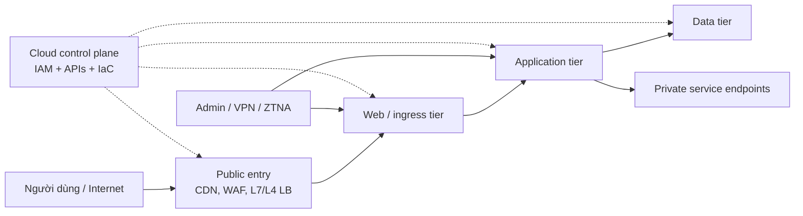
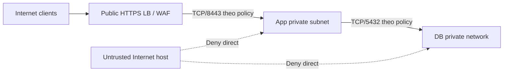
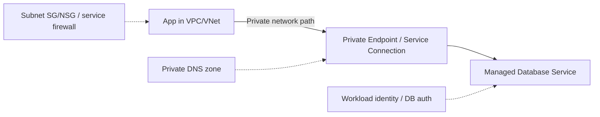
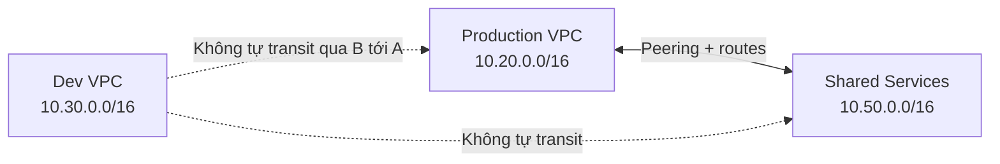
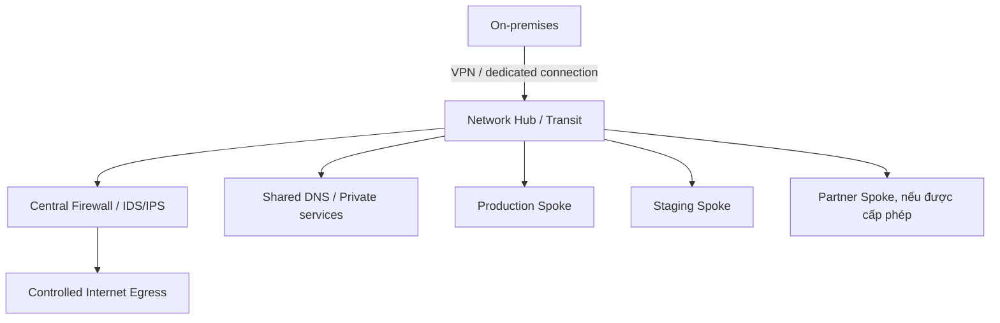
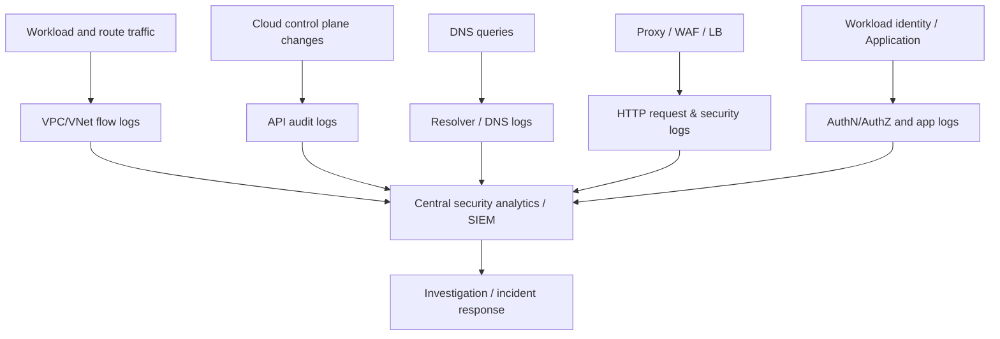
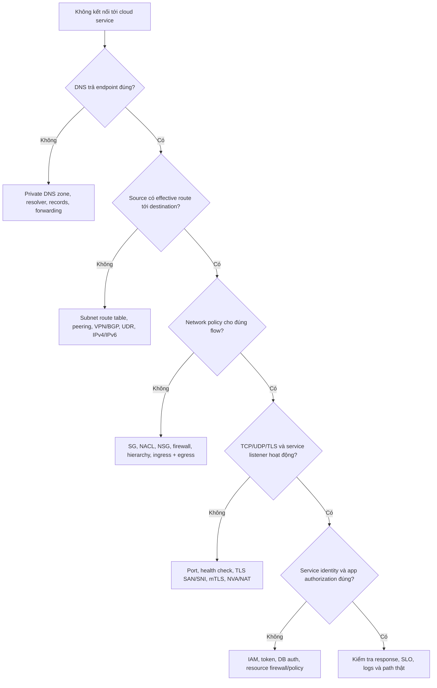

# VPC hoặc VNet và ranh giới mạng cloud: thiết kế phân đoạn, kết nối và kiểm soát truy cập

Một doanh nghiệp đưa ứng dụng ba tầng lên cloud. Họ đặt máy chủ ứng dụng vào subnet có tên `private-app` và cơ sở dữ liệu vào `private-db`, rồi kết luận toàn bộ backend đã được cách ly khỏi Internet. Sau đó, một kỹ sư mở đường peering tới mạng khác, thêm route `0.0.0.0/0` qua thiết bị NAT, hoặc cấp một public endpoint cho database managed service. Tên subnet vẫn là `private`, nhưng **đường đi thực tế và bề mặt truy cập đã thay đổi**.

**VPC (Virtual Private Cloud)** và **VNet (Virtual Network)** cung cấp không gian mạng logic để triển khai tài nguyên cloud, phân chia địa chỉ, điều khiển tuyến và áp dụng chính sách luồng mạng. Chúng là **ranh giới cấu hình quan trọng**, không phải bằng chứng rằng mọi tài nguyên bên trong đều tự động an toàn, cô lập hoàn toàn hoặc được phép tin nhau.

Trong chương **Bảo mật mạng cloud** thuộc module **SECURITY_NETWORK_SECURITY**, bài học kết nối phân đoạn, firewall, VPN, IDS/IPS, DNS, xác thực kết nối, giám sát và threat modeling với những đặc điểm cloud: hạ tầng mạng được lập trình qua API, tài nguyên thay đổi nhanh, managed services có đường kết nối riêng và **control plane** có thể thay đổi topology trong vài giây.

Sau khi học, bạn có thể:

1. Mô tả VPC/VNet, subnet, route table, internet egress, firewall rules và các trust boundaries trong cloud.
2. Phân biệt những khác biệt quan trọng giữa **AWS VPC**, **Azure VNet** và **Google Cloud VPC** mà không giả định các dịch vụ tương đương hoàn toàn.
3. Thiết kế phân đoạn ingress, application, data, management và egress theo least privilege.
4. Phân tích đường đi public/private qua Internet gateway, NAT, private endpoints, peering, transit/hub-spoke và hybrid networking.
5. Giải thích vì sao **IAM/control plane**, DNS, IPv6, managed PaaS và service identity có thể làm thay đổi hoặc vượt qua những giả định an toàn dựa trên subnet.
6. Xây dựng chính sách network bằng infrastructure as code (IaC), guardrails, flow logging và kiểm thử reachability có bằng chứng.
7. Chẩn đoán tình huống tài nguyên “ở private subnet nhưng vẫn bị phơi bày”, “không kết nối được dù security group đã allow”, route asymmetry hoặc DNS của private endpoint sai.
8. Kết hợp network boundary với Zero Trust, ứng dụng tự xác thực/ủy quyền và kế hoạch ứng phó sự cố.

> **Quy ước ví dụ:** Dải `10.20.0.0/16`, `10.30.0.0/16` là địa chỉ nội bộ giả lập. Các dải `192.0.2.0/24`, `198.51.100.0/24`, `203.0.113.0/24` và `2001:db8::/32` dành cho tài liệu; các hostname `.example.test` hoặc `.test` không phải dịch vụ Internet công cộng. Tên và khả năng tính năng cloud thay đổi theo provider, loại tài nguyên, region và phiên bản. Kiểm tra sản phẩm thực tế trước khi triển khai.

## 1. Mô hình tư duy: cloud network là mạng ảo có chính sách, không phải “mạng LAN tin cậy”

Trong hạ tầng vật lý, doanh nghiệp thường dùng switch, router, VLAN, VRF, firewall và WAN để chia mạng. Cloud cung cấp các thành phần tương tự về mục đích, nhưng phần lớn được định nghĩa và thực thi qua **software-defined networking** và cloud APIs.



Đường đi trên chỉ là logic: CDN có thể không nằm trong VPC/VNet; load balancer có thể là managed service; một database PaaS có thể không phải máy ảo nằm trong subnet của khách hàng. Cần xác định **tài nguyên nào thuộc network của mình, dịch vụ nào ở network của nhà cung cấp, chính sách nào được thực thi ở mỗi hop**.

### 1.1. Bốn lớp ranh giới thường gặp

| Lớp | Ví dụ | Câu hỏi bảo mật |
|---|---|---|
| **Administrative boundary** | AWS account, Azure subscription, Google Cloud project, organization/folder | Ai có quyền tạo public IP, route, peering, firewall rule hoặc xóa log? |
| **Logical network boundary** | VPC/VNet, subnet, routing domain, VRF tương đương | Gói tin có thể đi đến những mạng nào qua những next hops nào? |
| **Traffic policy boundary** | Security group, NSG, VPC firewall, cloud firewall, network policy | Nguồn, đích, protocol, port và hướng nào được cho phép? |
| **Service/identity boundary** | IAM, mTLS, OAuth/OIDC, workload identity, application authorization | Ai hoặc workload nào được thực hiện thao tác lên tài nguyên/dữ liệu? |

**Một lớp không thay lớp còn lại.** Ví dụ Security Group chỉ cho kết nối TCP/5432 từ application không chứng minh ứng dụng đã xác thực database bằng đúng credentials; IAM có thể cho phép một principal bật public endpoint mà không cần có quyền kết nối database qua mạng ở thời điểm đó.

### 1.2. Control plane và data plane

- **Control plane:** các API/tài nguyên cấu hình VPC, subnet, routes, firewalls, IP assignments, VPN, DNS, load balancer và private endpoints. Quyền ở đây thường được thực thi bằng cloud IAM/RBAC và chính sách tổ chức.
- **Data plane:** luồng packet/request thật giữa workloads và dịch vụ, chịu tác động của route, firewall, tunnel, proxy, TLS, DNS và application policy.

Một attacker có quyền **sửa control plane** có thể tạo đường mạng mới, sửa firewall hoặc gắn public IP. Vì vậy, “data plane hiện bị chặn” chưa đủ nếu quyền sửa cấu hình quá rộng.

### 1.3. Shared responsibility trong cloud

Cloud provider thường chịu trách nhiệm cho những lớp hạ tầng vật lý và nền tảng thuộc dịch vụ họ vận hành; khách hàng vẫn cần kiểm soát các phần được cho phép cấu hình như **VPC/VNet CIDR, routes, security groups/NSGs, IAM, DNS, TLS và dữ liệu**. Phạm vi trách nhiệm khác nhau giữa IaaS, PaaS và SaaS.

Đối với managed database hoặc managed Kubernetes, không phải mọi NIC, route hoặc agent nằm trong quyền quản trị trực tiếp của khách hàng. Phải đọc đúng mô hình dịch vụ để biết **chỗ nào cần private connectivity, chỗ nào cần service firewall và chỗ nào cần IAM/database authentication**.

## 2. AWS VPC, Azure VNet và Google Cloud VPC: giống về mục tiêu, khác về phạm vi

### 2.1. Bảng ánh xạ khái niệm

| Nhu cầu | AWS | Microsoft Azure | Google Cloud |
|---|---|---|---|
| Mạng logic | **VPC** | **VNet** | **VPC network** |
| Phạm vi mạng | VPC là tài nguyên **regional**, subnet thuộc một Availability Zone | VNet thuộc **region**, subnet trong VNet không gắn đơn nhất với một AZ theo cùng mô hình AWS | VPC có tính **global** trong một project/Shared VPC; subnet là **regional** |
| Phân đoạn địa chỉ | CIDR VPC/subnet, IPv4/IPv6 theo khả năng | Address spaces và subnet prefixes | Subnet IP ranges, primary/secondary ranges |
| Routing | VPC route tables, route targets (IGW, NAT gateway, TGW, endpoint...) | System routes và user-defined routes (UDR) với next-hop tương ứng | VPC routes, dynamic routes/Cloud Router và policy liên quan |
| Lọc traffic chính | Security Groups; Network ACLs trên subnet theo hỗ trợ | NSG, Azure Firewall và dịch vụ liên quan | VPC firewall rules/hierarchical policies, network firewall policies |
| Public ingress | Internet Gateway và public addresses, load balancer/CDN | Public IP, LB/Application Gateway/Front Door và chính sách tương ứng | External IP, Cloud Load Balancing/Cloud Armor và các cơ chế ingress |
| Egress/NAT | NAT Gateway/instance và route thích hợp | NAT Gateway/Azure Firewall/other outbound designs | Cloud NAT, firewall/route policies |
| Private access tới dịch vụ | VPC endpoints: interface/gateway, PrivateLink | Private Endpoint/Private Link, Service Endpoints (khác nhau) | Private Service Connect; Private Google Access cho một số trường hợp |
| Kết nối giữa mạng | VPC peering, Transit Gateway, Cloud WAN theo thiết kế | VNet peering, Virtual WAN, hub/spoke, Route Server theo trường hợp | VPC Network Peering, Network Connectivity Center và các dịch vụ phù hợp |
| Hybrid | Site-to-Site VPN, Direct Connect, BGP | VPN Gateway, ExpressRoute, BGP | Cloud VPN, Cloud Interconnect, Cloud Router/BGP |

**Không đồng nhất các hàng theo tên gọi.** Ví dụ AWS Security Group có mô hình stateful ở cấp ENI, còn Network ACL kiểu AWS là stateless; Azure NSG có ngữ nghĩa stateful nhưng phạm vi và quy tắc gán khác. GCP VPC là global trong khi subnet regional; từ “VPC global” không có nghĩa một subnet kéo dài xuyên tất cả regions.

### 2.2. Phạm vi region, zone và failure domain

```text
AWS VPC (region R)
  ├─ Subnet A (AZ-a)
  ├─ Subnet B (AZ-b)
  └─ Subnet C (AZ-c)

Azure VNet (region R)
  ├─ Subnet Web
  ├─ Subnet App
  └─ Subnet Data
     Tài nguyên có thể được triển khai theo AZ nếu dịch vụ hỗ trợ.

Google Cloud VPC (global logical network)
  ├─ Subnet R1 (regional)
  └─ Subnet R2 (regional)
```

Availability zone và subnet **không phải hai khái niệm đồng nghĩa**. Muốn HA theo AZ/region, phải đặt replicas, load balancer, database replicas, routing và phụ thuộc phù hợp. Chỉ tạo nhiều subnets không làm ứng dụng chịu được zone outage.

### 2.3. Shared VPC, shared network và mô hình nhiều tài khoản

Các tổ chức thường tách môi trường **production, staging, development, security và shared services** bằng accounts/subscriptions/projects. Có những mô hình chia sẻ network resources có kiểm soát, chẳng hạn AWS VPC sharing hoặc GCP Shared VPC. Azure cũng có thể kết nối/spoke nhiều subscriptions qua các cơ chế mạng và quyền tương ứng.

Điểm cần lưu ý:

- **Ownership network** và **ownership workload** có thể thuộc hai nhóm khác nhau.
- Một team được quyền triển khai VM/container không đồng nghĩa được quyền sửa mọi route/central firewall.
- Thêm một account/project vào mô hình shared network có thể mở rộng **blast radius** nếu network policy dùng allowlist quá rộng.
- Chia sẻ subnet không tự biến workloads từ nhiều team thành **cùng mức tin cậy**.

## 3. VPC/VNet boundary bảo vệ điều gì — và không bảo vệ điều gì?

### 3.1. Những việc logical network boundary hỗ trợ

1. **Tổ chức địa chỉ và route:** định nghĩa những subnet có thể giao tiếp và đường đi tới Internet/on-prem.
2. **Đặt điểm thực thi traffic policy:** attach SG/NSG/firewall hoặc service policy cho các luồng được phép.
3. **Kiểm soát public exposure:** quyết định tài nguyên nào có public IP/public endpoint, load balancer và đường inbound.
4. **Phân đoạn quản trị:** tách đường SSH/RDP/admin từ workload thường và chỉ cho phép qua VPN/ZTNA/bastion theo role.
5. **Quan sát và truy vết:** bật flow logs, route/firewall changes, DNS/proxy logs và cảnh báo.
6. **Cô lập sự cố:** có thể chặn traffic hoặc thay routing/policy cho một workload/vùng mà không cắt toàn tổ chức nếu thiết kế đúng.

### 3.2. Những ngộ nhận phải tránh

| Nhận định | Điều cần hiểu đúng |
|---|---|
| “Trong cùng VPC là trusted.” | VPC là ranh giới mạng logic, không phải user/service identity; cần least privilege giữa workloads. |
| “Private subnet không thể truy cập Internet.” | Một private subnet có thể egress qua NAT, firewall, proxy hoặc VPN và có thể truy cập private networks khác. |
| “Không có public IP là không bị truy cập trái phép.” | Có thể bị truy cập từ peering, VPN, compromised workload, SSRF hoặc private endpoint cấp quá rộng. |
| “Security Group allow là có kết nối.” | Route, NACL, host firewall, DNS, listener, policy và service authorization vẫn có thể chặn. |
| “Cloud provider mã hóa mọi packet nội bộ theo ý tôi.” | Các cơ chế bảo vệ nền tảng có phạm vi khác nhau; khi yêu cầu xác thực end-to-end/hop-specific, dùng TLS/mTLS hoặc đường mã hóa theo thiết kế. |
| “NAT Gateway là inbound firewall.” | NAT chủ yếu thay đổi địa chỉ và phục vụ egress/flow state theo dịch vụ; không thay network policy hay kiểm soát app. |
| “Private Endpoint chứng minh ai cũng được phép truy cập dữ liệu.” | Private transport không tự thay IAM, database credentials, OAuth/mTLS hoặc authorization của dịch vụ. |
| “Hai VPC peered luôn định tuyến bắc cầu qua mạng thứ ba.” | Peering truyền thống thường không có transit routing tự động; hub/transit cần thiết kế phù hợp. |

### 3.3. Một request cần vượt nhiều ranh giới

Ví dụ client Internet gọi `https://api.example.test/orders`:

```text
Internet client
   |
   v
DNS → Public HTTPS LB + WAF
   |
   v
LB listener/TLS/routing policy
   |
   v
Application subnet + security group/NSG
   |
   v
App service authorization
   |
   v
Private DB endpoint + network policy + DB authentication
```

**Ranh giới mạng** xác định packet có thể tới nơi nào; **ranh giới danh tính và ứng dụng** quyết định request có hợp lệ và dữ liệu nào được phép truy cập. Nếu chỉ kiểm tra tầng mạng, một tài khoản ứng dụng có quyền quá rộng vẫn có thể gây lộ dữ liệu.

## 4. Thiết kế IP addressing, CIDR và subnet để tránh mở đường vô ý

### 4.1. Chọn CIDR có khả năng mở rộng

Giả sử tổ chức thiết kế:

```text
Production VPC/VNet: 10.20.0.0/16
  Web/ingress:          10.20.10.0/24
  App:                  10.20.20.0/24
  Data:                 10.20.30.0/24
  Management:           10.20.40.0/24
  Private endpoints:    10.20.50.0/24

Staging VPC/VNet:    10.30.0.0/16
On-prem example:     10.100.0.0/16
```

Các prefix chỉ là ví dụ; mỗi cloud có giới hạn và số địa chỉ reserved trong subnet khác nhau. Không lấy `/24` làm yêu cầu bắt buộc cho mọi subnet, pod IP ranges, Azure delegated subnet hoặc các dịch vụ đặc thù.

Khi dự kiến peering, VPN hoặc transit:

- **Tránh CIDR overlaps** giữa những mạng cần giao tiếp, trừ khi có thiết kế NAT/translation/routing cụ thể.
- Dự phòng không gian cho cluster pods, container networks, managed databases, endpoints và autoscaling.
- Phân biệt **primary và secondary IP ranges** nếu nền tảng/service dùng nhiều address ranges.
- Ghi inventory prefix, owner, region, môi trường, route domains và lịch sử thay đổi.
- Không cấp mạng quá rộng “cho chắc” nếu nó khiến policy nguồn/đích bao phủ cả subnet chưa được triển khai.

### 4.2. Subnet không phải luôn là microsegmentation

Tạo ba subnet `web`, `app`, `data` giúp tổ chức tài nguyên, nhưng không tự đặt deny cho mọi flow giữa chúng. Một số cloud có default routes cho traffic nội bộ và default allow rules khác nhau theo network hoặc security model. Cần **kiểm tra policy hiệu lực**.

Ví dụ nhu cầu:

| Luồng | Policy mong đợi |
|---|---|
| Internet → LB TCP/443 | Allow qua public edge, áp WAF/rate limit theo thiết kế |
| LB → App TCP/8443 | Allow đúng identity/subnet/SG của LB |
| App → DB TCP/5432 | Allow chỉ ứng dụng cần thiết |
| Web → DB TCP/5432 | Deny |
| User VPN → bastion/management | Allow theo role và ticket/điều kiện |
| Internet → DB hoặc SSH/RDP | Deny |
| App → Internet | Chỉ các destination/protocol cần thiết, qua egress policy |

Thiết kế ít nhất cần hai lớp: **route reachability** và **filtering tại đúng chỗ**. Một route tồn tại không có nghĩa packet được phép, và một rule `allow` không tự tạo route.

### 4.3. IPv4 private không đồng nghĩa không có public reachability

Dải `10.0.0.0/8`, `172.16.0.0/12`, `192.168.0.0/16` là private IPv4 theo RFC1918. Workload dùng IPv4 private có thể vẫn là backend của **public load balancer** hoặc được truy cập qua **NAT/port forwarding, proxy, VPN hay peering**. Muốn đánh giá exposure phải kiểm tra **đường dữ liệu tới dịch vụ**, không chỉ địa chỉ NIC.

### 4.4. IPv6 thay đổi giả định NAT

Nhiều mô hình IPv6 cho workload địa chỉ global unicast nhưng vẫn giới hạn kết nối bằng route/firewall. Không nên suy rằng “có global IPv6 thì mở inbound”, hoặc “không có IPv4 public thì không có đường Internet”.

Phải kiểm tra:

- IPv6 CIDR và subnet assignments.
- Route `::/0`, IPv6 Internet egress hoặc egress-only gateway theo dịch vụ.
- IPv6 firewall/NSG/SG rules độc lập với IPv4.
- DNS `AAAA` records, load balancer dual-stack và ứng dụng có listen IPv6 không.
- ICMPv6 cần thiết cho Neighbor Discovery/Path MTU Discovery; không blanket block toàn bộ ICMPv6.

**Một IPv4 allowlist không tự bảo vệ IPv6.**

## 5. Route tables, next hops và đường đi thực tế

Routing quyết định nơi các gói có thể được chuyển tiếp; **routing không quyết định quyền truy cập ứng dụng**. Một security rule cho phép TCP/443 không thể tạo kết nối nếu source không có đường đến destination.

### 5.1. Local routes, default routes và routes riêng

Ví dụ các lựa chọn route trong một môi trường AWS giả lập:

```text
Destination        Target                       Mục đích
10.20.0.0/16       local                        Subnet trong VPC
0.0.0.0/0          IGW                          Public subnet
0.0.0.0/0          NAT gateway                  Private subnet outbound
10.30.0.0/16       Peering / Transit gateway    Mạng liên kết
10.100.0.0/16      VPN / Transit gateway        On-premises
```

Đây là **nhiều phương án route theo bảng khác nhau**, không phải một bảng nên chứa cả hai default routes qua IGW và NAT ở cùng ngữ cảnh. Cần kiểm tra **route table được gắn cho từng subnet** và đường đi theo địa chỉ đích thực sự.

### 5.2. Public/private subnet khác nhau theo cloud

**AWS:** Trong mô hình IPv4 thông thường, public subnet có route phù hợp đến Internet Gateway (IGW). Workload muốn giao tiếp Internet trực tiếp còn cần public IPv4/EIP và SG/NACL phù hợp. Private subnet thường không có default route trực tiếp tới IGW, nhưng có thể **chủ động ra ngoài** qua NAT Gateway. Isolated subnet không có Internet default route theo thiết kế.

**Azure:** VNet có system routes, user-defined routes (UDR), và routes học qua BGP khi phù hợp. Public exposure thường được xác định bởi Public IP, load balancer, Application Gateway hoặc managed service public endpoint; không có khái niệm gắn IGW vào VNet đúng như AWS. NAT Gateway có thể được cấu hình cho outbound của subnet.

**Google Cloud:** VPC network có routes và firewall policies; VM có external IP, routes/firewall phù hợp có thể giao tiếp Internet. Workload không có external IP có thể dùng Cloud NAT để tạo các outbound connections theo khả năng. Cloud NAT không phải public inbound listener cho tất cả traffic.

**Tên subnet `private` không có giá trị enforcement.** Kiểm tra route association, external addresses, load balancer, proxy, service endpoints và firewall thực tế.

### 5.3. Longest prefix match, route precedence và bypass

```text
0.0.0.0/0       → egress firewall
10.30.20.0/24  → network peering
```

Traffic đến `10.30.20.10` có thể đi theo route cụ thể hơn thay vì default egress firewall, nếu được nền tảng chấp nhận. Một thiết kế chỉ buộc default traffic qua thiết bị inspection có thể **không kiểm soát traffic theo những route cụ thể hơn**.

Không áp một công thức route precedence máy móc cho mọi cloud: system routes, UDR, dynamic/BGP routes, service routes và các chính sách có thứ tự riêng theo provider. Cần kiểm tra **effective route** từ source workload/NIC.

### 5.4. Asymmetric routing qua firewall/NVA

```text
Request:  App A → NVA firewall → App B
Response: App B ─────────────────→ App A
```

Với thiết bị stateful, response đi đường khác có thể không qua cùng state table và bị drop. Trong hub-spoke/multi-zone, cần thiết kế return path và connection state synchronization nếu sản phẩm yêu cầu. Không quy mọi timeout cho thiếu allow rule khi route đã bất đối xứng.

## 6. Security Groups, NSG, NACL và cloud firewalls

### 6.1. AWS Security Group (SG)

**AWS Security Group** gắn với ENI/tài nguyên phù hợp, có các quy tắc allow inbound/outbound, theo dõi **connection state**. Traffic trả lời của kết nối đã được phép thường không cần một allow rule đối xứng thủ công.

```text
SG-LB:
    ingress TCP/443 từ client sources được phép
SG-APP:
    ingress TCP/8443 từ SG-LB
    egress TCP/5432 tới SG-DB khi ứng dụng cần DB
SG-DB:
    ingress TCP/5432 từ SG-APP
```

Chính sách minh họa cần được triển khai đúng **trên ENI tương ứng**. SG referencing giữa các VPC/peering/transit tùy feature và giới hạn, không mặc định áp dụng mọi trường hợp. **SG egress allow-all mặc định** có thể tồn tại trong cấu hình mới; phải kiểm tra egress policy hiệu lực và bớt quyền theo nhu cầu.

### 6.2. AWS Network ACL (NACL)

NACL gắn với subnet, sử dụng mô hình **stateless**, có rule numbers và các hành động permit/deny. Vì không tự duy trì connection state như SG, **đường request và response** phải được xét, bao gồm ephemeral ports của TCP.

```text
Client TCP/55000 → Server TCP/443
Server TCP/443   → Client TCP/55000
```

Nếu inbound TCP/443 được phép nhưng outbound trả về client ephemeral port bị từ chối, kết nối có thể thất bại. Dải ephemeral ports khác nhau theo OS và workload; không dùng một dải giả định cho toàn bộ hệ thống.

### 6.3. Azure NSG

**Azure Network Security Group** là cơ chế stateful với inbound/outbound rules có priority, có thể áp ở subnet và NIC theo khả năng. Một packet có thể chịu tác động **cả subnet-NSG và NIC-NSG**.

- NSG có **default rules**; trong đó có các quy tắc liên quan `VirtualNetwork`, Internet, AzureLoadBalancer theo chiều cụ thể.
- `VirtualNetwork` service tag **không nhất thiết chỉ bao gồm subnet hiện tại**; phạm vi có thể chịu ảnh hưởng mạng kết nối/routing.
- Priority, nguồn/đích/port và effective security rules quyết định kết quả.
- Azure Firewall, private endpoints, managed service firewall và IAM vẫn là những lớp độc lập.

Đừng coi `DenyAllInbound` default là bằng chứng traffic giữa mọi tài nguyên VNet đã bị chặn: một allow mặc định ưu tiên hơn có thể đã áp dụng.

### 6.4. Google Cloud VPC firewall

Google Cloud cung cấp VPC firewall rules, hierarchical firewall policies và network firewall policies theo khả năng. Các quy tắc có direction, priority, targets và source/destination constraints.

- **Implied rules** thường gồm deny ingress và allow egress nếu không có rule/policy ưu tiên hơn; nhưng default VPC network và organization policy có thể chứa allow rules riêng.
- VPC firewall theo dõi connection state cho các luồng phù hợp.
- Priority và higher-level policies có thể ảnh hưởng cách project-level rule được áp dụng.
- Shared VPC/network tags/service-account targets phải được hiểu đúng về quyền sở hữu.

### 6.5. So sánh nhanh

| Tiêu chí | AWS SG | AWS NACL | Azure NSG | GCP VPC firewall |
|---|---|---|---|---|
| Stateful | Có | **Không** | Có | Có |
| Phạm vi | ENI/tài nguyên hỗ trợ | Subnet | NIC/subnet | VPC và target theo policy |
| Inbound + outbound | Có | Có | Có | Có |
| Explicit deny | SG truyền thống chủ yếu allow | Có | Có | Có |
| Rule priority/order | Không như numbered ACL | Rule number | Priority | Priority/hierarchy |
| Return ephemeral ports | State giúp xử lý | Phải xét cả chiều | State giúp xử lý | State giúp xử lý |
| Lỗi phổ biến | Allow-all egress hoặc attach sai | Return path/port bị block | Default allow nội bộ, priority | Implied egress allow, org-level rules |

**Stateful filtering không mã hóa traffic hoặc xác thực user.** TLS/mTLS, IAM và ứng dụng vẫn phải thực thi authentication/authorization theo nhu cầu.

## 7. Public ingress: từ Internet tới backend private

Một workload không cần public IP để phục vụ người dùng Internet; public HTTPS load balancer có thể kết thúc TLS và chuyển request tới application có private IP.



### 7.1. Kiểm tra toàn bộ đường ingress

1. DNS public trỏ đến đúng CDN/LB/gateway; không có DNS alias/legacy origin bỏ qua WAF.
2. Public listener chỉ mở protocol/ports cần thiết, có TLS hostname verification, policy cipher phù hợp.
3. WAF, DDoS protection và rate limiting được đặt đúng điểm, nhưng **không thay app authentication**.
4. Backend security group/NSG/firewall chỉ cho đúng source LB/proxy identity hoặc subnet phù hợp.
5. Backend không có public IP/port admin/debug hoặc alternate listener ngoài ý định.
6. App tiếp tục xác thực user/workload và giới hạn quyền tài nguyên.
7. Kiểm tra IPv6, alternate hostnames, DNS zones, service endpoints, cloud managed API gateways.

### 7.2. Những đường public exposure thường bị bỏ sót

| Đường truy cập | Vì sao dễ bị quên |
|---|---|
| VM có public IPv4 hoặc global IPv6 | Inventory chỉ lọc một address family |
| Managed database public endpoint | Không phải một public IP gắn trực tiếp app VM |
| API Gateway/Function public URL | Chạy serverless nhưng có thể phục vụ public traffic |
| Public LB trước backend private | Backend private không nghĩa **dịch vụ** private |
| Object storage public policy/website endpoint | Dữ liệu có thể public dù VPC có SG chặt |
| DNS alias cũ hoặc debug port | Bypass WAF/rate limit/SSO gateway chính |
| Cross-account private peering | Không public Internet nhưng mở thêm một đường tin cậy |

**Public exposure là thuộc tính của endpoint và toàn bộ traffic path**, không chỉ thuộc tính của subnet hoặc VM network interface.

### 7.3. Origin bypass và forwarded identity

Nếu khách hàng dùng `api.example.test` qua CDN/WAF nhưng một public IP khác tới thẳng backend, đối tượng có thể tránh edge policy nếu backend không tự kiểm soát.

Giảm rủi ro:

- Chỉ cho trusted proxies/LBs tới backend; hạn chế public address.
- Bảo vệ proxy → app bằng TLS/mTLS khi phù hợp.
- Chuẩn hóa `Forwarded`, `X-Forwarded-For`, `X-Forwarded-Proto` và identity headers; app **không tin dữ liệu do client tự khai**.
- Giữ app authorization, IAM/database credentials và session validation.
- Thử **negative path** tới backend trực tiếp trong staging hoặc test environment được phép.

## 8. Egress, NAT và đường thoát dữ liệu

Một attacker có thể không cần inbound Internet connection nếu đã compromise workload hoặc có SSRF. Workload có thể **chủ động** gọi ra ngoài và gửi dữ liệu nếu egress route/policy cho phép.

### 8.1. NAT không phải egress firewall ứng dụng

```text
Private app (10.20.20.10)
     |
     v
Route 0.0.0.0/0 → NAT / central egress
     |
     v
External API / Internet
```

Managed NAT thông thường hỗ trợ translation cho outbound flows trong phạm vi dịch vụ; **nó không tự quyết định** hostname nào được phép, user identity, loại payload hay quyền truy cập SaaS. Không có public IPv4 trên VM không bảo đảm rằng VM không thể gửi dữ liệu ra Internet.

### 8.2. Thiết kế egress theo nhu cầu

| Nguồn | Luồng nên xem xét | Biện pháp |
|---|---|---|
| App workloads | DNS, time sync, approved partner APIs, artifact retrieval | Egress proxy/firewall, chỉ ports/destinations cần |
| Database | Backup, monitoring, service dependencies | Private endpoints và egress hạn chế |
| CI/CD | Registry, source control, package mirror | Separate runner boundary, short-lived IAM, audited egress |
| Kubernetes Pods | DNS, registry, cloud APIs | VPC firewall/NetworkPolicy, workload identity, egress controls |
| Admin access | Bastion, management APIs | VPN/ZTNA, PAM/JIT và audit |

**DNS name allowlist** chỉ hiệu quả nếu resolver/proxy enforcement đúng. Nếu workload có thể gọi IP trực tiếp, dùng DoH khác hoặc route IPv6 ngoài policy, một danh sách domain ở đúng một proxy có thể không phủ hết traffic.

### 8.3. IPv6 không cần NAT kiểu IPv4

Một workload có global IPv6 có thể egress qua route/chính sách IPv6. Một số nền tảng có egress-only gateway hoặc chức năng outbound tương đương, nhưng phải dựa trên tính năng/provider thật.

Kiểm tra `::/0`, IPv6 SG/NSG/firewall rules, DNS `AAAA`, ICMPv6 và các interfaces khác nhau. Một egress rule IPv4 chỉ xét `0.0.0.0/0` không tự áp lên IPv6.

### 8.4. Centralized inspection có thể bị bypass bởi route cụ thể hơn

Một hub NVA/Azure Firewall/cloud firewall có thể kiểm tra traffic đi qua nó. Tuy nhiên:

- Peering route cụ thể có thể không đi qua default-route firewall.
- Private service endpoints có thể tạo service-specific reachability.
- Managed PaaS có data plane khác với VM routes.
- NVA đa zone cần return path, HA và connection-state handling.
- Nếu inspection appliance hỏng, cần policy fail-open/fail-closed có chủ đích.

Do đó, hãy **xác minh effective routes và traffic flows** thay vì suy từ sơ đồ có biểu tượng firewall.

## 9. DNS là một phần của ranh giới mạng cloud

DNS biến service name thành đích IP. Một VPC/VNet có thể có **private DNS zones**, conditional forwarding, managed resolvers hoặc service discovery. DNS sai có thể khiến ứng dụng đi ra public endpoint dù dự định dùng private connectivity.

### 9.1. Public DNS và private DNS

```text
Public DNS:
  api.example.test          → public LB

Private DNS trong workload network:
  db.internal.example.test  → private DB IP
  storage.example.test      → private endpoint mapping, nếu được cấu hình
```

Hai clients ở hai network khác nhau có thể nhận câu trả lời DNS khác nhau theo **split-horizon DNS**. Điều này có thể đúng theo thiết kế; cần kiểm soát zone linkage, forwarding rules, resolver routes và quyền sửa DNS.

### 9.2. DNS không tạo route hay authorization

`db.internal.example.test` phân giải thành `10.20.30.5` **không đảm bảo** source có route tới IP ấy; route hợp lệ **không đảm bảo** firewall allow; và firewall allow không chứng minh app có DB credentials hợp lệ.

Chuỗi kiểm tra:

```text
DNS resolution
   → effective route
   → network policy
   → service listener / TLS identity
   → IAM / database credentials / authorization
```

### 9.3. DNS ở hybrid và private endpoints

Khi on-prem clients dùng private endpoints trên cloud, thường cần conditional DNS forwarding hoặc private resolver để phân giải đúng địa chỉ. Nếu on-prem resolver chỉ dùng public DNS, nó có thể trả **public service address** hoặc không tìm thấy private hostname.

Các vấn đề thường gặp:

- Private DNS zone chưa liên kết với VPC/VNet của workload.
- DNS forwarder không có route tới resolver phía cloud.
- Peered VPC/VNet chưa được thiết kế chia sẻ DNS resolution theo provider.
- CNAME của public service không được ánh xạ về private endpoint như dự kiến.
- Cache DNS giữ IP cũ sau khi migrate service.
- Một ứng dụng dùng DoH/resolver riêng bypass DNS path doanh nghiệp.

**Không sửa mọi lỗi private endpoint bằng cách mở public access của service.** Kiểm tra DNS và effective route trước.

### 9.4. DNS và bảo mật

DNS logs có thể giúp phát hiện domain lạ, beaconing hoặc domain generation behavior, nhưng chứa thông tin nhạy cảm về workloads. Private DNS zones, resolver policies và DNS firewall/filtering giúp bảo vệ một số đường phân giải.

**DNS filtering không thay network egress firewall** và TLS certificate validation. Một workload đã biết IP đích có thể kết nối không cần query DNS nếu policy cho phép.

## 10. Private connectivity tới PaaS và cloud services

Một managed database hoặc storage service có thể nằm ngoài dải địa chỉ/VM network trực tiếp của khách hàng, nhưng cloud cung cấp cách truy cập **không cần đi qua public Internet endpoint theo đường thông thường**.

### 10.1. Các họ giải pháp cần phân biệt

| Nền tảng | Khái niệm | Điểm cần hiểu |
|---|---|---|
| AWS | **Interface VPC Endpoint / PrivateLink** | Tạo private connectivity tới service được hỗ trợ qua endpoint network interfaces/đường riêng của nền tảng |
| AWS | **Gateway endpoint** | Dùng cho các dịch vụ được hỗ trợ như S3/DynamoDB, liên quan route tables và endpoint policies |
| Azure | **Private Endpoint / Private Link** | Network interface/private address trong VNet để truy cập một service endpoint được hỗ trợ; cần DNS đúng |
| Azure | **Service Endpoint** | Cơ chế tăng phạm vi kiểm soát nguồn VNet tới một số Azure services, **khác Private Endpoint** |
| Google Cloud | **Private Service Connect** | Private connectivity giữa producer/consumer services theo các mô hình được hỗ trợ |
| Google Cloud | **Private Google Access** | Cho VM/workloads đáp ứng điều kiện dùng private access tới các Google APIs/services được hỗ trợ theo cách riêng |

**Private connectivity là thuộc tính đường truy cập**, không phải tự động bật least-privilege authorization hoặc đảm bảo mọi request đều dùng private path. DNS, service firewall, endpoint policy, IAM và public access configuration vẫn cần kiểm tra.

### 10.2. Ví dụ private DB



Với một thiết kế được phê duyệt:

1. Workload phân giải hostname dịch vụ về đích private thích hợp.
2. Route/firewall cho phép đúng source và port tới endpoint.
3. Endpoint/service association đúng project/subscription/account và resource ID.
4. Dịch vụ đã tắt hoặc hạn chế public exposure **nếu thuộc tính sản phẩm cho phép**.
5. Client xác minh **TLS server certificate/hostname** và dùng IAM/DB credentials hợp lệ.
6. Logs của dịch vụ và network liên kết được request với source principal/workload.

### 10.3. PrivateLink không phải VPC peering

Peering thường mở kết nối **mạng–mạng** trong phạm vi routes/policies, có thể tăng reachability tới nhiều hosts. Private endpoint/PrivateLink thường cung cấp **kết nối đến một service/endpoint cụ thể** thay vì tự động làm hai VPC có full routing tới nhau.

Nếu consumer chỉ cần dùng một API service của partner, **service-specific private connectivity** có thể giảm phạm vi tin cậy so với peering toàn bộ CIDR. Nhưng vẫn cần service authorization và endpoint policy.

## 11. VPC/VNet peering: kết nối private không đồng nghĩa một trust domain

**Peering** là một cách tạo kết nối giữa hai logical networks mà không mặc định dùng Internet công cộng làm đường kết nối. Nhưng nó có thể tạo reachability giữa các workload vốn được quản lý bởi những team/account khác nhau.

### 11.1. Peering mở kết nối ở tầng mạng



Để peering hoạt động, thường cần:

1. Tài nguyên peering/connection được cả hai bên chấp nhận theo quy trình.
2. CIDR/address spaces không conflict theo yêu cầu sản phẩm.
3. Routes hoặc các cấu hình forwarding phù hợp ở hai phía.
4. Firewall/SG/NSG/host policy cho đúng source và destination.
5. DNS resolution nếu ứng dụng dùng hostname, theo tính năng của provider.
6. IAM/governance và logging để biết ai được phép tạo kết nối mới.

### 11.2. Peering thường không tự có tính bắc cầu

Trong các mô hình peering phổ biến:

```text
VPC A ↔ VPC B ↔ VPC C
```

**Không suy rằng A tự đi qua B để đến C**. AWS VPC peering và Google Cloud VPC Network Peering không cung cấp transitive routing theo kiểu tự động này; Azure VNet peering cũng không tự biến B thành router transit cho mọi trường hợp. Muốn trung chuyển cần một kiến trúc được hỗ trợ như hub/transit gateway/NVA/Virtual WAN hoặc giải pháp khác và cấu hình routes/policies riêng.

Điều này có lợi cho tránh mở rộng reachability ngoài ý định, nhưng **không thay firewall**: A và B đã có route hợp lệ vẫn cần kiểm soát tối thiểu từng luồng.

### 11.3. CIDR overlap và route conflicts

Nếu Production và Dev cùng dùng `10.20.0.0/16`, peering truyền thống thường không thể đáp ứng kết nối trực tiếp đúng như kỳ vọng hoặc gặp hạn chế nghiêm trọng. Những giải pháp dùng translation, proxy, NAT, service-private connectivity hoặc renumbering cần được đánh giá riêng.

**CIDR planning là một yêu cầu an ninh dài hạn**, không chỉ việc phân bổ địa chỉ. Một dải chồng lấn dễ thúc đẩy workaround như public endpoints hoặc broad NAT, làm tăng độ phức tạp và bề mặt bị tấn công.

### 11.4. Khi peering là quá rộng

Nếu Dev chỉ cần gọi một internal artifact API ở Prod, direct peering có thể mở khả năng route tới nhiều địa chỉ Prod hơn cần thiết. Hãy cân nhắc **service-specific private endpoint/PrivateLink**, API gateway, identity proxy hoặc mirror/repository riêng, theo đúng dịch vụ.

Lựa chọn phải dựa vào **scope**, khả năng authorization và vận hành, không chỉ chi phí/hops.

## 12. Hub-spoke, transit network và centralized inspection

Ở quy mô nhiều accounts/projects/subscriptions, tổ chức thường cần mạng hub để cung cấp DNS, VPN, security services, egress, routing và shared services cho các spokes.



### 12.1. Hub không tự cô lập các spokes

Nếu mọi spoke quảng bá CIDR của mình vào hub và hub cho phép route transit giữa chúng, Production và Staging có thể giao tiếp ngay cả khi chúng nằm ở hai VPC/VNet tách biệt.

Thiết kế phải xác định:

- **Route propagation** và các route tables/associations của hub/transit.
- Spoke nào được phép gửi traffic tới shared services, on-prem hoặc spoke khác.
- Traffic nào bắt buộc qua inspection appliance; traffic nào được phép đi trực tiếp.
- Chính sách east–west/egress và return path, không chỉ inbound Internet.
- Blast radius khi firewall/transit hub/control plane lỗi.
- Ai có IAM role để attach spoke mới, tạo route hoặc sửa policies.

### 12.2. Phân biệt reachability và authorization giữa spokes

Ví dụ:

| Source | Destination | Quy tắc định hướng |
|---|---|---|
| Production App | Shared DNS/NTP | Allow cụ thể |
| Production App | Shared artifact registry | Allow theo service identity, TLS |
| Dev App | Production DB | Deny |
| Staging | Production management endpoints | Deny |
| SecOps bastion | Production management | Allow theo MFA/JIT/PAM và audit |
| Any Spoke | Internet | Chỉ qua egress policy được phê duyệt |

Hãy kiểm thử **deny cases** từ đúng source subnet/VM/pod. Route table cho phép không đồng nghĩa firewall allow; firewall allow cũng không nên được sử dụng làm chứng cứ rằng IAM/app authorization đúng.

### 12.3. Các kiểu kiến trúc thường dùng

| Kiểu | Điểm mạnh | Đánh đổi |
|---|---|---|
| Peering trực tiếp | Đường đơn giản cho ít networks | Không transit tự động, khó mở rộng quản lý nhiều liên kết |
| Transit/hub networking | Centralize routing và một số shared services | Đòi hỏi route domains, inspection, HA và kiểm soát propagation |
| Service-level private connectivity | Giới hạn kết nối tới một service | Cần service endpoint policies, DNS, service authentication |
| Zero Trust/application proxy | Quyền theo user/workload/ứng dụng | Khác mô hình L3; cần tích hợp identity, session, observability |
| Overlay/service mesh | mTLS/workload identity giữa services | Không tự sửa cloud routing/public endpoint hoặc control-plane IAM |

### 12.4. Central firewall không thay workload firewall

Một hub firewall thường chỉ kiểm tra những flows đi qua nó. Traffic giữa hai workloads **trong cùng VPC/subnet** hoặc qua đường private khác có thể không đi qua hub. Do đó cần **workload-level SG/NSG/firewall, Kubernetes NetworkPolicy và application authorization** để đạt kiểm soát east–west thực tế.

## 13. Hybrid networking: VPN, leased connections và BGP

Khi nối cloud với datacenter/văn phòng, một đường private hoặc VPN không tự làm hai mạng có cùng độ tin cậy. Nó chỉ mở đường reachability trong phạm vi cấu hình.

### 13.1. Các mô hình thường gặp

| Nhu cầu | Lựa chọn tiêu biểu | Điều cần kiểm soát |
|---|---|---|
| Encrypted site-to-site | AWS Site-to-Site VPN, Azure VPN Gateway, Google Cloud VPN | IKE/IPsec policy, endpoints, tunnels, routing, BGP/static routes |
| Dedicated/private connectivity | AWS Direct Connect, Azure ExpressRoute, Cloud Interconnect | Đường vật lý/logical, BGP, segmentation, hợp đồng, HA; **không tự mặc định IPsec** |
| Remote user access | VPN/ZTNA/app proxy | User/device identity, MFA, posture, least privilege |
| Partner integration | VPN/private service endpoint/API | Ownership, CIDR overlap, egress, audit, time-bound access |

**Đường truyền riêng không đồng nghĩa traffic đã được mã hóa end-to-end.** Nếu có yêu cầu confidentiality/integrity ở mức mạng, dùng IPsec/MACsec hoặc TLS/mTLS khi môi trường và nhà cung cấp hỗ trợ theo kiến trúc.

### 13.2. BGP và phạm vi route được học/quảng bá

Một VPN hoặc dedicated connection có thể dùng **BGP** để quảng bá prefixes giữa cloud và on-prem. Cần giới hạn:

- Những prefix on-prem được phép nhập vào cloud.
- Những prefix cloud được phép xuất sang on-prem.
- Default route `0.0.0.0/0` hoặc `::/0` có được advertise/accept không.
- Prefix length policy, tránh route leak và overlapping CIDRs.
- AS path/community policies và route validation theo khả năng.
- Failover preference và không đối xứng đường về.

**Không tin mọi route chỉ vì BGP session Established.** Prefix filtering và role-based routing policies là lớp quan trọng của routing security; VPN encryption không chứng thực tính đúng đắn của mọi route.

### 13.3. Hai đường dự phòng chưa chắc độc lập

Một tổ chức có hai VPN tunnels nhưng cả hai đi qua cùng ISP/router/on-prem power hoặc cùng cloud endpoint group. Khi thiết kế HA cần phân tích **failure domains** thực tế:

- Two independent paths/regions/zones theo SLA cần thiết.
- BGP preference, route withdrawal, health/circuit testing.
- DNS/identity/PKI dependencies của đường hybrid.
- MTU/MSS, fragmentation, asymmetric routing.
- Ứng dụng có thể khôi phục kết nối sau failover hay không.

**Hai tunnel xanh trên dashboard không đảm bảo application SLO** nếu database, DNS hoặc đường quản trị vẫn có single point of failure.

## 14. Governance: IAM và control plane có thể phá ranh giới mạng

Network controls được cấu hình bằng cloud APIs. Một principal có quyền cao có thể:

- Mở SG/NSG firewall inbound `0.0.0.0/0`/`::/0`.
- Thêm public IP hoặc public LB listener.
- Thay route từ egress firewall sang Internet path khác.
- Tạo VPC peering, transit attachment hoặc private endpoint tới một vùng chưa được kiểm soát.
- Tắt flow logs, xoá audit alerts hoặc sửa DNS zone.
- Thay policy trên managed database thành public access.

Vì vậy **bảo mật VPC/VNet không chỉ nằm trong các rule đang chạy**, mà còn ở quyền thay đổi chúng.

### 14.1. Separation of duties

Một mô hình có thể chia:

| Vai trò | Quyền cần thiết | Quyền nên hạn chế |
|---|---|---|
| Network platform team | VPC/VNet, subnet, routing, transit, central firewall | Tự do đọc mọi dữ liệu ứng dụng |
| Workload team | Deploy app vào subnet được phê duyệt, quản lý workload-level policy được ủy quyền | Tạo public routes/peering ngoài quy trình |
| Security team | Define guardrails, policy audit, security logging và review exceptions | Trực tiếp sửa production không audit |
| Identity team | IAM/RBAC, privileged access và approvals | Cấp broad admin mặc định cho workload |
| SRE/operations | Health, logs, incident response và thay đổi theo runbook | Bỏ qua change controls/policy để “sửa nhanh” |

Nhu cầu thực tế có thể đòi quyền khẩn cấp, nhưng cần **break-glass có MFA, thời hạn, logging và hậu kiểm**, không phải shared root/admin credentials không thể quy trách nhiệm.

### 14.2. Guardrails theo cấp tổ chức

Những kiểu kiểm soát phù hợp theo cloud:

- Organization/account policies hoặc service control policies khi nền tảng hỗ trợ để hạn chế hành động cấp cao.
- Azure RBAC/Policy/management groups hoặc equivalents của cloud khác.
- GCP organization policies/hierarchical firewall policies với quyền theo project/folder.
- IaC policy-as-code/plan checks, mandatory reviewers và drift detection.
- Ràng buộc tạo public IP, firewall allow-all, route thay đổi và tắt audit logs.
- CI/CD identity dùng short-lived credentials, least privilege và approvals.

**Guardrail không thay test data plane.** Policy ngăn mở SG mới rất tốt nhưng một SG cũ mở rộng, resource không được scan hoặc đường service-specific bypass vẫn cần được phát hiện.

### 14.3. Tags và network identity

Tags/labels hỗ trợ inventory, tính phí, gán owner và chọn resource trong policy. Một số firewall hỗ trợ targets theo tags/service accounts. Tuy nhiên:

- Tag có thể bị thay nếu IAM cho phép; không coi string `env=prod` do workload tự khai là bằng chứng bảo mật mạnh.
- Một resource thiếu tag có thể không được áp policy mong muốn.
- Tự động sinh rules từ tags cần audit và kiểm tra quyền thay tag.
- Với production, cần binding tới danh tính tài nguyên được cloud chứng thực và guardrail phù hợp, không chỉ một metadata tự nguyện.

## 15. Kubernetes, serverless và managed services không tự nằm trong một boundary kiểu VM

Một kiến trúc cloud hiện đại có VM, containers, Kubernetes, serverless Functions, API Gateway, object storage và managed databases. **Không thể kiểm tra toàn bộ mạng chỉ bằng danh sách subnets của VM.**

### 15.1. Kubernetes chạy trong VPC/VNet

```text
Internet
   → Public ingress / Gateway / LB
   → Kubernetes Service
   → Pod network
   → Database private endpoint
```

Cần xét đồng thời:

- VPC/VNet route, node/pod address spaces và security controls.
- Ingress/LB public/private config, TLS/WAF.
- Kubernetes NetworkPolicy/CNI behavior; policy có thực sự được CNI thực thi không?
- Pod/service account identity, RBAC và secrets access.
- Egress path của pods tới DNS, cloud APIs, registries và Internet.
- Node metadata service/instance identity và rủi ro credential exposure.
- Workload-to-workload mTLS/service mesh nếu triển khai.

**Một Kubernetes namespace không tự là ranh giới mạng độc lập.** NetworkPolicy và CNI phải thực thi, còn app identities/authorization cần được kiểm tra riêng.

### 15.2. Serverless và API gateways

Một Function có cấu hình VPC/VNet integration có thể dùng private network path cho một số **outbound** resources, nhưng public HTTP trigger hoặc gateway của nó có thể vẫn tồn tại theo cách dịch vụ định nghĩa.

Đừng suy rằng “Function có VPC connector” đồng nghĩa **không có public ingress**. Cần xem:

1. Trigger/endpoint authentication, public accessibility và ingress mode.
2. Outbound connector/subnet/NAT và DNS resolution.
3. IAM/service account/managed identity và secrets.
4. Per-function firewall/private endpoint theo tính năng provider.
5. Logs về requests tới public endpoint và flows đi ra.

### 15.3. Object storage và managed database

VPC isolation không tự áp cho object storage bucket hoặc database PaaS public API. Các tài nguyên này cần:

- IAM/bucket policy/database users và least privilege.
- Public access block hoặc service firewall đúng tính năng.
- Private endpoint/service endpoint khi cần.
- Encryption, key management và audit data access.
- Không để application credentials có quyền quá rộng.

Một bucket public sai policy có thể lộ dữ liệu **ngay cả khi mọi VM đều nằm trong private subnet**.

### 15.4. Metadata service và SSRF

Cloud VM thường có metadata service để cung cấp thông tin instance hoặc cấp credentials tạm theo cơ chế cloud. Khi app có lỗi **Server-Side Request Forgery (SSRF)**, attacker có thể cố dùng app làm bên gửi request tới những địa chỉ nội bộ hoặc metadata service.

Các lớp giảm rủi ro:

- Chống SSRF tại app: URL parsing/allowlist, kiểm tra redirect/DNS rebinding, không cho truy cập host nội bộ không cần thiết.
- Sử dụng cơ chế metadata access protection theo cloud và workload, ví dụ AWS IMDSv2 ở môi trường phù hợp.
- Least-privilege instance role/service account, short-lived credentials.
- Giới hạn khả năng các container/process dùng host metadata identity nếu không cần.
- Dùng egress restrictions và telemetry để phát hiện kết nối lạ tới metadata/internal endpoints.

**Chỉ “đặt app trong private subnet” không chặn SSRF.** Kẻ tấn công có thể lợi dụng app đã ở trong ranh giới để gọi resources chỉ truy cập được nội bộ.

## 16. Zero Trust: ranh giới mạng có ích nhưng không phải danh tính

Zero Trust hướng tới **xác minh rõ ràng danh tính và trạng thái truy cập, cấp quyền tối thiểu và giả định không có mạng nào mặc nhiên đáng tin**.

### 16.1. Network location và identity khác nhau

```text
Old assumption:
  Source IP in VPC A → trusted service → broad allow

Stronger approach:
  Workload identity + purpose + authorization
  AND trusted network path / policy
  AND TLS/mTLS peer validation
  AND monitoring / re-evaluation
```

Một source IP thuộc `10.20.0.0/16` chỉ cho biết địa chỉ của một node/luồng; nó **không chứng minh request đến từ service có quyền**. IP còn có thể thay đổi do autoscaling, NAT, proxy hoặc compromise.

### 16.2. Workload identity, mTLS và service authorization

Khi App A gọi App B:

1. Network policy chỉ cho A tới đúng host/port của B.
2. TLS/mTLS xác minh peer/service identity theo PKI được quản lý.
3. App B kiểm tra authorization: caller service nào được gọi operation nào?
4. Cloud IAM cấp quyền tối thiểu cho các APIs/managed services, tách biệt network permission.
5. Logs đủ liên kết caller identity với request ID và resource.

**mTLS thành công không tự cho mọi API permission.** Một certificate hợp lệ chứng minh danh tính peer trong phạm vi PKI, còn application/identity policy quyết định hành vi.

### 16.3. Zero Trust không phải bỏ mọi network segmentation

Network segmentation vẫn giảm **blast radius**, giảm số đích reachable và tạo điểm chặn/quan sát. Zero Trust bổ sung xác minh identity/app policy để tránh việc một compromised workload có thể đi ngang tới mọi resource cùng subnet/VPC.

## 17. Quan sát VPC/VNet: flow logs, audit logs và khả năng truy vết

Một thiết kế an toàn phải trả lời được **ai thay đổi network policy**, **traffic đi qua ranh giới nào**, **bị chặn ở đâu** và **ứng dụng đã xử lý gì**. Không phải mọi loại log đều cung cấp cùng mức chi tiết.

### 17.1. Network flow logs

Các nền tảng cloud cung cấp cơ chế network/flow telemetry như AWS VPC Flow Logs, Azure virtual network flow logging theo khả năng và chính sách hiện hành, hay Google Cloud VPC Flow Logs.

Flow logs thường chứa **metadata**, không phải toàn bộ packet payload:

- Source/destination addresses và ports, protocol.
- Interface/resource/flow identifiers tùy nền tảng.
- Số bytes/packets theo cửa sổ đo.
- Một số thông tin action allow/reject, route/zone/direction hoặc metadata bổ sung.
- Timestamps và sampling/aggregation fields theo tính năng dịch vụ.

**Không khẳng định tất cả cloud flow logs đều ghi từng packet hoặc từng firewall deny.** Phạm vi hỗ trợ, sampling, độ trễ, retention, trường dữ liệu và cách tính có khác biệt. Khi thiếu bản ghi, chưa chắc traffic không tồn tại.

### 17.2. Control-plane audit logs

| Cần phát hiện | Ví dụ sự kiện |
|---|---|
| Mở public ingress | SG/NSG/firewall rule rộng hơn, public IP mới |
| Thay đường egress | Route table association, UDR, NAT/Internet path change |
| Mở trust boundary mới | VPC/VNet peering, transit/hub attachment, private endpoint |
| Thay service exposure | LB listener, API Gateway, managed DB public network access |
| Làm mất tầm nhìn | Flow logs disabled, log sinks/retention changed |
| Đổi private DNS | Zone record, forwarding/resolver rules |
| Tăng đặc quyền | IAM policy bindings/roles có thể sửa network resources |

Audit logs dùng để giải thích **vì sao cấu hình thay đổi**. Flow logs dùng để quan sát **traffic trong phạm vi được ghi nhận**. Application logs xác định **API call/user authorization**. Cần tương quan cả ba nguồn.

### 17.3. Một sơ đồ quan sát



### 17.4. Correlation phải tính tới NAT và địa chỉ động

Ví dụ:

```text
App pod IP:           10.20.20.18
Node VM IP:           10.20.20.10
NAT egress address:   203.0.113.10 (documentation)
Cloud service log:    service principal / workload identity
```

Một external service có thể thấy **NAT public IP** thay vì app Pod IP. Để điều tra, cần map connection, IP/port/time với pod/node/instance identity, NAT logs nếu có và application request ID. IP dùng chung không đủ chứng minh người dùng hoặc workload cụ thể.

### 17.5. Những chỉ số vận hành cần có

| Chỉ số | Mục tiêu |
|---|---|
| Number of public-facing endpoints | Tìm exposure mới hoặc không có owner |
| Broad ingress/egress rules | Giảm allow-all và quyền quá rộng |
| Effective routes deviating from baseline | Phát hiện đường bypass qua peering/NAT |
| Flows rejected by policy | Tìm cấu hình sai và traffic bất thường |
| Unexpected east-west connections | Phát hiện lateral movement |
| New peering/transit attachments | Kiểm soát mở rộng trust boundary |
| Private endpoint DNS failures | Phát hiện fallback sai/public access |
| VPN/BGP route changes | Phát hiện route leak, hybrid outage |
| WAF/LB/app error and latency | Đo tác động tới user, không chỉ mạng |
| Flow log/audit pipeline health | Không coi thiếu alert là an toàn nếu logs bị mất |

Log không nên chứa secrets/bearer tokens và cần được bảo vệ bằng RBAC, retention, mã hóa, kiểm soát export. Tích hợp nhiều nguồn không tự bảo đảm phát hiện mọi tấn công; SOC phải có quy trình điều tra và phản ứng.

## 18. Threat modeling: những cách cloud network boundary bị vượt qua

### 18.1. Những tài sản và quyền cần bảo vệ

| Tài sản | Điều kiện rủi ro |
|---|---|
| Network topology, routes và firewall | IAM role sửa config ngoài ý định |
| App service ports | Public exposure, lateral movement hoặc bypass |
| Database và secrets | Connection policy rộng, credentials bị lộ, SSRF |
| DNS/private endpoint mappings | Redirect traffic, public fallback hoặc DNS poisoning |
| Egress path | Exfiltration, C2 traffic, bypass inspection |
| Kubernetes/VM metadata identity | Instance credentials được dùng sai mục đích |
| Hybrid VPN/BGP | Route leak, unexpected on-prem reachability |
| Logs và policy evidence | Disabled/retention thấp hoặc bị chỉnh sửa |

### 18.2. Mối đe dọa theo ranh giới

| Mối đe dọa | Hành vi/rủi ro | Phòng vệ |
|---|---|---|
| **Accidental public exposure** | Public IP/LB/DB endpoint mở với allow-all | Public exposure inventory, deny-by-default, guardrails |
| **Overly broad east–west** | Web workload có thể đến management/database | Tiered SG/NSG/firewall, least privilege, service identity |
| **Compromised workload** | Attacker pivot qua peering/transit tới mạng khác | Segmentation, workload EDR/NDR, app authorization |
| **SSRF/metadata theft** | App server gọi metadata hoặc internal endpoints | SSRF prevention, IMDS protections, least-privilege IAM |
| **Uncontrolled egress** | Workload gửi dữ liệu tới Internet tùy ý | Egress firewall/proxy, DNS controls, DLP/telemetry |
| **Control-plane privilege abuse** | Thêm route, mở SG hoặc tắt logs | IAM/RBAC least privilege, org guardrails, audit alerts |
| **Peering trust expansion** | Dev/partner có đường tới Prod subnet | Routing domains, ACL/SG, peering reviews |
| **Private endpoint misconfiguration** | DNS đi public hoặc endpoint sai resource | Private DNS/endpoint ID review, public access disabled khi phù hợp |
| **IPv6 shadow exposure** | IPv4 bị chặn, IPv6 còn mở | Dual-stack asset inventory, IPv6 policy/route tests |
| **Routing asymmetry** | Response bỏ qua NVA stateful | Effective route review và return-path design |
| **Shared firewall failure** | All spokes mất kết nối khi hub lỗi | HA/capacity, failover và SLO tests |
| **DNS/PKI compromise** | Traffic trỏ sai endpoint hoặc tin nhầm TLS identity | DNS permissions, TLS/mTLS, CA/keys lifecycle |
| **Uncontrolled IaC drift** | Console thay đổi mà repo không phản ánh | Drift detection, restricted console edits, approvals |
| **Log blind spots** | Incident nhưng flow logs off/không có retention | Protected centralized logs và health alerts |

### 18.3. Kiểm tra rủi ro qua câu hỏi “ai, đường nào, quyền gì?”

Cho mỗi đường kết nối, ghi:

```text
Source identity / asset:
Destination service / data:
Protocol and port:
Effective route / next hop:
Ingress + egress firewall controls:
Transport authentication / encryption:
IAM or application authorization:
Owner / approved reason / expiration:
Logs / monitoring:
Expected DENY paths:
```

Không đánh dấu một đường là “secure” chỉ vì có route private hoặc VPN tunnel. Nếu app source bị compromise, **tài nguyên nào còn reachable và tài khoản nào có quyền** mới là câu hỏi quyết định blast radius.

### 18.4. Tư duy từ giả định đã có một máy bị xâm nhập

Giả sử một Pod web đã bị chiếm quyền thực thi code. Đặt câu hỏi:

1. Pod có gọi được các private IP trong cùng subnet/VPC không?
2. Nó có thể kết nối tới RDS/Azure SQL/Cloud SQL qua private endpoint không?
3. Service account/instance profile có quyền nào với cloud APIs?
4. DNS resolver có cho truy vấn internal zones và trả thông tin topology không?
5. Nó có đường egress Internet qua NAT/proxy và có thể dùng protocol nào?
6. Peering/transit/hybrid routes dẫn nó tới những VPC/on-prem nào?
7. Có log/alert nào xác định workload, user hoặc service identity và đích truy cập?
8. Có thể cô lập workload mà không làm hỏng khả năng quản trị và khôi phục không?

Các câu hỏi này giúp tránh thiết kế chỉ tập trung vào chặn Internet ingress mà bỏ qua **lateral movement và quyền trên control plane**.

## 19. Ví dụ policy và cấu hình ở các nền tảng

Đây là các mẫu **học tập**, không phải sản phẩm hạ tầng hoàn chỉnh. Chúng giả định route tables, DNS, service endpoints và policy khác đã được thiết lập theo mục tiêu; **không tự chạy `terraform apply` hoặc cloud CLI lên production** khi chưa có review và rollout.

### 19.1. AWS: SG-to-SG cho tầng ứng dụng

Đặt mục tiêu: application chỉ được nhận TCP/8443 từ load balancer SG, và chỉ được gửi TCP/5432 tới DB SG trong ví dụ giới hạn.

```hcl
# Terraform minh họa dùng AWS provider.
# Các biến vpc_id, lb_sg_id, db_sg_id phải tham chiếu
# những tài nguyên đã được xác minh đúng môi trường.

resource "aws_security_group" "app" {
  name        = "demo-app-sg"
  description = "App tier security group in example VPC"
  vpc_id      = var.vpc_id
}

resource "aws_vpc_security_group_ingress_rule" "app_from_lb" {
  security_group_id            = aws_security_group.app.id
  referenced_security_group_id = var.lb_sg_id
  ip_protocol                  = "tcp"
  from_port                    = 8443
  to_port                      = 8443
  description                  = "Only application LB may connect"
}

resource "aws_vpc_security_group_egress_rule" "app_to_db" {
  security_group_id            = aws_security_group.app.id
  referenced_security_group_id = var.db_sg_id
  ip_protocol                  = "tcp"
  from_port                    = 5432
  to_port                      = 5432
  description                  = "Only DB traffic illustrated"
}
```

**Những điểm không được suy từ snippet:**

- Không tạo VPC/subnets/routes/LB/DB; không cấu hình DB SG inbound, nên chưa có end-to-end connectivity.
- Tài nguyên được tạo bởi Terraform có thể có hành vi default SG egress/provider drift cần xác minh **qua plan và effective SG rules**. Không cho rằng snippet là toàn bộ policy nếu SG còn rule từ cấu hình khác.
- Ứng dụng có thể cần DNS, identity provider, secrets, TLS certificate renewal và observability; chỉ cho outbound DB có thể làm chúng thất bại.
- Nếu backend không phải SG-compatible resource hoặc nằm ở một VPC khác, tham chiếu SG cần được đánh giá theo service limits.
- SG stateful không thay xác minh TLS backend hoặc DB credentials.

### 19.2. Azure: mẫu network security rule cho app tier

Một mẫu logic Azure NSG:

```text
Resource: app-tier NSG trên subnet hoặc NIC theo thiết kế

Inbound:
  Priority 200
  Source: AppGateway subnet 10.20.10.0/24
  Destination: App subnet 10.20.20.0/24
  Protocol: TCP
  Destination port: 8443
  Action: Allow

Outbound:
  Chỉ những luồng thực sự cần, ví dụ app → database TCP/5432
  Và DNS/monitoring/identity/updates được phê duyệt

Additional rules:
  Kiểm tra default NSG rules và service tags
  Đặt deny/allow theo thứ tự priority phù hợp
```

Mẫu mô tả **policy intention**, không tự tạo NSG và cũng không bảo đảm rằng Azure Application Gateway trong mọi cấu hình có source CIDR chính xác như ví dụ. Cần đối chiếu IP nguồn thực tế, health probes, backend pool, service tags, routing và subnet delegation.

### 19.3. Google Cloud: policy theo workload target

Một mẫu rule trong VPC giả lập:

```text
Name: allow-internal-proxy-to-app
Network: prod-vpc
Direction: INGRESS
Action: ALLOW
Priority: 1000
Source CIDR: 10.20.10.0/24
Target: app backend instances, được chọn bằng cơ chế được phép
Protocol/port: tcp:8443

Tất cả other ingress:
  được xét theo hierarchical/network policies, project firewall rules
  và implied rules thực tế
```

**Quan trọng:** Với Google Cloud external/global managed load balancers, traffic tới backend có thể xuất phát từ **proxy-only subnet** hoặc các dải IP/health checker của nhà cung cấp theo loại LB; không tự dùng CIDR frontend hoặc một CIDR tùy ý làm source allowlist. Phải kiểm tra loại LB, backend connectivity model, health checker sources và tài liệu sản phẩm thực tế.

### 19.4. Pseudocode policy theo luồng thay vì provider

```yaml
service: production-orders
environment: prod
ingress:
  - from: approved-public-edge
    to: app
    protocol: tcp
    port: 8443
    tls_backend_peer_verified: true
  - from: app-identity
    to: database
    protocol: tcp
    port: 5432
    authorization: required
deny:
  - from: internet
    to: application-direct
  - from: development
    to: production-database
  - from: any-untrusted
    to: management
egress:
  - from: app
    to: approved-services-only
logging:
  network_flows: enabled
  control_plane_audit: enabled
```

Đây là **YAML logic do tài liệu tự định nghĩa**, không phải schema chính thức của Terraform, AWS, Azure, GCP hay một policy engine. Nó là bản yêu cầu để đội cloud, security và application cùng review trước khi dịch sang IaC thật.

## 20. Troubleshooting cloud network: tìm điểm đầu tiên thất bại

Một sự cố thường được mô tả là “security group không cho kết nối”, nhưng nguyên nhân có thể nằm ở DNS, route, attachment, certificate, identity, application listener hoặc chính service endpoint.

### 20.1. Flow điều tra



### 20.2. Phân loại theo triệu chứng

| Triệu chứng | Giả thuyết ưu tiên | Không được kết luận vội |
|---|---|---|
| VM private không ra Internet | Không có NAT/default route, egress deny, DNS lỗi | “Private subnet không được phép có outbound” |
| API public chạy nhưng backend trực tiếp cũng truy cập được | Origin bypass, public IP/secondary listener | “WAF đã bảo vệ mọi đường” |
| App tới DB timeout | Route/NACL/SG/NSG, DB listener, TLS hoặc DNS | “Chỉ cần mở TCP/5432” |
| Peered VPCs không ping được | Routes, firewall/ICMP, peering state, overlapping CIDRs | “Peering chưa có hiệu lực” chỉ vì ICMP bị chặn |
| A↔B peering và B↔C peering nhưng A không tới C | Không transitive routing | “Cloud router bị lỗi” |
| Private Endpoint resolve public IP | Private DNS zones/links/forwarding thiếu | “Phải bật public access” |
| HTTP/TLS báo wrong hostname | Private DNS dùng alias sai hoặc TLS SAN không khớp | “Tắt verify sẽ giải quyết an toàn” |
| Chỉ IPv6 bị lộ | Global IPv6 route/listener và firewall rule khác IPv4 | “Không có public IPv4 nghĩa là private” |
| VPN up nhưng subnet không reachable | Prefix BGP/filter, route propagation, return path, firewall | “Tunnel Established nghĩa là app kết nối được” |
| Một zone thành công, zone khác timeout | Route/AZ/NVA path, LB health source, capacity | “Một VM trong VPC thành công nghĩa là mọi VM thành công” |
| SG allow đúng nhưng traffic vẫn drop | NACL stateless, host firewall, asymmetric path, NSG hierarchy | “Một allow rule thắng mọi policy” |
| Cloud flow log không có request | Logging scope/sampling/metadata gap hoặc traffic không đi qua ENI dự kiến | “Không có traffic” |
| Request `403` từ cloud service | IAM/resource policy/app authorization | “Network firewall đã chặn” |

### 20.3. Linux: quan sát từ workload được phép

```bash
# Tình trạng interface, địa chỉ và route.
ip -br address
ip route
ip -6 route
ip rule show

# DNS ở môi trường đang dùng; công cụ có thể khác theo distro.
cat /etc/resolv.conf
getent ahosts db.internal.example.test

# Kiểm tra route tới một địa chỉ thuộc lab.
ip route get 10.20.30.5

# Test HTTPS giữ certificate validation khi endpoint có thật.
curl -Iv --max-time 8 https://api.example.test/
```

**Các lệnh trên chỉ quan sát**, không tự sửa network policy. `ip route get` trong một namespace/container/VM không đại diện route của cloud fabric ở mọi hop; phải kết hợp **effective routes/flow logs** ở console/API theo quyền được cấp.

### 20.4. Windows: DNS và route

```powershell
# Địa chỉ và cấu hình IP.
Get-NetIPConfiguration

# IPv4/IPv6 routing tables.
Get-NetRoute -AddressFamily IPv4
Get-NetRoute -AddressFamily IPv6

# DNS resolution và TCP connectivity (thay hostname theo lab).
Resolve-DnsName db.internal.example.test
Test-NetConnection db.internal.example.test -Port 5432
```

`Test-NetConnection` thành công chỉ cho biết reachability TCP trong điều kiện thử; nó **không chứng minh TLS/DB login/IAM** thành công.

### 20.5. Cloud-native evidence cần đọc

Ở cloud control plane, dùng những công cụ được cung cấp cho:

- **Effective routes** của NIC/subnet/workload và route associations.
- **Effective security rules** hoặc firewall policy evaluation theo nguồn/đích.
- Peering/transit attachment, route propagation và BGP received/advertised routes.
- Private DNS zone links, service endpoint/Private Endpoint approval và resource IDs.
- VM/Pod target IP, ENI/NIC, interface SG/NSG attachments.
- Flow logs, API audit logs, LB target health và service access logs.
- Cloud network reachability analyzer/connectivity tests theo khả năng provider và quyền.

Một kết quả network reachability analysis là mô hình của các control-plane policies/paths trong phạm vi công cụ; nó **không thay kiểm thử ứng dụng và TLS/identity end-to-end**.

### 20.6. Packet capture tại đúng hop

Khi được phép và không có cách khác để xác minh:

```bash
# Ví dụ bắt ngắn trên interface đã được kiểm tra, chỉ trong lab.
sudo tcpdump -ni eth0 'host 10.20.30.5 and tcp port 5432'
```

Nếu thấy SYN mà không thấy SYN/ACK, vấn đề có thể là listener, return path, SG/NACL hoặc host firewall. Nếu TCP established nhưng database authentication từ chối, đó là vấn đề ở tầng cao hơn. Lưu ý một packet capture tại VM có thể không nhìn thấy packet đã bị cloud fabric drop **trước khi tới NIC**.

Không xem packet ciphertext là nội dung ứng dụng đã giải mã, và không đưa PCAP có dữ liệu nhạy cảm vào nơi chia sẻ không được phép.

## 21. Những tình huống kiến trúc và sự cố thường gặp

### Tình huống A — Private database bị truy cập từ staging

**Bối cảnh:** DB có private IP, không public, nhưng một workload staging kết nối được qua transit network.

**Nguyên nhân khả dĩ:** Hub route propagation và DB firewall cho cả corporate CIDR; phân đoạn theo IP quá rộng.

**Điều tra:** Effective routes của staging, hub attachments, DB SG/NSG rules, app/db logs. **Khắc phục:** hạn chế reachability và quyền DB tới đúng production workloads, policy theo service identity khi có thể; không coi private IP là đủ.

### Tình huống B — Endpoint quản lý cũ vẫn public

**Bối cảnh:** Ứng dụng có WAF trước LB mới, nhưng một old VM còn public IP TCP/443.

**Rủi ro:** Client đi thẳng vào origin, bỏ qua WAF authentication/rate limits.

**Điều tra:** Inventory public IPs/DNS/listeners ở IPv4/IPv6, test path trong staging, SG/NACL và app logs. **Khắc phục:** đóng public exposure không cần thiết, chỉ chấp nhận LB/source được phép, bảo vệ app authorization.

### Tình huống C — Private endpoint trả public DNS

**Bối cảnh:** App muốn gọi managed storage qua private endpoint, nhưng DNS query trả IP public.

**Giả thuyết:** Private DNS zone chưa được link, resolver/forwarding sai hoặc app dùng resolver khác.

**Điều tra:** DNS query từ chính workload, zone association, endpoint status, route. **Khắc phục:** sửa DNS/private routing và service policy; không tự bật public endpoint chỉ để tránh cấu hình resolver.

### Tình huống D — VPN hybrid có BGP Established nhưng app vẫn timeout

**Bối cảnh:** Tunnel up, remote route được advertise, nhưng on-prem không kết nối được app subnet.

**Giả thuyết:** Cloud route table chưa propagate prefix, inbound SG/NSG deny, return path sai, overlapping CIDR hoặc NAT.

**Điều tra:** BGP route lists, effective routes **hai chiều**, tunnel selectors, flow logs và TCP test theo đúng nguồn. Không kết luận VPN hỏng chỉ vì ứng dụng unreachable.

### Tình huống E — AWS SG allow nhưng NACL chặn response

**Bối cảnh:** App nhận TCP/443, nhưng client timeout khi handshake.

**Giả thuyết:** NACL stateless không cho outbound tới ephemeral destination port hoặc route về không phù hợp.

**Điều tra:** NACL numbered rules hai chiều, flow log accept/reject trong phạm vi hỗ trợ, packet capture từ những điểm được phép. **Khắc phục:** policy NACL/route chính xác; không mở all inbound/outbound ngoài nhu cầu.

### Tình huống F — GCP ingress rule không có tác dụng

**Bối cảnh:** Một project-level allow rule đã thêm cho workload, nhưng kết nối vẫn bị chặn.

**Giả thuyết:** Higher-level firewall policy deny, sai target tag/service account, sai VPC hoặc IP nguồn thực tế của managed load balancer khác kỳ vọng.

**Điều tra:** Firewall policy evaluation theo thứ tự, target identity, project/network, proxy-only subnet/health checker source nếu phù hợp loại LB.

### Tình huống G — Public IPv4 bị đóng, IPv6 vẫn mở

**Bối cảnh:** VM không còn public IPv4 nhưng có global IPv6 và route `::/0`; một listener lắng nghe IPv6, rule cho inbound rộng.

**Nguyên nhân:** Security review chỉ kiểm tra IPv4.

**Điều tra:** AAAA records, IPv6 addresses, rules, route, listener và LB dual-stack config. **Khắc phục:** kiểm soát IPv6 theo chính sách, không vô hiệu hóa toàn bộ ICMPv6 cần thiết.

### Tình huống H — Một workload bị compromise dùng IAM để mở firewall

**Bối cảnh:** EDR/NDR phát hiện workload bất thường; ngay sau đó cloud audit log ghi rule mới `0.0.0.0/0` vào management port.

**Nguyên nhân khả dĩ:** Instance role/service account có quyền network admin rộng, hoặc credential bị lộ.

**Ứng phó:** điều tra principal và session, hạn chế network exposure, cô lập identity/host có kiểm soát, bảo toàn audit logs, thu hồi secrets/tokens, review scope IAM và guardrails. Không chỉ xóa rule mà bỏ qua nguồn quyền đã tạo ra nó.

### Tình huống I — Shared firewall khiến toàn hệ thống mất kết nối

**Bối cảnh:** Production và staging đều route egress/on-prem qua một NVA instance; NVA lỗi, các spokes mất network.

**Nguyên nhân:** Single point of failure trong centralized inspection.

**Điều tra:** Health of NVA/firewall, route tables, HA pair, AZ placement, state sync và capacity. **Khắc phục:** HA/multi-AZ, route failover được thử, SLO và kiểm soát fail-open/fail-closed có chủ đích; không tạo bypass vĩnh viễn để chữa tạm.

### Tình huống J — Cloud Function có VPC integration nhưng vẫn public

**Bối cảnh:** Một HTTP-triggered serverless function được cấu hình VPC connector rồi nhóm dự án coi nó private.

**Nguyên nhân:** Integration chỉ điều chỉnh một phần outbound/private service access; public trigger/ingress vẫn có policy riêng.

**Điều tra:** Ingress mode, authentication requirements, URL/gateway, IAM và network connector. **Khắc phục:** service-specific private ingress/authentication hoặc policy phù hợp sản phẩm, không suy từ trạng thái VPC attached.

## 22. Lab: thiết kế và chứng minh ranh giới mạng cloud

### 22.1. Mô hình bài thực hành

Lab có một mạng production và một mạng development, cùng một mạng quản trị giả lập:

```text
                       Internet client
                              |
                              v
                        HTTPS LB / WAF
                              |
Production network 10.20.0.0/16
  Web subnet:    10.20.10.0/24
  App subnet:    10.20.20.0/24
  Data subnet:   10.20.30.0/24
  Mgmt subnet:   10.20.40.0/24
                              |
                    Private DB endpoint

Development network 10.30.0.0/16
  Dev app: 10.30.20.10

Management network 10.100.0.0/16
  VPN/bastion: approved administration only
```

**Không cần có public Internet exposure thật để làm bài tập.** Có thể dựng lab bằng cloud sandbox/tài nguyên kiểm thử được cấp quyền hoặc môi trường network simulator phù hợp. Nếu dùng cloud thực, kiểm soát chi phí, resource ownership, service quotas và cleanup.

### 22.2. Quy tắc truy cập dự kiến

| Source | Destination | Kỳ vọng |
|---|---|---|
| Internet | Public HTTPS LB TCP/443 | Allow |
| Internet | App private instance TCP/8443 | Deny direct |
| Internet | Database TCP/5432 | Deny |
| Public LB | App TCP/8443 | Allow với TLS backend identity được xác minh |
| Production App | Production DB TCP/5432 | Allow, vẫn yêu cầu DB auth |
| Production Web | Production DB TCP/5432 | Deny |
| Development App | Production DB TCP/5432 | Deny |
| Management Bastion | App admin port được phê duyệt | Allow theo identity và thời hạn |
| Any non-admin workload | Management subnet | Deny |
| Production App | Approved external API | Chỉ qua egress path được phê duyệt |
| Production App | Unapproved Internet destination | Deny theo egress policy |
| Production App | Private managed storage | Allow qua private endpoint và IAM thích hợp |

### 22.3. Ma trận kiểm thử positive và negative

| ID | Thao tác | Bằng chứng cần có |
|---|---|---|
| **CN-01** | Test HTTPS từ client tới public LB | DNS, TLS hostname verification, response/request ID |
| **CN-02** | Test direct Internet → App | Không route/reachability trái policy; log deny nếu được hỗ trợ |
| **CN-03** | Test direct Internet → DB | Public exposure inventory và connection denied |
| **CN-04** | Test LB → App TCP/8443 | SG/NSG allow đúng, route và backend TLS identity |
| **CN-05** | Test Web → DB TCP/5432 | Deny theo policy |
| **CN-06** | Test App → DB | Allow network, sau đó DB auth và authorization đúng |
| **CN-07** | Test Dev → Prod DB | Deny ngay cả khi một peering/transit route tồn tại |
| **CN-08** | Test Management → Bastion/App | Chỉ identity/đường/port được phê duyệt |
| **CN-09** | Test App → external API được phép | Qua egress firewall/proxy có logging |
| **CN-10** | Test App → Internet destination không được phép | Deny; không bypass bằng IPv6 hoặc IP trực tiếp |
| **CN-11** | Test private endpoint | DNS resolve đúng private target, service auth thành công |
| **CN-12** | Test sai private DNS | Không tự fallback sang public service trái policy |
| **CN-13** | Test change firewall allow-all trong IaC plan | Policy-as-code hoặc reviewer phát hiện và chặn |
| **CN-14** | Test unauthorized route/peering change | IAM/org guardrail từ chối hoặc alert theo mục tiêu |
| **CN-15** | Test network isolation của compromised workload giả lập | Chặn lateral paths, vẫn giữ IR/management channel phù hợp |
| **CN-16** | Test hybrid VPN/BGP trong lab nếu có | Route filtering, return path và least-privilege network policies |
| **CN-17** | Test IPv6 ingress/egress | Không có shadow path trái policy |
| **CN-18** | Test flow and audit correlation | Gắn source workload, destination, rule/route, timestamp và change identity |

### 22.4. Trình tự thực hiện

1. Vẽ VPC/VNet và subnets; khai báo CIDR không overlap theo topology.
2. Tạo network policies theo **ma trận allow/deny**, không tạo allow-all để “làm cho bài chạy trước”.
3. Thiết lập public entry point nhưng giữ App và DB không exposed trực tiếp.
4. Tạo route/peering/transit/private endpoint chỉ nếu bài test yêu cầu, ghi lại nguồn tạo và route propagation.
5. Bật flow logs và audit logs theo quyền; kiểm tra timestamp/time zone.
6. Chạy positive tests, ghi bằng chứng network connectivity và application authorization.
7. Chạy negative tests **trên tài nguyên thử được phép**, xác minh deny path đúng mục tiêu.
8. Thử một thay đổi có kiểm soát (DNS/route/security rule) và dùng drift/alerts quan sát.
9. Kiểm tra IPv4/IPv6, direct IP, DNS aliases và private endpoints.
10. Xác minh quyền IAM không cho workload/application account sửa network control plane trái nhiệm vụ.
11. Khôi phục lab, xóa test public exposure/temporary identities và tắt resources không còn cần thiết.
12. Ghi PASS/FAIL/INCONCLUSIVE, reviewer và remediation items.

### 22.5. Biên bản mẫu

```text
Test: CN-07 Deny Development to Production Database
Environment: approved cloud sandbox
Source: Dev workload 10.30.20.10
Destination: Prod DB 10.20.30.5:5432

Expected:
  Connection denied according to network segmentation policy.
  DB IAM/credentials remain separate protection.
  No alternative IPv6, public, peering or hybrid path permits bypass.

Evidence:
  [ ] Source route and interface identity
  [ ] Effective peering/transit routes
  [ ] SG/NSG/firewall rules and evaluation
  [ ] Connection test/flow log event
  [ ] DB application/auth log if relevant

Result: PASS / FAIL / INCONCLUSIVE
Reviewer: ...
Rollback: remove only temporary lab rules/resources.
```

**Một kết nối timeout không luôn là bằng chứng segmentation đúng**: DNS hoặc route lỗi cũng gây timeout. Cần xác định **đúng điểm enforcement** và test cả những đường khác có thể tồn tại.

## 23. Vận hành và incident response đối với cloud network boundary

### 23.1. Thay đổi cấu hình có kiểm soát

Một change request nên nêu:

1. **Mục tiêu nghiệp vụ:** service nào cần kết nối tới service nào và để làm gì?
2. **Source/destination identity:** account/project/subscription, VPC/VNet, subnet, resource identity, ports và AFI IPv4/IPv6.
3. **Đường đi dự kiến:** effective routes, transit, NAT, LB, private endpoints, DNS.
4. **Enforcement:** SG/NSG/NACL/firewall/service policy, IAM/app authorization.
5. **Tác động:** tài nguyên nào thêm reachable, blast radius và các ngoại lệ.
6. **Quan sát:** logs, SLO, alert và người chịu trách nhiệm.
7. **Triển khai:** IaC plan, peer review, canary/staging, maintenance/rollback.
8. **Xác minh:** positive/negative tests và evidence sau thay đổi.

Đừng tự chạy `apply` chỉ vì IaC diff hợp lệ cú pháp. Một rule thêm `0.0.0.0/0` ở network policy có thể đúng về mặt syntax nhưng sai nghiêm trọng về bảo mật.

### 23.2. Detect drift và unauthorized changes

Nhiều cloud consoles cho phép thay trực tiếp firewall/routes sau khi IaC đã được triển khai. Những thay đổi này có thể khiến **repo không còn phản ánh trạng thái thực tế**.

Biện pháp:

- Ưu tiên quy trình Git/IaC có review.
- Bật change audit và resource configuration inventory.
- So desired state với deployed state; cảnh báo drift.
- Giới hạn quyền console edit, đặc biệt networking, IAM và public service settings.
- Ghi nhận ngoại lệ khẩn cấp với chủ sở hữu, thời hạn và yêu cầu hoàn nguyên vào source of truth.

### 23.3. Playbook A — Một public endpoint không mong đợi xuất hiện

1. Xác định resource, public IP/hostname, listener, protocol và **đường truy cập thực sự**.
2. Lấy audit logs: principal/ticket/time đã tạo public exposure.
3. Đánh giá dữ liệu/tài nguyên sau endpoint có thể bị truy cập; kiểm tra access logs.
4. Hạn chế public exposure theo phương án ít gây disruption nhất và có kiểm chứng.
5. Nếu nghi compromised principal, khóa/thu hồi session/credentials phù hợp, review IAM và các thay đổi liên quan.
6. Kiểm tra IPv6, alternate endpoints, DNS/caching và managed service public access.
7. Cập nhật IaC/guardrails và post-incident review, lưu evidence.

### 23.4. Playbook B — Network segmentation bypass

Nếu Dev có thể kết nối Prod DB:

1. Xác định đường thực tế: peering, hub, public endpoint, VPN, service-private path?
2. Đọc effective route và firewall/SG/NSG policy từ đúng source.
3. Xác định IAM/app identity có thực hiện truy cập dữ liệu được hay chỉ network reachable.
4. Chặn path không được phép bằng đúng enforcement point, tránh ảnh hưởng flow hợp lệ.
5. Đánh giá logs xem có data access trái quyền, không chỉ port opened.
6. Review route propagation, default intra-network rules và policy-as-code.
7. Test lại negative path, ghi kết quả và hồi phục service hợp lệ nếu bị ảnh hưởng.

### 23.5. Playbook C — Mất kết nối toàn vùng sau thay route

1. Xác nhận scope (một subnet, spoke, zone, VNet/VPC hay hybrid).
2. Xác định change gần nhất về routes, NAT, NVA, peering hoặc BGP.
3. So desired/effective routes và health các next-hop appliances.
4. Xác minh đường trả về, stateful firewall, MTU/DNS nếu liên quan.
5. Khôi phục cấu hình đã biết an toàn theo rollback, **không** mở public access để cứu tạm.
6. Quan sát user-facing SLI, logs và traffic distribution, không chỉ thấy tunnel xanh.
7. Làm hậu kiểm năng lực HA và control-plane safeguards.

### 23.6. Tách cô lập mạng và cô lập danh tính

Trong incident, đổi SG/NSG để drop traffic có thể giảm lateral movement, nhưng nếu attacker còn IAM credentials, họ có thể sửa rule lại hoặc dùng cloud APIs/managed services không đi qua đường bị chặn.

Vì vậy cần đồng thời:

- Thu hồi/giới hạn **IAM principals, sessions, keys** có nguy cơ.
- Giới hạn **network reachability** và bảo toàn IR/forensic management path.
- Kiểm tra **data-plane access** vào storage, database và APIs.
- Bảo vệ **audit logs/flow logs** trước khi thao tác làm mất bằng chứng.
- Khôi phục workload từ nguồn tin cậy, review quyền và re-test negative paths.

**Một security group được “đóng lại” chưa chắc kết thúc incident** nếu quyền trên control plane còn bị lạm dụng.

## 24. Câu hỏi ôn tập và suy luận kiến trúc

### Câu 1. VPC và subnet có phải ranh giới bảo mật đủ để tin tất cả các workloads bên trong?

**Định hướng:** Không. Chúng tổ chức mạng logic/địa chỉ/route; phải áp SG/NSG/firewall, workload identity, application authorization, audit và segmentation nội bộ.

### Câu 2. Vì sao một VM không có public IPv4 vẫn có thể gửi dữ liệu ra Internet?

**Định hướng:** Nó có thể egress qua NAT gateway, proxy, NVA hoặc cloud-managed service path. Đồng thời có thể có IPv6 global address/route riêng.

### Câu 3. AWS public subnet được xác định bằng tên hay route?

**Định hướng:** Route association và đường tới IGW là thành phần then chốt trong mô hình IPv4. Một instance cần public IP, network permissions và endpoint listener phù hợp để giao tiếp trực tiếp với Internet.

### Câu 4. VPC peering A↔B và B↔C có tạo A↔C không?

**Định hướng:** Không tự động có transit routing trong các mô hình peering truyền thống. Cần hub/transit design phù hợp và routes/security policies riêng.

### Câu 5. AWS SG và NACL khác nhau ở điểm nào quan trọng cho TCP?

**Định hướng:** SG stateful, NACL stateless và có numbered rules; NACL phải xét cả request/response, gồm return ephemeral ports.

### Câu 6. Azure NSG có default `DenyAllInbound`. Vậy mọi subnet trong cùng VNet đều bị chặn?

**Định hướng:** Không. Có default rules cho các loại traffic như `VirtualNetwork`, tùy chiều/priority, cũng như NSG attachment ở subnet/NIC. Phải xem effective rules.

### Câu 7. GCP VPC là global có nghĩa một subnet cũng global?

**Định hướng:** Không. GCP VPC network có phạm vi global, nhưng subnets là regional. Đặt workload theo region/zone và kiểm soát firewall/routes riêng.

### Câu 8. Khi app có DNS record trỏ private DB IP, vì sao kết nối vẫn timeout?

**Định hướng:** Có thể không có effective route, firewall chặn, target không listen, TLS thất bại hoặc NVA return path sai. DNS success chỉ là bước đầu.

### Câu 9. Private Endpoint có thay được IAM hoặc DB authentication không?

**Định hướng:** Không. Nó giúp thiết kế private connectivity; dịch vụ vẫn phải xác minh principal, credentials và resource authorization.

### Câu 10. Vì sao không tự bật public access của PaaS khi private DNS lỗi?

**Định hướng:** Điều đó mở trust boundary và có thể bypass private service policy. Sửa DNS zone links, forwarding, route/endpoint association trước.

### Câu 11. NVA egress nằm ở default route có kiểm tra mọi traffic của VPC không?

**Định hướng:** Không chắc. Specific routes, peering, private endpoints và service-specific paths có thể bypass default path; cần effective route/flow tests.

### Câu 12. VPN site-to-site đã mã hóa. Có thể tin mọi prefix BGP nhận từ peer không?

**Định hướng:** Không. Encrypted tunnel không chứng thực quyền quảng bá mọi route; cần prefix filtering, BGP policy và route propagation review.

### Câu 13. Một managed database không có VM network interface do bạn quản lý. Bảo vệ bằng cách nào?

**Định hướng:** Service-specific firewall/public access controls, private endpoint, IAM/DB authentication, TLS, encryption/logs và vendor-specific policies.

### Câu 14. App nằm private subnet nhưng public API Gateway gọi tới nó. Dịch vụ có phải private không?

**Định hướng:** Không nếu API Gateway cho client public truy cập. Backend không có public IP nhưng **dịch vụ tổng thể** vẫn có public ingress.

### Câu 15. Một service account có quyền sửa SG và thêm public IP; tại sao đây là rủi ro dù rules hiện rất chặt?

**Định hướng:** Control-plane privilege có thể biến topology thành exposed. Cần IAM least privilege, org guardrails, drift monitoring và audit.

### Câu 16. Tại sao network flow log không đủ để chứng minh người dùng đã truy cập dữ liệu trái quyền?

**Định hướng:** Flow logs chủ yếu là metadata network; cần IAM/database/app access logs, identity mapping, timestamp và kết quả authorization.

### Câu 17. Có thể chỉ lọc `0.0.0.0/0` và coi dual-stack đã an toàn?

**Định hướng:** Không. Phải kiểm tra IPv6 `::/0`, global IPv6 addresses, DNS `AAAA`, listeners và chính sách riêng.

### Câu 18. Khi Dev có đường tới Prod DB nhưng TCP connect bị từ chối, liệu segmentation đã đúng?

**Định hướng:** Chưa đủ bằng chứng. Phải xác minh từ chối tại đúng enforcement point, không chỉ vì DNS/route không hoạt động tình cờ, và kiểm tra alternate paths.

### Câu 19. Vì sao mở VPC peering để gọi một API partner có thể không phù hợp?

**Định hướng:** Peering có thể tăng network reachability rộng hơn nhu cầu; service-level private connectivity hoặc app proxy với identity controls có thể giảm trust scope.

### Câu 20. Làm sao xử lý một instance role bị lộ và đã dùng để mở firewall?

**Định hướng:** Cần giới hạn IAM session/keys, kiểm tra audit changes, đóng public exposure, cô lập workload có kiểm soát, giữ evidence và rà soát mọi quyền/data access liên quan. Chỉ xóa rule chưa đủ.

## 25. Checklist VPC/VNet và ranh giới mạng cloud

- [ ] Đã xác định scope của mỗi AWS VPC, Azure VNet, GCP VPC và vùng region/zone của resources.
- [ ] Mỗi network/account/project/subscription có owner và classification (production, staging, dev, shared, partner).
- [ ] CIDR/subnet/secondary ranges có IPAM, không overlap không kiểm soát với on-prem, peering hoặc hybrid networks.
- [ ] Đã vẽ trust boundaries: public ingress, application, data, management, egress và managed services.
- [ ] Đã xác định **control plane** và **data plane** riêng, với IAM/RBAC least privilege để sửa network resources.
- [ ] Effective routes được review theo từng source subnet/NIC/workload, gồm local, Internet, NAT, peering, transit và hybrid paths.
- [ ] Có inventory public IPs, public LBs, CDN, API gateways, Functions, storage/database public endpoints và alternate hosts.
- [ ] Backend không bị truy cập vòng qua WAF/LB, kể cả IPv6, debug ports hoặc endpoint cũ.
- [ ] SG/NSG/firewall/NACL được áp đúng attachment/target; cả inbound/outbound rules được kiểm tra.
- [ ] AWS NACL stateless được kiểm tra return path/ephemeral ports; SG stateful không bị hiểu nhầm thành ứng dụng authentication.
- [ ] Azure NSG default rules, service tags, priority và subnet/NIC effective rules được rà soát.
- [ ] GCP implied rules, hierarchical firewall policies, target identities/tags và LB health source ranges được xác minh.
- [ ] Đã định nghĩa allow matrix theo source/destination/protocol/port cùng deny matrix cho những vùng không nên giao tiếp.
- [ ] Không dùng allow-all `0.0.0.0/0` hoặc `::/0` trên cổng nhạy cảm nếu không có rủi ro được phê duyệt và kiểm soát.
- [ ] Workload EGRESS qua NAT/firewall/proxy được giới hạn tới destination/protocol cần thiết, có logging.
- [ ] IPv4 và IPv6 được đánh giá độc lập: routes, listener, SG/NSG/firewall, DNS `A/AAAA`, egress và return path.
- [ ] DNS private zones/links, resolver forwarding, peered/hybrid resolution và split-horizon behavior được kiểm chứng.
- [ ] Private Endpoint/PrivateLink/PSC hoặc service endpoint phù hợp nhu cầu và **không thay** IAM/service authorization.
- [ ] Public access của managed services được tắt hoặc hạn chế theo tính năng và policy; không giả định private subnet bảo vệ bucket/PaaS.
- [ ] Peering, transit/hub, route propagation và non-transitive behavior được review, không mở Dev → Prod ngoài ý định.
- [ ] Hub firewall/NVA có return-path symmetry, HA, capacity và fail-open/fail-closed policy rõ ràng.
- [ ] Hybrid VPN/dedicated links có BGP prefix filtering, route scope, dự phòng và encryption phù hợp.
- [ ] Kubernetes Pod/Node/Ingress, NetworkPolicy/CNI, workload identity và service mesh mTLS được kiểm tra theo các điểm thực thi thật.
- [ ] Serverless VPC integration không bị nhầm với private inbound; HTTP trigger/gateway authentication vẫn được đánh giá riêng.
- [ ] Metadata service/SSRF, instance profiles và service accounts được bảo vệ, giảm nguy cơ lấy cloud credentials.
- [ ] IAM/RBAC, org-level guardrails và approvals hạn chế việc tạo public IP, rộng firewall, peering, route hoặc tắt logs.
- [ ] IaC được review bằng policy-as-code, có drift detection và inventory phiên bản cấu hình hiệu lực.
- [ ] Flow logs, control-plane audit, DNS, WAF/LB, IAM/app logs và time correlation có quyền/retention phù hợp.
- [ ] Có quan sát east–west, unexpected egress và public exposure, không chỉ theo dõi CPU/health của VM.
- [ ] Có positive và negative tests cho các luồng cần allow và các luồng **phải deny**.
- [ ] TLS/mTLS, application authentication/authorization và resource IAM được duy trì trên cả private network.
- [ ] Có playbook public exposure, route/peering bypass, network isolation, compromise IAM và hybrid outages.
- [ ] Mọi thay đổi production có staged rollout/rollback, SLO/availability monitoring và bằng chứng kiểm thử.
- [ ] Định kỳ kiểm tra quyền quản trị, tài nguyên không còn owner và chính sách cloud mới có thể làm thay đổi traffic path.

**Ghi nhớ:** **VPC/VNet là cấu trúc quan trọng để tổ chức và kiểm soát mạng cloud, nhưng ranh giới bảo mật thật nằm ở tổ hợp route, firewall, public/private endpoints, DNS, IAM và service authorization.** Đừng hỏi chỉ “server có ở private subnet không?”, mà hãy hỏi **ai có thể tạo đường đến nó, ai được sửa đường ấy, traffic đi qua enforcement point nào, dịch vụ xác minh danh tính ra sao và có bằng chứng nào cho các đường phải bị từ chối**. Khi các câu hỏi này được kiểm chứng bằng IaC, effective-route analysis, flow/audit logs và bài test đúng scope, kiến trúc cloud mới giảm được blast radius của lỗi cấu hình và xâm nhập.
