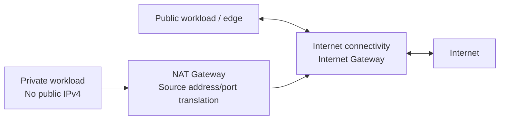
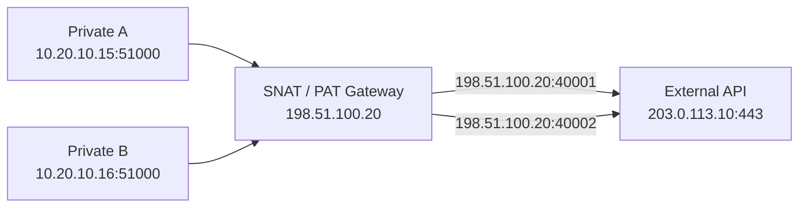
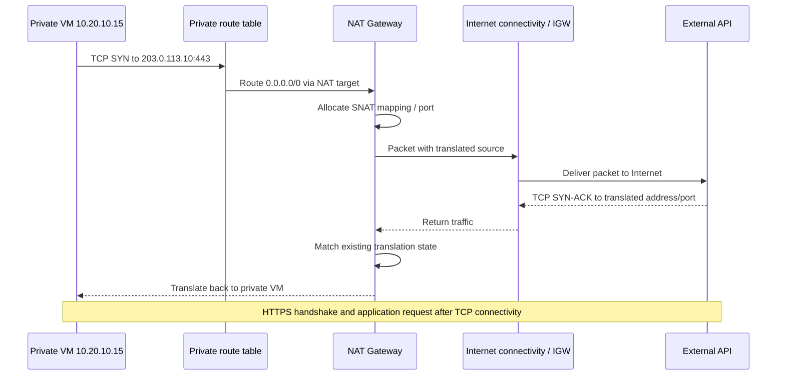
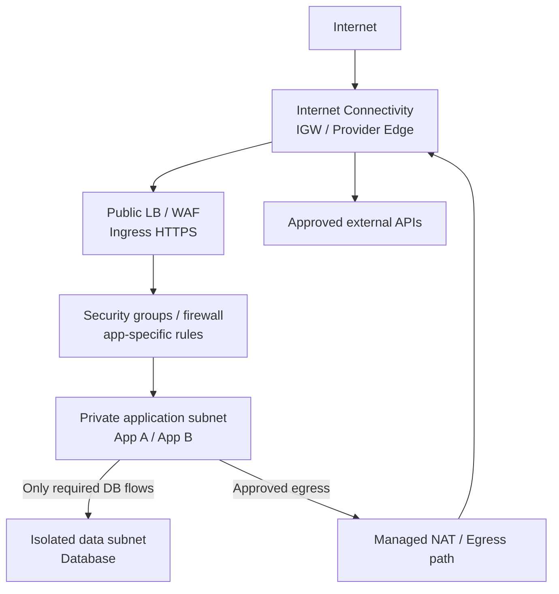
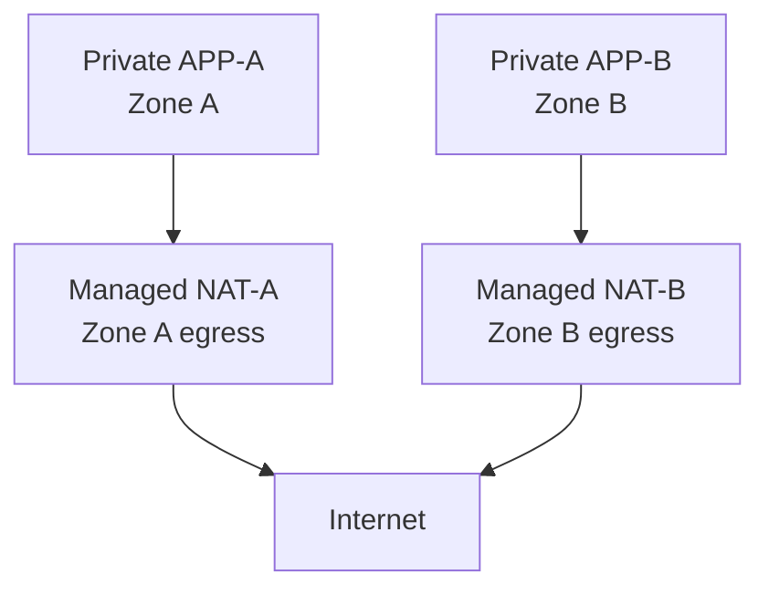
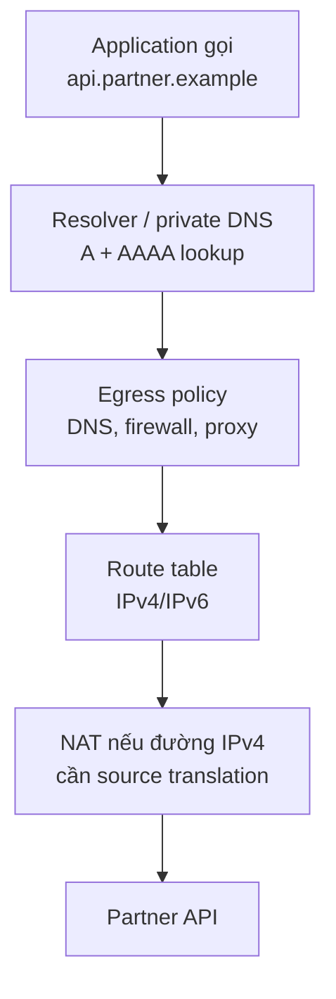
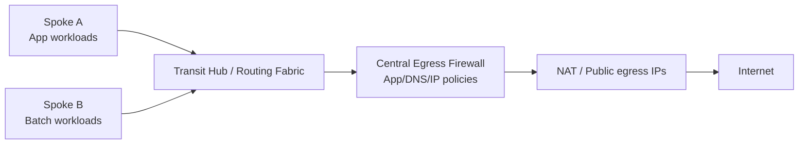
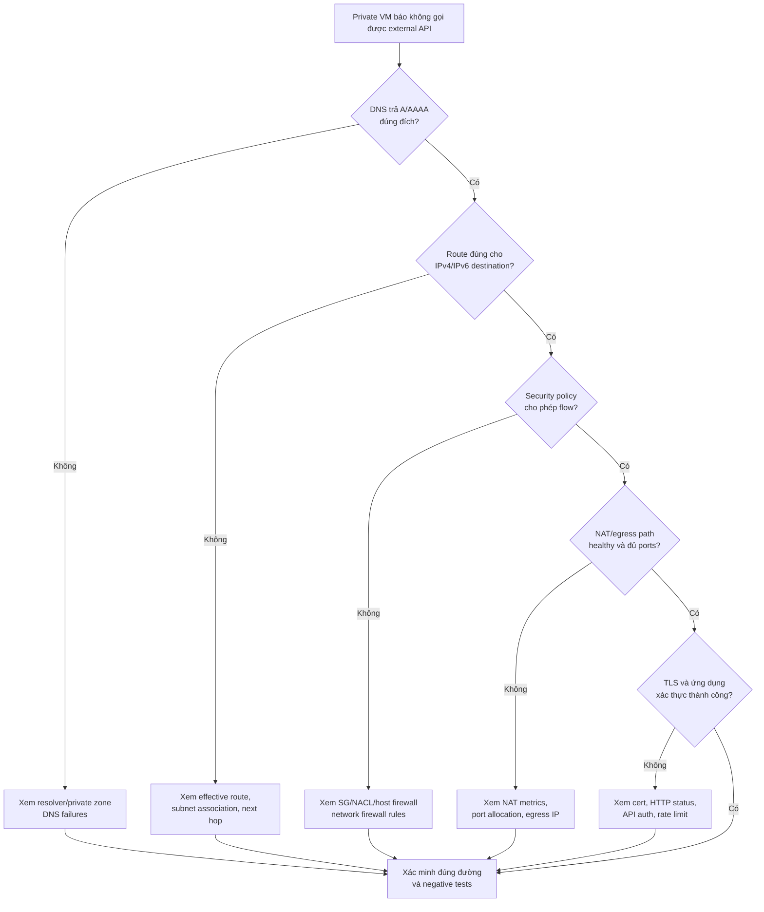

# Internet gateway và NAT gateway trong bảo mật mạng cloud

**Internet gateway** và **NAT gateway** là hai thành phần quan trọng khi thiết kế kết nối giữa mạng cloud riêng của tổ chức với Internet hoặc các miền mạng khác. Tuy cùng có thể xuất hiện trên đường đi của lưu lượng ra Internet, chúng **không làm cùng một việc**. Internet gateway cung cấp hoặc gắn với một đường kết nối Internet cho mạng ảo theo mô hình của nhà cung cấp; NAT gateway thực hiện **dịch địa chỉ mạng và cổng** để nhiều tài nguyên có thể sử dụng địa chỉ nguồn bên ngoài theo chính sách, thường phục vụ kết nối **outbound** từ những workload không được cấp public IPv4 trực tiếp.

Trong mô-đun **SECURITY_NETWORK_SECURITY**, người học cần đặt hai gateway này bên cạnh **route table, subnet, security group, network ACL, firewall/NGFW, DNS, proxy, VPN, IDS/IPS, IAM và giám sát cloud**. Một kết nối mạng chỉ được coi là an toàn khi hiểu rõ **đường đi, hướng được phép khởi tạo kết nối, danh tính tài nguyên, quy tắc truy cập và khả năng quan sát**; chỉ đặt máy sau một NAT gateway không phải là biện pháp bảo vệ đầy đủ.

Bài học sử dụng **kiến trúc tổng quát** và một số ví dụ theo các mô hình AWS, Azure, Google Cloud. Các nền tảng có khác biệt thực sự về cách tạo route, gắn gateway, loại NAT, tính sẵn sàng và tính phí. Vì vậy, ví dụ và pseudo-policy dưới đây diễn tả **nguyên tắc thiết kế**, không phải công thức cấu hình có thể áp nguyên trạng lên mọi cloud.

## 1. Mục tiêu học tập

Sau bài học, người học có thể:

1. Phân biệt **Internet gateway, NAT gateway, NAT instance, egress firewall, forward proxy và load balancer**.
2. Giải thích **public/private IPv4**, subnet route table, default route, next hop, local route và điều kiện để một máy thực sự truy cập Internet.
3. Mô tả đường đi của một phiên **private workload → NAT gateway → Internet → response**, bao gồm source NAT/port translation.
4. Phân biệt **kết nối outbound do private host khởi tạo** với **kết nối inbound không được mong đợi**.
5. Thiết kế route và chính sách cho **public subnet, private application subnet, isolated data subnet** mà không đồng nhất tên subnet với mức bảo mật tuyệt đối.
6. So sánh những khác biệt về sản phẩm và cách gắn NAT/Internet access trên **AWS, Azure và Google Cloud**.
7. Hiểu **IPv6, egress-only Internet gateway, NAT64/DNS64, dual-stack** và nguy cơ đường đi IPv6 vượt ngoài chính sách IPv4.
8. Nhận diện vấn đề **cạn SNAT ports, connection tracking, timeouts, IP allowlist, NAT log correlation**.
9. Đánh giá **multi-AZ/zone, failover, blast radius, capacity, cost** và phụ thuộc DNS/identity khi xây dựng đường Internet egress.
10. Có runbook và bộ **positive/negative tests** để chứng minh đúng lưu lượng được phép, đúng lưu lượng bị từ chối và dịch vụ vẫn hoạt động trong tình huống lỗi.

## 2. Mô hình tinh thần: ai kết nối ai, ai dịch địa chỉ?

Một sơ đồ đơn giản:



Sơ đồ mô tả một mô hình **đường IPv4 outbound điển hình**, không phải cấu trúc triển khai giống hệt trên mọi nhà cung cấp. Ở AWS, một **public NAT gateway** thường nằm trong public subnet và dùng đường qua Internet gateway để ra Internet; ở Azure hay Google Cloud, NAT service không có cùng cách gắn vào public subnet/route như vậy.

**Hai câu hỏi khác nhau:**

- **Internet gateway / Internet access:** Mạng ảo có đường định tuyến và khả năng kết nối tới Internet không?
- **NAT gateway:** Khi một gói ra khỏi mạng riêng, **địa chỉ nguồn/port của nó được chuyển đổi thành gì** và phản hồi được ánh xạ về phiên nào?

Một **router có default route ra Internet** không tự bảo đảm máy chủ có địa chỉ công khai và có thể nhận kết nối từ ngoài. Một **NAT gateway** cũng không tự quyết định người dùng hay ứng dụng nào được truy cập dịch vụ cụ thể.

### 2.1. So sánh chức năng

| Thành phần | Chức năng chính | Không nên suy ra |
| --- | --- | --- |
| **Internet gateway (IGW)** | Cung cấp điểm/khả năng kết nối giữa virtual network và Internet theo mô hình cloud | Tự kiểm soát ứng dụng hoặc tự cho mọi VM nhận inbound |
| **NAT gateway** | Dịch địa chỉ/cổng cho kết nối theo chính sách, phổ biến ở outbound IPv4 | Là firewall, IDS/IPS hoặc DLP đầy đủ |
| **Route table** | Chọn next hop/target theo prefix đích và route priority | Có tuyến là ứng dụng được phân quyền |
| **Security group** | Firewall logic ở tài nguyên/interface theo nền tảng | Thay thế certificate/mTLS hay kiểm tra danh tính user |
| **Network ACL / firewall rule** | Kiểm soát traffic ở subnet/network/host theo sản phẩm | Tự biết nội dung HTTPS và quyền API |
| **Network firewall/NGFW** | Kiểm soát sâu theo rule, destination, threat signatures khi hỗ trợ | Tự sửa vulnerability của ứng dụng |
| **Forward proxy** | Đại diện client, có thể kiểm soát HTTP CONNECT/URL/identity | Tự ngăn đường direct egress nếu network không chặn |
| **Load balancer/reverse proxy** | Nhận kết nối inbound, phân phối tới backend | NAT gateway thay thế được ingress publishing |
| **Private service endpoint** | Kết nối private tới dịch vụ cloud hỗ trợ | Bảo đảm mọi dịch vụ đều có endpoint private |

## 3. Các khái niệm nền: VPC/VNet, subnet và route

Nhà cung cấp cloud thường cho phép tổ chức tạo **mạng ảo** như VPC hoặc VNet, chia dải IP thành subnet và quản trị các route, firewall rules và kết nối liên mạng.

### 3.1. Ba lớp cần tách

1. **Addressing:** VM/pod/interface có private IP, public IP, IPv6 hoặc nhiều địa chỉ?
2. **Routing:** Đường tới destination được chọn là local, gateway Internet, NAT, firewall, VPN, transit hub hay endpoint khác?
3. **Security policy:** Traffic có bị chặn bởi security group, network ACL, OS firewall, network firewall, identity hoặc application authorization?

Có địa chỉ công khai nhưng **không có đường route hoặc bị firewall chặn** vẫn không tạo ứng dụng reachable. Có default route nhưng một IPv4 private host **không có cơ chế dịch địa chỉ nguồn phù hợp** có thể không giao tiếp Internet thành công trong mô hình thông thường.

### 3.2. Longest-prefix match và default route

Bảng route minh họa:

```text
10.20.0.0/16      -> local virtual-network route
10.30.0.0/16      -> private VPN / transit attachment
0.0.0.0/0         -> NAT path for selected private subnet
```

Packet tới **10.30.20.10** thường chọn tuyến **10.30.0.0/16**, không đi default route. Packet tới một địa chỉ Internet không khớp route cụ thể hơn mới đi qua **0.0.0.0/0**. Trong IPv6, default route là **::/0**, không liên quan trực tiếp tới chính sách 0.0.0.0/0.

**Không coi default route là policy truy cập.** Một tuyến 0.0.0.0/0 đưa traffic tới next hop nhưng firewall, policy ứng dụng và cả việc destination có tồn tại hay không vẫn quyết định kết quả.

## 4. Public subnet và private subnet thực chất là gì?

Ở nhiều hướng dẫn kiến trúc, người ta nói:

- **Public subnet:** có đường tới Internet gateway hoặc công cụ public Internet access phù hợp.
- **Private subnet:** workload không có direct public inbound; kết nối ra ngoài có thể đi NAT, egress firewall hoặc private endpoints.
- **Isolated subnet:** không có default route tới Internet; chỉ nối những dịch vụ nội bộ/được phê duyệt.

Tuy nhiên, **tên subnet không phải một cơ chế kiểm soát bảo mật có hiệu lực tự thân**. Quan trọng là những route, IP assignments và firewall policy đã cấu hình.

### 4.1. Public route khác public reachability

Trong kiến trúc AWS IPv4 quen thuộc, subnet có **0.0.0.0/0 → Internet gateway** thường được gọi là public subnet. Nhưng một EC2 instance chỉ có private IPv4 không vì thế mà tự giao tiếp Internet trực tiếp qua IGW bằng IPv4 nếu thiếu public IPv4/Elastic IP hoặc cơ chế phù hợp khác.

Ngược lại, một EC2 instance có public IPv4 ở subnet có route IGW vẫn có thể bị **security group, NACL hoặc host firewall chặn inbound**.

### 4.2. Private không có nghĩa không kết nối được outbound

Một private application server có thể cần:

- Tải bản vá hệ điều hành.
- Gửi telemetry tới SaaS được phê duyệt.
- Gọi API đối tác.
- Truy cập package registry.
- Kết nối dịch vụ cloud mà chưa có private endpoint.

Thiết kế nên cung cấp **egress được kiểm soát**, không đặt mọi private VM thành public server chỉ để hỗ trợ update. NAT gateway là một lựa chọn cho nhu cầu này.

## 5. Internet gateway: chức năng và ranh giới

Trong mô hình cloud có thành phần tên **Internet gateway**, gateway thường là điểm kết nối giữa mạng ảo và Internet. Với **AWS VPC Internet Gateway**, đây là thành phần gắn với VPC và được route table trỏ tới cho các đích Internet khi cần.

Cần phân biệt:

- **Đường route qua IGW**: xác định nơi gửi traffic.
- **Public IPv4/Elastic IP hoặc global IPv6**: khả năng địa chỉ được Internet định tuyến tới theo mô hình provider.
- **Security group/NACL/host firewall**: kiểm soát inbound/outbound.
- **Dịch vụ lắng nghe**: ứng dụng thực sự bind ở địa chỉ/port và xác thực request ra sao.

### 5.1. IGW không phải reverse proxy

IGW không tự thực hiện HTTPS termination, WAF policy, authentication user hoặc load balancing HTTP. Nếu muốn công bố một API public nhưng giữ application servers private, kiến trúc thường dùng **public load balancer/reverse proxy/WAF trước backend private**, không chỉ cấp public IP cho backend.

### 5.2. IGW không tự là security boundary đầy đủ

Có Internet route không phải mọi traffic đều được phép, nhưng cũng không thể dựa vào “network nằm sau IGW” như dấu hiệu an toàn. Cần:

1. Chỉ cấp public address cho **thành phần có nhu cầu trực tiếp**.
2. Thiết kế ingress qua load balancer, WAF/API gateway hoặc endpoint được bảo vệ.
3. Dùng security group, network ACL và host firewall **deny-by-default** theo phạm vi.
4. Không đưa database/management interface ra Internet chỉ vì subnet đã có IGW route.
5. Có inventory public IP, DNS, certificates, exposed ports và owners.
6. Giám sát route changes, public IP attachments và firewall rule drift.

## 6. NAT gateway: giải quyết bài toán egress IPv4

**Network Address Translation (NAT)** dịch thông tin địa chỉ nguồn/đích theo mô hình; trong kết nối outbound thường là **SNAT (source NAT)**, đôi khi bao gồm dịch cổng (*PAT/NAPT*).

Một ví dụ:

- Workload A có private IP **10.20.10.15**.
- Workload B có private IP **10.20.10.16**.
- Cả hai kết nối tới API bên ngoài trên TCP/443.
- NAT gateway có public egress IP **198.51.100.20** trong ví dụ minh họa.
- Destination bên ngoài nhìn thấy kết nối đến từ **198.51.100.20** với các cổng nguồn được NAT ánh xạ.

**198.51.100.0/24** là dải dành cho tài liệu, không phải IP egress sử dụng được trên Internet thực tế.



Cùng một source port ở hai private hosts có thể được ánh xạ thành **hai cổng ngoài khác nhau** để phân biệt các luồng theo ngữ cảnh kết nối. NAT implementation cụ thể có thể dùng thuật toán cấp cổng khác; sơ đồ không quy định mọi NAT gateway phải cấp các cổng 40001/40002.

### 6.1. NAT không che giấu “ai là ai” trước tổ chức

Đích bên ngoài thường chỉ nhìn thấy public egress IP sau NAT. Nhưng tổ chức vận hành vẫn phải có khả năng liên kết **workload → private IP/source port → NAT mapping → public IP/translated port → destination** khi điều tra.

Nếu không có mapping log hoặc telemetry tương ứng, nhiều workload có chung public IP sẽ khiến việc gán một kết nối cho đúng asset trở nên khó khăn.

## 7. Luồng gói tin outbound và return path

Hãy xét một VM private gọi HTTPS tới một API ngoài Internet.



Sơ đồ phản ánh đường IPv4 của một thiết kế tiêu biểu. Với Google Cloud hoặc Azure, những bước cung cấp Internet connectivity và dịch nguồn có thể được triển khai khác, không nhất thiết có một IGW/route target được hiển thị cùng tên.

### 7.1. Vì sao NAT gateway outbound thường không tạo inbound public service?

NAT gateway kiểu outbound thiết lập mapping khi **workload phía trong khởi tạo** phiên hợp lệ. Một Internet client gửi kết nối mới tới public egress IP mà **không có mapping hoặc quy tắc inbound tương ứng** thường không được chuyển thẳng tới một private workload tùy ý.

Điều này là một tính chất của mô hình outbound NAT, **không phải bằng chứng NAT gateway là firewall đầy đủ**. Phải kiểm tra đúng dịch vụ NAT của provider vì có loại NAT/port mapping dành cho những mục đích khác.

### 7.2. Return traffic vẫn cần security policy

NAT ánh xạ response về host gốc, nhưng gói vẫn có thể bị:

- Stateless network ACL chặn ở cổng nguồn/đích phù hợp.
- Host firewall hoặc security control từ chối.
- Timeout state hoặc cổng SNAT đã giải phóng.
- Lỗi route, tunnel hay kết nối upstream.
- Ứng dụng/TLS từ chối vì certificate hoặc AuthZ.

Trạng thái “NAT gateway available” không chứng minh mọi request được hoàn thành.

## 8. SNAT, DNAT, PAT/NAPT: ba ý niệm cần tách

| Kỹ thuật | Điều thay đổi | Ví dụ/ứng dụng |
| --- | --- | --- |
| **SNAT** | Thay địa chỉ nguồn, đôi khi cổng nguồn | Private VM gọi Internet qua egress address |
| **DNAT** | Thay địa chỉ đích, đôi khi cổng đích | Inbound publishing hoặc điều hướng tới server trong một kiến trúc cụ thể |
| **PAT/NAPT** | Dịch cả địa chỉ và port theo trạng thái | Nhiều flows cùng chia sẻ public IPv4 |
| **NAT64** | Dịch giữa IPv6 và IPv4 theo thiết kế | IPv6-only workload truy cập một số IPv4 destinations |
| **No NAT / routed connection** | Giữ nguyên địa chỉ IP theo chính sách định tuyến | Private interconnect, VPN, peering, một số IPv6 paths |

### 8.1. Cái gì không phải NAT?

- Một **reverse proxy** chấm dứt kết nối HTTP và tạo request upstream mới; đây không đơn thuần là thay IP header.
- Một **public load balancer** có thể dùng nhiều cơ chế mạng và proxy khác nhau; đừng gọi tất cả đều là NAT gateway.
- **Firewall** kiểm tra quyền kết nối; NAT chỉ làm một phần thao tác chuyển đổi địa chỉ, dù cùng nằm trên thiết bị firewall.
- **DNS** ánh xạ hostname thành địa chỉ, không thực hiện packet NAT.
- **Encryption/VPN** bảo vệ đường truyền, không đồng nghĩa tự động SNAT.

Trong triển khai thực tế, một thiết bị có thể đảm nhận nhiều chức năng. Phải xác minh chức năng bằng **data path và chính sách cụ thể** thay vì tên marketing.

## 9. Public/private application architecture

Một mô hình quen thuộc: Internet chỉ được truy cập đến load balancer/WAF, application server không có public IPv4, database không có đường Internet.



Đường kết nối từ **APP → DB** phải đi qua ranh giới được phân quyền, không tự dùng default route tới NAT. **Database subnet** không cần default route ra Internet nếu mọi dependency có thể đi private; đây thường là mục tiêu giảm bề mặt tấn công, nhưng vẫn cần phương án cập nhật, backup và quản trị có kiểm soát.

### 9.1. Trách nhiệm từng lớp

| Lớp | Quyết định | Ví dụ chính sách |
| --- | --- | --- |
| Public DNS | Hostname công khai tới edge nào | api.example.net → LB |
| Public ingress | Ai được kết nối và TLS/WAF áp ra sao | Internet → LB TCP/443 |
| LB → application | Backend nào và identity nào được tin | LB SG → APP SG TCP/8443 |
| APP → DB | Service nào được đọc/ghi dữ liệu | APP role → DB TCP/5432 theo network và database AuthZ |
| APP → NAT | Workload nào có Internet egress | APP subnet route + firewall egress |
| NAT → external | Public egress source và mapping nào | Approved SaaS destinations; quan sát flow |
| Operations | Ai được thay route/SG/NAT? | IAM least privilege + change review |

**Rủi ro “private subnet = trusted”:** nếu app A bị tấn công, nó vẫn có thể lạm dụng egress hoặc đường tới DB. Vì vậy cần **service identity, firewall policy, WAF/API authorization, workload security và giám sát**.

## 10. Routing ví dụ: thiết kế AWS-style có kiểm soát

Đây là **một mô hình tham khảo theo khái niệm AWS VPC IPv4** với hai subnet và một public NAT gateway. Không áp nguyên mẫu vào môi trường khác; ngay cả trong AWS cần kiểm tra VPC CIDR, AZ, route-table association, attachment và endpoint.

### 10.1. Ví dụ địa chỉ

- VPC CIDR: **10.20.0.0/16**.
- Public subnet-A: **10.20.0.0/24**.
- Private app subnet-A: **10.20.10.0/24**.
- Isolated DB subnet-A: **10.20.20.0/24**.
- NAT gateway public-A nằm trong public subnet-A, có public egress IPv4 phù hợp.
- Internet gateway được gắn với VPC.

### 10.2. Route tables minh họa

```text
PUBLIC-RT-A
Destination           Target
10.20.0.0/16          local
0.0.0.0/0             Internet Gateway

PRIVATE-APP-RT-A
Destination           Target
10.20.0.0/16          local
0.0.0.0/0             NAT Gateway A

ISOLATED-DB-RT-A
Destination           Target
10.20.0.0/16          local
(no Internet default route)
```

**Lưu ý:** kiểu route này diễn giải logic, không phải output của cloud CLI. Trong AWS, public NAT gateway có thiết kế liên quan public subnet/Elastic IP và một đường Internet gateway cho Internet egress. Nhưng **private NAT gateway** là loại khác phục vụ mục tiêu kết nối private, không nên coi hai loại NAT gateway là tương đương.

### 10.3. Vì sao NAT gateway cần vị trí và route phù hợp?

Nếu một public NAT gateway được đặt ở subnet không có **đường tiếp cận Internet theo mô hình của provider**, workload sẽ không thể ra Internet như dự tính chỉ vì route private subnet đã trỏ về NAT. Tương tự, nếu private subnet trỏ default tới IGW nhưng workload không có public IPv4, đó không tự là giải pháp thay NAT.

### 10.4. Không dùng NAT cho traffic VPC local

Route local tới cùng VPC CIDR thường được ưu tiên bởi prefix cụ thể hơn. Traffic APP → DB trong cùng mạng ảo không nên đi vòng ra NAT gateway để quay về. Nếu muốn lọc east-west traffic, cần **subnet/host firewall, network firewall, service identity và segmentation**, không đánh đổi thiết kế route chỉ để “bắt mọi packet qua NAT”.

## 11. Các provider khác nhau thế nào?

**Không phải cloud nào cũng có một tài nguyên Internet gateway hoạt động như AWS IGW** hoặc NAT gateway phải đặt trong public subnet.

| Chủ đề | AWS VPC — mô hình phổ biến | Azure VNet — mô hình phổ biến | Google Cloud VPC — mô hình phổ biến |
| --- | --- | --- | --- |
| Kết nối Internet cho VM/public service | Route/IGW, public addressing và security controls | Hạ tầng Internet routing + public IP/LB và NSG/policy phù hợp | Routes/Internet path, external IP/LB và VPC firewall |
| NAT outbound managed | **NAT Gateway** theo subnet và route target; có loại public/private | **Azure NAT Gateway** gắn với subnet, dùng public IP/prefix cho outbound | **Cloud NAT** được cấu hình trong region qua Cloud Router; dịch outbound theo phạm vi phù hợp |
| Điểm quản trị route | VPC route tables gắn subnet | System routes, user-defined routes và subnet associations theo sản phẩm | VPC routes, dynamic routing/policies và NAT configuration theo mô hình |
| Public IPv4 cho workload private | Không cần public IPv4 ở từng private VM khi đi qua public NAT gateway | NAT gateway có thể cung cấp outbound IP chung cho subnet | Cloud NAT giúp eligible instances không có external IPv4 ra Internet |
| Inbound tới backend | Public LB, public IP và các ingress products | Public LB/Application Gateway/Front Door hoặc dịch vụ tương đương | External LB/other ingress products |
| Kiểm soát firewall | Security Groups/NACL, firewall products | NSG/Azure Firewall và controls khác | VPC Firewall Rules/policies và security products |

**Không dùng bảng này như danh sách tính năng đầy đủ hoặc hướng dẫn CLI cụ thể.** Loại tài nguyên, cách gán route, độ ưu tiên route, subnet constraints, NAT behavior, IP quotas, HA và cost phải kiểm tra theo **dịch vụ/vùng/phiên bản kiến trúc hiện hành của nhà cung cấp**.

### 11.1. Điểm dễ nhầm khi chuyển từ AWS sang Azure

Trong nhiều thiết kế Azure, NAT Gateway được **associate với subnet** làm đường outbound source NAT mặc định theo quy tắc ưu tiên và định tuyến nền tảng, không cấu hình bằng một route target Internet gateway giống mô hình AWS VPC trên. Nếu có **user-defined route ép traffic qua firewall/NVA**, đường đi thực sự có thể khác. Vì vậy phải kiểm tra **effective routes** và actual source IP, không chỉ sự hiện diện của NAT resource.

### 11.2. Điểm dễ nhầm khi chuyển sang Google Cloud

Google Cloud **Cloud NAT** là một dịch vụ NAT managed được cấu hình cho resource và region phù hợp, thường phối hợp Cloud Router ở **control plane**. Điều này không có nghĩa từng packet outbound phải đi qua một router VM mà người dùng quản trị, cũng không có nghĩa phải đặt một NAT instance trong public subnet.

Một Cloud NAT configuration **không tự cung cấp internet policy/app firewall**; đường route, VPC firewall, resource eligibility và routing topology vẫn cần đúng.

### 11.3. Một subnet có thể có nhiều khả năng egress

Trong cloud hybrid, lưu lượng có thể đi qua:

- NAT gateway cho Internet IPv4 thông thường.
- Network firewall/NVA rồi mới ra Internet.
- VPN/private interconnect tới egress tại data center.
- Private endpoint để truy cập dịch vụ cloud cụ thể.
- Proxy/TLS inspection cho một số ứng dụng web.
- IPv6 egress qua đường riêng.

Phải lập **bảng route + policy theo destination/source**, không suy rằng “subnet đã gắn NAT” nghĩa mọi packet của nó đều đi NAT.

## 12. Public IP, public ingress và ý nghĩa thực tế của “không có public IP”

Một private workload **không có external IPv4** thường không thể nhận một kết nối Internet IPv4 trực tiếp chỉ bằng việc người ngoài biết private IP. Tuy nhiên, nó vẫn có thể **trở thành điểm nhận traffic ngoài qua thành phần trung gian**:

- Public load balancer chuyển request tới backend private.
- API gateway kết nối nội bộ hoặc private integration.
- Reverse proxy/CDN truy cập origin theo private link hoặc controlled ingress.
- VPN, peering hoặc transit hub cho mạng khác truy cập.
- Serverless/function integration hoặc event bus kích hoạt xử lý.

**“Không có public IP” không đồng nghĩa “không có exposed attack surface”.** Cần xem toàn bộ entry points, IAM, application API, network path và data flows.

### 12.1. NAT gateway không thay load balancer inbound

Nếu tổ chức muốn công bố **api.example.net** tới người dùng Internet, thiết kế nên xem public LB/reverse proxy/WAF hoặc dịch vụ API ingress tương đương. NAT outbound **không** tự tạo listener HTTPS, certificate hoặc policy inbound đến backend.

Một NAT instance tùy chỉnh có thể dùng DNAT/port forwarding nếu được cấu hình, nhưng khi đó nó không còn là cùng use case với **managed outbound NAT gateway** trong kiến trúc tiêu chuẩn.

## 13. NAT gateway không phải firewall

Một lỗi khái niệm phổ biến là: **“Private VM nằm sau NAT thì đã an toàn vì Internet không mở inbound.”**

Câu này chỉ nói được một phần về **kiểu kết nối inbound không được khởi tạo**. Nếu private VM được phép gửi request tới bất kỳ đích nào, mã độc trên VM vẫn có thể gọi command-and-control, exfiltrate dữ liệu hoặc dùng HTTPS tới đích không được phê duyệt.

### 13.1. So sánh NAT và firewall

| Câu hỏi | NAT gateway | Firewall/NGFW |
| --- | --- | --- |
| Thay đổi source/destination IP/port? | Có, theo NAT policy | Có thể kèm NAT nếu sản phẩm hỗ trợ |
| Xác thực danh tính ứng dụng hoặc user? | Thông thường không | Có thể tích hợp identity-aware policies tùy sản phẩm |
| Chặn domain/URL độc hại? | Không mặc định | Có thể thông qua DNS/SWG/NGFW/app inspection |
| Phát hiện malware/IPS signature? | Không mặc định | Có thể với IPS/NGFW nếu cấu hình |
| Chặn kết nối mới không có mapping? | Thuộc tính của outbound stateful NAT | Chính sách firewall riêng |
| Ghi mapping giữa private/public flow? | Có thể có telemetry/log tương ứng | Firewall thường ghi quyết định cho phép/từ chối |
| Quyết định một API request có quyền DELETE? | Không | Thường cần API/application AuthZ |

### 13.2. Thiết kế egress defense in depth

1. Firewall/security group **chỉ mở những cổng/đích cần thiết**, theo khả năng quản lý.
2. Dùng **DNS policy/allowlist/secure web gateway** nếu cần kiểm soát domain hoặc URL.
3. Dùng **network firewall/NGFW** cho yêu cầu lọc sâu hoặc threat detection.
4. **Endpoint/workload EDR** hoặc runtime controls phát hiện tiến trình bất thường.
5. API bên ngoài dùng **TLS certificate validation, mTLS/OAuth** theo nhu cầu.
6. NAT logs/flow logs hỗ trợ điều tra, nhưng không thay event logs từ ứng dụng.
7. IAM chỉ cho workloads đủ quyền sử dụng cloud services, kể cả khi egress network được phép.

## 14. Security group, network ACL và host firewall

Trong một kiến trúc AWS-style, có thể gặp:

- **Security Group (SG):** cơ chế firewall stateful gắn với network interface/resource được hỗ trợ.
- **Network ACL (NACL):** cơ chế lọc subnet thường là stateless trong mô hình AWS, với inbound và outbound rules.
- **Host firewall:** iptables/nftables, Windows Firewall hoặc agent policy bên trong VM.
- **Network Firewall/NVA:** enforcement tập trung ở vùng mạng khác.

### 14.1. Stateful vs stateless

Một **stateful firewall** có thể cho phép gói phản hồi của một connection được phép theo connection state, mà không nhất thiết cần rule đối xứng cho từng ephemeral return port. Một **stateless ACL** cần quy tắc phù hợp ở cả hai hướng theo thông tin packet.

Ví dụ private VM kết nối TCP/443 tới external API, cổng nguồn có thể là một ephemeral port. Nếu một NACL stateless chặn return traffic tới cổng ephemeral thích hợp, **NAT có translation hợp lệ nhưng ứng dụng vẫn timeout**.

**Không gán đặc tính stateful/stateless của AWS SG/NACL cho mọi sản phẩm Azure/GCP.** Phải đọc đúng service semantics của provider đang triển khai.

### 14.2. NAT gateway và security group

Với **AWS managed NAT Gateway**, không nên giả định có thể gắn security group trực tiếp cho NAT gateway theo cách gắn vào EC2 instance. Policy bảo vệ thường đặt ở **nguồn workload, subnet NACL, firewall egress và các lớp khác**. NAT instance tự quản trị lại có host firewall/security group như một VM, nhưng tổ chức phải chịu trách nhiệm vận hành bản vá, HA và throughput.

### 14.3. Network ACL không thay quyền ứng dụng

NACL cho phép traffic từ một địa chỉ không có nghĩa caller đã được xác thực với API. Ngay cả nếu response qua NAT thành công, resource server vẫn phải kiểm tra **token, scope, user/service identity và object-level authorization**.

## 15. IPv6: Internet access không giống IPv4 NAT

IPv6 có không gian địa chỉ rộng hơn. Trong nhiều mô hình cloud, workload có thể dùng **global IPv6 address** và được định tuyến ra Internet mà **không cần NAT44**. Vì vậy, nếu chỉ kiểm soát IPv4 0.0.0.0/0 qua NAT, một đường **::/0** có thể tạo luồng Internet khác nếu IPv6 được bật.

### 15.1. Ba câu hỏi cần hỏi riêng

1. Workload có **IPv6 address** không và loại địa chỉ nào?
2. Route **::/0** đi tới next hop nào: Internet gateway, egress-only gateway, firewall hay không có route?
3. Security policy IPv6 có ngăn các luồng **inbound và outbound ngoài phạm vi** không?

Không thấy public IPv4 không chứng minh workload **không thể truy cập Internet** nếu nó có đường IPv6.

### 15.2. Egress-only Internet gateway

Trong **AWS VPC IPv6**, có thành phần **egress-only Internet Gateway** hỗ trợ traffic IPv6 outbound và phản hồi cho kết nối được thiết lập, đồng thời không cho phép Internet khởi tạo kết nối inbound tùy ý theo mô hình đó. Nó **không đồng nghĩa** NAT IPv4 và không cần dịch địa chỉ nguồn IPv6 theo kiểu NAT44.

Vẫn cần **IPv6 security group/NACL, routing, DNS AAAA và IAM/app policies**. Thiết kế phải được kiểm thử với cả **0.0.0.0/0** và **::/0**.

### 15.3. NAT64 và DNS64

Một số môi trường **IPv6-only** cần truy cập các dịch vụ chỉ có IPv4. **NAT64** là kỹ thuật dịch IPv6↔IPv4, thường kết hợp **DNS64** để hỗ trợ ứng dụng dùng DNS tìm đích IPv4.

Cần hiểu:

- NAT64 **khác NAT44**, không chỉ đổi nguồn private IPv4 thành public IPv4.
- DNS64 có thể tổng hợp bản ghi AAAA từ A theo chính sách, nhưng không phải mọi ứng dụng dùng DNS đều hoạt động giống nhau.
- DNSSEC validation, IPv4 literals, embedded IPv4 và protocol specifics có thể tạo vấn đề tương thích.
- Các khả năng NAT64/DNS64 được managed cloud cung cấp **khác nhau theo provider và dịch vụ**.
- Kiểm soát egress, nguồn log và mapping phải bao phủ cả hai address families.

**Không tắt IPv6 vô điều kiện để tránh cấu hình.** Hãy định nghĩa đúng đường IPv6 và kiểm thử policy, hoặc quyết định không triển khai IPv6 theo kế hoạch kiến trúc có phê duyệt.

## 16. Địa chỉ egress cố định và IP allowlist của đối tác

Nhiều dịch vụ B2B dùng **source IP allowlist**. Đối tác yêu cầu mọi request API từ tổ chức đến từ một số public IPv4 đã khai báo.

NAT gateway có thể giúp gom traffic nhiều private workloads sau một tập **public egress IP** theo mô hình cấu hình. Nhưng cần xét:

- NAT gateway có **một hay nhiều public IP**?
- Các vùng/zone/region có dùng egress IP khác nhau?
- Khi failover, IP ra ngoài có giữ nguyên không?
- Có đường Internet khác khiến traffic bỏ NAT không?
- Có sử dụng IPv6 trực tiếp tới đối tác không?
- Outbound qua **proxy, VPN hoặc interconnect** có địa chỉ nguồn khác không?
- Nhà cung cấp có cơ chế thay IP/rotation khi nâng cấp hoặc phục hồi không?

### 16.1. IP allowlist không phải authentication hoàn chỉnh

Một public egress IP có thể đại diện cho **nhiều workloads**. Đối tác biết một request đến từ IP được phép nhưng **không chứng minh service nào phát request đó**.

Kênh B2B cần thêm **mTLS, OAuth 2.0 client credentials, signed requests hoặc API authentication** theo rủi ro; source-IP allowlist chỉ là một lớp mạng bổ sung.

### 16.2. Hai zone, hai egress IP

Giả sử APP-A ở Zone A đi NAT-A và APP-B ở Zone B đi NAT-B. Nếu đối tác chỉ allowlist public IP NAT-A, các request từ Zone B có thể bị **403/connection drop**, dù DNS/TLS và application credentials giống nhau.

Phải đăng ký đủ **approved egress IP set**, lập kế hoạch failover và xác minh bằng telemetry từ dịch vụ đích/endpoint kiểm tra có phép, không đoán theo IP của VM.

## 17. High availability: zone, region và rủi ro dùng chung NAT

NAT gateway là điểm tập trung traffic. Khi thiết kế **multi-AZ/multi-zone**, cần xem **failure domain, dependency, route association và egress IP**, không chỉ số lượng VM.

### 17.1. Mô hình per-zone



Với AWS, thiết kế **NAT gateway riêng cho từng Availability Zone** thường được dùng nhằm tránh sự phụ thuộc không cần thiết vào một NAT gateway đặt ở AZ khác. Đây là quyết định thiết kế availability/cost, không phải một quy tắc mà mọi provider có tài nguyên zone tương ứng.

### 17.2. Một NAT dùng chung nhiều zone

Có thể tạo điểm tập trung và giảm số lượng NAT resources trong một số kiến trúc, nhưng cần đánh giá:

- Nếu NAT zone lỗi, các workloads zone khác có mất outbound không?
- Cross-zone traffic có thêm phí/độ trễ không?
- Route table có cơ chế **failover được tự động hóa, kiểm soát và thử nghiệm** không?
- Egress IP có thay khi chuyển NAT không?
- Flow mapping/session cũ có phục hồi tự động không?
- Proxy, firewall, DNS và external allowlists có phụ thuộc cùng một đường không?

**Không giả định managed NAT luôn tự thực hiện failover cross-zone hoặc cross-region theo cách ứng dụng cần.** Tính khả dụng của dịch vụ managed và route topology thực tế là hai vấn đề riêng.

### 17.3. Region-level disaster recovery

Nếu toàn region không sẵn sàng, egress có thể chuyển sang region dự phòng với **public IP khác**, VPC/VNet routes, DNS và credentials khác. Cần đồng bộ inventory allowlists, application dependencies và secrets theo phương án DR, đồng thời chấp nhận rằng một số kết nối cũ sẽ bị cắt khi chuyển đường.

## 18. SNAT port exhaustion và khả năng mở rộng

Một NAT gateway có **số lượng cổng và state mappings hữu hạn**. Nếu rất nhiều connections xuất phát từ private hosts tới cùng destination IP:port hoặc số đích/cổng hạn chế, có thể xuất hiện **SNAT port exhaustion** hoặc lỗi cấp mapping, tùy thuật toán và quotas của nhà cung cấp.

### 18.1. Hiểu bằng ví dụ

Nhiều workers cùng gọi:

```text
Destination: 203.0.113.10:443

Workers:
  worker-001 -> thousands of short TCP connections
  worker-002 -> thousands of short TCP connections
  ...
  worker-500 -> thousands of short TCP connections

NAT:
  finite source-port mappings per public egress address / destination tuple
```

Giới hạn thực tế **không đơn giản luôn là 65.535 connections cho cả gateway**. Nó phụ thuộc provider, public IP count, protocol, destination tuple, port allocation, timeouts, scaling và mapping algorithm.

### 18.2. Dấu hiệu

- Một số workload timeout khi tải tăng, một số vẫn hoạt động.
- TCP connection attempts tăng mạnh, nhưng external API ít nhận request.
- NAT telemetry báo **port allocation errors/drops** khi provider có chỉ số đó.
- Nhiều ngắn hạn connections thay vì tái sử dụng keep-alive/HTTP/2.
- Một destination SaaS cụ thể bị ảnh hưởng trong khi các destination khác bình thường.
- Concurrency bùng lên sau deployment, queue retry storm hoặc service error.

### 18.3. Hướng giảm rủi ro

1. Dùng **HTTP connection pooling/keep-alive** phù hợp với ứng dụng và proxy.
2. Giảm **unbounded retry**; có exponential backoff/jitter và retry budget.
3. Tăng **egress public IP capacity** hoặc phân tách NAT paths theo khả năng provider.
4. Phân phối workload/đích qua các NAT resources khi kiến trúc cho phép.
5. Dùng **private endpoints** cho cloud APIs được hỗ trợ để bớt phụ thuộc NAT.
6. Đo số active connections, new connections/s, port allocation errors và end-to-end latency.
7. Kiểm tra **idle timeout** và protocol behavior, không đặt timeout cực ngắn gây phá kết nối hợp lệ.
8. Làm **load test được phê duyệt** với mức tải có giới hạn, tránh gây nghẽn shared Internet egress production.

### 18.4. Không nhầm với CPU hoặc application timeout

Không phải mọi connection reset/timeout đều là SNAT exhaustion. Cần đối chiếu **NAT metrics + application retry/connection counts + packet drops + destination health + firewall logs** trước khi kết luận. Một lỗi API 429 hoặc 503 là dấu hiệu rate limit/backend overload, không tự là cạn NAT port.

## 19. Connection tracking, idle timeouts và giao thức không phải TCP

NAT cần phân biệt luồng. Với TCP/UDP, state thường liên quan **5-tuple**:

```text
(src IP, src port, dst IP, dst port, transport protocol)
```

Sau dịch, NAT dùng mapping tương ứng và trạng thái để xử lý packet trả về. Thời gian giữ mapping khác theo **protocol, connection state và nhà cung cấp**.

### 19.1. TCP keep-alive và reuse

Một ứng dụng mở hàng nghìn TCP connections mới tới cùng API có thể dùng nhiều cổng hơn ứng dụng tái sử dụng kết nối hợp lệ. HTTP/2 có thể multiplex nhiều requests trên một connection, nhưng cần kiểm tra server/client hỗ trợ và khả năng cân tải.

Không bật keep-alive vô hạn: idle connections vẫn tốn tài nguyên và bị ảnh hưởng bởi timeout của NAT, firewall, proxy và server.

### 19.2. UDP, QUIC và timeout

QUIC/HTTP/3 dùng UDP. NAT mapping cho UDP có thể hết hạn khi idle, khiến session di chuyển mạng hoặc không duy trì được đường theo cách client kỳ vọng. Kiểm thử cần xét **UDP/443, packet loss, NAT idle timeout, path migration và firewall policy**, không suy rằng HTTPS qua TCP đã pass là HTTP/3 sẽ hoạt động.

### 19.3. ICMP và path MTU

Một số thông điệp ICMP/ICMPv6 cần thiết cho chẩn đoán và **Path MTU Discovery**. Chặn tất cả ICMP có thể tạo lỗi “ping nhỏ được nhưng upload lớn thất bại”. Cách NAT hỗ trợ ICMP và packet fragments khác nhau theo provider; cần dựa vào telemetry và khả năng dịch vụ thực tế.

## 20. NAT gateway, private endpoints và tối thiểu hóa Internet egress

Không phải mọi đích ngoài subnet đều cần đi Internet. Nhiều cloud cung cấp **private endpoints/service endpoints/PrivateLink/VPC endpoints** hoặc các cơ chế kết nối private đến dịch vụ tương ứng.

Ví dụ một private workload cần:

- Đọc object storage.
- Đẩy log/metrics tới cloud monitoring service.
- Kéo container image.
- Truy cập secret manager hoặc key management.
- Gọi API managed database.

Một số dịch vụ có thể đi qua **endpoint private** thay vì NAT–Internet path, tùy provider/region/configuration.

### 20.1. Lợi ích

- Giảm dependency vào NAT gateway/public Internet egress.
- Giảm bề mặt tiếp xúc Internet cho một nhóm dịch vụ.
- Có thể hỗ trợ đường dữ liệu riêng, policy theo endpoint/resource.
- Giảm số connections/cost đi qua NAT trong một số trường hợp.
- Cải thiện phân loại và quan sát luồng giữa workloads và cloud services.

### 20.2. Không coi private endpoint tự là quyền

Private endpoint vẫn cần **IAM/resource policies, DNS phù hợp, firewall/security group và kiểm soát dữ liệu**. Một private IP đến object storage không chứng minh service được phép đọc mọi bucket.

**Không dịch vụ nào cũng có private endpoint**, và cùng một service có thể khác về DNS/region/quota/cost. Khi chuyển đích từ public endpoint sang private endpoint, kiểm tra **private DNS, TLS hostname, SDK behavior và routing**.

## 21. DNS và Internet egress: gói không đi như tên miền

Một application thường kết nối tới **hostname**, nhưng route table xét **IP destination**. Quá trình phân giải tên có thể dùng resolver của cloud, DNS forwarder, private zone hoặc DoH trong ứng dụng.

### 21.1. Luồng điển hình



Sơ đồ đơn giản hóa; thực tế kiểm tra DNS và network policy có thể ở nhiều vị trí và IPv6 path có thể **không đi NAT44**.

### 21.2. Vấn đề thường gặp

- DNS trả **AAAA** và client chọn IPv6 ngoài chính sách.
- DNS record thay IP theo CDN/geo-DNS, trong khi firewall allowlist chỉ có một IP cũ.
- Private DNS zone làm hostname resolve về private endpoint khác đường dự kiến.
- Resolver phân giải được nhưng NAT route/ACL không cho TCP tới đích.
- Proxy là thành phần phân giải DNS, không phải application host.
- Truy vấn DNS qua một đường được phép nhưng request thực đi đường khác.
- Cloud-specific metadata hostname/IP cần kiểm soát đặc biệt vì SSRF.

**DNS filtering không thay thế egress filtering**, và một fixed egress IP không chứng minh request đã đi tới đúng hostname; cần TLS hostname validation và kiểm soát application-level authorization.

## 22. SSRF, cloud metadata và những đích nhạy cảm

**Server-Side Request Forgery (SSRF)** có thể khiến một backend phát request tới đích do attacker kiểm soát hoặc chọn đích nội bộ không được phép.

Nếu application có quyền Internet egress rộng, nó có thể bị lợi dụng để gửi request tới:

- **Cloud instance metadata endpoints** hoặc các dịch vụ cung cấp credentials nếu cấu hình bảo vệ yếu.
- Loopback hoặc local services.
- Private IP management APIs.
- Internal control-plane endpoints.
- Đích Internet dùng exfiltration hoặc callback.

### 22.1. Vì sao NAT không giải quyết SSRF?

NAT gateway chủ yếu dịch địa chỉ để traffic đi ra, không tự kiểm tra liệu application **có nên gọi URL đó** hay request có xuất phát từ user input nguy hiểm.

Một số metadata endpoints có đường **link-local/local** đặc thù và không đi qua NAT Internet thông thường. Vì vậy chính sách “mọi Internet egress qua NAT” **không bảo đảm** đã chặn request tới metadata.

### 22.2. Phòng vệ nhiều lớp

- Ứng dụng có **URL/destination allowlist**, chống redirect và kiểm tra input theo ngữ cảnh.
- Runtime/host firewall và cloud network policy giới hạn loopback/link-local/metadata access khi hỗ trợ.
- Dùng cơ chế metadata hardening của provider và **workload IAM least privilege**.
- Egress proxy/NGFW với chính sách đích cụ thể khi phù hợp.
- Không chuyển tiếp **Authorization headers/tokens** sang hostname khác không được phép.
- Kiểm tra **IPv4, IPv6, DNS rebinding, redirects** ở biên đáng tin theo ứng dụng.
- Giám sát truy cập metadata và credential usage bất thường.

## 23. Centralized egress, firewall và hub-and-spoke

Một tổ chức lớn có thể không muốn mỗi VPC/VNet đều tự mở Internet egress. Thay vào đó, nó xây **hub-and-spoke** với egress firewall/proxy/NAT tập trung.



### 23.1. Ưu điểm

- Chính sách egress tập trung theo zone/workload.
- Một tập outbound IP/telemetry để quản lý kết nối với đối tác.
- Dễ áp DNS/SWG/NGFW/DLP khi kiến trúc cần.
- Có thể chuẩn hóa logs, policy-as-code và route validation.

### 23.2. Rủi ro

- Tạo **single point of failure** nếu hub/firewall/NAT không có HA phù hợp.
- Cross-zone/region data transfer costs và latency.
- Khó xử lý **asymmetric routing** với stateful firewall.
- Route leak giữa spoke và tenant, hoặc traffic bypass inspection.
- Khi policy quá rộng, một spoke bị chiếm có thể truy cập vùng khác.
- Khó quy chiếu source workload nếu NAT nhiều lần, thiếu flow correlation.

### 23.3. Không mặc định mọi traffic phải hairpin qua hub

Một số workload cần private endpoint cục bộ hoặc direct regional service connectivity để giảm latency/cost. Điều quan trọng là **policy rõ cho từng đích**, không phải mô hình centralized luôn hơn mọi mô hình distributed.

## 24. Điều khiển truy cập: IAM, route changes và cấu hình gateway

Một hệ thống có thể cấu hình SG/NACL rất chặt nhưng vẫn bị thay đổi nếu người có quyền cloud IAM vô tình:

- Tạo public IP và gán vào VM nhạy cảm.
- Thêm route **0.0.0.0/0 → IGW** cho subnet chưa được phê duyệt.
- Chuyển private route sang NAT hoặc firewall không phù hợp.
- Xóa security group rules cần thiết.
- Bật auto-assign public address cho workload.
- Tạo bypass qua một Internet-facing load balancer mới.
- Thay cấu hình NAT public IP hoặc network attachment khiến đối tác không nhận request.

### 24.1. Least privilege cho control plane

- Tách quyền **network architect, operator, security reviewer, workload deployer**.
- Giới hạn quyền sửa **route table, gateway, public IP, subnet, firewall policy**.
- Dùng approval, pull request, infrastructure-as-code (IaC) và audit logs.
- Có policy guardrails ngăn gán public IP cho tài nguyên không được phép.
- Phát hiện drift so với baseline routes/security groups.
- Giám sát public endpoint exposure và thay đổi egress IP inventory.
- Kiểm thử rollback trước khi áp rule diện rộng.

**Cloud control-plane security và data-plane security là hai ranh giới riêng**. Bảo vệ traffic sẽ không lâu bền nếu bất kỳ workload role nào cũng có quyền thay route/firewall bên ngoài.

## 25. Network observability: cần xem những bảng/log nào?

Để điều tra một private VM không ra Internet, không chỉ nhìn NAT gateway status. Nên thu thập bằng chứng qua nhiều lớp:

| Nguồn | Cần kiểm tra | Trả lời câu hỏi |
| --- | --- | --- |
| **Cloud route tables/effective routes** | Prefix, next hop, subnet association, priority | Traffic dự định đi đâu? |
| **Instance NIC/IP inventory** | Private/public IPv4, IPv6, subnet, zone | VM có địa chỉ gì? |
| **NAT gateway metrics** | Active/new connections, data processed, port errors, drops | NAT có xử lý và đủ capacity? |
| **NAT mappings/flow logs nếu có** | Source private IP:port ↔ translated IP:port, destination | Ai thực sự phát connection? |
| **VPC/VNet flow logs** | Source/destination, ports, protocol, allow/deny, bytes | Network policy có chặn? |
| **Firewall/NGFW/SWG** | Rule ID, action, DNS/domain policy, TLS metadata | Traffic bị từ chối vì sao? |
| **DNS query/answer** | Resolver, A/AAAA, private/public zones | Application chọn destination nào? |
| **VM/OS network state** | Interface, route, DNS, connection states | Lỗi ở host hay cloud fabric? |
| **TLS/application logs** | Certificate, HTTP status, AuthN/AuthZ, retry | Kết nối được nhưng ứng dụng thất bại? |
| **Provider audit/IaC history** | Người thay route/NAT/SG, thời gian, policy version | Sự cố có liên quan thay đổi? |
| **External partner logs** | Egress IP, HTTP status/rate limits, TLS | Bên nhận nhìn thấy địa chỉ/credential nào? |

### 25.1. NAT log không luôn cung cấp mọi mapping

Một số managed NAT products có **flow logs/metrics ở những cấp khác nhau**, nhưng không phải dịch vụ nào xuất **bảng dịch từng flow** theo cùng định dạng hoặc tự lưu lâu dài. Khi điều tra, có thể phải kết hợp **VPC flow logs, host connection telemetry, proxy logs và application trace IDs**.

Nếu nhiều private workloads cùng chia sẻ public IP, chỉ có external log với source public IP là **chưa đủ** kết luận workload nào gửi request.

## 26. Mẫu event và quan sát lưu lượng

Ví dụ một record phân tích luồng do nhóm vận hành dựng từ các nguồn được phép (không phải output mặc định của một provider):

```json
{
  "event_time": "2026-11-28T02:30:00Z",
  "event_id": "egress-demo-001",
  "environment": "production",
  "workload_id": "orders-worker-a",
  "zone": "zone-a",
  "source_private_ip": "10.20.10.15",
  "source_private_port": 51000,
  "egress_public_ip": "198.51.100.20",
  "egress_public_port": 40001,
  "destination_ip": "203.0.113.10",
  "destination_port": 443,
  "protocol": "tcp",
  "egress_path": "nat-a",
  "network_policy": "allow-approved-partner-api",
  "application_result": "tls-and-api-success",
  "trace_id": "trace-demo-001",
  "raw_credentials_logged": false
}
```

**Dữ liệu minh họa:** public IP thuộc dải dành cho tài liệu. Trong hệ thống thật, chỉ điền translated port khi có **bằng chứng đáng tin** từ NAT logs/correlation, không suy đoán. Không ghi access tokens, secrets hoặc payload nhạy cảm vào event mạng.

### 26.1. Cảnh báo nên có

- NAT state không sẵn sàng hoặc đường route trở nên bất thường.
- **Port allocation failures**, drops hoặc connection attempts tăng bất thường.
- Egress public IP thay đổi ngoài change window.
- Public IP được gán cho workload private ngoài policy.
- IPv6 default route xuất hiện ở vùng không dự định truy cập Internet.
- Tăng traffic tới danh sách đích lạ/metadata service.
- Cloud audit ghi thay đổi route/IGW/NAT/security group không có ticket.
- External partner bắt đầu trả **403/429** theo source IP.
- Chi phí data transfer/NAT đột biến kèm retry storm hoặc workload tăng số kết nối.

**Cảnh báo phải đủ ngữ cảnh để phân biệt misconfiguration với xâm nhập**, không tự coi mọi surge traffic là malicious.

## 27. Quy trình chẩn đoán: private workload không truy cập Internet



### 27.1. Bước kiểm tra chuẩn

1. Xác định source **VM/pod, private IP, subnet, route table, zone, destination IP:port**.
2. Xác minh **DNS A/AAAA**, thời điểm và resolver.
3. Đọc **effective route** cho destination; không chỉ nhìn một route table bất kỳ.
4. Kiểm tra source interface security group, network ACL, host firewall, network firewall.
5. Xác minh **NAT/egress resource** hoạt động đúng provider route model.
6. Kiểm tra SNAT allocation errors, connection limit, NAT idle timeout.
7. Đối chiếu egress public IP và allowlist của đối tác.
8. Đọc TLS/application status, tránh sửa network khi thực tế là HTTP 401/403.
9. Kiểm tra return path/stateful firewall và các connection drops.
10. Xác minh được phép/bị chặn đúng bằng **positive/negative tests**, sau đó ghi change evidence.

### 27.2. Dấu hiệu đủ mạnh để phân biệt

| Triệu chứng | Khả năng cần xem | Không nên kết luận |
| --- | --- | --- |
| DNS NXDOMAIN | DNS zone/resolver/name | NAT gateway hỏng |
| TCP timeout | Route, NACL/SG, NAT, network firewall, destination | Chắc chắn lỗi application token |
| TCP reset | Host/firewall/proxy/destination behavior | Chắc chắn port exhaustion |
| TLS certificate error | CA trust, hostname, time, proxy | Cần mở SG toàn bộ |
| HTTP 401 | API authentication credential | NAT không dịch IP |
| HTTP 403 từ partner | Source IP allowlist hoặc authorization | Chỉ có một nguyên nhân |
| HTTP 429 | Quota/rate limit ở ứng dụng/partner | NAT cạn cổng |
| NAT port allocation errors | Connection surge, pool/port capacity | App server bị lỗi logic |
| Chỉ Zone B lỗi | NAT-B, route association, zone policy, allowlist | Toàn Internet outage |
| IPv4 ổn, IPv6 lỗi | ::/0, SG IPv6, DNS AAAA, dual-stack | NAT44 xử lý cả IPv6 |
| Ping thành công, HTTPS lỗi | TLS, firewall L7, proxy, certificate, MTU | Network hoàn toàn khỏe |
| Chỉ lỗi sau idle | NAT timeout, keepalive, TCP/UDP state, server idle | Certificate chắc chắn hết hạn |

## 28. Lệnh kiểm tra chỉ đọc trên workload Linux

Chỉ thực hiện với **máy và tài khoản được cấp quyền quản trị**. Các lệnh sau không chỉnh route/firewall và không sinh tải đáng kể khi dùng đúng.

```bash
# Địa chỉ và giao diện hiện tại
ip -br addr
ip -4 route show
ip -6 route show
ip rule show

# Quyết định route cho destination minh họa
ip -4 route get 203.0.113.10

# Kiểm tra DNS của endpoint theo công cụ sẵn có
getent ahosts api.partner.example

# Quan sát kết nối TCP và trạng thái socket
ss -tn
```

**Quan trọng:** trong managed cloud, hệ điều hành guest có thể thấy **default route tới virtual router của subnet**, không nhìn thấy cloud route table target là IGW hay NAT. Muốn biết NAT route thật, cần xem **cloud control plane/effective routes** của subnet/attachment.

### 28.1. Test HTTPS có phép

```bash
# Chỉ kiểm tra endpoint được phê duyệt, không truyền secrets
curl -I -v https://api.partner.example/

# Nếu cần phân biệt IPv4/IPv6 theo chính sách và công cụ hỗ trợ
curl -4 -I -v https://api.partner.example/
curl -6 -I -v https://api.partner.example/
```

- **curl -I** dùng HTTP HEAD; endpoint không hỗ trợ HEAD có thể trả 405 dù TLS/network đúng.
- **-4/-6** giúp kiểm tra riêng address family, nhưng chỉ hiệu quả nếu DNS/route/protocol thực sự hỗ trợ.
- Không dùng tùy chọn bỏ kiểm tra TLS certificate để “chứng minh” egress an toàn.
- Không truy cập website dò public IP không được phê duyệt; nếu cần xác minh source IP, dùng **diagnostic endpoint nội bộ/đối tác được phép** và ghép với flow logs.

### 28.2. Không chỉnh route để chẩn đoán thiếu bằng chứng

Những lệnh như **ip route add/del, sửa SG, đổi NAT route hoặc thay public IP** sẽ tác động tới dịch vụ. Trong bước điều tra chỉ nên quan sát, xây giả thuyết, sau đó thay đổi qua **change review có rollback**.

## 29. Quan sát cloud control plane an toàn

Trên một tài khoản AWS được cấp quyền chỉ đọc, ví dụ những API có thể hữu ích:

```bash
# Ví dụ AWS CLI read-only; cần cấu hình account/region/permission hợp lệ
aws ec2 describe-vpcs
aws ec2 describe-subnets
aws ec2 describe-route-tables
aws ec2 describe-internet-gateways
aws ec2 describe-nat-gateways
aws ec2 describe-network-interfaces
aws ec2 describe-security-groups
aws ec2 describe-network-acls
```

Các lệnh là minh họa cho **AWS**, không phải cú pháp Azure/GCP. Kết quả có thể rất lớn; trong production phải **scope region/account/VPC/subnet** theo ID được duyệt và tránh công bố inventory nhạy cảm. Không mặc định tài khoản đọc được mọi region.

Với **Azure** cần kiểm tra các tài nguyên NAT Gateway association, subnet effective routes/NSG, Azure Firewall nếu có. Với **Google Cloud** cần kiểm tra Cloud NAT configuration/metrics, Cloud Router liên quan, subnet/source eligibility, VPC routes/firewall rules. Cú pháp CLI và tính năng thay đổi theo công cụ; không gán lệnh AWS cho các môi trường đó.

### 29.1. Không suy đoán security state từ một màn hình

Một NAT gateway “Available” vẫn có thể:

- Không được route table/virtual network dùng cho workload đó.
- Có public IP không nằm trong partner allowlist.
- Đang quá tải kết nối/cổng tới một đích.
- Có flow bị SG/NACL/firewall chặn trước/sau NAT.
- Có egress IPv6 đi theo đường khác.
- Không phải resource đang phục vụ workload lỗi.

Hãy dựa trên **source workload → effective route → egress target → flow/metric → destination response**.

## 30. Các tình huống vận hành

### 30.1. Case A — Public subnet có IGW nhưng EC2 không ra Internet

**Bối cảnh:** một EC2 instance chỉ có private IPv4 nằm trong public subnet và route 0.0.0.0/0 tới IGW. Người vận hành cho rằng nó phải cập nhật package được.

**Nguyên nhân có thể:** thiếu public IPv4 hoặc một cơ chế egress phù hợp khác, cùng khả năng SG/NACL/DNS sai.

**Điều tra:** xem NIC public IPv4 association, subnet/route table, security policy, DNS và địa chỉ đích.

**Khắc phục:** nếu workload cần private, chuyển sang **private subnet + NAT/egress phù hợp** thay vì cấp public IP mặc định. Nếu workload thực sự là public server, cấp/kiểm soát public addressing theo thiết kế và giữ inbound SG tối thiểu.

### 30.2. Case B — Private app truy cập được Internet nhưng không gọi được API đối tác

**Bối cảnh:** APP-A và APP-B đều gọi được một số destination, nhưng APP-B nhận **403 từ partner API**.

**Khả năng:** APP-B ở Zone B đi qua NAT-B có public IP khác NAT-A; partner chỉ allowlist NAT-A. Hoặc token/scope của APP-B sai.

**Điều tra:** xác nhận partner nhìn thấy source public IP nào và HTTP 403 thực sự đến từ đâu; xem NAT path, route table và app credentials.

**Khắc phục:** cập nhật **approved egress IP set** với đối tác và giữ API AuthN/AuthZ, hoặc sửa đúng token nếu đó là nguyên nhân. Không mở tất cả SG/NACL chỉ vì 403.

### 30.3. Case C — Sau deploy, hàng loạt HTTPS outbound timeout

**Bối cảnh:** batch workers tăng số requests/second và liên tục tạo TCP connections mới tới một external service.

**Giả thuyết:** SNAT port allocation errors; cũng có thể destination rate limiting hoặc firewall/CPU constraints.

**Điều tra:** NAT metrics, active/new connection counts, application retry behavior, destination-specific failures và transport timestamps.

**Khắc phục:** connection reuse, retry budgets, đánh giá tăng NAT/public IP capacity và chia đường egress theo kiến trúc. Kiểm thử dưới tải giới hạn trước khi mở rộng production.

### 30.4. Case D — IPv4 qua NAT được kiểm soát nhưng IPv6 bypass

**Bối cảnh:** công ty giám sát IPv4 egress trên NAT/NGFW nhưng một workload dual-stack có ::/0 tới Internet path khác và kết nối IPv6 ngoài chính sách.

**Điều tra:** IPv6 assignments, ::/0 effective routes, SG/NACL IPv6, DNS AAAA, app protocol choice và path metrics.

**Khắc phục:** thiết kế policy IPv6 tương đương hoặc tách đường IPv6 theo yêu cầu, không chỉ thêm rule NAT44. Xác minh các destinations bị cấm không thể ra qua cả IPv4 lẫn IPv6.

### 30.5. Case E — NAT gateway zone A lỗi, zone B vẫn khỏe nhưng outbound app mất

**Bối cảnh:** ứng dụng deploy ở nhiều zone nhưng cả APP-A và APP-B đều dùng NAT-A.

**Nguyên nhân:** route dependency cross-zone; NAT-A hoặc network path của zone A lỗi gây ảnh hưởng nhiều workloads.

**Khắc phục:** theo risk/cost, xây per-zone egress hoặc failover automation có giám sát, xác minh egress IP và firewall/partner allowlists cho đường dự phòng. Ghi rõ mức hỗ trợ và điều kiện của provider.

### 30.6. Case F — Database private có thể tải dữ liệu trực tiếp ra ngoài

**Bối cảnh:** data subnet được gọi là “isolated”, nhưng route table lại có default path tới NAT và SG/egress policy quá rộng.

**Rủi ro:** workload hoặc tiến trình bị chiếm có thể exfiltrate dữ liệu dù DB không có public IPv4.

**Điều tra:** effective routes, egress SG/firewall, DNS, VPC flow logs, host process và data access logs.

**Khắc phục:** bỏ Internet route nếu không cần, chỉ cấp private endpoints/dịch vụ update hợp lệ, áp IAM/DB AuthZ và giám sát. **Tên subnet “isolated” không thay thế evidence cấu hình.**

## 31. Threat modeling: điểm nào có thể bị lợi dụng?

| Tài sản/ranh giới | Threat | Cách giảm rủi ro |
| --- | --- | --- |
| **Public route/IGW** | Workload private bị gán public address/trở thành exposed | Guardrails, route/public IP inventory, least privilege IAM |
| **Public-facing LB** | API bị DDoS, scanning hoặc WAF bypass | WAF, DDoS controls, TLS/PKI, app AuthZ |
| **NAT egress** | Malware dùng được Internet outbound | Firewall/NGFW, DNS policy, workload protection |
| **Shared egress IP** | Khó quy trách nhiệm, partner allowlist quá rộng | Logs, workload identity, per-zone/IP segmentation |
| **SNAT ports** | Resource exhaustion hoặc retry storm | Capacity, connection reuse, alerts, rate limits |
| **Route tables** | Direct path bỏ qua firewall hoặc NAT | IaC guardrails, route drift detection, negative tests |
| **IPv6** | ::/0 bypass IPv4 egress controls | IPv6 route/security parity, telemetry |
| **Cloud metadata** | SSRF lấy temporary credentials | Metadata hardening, IAM least privilege, egress controls |
| **Cloud IAM** | Sửa NAT, route, SG, public IP ngoài quy trình | RBAC/IAM, MFA, audit, approval |
| **Single-zone NAT** | One-zone failure làm hỏng nhiều workloads | Multi-zone design, failover tests |
| **Private endpoint** | Endpoint tự trở thành đường truy cập data ngoài policy | IAM, resource policy, private DNS, network controls |
| **Network logging** | Không xác định được workload gây kết nối | NAT/flow/host/app correlation |
| **TLS/CA trust** | Kết nối ra ngoài tới server giả qua DNS/route sai | Certificate/hostname validation, identity-aware API |

### 31.1. Ba lớp có thể kiểm soát độc lập

- **Control plane:** ai được thay gateway, route, SG, public IP, private endpoints.
- **Data plane:** traffic đi đâu, qua NAT/firewall nào, có bị chặn đúng không.
- **Application/identity:** workload nào phát traffic, TLS/credential có đúng peer và quyền hay không.

Phòng vệ chỉ một lớp sẽ tạo điểm mù. Ví dụ, SG egress mở TCP/443 tới mọi IP có thể giúp ứng dụng hoạt động, nhưng **không tự xác nhận domain/hostname đáng tin hoặc ngăn API key bị lạm dụng**.

## 32. Runbook ứng phó: egress bất thường hoặc mất kết nối

### Bước 1 — Xác định bối cảnh

Ghi rõ **account/subscription/project, region/zone, VPC/VNet, subnet, workload, private IP, destination, timestamp và thay đổi gần đây**. Phân loại:

- **Availability:** traffic hợp lệ không đi được?
- **Security:** traffic ngoài policy đang đi được?
- **Identity/partner:** egress IP mới, mTLS/token bị từ chối?
- **Capacity/cost:** NAT port exhaustion, bytes/requests hoặc bill tăng?

### Bước 2 — Giữ bằng chứng

Thu thập có kiểm soát:

- Effective routes, gateway/NAT state, public IP allocations.
- SG/NACL/firewall rules và cloud audit events.
- NAT metrics, VPC flow logs, host connection logs.
- DNS query answers, IPv4/IPv6 paths.
- HTTPS/TLS/application result và external partner feedback.
- Policy/IaC version trước và sau thay đổi.

Không sao chép secrets, tokens, private keys vào ticket hoặc logs; giới hạn retention dữ liệu mạng theo yêu cầu bảo mật.

### Bước 3 — Cô lập đúng điểm sai

- **Route drift:** khôi phục route đúng nơi, không sửa lan rộng toàn VPC.
- **Firewall/NACL reject:** kiểm tra rule và return path, chỉ mở flow cần thiết.
- **NAT exhaustion:** giảm retry storms, tối ưu pooling/capacity có kiểm soát.
- **Egress IP changed:** đối chiếu registered IP set và phương án HA.
- **IPv6 bypass:** áp controls tương ứng IPv6.
- **SSRF/exfiltration nghi ngờ:** cô lập workload, hạn chế egress, giữ evidence và phối hợp incident response.
- **Partner API 401/403:** xem AuthN/AuthZ và allowlist, không mặc định là lỗi NAT.

### Bước 4 — Xác minh hồi phục và an toàn

1. Workload hợp lệ gọi được API được phép bằng TLS/credential đúng.
2. Workload bị cấm **không** gọi được đích nhạy cảm theo cả IPv4/IPv6.
3. Không phát sinh route bypass qua public IP hoặc alternate subnet path.
4. NAT mapping/connection metrics và application success rate ổn định.
5. Partner thấy **public egress IP thuộc danh sách được phê duyệt**.
6. Public ingress không mở thêm endpoint ngoài ý định.
7. Runbook, IaC và alerts được cập nhật sau sự cố.

## 33. Ma trận kiểm thử Internet gateway/NAT gateway

| ID | Điều kiện kiểm thử trong lab/phạm vi được phép | Kết quả mong đợi |
| --- | --- | --- |
| **T01** | Public VM có địa chỉ Internet phù hợp + IGW route + allow rules | Kết nối outbound hợp lệ |
| **T02** | Public subnet có IGW route nhưng VM chỉ có private IPv4 | Không giả định IPv4 Internet direct hoạt động |
| **T03** | Private VM có default route tới public NAT gateway hợp lệ | Outbound HTTPS được dịch nguồn và thành công |
| **T04** | Internet host thử inbound trực tiếp vào private VM sau outbound NAT | Không tự có inbound listener/mapping |
| **T05** | Private VM thiếu default route và không có private endpoint | Không có Internet egress ngoài policy |
| **T06** | Security group egress từ chối destination/port | Flow bị chặn dù NAT available |
| **T07** | NACL stateless chặn ephemeral return port trong lab | Return flow thất bại có bằng chứng |
| **T08** | DB isolated subnet không có Internet route | Không được truy cập external API ngoài ngoại lệ |
| **T09** | APP → DB cùng VPC qua local route | Không đi vòng NAT; DB AuthZ vẫn áp |
| **T10** | Zone A đi NAT-A, Zone B đi NAT-B | Hai egress IP và route được xác nhận |
| **T11** | Partner allowlist chỉ chứa NAT-A | Zone B bị từ chối như policy dự đoán |
| **T12** | Partner allowlist đủ IP của hai zone | Kết nối thành công qua hai đường được phê duyệt |
| **T13** | Tăng connection concurrency trong lab có kiểm soát | Quan sát port allocation/capacity và alert phù hợp |
| **T14** | Client giữ connection reuse/keep-alive | Giảm churn cổng theo kỳ vọng của workload |
| **T15** | NAT zone/path lỗi trong bài test DR có phê duyệt | Failover/route recovery theo SLO |
| **T16** | IPv6 dual-stack có ::/0 | Chỉ đi đường/egress policy được duyệt |
| **T17** | IPv4 bị chặn theo policy, ứng dụng thử IPv6 | Không bypass ngoài thiết kế |
| **T18** | IPv6-only workload cần IPv4 destination khi hỗ trợ NAT64 | NAT64/DNS64 hoạt động đúng phạm vi |
| **T19** | Dịch vụ cloud có private endpoint | Traffic đi đường private và IAM vẫn kiểm tra |
| **T20** | VM gọi cloud metadata ngoài quyền theo lab policy | Bị giới hạn bởi metadata/IAM/runtime controls |
| **T21** | Workload bị SSRF đưa URL nhạy cảm trong lab | App/network egress policy từ chối |
| **T22** | Route table bị thay không có phê duyệt trong thử nghiệm | Drift/alert/guardrail phát hiện |
| **T23** | Thay NAT public IP có kế hoạch | Inventory/partner allowlist/monitoring cập nhật |
| **T24** | API trả HTTP 401/403 dù NAT kết nối được | Không suy NAT hỏng; phân biệt AuthN/AuthZ |
| **T25** | DNS A/AAAA thay đổi do hợp lệ | Route/firewall/proxy policy xử lý đúng |
| **T26** | API tải nội dung lớn/UDP hoạt động | MTU/idle timeout/protocol policy không gây lỗi ngoài kỳ vọng |
| **T27** | Tạo traffic giả lập theo hai workloads dùng chung NAT | Ghép đúng workload qua flow/host/app evidence |
| **T28** | Rollback route/SG/NAT change đã phê duyệt | Traffic hợp lệ phục hồi và negative tests còn pass |
| **T29** | Public LB → private backend | Chỉ LB/trusted ingress được kết nối tới backend |
| **T30** | Public IP đột nhiên xuất hiện ở subnet private trong lab | Security guardrail/alert theo policy |
| **T31** | Centralized firewall/NAT hub có hai spokes | Phân đoạn ngăn transit trái phép |
| **T32** | Chuyển egress sang DR region theo bài test | IP/route/IAM/DNS được xác minh ở region dự phòng |

Các negative tests phải thực hiện trên **tài nguyên, địa chỉ, tài khoản và đường kết nối được phép**; tránh dò quét hoặc gây quá tải nhà cung cấp/đối tác. Test thay route/NAT trong production cần maintenance approval và rollback cụ thể.

## 34. Những sai lầm thường gặp

| Nhận định sai | Vì sao sai | Cách làm đúng |
| --- | --- | --- |
| “Có IGW thì mọi VM trong VPC đều ra Internet” | Route, địa chỉ và firewall khác nhau | Kiểm tra từng subnet/VM/effective route |
| “Public subnet nghĩa VM tự có public IPv4” | Route và public address assignment khác nhau | Kiểm kê NIC, EIP/public IP và policy |
| “Private subnet nghĩa tuyệt đối không có Internet” | NAT hoặc IPv6 có thể tạo outbound path | Đọc route cả IPv4 lẫn IPv6 |
| “NAT gateway là firewall” | NAT dịch địa chỉ, không tự kiểm soát app/destination | Kết hợp SG/NACL/NGFW/DNS/identity |
| “Không có public IP nghĩa API không thể bị tấn công” | LB, peering, VPN, endpoints vẫn có đường vào | Threat model mọi ingress paths |
| “NAT gateway dùng để public HTTPS server” | Managed outbound NAT không thay ingress LB | Public LB/WAF/API gateway |
| “NAT là mã hóa” | Đổi địa chỉ không bảo vệ dữ liệu | Dùng TLS/mTLS/VPN phù hợp |
| “VM có 0.0.0.0/0 ở guest OS nghĩa đi qua NAT” | Guest default route có thể chỉ trỏ virtual router | Xem cloud effective routes |
| “SG/NACL là một” | Stateful và stateless semantics có thể khác | Hiểu riêng từng lớp |
| “Một NAT gateway tự HA cross-region” | Failure domain/route thay theo provider | Thiết kế/test DR và multi-zone |
| “Một public egress IP nhận diện đúng service” | Nhiều workloads chia sẻ IP | Workload identity + NAT/flow correlation |
| “Partner allowlist một IP đủ cho tất cả AZ” | Mỗi zone/region có thể egress IP khác | Kiểm kê toàn bộ egress paths |
| “65.535 là limit đơn giản của mọi NAT” | Port allocation phụ thuộc provider và destination tuple | Đo quotas/metrics thực tế |
| “Bất kỳ timeout nào là SNAT exhaustion” | DNS, SG, TLS, API, load cũng gây timeout | Điều tra theo từng tầng |
| “Có private endpoint thì khỏi IAM” | Endpoint là đường mạng, không cấp quyền data | Resource IAM/AuthZ/endpoint policy |
| “Chặn IPv4 là chặn Internet” | IPv6 ::/0 có thể là đường khác | Security parity cho dual-stack |
| “Metadata phải đi qua Internet NAT” | Metadata thường dùng đường local/link-local đặc thù | Metadata hardening + IAM + SSRF defenses |
| “Cloud NAT của mọi hãng cấu hình route giống AWS” | Product models khác đáng kể | Dựa trên provider route/effective config |
| “NAT logs luôn chứa mọi flow mapping” | Telemetry/granularity khác nhau | Ghép NAT metrics, VPC flows, app/host logs |
| “Chỉ cần thấy NAT Available là ứng dụng khỏe” | Có thể lỗi TLS, AuthZ hoặc partner allowlist | Test ứng dụng end-to-end |

## 35. Checklist triển khai an toàn

- [ ] Có sơ đồ VPC/VNet, subnet, CIDR, vùng/zone, IPv4/IPv6 và owners.
- [ ] Phân loại đúng public ingress, private app, isolated data và egress services.
- [ ] Các subnet chỉ có **route cần thiết**, không tự thêm 0.0.0.0/0 và ::/0.
- [ ] Public addresses chỉ cấp cho tài nguyên thực sự có nhu cầu, có inventory/audit.
- [ ] Public LB/WAF/API gateway được dùng cho inbound theo yêu cầu thay vì dùng NAT outbound.
- [ ] Private workloads không cần public IPv4 có egress path được kiểm soát nếu nghiệp vụ yêu cầu.
- [ ] Đã kiểm tra Internet gateway/NAT route **theo mô hình provider cụ thể**.
- [ ] Không dùng một template AWS route table để cấu hình NAT cho Azure/GCP mà không kiểm tra.
- [ ] Đường APP → DB hoặc private services không bị chuyển ra NAT trái kiến trúc.
- [ ] Firewall/SG/NACL/host rules có scope theo nguồn, đích, port và trạng thái.
- [ ] SG/NACL stateful/stateless đã được kiểm thử với return traffic và ephemeral ports.
- [ ] NAT không bị coi là sự thay thế NGFW, DNS security hoặc application AuthZ.
- [ ] Egress policies có mục tiêu hostname/IP/service cụ thể khi cần.
- [ ] Không có direct egress bypass qua alternate route, public IP, IPv6 hoặc proxy.
- [ ] Dual-stack/IPv6 ::/0, SG IPv6 và DNS AAAA có policy tương đương.
- [ ] Egress-only IPv6 gateway hoặc NAT64/DNS64 chỉ dùng khi được thiết kế, kiểm thử đúng.
- [ ] Partner source-IP allowlist bao gồm **tất cả egress IP thực tế**, cả failover/DR.
- [ ] API bên ngoài vẫn xác thực bằng TLS/mTLS/OAuth, không chỉ source IP.
- [ ] NAT port/connection capacity, SNAT allocation failures và throughput được theo dõi.
- [ ] Apps dùng connection pooling/retry budgets; không gây connection storms.
- [ ] NAT multi-zone/region và shared failure domains có đánh giá rủi ro/chi phí.
- [ ] Route failover, egress IP và return path được kiểm thử với phương án khôi phục.
- [ ] Cloud private endpoints được ưu tiên cho dịch vụ phù hợp theo yêu cầu bảo mật và chi phí.
- [ ] Private endpoints vẫn có IAM, DNS, firewall và resource policies đúng.
- [ ] Workload có phòng vệ SSRF, metadata access controls và IAM least privilege.
- [ ] Cloud network control plane IAM giới hạn quyền sửa gateway/routes/public IP/firewall.
- [ ] IaC review, drift detection và cloud audit ghi nhận thay đổi ngoài quy trình.
- [ ] Có giám sát NAT metrics, VPC/VNet flow logs, DNS, firewall, host và application.
- [ ] NAT translation/public IP mapping được tương quan với workload/trace ID khi cần.
- [ ] Không lưu raw credentials/tokens/payload nhạy cảm trong flow/event logs.
- [ ] Đã kiểm thử cho phép và từ chối theo IPv4/IPv6, route, firewall, DNS, TLS/AuthZ.
- [ ] Đã thử ít nhất một tình huống NAT/zone/partner allowlist failure có rollback.
- [ ] Có runbook cho mất outbound, SNAT exhaustion, egress IP drift, IPv6 bypass và SSRF.
- [ ] Cost telemetry bao gồm NAT processing, public IP, data transfer, logging và cross-zone paths.
- [ ] Exceptions có owner, expiry, approval và bằng chứng thu hồi.
- [ ] Tất cả thử nghiệm chỉ áp dụng trên tài sản/đối tác đã cho phép.

## 36. Tổng kết

**Internet gateway** và **NAT gateway** đều liên quan kết nối mạng cloud, nhưng có chức năng khác nhau. **Internet gateway** cung cấp một đường kết nối Internet theo mô hình provider và phối hợp với địa chỉ/route/firewall. **NAT gateway** chủ yếu thực hiện **dịch nguồn và trạng thái kết nối cho outbound**, cho phép nhiều private IPv4 workloads sử dụng một hoặc nhiều public egress addresses mà không cần cấp public IPv4 riêng cho từng máy.

Vận hành an toàn không dừng ở việc chọn route **0.0.0.0/0**. Phải hiểu **subnet associations, public/private addressing, stateful/stateless controls, source translation, ephemeral ports, IPv6 routes, DNS, partner allowlist, multi-zone availability và hành vi thật của AWS/Azure/GCP**. Đặc biệt, **NAT không tự là firewall, không xác thực dịch vụ và không ngăn dữ liệu bị lộ nếu egress/application policy quá rộng**.

Trong **SECURITY_NETWORK_SECURITY**, Internet/NAT gateways cần được thiết kế cùng **network segmentation, SG/NACL/NGFW, TLS/PKI, DNS security, VPN, IAM, Zero Trust, private endpoints, IDS/IPS/NDR và đa tầng giám sát**. Tiêu chí thành công là **đúng workload có đúng đường outbound cần thiết; inbound không được phép không xuất hiện; hoạt động được khi lỗi/failover; và mọi flow, thay đổi cùng quyết định chặn/cho phép đều có bằng chứng kiểm chứng được**.
