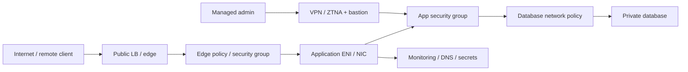
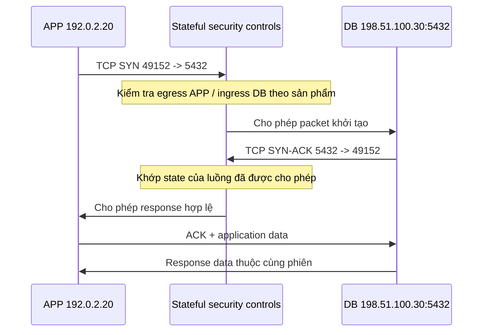
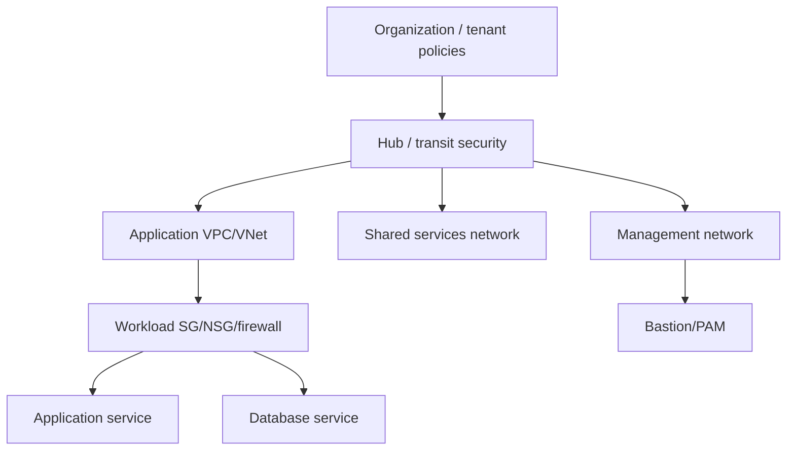

# Security group và stateful filtering trong bảo mật mạng cloud

## Mục tiêu học tập

Sau bài học, bạn có thể:

1. Giải thích **security group**, **ingress**, **egress**, **stateful filtering**, **connection tracking** và ranh giới giữa chính sách mạng với xác thực ứng dụng.
2. Mô tả vì sao luồng phản hồi của một kết nối đã được cho phép có thể được chấp nhận **không cần quy tắc mở cổng ngược tương ứng**, và phân biệt điều đó với một phiên kết nối mới theo chiều ngược lại.
3. Thiết kế ma trận lưu lượng giữa **Internet/edge, ứng dụng, database, quản trị, monitoring, DNS và cloud services** theo nguyên tắc least privilege.
4. Phân biệt **AWS EC2 security groups**, **Azure Network Security Groups (NSG)** và **Google Cloud VPC firewall rules** về phạm vi áp dụng, allow/deny, thứ tự ưu tiên và mặc định; không đánh đồng mọi sản phẩm là một.
5. So sánh stateful filtering với **stateless network ACL**, routing table, NAT, cloud firewall cấp cao hơn và application authorization.
6. Đánh giá rủi ro **outbound allow-all, kết nối đã được tracking, rule changes, IPv6, multi-NIC, load balancer, NAT, peering, VPN và Kubernetes**, cùng các đường bypass.
7. Xây policy dưới dạng sơ đồ, ma trận và Infrastructure as Code (IaC), kiểm chứng bằng telemetry/flow logs, điều tra sự cố và thực hành **lab Python ngoại tuyến không tạo traffic mạng**.

## 1. Vì sao cần security group trong cloud?

Một ứng dụng chạy trên máy ảo trong cloud thường có nhiều hướng lưu lượng:

- Người dùng Internet cần kết nối tới HTTPS ở edge/load balancer.
- Edge cần kết nối tới cổng ứng dụng nội bộ.
- Ứng dụng cần truy cập database, DNS, NTP hoặc dịch vụ quản lý secrets.
- Monitoring cần kết nối tới endpoint metrics riêng.
- Admin cần truy cập qua bastion, VPN hoặc ZTNA trong thời gian được cấp quyền.
- Mọi thành phần có thể gửi lưu lượng phản hồi cho những kết nối đã được cho phép.

Nếu **mở mọi cổng cho mọi nguồn** chỉ để dịch vụ chạy được, một ứng dụng bị xâm nhập có thể dễ dàng chuyển sang database, máy khác hoặc kênh quản trị. Một endpoint cloud vô tình có public IP có thể bị truy cập ngoài dự kiến.

**Security group (SG)** là một cơ chế lọc lưu lượng ở cấp tài nguyên/interface hoặc vùng cloud cụ thể, thường có hành vi **stateful**: khi lưu lượng khởi tạo được phép, hệ thống theo dõi trạng thái tương ứng để cho phép lưu lượng phản hồi hợp lệ.

Trong module `SECURITY_NETWORK_SECURITY`, bài này thuộc chương **Bảo mật mạng cloud**, liên hệ với **phân đoạn, firewall, VPN, IDS/IPS, DNS security, network threat modeling và quản lý kết nối cloud**.

> **Nguyên tắc:** Một security group không tạo ra “mạng an toàn” chỉ vì nó được gắn vào instance. Phải biết **rule cho phép luồng mới nào, đường phản hồi được tracking ra sao, policy ở những tầng khác là gì và những kết nối thực tế có đi qua điểm thực thi hay không**.

### 1.1. Thuật ngữ cốt lõi

| Thuật ngữ | Nghĩa trong bài | Nhầm lẫn cần tránh |
|---|---|---|
| **Security group** | Tập luật kiểm soát luồng đến/đi cho tài nguyên được gắn policy | “SG tự xác thực người dùng” |
| **Ingress / inbound** | Luồng đi **vào** tài nguyên/interface đang xét | “Inbound ở một server luôn là inbound của toàn VPC” |
| **Egress / outbound** | Luồng đi **ra** tài nguyên/interface đang xét | “Mở egress chỉ là cho response” |
| **Stateful filtering** | Dùng thông tin trạng thái luồng/phiên để xử lý packet thuộc luồng đã được phép | “Mọi packet có cùng IP đều mặc nhiên hợp lệ” |
| **Connection tracking (conntrack)** | Cơ chế ghi nhận trạng thái luồng/chiều phản hồi theo quy tắc triển khai | “Theo dõi vô hạn thời gian, không có timeout” |
| **5-tuple** | Protocol, source IP/port, destination IP/port | “Chỉ source IP đủ để xác định connection” |
| **Ephemeral port** | Cổng nguồn thường do client chọn tạm thời | “Server phải mở inbound tất cả ephemeral port cho mọi client” |
| **Stateless ACL** | Kiểm tra packet độc lập theo hướng và rule, không dựa trạng thái phiên | “ACL cũng tự cho phép response như SG” |
| **Default deny** | Không có allow rule phù hợp thì từ chối theo cơ chế của lớp policy | “Mọi cloud mặc định cấm egress” |
| **Least privilege** | Chỉ cho nguồn, đích, protocol, cổng và thời hạn thực sự cần | “Mở cả subnet để dễ vận hành” |
| **Route table** | Quyết định next hop/đường dẫn mạng | “Có route nghĩa là được firewall cho phép” |
| **NAT** | Dịch địa chỉ/cổng theo quy tắc gateway | “NAT tự là kiểm soát authorization” |

### 1.2. Security group không hoạt động độc lập



Đây là sơ đồ logic; **không phải mọi gói tin đi qua các thành phần theo đúng thứ tự trong hình**. Load balancer có thể là proxy L7, network load balancer L4 hoặc sản phẩm managed với quy tắc data path khác nhau. Khi triển khai phải ghi rõ **route, NAT, SG/NSG/firewall, subnet ACL và listener cụ thể**.

## 2. Stateful filtering thực sự làm gì?

### 2.1. Ví dụ TCP giữa app và database

Giả sử:

```text
APP  192.0.2.20:49152 -> DB 198.51.100.30:5432 TCP

APP: client khởi tạo kết nối
DB : server lắng nghe TCP/5432
```

Khi chính sách cho phép kết nối **APP → DB TCP/5432**, cơ chế stateful có thể lưu metadata của luồng:

```text
Protocol: TCP
Forward:  192.0.2.20:49152 -> 198.51.100.30:5432
Reverse:  198.51.100.30:5432 -> 192.0.2.20:49152
State:    thuộc connection đã được chấp nhận
Timer:    theo định nghĩa của engine/implementation
```

Packet phản hồi từ DB đến cổng nguồn tạm **49152** được coi là một phần của kết nối đang theo dõi, không tương đương việc DB được phép **tự khởi tạo kết nối bất kỳ** đến mọi cổng của APP.

### 2.2. Luồng khởi tạo và luồng phản hồi



Sơ đồ trình bày **lý luận chính sách**, không mô tả một bộ conntrack duy nhất gộp mọi firewall trên đường. Trong thực tế có thể có **nhiều thiết bị stateful độc lập**, mỗi lớp tự theo dõi trạng thái hoặc dùng cơ chế connection matching riêng.

### 2.3. Một kết nối mới theo hướng ngược lại vẫn cần rule

So sánh hai packet:

```text
A. DB 198.51.100.30:5432 -> APP 192.0.2.20:49152
   Thuộc response của session APP -> DB đã được cho phép.

B. DB 198.51.100.30:55000 -> APP 192.0.2.20:7000
   Kết nối TCP mới từ DB -> APP, không phải response ở A.
```

**Stateful** không có nghĩa rule `APP → DB:5432` cho phép B. B phải đi qua policy cho **luồng mới**, và sẽ bị chặn nếu không có quyền phù hợp.

### 2.4. UDP và ICMP cũng cần suy nghĩ theo state

TCP có flags và quá trình thiết lập/đóng kết nối; với UDP không có handshake ở tầng transport, nên nhiều bộ lọc stateful dựa vào **5-tuple, chiều phản hồi và idle timeout** để coi packet là thuộc luồng vừa phát sinh.

Một DNS query UDP/53 có thể được phép nhận response mà không mở inbound UDP toàn bộ. Tuy nhiên, không có chuyện một bản ghi trạng thái UDP tồn tại mãi; **timeout và cách nhận dạng reply tùy sản phẩm**.

ICMP/ICMPv6 có các thông điệp phản hồi/lỗi liên quan tới traffic khác; không được giả định mọi ICMP là “mới và bị chặn” hoặc tất cả ICMP đều được tự mở. Cần kiểm tra tài liệu của engine về **related traffic** và các thông điệp cần thiết cho Path MTU Discovery/Neighbor Discovery.

## 3. Trạng thái kết nối: 5-tuple, thời hạn và thay đổi rule

### 3.1. Bảng trạng thái là tối ưu hóa có ngữ nghĩa bảo mật

Một engine có thể lưu:

| Trường | Ví dụ | Ý nghĩa |
|---|---|---|
| Protocol | TCP | Phân biệt TCP/UDP/ICMP |
| Source IP/port | `192.0.2.20:49152` | Endpoint khởi tạo |
| Destination IP/port | `198.51.100.30:5432` | Endpoint đích |
| Reverse flow key | `198.51.100.30:5432 → 192.0.2.20:49152` | Hỗ trợ matching response |
| State/phase | Established/tracked | Đánh giá theo engine |
| Created/last_seen | UTC timestamp | Idle timeout và correlation |
| Policy/context | SG/firewall/zone/ENI ID | Giúp debug và audit |

Bảng này **mang tính khái niệm**, không phải schema log AWS/Azure/GCP. Một số provider chỉ xuất **flow logs ở mức aggregate**, không công khai toàn bộ conntrack entries.

### 3.2. Idle timeout và resource limit

Những yếu tố có thể làm kết nối bị ngắt:

- Luồng không có traffic trong thời gian dài và **state bị timeout**.
- Load balancer/NAT gateway/firewall có timeout thấp hơn ứng dụng.
- Stateful engine đạt giới hạn tài nguyên tracking hoặc có sự cố.
- Backend hoặc client đóng kết nối.
- Routing/HA failover khiến chiều đi và chiều về không còn gặp cùng cơ chế tracking.
- Thay policy hoặc thay network interface/instance ảnh hưởng đến state theo đặc điểm sản phẩm.

**Không có một số timeout chuẩn chung** cho mọi SG, mọi giao thức và mọi cloud. Phải kiểm tra mô tả connection tracking và giá trị quan sát của provider, loại interface, platform và workload.

### 3.3. Thay rule khi session đã tồn tại

Một câu hỏi quan trọng:

> Nếu xóa rule allow tại 10:00, một kết nối TCP đã được cho phép từ 09:50 sẽ bị cắt ngay hay vẫn tiếp tục?

**Không thể khẳng định thống nhất cho mọi cloud firewall.** Nhiều engine stateful có thể giữ cho lưu lượng của kết nối đang tracking tiếp tục theo state hiện hữu, ít nhất trong một số điều kiện; nhưng hành vi khi thay rule, tracked/untracked connections, session timeout và HA tùy sản phẩm.

Để **thu hồi truy cập khẩn cấp**:

1. Áp rule deny/loại allow đúng phạm vi.
2. Xác minh **kết nối mới** không được mở.
3. Đánh giá **kết nối đang mở** và hành vi conntrack theo provider.
4. Nếu cần, xử lý session tại **ứng dụng, gateway, target service hoặc network controls** có khả năng terminate.
5. Kiểm tra log/flow, bảo đảm không tạo collateral outage.

**Không dùng xóa rule như bằng chứng duy nhất rằng mọi session đang tồn tại đã chấm dứt.**

### 3.4. Ngoại lệ của connection tracking

Một số sản phẩm, đặc biệt AWS EC2 SG trong những cấu hình quy tắc rộng, có những phân loại **tracked và untracked flows** và các ngoại lệ cho kết nối dịch vụ hạ tầng được quản lý. Vì vậy không nên suy **mọi flow đều được tracking theo cùng một cách** chỉ từ nhãn “stateful”.

Trong thực tế, tìm hiểu cả **connection tracking allowance, giới hạn, metrics, timeout configurability và ngoại lệ theo tài nguyên ENI/NAT/LB** của provider trước khi điều chỉnh policy quan trọng.

## 4. Security group và stateless network ACL khác nhau

### 4.1. Luật stateless phải xét cả hai hướng

Với **stateless network ACL**, mỗi packet được đối chiếu rule theo hướng, **không dựa vào thông tin session đã được chấp nhận**.

Ví dụ APP khởi tạo tới DB TCP/5432:

- Outbound APP subnet → DB subnet TCP destination 5432 phải được phép.
- Inbound DB subnet → APP subnet TCP destination **ephemeral port** của APP phải được phép để nhận phản hồi, nếu ACL kiểm tra tại ranh giới đó.
- Chiều DB subnet cũng có inbound/outbound tương ứng.
- Cổng ephemeral và NAT mapping phụ thuộc OS/client và hạ tầng.

**Mở ephemeral ports cho response trong ACL stateless không đồng nghĩa mở inbound mọi luồng trong SG stateful**, vì còn các điểm thực thi khác nhau.

### 4.2. So sánh tổng quát

| Đặc điểm | Stateful SG/NSG/firewall | Stateless ACL |
|---|---|---|
| Phản hồi một luồng đã được phép | Có thể được chấp nhận theo state | Cần rule theo hướng packet tương ứng |
| Luồng mới theo chiều ngược | Phải đáp ứng policy riêng | Phải đáp ứng rule chiều đó |
| Đối tượng áp dụng | Tùy cloud: ENI/NIC/instance/VM | Thường tại subnet/boundary hoặc thiết bị |
| Thứ tự/deny | **Phụ thuộc sản phẩm**, không phải luôn như nhau | Thường có thứ tự/priority hoặc cơ chế cụ thể |
| Rule rộng | Có thể tạo tracked/untracked nuance | Mỗi packet match rule tại ranh giới |
| Vận hành | Dễ định nghĩa app flows | Cần thiết kế request và return-path |
| Hạn chế | State table, idle timeout, session behavior | Quản trị nhiều rule chiều ngược, ephemeral ports |
| Phòng vệ | Phân đoạn theo workload/service | Ranh giới subnet hoặc lớp defense-in-depth |

**Quan trọng:** Trong AWS, **EC2 security groups là stateful, allow-only**, còn **VPC network ACL là stateless, có allow/deny và rule numbers**. Azure NSG và Google Cloud firewall có **tập thuộc tính/ưu tiên riêng**; không dùng các đặc tính của AWS NACL để suy về Azure NSG.

### 4.3. Hai lớp có thể cùng cần chấp nhận traffic

Giả sử ở AWS:

```text
APP ENI SG egress: allow DB SG TCP/5432
DB ENI SG ingress: allow APP SG TCP/5432

Subnet NACL (nếu đã custom):
  APP subnet outbound -> DB:5432
  APP subnet inbound  <- DB reply ephemeral port
  DB subnet inbound   <- APP:5432
  DB subnet outbound  -> APP reply ephemeral port
```

Đây là mô hình logic để thấy **hai loại policy độc lập**. Luật NACL thực tế dựa vào protocol/port/address CIDR và hướng trên **subnet boundary**, không dùng tham chiếu SG để match nguồn giống SG. Cần kiểm tra đường đi thực tế; một số traffic cùng subnet không đi qua kiểm tra NACL giống luồng qua subnet boundary.

## 5. Phạm vi thực thi: cloud nào áp rule vào đâu?

### 5.1. Bảng tổng quan theo nhà cung cấp

| Nền tảng | Tên cơ chế | Đơn vị áp dụng thường gặp | Rule model điển hình |
|---|---|---|---|
| **AWS** | EC2 Security Group | Elastic Network Interface (ENI), được instance và một số tài nguyên dùng | **Stateful, allow-only**; nhiều SG hợp lại theo effective allow |
| **Microsoft Azure** | Network Security Group (NSG) | Subnet và/hoặc NIC của VM, tùy thiết kế | **Stateful**, allow/deny theo priority; có default rules |
| **Google Cloud** | VPC firewall rules / network firewall policies | VM interfaces/target instances theo VPC và policy scope | **Stateful**, allow/deny, priority và các cấp policy |
| **Kubernetes/CNI** | NetworkPolicy hoặc network controls khác | Pod/workload và cluster data plane theo CNI | Không tự đồng nhất với SG cloud; semantics phụ thuộc controller/CNI |

Đây là **mô hình khái quát**. Provider có thể bổ sung firewall policy cấp tổ chức, load balancer, workload/endpoint, Kubernetes integration hoặc dịch vụ managed không dùng một loại SG chung. Cần đọc tài liệu của **dịch vụ và phiên bản đang dùng** trước khi deploy.

### 5.2. Một VM có nhiều lớp policy

```text
Client
   |
Cloud edge / DDoS / WAF / Load balancer (nếu có)
   |
VPC/VNet route / NAT / network firewall
   |
Subnet policy / network ACL / NSG (tùy provider)
   |
NIC/ENI security group / VPC firewall enforcement
   |
Host firewall + operating system
   |
Application listener + identity authorization
```

Sơ đồ cho biết **lớp cần kiểm tra**, không cam kết thứ tự xử lý packet giống nhau giữa mọi cloud. Một số managed LB có network path khác; một số policy không áp cho traffic đặc biệt. Cần xác minh bằng flow logs, route analysis, packet/host logs và document dịch vụ.

## 6. AWS EC2 Security Groups

### 6.1. Ngữ nghĩa cơ bản

Với EC2 SG thường dùng:

- SG được gắn vào **ENI**; tài nguyên có thể dùng nhiều SG tùy giới hạn nền tảng.
- Rule **allow**, không có explicit deny trong EC2 SG.
- Không dùng thứ tự priority giữa các rule SG.
- Nếu có nhiều SG trên một ENI, **tập allow hiệu lực là hợp của các rule phù hợp**; một SG “hạn chế” không thể phủ định allow rộng của SG khác.
- Inbound không có rule allow thì **luồng mới tương ứng bị chặn**.
- Tình trạng outbound mặc định phụ thuộc **loại SG, cách tạo và công cụ IaC**, nên phải kiểm tra **effective egress**; nhiều SG mới có outbound allow-all ban đầu.
- Lưu lượng phản hồi của các kết nối được phép có hành vi stateful, theo ngoại lệ/điều kiện connection tracking của AWS.

**Không gán SG cho một subnet theo cách gán AWS NACL.** SG và NACL có phạm vi và ngữ nghĩa khác nhau.

### 6.2. Tham chiếu security group thay vì CIDR

Ví dụ quy tắc:

```text
APP SG inbound:
  TCP/8443 from EDGE SG

DB SG inbound:
  TCP/5432 from APP SG

APP SG outbound:
  TCP/5432 to DB SG
```

Tham chiếu SG giúp mô tả **nhóm ENI liên quan** mà không phải duy trì danh sách IP app thay đổi liên tục. Tuy vậy:

- Phạm vi tham chiếu SG khác nhau theo **cùng VPC, peering, transit gateway và loại rule/điều kiện**; không suy có thể reference xuyên mọi network topology.
- Một SG reference **không phải xác thực user/service account** và không tự chặn mọi lưu lượng từ một instance compromised trong nhóm đó.
- Vẫn cần route tới đích, gateway/SG outbound phù hợp và bảo vệ layer 7.
- Một rule tham chiếu SG khác **không làm gộp toàn bộ rule** của SG được tham chiếu vào policy hiện tại; nó là cách chọn nguồn/đích theo cơ chế provider.

### 6.3. Inbound trống và outbound rộng

Một SG trên private database có thể không mở ingress từ Internet, nhưng nếu egress `0.0.0.0/0` và `::/0` còn mở, ứng dụng bị xâm nhập có thể cố kết nối đến nhiều đích mà route cho phép.

**Không thể suy “DB không có public IP nên egress an toàn”.** Nếu có NAT gateway, transit route, VPN hoặc VPC endpoint, lưu lượng có thể đi tới những đích không mong muốn. Cần xác định **đích hợp lệ** và egress filtering ở tầng thích hợp.

Ngoài ra, các **dịch vụ hạ tầng đặc biệt** (ví dụ một số đường tới DNS resolver của VPC/metadata/managed infrastructure) có thể có ngoại lệ đối với SG hoặc cơ chế kiểm soát riêng. Không thiết kế “chặn tất cả DNS/metadata” chỉ bằng SG mà không kiểm chứng hỗ trợ của AWS.

### 6.4. Gắn nhiều SG không làm tăng giới hạn theo kiểu deny override

Ví dụ ENI có:

```text
SG-PROD: ingress TCP/8443 only from EDGE SG
SG-DEBUG: ingress TCP/8443 from 0.0.0.0/0
```

Rule hiệu lực **vẫn cho phép nguồn rộng** qua SG-DEBUG, nếu đường đi khác thỏa. Không có “SG-PROD deny” để phủ lên SG-DEBUG.

Vì vậy, khi điều tra exposure:

- Liệt kê **tất cả SG attached** trên ENI và rule của chúng.
- Kiểm tra CIDR IPv4/IPv6 và referenced SG trên từng rule.
- Theo dõi những thay đổi SG attachment và IAM cho phép sửa SG.
- Không chỉ xem đúng một SG có tên “production-hardened”.

## 7. Azure Network Security Groups

### 7.1. Stateful nhưng có priority và deny

Azure NSG thường bao gồm:

- **Inbound và outbound security rules**, với source/destination, port/protocol, action `Allow` hoặc `Deny`.
- **Priority** theo quy tắc sản phẩm; rule có priority ưu tiên hơn sẽ được đánh giá theo thứ tự.
- **Default security rules**, trong đó có những allow cho lưu lượng nội bộ VNet, Azure Load Balancer, outbound theo thiết kế và deny cuối.
- NSG có thể gắn vào **subnet và NIC**; khi cả hai được dùng, lưu lượng phải vượt qua các kiểm soát liên quan ở đường đi.
- Có **stateful flow records/connection behavior** cho lưu lượng đã được phép; thay rule không đồng nghĩa mọi phiên cũ bị cắt ngay lập tức.

Không copy giả định của AWS “SG chỉ có allow” vào Azure NSG; **Azure có deny và priority**. Đồng thời, **NSG default rules có thể cho phép intra-VNet traffic rộng hơn dự kiến**, nên phải rà effective rules thay vì chỉ xem custom rules.

### 7.2. Ví dụ hiệu lực khi subnet + NIC NSG cùng tồn tại

Giả sử:

```text
Subnet NSG:
  Allow APP subnet -> DB TCP/5432
  Deny other DB ingress

DB NIC NSG:
  Allow APP subnet -> DB TCP/5432
  Deny other DB ingress
```

Để một luồng đến DB, cần kiểm tra **route** và các **NSG rules áp dụng**. Nếu một lớp deny, rule allow ở lớp còn lại **không tự vượt được deny**.

Ngược lại, khi custom rule không match, **default rules** có thể tiếp tục có hiệu lực. Một rule `DenyAllInBound` mặc định không có nghĩa nội bộ VNet bị deny nếu có allow mặc định ưu tiên hơn. Cần xem **effective security rules** và các virtual network/service tag liên quan.

### 7.3. Service tags và Application Security Groups

**Service tags** có thể đại diện tập địa chỉ của dịch vụ/hạ tầng Azure, được nền tảng quản lý theo đặc tả. **Application Security Groups (ASG)** giúp nhóm NIC theo ứng dụng để dùng trong rules phù hợp.

Cẩn trọng:

- Service tag không có nghĩa “mọi API cụ thể trong dịch vụ đều an toàn”.
- ASG/NSG grouping không thay user identity và application authorization.
- Một policy `AllowVirtualNetworkInBound` có thể quá rộng nếu VNet có nhiều workload/tier.
- Rule priority, source/destination service tags, IPv6 và subnet/NIC associations phải được kiểm tra bằng công cụ hiệu lực thực tế.

## 8. Google Cloud VPC firewall rules

### 8.1. Ngữ nghĩa cơ bản

Trong Google Cloud, firewall rules và network firewall policies thường có:

- **Ingress/egress direction**, allow/deny, priority và tập mục tiêu.
- Quy tắc **stateful**: lưu lượng phản hồi của một kết nối được cho phép thường được xử lý như related return traffic theo cơ chế provider.
- **Implied ingress deny** và **implied egress allow** ở VPC network theo model cơ bản, trừ khi rule/policy cấp liên quan thay đổi kết quả.
- Rule có thể dùng **network tags, service accounts hoặc tiêu chí target** phù hợp với loại policy, cùng IP ranges/protocols/ports.
- Có thể tồn tại **hierarchical firewall policies, global/regional network firewall policies** và những quy tắc ưu tiên/phạm vi khác VPC firewall rules.

Không suy priority của một VPC rule có thể ghi đè **mọi** hierarchical policy ở cấp tổ chức/folder. Cách đánh giá và hành vi delegation của các tầng policy phải đối chiếu tài liệu của loại firewall policy đang dùng.

### 8.2. Rule cho phép và rule từ chối không đơn thuần cộng dồn

Ví dụ:

```text
GCP ingress allow TCP/8443 từ subnet edge đến app targets.
GCP ingress deny TCP/8443 từ vùng không được duyệt.
```

Kết quả phụ thuộc **priority, target matching, source selector và tầng policy**. Không lấy mô hình AWS SG union-of-allows để giải thích một GCP deny rule có precedence.

### 8.3. Tags/service accounts là selectors, không phải authorization ứng dụng

Một VM được target bằng network tag `app-prod` vẫn có thể chạy mã độc khi bị compromise. Firewall cho phép dựa vào tag/service account **không thay ứng dụng xác minh user, request, role và dữ liệu được phép**.

Cần bảo vệ IAM quyền thay network tags, service account assignment và firewall rules. **Một principal có quyền đổi tag/SA hoặc policy** có thể thay tập VM nhận rule, dù không đổi port.

## 9. Bảng so sánh không được đánh đồng ba cloud

| Vấn đề | AWS EC2 SG | Azure NSG | Google Cloud VPC firewall |
|---|---|---|---|
| Cơ chế stateful | Có, với ngoại lệ theo connection tracking | Có, với hành vi flow theo NSG | Có, với state tracking theo cơ chế VPC firewall |
| Rule cho phép/từ chối | **Allow-only** | **Allow và deny** | **Allow và deny** |
| Rule priority/order | Không có thứ tự deny override | Có **priority** | Có **priority**, và nhiều tầng policy |
| Đối tượng thường áp | **ENI** | **NIC/subnet** | **VM/network interface/targets** theo chính sách |
| Nhiều rule/group | Union of allows trên SG attached | Effective rules qua association/priority | Effective policies/priority/target matching |
| Egress mở mặc định | Nhiều SG mới có outbound allow-all, xem công cụ tạo | Default rules có thể allow outbound | Implied egress allow theo VPC model cơ bản |
| Cô lập subnet riêng | NACL stateless độc lập | NSG có thể gắn subnet | VPC/firewall policy scope, subnet không tự là SG |
| Nhóm nguồn/đích | CIDR, SG references và selector hỗ trợ | CIDR, service tags, ASGs theo khả năng | CIDR, network tags/SA và policy selectors |
| Control IAM | EC2 SG/IAM API | Azure RBAC/Policy và NSG API | IAM firewall policy/tag/SA permissions |
| Kiểm thử | SG effective rules + Flow Logs/Reachability Analyzer | Effective NSG rules + Network Watcher/flow diagnostics | Firewall Rules Logging + Connectivity Tests/flow logs |

**Các tên dịch vụ chẩn đoán và tính năng logging có thể thay đổi theo thời điểm hoặc loại resource.** Khi triển khai thật, kiểm tra tài liệu provider và công cụ đang được kích hoạt; bảng nêu mô hình phục vụ học tập, không bảo đảm tất cả tính năng dùng được với mọi subscription/region.

## 10. Thiết kế ma trận truy cập ba tầng

Giả sử một ứng dụng quản lý đơn hàng chạy ở một VPC/VNet, với:

```text
Internet clients
    |
Public HTTPS Load Balancer
    |
EDGE zone / WAF
    |
APP zone (private application)
    |
DB zone (private database)

Admin -> VPN/ZTNA -> Bastion -> MGMT zone
APP -> DNS / NTP / approved cloud service endpoints
Monitoring -> metrics endpoints theo chính sách
```

### 10.1. Tài nguyên minh họa

Dùng địa chỉ **dành cho tài liệu**:

| Thành phần | Địa chỉ ví dụ | Port/chức năng |
|---|---|---|
| Public edge | `203.0.113.10` | TCP/443 |
| APP instance | `192.0.2.20` | TCP/8443 |
| DB instance | `198.51.100.30` | TCP/5432 |
| Bastion | `198.51.100.40` | TCP/443 qua gateway quản trị |
| App admin interface | `192.0.2.21` | TCP/9443, chỉ từ bastion |
| Internal metrics | `192.0.2.22` | TCP/9100, chỉ monitoring |
| DNS resolver | `203.0.113.53` | UDP/TCP 53 nếu architecture yêu cầu |

Đây **không phải IP có thể dùng trực tiếp làm production**, và `203.0.113.0/24`/`192.0.2.0/24`/`198.51.100.0/24` là dải tài liệu. Hệ thống thật phải dùng IPAM, routing, DNS, provider endpoints và security zones phù hợp.

### 10.2. Ma trận luồng được phép

| Nguồn | Đích | Giao thức/port | Chiều khởi tạo | Kỳ vọng |
|---|---|---|---|---|
| Internet | Public LB | TCP/443 | Client → LB | Allow tại public listener + TLS/app security |
| LB/EDGE | APP | TCP/8443 | Edge → APP | Allow có scope theo LB identity/source |
| APP | DB | TCP/5432 | APP → DB | Allow chính xác nhóm APP đến DB |
| APP | Approved DNS | UDP/TCP 53 | APP → resolver | Allow theo policy DNS |
| APP | Approved cloud API | HTTPS/443 | APP → service endpoint | Allow đúng đích/service identity |
| Monitoring | Metrics | TCP/9100 | Collector → instance | Allow monitoring source/role |
| Authorized admin | Bastion | HTTPS/443 | Admin → bastion | Allow sau IdP/MFA/ZTNA |
| Bastion | Admin API | TCP/9443 | Bastion → management | Allow JIT/role và TLS validation |
| DB | APP cổng tùy ý | Bất kỳ kết nối mới | DB → APP | **Deny** |
| Internet | APP private | Bất kỳ | Client → APP | **Deny** |
| Guest/contractor | DB/MGMT | Bất kỳ | Không được duyệt | **Deny** |
| APP | Internet mọi đích | Bất kỳ | APP → Internet | **Deny mặc định theo policy mục tiêu** |

### 10.3. Return traffic không phải rule cho kết nối mới

Với APP → DB TCP/5432, phản hồi DB → APP được stateful engine cho phép **trong phạm vi state tương ứng**, nếu không có lớp firewall stateless khác chặn.

Tuy vậy:

- **APP → DB:** kiểm tra cả egress APP và ingress DB khi các tài nguyên có SG/NSG tương ứng.
- **DB → APP phản hồi:** cơ chế stateful có thể chấp nhận mà không có allow rule dành riêng cho đích ephemeral port.
- **DB → APP kết nối mới:** vẫn phải thỏa outbound DB và inbound APP nếu chính sách yêu cầu.
- **Application authorization:** dù TCP đã thông, DB vẫn phải xác thực tài khoản/service credentials đúng quyền.

## 11. Ingress/egress: hướng nhìn theo từng interface

### 11.1. Cùng một flow có thể inbound ở nơi này và outbound ở nơi khác

```text
Client -> LB -> APP -> DB

Client -> LB: inbound tại LB
LB -> APP : outbound tại LB, inbound tại APP
APP -> DB : outbound tại APP, inbound tại DB
DB -> APP : response của APP -> DB (trong state)
APP -> LB : response của LB -> APP (trong state tương ứng)
```

Không có một nhãn `ingress` hay `egress` duy nhất cho toàn đường đi; **mỗi tài nguyên có điểm nhìn riêng**. Ví dụ, packet đi từ APP qua transit gateway có thể được đánh giá tại APP ENI, subnet ACL, transit controls và firewall trung tâm tùy kiến trúc.

### 11.2. Load balancer có thể đổi source identity

Với reverse proxy L7, APP thường thấy kết nối TCP **từ LB/proxy**, không phải TCP socket trực tiếp từ người dùng Internet. Một LB L4 passthrough hoặc thiết kế preserved client IP có thể khác.

Vì vậy không viết rule `APP ingress from Internet` để “cho LB hoạt động” khi có thể **allow đúng LB security group/health probe source** hoặc network identity theo sản phẩm. Phải xác định thực tế **source IP, source SG, SNAT và health check path**.

### 11.3. Return path và routing

Stateful filter không tạo route. Nếu DB response đi theo một đường khác không có phiên tương ứng, hoặc route/ACL/NAT không khớp, traffic có thể vẫn lỗi.

Đặc biệt cần kiểm tra:

- Multi-NIC và các bảng định tuyến khác nhau.
- NAT gateway, transit gateway, network virtual appliance (NVA).
- VPN/Direct Connect/ExpressRoute/Cloud Interconnect.
- Cross-VPC/VNet peering, private link và route propagation.
- High availability/failover với state synchronization hoặc asymmetric path.
- IPv4 và IPv6 có route/security rule riêng.

## 12. Egress filtering và kiểm soát rò dữ liệu

### 12.1. Outbound allow-all là một quyết định có rủi ro

Một workload chỉ phục vụ ứng dụng nội bộ không nhất thiết cần kết nối tới **mọi IP/port Internet**. Nếu egress rộng, kẻ xâm nhập có thể lợi dụng workload để:

- Tải payload hoặc kết nối command-and-control.
- Gửi dữ liệu ra endpoint không được duyệt.
- Quét hoặc gọi các hệ thống nội bộ có route.
- Truy cập cloud API khi credential/IAM cũng bị cấu hình quá quyền.
- Gửi DNS/HTTPS qua kênh vượt khỏi monitoring mong đợi.

**SG là một lớp giảm bề mặt network**, không phải hệ thống Data Loss Prevention hoàn chỉnh. Với FQDN/URL-based policy, cần **egress proxy, cloud firewall có hỗ trợ domain filtering, DNS security hoặc application controls** tương ứng.

### 12.2. DNS, HTTPS và dịch vụ cloud đặc biệt

Nhu cầu egress hợp lệ có thể bao gồm:

- DNS recursive resolver và private DNS zones.
- NTP/time sync.
- VPC endpoint/private endpoint tới secrets, storage, logs, package registry.
- OCSP/CRL hoặc CA chain distribution khi TLS validation cần.
- Container image registry, artifact repository, telemetry collector.
- Service control plane cần cho identity/workload/cluster.

Một rule `TCP/443 tới 0.0.0.0/0` **không xác định được website/dịch vụ cụ thể**, vì hàng triệu endpoint dùng HTTPS/443. Ngược lại, chặn tất cả outbound 443 có thể làm mất đường lấy secret, cert hoặc telemetry.

### 12.3. Không ngộ nhận SG kiểm soát mọi loại traffic

Cloud provider có thể cho phép một số đường tới **resolver, metadata, DHCP, time sync hoặc hạ tầng quản lý** được xử lý theo cơ chế đặc biệt. Các mục tiêu này cần những biện pháp như **IMDS hardening, IAM, VPC endpoint policy, DNS firewall/resolver policy, host firewall và proxy** tùy dịch vụ.

Trước khi tuyên bố “SG egress deny bảo đảm không có network egress nào”, phải kiểm tra **các ngoại lệ chính thức của provider** và traffic thực.

## 13. IPv6: không bỏ qua một nửa security boundary

### 13.1. IPv6 cho phép truy cập không cần NAT44

Một instance có địa chỉ IPv6 global và route ra Internet có thể được tiếp cận theo IPv6 nếu có listener và policy cho phép. Chỉ mở/khóa rule IPv4 không bảo đảm IPv6 tương đương.

Ví dụ:

```text
IPv4 ingress APP: chỉ 192.0.2.0/26 TCP/8443
IPv6 ingress APP: ::/0 TCP/8443
```

Dù IPv4 chặt, rule IPv6 ở trên có thể quá rộng nếu APP có IPv6 reachable và các lớp khác cho phép. Hãy kiểm tra **CIDR IPv6, default route, egress-only internet gateway (nếu dùng), firewall/SG và host listener**.

### 13.2. ICMPv6 và network functionality

Không chặn toàn bộ ICMPv6 để “làm cứng” cloud network. Các thông điệp ICMPv6 cần thiết cho **Neighbor Discovery, Router Advertisement (theo kiến trúc) và Path MTU Discovery**; hạ tầng cloud có thể xử lý một phần theo cách riêng.

Xây policy theo **loại thông điệp, source hợp lệ, chức năng và tài liệu provider**, không dùng blanket deny gây lỗi kết nối khó tìm.

### 13.3. Dual-stack acceptance tests

- Truy cập hợp lệ qua IPv4 và IPv6 đều được xử lý theo mục tiêu.
- Nguồn Internet không được phép tới private APP/DB qua cả hai IP family.
- Không có rule IPv6 `::/0` ngoài yêu cầu được phê duyệt.
- Phần mềm đang listen `0.0.0.0` hay `::`? Tùy OS có thể xuất hiện dual-stack behavior.
- DNS A và AAAA trỏ đến những endpoint nào; có edge/region bị bỏ quên không?
- Monitoring và flow logs bao phủ IPv6; không chỉ xem IPv4 rejected flows.

## 14. Rule scope: CIDR, nhóm nguồn và danh tính dịch vụ

### 14.1. Định nghĩa nguồn càng hẹp càng tốt

Thay vì:

```text
DB ingress TCP/5432: 0.0.0.0/0
```

Nên định nghĩa:

```text
DB ingress TCP/5432: chỉ APP workloads được duyệt
APP ingress TCP/8443: chỉ EDGE/LB đã xác định
MGMT ingress TCP/9443: chỉ bastion hoặc admin access gateway
```

Có thể hiện thực bằng **SG references, ASG, network tags, service-account selectors hoặc IP ranges** tùy cloud; không áp một loại selector lên mọi sản phẩm.

### 14.2. Nhóm động giúp vận hành nhưng không phải Zero Trust

Nếu 500 app instances thay đổi IP theo autoscaling, một rule dùng **nhóm workload** giúp ít lệch cấu hình hơn danh sách IP tĩnh. Tuy nhiên:

- IAM quyền **gán tag/SG/ASG/service account** cần được bảo vệ.
- Nếu workload được gắn nhầm vào nhóm tin cậy, network access có thể mở rộng.
- Một app instance đã bị compromise vẫn thuộc nhóm cho phép.
- Tại tầng ứng dụng vẫn phải kiểm tra **mTLS/workload identity, user authorization và truy cập dữ liệu**.

### 14.3. Tránh chọn nhóm vì tên “internal”

Tên security group như `trusted-internal` không có ngữ nghĩa bảo mật tự động. Hãy lưu **owner, resource scope, purpose, allowed ports, policy version và review date**. Không kết luận an toàn chỉ từ label.

## 15. Multi-tenant, multi-account, multi-VPC và hybrid cloud

### 15.1. SG không xuyên qua mọi loại đường nối

Một ứng dụng có thể dùng:

- VPC peering hoặc shared VPC.
- Transit gateway/hub-and-spoke VNet.
- Site-to-site VPN, leased line hoặc dedicated cloud interconnect.
- PrivateLink/private endpoint.
- Managed service endpoint hoặc proxy mesh.

Các đường này có **giới hạn riêng về SG references/identity, routing, NAT và firewall**. Rule nguồn ở một SG không mặc định áp được xuyên tài khoản, region, mạng peering hay một gateway bất kỳ.

### 15.2. Lớp policy để bảo vệ môi trường nhiều tài khoản



Không để VPC peering/route propagation vô tình tạo đường tới DB hoặc management khi application-level SG đang quá rộng. Bảo vệ theo **scope của từng tài nguyên** và theo **nguồn thực tế sau NAT/proxy**.

### 15.3. Cross-account hoặc shared services

Mỗi shared service nên có:

- Danh mục **consumer identities/network sources** được phê duyệt.
- Allowed ports/protocols và hình thức xác thực ứng dụng.
- Quản lý account ownership, IAM và khả năng revoke.
- Flow logs/network telemetry có thể tương quan giữa hai tài khoản.
- Thời hạn và chính sách rà soát exception.
- Kịch bản incident nếu tài khoản consumer bị compromise.

**Đặt ứng dụng trong private subnet vẫn chưa đủ** nếu VPN/transit/shared services cho nhiều nguồn reach và SG cho phép quá rộng.

## 16. Load balancer, health checks và managed services

### 16.1. Security group của LB không phải SG của backend

Một cloud load balancer có thể có:

- Listener công cộng TCP/443, TLS termination và WAF.
- Security controls riêng cho **frontend** và **backend**.
- Health checks tới các target trên port/path khác với lưu lượng người dùng.
- Các địa chỉ nguồn do cloud provider quản lý hoặc security group có thể tham chiếu theo dịch vụ.
- SNAT/preserved client IP, với hành vi khác nhau theo loại LB và target.

Ví dụ:

```text
Internet → public LB TCP/443
LB      → APP TCP/8443
LB      → APP health TCP/8443 hoặc /health
APP     → LB response (tracked)
```

Khi APP chỉ nên nhận request từ LB, rule `APP ingress 8443 from 0.0.0.0/0` thường quá rộng. Nhưng cũng không nên **đoán** dải IP health checker. Tùy provider/product, có thể cho phép LB SG, subnet/source ranges hoặc cơ chế khác. Cần đối chiếu tài liệu **đúng loại LB, target type và preserve-client-IP mode**.

### 16.2. Phản hồi qua proxy khác phản hồi của kết nối Internet ban đầu

Với proxy L7, có **hai kết nối độc lập**:

```text
Kết nối #1: Client :random -> LB :443
Kết nối #2: LB :random     -> APP :8443
```

Stateful filtering được đánh giá cho từng kết nối ở điểm tương ứng. Luồng trả lời `APP → LB` là **response của #2**, không trực tiếp là response của #1.

Đừng giả định source IP mà APP thấy là IP người dùng. Header `X-Forwarded-For`/`Forwarded` có thể được LB/proxy bổ sung cho logging/application logic, nhưng **không phải địa chỉ IP ở IP header** và không tự an toàn nếu client có thể giả mạo. Chỉ tin header từ các proxy hops đã được xác thực và kiểm soát.

### 16.3. Managed database, storage và private endpoints

Một RDS/managed SQL/private database có thể dùng network controls và resource-level access policy riêng. Muốn APP gọi được DB, cần kiểm tra:

1. APP có route tới private endpoint?
2. APP egress có cho đúng dịch vụ/port không?
3. DB ingress có cho APP source/identity network không?
4. Database có listener và TLS phù hợp?
5. Database **user/application credentials** có đúng quyền không?
6. DNS private zone có trả về endpoint dự kiến không?
7. Endpoint service/cloud IAM có yêu cầu xác thực bổ sung không?

Một TCP/5432 handshake thành công **không chứng minh** app account được đọc mọi bảng. Ngược lại, ứng dụng bị lỗi vì chứng thư DB hết hạn không được “sửa” bằng mở SG rộng hơn.

## 17. Kubernetes, containers và security group

### 17.1. Cloud SG và Kubernetes NetworkPolicy không giống nhau

Một workload Kubernetes có thể chịu:

- SG/NSG/firewall của **VM/node/ENI**.
- Security controls riêng của **pod** khi provider/CNI hỗ trợ.
- Kubernetes **NetworkPolicy** (nếu CNI thực sự thực thi).
- Service mesh mTLS/authorization policy.
- Ingress/Gateway API hoặc LoadBalancer Service.
- Host firewall và application authorization.

Một rule mở node `TCP/30000-32767` cho NodePort có thể mở một đường ngoài dự kiến tùy Service, cloud integration và routing. Không dùng số cổng NodePort mặc định làm giả định bất biến; phạm vi có thể cấu hình.

### 17.2. Ví dụ khó: pod có hai đường ingress

```text
External LB -> Service -> Pod:8080
Internal Pod -> PodIP:8080
```

Nếu bạn chỉ harden **SG của public load balancer**, pod khác trong cluster vẫn có thể tiếp cận trực tiếp service/pod theo network policy. Nếu chỉ cấu hình NetworkPolicy, traffic từ node/hostNetwork hoặc những trường hợp đặc biệt tùy CNI có thể không bị xử lý giống pod-to-pod thông thường.

Cần xác định:

- **CNI** có hỗ trợ ingress/egress NetworkPolicy không?
- Policy áp vào pod nào bằng label selector?
- **Egress DNS** tới cluster DNS có được phép?
- Node IP/Pod IP và SNAT có đổi source mà SG nhìn thấy?
- LB health probe/ingress controller có còn reach?
- SG cho pod (nếu có) thực sự được gắn vào interface nào?
- Cross-namespace, cross-cluster và multi-region có tuyến nào khác?

### 17.3. NetworkPolicy minh họa không thay SG cloud

```yaml
# LAB EXAMPLE: phải có CNI hỗ trợ NetworkPolicy.
# Chỉ minh họa lựa chọn pod và cổng ingress ứng dụng.
apiVersion: networking.k8s.io/v1
kind: NetworkPolicy
metadata:
  name: app-restricted-ingress
  namespace: lab
spec:
  podSelector:
    matchLabels:
      app: order-api
  policyTypes:
    - Ingress
  ingress:
    - from:
        - podSelector:
            matchLabels:
              role: ingress-gateway
      ports:
        - protocol: TCP
          port: 8443
```

**Giới hạn:** `podSelector` trong `from` ở ví dụ này chọn pod **cùng namespace** theo ngữ nghĩa Kubernetes. Nếu ingress gateway ở namespace khác, phải dùng namespace selector kết hợp đúng; đừng copy ví dụ rồi kết luận gateway đã được phép. Cần thêm egress policy, DNS exception, cloud SG và network path theo kiến trúc thực.

### 17.4. Service mesh không loại bỏ nhu cầu network filtering

mTLS giúp xác minh workload/service identity khi triển khai đúng, nhưng không tự ngăn một pod tiếp xúc TCP với mọi địa chỉ. Network segmentation **giảm attack surface trước lớp ứng dụng**, service mesh/app policy xử lý **authorization ở mức identity/request**.

**Defense in depth** nghĩa là khi một lớp bị lỗi hoặc certificate bị lộ, không mặc định cả mạng production đều mở.

## 18. IaC cho AWS SG: mô tả chính sách bằng thay đổi có kiểm soát

### 18.1. Ví dụ Terraform theo role

Các resource sau là **đoạn minh họa**, cần VPC và SG tham chiếu đã tồn tại, phù hợp Terraform AWS provider/version, có chủ sở hữu và pipeline review.

```hcl
# LAB ILLUSTRATION: aws_vpc.lab, aws_security_group.edge
# và aws_security_group.db là dependencies giả định đã được quản lý.

resource "aws_security_group" "app" {
  name        = "app-sg-lab"
  description = "Network policy for application layer"
  vpc_id      = aws_vpc.lab.id

  tags = {
    Service = "order-api"
    Owner   = "network-security"
  }
}

# EDGE -> APP, chỉ TCP/8443
resource "aws_vpc_security_group_ingress_rule" "app_from_edge" {
  security_group_id            = aws_security_group.app.id
  referenced_security_group_id = aws_security_group.edge.id
  ip_protocol                  = "tcp"
  from_port                    = 8443
  to_port                      = 8443
  description                  = "Only approved edge to app"
}

# APP -> DB, chỉ TCP/5432
resource "aws_vpc_security_group_egress_rule" "app_to_db" {
  security_group_id            = aws_security_group.app.id
  referenced_security_group_id = aws_security_group.db.id
  ip_protocol                  = "tcp"
  from_port                    = 5432
  to_port                      = 5432
  description                  = "Application to database"
}

# DB ingress chỉ từ APP.
resource "aws_vpc_security_group_ingress_rule" "db_from_app" {
  security_group_id            = aws_security_group.db.id
  referenced_security_group_id = aws_security_group.app.id
  ip_protocol                  = "tcp"
  from_port                    = 5432
  to_port                      = 5432
  description                  = "Database only from app"
}
```

**Cẩn trọng với egress mặc định:** Terraform/provider và SG mới có thể tạo hoặc xử lý **default allow-all outbound** khác nhau theo hình thức khai báo và lifecycle. Không kết luận chỉ vì đoạn ví dụ có một egress rule là effective egress thực sự đã giới hạn. Phải kiểm tra **Terraform plan, AWS effective SG rules và những SG khác gắn cùng ENI**, rồi thiết kế quản lý rule nhất quán theo provider version.

Trong production còn cần những rule tối thiểu cho DNS, telemetry, secrets và runtime services nếu có. Không mở rộng ngầm mọi đích 443 để “sửa” dịch vụ.

### 18.2. Vì sao chỉ nhìn Terraform file chưa đủ?

- Một admin có thể thêm SG rule qua console/API.
- Một ENI có thể được gắn thêm SG khác không nằm trong module đang xem.
- Một account khác/shared services có thể sở hữu rule/route liên quan.
- IaC state có thể drift hoặc bị import sai.
- Rule theo CIDR có thể mở rộng khi VPC/subnet thay đổi.
- Cloud service có thể dùng **managed ENI/security controls** nằm ngoài phạm vi module IaC này.

Cần kiểm tra **desired vs actual state**, IAM permissions, change logs và data path.

## 19. Policy ví dụ cho Azure và Google Cloud

### 19.1. Azure NSG: ưu tiên allow cụ thể và deny rộng có chủ đích

Một thiết kế có thể ghi policy logic:

```yaml
# PSEUDOCODE: không phải Azure ARM/Bicep/CLI có thể deploy.
nsg: app-subnet-policy
inbound:
  - priority: 200
    action: Allow
    source: edge-subnet
    destination: app-subnet
    protocol: TCP
    port: 8443
  - priority: 300
    action: Deny
    source: VirtualNetwork
    destination: app-subnet
    protocol: Any
    port: Any
outbound:
  - priority: 200
    action: Allow
    source: app-subnet
    destination: db-subnet
    protocol: TCP
    port: 5432
  - priority: 300
    action: Deny
    source: app-subnet
    destination: VirtualNetwork
    protocol: Any
    port: Any
```

Mục tiêu mô hình là **rule cụ thể được xét trước rule deny rộng**, không để default `AllowVnetInBound` vô tình mở ngang tier. Trong thực tế, phải xét đầy đủ **source/destination, address prefixes/ASGs, subnet/NIC NSG, priority, service tags, egress to Internet và default rules**.

**Không copy YAML này vào Azure.** Nó không chứa syntax đầy đủ và có thể chặn DNS, telemetry hoặc health checks nếu áp nguyên mẫu thiếu phân tích.

### 19.2. Google Cloud: target và priority

Ví dụ ý định:

```text
Network: production-vpc
Targets: VM workloads thuộc nhóm APP được kiểm soát
Ingress:
  allow TCP/8443 từ edge CIDR hoặc nguồn được hỗ trợ
  deny nguồn khác theo policy và precedence phù hợp

Targets: VM workloads thuộc nhóm DB
Ingress:
  allow TCP/5432 từ APP sources được phê duyệt
  deny những kết nối mới không hợp lệ

Egress:
  hạn chế APP tới DB/DNS/cloud endpoints thực sự cần
  chặn các đích khác ở lớp chính sách phù hợp
```

Điểm cần kiểm chứng là **rule targets, service account/tags, priority, policy hierarchy, implied rules và hiệu lực trên VM interface**. Một deny rule có priority thấp hơn allow rộng có thể không đạt ý định.

### 19.3. Đặt policy ở đúng lớp thay vì thêm nhiều luật trùng nhau

Không nhất thiết sao chép y nguyên cùng một tập rule vào **SG, NACL, cloud firewall, host firewall và service mesh**. Làm vậy dễ tạo lỗi vận hành khó chẩn đoán.

Nên định nghĩa:

- **Boundary:** mỗi lớp bảo vệ tài nguyên và hướng traffic nào?
- **Owner:** ai được thay?
- **Source of truth:** IaC/config version ở đâu?
- **Observed state:** dùng công cụ nào chứng minh đúng?
- **Failure mode:** nếu một lớp bị lỗi hoặc unavailable, lớp nào vẫn bảo vệ?
- **Exception path:** khi phát sinh nhu cầu app mới, phê duyệt và kiểm thử thế nào?

## 20. Least privilege theo ingress và egress

### 20.1. Tách rule theo mục đích thay vì “một rule cho mọi thứ”

Một security group có nhiều cổng hợp lệ nhưng cần **owner và description theo từng luồng**:

| Flow ID | Source | Destination | Protocol/port | Owner | Tài liệu lý do |
|---|---|---|---|---|---|
| APP-001 | EDGE | APP | TCP/8443 | Application team | Public traffic qua proxy |
| APP-002 | APP | DB | TCP/5432 | Data team | Query database |
| APP-003 | APP | DNS | UDP/TCP 53 | Platform team | Resolver theo policy |
| OPS-001 | Monitoring | Metrics | TCP/9100 | SRE | Thu thập metrics |
| SEC-001 | Bastion | Mgmt | TCP/9443 | Security ops | JIT management |
| APP-004 | APP | Approved secrets endpoint | TCP/443 | Platform | Credential rotation |

Quy trình review nên kiểm tra **source owner** và **destination owner**, không chỉ review port.

### 20.2. Chế độ mặc định theo rủi ro

- **Ingress production:** deny mặc định, allow những nguồn cần.
- **Egress production nhạy cảm:** hạn chế theo đích/service; chấp nhận những ngoại lệ provider đã xác minh và áp kiểm soát bù.
- **Management zone:** đường riêng qua bastion/ZTNA/PAM, không mở SSH/RDP/HTTPS admin chỉ vì máy có private IP.
- **DB/data tier:** không public, ingress chỉ app/service hợp lệ, outbound tối thiểu.
- **Monitoring:** chỉ đúng metrics endpoints, không tự được quyền đến admin API.
- **Guest/BYOD/contractor:** không route thẳng vào production data tier chỉ vì đi qua VPN.

### 20.3. Quyền mạng khác quyền sử dụng dịch vụ

Giả sử:

```text
SG allow APP -> DB TCP/5432
DB user "order_api" chỉ có SELECT/INSERT trên bảng nghiệp vụ.
```

Nếu APP bị chiếm, SG giảm khả năng APP reach các tài nguyên khác. Tuy nhiên **DB vẫn phải tự thực thi authentication và authorization**, giới hạn secret và audit query. Không lấy SG làm thay thế Row Level Security, IAM, mTLS hoặc ứng dụng.

## 21. Security posture và kiểm soát thay đổi

### 21.1. Các nguy cơ vận hành phổ biến

| Nguy cơ | Hậu quả | Biện pháp |
|---|---|---|
| SG ingress `0.0.0.0/0` tới DB/admin | Phơi bày dịch vụ ngoài dự kiến | Policy-as-code, restricted source rules |
| Thêm `::/0` mà quên review IPv6 | Đường public IPv6 rộng | Dual-stack checks |
| Egress allow-all vô tình tồn tại | Workload có nhiều đường ra | Egress policy + effective-rule audit |
| SG mới được gắn thêm vào ENI | Mở rộng union-of-allows ở AWS | Inventory tất cả attached SG |
| Azure NSG default VNet allow không được xét | Lateral traffic trong VNet | Effective NSG rules và explicit tier boundaries |
| GCP allow rule priority vượt deny dự kiến | Deny không match | Policy hierarchy/priority review |
| Tag/ASG/service account bị đổi | VM vào nhầm nhóm quyền | IAM và change audit |
| Egress chặn DNS/NTP/secrets | Ứng dụng không khởi chạy | Dependency discovery, staged rollout |
| Multi-NIC asymmetric route | Connection tracking/routing bất thường | Data path và route analysis |
| Revocation chỉ xóa allow rule | Session cũ có thể tồn tại | Session containment tại điểm phù hợp |
| Dùng IPv4 ping thay kiểm thử ứng dụng | Sai kết luận allow/deny | TCP/UDP/app probes và logs |
| Cloud firewall logging không bật | Không có bằng chứng chặn | Telemetry coverage và sample phù hợp |
| Chỉ kiểm tra primary region | Standby/DR có policy rộng hơn | HA/DR parity tests |

### 21.2. Quy trình thay đổi rule chuẩn

1. **Ghi nhu cầu**: app nào cần flow nào, ai là owner, mức nhạy cảm.
2. **Xác định đường đi**: source/destination thực, LB/NAT/route, SG/NSG/NACL, IPv4/IPv6.
3. **Tạo rule hẹp nhất**: scope group/CIDR, protocol/port, hướng, expiry với rule tạm.
4. **Review an ninh và vận hành**: IAM, segmentation, compliance, SLO, rollback.
5. **Kiểm tra IaC** và effective-policy plan; không chạy apply từ laptop ngẫu nhiên.
6. **Staging/canary** ở một tập workload hoặc environment nhỏ được phê duyệt.
7. **Test allow và deny**: ứng dụng cần hoạt động, đường cấm phải thực sự bị chặn.
8. **Triển khai dần** với health/flow monitoring và rollback.
9. **Đối chiếu observed rules**, attached SG, routes và workload ownership.
10. **Đóng ticket** kèm evidence, xóa exception khi hết hạn và cập nhật runbook.

**Một rule mới mở cổng 5432 có thể làm app “hết timeout”, nhưng không chứng minh rule đó đúng** nếu nguồn được chọn là `0.0.0.0/0`.

## 22. Telemetry: dùng gì để biết traffic đã bị allow hay deny?

### 22.1. Nguồn quan sát hữu ích

| Nguồn | Có thể chứng minh gì? | Giới hạn |
|---|---|---|
| **VPC/VNet flow logs** | Flow summary, 5-tuple, thời gian, một số quyết định accept/reject | Có thể aggregate/sample, không phải packet capture đầy đủ |
| **SG/NSG/firewall rule inventory** | Desired/observed policy và associations | Không tự chứng minh runtime path/ứng dụng khỏe |
| **Route analysis / connectivity diagnostics** | Khả năng reach và các lớp kiểm tra theo tool | Không thay application authentication |
| **Host firewall logs** | Local drop/allow, process/listener context khi có | Thiếu cloud control plane context |
| **Application/DB logs** | Login, authorization, transaction result | Lỗi app có thể xảy ra sau khi network đã allow |
| **Load balancer logs** | Upstream status, health, source/proxy context | L7 proxy tạo connection riêng, không phải client TCP trực tiếp |
| **DNS resolver logs** | Query, answer, scope và thời gian | Query không chứng minh TCP connection đã tạo |
| **Cloud activity/audit logs** | Ai sửa SG/NSG/firewall, khi nào, API nào | Rule update event không đảm bảo client sessions đã dừng |
| **NAT/Firewall appliance logs** | Translation và state; có thể thấy egress path | Không nhất thiết có ở native SG |

Không dựa vào **một** nguồn duy nhất. Ví dụ flow `ACCEPT` nghĩa là một lớp policy cho phép packet/flow tương ứng trong dữ liệu log, **không đồng nghĩa người dùng đã được DB xác thực**.

### 22.2. Một event mẫu cho analyst

```json
{
  "event_type": "cloud.network_flow_denied",
  "observed_at": "2026-11-28T11:20:00Z",
  "environment": "lab",
  "workload_id": "db-lab-01",
  "source_zone": "GUEST",
  "destination_zone": "DB",
  "protocol": "TCP",
  "source_ip": "192.0.2.44",
  "source_port": 51520,
  "destination_ip": "198.51.100.30",
  "destination_port": 5432,
  "decision": "DENY",
  "decision_scope": "db-ingress-policy",
  "rule_id": "default-deny-db",
  "connection_state": "new",
  "provider": "synthetic",
  "verification": "lab-policy-and-flow-evidence"
}
```

Đây là sự kiện **giả lập**, không phải schema mặc định của AWS, Azure hoặc GCP. `rule_id` và `connection_state` chỉ hiển thị nếu telemetry thực có các trường đó; không tự khẳng định provider flow logs luôn có.

### 22.3. Các chỉ số quan trọng

- **Unapproved public ingress rules:** rule inbound nhạy cảm cho nguồn Internet.
- **Overly broad egress:** số workload có outbound allow-all ngoài ngoại lệ.
- **App-to-DB path coverage:** tỷ lệ đường hợp lệ có rule hẹp và kiểm thử thành công.
- **SG/NSG/firewall policy drift:** observed khác IaC/source of truth.
- **Temporary rule age:** rule tạm không có thời hạn hoặc đã quá hạn.
- **Dual-stack parity:** các luồng IPv4 và IPv6 cùng mục tiêu được bảo vệ như nhau.
- **Stale attachments:** instance/ENI/pod gắn group không còn owner.
- **Conntrack pressure/idle timeout events:** khi provider có metrics hỗ trợ.
- **Flow-log coverage:** subnet/VPC/region/instance có telemetry đáng tin.
- **Denial false positives:** lưu lượng hợp lệ bị chặn sau rollout.
- **New lateral movement paths:** những nguồn không được phép vẫn reach tier nhạy cảm.
- **Change-to-observation latency:** rule cập nhật bao lâu mới có kết quả kiểm thử.

## 23. Troubleshooting khi luồng hợp lệ bị chặn

### 23.1. Quy trình theo từng lớp

Giả sử APP không truy cập DB TCP/5432.

1. **Xác định điểm nguồn**: instance/ENI/NIC/pod, địa chỉ thật, route, DNS, user/app.
2. **Xác định đích**: hostname, A/AAAA, private endpoint, listener TCP/5432, service health.
3. **Kiểm tra policy nguồn**: APP egress có cho DB TCP/5432 không?
4. **Kiểm tra policy đích**: DB ingress có cho APP source đúng ngữ nghĩa provider không?
5. **Kiểm tra các lớp trung gian**: NACL stateless, NSG subnet/NIC, cloud firewall, NVA, routing/NAT.
6. **Đọc flow logs** ở nguồn/đích và route diagnostics theo quyền.
7. **Xem host firewall** trên DB, process listener, TLS/authentication errors.
8. **Kiểm tra return path** và conntrack state/timeout khi cần.
9. **Kiểm tra IPv4/IPv6 khác nhau** nếu tên DNS trả cả A/AAAA.
10. Chỉ thay **rule tối thiểu** theo evidence; nghiệm thu allow/deny và ghi change.

### 23.2. Phân biệt các kiểu lỗi

| Triệu chứng | Chưa thể kết luận ngay | Các điểm cần xem |
|---|---|---|
| TCP timeout | Không chắc do SG | Route, NACL, NSG, LB, host firewall, listener |
| TCP connection refused | Không chắc SG deny | RST từ host/proxy, service không lắng nghe |
| TCP established, TLS handshake fail | Không chắc network rule sai | Certificate, SNI, cipher, mTLS, app proxy |
| HTTP 401/403 | Thường đã đến tầng ứng dụng | User/session authorization, WAF/gateway |
| DB authentication failed | Network đã có thể thông | DB credentials/role, TLS |
| Connection reset sau idle | Không mặc định SG đổi | NAT/LB/conntrack timeout, keepalive |
| UDP request không thấy response | Có thể nhiều nguyên nhân | DNS/NTP service, timeout, ACL return path |
| IPv4 OK, IPv6 FAIL | Không chỉ do DNS | IPv6 SG/route/listener/ICMPv6 policy |
| Một node OK, node khác FAIL | Không nhất thiết app bug | SG attachment, zone/region, route, IAM |
| Flow accepted nhưng app vẫn fail | ACCEPT không chứng minh app healthy | Host, TLS, DB auth, session token |

**Không sửa bằng cách mở inbound toàn bộ VPC hoặc egress `0.0.0.0/0` chỉ vì không biết nguyên nhân.** Cần xem các lớp chính xác.

### 23.3. Chú ý NACL stateless và ephemeral ports

Nếu kết nối qua NACL stateless, có thể ingress DB/5432 đã được mở nhưng **reply packet tới cổng nguồn tạm** ở phía APP bị NACL chặn. Đừng mở SSH/database trên mọi port; phân tích **hướng request/response, ephemeral range, OS/client NAT và từng subnet ACL**.

## 24. Runbook khi phát hiện security group quá rộng

### Giai đoạn A — Xác nhận và đánh giá ảnh hưởng

1. Xác định rule cụ thể (provider, account/project/subscription, network, SG/NSG ID, direction, CIDR/selector, port).
2. Liệt kê **tài nguyên/ENI/NIC/VM/pod** bị ảnh hưởng, cả primary/standby và vùng dự phòng.
3. Kiểm tra **public IP/IPv6, route, NAT, LB, VPN, peering** để hiểu exposure thực tế.
4. Xem rule mới xuất hiện khi nào, ai sửa, có change ticket/IaC không.
5. Đối chiếu flow logs, app auth logs và threat signals; không suy **có rule rộng = đã bị xâm nhập**.
6. Phân loại thành **exposure tiềm tàng**, **unauthorized connectivity confirmed** hoặc **compromise suspected/confirmed**.

### Giai đoạn B — Containment có kiểm soát

7. Với rule quá rộng, ưu tiên giảm scope theo **nguồn/đích/port** tại đúng tài nguyên.
8. Bảo đảm vẫn còn health check, DNS, telemetry và các kết nối hợp lệ theo SLA.
9. Nếu resource đã bị compromise, kết hợp **host/app containment, credential/token revoke**, không chỉ thu hồi SG.
10. Xác minh thay đổi rule có tác động tới **new connections** và **tracked existing sessions** như mục tiêu.
11. Với AWS nhiều SG attached, phải kiểm tra **union-of-allows**; xóa một SG không đủ nếu SG khác vẫn mở.
12. Với Azure/GCP, xem **priority, deny/allow và hierarchical policy**, không suy chỉ từ rule text.
13. Đối với egress exfiltration, dùng network firewall/DNS/proxy/endpoint controls tùy loại đường và ngoại lệ provider.
14. Ghi audit và bảo toàn evidence; không thay đổi quá rộng khiến gián đoạn toàn hệ thống.

### Giai đoạn C — Kiểm chứng và ngăn tái phát

15. Positive test từ đúng nguồn được phép, tới listener khỏe mạnh.
16. Negative test từ nguồn bị cấm, cả IPv4/IPv6.
17. Đối chiếu flow/firewall logs, host/app results và **effective rules**.
18. Kiểm tra policy sau failover, autoscale, pod replacement hoặc IaC reconciliation.
19. Sửa template/policy-as-code, thu hồi quyền IAM quá rộng và đặt guardrail.
20. Đưa exception về đúng owner/TTL, cập nhật inventory và hậu kiểm.

**Không dùng kết quả “TCP timeout” đơn độc để tuyên bố containment đã thành công** khi không chắc destination listener còn hoạt động.

## 25. Lab ngoại tuyến: mô phỏng stateful return flow

Bài thực hành này **không mở socket, không tạo packet, không quét cloud và không thực hiện thay đổi firewall**. Nó chỉ tính kết quả trên dữ liệu giả định trong bộ nhớ.

### 25.1. Giả thiết mô hình

- Mỗi flow mới phải được **allow ở egress của nguồn và ingress của đích**.
- Nếu flow đã được chấp nhận, một reverse 5-tuple khớp và chưa hết timeout có thể được phép như **tracked response**.
- Không có route/NAT, TCP handshake state machine, ICMP related traffic hay nhiều chính sách provider.
- TTL giả định **300 giây cho TCP**, **30 giây cho UDP**: là **giá trị lab**, không phải timeout mặc định của bất kỳ cloud nào.
- Zones chỉ là nhãn trong mã; production phải xác minh identity/SG attachment ở PEP.

```text
EDGE -> APP TCP/8443     ALLOW_NEW
APP  -> DB  TCP/5432     ALLOW_NEW
APP  -> DNS UDP/53       ALLOW_NEW
DB   -> APP TCP response ALLOW_TRACKED_RESPONSE nếu khớp reverse
DB   -> APP TCP new      DENY_NEW
GUEST-> DB  TCP/5432     DENY_NEW
APP  -> DNS late reply   DENY_NEW sau timeout
```

### 25.2. Python có thể chạy hoàn toàn offline

```python
from dataclasses import dataclass

@dataclass(frozen=True)
class Packet:
    src_zone: str
    dst_zone: str
    src_ip: str
    dst_ip: str
    src_port: int
    dst_port: int
    protocol: str

# Mỗi rule: (source zone, destination zone, protocol, dest port).
INGRESS_ALLOW = {
    ("EDGE", "APP", "TCP", 8443),
    ("APP", "DB", "TCP", 5432),
    ("APP", "DNS", "UDP", 53),
}
EGRESS_ALLOW = {
    ("EDGE", "APP", "TCP", 8443),
    ("APP", "DB", "TCP", 5432),
    ("APP", "DNS", "UDP", 53),
}

tracked_reverse = {}  # reverse 5-tuple -> expiry in lab seconds

def flow_key(packet):
    return (
        packet.protocol, packet.src_ip, packet.src_port,
        packet.dst_ip, packet.dst_port,
    )

def reverse_key(packet):
    return (
        packet.protocol, packet.dst_ip, packet.dst_port,
        packet.src_ip, packet.src_port,
    )

def inspect(packet, now_seconds):
    key = flow_key(packet)
    expires_at = tracked_reverse.get(key)

    if expires_at is not None:
        if now_seconds < expires_at:
            return "ALLOW_TRACKED_RESPONSE"
        # State cũ đã hết hạn; không thể dùng để cho qua packet này.
        del tracked_reverse[key]

    rule = (
        packet.src_zone, packet.dst_zone,
        packet.protocol, packet.dst_port,
    )
    if rule not in INGRESS_ALLOW or rule not in EGRESS_ALLOW:
        return "DENY_NEW"

    ttl = 30 if packet.protocol == "UDP" else 300
    tracked_reverse[reverse_key(packet)] = now_seconds + ttl
    return "ALLOW_NEW"

app_to_db = Packet(
    "APP", "DB", "192.0.2.20", "198.51.100.30",
    49152, 5432, "TCP",
)
db_reply = Packet(
    "DB", "APP", "198.51.100.30", "192.0.2.20",
    5432, 49152, "TCP",
)
db_new = Packet(
    "DB", "APP", "198.51.100.30", "192.0.2.20",
    5432, 7000, "TCP",
)
guest_to_db = Packet(
    "GUEST", "DB", "192.0.2.55", "198.51.100.30",
    52000, 5432, "TCP",
)
app_to_dns = Packet(
    "APP", "DNS", "192.0.2.20", "203.0.113.53",
    51000, 53, "UDP",
)
dns_reply = Packet(
    "DNS", "APP", "203.0.113.53", "192.0.2.20",
    53, 51000, "UDP",
)

cases = [
    (app_to_db, 0, "ALLOW_NEW"),
    (db_reply, 2, "ALLOW_TRACKED_RESPONSE"),
    (db_new, 3, "DENY_NEW"),
    (guest_to_db, 4, "DENY_NEW"),
    (app_to_dns, 10, "ALLOW_NEW"),
    (dns_reply, 15, "ALLOW_TRACKED_RESPONSE"),
    (dns_reply, 45, "DENY_NEW"),  # UDP state từ t=10 hết hạn t=40
]

for packet, timestamp, expected in cases:
    observed = inspect(packet, timestamp)
    assert observed == expected, (packet, observed, expected)
    print(timestamp, packet.src_zone, "->",
          packet.dst_zone, observed)
```

Kết quả mong đợi: **bảy assertion đạt**. Phản hồi đúng reverse 5-tuple của APP→DB được phép, nhưng kết nối DB→APP mới bị chặn. Phản hồi DNS tới sau TTL giả định không còn được nhận như tracked response.

### 25.3. Những giới hạn cần hiểu

Mã lab cố ý đơn giản hóa:

- Không kiểm tra **TCP SYN/ACK/FIN/RST**; một packet bất kỳ khớp reverse 5-tuple được xem là reply.
- Không xử lý **state refresh khi có traffic liên tục**, flow aging khác nhau hoặc NAT mapping.
- Chưa có CIDR matching, SG union, NSG priority, GCP hierarchical policy, NACL hay cloud special cases.
- Không có routing, load balancer, DNS resolution, TLS hay application authentication.
- Không có concurrent sessions/connection tracking pressure/HA failover.
- Không áp dụng mô hình đối với **ICMPv6/related errors**.

Vì thế **lab chỉ dạy tư duy**, không thay thế hành vi bộ lọc thực hoặc chứng minh production an toàn.

### 25.4. Bài tập mở rộng

1. Thêm một SG AWS khác gắn cùng APP và allow rộng; mô hình union-of-allows thay kết quả thế nào?
2. Tạo NSG Azure có deny priority 100 và allow priority 200 cho cùng flow.
3. Mô phỏng GCP VPC firewall với policy cấp tổ chức chặn trước allow VPC.
4. Thêm IPv6 addresses trong flow keys và thử bị deny khi không có ingress IPv6.
5. Thêm NACL stateless vào APP subnet, chủ động chặn return port 49152.
6. Thêm rule egress APP→DB nhưng bỏ DB ingress, kiểm tra DENY_NEW.
7. Thêm expiry cho rule tạm theo change ticket.
8. Mô phỏng xóa rule trong lúc reverse flow đã được tracking; phân biệt **new vs existing**.
9. Thêm NAT translation map và lưu ý 5-tuple trước/sau NAT khác nhau.
10. Thêm policy cho APP→secret endpoint HTTPS nhưng không cho mọi Internet HTTPS.
11. Tính telemetry coverage: flow nào có decision log, flow nào thiếu dữ liệu.
12. Xây bộ test cho “deny DB→APP new” không làm hỏng “allow DB→APP response”.

## 26. Kiểm tra read-only trên môi trường được cấp quyền

Các ví dụ chỉ nhằm **quan sát metadata và chính sách**, không tạo/thay/xóa rule, không chạy quét mạng. Dùng đúng account/subscription/project mà bạn **được cấp quyền**.

### 26.1. AWS CLI

```bash
# Thay SG_ID bằng id có thật trong tài khoản bạn được quản lý.
aws ec2 describe-security-groups --group-ids SG_ID

# Liệt kê rule theo group id để kiểm tra ingress và egress.
aws ec2 describe-security-group-rules \
  --filters Name=group-id,Values=SG_ID
```

Cần xem:

- SG nào **được gắn với ENI thực tế**; lệnh chỉ đọc một SG chưa phản ánh union của các SG khác.
- Source/destination CIDR v4/v6, referenced SG, protocol và port.
- Effective egress thực tế, không chỉ những rule trong một Terraform module.
- Cloud audit logs ghi thay đổi gần đây.

### 26.2. Azure CLI

```bash
# Chỉ đọc cấu hình NSG đã được cấp quyền quan sát.
az network nsg show \
  --resource-group RESOURCE_GROUP \
  --name NSG_NAME

# Effective NSG rules trên NIC cụ thể (nếu tính năng hỗ trợ).
az network nic list-effective-nsg \
  --resource-group RESOURCE_GROUP \
  --name NIC_NAME
```

Cần đánh giá **priority, default rules, service tags, ASGs, subnet/NIC associations**. Rule bạn thấy trong một NSG chỉ là một phần của đường đi.

### 26.3. Google Cloud CLI

```bash
# Chỉ đọc firewall rule inventory trong project được cấp quyền.
gcloud compute firewall-rules list \
  --project=PROJECT_ID

# Có thể cần xem thêm hierarchical/network firewall policies
# theo cấu hình và quyền của tổ chức.
```

**Các lệnh có thể cần chọn project/region/permission và khác nhau theo phiên bản CLI/provider.** Không dùng kết quả liệt kê VPC rules để kết luận hierarchical rules hoặc target-specific policies đều đã được kiểm toán.

### 26.4. Kiểm tra từ phía client trong lab

Có thể dùng `curl` hoặc `nc` **chỉ tới endpoint cụ thể thuộc lab và có listener được kiểm chứng**, không quét toàn subnet.

```bash
# Ví dụ read-only từ app instance trong lab:
ip route
ip -6 route

# Chỉ thử một service thuộc lab, không scan nhiều cổng:
nc -vz -w 3 198.51.100.30 5432

# HTTP health endpoint của ứng dụng lab khi có:
curl --connect-timeout 3 --max-time 6 \
  https://app.lab.example.test/health
```

Không có endpoint thật tại các địa chỉ/tên ví dụ nếu bạn chưa tạo lab. Một TCP success chỉ chứng minh **network connection**, không chứng minh DB/app authorization; timeout không mặc nhiên do SG.

## 27. Ma trận nghiệm thu kỹ thuật

| Case | Điều kiện/đường kiểm tra | Kỳ vọng |
|---|---|---|
| Internet → public LB | HTTPS/443 đúng listener | Allow, TLS/app policy đúng |
| Internet → APP private | Direct to APP IP/port | Deny |
| EDGE → APP | TCP/8443 qua LB path thực | Allow |
| APP → DB | TCP/5432 bằng identity workload hợp lệ | Allow network; DB auth đánh giá riêng |
| DB → APP tracked response | Reverse 5-tuple hợp lệ | Allow theo state |
| DB → APP new connection | Reverse direction nhưng new 5-tuple | Deny nếu không có rule |
| APP → DNS | Resolver/port hợp lệ | Allow, không buộc mở toàn egress |
| APP → unknown Internet | Không có business requirement | Deny ở lớp policy thích hợp |
| Guest/BYOD → DB | Không có role | Deny |
| Authorized bastion → admin | MFA/JIT và route hợp lệ | Allow có điều kiện |
| Direct admin from Internet | Không qua bastion/ZTNA | Deny |
| Monitoring → metrics | Collector được duyệt | Allow read-only |
| Monitoring → admin mutation | Không có đặc quyền | Deny tại management/app PEP |
| AWS multiple SG | Một SG hẹp và một SG rộng gắn cùng ENI | Phát hiện union-of-allows rộng |
| AWS NACL stateless | Return ephemeral port không có rule | Phát hiện đúng lỗi, không mở nhầm SG |
| Azure priority | Deny ưu tiên hơn allow | Deny theo effective rules |
| Azure subnet + NIC | Một NSG deny | Không bypass nhờ NSG khác allow |
| Azure default VNet | Chưa có explicit segmentation | Phát hiện đường allow nội bộ quá rộng |
| GCP VPC priority | Allow/deny overlap | Kết quả khớp precedence thực |
| GCP hierarchical policy | Org/folder policy áp dụng | Không bị VPC rule bypass trái ý định |
| IPv4 ingress | Rule chỉ cho EDGE | Deny nguồn khác |
| IPv6 ingress | APP có IPv6 reachable | Dual-stack protection tương đương |
| ICMPv6/PMTUD | Đường IPv6 hợp lệ | Không phá chức năng mạng cần thiết |
| LB health check | Probe được duyệt | Backend healthy, không mở quá rộng |
| L7 proxy source | APP nhìn thấy IP LB | Ingress dùng đúng nguồn/SG được hỗ trợ |
| NAT/private endpoint | APP gọi service nội bộ | Route/SG/endpoint policy đúng |
| VPN/transit | Remote không có quyền → DB | Không bypass phân đoạn |
| Multi-NIC | Instance có 2 ENI và nhiều route | Effective SG/route đúng mỗi interface |
| Conntrack timeout | Idle UDP/TCP trong lab | Behavior đúng mô hình/provider |
| Rule revoke | Xóa allow khi session đã mở | New deny, xử lý existing riêng |
| HA/failover | Node/firewall khác takeover | Policy và reachability không mở rộng |
| Auto-scaling | Instance mới gắn đúng SG | Không mở all-IP ngoài ý định |
| Kubernetes pod | Pod-to-pod không được phép | Deny bằng policy thực thi tương ứng |
| Logging coverage | Flow bị reject hoặc accept | Có telemetry hoặc ghi rõ khoảng trống |
| IaC drift | Manual SG change ngoài pipeline | Phát hiện và xử lý |
| Rollback | Rule mới chặn app hợp lệ | Khôi phục đúng scope, không tạo wide-open rule |

**PASS cho deny case cần bằng chứng** tại PEP, flow/route hoặc kết quả authorization, trong khi positive path vẫn khỏe. Nếu đích bị tắt, timeout không chứng minh rule đang deny.

## 28. Những hiểu nhầm thường gặp

| Hiểu nhầm | Thực tế | Cách đúng |
|---|---|---|
| “Stateful nghĩa là mọi reply đều được qua” | Chỉ traffic khớp state/conditions phù hợp | Hiểu 5-tuple, timeouts và ngoại lệ |
| “Có ingress allow là app sẽ chạy” | Còn egress nguồn, route, NACL/NSG và service | Kiểm tra end-to-end |
| “Mở inbound ephemeral ports cho SG” | SG stateful thường cho response tự động | Phân biệt với ACL stateless |
| “SG deny được rule khác trong AWS” | AWS EC2 SG allow-only, union trên ENI | Xem tất cả attached SG |
| “Azure NSG giống AWS SG hoàn toàn” | Azure NSG có deny/priority/default rules | Đọc effective NSG |
| “GCP deny chắc chắn ghi đè mọi allow” | Còn priority, target và policy hierarchy | Kiểm tra precedence |
| “Private subnet tự an toàn” | VPN/peering/transit/NAT/endpoint vẫn có path | Segmentation theo asset |
| “Không có public IPv4 là không bị truy cập” | IPv6, VPN, private path, proxy exposure | Kiểm tra tất cả đường |
| “Outbound allow-all không sao” | Compromised host có thể egress tùy route | Egress least privilege |
| “SG chặn được mọi metadata/DNS” | Có provider special cases | Kiểm soát thêm IAM/DNS/host policy |
| “Tag/service account tự xác thực workload hoàn toàn” | Tags/SA bị quản trị và workload có thể compromised | IAM bảo vệ selectors + app identity |
| “Flow logs ACCEPT = DB auth OK” | Network allow khác app authorization | Correlate DB/app logs |
| “Xóa rule ngắt mọi session ngay” | Existing state behavior có thể khác | Kiểm tra conntrack/PEP/app termination |
| “LB inbound giống APP inbound” | Proxy tạo connection khác hoặc đổi source | Kiểm tra LB path thật |
| “Chỉ cần kiểm tra IPv4” | IPv6 SG/route có thể rộng | Dual-stack policy tests |
| “Health probes dùng nguồn Internet bất kỳ” | Probe sources/service ID theo product | Giới hạn đúng nguồn |
| “NetworkPolicy giống cloud SG” | Scope, CNI và enforcement khác | Kiểm tra cả cloud và cluster |
| “Mở SG là chữa được mọi TLS timeout” | TLS, DNS, host firewall, app health độc lập | Troubleshoot theo lớp |
| “Một file IaC phản ánh mọi effective rule” | SG attachments/drift/cloud policy khác | Observed-state audit |
| “Default egress giống mọi cloud” | Defaults và tool lifecycle khác nhau | Inspect actual rules |

## 29. Câu hỏi ôn tập và đáp án

**Câu 1 — Response hay connection mới?** APP kết nối DB TCP/5432 bằng cổng nguồn 49152. DB trả về từ TCP/5432 tới APP/49152. Cần mở inbound TCP/49152 riêng trên APP SG stateful không?

**Đáp án:** Thông thường không, nếu response được bộ lọc nhận dạng là thuộc kết nối đã được phép và không có lớp stateless khác chặn. Đây **không** có nghĩa mọi DB→APP TCP/49152 đều được tự mở.

**Câu 2 — Luồng mới từ DB.** DB mở kết nối TCP mới tới APP/7000; chỉ có rule APP→DB/5432. Có được phép?

**Đáp án:** Không theo nguyên tắc least privilege. Đây không phải reverse flow của session trước; phải có rule cho kết nối mới nếu thực sự cần.

**Câu 3 — AWS nhiều SG.** ENI có SG-A allow edge/8443 và SG-B allow `0.0.0.0/0` tới 8443. Rule hiệu lực thế nào?

**Đáp án:** AWS EC2 SG dùng **union-of-allows**; SG-B làm ingress rộng. SG-A không deny override SG-B.

**Câu 4 — Azure NSG.** Một rule deny có priority cao hơn allow đến cùng đích/port. Kết quả theo mô hình NSG?

**Đáp án:** Rule có priority ưu tiên hơn phù hợp sẽ quyết định, với điều kiện đánh giá đúng rule scope/default và cả subnet/NIC layers.

**Câu 5 — GCP.** Một VPC firewall allow rule được tạo, nhưng hierarchical policy cấp tổ chức vẫn từ chối. Có thể sửa bằng cách tăng priority VPC rule không?

**Đáp án:** Không mặc định. Phải hiểu **policy hierarchy và delegation**; VPC rule không thể tùy ý vượt tầng policy cấp trên.

**Câu 6 — Egress allow-all.** DB ở private subnet, không có public IP, nhưng outbound allow-all. Có nghĩa không thể gửi dữ liệu ra ngoài?

**Đáp án:** Không. NAT/transit/VPN/private endpoints có thể tạo đường tới đích. Cần route analysis, egress policy, IAM, DNS và audit.

**Câu 7 — SG so với NACL.** Vì sao NACL stateless cần cân nhắc ephemeral ports trong khi SG stateful thường không cần inbound rule riêng cho response?

**Đáp án:** NACL xét packet theo từng hướng mà không tự nhớ session; SG có state tracking. Hai lớp có thể cùng xử lý luồng nên NACL vẫn gây chặn reply.

**Câu 8 — TLS.** TCP từ APP tới DB được SG cho phép nhưng ứng dụng báo certificate mismatch. Có nên mở toàn TCP để sửa?

**Đáp án:** Không. Lỗi liên quan xác minh TLS/hostname/CA; sửa PKI hoặc service identity chứ không mở SG rộng.

**Câu 9 — IPv6.** Ingress IPv4 của APP chỉ từ EDGE nhưng IPv6 `::/0` allow/8443. Kết luận?

**Đáp án:** Có nguy cơ exposure nếu APP IPv6 reachable. Cần bảo vệ dual-stack, kiểm tra listener, route và IPv6 policy.

**Câu 10 — Load balancer.** APP nhận kết nối TCP từ IP LB, không phải IP client. Dùng IP nào để viết SG source?

**Đáp án:** Theo data path thực và khả năng của provider: có thể tham chiếu SG LB hoặc nguồn/health checker phù hợp. Không đoán từ header `X-Forwarded-For`.

**Câu 11 — Rule revoke.** Xóa inbound allow nhưng client có TCP session established tiếp tục gửi dữ liệu. Có chắc cloud không áp rule mới?

**Đáp án:** Chưa chắc. Stateful tracking có thể giữ existing flows theo điều kiện sản phẩm. Kiểm tra new connections, conntrack behavior và session revocation nếu là containment.

**Câu 12 — Tags.** Một workload được gắn tag `trusted-app` nên rule GCP cho phép. Tag chứng minh app không bị compromise?

**Đáp án:** Không. Tag là selector quản trị; cần bảo vệ quyền gán tag, kiểm soát workload identity và authorization trong ứng dụng.

**Câu 13 — Monitoring.** Flow logs ghi ACCEPT cho TCP/443 tới database proxy, nhưng DB trả HTTP/403 hoặc TLS error. Network policy có “fail” không?

**Đáp án:** Không thể kết luận. Network may be reachable; app authorization/TLS có thể deny. Cần phân biệt tầng và dựa vào app logs.

**Câu 14 — Multi-NIC.** Một EC2 instance có hai ENI. Xem SG của ENI thứ nhất có đủ để biết mọi đường inbound?

**Đáp án:** Không. SG attached và route trên **từng ENI** phải được kiểm tra, cùng các đường secondary/private/IPv6.

**Câu 15 — DNS.** APP không resolve được DB sau khi siết egress. Chỉ mở TCP/5432 có đủ?

**Đáp án:** Không nếu app cần DNS. Kiểm tra resolver, DNS path và provider special cases; mở đúng dịch vụ cần, không mở toàn Internet.

**Câu 16 — Incident.** Phát hiện public SG allow SSH từ Internet. Việc đầu tiên có phải tắt mọi instance trong VPC?

**Đáp án:** Không mặc định. Xác định tài nguyên gắn SG, route, public reachability và dấu hiệu truy cập, rồi containment scoped theo runbook; tắt hàng loạt có thể gây outage không cần.

**Câu 17 — NodePort.** Khóa LB SG đã bảo vệ chắc chắn mọi pod backend không thể bị reach từ nguồn khác?

**Đáp án:** Không. Còn node SG, NodePort, pod routing, CNI, NetworkPolicy, private/VPN paths và workload-to-workload traffic.

**Câu 18 — Egress proxy.** Vì sao SG allow TCP/443 tới Internet chưa đủ để chặn một domain độc hại trong HTTPS?

**Đáp án:** Rule ở L3/L4 không xác minh URL/domain hoặc nội dung HTTP theo mặc định. Cần DNS/egress proxy/firewall L7/app controls phù hợp.

**Câu 19 — Session timeout.** UDP reply đến sau idle timeout có được coi là traffic đã được tracking không?

**Đáp án:** Không nếu state đã hết hạn và không có cơ chế khác cho phép; kết quả phụ thuộc engine/timeout. Lab minh họa sẽ deny reply muộn.

**Câu 20 — Policy rollout.** Một rule allow app→DB rất hẹp nhưng deployment làm monitoring mất kết nối. Có nên đánh dấu hoàn tất vì database chạy?

**Đáp án:** Chưa. Nghiệm thu bao gồm dependencies như metrics, logs, DNS và health. Bổ sung đường cần thiết có scope rồi kiểm thử allow/deny.

## 30. Checklist thiết kế và nghiệm thu

- [ ] Có sơ đồ **source→destination**, data path, route, LB/NAT, SG/NSG/firewall, host và app PEP.
- [ ] Inventory tài nguyên/ENI/NIC/VM/pod, owner, SG attachments, CIDR, IPv4/IPv6 và môi trường.
- [ ] Hiểu **ingress/egress theo từng tài nguyên**, không gộp hướng cho toàn kiến trúc.
- [ ] Phân biệt stateful return traffic với **new connections** theo chiều ngược.
- [ ] Xác định conntrack idle timeout, capacity, exceptions và existing-session behavior theo provider.
- [ ] AWS: xem **union** của tất cả EC2 SG, allow-only, NACL stateless và egress mặc định.
- [ ] Azure: xem **NSG priority, allow/deny, default VNet rules, subnet + NIC effective rules**.
- [ ] GCP: xem **VPC firewall priorities, targets, implied rules và hierarchical policies**.
- [ ] Ingress production không có allow-all trừ business justification rõ và compensating controls.
- [ ] Egress hạn chế theo đích dịch vụ/role, không mặc định allow Internet rộng.
- [ ] App→DB rule chỉ đúng nguồn, đích, port và có cả egress nguồn + ingress đích khi cần.
- [ ] DB/admin không public, có đường management riêng qua bastion/PAM/ZTNA.
- [ ] DNS, NTP, cloud APIs, secrets, certificate checks, telemetry được allow đúng phạm vi.
- [ ] SG references/ASG/tags/service accounts có IAM bảo vệ quyền thay đổi selector.
- [ ] Không dùng SG như thay thế authentication, authorization, WAF, EDR hoặc app security.
- [ ] Không nhầm stateless NACL với SG stateful; return ephemeral traffic được kiểm tra phù hợp.
- [ ] IPv4 và IPv6 cùng có negative/positive tests và logging.
- [ ] Load balancer source identity, health check, proxy/SNAT và backend route được xác minh.
- [ ] NAT, peering, transit, VPN, private endpoints không tạo bypass ngoài ý định.
- [ ] Kubernetes NodePort/Service/CNI/NetworkPolicy được kiểm thử bên cạnh cloud SG.
- [ ] IaC review/guardrails phát hiện wildcard ingress, outbound allow-all và drift.
- [ ] Mỗi exception có owner, port/protocol, purpose, change ticket, review date và expiry.
- [ ] Telemetry/flow logs có độ phủ và retention phù hợp, nguồn dữ liệu được phân quyền.
- [ ] Positive tests xác nhận luồng hợp lệ và application health vẫn hoạt động.
- [ ] Negative tests xác nhận những nguồn/port bị cấm bị PEP chặn, không suy từ timeout đơn lẻ.
- [ ] Kịch bản **rule revoke** kiểm tra cả new và existing connections.
- [ ] Multi-NIC, HA/DR, autoscaling và multi-region không làm thay đổi security boundary.
- [ ] Có runbook cloud network incident và phương án rollback scoped.
- [ ] Dữ liệu log không để lộ credential/tokens, có đồng bộ UTC và correlation IDs.
- [ ] Bước content QA chuyên môn được thực hiện ở giai đoạn riêng của quy trình xuất bản.

## 31. Tài liệu tham khảo

- [AWS — Security groups for your VPC](https://docs.aws.amazon.com/vpc/latest/userguide/vpc-security-groups.html): mô hình EC2 SG, inbound/outbound và phạm vi áp dụng.
- [AWS — Security group connection tracking](https://docs.aws.amazon.com/AWSEC2/latest/UserGuide/security-group-connection-tracking.html): stateful tracking, tracked/untracked flows, allowances và timeouts.
- [AWS — Network ACLs](https://docs.aws.amazon.com/vpc/latest/userguide/vpc-network-acls.html): phân biệt stateless subnet ACL và SG.
- [Microsoft Learn — Network security groups](https://learn.microsoft.com/en-us/azure/virtual-network/network-security-groups-overview): Azure NSG, priority, stateful flow, default rules và subnet/NIC association.
- [Microsoft Learn — Azure Network Watcher](https://learn.microsoft.com/en-us/azure/network-watcher/network-watcher-overview): chẩn đoán đường kết nối và network telemetry.
- [Google Cloud — VPC firewall rules](https://cloud.google.com/firewall/docs/firewalls): rule targets, priorities, allow/deny, implied rules và trạng thái.
- [Google Cloud — Firewall policies](https://cloud.google.com/firewall/docs/firewall-policies): policy hierarchy và phạm vi quản trị.
- [Google Cloud — Connectivity Tests](https://cloud.google.com/network-intelligence-center/docs/connectivity-tests/concepts/overview): mô phỏng/kiểm tra khả năng kết nối theo đường mạng.
- [NIST SP 800-41 Rev. 1 — Guidelines on Firewalls and Firewall Policy](https://csrc.nist.gov/pubs/sp/800/41/r1/final): nguyên tắc firewall policies và phân vùng.
- [NIST SP 800-207 — Zero Trust Architecture](https://csrc.nist.gov/pubs/sp/800/207/final): không mặc định tin mạng nội bộ, resource-specific authorization.
- [NIST SP 800-53 Rev. 5 — Security and Privacy Controls](https://csrc.nist.gov/pubs/sp/800/53/r5/upd1/final): kiểm soát truy cập, network boundary, logging và quản trị cấu hình.
- [RFC 9293 — Transmission Control Protocol](https://www.rfc-editor.org/rfc/rfc9293): hành vi TCP và các khái niệm phiên/flags.
- [RFC 768 — User Datagram Protocol](https://www.rfc-editor.org/rfc/rfc768): UDP không có handshake như TCP.
- [RFC 8200 — Internet Protocol, Version 6 (IPv6)](https://www.rfc-editor.org/rfc/rfc8200): IPv6 packet format và lưu lượng.
- [RFC 4890 — Recommendations for Filtering ICMPv6 Messages in Firewalls](https://www.rfc-editor.org/rfc/rfc4890): chọn lọc ICMPv6 phù hợp.
- [Kubernetes — Network Policies](https://kubernetes.io/docs/concepts/services-networking/network-policies/): phạm vi và phụ thuộc CNI của network filtering ở pod.
- **Tài liệu sản phẩm CNI, cloud load balancer, managed database, IaC provider và network firewall đang sử dụng:** kiểm chứng phiên bản và tính năng thực tế trước khi triển khai.

**Ghi nhớ:** **Stateful security group kiểm soát luồng khởi tạo và có thể cho phép phản hồi thuộc kết nối đã được chấp nhận mà không cần mở rule ngược dành cho kết nối mới.** Nhưng tính năng đó **không phải một lớp xác thực danh tính**, không tự tạo route, không thay stateless ACL, không bảo vệ toàn bộ egress và không có ngữ nghĩa đồng nhất ở mọi cloud. Muốn bảo mật mạng cloud hiệu quả phải phối hợp **ingress/egress least privilege, đúng phạm vi SG/NSG/firewall, quan sát conntrack, kiểm thử IPv4/IPv6, routing/LB/NAT, IAM và application authorization**.
