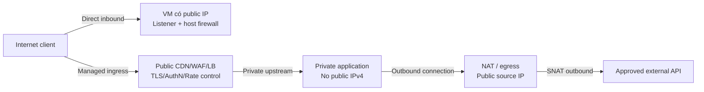
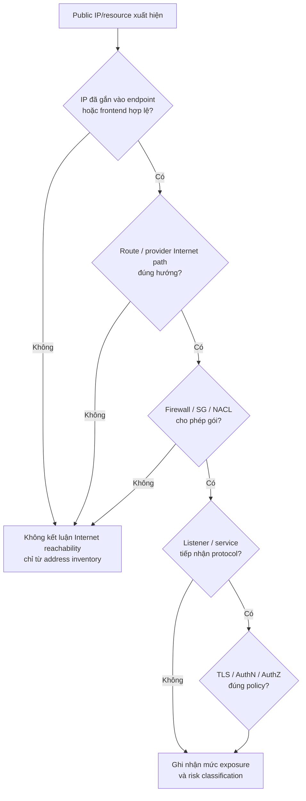
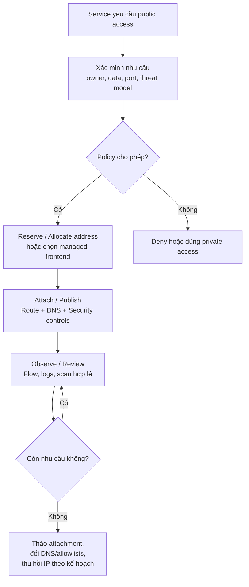
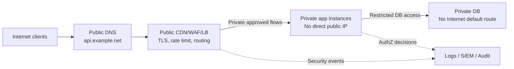
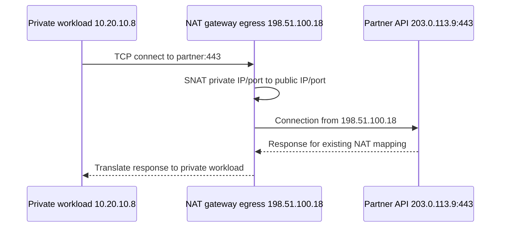
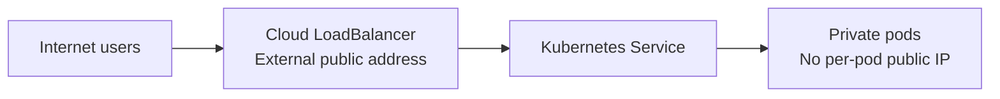
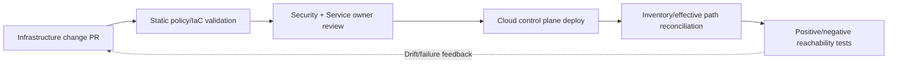
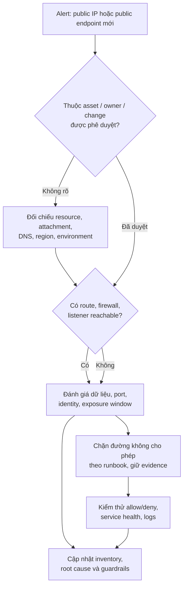

# Kiểm soát địa chỉ IP công khai trong bảo mật mạng cloud

**Địa chỉ IP công khai (public IP address)** là địa chỉ được định tuyến trên Internet theo cơ chế mạng phù hợp, cho phép một tài nguyên hoặc điểm truy cập tham gia trao đổi lưu lượng bên ngoài mạng riêng. Trong môi trường cloud, **cấp phát, gán, công bố, định tuyến, bảo vệ, giám sát và thu hồi public IP** là một phần quan trọng của quản trị bề mặt tấn công. Một thay đổi nhỏ như bật tự động gán public IPv4 cho máy ảo, tạo load balancer Internet-facing hoặc thêm route IPv6 có thể vô tình mở ra một đường truy cập mới.

Tuy nhiên, **có public IP không đồng nghĩa có một dịch vụ đang mở cho toàn Internet**. Khả năng truy cập phụ thuộc vào định tuyến, interface/điểm kết thúc dịch vụ, listener, security group/firewall, NACL, chính sách sản phẩm và giao thức ứng dụng. Ngược lại, **không có public IP trên máy ảo cũng không đồng nghĩa ứng dụng không thể bị truy cập từ Internet**: ứng dụng có thể được công bố thông qua load balancer, API gateway, CDN/WAF, reverse proxy hoặc dịch vụ managed có public endpoint.

Trong mô-đun **SECURITY_NETWORK_SECURITY**, kiểm soát public IP phải phối hợp với **phân đoạn mạng, firewall/NGFW, TLS/PKI, DNS security, VPN/ZTNA, NAC, DDoS protection, IDS/IPS/NDR, cloud IAM và giám sát sự cố**. Mục tiêu không phải cấm mọi public IP mà là **cấp đúng nơi có nhu cầu, chỉ mở đúng luồng, xác thực đúng người hoặc dịch vụ, có bằng chứng vận hành và thu hồi kịp thời khi hết nhu cầu**.

Các ví dụ dùng dải địa chỉ dành cho tài liệu như **192.0.2.0/24**, **198.51.100.0/24**, **203.0.113.0/24** và **2001:db8::/32**; đây không phải địa chỉ cần triển khai thật. Khác biệt giữa AWS, Azure và Google Cloud được nhắc ở mức kiến trúc; phải xác minh chức năng, loại resource, vùng và chính sách của nhà cung cấp trước khi triển khai.

## 1. Mục tiêu học tập

Sau bài học, người học có thể:

1. Phân biệt **public IPv4, private IPv4, global IPv6, IPv6 ULA, public IP resource, public service endpoint và egress IP**.
2. Hiểu vì sao **public addressing**, **routing**, **firewall** và **authentication/authorization** là các điều kiện khác nhau.
3. Nhận diện public IP gắn với **VM/NIC, load balancer, gateway, NAT, firewall, VPN, Kubernetes LoadBalancer và dịch vụ PaaS**.
4. Xây dựng **inventory công khai xuyên account/subscription/project, region, VPC/VNet, environment và owner**.
5. Thiết kế **default-deny public exposure**, ngoại lệ có owner/expiry, phân quyền sửa cấu hình và guardrails phòng ngừa.
6. Kiểm soát đường **inbound**, đường **outbound source NAT** và **IPv6** mà không lẫn NAT với một lớp firewall hoàn chỉnh.
7. Giải thích lợi ích và giới hạn của **WAF, DDoS protection, CDN, reverse proxy, VPN/ZTNA, private endpoints và source-IP allowlists**.
8. Xác minh **DNS A/AAAA, TLS certificate, hostname, public IP drift, stale DNS và resource lifecycle**.
9. Đo được **quyền truy cập thực tế, thay đổi control plane, traffic flows, port exposure, NAT use và chi phí IP**.
10. Xử lý các sự cố **public IP bị gán nhầm, egress IP đổi, mở cổng ngoài policy, IPv6 bypass hoặc giải phóng địa chỉ còn tham chiếu DNS**.
11. Lập **positive/negative tests** và runbook đủ để kiểm toán một kiến trúc public exposure.

## 2. Hiểu đúng “public IP” trong cloud

**Public IPv4** thường là địa chỉ thuộc vùng có thể định tuyến công khai và được cloud provider hoặc tổ chức sở hữu/quản lý phân bổ cho một tài nguyên/điểm egress. Địa chỉ **private IPv4** theo RFC 1918 gồm các dải:

- **10.0.0.0/8**
- **172.16.0.0/12**
- **192.168.0.0/16**

Các private IPv4 không được định tuyến trực tiếp trên Internet toàn cầu theo mô hình thông thường; để truy cập Internet IPv4 từ mạng riêng thường cần **source NAT hoặc một điểm trung gian phù hợp**.

Địa chỉ **IPv6 global unicast** có thể được định tuyến toàn cầu, nhưng phải xét prefix, tuyến và chính sách của provider. **IPv6 Unique Local Address (ULA)**, thường thuộc **fc00::/7**, không có cùng đặc tính định tuyến Internet toàn cầu. Không áp nguyên quy tắc “chỉ có public IPv4 mới ra Internet” cho workload dual-stack.

### 2.1. Bốn khái niệm rất dễ bị đồng nhất

| Khái niệm | Câu hỏi đúng | Ví dụ |
| --- | --- | --- |
| **Public IP resource/allocation** | Cloud đã cấp hoặc dự trữ địa chỉ nào? | Elastic IP, cloud public IP resource, static external IP |
| **Public IP association** | Địa chỉ được gắn vào endpoint/NIC/LB nào? | IP A gắn frontend của public load balancer |
| **Public network reachability** | Route và firewall có cho kết nối tới endpoint? | Internet client có thể kết nối TCP/443 đến LB |
| **Public service exposure** | Có ứng dụng/listener hợp lệ xử lý request? | WAF → API public, xác thực OAuth và AuthZ |

Một public IP **đã đặt trước nhưng chưa gắn** không tự tạo listener Internet. Một endpoint **không có IP công khai của riêng VM** vẫn có thể nhận traffic qua LB hoặc dịch vụ được công bố ở tầng trên.

### 2.2. Địa chỉ công khai không phải danh tính đáng tin

Một IP có thể đại diện cho nhiều người dùng sau **CGNAT**, nhiều services sau proxy hoặc nhiều workloads sau NAT. IP được phép trong firewall **không chứng minh** request do service được phê duyệt thực hiện.

Luồng nhạy cảm cần thêm **TLS certificate validation, mTLS, OAuth/OIDC, workload identity và resource-level authorization** khi phù hợp.

## 3. Vì sao phải quản lý public IP như tài sản bảo mật?

Public IP có thể trở thành điểm có thể bị nhìn thấy hoặc kết nối từ bên ngoài. Rủi ro không chỉ là có một cổng mở, mà còn nằm ở **việc không biết một đường công khai tồn tại**.

Những tình huống điển hình:

- Một VM thử nghiệm được cấp public IPv4 tự động và có SSH/RDP listener.
- Một security group bị sửa từ CIDR quản trị hẹp thành **0.0.0.0/0**.
- Một Kubernetes Service được đổi thành **LoadBalancer**, tạo external frontend mới.
- Một managed database có public access được bật ngoài change window.
- Một workload IPv6 có **::/0** route và rule inbound rộng, dù IPv4 private.
- Một Elastic/static IP đã hết dùng nhưng DNS vẫn trỏ đến nó.
- Một NAT egress IP bị thay khiến API đối tác từ chối hợp lệ hoặc audit không khớp.
- Một VM chạy với public endpoint không có TLS/PKI hoặc thiếu application authentication.

**Nguyên tắc:** cần biết **địa chỉ nào, gắn với tài nguyên nào, ai chịu trách nhiệm, dịch vụ nào tiếp xúc, vì sao cần public, có ràng buộc nào bảo vệ và khi nào hết nhu cầu**.

### 3.1. Public IP exposure khác asset criticality

Không phải mọi public IP có cùng rủi ro. Một public WAF/LB phục vụ HTTPS có AuthN/AuthZ, rate limits và vận hành tốt có thể phù hợp thiết kế. Một database public chấp nhận kết nối từ mọi nguồn lại có mức rủi ro khác.

Ưu tiên đánh giá theo:

1. **Loại ứng dụng và dữ liệu:** public marketing website, API thanh toán, remote admin, database, logging pipeline.
2. **Đường đến:** Internet trực tiếp hay qua CDN/WAF/VPN/private path.
3. **Cổng/giao thức và listener:** TCP/443, UDP/443, SSH, RDP, database ports, custom management.
4. **Chính sách truy cập:** source restrictions, service identity, MFA, TLS, least privilege.
5. **Khả năng bị chiếm/khai thác:** phiên bản, lỗi cấu hình, weak credentials, thiếu patch.
6. **Tác động nếu hỏng:** dữ liệu, availability, lateral movement và blast radius.

## 4. Bốn đường đi mạng phải phân biệt



**Đường 1: Public VM.** Client Internet kết nối tới IP của VM nếu route và firewall cho phép. VM giữ trách nhiệm về listener, host firewall, patch và danh tính.

**Đường 2: Public edge.** Internet vào một **load balancer, CDN, WAF hoặc API gateway** công khai; backend private. Đây thường là cách công bố ứng dụng web/API giảm nhu cầu cấp public IP cho từng máy.

**Đường 3: Outbound NAT.** Private workload không có public IPv4 riêng nhưng đi Internet qua **public egress IP** của NAT/firewall/proxy. IP này chủ yếu phục vụ kết nối đi ra.

**Đường 4: Private connectivity.** Workload truy cập private endpoint, peering, interconnect hoặc VPN mà không cần public Internet address ở endpoint ứng dụng tương ứng.

Khi kiểm toán một IP, phải xác định **nó nằm trên đường nào**. Cùng một tập public IP nhưng yêu cầu bảo vệ, logging và vòng đời rất khác.

## 5. Có IP công khai khác với được truy cập từ Internet

Giả sử một VM có public IP **203.0.113.24**. Có thể xảy ra:

- VM chỉ được phép **outbound**; inbound firewall không mở bất kỳ cổng nào.
- TCP/443 được mở cho Internet; ứng dụng HTTPS trả nội dung đã xác thực.
- TCP/22 chỉ mở cho một VPN/bastion egress IP được phê duyệt.
- Security group cho TCP/443 nhưng host firewall chặn hoặc ứng dụng không listen.
- Ứng dụng chỉ bind vào **127.0.0.1** hoặc private interface, không nhận request theo cách người quản trị nghĩ.
- Public IP resource còn được phân bổ nhưng không gắn với một endpoint đang hoạt động.

### 5.1. Mô hình đánh giá reachability



Một *reachable service* vẫn có thể yêu cầu danh tính và từ chối request hợp lệ về TCP nhưng không có quyền. **Vulnerability exposure** phải đánh giá riêng với việc cổng có nhận SYN/TLS hay không.

### 5.2. Firewall rule mở không chứng minh endpoint đang chạy

Một security group inbound cho **0.0.0.0/0:443** có thể là **rủi ro cấu hình** ngay cả khi chưa có listener; ứng dụng triển khai sau có thể làm đường này mở thực sự. Vì vậy cần cả **preventive policy** và kiểm thử reachability trong phạm vi được phép.

## 6. Kiểm kê public IP đa tài khoản và đa môi trường

Mạng cloud doanh nghiệp thường phân tán trên **nhiều account/subscription/project, VPC/VNet, region, cluster và nhà cung cấp**. Public IP inventory không nên là một bảng chỉ chứa chuỗi địa chỉ.

### 6.1. Bộ trường kiểm kê tối thiểu

| Trường | Ví dụ | Công dụng |
| --- | --- | --- |
| **Provider/account/project** | production-network-account | Xác định nơi kiểm soát tài nguyên |
| **Region/zone** | region-a / zone-1 | Đánh giá DR, traffic path, locality |
| **Public address/prefix** | 203.0.113.24/32, 2001:db8:1::/64 | Định danh IP, phân biệt IPv4/IPv6 |
| **Allocation ID / resource ID** | public-ip-resource-001 | Tránh nhầm khi IP được gán lại |
| **Resource type** | VM NIC / LB frontend / NAT / firewall / gateway | Xác định ingress hay egress |
| **Association/attachment** | frontend api-public | Biết đối tượng đang dùng |
| **DNS names** | api.example.net | Mapping public identity |
| **Exposure purpose** | HTTPS ingress / partner API egress | Lý do cần public address |
| **Allowed ports/protocols** | TCP/443; UDP/443 nếu dùng QUIC | Kiểm tra chính sách |
| **Ingress source policy** | public users, trusted edge, admin VPN | Độ rộng truy cập |
| **Identity and TLS** | Public PKI + OAuth; mTLS | Cơ chế xác thực |
| **Owner/business service** | Platform / customer-api | Quy trách nhiệm |
| **Environment and data class** | prod / sensitive | Ưu tiên rủi ro |
| **Provisioning source** | Terraform/module/case ID | Kiểm soát IaC |
| **Created/last changed** | Timestamp, change ticket | Drift/lifecycle |
| **Exception expiry** | Time-limited waiver | Ngăn quyền tạm trở thành vĩnh viễn |
| **Last verification** | Reachability test / firewall review | Chứng minh trạng thái thực |

### 6.2. Inventory cần tìm nhiều loại đối tượng

Không chỉ tìm **Elastic IP** hoặc VM external IP. Cần rà soát:

- VM/instance **ephemeral public IPv4**, static/reserved addresses, multiple NICs.
- Public **load balancers, ingress controllers, API gateways, app gateways, CDN/WAF origins**.
- **NAT gateway/firewall public egress IPs** và các IP khác dùng outbound.
- Public interfaces của **VPN, bastion, remote administration hoặc network appliances**.
- **Managed databases, object storage, serverless và PaaS public endpoints**.
- **Kubernetes Services type LoadBalancer**, public ingress, external DNS controllers.
- **IPv6 global addresses/prefixes** và routes ::/0.
- **DNS A/AAAA/CNAME** hiện tại, lịch sử và stale references.
- **Allocated but unused addresses** có owner, chi phí và kế hoạch thu hồi.

Một số managed services có **public endpoint theo DNS/provider fabric** mà không gắn một public IP resource trong account theo cách VM. Nếu chỉ liệt kê địa chỉ thuộc account, inventory vẫn có thể **bỏ sót dịch vụ Internet-exposed**.

## 7. Lifecycle public IP: cấp phát, gắn, thay, thu hồi

Một public IP cần có vòng đời vận hành rõ ràng:



### 7.1. Yêu cầu cấp public IP cần trả lời

- Dịch vụ nào, ai sở hữu, môi trường nào?
- Vì sao cần **public IP trực tiếp** thay vì LB/WAF/ZTNA/private endpoint?
- IP dùng **inbound, outbound hay cả hai** theo thiết kế?
- Port/protocol và source destinations là gì?
- Có public DNS, certificate, monitoring và alert không?
- Có yêu cầu static IP của đối tác/DR?
- Ai có quyền sửa route, gắn IP hoặc mở firewall?
- Địa chỉ có **ngày hết nhu cầu** hoặc bước review lại không?

### 7.2. IP allocation khác IP association

Một địa chỉ **reserved/static** có thể được giữ mà chưa dùng. Một địa chỉ **ephemeral** có thể đổi khi resource lifecycle thay đổi. Khi một public IP được tháo khỏi tài nguyên, không nên giả định nó lập tức biến mất khỏi DNS/partner allowlist/monitoring.

Ngược lại, khi release địa chỉ cho provider, **có thể tái phân bổ địa chỉ cho chủ thể khác** theo chính sách của provider. Việc này khiến DNS cũ và các rule dựa trên IP trở thành rủi ro vận hành/bảo mật.

## 8. Public IPv4 động, reserved/static và BYOIP

Có ba mô hình cần phân biệt:

| Loại | Ý nghĩa | Điều cần quản lý |
| --- | --- | --- |
| **Ephemeral/auto-assigned public IPv4** | Provider cấp theo vòng đời resource/instance/interface | Địa chỉ có thể thay đổi; không dùng làm identity ổn định |
| **Static/reserved public IPv4** | Địa chỉ được giữ theo resource/allocation và gán theo policy | Chi phí, chủ sở hữu, attachment, release, DR |
| **Bring Your Own IP (BYOIP)** | Tổ chức mang dải IP được sở hữu/ủy quyền vào dịch vụ cloud hỗ trợ | Quyền sở hữu, routing/BGP/ROA, provider onboarding, failover |
| **Provider-managed public frontend** | Dịch vụ LB/CDN/API có địa chỉ do provider quản lý | Hostname, IP stability promise, DNS, TLS, routing policy |

### 8.1. Static IP không có nghĩa ứng dụng luôn sẵn sàng

Một static IP vẫn có thể trỏ tới endpoint lỗi, không có listener, sai route hoặc firewall. Với HA, ứng dụng có thể dùng **DNS/LB managed frontend** thay vì cố duy trì một IP cố định cho từng VM.

### 8.2. BYOIP có trách nhiệm khác

Khi tổ chức mang dải public IP riêng lên cloud, cần xác minh:

- Quyền sử dụng và kiểm soát prefix.
- Quy định route advertisement, ROA/RPKI hoặc các yêu cầu xác minh từ provider.
- Kế hoạch migration giữa data center/cloud providers.
- Ngăn **route hijack/misannouncement** ở các biên phù hợp.
- Theo dõi public prefix inventory, ownership và incident escalation.

**BYOIP không tự làm endpoint an toàn**; sau khi route đến cloud, các inbound firewall, TLS, AuthN và application vulnerabilities vẫn tồn tại.

## 9. Ingress: mở public IP cho đúng loại dịch vụ

Từ bên ngoài vào hệ thống, có một số điểm cần được công bố:

- **HTTPS website/API** cho khách hàng.
- **VPN/ZTNA gateways** cho nhân viên/đối tác.
- **Mail gateways hoặc DNS authoritative services** có yêu cầu Internet.
- **Public UDP services** được thiết kế riêng.
- **Public monitoring/callback endpoints** theo nhu cầu nghiệp vụ.

Không nên mặc định public VM trực tiếp là đường duy nhất. Với web/API, thường nên cân nhắc **public LB → WAF/API gateway → private backend**.

### 9.1. Mẫu kiến trúc inbound



Yêu cầu vận hành:

1. Edge có certificate/TLS đúng hostname và chính sách.
2. Backend chỉ cho **trusted edge/private path** kết nối đúng port.
3. Public Internet không thể trực tiếp chạm backend bằng alternate IP/IPv6 path.
4. Gateway có **WAF/rate limit/authentication** khi cần, nhưng backend vẫn thực thi resource-level AuthZ.
5. Health checks, capacity, DDoS handling và failover được đo.
6. DNS/edge/region thay đổi đều được đưa vào inventory và change control.

### 9.2. Internet-facing load balancer không xóa rủi ro của ứng dụng

WAF chỉ là một lớp phòng vệ. Lỗi **BOLA/IDOR, SQL injection, business logic, SSRF, token validation sai hoặc quyền IAM quá rộng** vẫn cần được xử lý bằng secure coding, AuthZ và kiểm soát mạng ở backend.

## 10. Direct public VM: khi nào và bảo vệ ra sao?

Có use case hợp lệ cho VM có public IP, ví dụ appliance được thiết kế, lab giới hạn, mạng gateway hoặc dịch vụ legacy không hỗ trợ private integration. Khi đó cần **ngoại lệ có lý do và kiểm soát cụ thể**.

### 10.1. Baseline tối thiểu

- Chỉ gắn public IP nếu **đã duyệt use case**.
- Chỉ mở **port/protocol** thật sự cần; không dùng 0.0.0.0/0 cho cổng quản trị.
- Thiết lập host firewall và network security group/NSG/VPC firewall.
- Dùng **SSH keys, short-lived credentials, MFA qua gateway** hoặc remote access có quản trị.
- Có update/patch lifecycle và vulnerability management.
- Không để credentials, metadata, debug endpoints hoặc database listener public ngoài policy.
- Bật logs, alert và external exposure review trong phạm vi được phép.
- Xác minh IPv6 song song nếu NIC có địa chỉ global.
- Có owner/expiry và cách chuyển dần sang private endpoint/LB nếu phù hợp.

### 10.2. Không dựa vào obscurity

Đổi SSH từ TCP/22 sang một cổng cao hơn **không thay cơ chế authentication** và không tự ngăn scanning. Tương tự, một IP chưa có DNS công khai vẫn có thể được tìm thấy bằng hoạt động quan sát Internet.

## 11. Quản trị truy cập máy chủ không nên bắt buộc public IP

Nhiều tổ chức gán public IP chỉ để quản trị VM từ xa bằng SSH/RDP. Điều này tạo thêm bề mặt tấn công nếu không được kiểm soát kỹ.

Thay thế thường đáng cân nhắc:

- **VPN/ZTNA** với xác thực danh tính/MFA và phân quyền đến đúng management resource.
- **Managed session/remote administration** thông qua cơ chế agent/control plane được nhà cung cấp hỗ trợ, không mở SSH/RDP Internet nếu không cần.
- **Bastion/jump host** được harden, ghi audit và hạn chế nguồn truy cập.
- **Private interconnect** từ data center.
- **Ephemeral administrative access** theo phê duyệt và thời hạn.

### 11.1. Bastion vẫn phải có chính sách

Bastion Internet-facing có thể giảm số public VM nhưng bản thân nó là **điểm nhạy cảm**. Cần MFA/IdP, device posture khi phù hợp, SSH key lifecycle, logging, session control, host hardening và DR. Bastion không thay resource-level permissions tại máy đích.

### 11.2. Giảm attack surface của management ports

Một rule public **TCP/22 hoặc TCP/3389 từ mọi nguồn** có rủi ro cao, kể cả khi credential khá mạnh. Cần giới hạn nguồn và ưu tiên loại bỏ public management path theo chính sách Zero Trust.

## 12. Outbound: public egress IP không giống inbound exposure

Một private workload có thể không có public IP nhưng request outbound ra Internet bằng **IP của NAT gateway, firewall hoặc proxy**. Địa chỉ egress này có thể được đối tác dùng để allowlist.



Đây là logic **outbound SNAT IPv4**, không phải mô hình cho mọi provider hoặc IPv6 path.

### 12.1. Vì sao public egress IP cần quản trị?

- Một egress IP có thể đại diện cho **hàng trăm workloads**.
- Đối tác có thể yêu cầu IP allowlist; khi IP thay, dịch vụ hợp lệ bị chặn.
- Các kết nối không mong muốn có thể xuất phát từ một workload bị chiếm và **chia sẻ uy tín IP** với các ứng dụng hợp lệ.
- Phân tích sự cố cần ghép public IP:port với private workload/trace nếu telemetry hỗ trợ.
- NAT gateway/egress IP tốn phí và có **capacity/port limits** tùy nhà cung cấp.

### 12.2. Hạn chế egress theo workload

Đừng dùng một NAT gateway mở toàn Internet làm lý do bỏ qua egress policy. Cần cân nhắc **firewall egress, DNS filtering, proxy, private endpoints, workload identity, domain/service allowlists, connection pooling** và audit.

## 13. IP allowlist: có ích nhưng không phải danh tính

Một API đối tác có thể chỉ chấp nhận request từ **public IP của công ty**. Cơ chế này bổ sung một điều kiện mạng, nhưng không thay thế việc xác thực request.

### 13.1. Giới hạn về bảo mật

- Nhiều service hoặc người dùng có thể dùng chung source IP.
- Một VM bị chiếm trong vùng đã allowlist có thể dùng IP đó để gọi API.
- Public IP có thể thay do failover, đổi NAT, thay provider hoặc giải phóng/tái cấp.
- Client sau **VPN, proxy, CGNAT** không được nhận diện riêng chỉ bằng public IP.
- Một partner có thể nhìn thấy **IPv6 source** khác tập IPv4 allowlist.

### 13.2. Mô hình B2B phù hợp

```text
Network access:
  approved-egress-public-IPs -> partner TLS endpoint

Transport identity:
  verify partner hostname + certificate chain

Client/API identity:
  mTLS client certificate OR OAuth client credentials
  OR protocol-specific strong authentication

Authorization:
  only approved actions/resources/tenants

Operations:
  log source service + partner API decision + correlation ID
```

**Public IP allowlisting là một điều kiện, không phải toàn bộ chính sách.**

### 13.3. Kiểm tra multi-zone và DR

Nếu Zone A đi NAT-A và Zone B đi NAT-B, đối tác cần có cấu hình **tập IP được phê duyệt** bao phủ cả hai đường phù hợp. Khi DR chuyển region, có thể thay IP và route; nên kiểm thử trước bằng account/test identity thay vì đợi sự cố thật.

## 14. Public IPv6: rủi ro bị bỏ sót khi chỉ kiểm soát IPv4

IPv6 global unicast có thể là địa chỉ có khả năng định tuyến toàn cầu; không nhất thiết cần NAT44 để thiết bị kết nối Internet.

Một workload dual-stack có thể:

- Có **private IPv4** không gắn public IPv4.
- Có **global IPv6** trên interface.
- Có default route **::/0** tới Internet path được provider hỗ trợ.
- Có IPv6 firewall rules khác IPv4.

Nếu tổ chức chỉ rà soát public IPv4 và các rule **0.0.0.0/0**, có thể bỏ sót đường Internet IPv6.

### 14.1. Checklist riêng cho IPv6

1. Kiểm kê địa chỉ/prefix IPv6 global ở NIC/subnet/LB.
2. Kiểm tra **::/0 route** và next hop.
3. Đánh giá inbound IPv6 firewall và các rule nguồn **::/0**.
4. So sánh security parity với IPv4: TCP/443, UDP/443, admin ports, outbound.
5. Kiểm tra **DNS AAAA** và cách clients ưu tiên kết nối.
6. Xác minh application TLS/certificate/hostname ở đích IPv6.
7. Đo flow logs IPv6, không chỉ IPv4 NAT metrics.
8. Xem kịch bản IPv6-only, NAT64/DNS64 nếu nền tảng triển khai.

### 14.2. Egress-only không đồng nghĩa NAT IPv4

Một số cloud cung cấp mô hình IPv6 **egress-only Internet gateway** hoặc các thành phần kiểm soát outbound khác. Chúng có thể ngăn kết nối inbound không mong đợi theo thiết kế nhưng **không nhất thiết làm source NAT như IPv4 PAT**.

Phải kiểm tra **provider semantics**, không áp quy tắc “NAT ra Internet là an toàn” cho mọi IPv6.

## 15. DNS, certificate và public IP changes

Người dùng thường truy cập **hostname**, không nhập trực tiếp IP. Khi public IP thay đổi, DNS có thể trở thành điểm gián đoạn hoặc sai đích.

### 15.1. Mối liên hệ giữa DNS và public exposure

- **A record:** hostname → IPv4.
- **AAAA record:** hostname → IPv6.
- **CNAME/ALIAS hoặc cơ chế provider-specific:** hostname → frontend managed.
- **Public certificate:** chứng minh danh tính hostname theo TLS trust policy, không tự ràng buộc vĩnh viễn một IP.
- **DNS TTL/caching:** quyết định thời gian một resolver có thể giữ câu trả lời theo cơ chế cache.
- **Reverse DNS/PTR:** có thể cần trong một số ứng dụng (chẳng hạn email), không thay chứng chỉ TLS.

### 15.2. Nguy cơ stale DNS

Giả sử **legacy.example.net → 203.0.113.24** từng chỉ tới VM cũ. Nhóm vận hành release public IP nhưng quên xóa A record. Provider có thể phân bổ lại IP cho một người dùng khác sau này; khi đó hostname vẫn trỏ tới địa chỉ không còn được tổ chức kiểm soát.

Rủi ro tùy dịch vụ: người dùng có thể đến nhầm máy, traffic bị thất bại hoặc bị lừa nếu không kiểm tra danh tính đúng. **TLS hostname validation** giảm một số nguy cơ đối với HTTPS, nhưng không bảo đảm mọi protocol/application đều được cấu hình kiểm tra chặt.

### 15.3. Thu hồi IP theo trình tự an toàn

1. Xác định **resource và business owner**.
2. Kiểm tra IP được dùng cho inbound, outbound, DNS, allowlist, certificate, monitoring hay DR.
3. Thay endpoint và kiểm thử traffic hợp lệ trên đường mới.
4. Cập nhật hoặc xóa DNS records, egress/partner allowlists và inventory.
5. Chờ/đánh giá cửa sổ DNS caching và các client hard-coded IP theo rủi ro.
6. Tháo attachment, dừng listener và thu hồi resource theo change plan.
7. Xác nhận **không còn service cần IP cũ** và theo dõi stale references.
8. Ghi thời gian, người thực hiện, reason và bằng chứng.

**Không release IP trước khi xử lý DNS và dependency** khi việc đó có thể chuyển traffic tới bên không kiểm soát.

## 16. Static IP, DNS failover và kiến trúc sẵn sàng cao

Một static public IP có thể giúp partner allowlist hoặc hệ thống legacy đơn giản hóa cấu hình. Tuy nhiên, **availability** phụ thuộc vào resource/region/route và cơ chế chuyển đổi.

### 16.1. Ba lựa chọn phổ biến

| Mô hình | Điểm mạnh | Điều cần lưu ý |
| --- | --- | --- |
| **IP gắn trực tiếp VM** | Triển khai đơn giản cho workload nhỏ | VM lifecycle, failover, single host exposure |
| **Public LB/front door** | Backend private, health check, phân phối tải | LB/WAF availability, DNS, upstream TLS, origin bypass |
| **Global/CDN managed ingress** | Distributed edge, routing, cache/DoS features theo sản phẩm | Provider dependency, origin protection, certificate/DNS lifecycle |

Không mặc định mọi managed LB/CDN có **static IP guarantee** hoặc thời gian failover giống nhau. Nếu có yêu cầu fixed IP, kiểm chứng đặc tính product/SKU/region và cách cập nhật allowlists.

### 16.2. DNS failover không tức thời tuyệt đối

Ngay cả khi đổi record nhanh, **resolver caching, client behavior, connection reuse** có thể giữ endpoint cũ trong một khoảng thời gian. Test DR phải đo end-to-end recovery, không chỉ xác nhận DNS API trả thành công.

## 17. AWS: các điểm kiểm soát public IP quan trọng

Trong **AWS VPC**, nhóm tài nguyên cần chú ý có thể gồm:

- **EC2 public IPv4** được tự động gán khi tạo instance/interface trong ngữ cảnh được hỗ trợ.
- **Elastic IP** được phân bổ/gán lại cho endpoint được hỗ trợ.
- **Public-facing load balancers**, API ingress/frontends.
- **Internet Gateway (IGW)** và route tables của subnet.
- **NAT Gateway public egress IPs** và những đường outbound khác.
- **IPv6 assignments/default routes** cùng egress-only gateway khi phù hợp.
- Các dịch vụ managed có **public endpoint/public accessibility** độc lập với một public IP trực tiếp trên EC2.

### 17.1. Đánh giá một EC2 instance có public IPv4

Cần biết:

1. Instance và interface nào giữ địa chỉ public?
2. Địa chỉ là **auto-assigned** hay Elastic IP?
3. Subnet gắn route table nào, default route IPv4/IPv6 ra sao?
4. SG inbound/outbound và NACL cho phép gì?
5. OS có listener nào và host firewall ra sao?
6. Resource có thực sự cần public IP hay có thể dùng **SSM/managed session, VPN hoặc private LB**?
7. Có automation nào có thể tự gắn lại địa chỉ sau khi sửa bằng tay không?

### 17.2. IAM và guardrails

Nên giới hạn quyền các hành động như:

- Cấp/gán/thu hồi public IP resource.
- Tạo instance/network interface với public-address setting.
- Tạo/chỉnh Internet-facing LB.
- Thêm hoặc thay route IGW/egress.
- Sửa SG/NACL hoặc security policy.
- Thay public DNS record.

Các khả năng như **IAM policies, organization-level preventive controls, config/compliance monitoring, infrastructure-as-code review** có thể phối hợp, nhưng cách thực thi cụ thể phải kiểm chứng theo loại API/action/resource.

### 17.3. Lưu ý chi phí public IPv4

Địa chỉ public IPv4 là tài nguyên khan hiếm; các provider có thể tính phí theo loại IP, trạng thái gán hoặc hình thức phân bổ. Vì giá/SKU thay đổi, không hard-code giá vào policy; dùng **billing inventory và cost attribution** để tìm địa chỉ bỏ không hoặc không có owner.

## 18. Azure: public IP resources, subnet và NAT

Với **Azure**, cần phân biệt các thành phần:

- **Azure Public IP address resource** cho frontend/resource được hỗ trợ.
- **Virtual Machine NIC/IP configuration** và public IP association.
- **Public Load Balancer, Application Gateway, Front Door** hoặc các dịch vụ Internet-facing khác theo sản phẩm.
- **Azure NAT Gateway** gắn với subnet phục vụ outbound theo kiến trúc.
- **Network Security Groups (NSG), Azure Firewall, user-defined routes/effective routes**.
- **Managed service public network access** có policy riêng theo dịch vụ.

### 18.1. Điểm dễ sai

- Gán **Public IP** cho VM để truy cập Internet trong khi use case chỉ cần **outbound**: có thể dùng NAT/controlled egress thay thế.
- Xem **NSG rule** là đủ nhưng route hoặc public endpoint PaaS vẫn tạo đường ngoài policy.
- Nhìn subnet có NAT Gateway rồi cho rằng **mọi lưu lượng** đều đi NAT, bỏ qua UDR/firewall/alternate path.
- Xem **IP resource allocated** là bằng chứng có public service đang lắng nghe.
- Quên role/IAM cho người có quyền tạo public IP hoặc sửa NSG.

### 18.2. Kiểm tra public network access của managed services

Một managed database/storage/AI endpoint có thể cung cấp **public network access** dưới một domain/provider endpoint mà người vận hành không gắn static public IP trực tiếp. Quyền IAM, private endpoints, firewall settings và service-specific public-access toggles đều phải vào inventory.

## 19. Google Cloud: external IPs, Cloud NAT và firewall

Trong **Google Cloud VPC**, cần rà soát:

- **Compute Engine VM external IP** và địa chỉ static/reserved.
- **External load balancer frontend** cùng DNS/SSL policies.
- **Cloud NAT** cho workload eligible khi thiết kế outbound.
- **VPC Firewall Rules / hierarchical firewall policies**, routes và organization policies.
- **GKE external LoadBalancer Services/Ingress/Gateway** có thể tạo public resource.
- Public endpoints của dịch vụ managed, serverless/API hoặc storage theo access settings.

### 19.1. Điểm dễ sai

- VM không có external IPv4 nhưng vẫn truy cập Internet qua **Cloud NAT**, nghĩa là outbound vẫn tồn tại.
- Một **public forwarding rule/frontend** được tạo bởi automation/kubernetes controller; VM backend không có external IP không làm endpoint riêng tư.
- Các **organization policy constraints** về external IP/public access có thể ngăn cấp mới, nhưng cần kiểm tra phạm vi, exceptions và đường công bố qua LB/PaaS khác.
- Cloud NAT và route/control plane có semantics khác AWS public NAT gateway; không sao chép nguyên một bảng route từ AWS sang Google Cloud.

### 19.2. Provider-neutral takeaway

Với mọi cloud, hãy kiểm tra **resource inventory + effective routing + firewall/public access policy + actual endpoints + workload identity**, chứ không chỉ tìm một tài nguyên có chữ “public IP”.

## 20. Kubernetes: Service LoadBalancer có thể tạo IP ngoài dự kiến

Một workload chạy trong cluster có thể có **pod IP nội bộ**, nhưng một tài nguyên Kubernetes thuộc loại **Service: LoadBalancer** hoặc ingress/gateway controller được cấu hình public có thể tạo **public frontend** ở cloud.



### 20.1. Cần kiểm soát đối tượng nào?

- **Ai được tạo Service type LoadBalancer** hoặc public Gateway/Ingress?
- Các namespace có admission policy chỉ cho public exposure của nhóm nào?
- Network annotations/provider options xác định **internal vs external** có đúng không?
- **External IP allocations** do controller tạo có xuất hiện trong inventory?
- Khi xóa Kubernetes object, có **orphaned LB/public IP/DNS** còn lại không?
- Có TLS, WAF, AuthN/AuthZ và rate limit ở frontend không?
- Backend có cho **direct bypass** qua NodePort/alternate network path không?

### 20.2. ServiceAccount và controller permissions

Một Kubernetes ServiceAccount của người phát triển không nên mặc định có quyền tạo mọi public endpoint. Cần kết hợp **Kubernetes RBAC, admission control, cloud IAM của controller và policy-as-code**.

### 20.3. Pod private không đồng nghĩa API private

Một team có thể nói “pods chỉ có private IP”, nhưng public LB frontend đang route tới Service. Phải xác định **cổng/hostname public ở bên ngoài**, không chỉ IP của workload.

## 21. Public IP của managed PaaS và serverless

Dịch vụ managed thường không biểu hiện như VM NIC. Một số có:

- URL **public HTTPS endpoint** do provider quản lý.
- Policy **public network access enabled/disabled**.
- ACL cho client IP hoặc VNet/VPC integration.
- Private endpoint/service connect hỗ trợ.
- API authentication/IAM riêng.
- Edge routing/CDN/managed LB mà public IP có thể thay theo mạng provider.

### 21.1. Đặc biệt với data services

Một database PaaS hoặc object storage có public endpoint **không phải lúc nào đồng nghĩa dữ liệu công khai không cần xác thực**. Rủi ro thực phải xét **network access policy và IAM/resource permissions**.

Tuy nhiên, công bố endpoint công khai làm tăng khả năng truy cập từ ngoài và có thể tạo rủi ro brute force, misconfiguration hoặc abuse. Với dữ liệu nhạy cảm, ưu tiên **private access + identity policy** khi phù hợp; nếu buộc phải public, cần điều kiện truy cập mạnh, logging và owner rõ.

### 21.2. Không bảo vệ PaaS chỉ bằng IP allowlist

IP allowlist có thể không phù hợp với client mobile/CGNAT hoặc serverless egress IP thay đổi. Một API công khai có thể cần **OAuth/mTLS, tenant-level AuthZ, WAF/rate limits** thay vì giả định IP ổn định là credential.

## 22. Kiểm soát control plane: ai được cấp và gán public IP?

**Public IP governance** không chỉ là cấu hình firewall. Cần bảo vệ **quyền thay đổi hạ tầng**.

Những thao tác nhạy cảm:

- Allocate/assign/release public IP.
- Bật auto-assign external address.
- Tạo Internet-facing load balancer/gateway.
- Sửa subnet route **0.0.0.0/0** hoặc **::/0**.
- Mở source CIDR rộng ở firewall/NSG/SG.
- Chuyển PaaS từ private sang public network access.
- Tạo cluster ingress công khai qua automation.
- Đổi DNS record sang public IP mới.
- Thay NAT public egress IP làm ảnh hưởng đối tác.

### 22.1. Mô hình phân quyền

| Vai trò | Quyền cần thiết | Quyền cần hạn chế |
| --- | --- | --- |
| **App Developer** | Yêu cầu public endpoint qua chuẩn đã duyệt | Tự mở bất kỳ cổng/route public nào |
| **Network Operator** | Triển khai route/IP theo change plan | Vượt ràng buộc IAM/policy tổ chức |
| **Security Reviewer** | Review policy và evidence | Trở thành tài khoản triển khai toàn quyền không kiểm soát |
| **Platform Automation** | Tạo LB/IP trong phạm vi namespace/project | Gắn public IP trên mọi workload |
| **Cloud Auditor/SOC** | Read-only inventory, flow/audit logs | Thay tài nguyên không được phê duyệt |
| **Break-glass Admin** | Khôi phục khi khẩn cấp theo quy trình | Dùng thường xuyên không ghi audit |

**Least privilege** cần áp ở IAM tổ chức và pipeline/IaC. Một SG đúng hôm nay vẫn có thể bị mở ngày mai nếu quá nhiều principal được sửa mà không review.

## 23. Preventive controls, detective controls và remedial controls

Có ba lớp kiểm soát:

1. **Preventive (phòng ngừa):** policy/IAM/organizational restrictions không cho tạo public IP hoặc mở 0.0.0.0/0 ở nơi chưa được phép.
2. **Detective (phát hiện):** inventory scan, config drift, cloud audit, public exposure monitoring phát hiện tài nguyên không phù hợp.
3. **Remedial (khắc phục):** ticket/automated remediation theo mức rủi ro, thu hồi IP hoặc đóng đường truy cập có kiểm soát.

### 23.1. Tại sao cần cả ba?

Một guardrail có thể ngăn VM gắn public IP mới nhưng **không xử lý hết** các public endpoints đã tồn tại, managed PaaS hoặc LB đã được tạo bởi role đặc biệt. Ngược lại, scan mỗi đêm có thể bỏ lỡ thời gian resource bị mở vài phút.

### 23.2. Tránh remediation tự động gây outage

Nếu một controller tự động xóa mọi public IP không có tag, nó có thể vô tình cắt đường tới public API hoặc VPN gateway do drift tags. Vì vậy nên phân loại:

- **Critical unapproved exposure:** có chính sách tự động đóng hợp lý và đã thử nghiệm.
- **Potential drift:** alert/ticket và xác minh ownership.
- **Known exception:** đối chiếu owner, scope, expiry và compensating controls.
- **Unknown dependency:** điều tra đường DNS/allowlist/DR trước khi release IP.

**Tính đúng của remediation** phải được kiểm thử, nhất là khi thao tác thay IP hoặc DNS khó rollback hoàn toàn.

## 24. Pseudopolicy: public IP exception và exposure baseline

Dưới đây là **policy mô tả ý định**, không phải manifest Terraform/AWS/Azure/GCP có thể chạy trực tiếp.

```yaml
# Pseudopolicy: cấu hình minh họa, không áp trực tiếp.
policy_id: CLOUD-PUBLIC-EXPOSURE-BASELINE
defaults:
  direct_public_ip_on_private_workloads: deny
  public_management_ports_from_anywhere: deny
  allowed_public_ingress_models:
    - managed-https-edge-with-waf
    - approved-vpn-or-ztna-gateway
  require_owner: true
  require_business_reason: true
  require_expiry_for_exceptions: true
  require_change_record: true
internet_ingress:
  default_deny: true
  approved_tcp_ports: [443]
  approved_udp_ports: []  # tùy ứng dụng HTTP/3/VPN nếu có
  inspect_ipv4_and_ipv6: true
  require_tls_hostname_verification: true
  require_application_authorization: true
origin:
  forbid_direct_public_bypass: true
  allow_only_trusted_edge_or_private_paths: true
public_egress:
  require_registered_source_ip_set: true
  use_controlled_nat_or_proxy: true
  separate_prod_from_dev_when_necessary: true
identity:
  restrict_public_ip_assignment_permissions: true
  restrict_route_and_firewall_change_permissions: true
monitoring:
  inventory_interval: organization-defined
  alert_public_ip_new_or_reassociated: true
  alert_public_access_without_approval: true
  correlate_dns_routes_firewall_flow_logs: true
exceptions:
  require_security_review: true
  record_compensating_controls: true
  revoke_on_expiry: true
```

Trong một môi trường có UDP/443 hợp lệ cho **HTTP/3/QUIC**, policy phải cho phép có kiểm soát thay vì áp default deny vô điều kiện. Tương tự, hệ thống DNS authoritative, mail relay hoặc VPN có cổng khác TCP/443. Chính sách phải **theo use case**, không dùng một allowlist cứng làm quy tắc bảo mật toàn ngành.

## 25. IaC và Policy-as-Code: tránh public IP được tạo ngoài ý muốn

Infrastructure-as-Code (IaC) giúp mô tả public IP và các đường truy cập bằng cấu hình có review. Tuy nhiên, IaC vẫn có thể tạo resource nguy hiểm nếu module defaults sai hoặc policy không kiểm tra.

### 25.1. Vòng kiểm soát triển khai



### 25.2. Các quy tắc có giá trị

- Cấm **public IP trực tiếp** trên nhóm workload không được phép, trừ exception có ID.
- Cấm **0.0.0.0/0 hoặc ::/0** cho management ports, trừ các trường hợp đặc biệt được xem xét.
- Chặn **public load balancer/ingress** ngoài namespace/account có quyền.
- Bắt buộc **owner, service, environment, change ID và security classification**.
- Đánh giá SG/NACL/NSG, public endpoint toggles và **routes đồng thời**.
- Kiểm tra public IPv4 **và IPv6**.
- Buộc có TLS/PKI, WAF/rate controls cho internet-facing API theo baseline.
- Ngăn backend/DB có direct public IP nếu chỉ nên nhận private ingress.
- Cảnh báo IP allocated but unattached và DNS còn trỏ IP đã release.
- Có ngoại lệ được ký duyệt, không hard-code **allow-all** cho pipeline.

### 25.3. IaC không thay runtime verification

Một Terraform plan có thể không hiện **cloud service được controller tự tạo sau deployment**, hoặc drift phát sinh từ thao tác thủ công. Cần đối chiếu **desired state và observed effective state**.

## 26. Lệnh inventory cloud: ví dụ chỉ đọc

Chỉ thực hiện với **account/subscription/project và tài nguyên được cấp quyền**. Những lệnh dưới đây nhằm quan sát trạng thái, không tạo/xóa IP hay thay cấu hình. Kết quả inventory có thể chứa thông tin nhạy cảm; lưu trữ có kiểm soát.

### 26.1. AWS CLI

```bash
# Public IPv4 được cấp/giữ dạng Elastic IP
aws ec2 describe-addresses

# Public/Private NIC/IP associations theo account + region đang chọn
aws ec2 describe-network-interfaces

# Instances và public IP metadata
aws ec2 describe-instances

# Đường Internet và NAT được khai báo
aws ec2 describe-internet-gateways
aws ec2 describe-nat-gateways
aws ec2 describe-route-tables

# Rules cho source/destination và public exposure
aws ec2 describe-security-groups
aws ec2 describe-network-acls
```

Các lệnh **không tự tìm mọi account/region hoặc mọi managed public endpoint**. Cần scope và phân trang theo công cụ/SDK, sử dụng IAM read-only. Với tổ chức có nhiều account, dùng **asset inventory/aggregator** phù hợp để tránh bỏ sót.

### 26.2. Azure CLI

```bash
# Public IP address resources trong subscription đã chọn
az network public-ip list --output table

# Các Network Interfaces và thông tin gắn IP
az network nic list --output table

# NAT gateway inventory
az network nat gateway list --output table

# NSG và route tables
az network nsg list --output table
az network route-table list --output table
```

Đối với PaaS, cần thêm kiểm tra **service-specific public network access**, private endpoints và DNS vì không phải public endpoint nào cũng biểu hiện thành một Public IP resource của workload.

### 26.3. Google Cloud CLI

```bash
# IP address resources: reserved internal/external theo phạm vi lệnh
gcloud compute addresses list

# VM instances và external network metadata
gcloud compute instances list

# Forwarding rules / public LB frontends
gcloud compute forwarding-rules list

# Firewall rules
gcloud compute firewall-rules list

# Routes theo project/network
gcloud compute routes list
```

Một số địa chỉ global/static và các sản phẩm LB có cách liệt kê riêng; **không coi những lệnh trên là inventory hoàn chỉnh**. Khi sử dụng cần xác minh project, region, network và quyền đọc.

### 26.4. Kubernetes inventory trong cluster được phép

```bash
# Các Service và external endpoints trong mọi namespace mà tài khoản có quyền đọc
kubectl get services --all-namespaces -o wide

# Ingress resources
kubectl get ingress --all-namespaces
```

Cần xem thêm **Gateway API resources, provider annotations, cloud load balancer thực tế** và đối chiếu orphaned resources. Một địa chỉ ở cột External-IP không tự nói policy WAF/SG đang đúng.

## 27. Quan sát thực tế ở VM/ứng dụng

Cloud control plane biết IP assignments; host OS có thể không thấy toàn bộ NAT/IGW logic.

### 27.1. Linux read-only

```bash
# Interface và các địa chỉ host đang thấy
ip -br address
ip -4 route show
ip -6 route show

# Các TCP/UDP listeners
ss -lnt
ss -lnu

# Route decision trong guest OS tới địa chỉ minh họa
ip -4 route get 203.0.113.10
```

**Lưu ý:** trong nhiều cloud, guest OS chỉ thấy private IP và default route tới virtual router. Public IPv4 có thể được provider ánh xạ ngoài guest; không thấy public IP trong kết quả **ip addr** không chứng minh VM không có external association.

### 27.2. DNS và HTTPS có phép

```bash
# Tra DNS A/AAAA trong môi trường có dig
dig api.example.net A
dig api.example.net AAAA

# Quan sát HTTPS ở endpoint do tổ chức sở hữu/được phép
curl -I -v https://api.example.net/

# TLS với SNI và hostname verification
openssl s_client -connect api.example.net:443 \
  -servername api.example.net \
  -verify_hostname api.example.net \
  -verify_return_error
```

**curl -I** dùng HEAD nên một ứng dụng trả HTTP 405 có thể không phải lỗi network/TLS. Không dùng tùy chọn bỏ certificate verification để chứng minh kết nối an toàn. Không scan port trên IP của bên không có quyền.

### 27.3. Windows PowerShell read-only

```powershell
# Interface và IP settings
Get-NetIPConfiguration
Get-NetIPAddress

# Route tables theo hệ điều hành
Get-NetRoute -AddressFamily IPv4
Get-NetRoute -AddressFamily IPv6

# TCP listeners
Get-NetTCPConnection -State Listen
```

Trong môi trường cloud, phải kết hợp host output với **NIC/public IP associations trên control plane, effective routes, firewall rules và managed LB/ingress**.

## 28. Exposure monitoring: quan sát được sự thay đổi

Các tín hiệu nên theo dõi:

| Tín hiệu | Vì sao quan trọng | Nguồn bằng chứng |
| --- | --- | --- |
| **New public IP allocation** | Có resource Internet mới hoặc IP bỏ không | Cloud asset audit/config |
| **Attach/reassociate public IP** | IP đang phục vụ resource mới | Cloud control plane logs |
| **Public IP removed/released** | Gián đoạn DNS/allowlist, IP reuse | Change log, DNS inventory |
| **New internet-facing LB/API** | Backend có thể được public dù private | LB configuration, DNS, flow logs |
| **0.0.0.0/0 inbound on sensitive port** | Public management/service exposure | SG/NSG/VPC firewall |
| **::/0 inbound or IPv6 route** | Public IPv6 path có thể không được kiểm soát | IPv6 effective routes/firewall |
| **PaaS public network access enabled** | Đường data/service ngoài private network | Service config and IAM |
| **New A/AAAA/CNAME** | Hostname public mới hoặc stale reference | DNS change/audit |
| **NAT egress IP changed** | Partner allowlist, traffic attribution | NAT resource and partner logs |
| **Unexpected connection/bytes spikes** | Abuse, misconfiguration, DDoS hoặc retry storm | VPC flow logs, WAF/NDR/IDS |
| **New public listener** | Cổng mới sau deployment/agent | Host telemetry, approved exposure test |
| **WAF bypass/direct origin flow** | Request đi thẳng vào backend | Firewall/flow logs và edge correlation |
| **IPv4/IPv6 policy mismatch** | Một đường bypass ngoài mong muốn | Dual-stack negative tests |

### 28.1. Giảm báo động giả

Một IP public có thể hợp lệ khi thuộc CDN/WAF. Một security group mở TCP/443 cho Internet có thể là chủ đích của public website. Alert nên kèm **asset owner, loại endpoint, environment, data sensitivity, change window, allowlist exception và kết quả reachability**.

Không coi tất cả public IP là incident, cũng không bỏ qua public IP chỉ vì cloud console hiện màu “healthy”.

## 29. NAT mapping và attribution của public egress IP

Một public egress IP dùng chung khiến sự kiện bên ngoài khó quy về đúng private workload. Khi điều tra, cần tập hợp:

- Public source IP/translated port nếu nguồn log hỗ trợ.
- Destination IP/port, protocol và timestamp.
- Private source IP/port và network interface/workload.
- NAT/egress appliance và route.
- VPC/VNet flow logs, host network telemetry.
- Request ID/trace ID và ứng dụng/caller identity.

### 29.1. Event minh họa

```json
{
  "event_time": "2026-11-28T03:20:00Z",
  "event_type": "public_egress_observation",
  "cloud_resource": "orders-worker-a",
  "source_private_ip": "10.20.10.15",
  "destination_ip": "203.0.113.10",
  "destination_port": 443,
  "transport": "tcp",
  "egress_public_ip": "198.51.100.18",
  "translated_source_port": 40001,
  "identity": "orders-worker-prod",
  "policy_id": "PARTNER-API-EGRESS",
  "trace_id": "trace-demo-001",
  "credential_values_logged": false
}
```

Đây là **mẫu sự kiện tự dựng**, không phải log mặc định từ một provider. Chỉ ghi translated port hoặc identity khi có **bằng chứng telemetry đáng tin**; không tự suy từ public IP. Không lưu access token, private key hoặc payload nhạy cảm trong event mạng.

### 29.2. Giới hạn của NAT logs

Không phải mọi managed NAT gateway cung cấp **full per-flow translation table** với độ chi tiết và retention giống nhau. Có thể cần ghép **cloud flow logs, firewall, host process logs và application traces**. Nếu không đủ bằng chứng, phải ghi rõ **attribution chưa xác định**.

## 30. Bảo vệ public endpoints trước scanning và DDoS

Một public IP thường có thể bị quan sát, probing hoặc nhận traffic không mong muốn. **Public exposure** cần tính đến cả bảo vệ ứng dụng và **availability**.

### 30.1. Các lớp phòng vệ

- **Network/transport controls:** firewall, DDoS mitigation, upstream protection, connection admission.
- **Edge controls:** CDN, WAF, rate limit, bot management nếu phù hợp.
- **Transport trust:** TLS certificate, SNI/ALPN, mTLS cho API B2B/administration.
- **Application controls:** OAuth/AuthN, object-level AuthZ, secure coding, request validation.
- **Operational controls:** patching, secret rotation, vulnerability scanning được phép, capacity testing.
- **Observability:** WAF decisions, L4 metrics, IDS/IPS, NDR, server/resource logs.

### 30.2. Ẩn origin và chống bypass

Nếu public API dùng WAF/CDN nhưng origin còn **public IP riêng**, attacker có thể thử đi thẳng tới origin nếu route/SG cho phép. Biện pháp:

1. Chỉ cho **trusted edge/private connectivity** tới origin theo kiến trúc.
2. Giữ **host-level và application authentication** dù đang sau WAF.
3. Kiểm tra IPv6/alternate ports và DNS cũ.
4. Có **origin authentication** qua mTLS/token/private link khi phù hợp.
5. Kiểm thử đường trực tiếp **bị từ chối** với tài sản và traffic được phép.

### 30.3. Public IP không phải lớp phòng vệ trước DDoS

Chỉ chuyển workload sau NAT hoặc đổi IP không giải quyết DDoS ở public ingress. Phải dùng upstream protections, rate limits, auto scaling/capacity planning và runbook theo SLO.

## 31. Threat modeling: rủi ro gắn với public IP

| Tình huống | Tác động | Phòng vệ phù hợp |
| --- | --- | --- |
| VM bị cấp public IP ngoài policy | Mở đường Internet không biết đến | Preventive guardrail, inventory, drift alert |
| SSH/RDP mở 0.0.0.0/0 | Password attacks, service exploitation | Private admin path, MFA, restricted sources |
| IPv6 global inbound không kiểm soát | Bypass IPv4-only restrictions | IPv6 inventory, ::/0 route/firewall review |
| Public LB có origin IP còn mở | Bypass WAF/rate limit | Origin restriction, mTLS/private link |
| PaaS service bật public access nhầm | Tăng attack surface dữ liệu | Private endpoint, service-specific policy, IAM |
| Source-IP allowlist là AuthN duy nhất | Bất kỳ workload cùng NAT IP có thể mạo danh | mTLS/OAuth, resource-level AuthZ |
| IP release trong khi DNS còn trỏ | Traffic sai đích, gián đoạn, phishing risk | Dependency inventory, safe retirement |
| Gán lại Elastic/static IP sai resource | Public identity chuyển sang service khác | IAM approvals, resource mapping, auditing |
| NAT IP đổi không cập nhật partner | 403/outage, khó attribution | Approved egress IP registry + DR tests |
| Public IPv4 không có owner | IP bỏ không, cost, không ai patch/respond | Ownership + reclamation workflow |
| Cloud IAM cho phép sửa mọi route/SG | Public exposure drift diện rộng | Least privilege, policy-as-code, change control |
| Public gateway quá tải | DDoS hoặc availability incident | DDoS services, WAF/LB, load testing |
| Port scanning phát hiện listener mới | Tấn công vào phần mềm chưa vá | Patching, detection, restricted ports |
| DNS/certificate không nhất quán | Phục vụ sai hostname hoặc lỗi TLS | DNS/TLS validation và change sequencing |
| Multi-region IP list không đồng bộ | DR chạy nhưng client/partner từ chối | Inventory, failover validation |

### 31.1. Hai lớp quyền quan trọng

- **Control-plane authorization:** ai được tạo IP, mở firewall, thay DNS/route hoặc bật public endpoint?
- **Data-plane/application authorization:** ai được kết nối và gọi resource/action thực tế?

Cả hai phải được kiểm soát. Một firewall đúng hôm nay không đủ nếu một operator/pipeline quá quyền có thể mở nó ngày mai.

## 32. Quy trình điều tra public IP exposure ngoài mong đợi



### 32.1. Bước 1 — Xác định thực thể thật

Ghi **provider, account/project/subscription, region, resource ID, IP, IPv4/IPv6, attachment, timestamp, DNS và owner**. Cùng một chuỗi IP có thể được cấp lại theo thời gian; cần dùng **resource ID và timestamp** để tránh nhầm.

### 32.2. Bước 2 — Xác định đường truy cập thực

Kiểm tra:

1. Route/effective next hop.
2. Security group/NSG/VPC firewall/NACL.
3. LB listener, API gateway route hoặc VM listening sockets.
4. Cloud-managed PaaS public access policy.
5. DNS A/AAAA/CNAME và hostname certificate.
6. Alternate IPv6 path hoặc bypass quanh WAF.
7. IAM/resource/AuthZ nếu đó là data service.

### 32.3. Bước 3 — Khoanh vùng theo rủi ro

Nếu public access là **trái phép** và gây nguy cơ nghiêm trọng, phải chặn ingress hoặc thu hồi permission phù hợp. Tuy nhiên, đừng release public IP trước khi kiểm tra dependency như DNS, public VPN, partner allowlist hoặc DR trong tình huống chưa rõ; có thể tạo outage hoặc chuyển lưu lượng sang chủ sở hữu khác.

### 32.4. Bước 4 — Ghi nhận bằng chứng

- Cloud audit event và người/automation thực hiện thay đổi.
- IaC commit/change ticket và policy version.
- Network/flow/WAF logs liên quan.
- Runtime listener/host telemetry.
- Kết quả kiểm thử từ **nguồn thử có phép**.
- Timeline exposure, đóng đường và kiểm chứng lại.

**Không tự quét Internet bên ngoài phạm vi được cho phép**; nếu cần external validation, dùng phương án được tổ chức phê duyệt.

## 33. Runbook thu hồi public IP không còn cần thiết

Một kế hoạch thu hồi có thể gồm:

1. Xác định IP resource, owner và **tất cả attachments** hiện tại/lịch sử liên quan.
2. Phân loại **inbound frontend, direct VM, NAT egress, VPN gateway hoặc reserved idle**.
3. Truy vết DNS, TLS certificates, WAF/LB routes, partner allowlist, monitoring và DR.
4. Chọn endpoint/egress replacement nếu service vẫn cần kết nối.
5. Triển khai endpoint mới và xác minh **positive tests** trước.
6. Chuyển DNS/route/allowlist theo thứ tự an toàn; xem caching và client dùng hard-coded IP.
7. Tháo public IP/attachment theo change window, đánh giá khả năng rollback.
8. Release địa chỉ theo quy trình khi không còn dependency; nếu cần reserved cho DR, giữ owner/expiry và xét cost.
9. Kiểm tra **stale DNS và Internet reachability** sau thay đổi.
10. Cập nhật inventory, billing tag, audit, monitoring, runbook.
11. Xác minh **negative tests**: endpoint cũ và các cổng bị cấm không còn reachable.
12. Ghi chính xác thời gian thực hiện, người phê duyệt, blast radius và lessons learned.

### 33.1. Khác biệt giữa detach và release

- **Detach/disassociate:** ngắt địa chỉ khỏi endpoint; địa chỉ có thể còn allocated/owned.
- **Release:** trả lại địa chỉ/quyền allocation theo cơ chế provider. IP có thể không còn thuộc quyền kiểm soát.
- **Delete frontend resource:** có thể kéo theo cloud-managed address lifecycle tùy dịch vụ; phải xác minh resource dependencies.
- **Update DNS/allowlist:** là công việc riêng, không tự được thực hiện chỉ vì IP đã detach.

## 34. Các tình huống vận hành

### 34.1. Case A — VM thử nghiệm vô tình nhận public IPv4

**Bối cảnh:** một pipeline tạo VM trong subnet mới và bật auto-assign public IPv4. Firewall ban đầu chỉ mở cổng test, sau đó một thay đổi khác mở TCP/22 rộng.

**Điều tra:** kiểm tra resource ID, lịch sử attach IP, subnet setting, route, SG/host firewall, pipeline IAM và thời điểm các rule thay đổi.

**Khắc phục:** chặn đường quản trị public, di chuyển sang managed session/VPN, sửa IaC module default, thêm preventive guardrail và alert tài nguyên mới. Không chỉ xóa VM rồi bỏ qua nguyên nhân policy.

### 34.2. Case B — Public API sau WAF nhưng origin vẫn truy cập trực tiếp

**Bối cảnh:** API được bảo vệ ở CDN/WAF, backend VM vô tình vẫn có public IP và inbound 443 từ mọi nguồn.

**Rủi ro:** một số request đi thẳng tới origin mà không qua edge rate limit/WAF; identity headers hoặc rate counters có thể khác.

**Khắc phục:** giới hạn origin chỉ nhận trusted edge/private path, bổ sung origin authentication nếu cần, giữ application AuthZ và kiểm thử đường trực tiếp bị chặn.

### 34.3. Case C — Đối tác ngừng nhận API khi đổi NAT public IP

**Bối cảnh:** ứng dụng private không đổi nhưng chuyển sang NAT gateway vùng khác để HA; partner API trả 403.

**Giả thuyết:** public egress IP mới chưa nằm trong allowlist hoặc credential/scope khác. Không tự kết luận từ 403.

**Bằng chứng:** partner thấy source IP nào, NAT associations, route selection, API response, token logs đã sanitize và change timeline.

**Khắc phục:** đăng ký đầy đủ egress IP của primary/DR theo approval, giữ mTLS/OAuth, kiểm thử failover.

### 34.4. Case D — IPv4 không public nhưng IPv6 đang mở SSH

**Bối cảnh:** kiểm kê công khai chỉ tìm EC2 external IPv4, bỏ qua global IPv6 và inbound rule **::/0:22**.

**Rủi ro:** management listener có thể reachable qua IPv6 dù người vận hành gọi đó là private server.

**Khắc phục:** rà soát IPv6 IP/prefix, ::/0 routes và firewall; chặn public management, triển khai private admin path và test dual-stack.

### 34.5. Case E — Xóa public IP trước khi dọn DNS

**Bối cảnh:** ứng dụng legacy đã ngừng, nhóm vận hành release static IP nhưng vẫn giữ **legacy.example.net** trỏ tới IP đó.

**Rủi ro:** DNS stale, kết nối của client tới sai địa chỉ/đối tượng nếu provider tái cấp cho người khác, hoặc outage kéo dài.

**Khắc phục:** cập nhật/xóa DNS và dependencies theo change plan, kiểm tra cache, phát hiện stale records, có inventory liên kết IP↔hostname. Không giả định certificate cũ hoặc IP cũ sẽ luôn thuộc quyền kiểm soát.

### 34.6. Case F — Service LoadBalancer tạo public IP ngoài policy

**Bối cảnh:** nhóm phát triển chuyển một Kubernetes Service thành **LoadBalancer** để debug, controller tạo public cloud frontend.

**Rủi ro:** endpoint mới không qua WAF/gateway chuẩn, security controls/logging thiếu.

**Khắc phục:** giới hạn Service types/annotations bằng admission policy, tách namespace/roles, kiểm soát cloud controller IAM và gỡ endpoint theo quy trình; áp ingress chuẩn có TLS/AuthZ.

### 34.7. Case G — PaaS database public trong khi VM private

**Bối cảnh:** application VM không có public IP, nhưng managed database bật public network access với firewall rule rộng.

**Rủi ro:** database network endpoint vẫn tiếp xúc Internet; dữ liệu không tự public nhưng bề mặt brute force/misconfig tăng.

**Khắc phục:** private endpoint, database authentication/IAM, TLS, firewall hẹp, logs và cloud guardrail cho public-access setting. Kiểm chứng theo product-specific semantics.

## 35. Ma trận kiểm thử kiểm soát IP công khai

| ID | Kiểm thử có phép | Kết quả mong đợi |
| --- | --- | --- |
| **T01** | Inventory nhiều account/project/region | Tìm đủ public allocations và ownership |
| **T02** | EC2/VM có auto-assigned public IP ngoài policy | Guardrail chặn hoặc phát cảnh báo |
| **T03** | Static IP reserved chưa gắn resource | Được ghi nhận là allocated/unattached, không coi đã exposed |
| **T04** | Public VM có IP nhưng inbound deny | Không có đường nhận kết nối mới từ Internet |
| **T05** | Public LB HTTPS chuẩn | Client hợp lệ truy cập được qua TLS/AuthN/AuthZ |
| **T06** | Internet client truy cập trực tiếp backend private | Bị chặn dù API qua LB hoạt động |
| **T07** | Management TCP/22 hoặc 3389 từ Internet ngoài policy | Deny; private admin path vẫn dùng được |
| **T08** | Public SG/NSG có 0.0.0.0/0 trên cổng nhạy cảm | Bị policy phát hiện/khắc phục |
| **T09** | IPv6 ::/0 và global IPv6 interface | Bị policy đánh giá tương đương IPv4 |
| **T10** | App IPv4 qua NAT egress | Source IP khớp approved egress set |
| **T11** | App dual-stack thử đi IPv6 ra Internet | Chỉ được phép trên đường IPv6 được duyệt |
| **T12** | Zone B/region DR dùng NAT public IP khác | Partner allowlist bao phủ IP hợp lệ |
| **T13** | Source IP allowlist pass nhưng API token sai | API vẫn từ chối AuthN/AuthZ |
| **T14** | Private service endpoint tới cloud API | Không cần public inbound, IAM còn kiểm tra |
| **T15** | PaaS service bật public network access ngoài approval | Phát hiện kể cả không có VM public IP |
| **T16** | Managed DB public endpoint có firewall rộng | Policy chặn/alert theo baseline |
| **T17** | Kubernetes LoadBalancer public ngoài namespace duyệt | Admission/cloud guardrail ngăn |
| **T18** | Thay Service LoadBalancer về private | Cloud resource/DNS orphaned được rà soát |
| **T19** | Cấp public IP qua IaC mà thiếu owner/exception | Pipeline policy fail |
| **T20** | Operator không có quyền gắn public IP | Cloud IAM deny |
| **T21** | Public IP re-association ngoài change window | Audit/alert phát hiện |
| **T22** | DNS A/AAAA trỏ IP sắp release | Dependency check ngăn thu hồi vội |
| **T23** | IP released nhưng DNS vẫn trỏ trong lab | Stale-record monitor cảnh báo |
| **T24** | Load balancer frontend thay certificate | TLS SAN/chain và hostname verification pass |
| **T25** | Direct-origin request bypass WAF | Bị chặn ở origin/SG/private path |
| **T26** | Public API chịu traffic hợp lệ cao có giới hạn | DDoS/rate controls giữ SLO theo mục tiêu |
| **T27** | Public NAT IP dùng chung nhiều workloads | Attribution dùng flow/host/app evidence, không suy IP |
| **T28** | NAT egress IP đổi trong failover lab | Inventory/alerts/partner flow cập nhật |
| **T29** | Public IP idle/unattached lâu quá hạn | Reclamation workflow có owner, không xóa nhầm |
| **T30** | Route 0.0.0.0/0 hoặc ::/0 mới ngoài policy | Route drift được cảnh báo |
| **T31** | HTTPS endpoint trên IPv4 và IPv6 | TLS/AuthZ và firewall behavior nhất quán |
| **T32** | Managed session/VPN thay public SSH | Quản trị thành công mà không mở public port |
| **T33** | Public frontend chính lỗi theo kịch bản DR | Failover theo architecture/SLO được phê duyệt |
| **T34** | Application deny nhưng TCP/TLS pass | Không nhầm AuthZ 403 với lỗi IP/routing |
| **T35** | Xóa IP có dependency thật trong thử nghiệm có rollback | Quy trình phát hiện/chặn thao tác không an toàn |
| **T36** | Đánh giá chi phí/public IP orphaned | Inventory và billing reconciliation đúng |
| **T37** | Khôi phục sau thay đổi firewall/public endpoint lỗi | Rollback giữ public path hợp lệ và deny paths khác |
| **T38** | Cloud security monitor phát hiện endpoint mới | Có owner, severity, evidence và response đúng thời gian |

**Negative tests cần thực hiện bằng tài khoản/tài sản và nguồn kiểm tra được cấp phép**; không quét hệ thống của bên thứ ba hay gây tải phá hoại. Các thử nghiệm mở/chặn public IP trong production phải có change window, rollback và giám sát.

## 36. Những hiểu lầm cần tránh

| Hiểu lầm | Vì sao sai | Cách hiểu đúng |
| --- | --- | --- |
| “Có public IP là ứng dụng luôn bị truy cập công khai” | Route/firewall/listener có thể chặn | Tách allocation, attachment, reachability và exposure |
| “Không có public IP ở VM là không có public endpoint” | LB/PaaS/API gateway vẫn có Internet ingress | Kiểm kê toàn bộ frontend |
| “Public subnet tự động cấp public IP cho mọi máy” | Address assignment và route khác nhau | Xem NIC/instance/config |
| “Private IPv4 không thể gửi Internet” | Có NAT/proxy/egress gateway | Kiểm tra outbound path |
| “NAT là firewall ngăn exfiltration” | NAT dịch địa chỉ, không tự xác thực đích/nội dung | Áp egress policy nhiều lớp |
| “Public egress IP nhận diện được một workload” | Nhiều máy dùng chung IP | Workload identity và log correlation |
| “IP allowlist thay OAuth/mTLS” | IP không chứng minh danh tính ứng dụng | Network allowlist + AuthN/AuthZ |
| “Public IP không có DNS thì không ai tìm thấy” | IP scanning hoặc quan sát network vẫn có thể thấy | Kiểm soát listener và firewall |
| “Đổi SSH port đủ bảo vệ máy chủ” | Không thay xác thực/patching | Private admin access, MFA và least privilege |
| “IPv6 không cần xét vì đã chặn IPv4” | ::/0/global IPv6 có thể mở đường riêng | Dual-stack inventory + controls |
| “Đã có WAF thì origin chắc chắn private” | Origin có thể có IP/rule direct | Origin-only trusted edge connectivity |
| “Managed service luôn có public IP resource trong account” | Có provider-managed public endpoint | Kiểm tra public access setting/DNS |
| “Static public IP bảo đảm dịch vụ HA” | Host/backend/region vẫn lỗi | Kiểm thử LB/DR |
| “Gỡ public IP thì DNS/allowlist tự hết” | DNS/partner configs độc lập | Dependency-aware retirement |
| “Release IP là không còn vấn đề gì” | IP có thể được tái cấp và DNS stale | Dọn references trước release |
| “Một public IPv4 price luôn cố định” | Chi phí theo provider/region/resource thay đổi | Billing/current SKU |
| “Một rule 0.0.0.0/0:443 luôn nguy hiểm như 0.0.0.0/0:22” | Mục đích public API khác remote admin | Risk/owner/identity/patch context |
| “Chỉ cần scan EC2 external IP” | PaaS, Kubernetes, LB, IPv6 bị bỏ sót | Inventory đa loại |
| “Cloud IAM không liên quan public exposure” | IAM cho phép tạo/mở resource | IAM guardrails và audit |
| “Policy-as-code bảo đảm thực tế không drift” | Manual changes/controllers có thể khác IaC | Reconcile observed effective state |
| “WAF đã có thì application không cần AuthZ” | WAF không sửa BOLA/business logic | Secure coding và resource AuthZ |
| “Partner 403 luôn do NAT IP đổi” | Có thể là token/scope/business deny | Kiểm chứng từng tầng |
| “Một public IP không dùng nên xóa ngay” | Có thể phục vụ DR/allowlist/DNS | Review ownership/dependency |
| “Địa chỉ IPv6 global lúc nào cũng truy cập được” | Route/firewall/listener vẫn quyết định | Kiểm chứng end-to-end |
| “Control plane log thay cho network traffic log” | Configuration changes khác flows thực tế | Kết hợp audit + flow + app |

## 37. Checklist quản trị public IP trong cloud

- [ ] Có inventory public IPv4, IPv6 global/prefix, allocation/resource IDs và owner.
- [ ] Inventory bao phủ mọi account/subscription/project, environment, region và cloud provider sử dụng.
- [ ] Phân biệt rõ **public ingress**, **public egress**, **allocated-unattached** và **public PaaS endpoint**.
- [ ] Các dịch vụ PaaS/serverless có public access setting được kiểm kê riêng.
- [ ] Kubernetes Service LoadBalancer/Ingress/Gateway có inventory và admission controls.
- [ ] VM private không bị tự động cấp public IPv4 trừ khi được phép.
- [ ] Public management ports không mở cho toàn Internet; ưu tiên VPN/ZTNA/managed sessions.
- [ ] Public web/API ingress dùng TLS/PKI, AuthN/AuthZ, WAF/rate limits theo mức rủi ro.
- [ ] Backend/origin chỉ nhận traffic từ trusted edge/private paths khi mô hình yêu cầu.
- [ ] Route tables/effective routes, IGW/NAT/firewall và security group/NSG/NACL được kiểm tra cùng nhau.
- [ ] IPv6 ::/0, global IPv6 addresses và firewall IPv6 được kiểm soát ngang IPv4.
- [ ] Public NAT/firewall egress IP có owner, service association và destination policy.
- [ ] Partner allowlists bao phủ primary/multi-zone/DR outbound paths đã duyệt.
- [ ] Không xem IP allowlist là xác thực service; có mTLS/OAuth và resource AuthZ phù hợp.
- [ ] Public DNS A/AAAA/CNAME, TLS certificates và IP associations được đối chiếu định kỳ.
- [ ] Có cơ chế cảnh báo DNS stale/địa chỉ release trong khi hostname còn tham chiếu.
- [ ] Static/unattached public IPs có owner, purpose, expiry và cost attribution.
- [ ] BYOIP có tài liệu prefix ownership/routing và incident procedures khi được dùng.
- [ ] Quyền allocate/associate/release IP và tạo public LB/ingress bị giới hạn bằng IAM.
- [ ] Quyền sửa route 0.0.0.0/0, ::/0, public access toggles và firewall rules được review.
- [ ] Có preventive guardrails, detection và remediation policy có owner.
- [ ] IaC modules không tự tạo public exposure ngoài ý định và có security tests trong CI.
- [ ] Controller/automation ngoài IaC vẫn được giám sát drift.
- [ ] Monitoring kết hợp cloud audit, inventory, flow logs, WAF/IDS/NDR và application logs.
- [ ] NAT flow attribution không dựa duy nhất trên public egress IP; có trace/host evidence.
- [ ] Alert public IP mới/gán lại, public management rules, new public PaaS endpoints.
- [ ] Alert IPv6 policy mismatch, origin bypass và egress source-IP drift.
- [ ] Có cloud billing view cho public IPs bỏ không, NAT costs và data transfers.
- [ ] Đã có positive/negative tests cho route, SG/firewall, TLS, source-IP và authorization.
- [ ] Kiểm thử failover để xác minh IP/hostname/partner allowlist của vùng dự phòng.
- [ ] Có runbook ứng phó public IP mới trái phép, direct-origin exposure và IPv6 bypass.
- [ ] Quy trình detach/release IP kiểm tra DNS, allowlists, monitoring và dependencies trước.
- [ ] Exception có owner, business reason, security review, expiry và rollback.
- [ ] Tất cả kiểm thử chỉ thực hiện trên tài nguyên được phép và có phạm vi rõ ràng.

## 38. Tổng kết

**Kiểm soát địa chỉ IP công khai** là hoạt động quản trị đồng thời **địa chỉ, attachment, routing, firewall, danh tính, DNS, vòng đời tài nguyên và khả năng quan sát**. Public IP có thể nằm trên VM, load balancer, NAT gateway, VPN/firewall appliance hoặc endpoint do provider quản lý. Vì vậy, không thể đánh giá mức độ an toàn chỉ bằng câu hỏi “máy này có public IP không?”.

Thiết kế đúng cần trả lời **ai được tạo/gán public IP, dịch vụ nào thực sự cần public ingress, workload nào cần public egress, đường IPv4/IPv6 nào được mở, chính sách nào xác thực và phân quyền, ai theo dõi thay đổi, và cách thu hồi an toàn khi hết nhu cầu**. Cần phân biệt **public IPv4 direct**, **public frontend → private backend**, **NAT outbound**, **private endpoints** và **global IPv6**, đặc biệt khi vận hành đa account, đa zone và đa cloud.

Trong **SECURITY_NETWORK_SECURITY**, khả năng quản lý public IP có giá trị khi kết hợp **segmentation, cloud IAM, firewall/NGFW, TLS/PKI, VPN/ZTNA, WAF/DDoS, DNS security, S2S identity, IDS/IPS/NDR và giám sát đa nguồn**. Tiêu chí thành công là **chỉ công bố những gì được phê duyệt, từ chối đúng các đường không được phép, duy trì kết nối hợp lệ và có bằng chứng để điều tra từng thay đổi địa chỉ hoặc bề mặt truy cập**.
