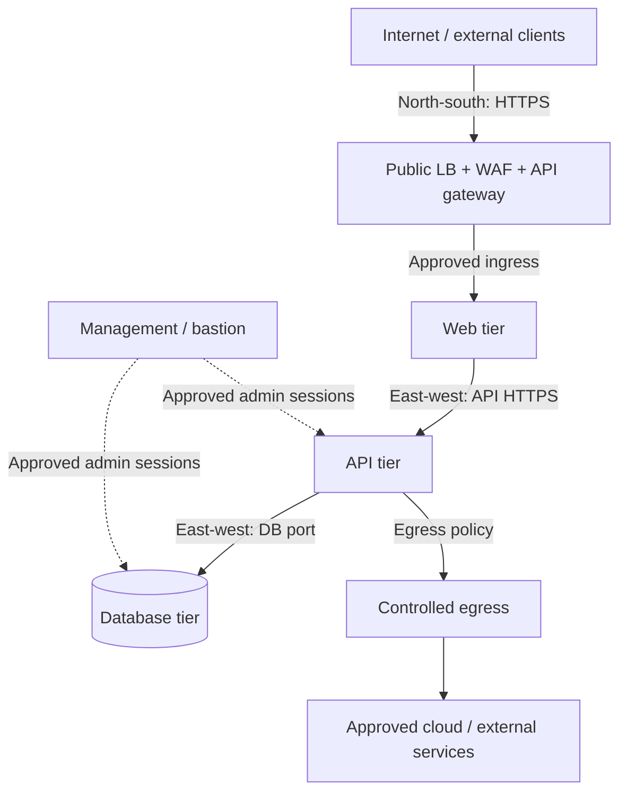
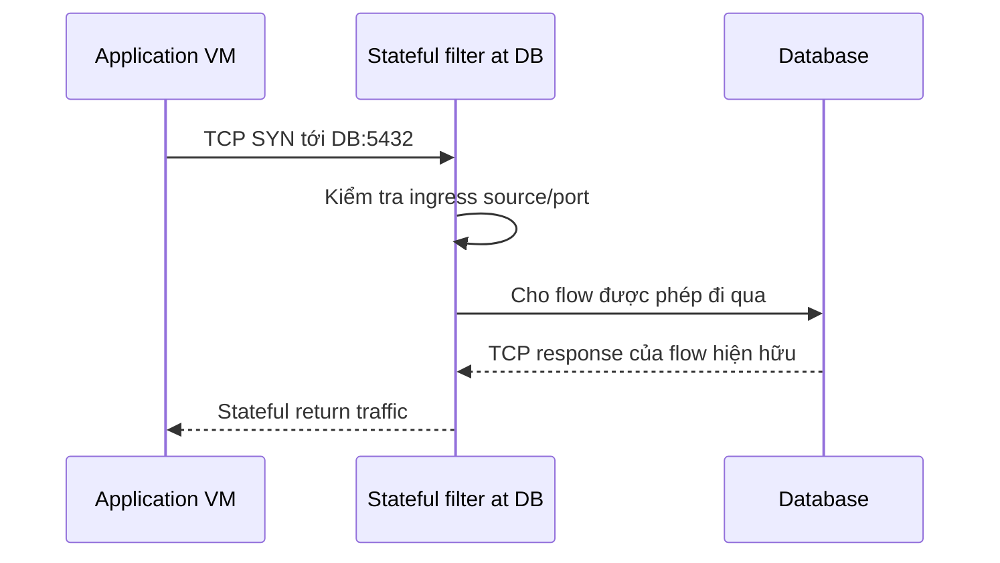
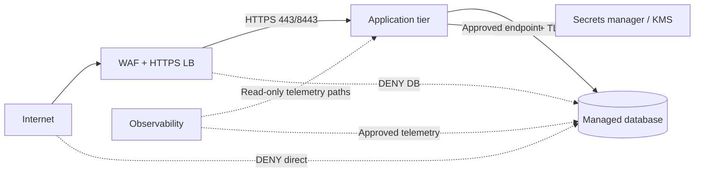
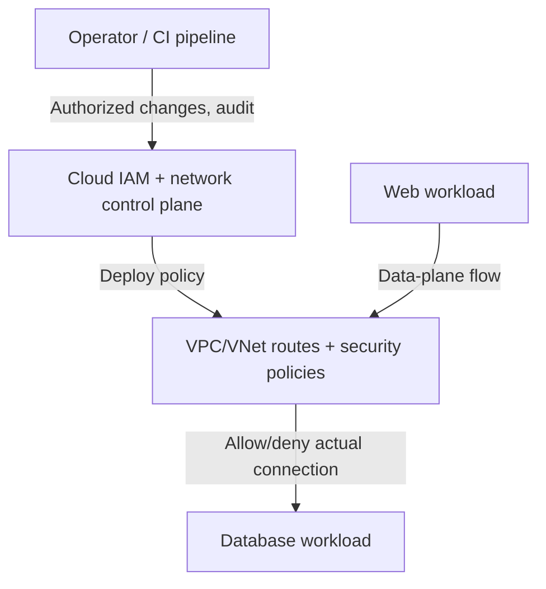
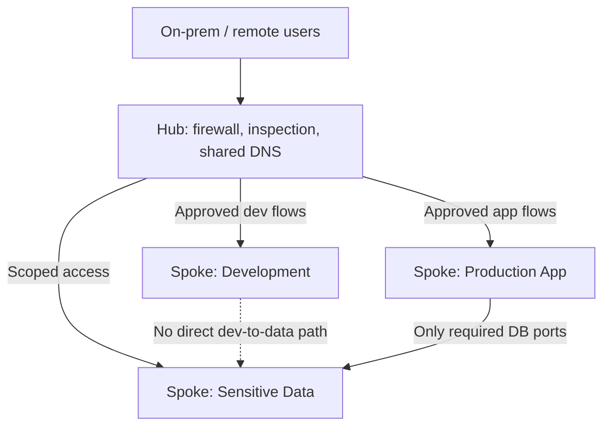

# Network segmentation trong tài khoản hoặc project cloud: thiết kế, thực thi và kiểm chứng

## 1. Network segmentation trong cloud là gì và vì sao cần?

**Network segmentation** là việc chia hệ thống thành các **vùng kết nối có chính sách khác nhau** và chỉ cho phép những luồng cần thiết đi qua ranh giới giữa các vùng. Trong cloud, phân đoạn không chỉ có nghĩa là tạo nhiều subnet: nó còn liên quan đến **virtual network, route table, firewall/security group, identity của workload, private endpoint, API gateway, Kubernetes NetworkPolicy, DNS, và quyền quản trị cloud**.

Giả sử một doanh nghiệp có **một AWS account**, **một Google Cloud project** hoặc **một Azure subscription** chứa:

- Frontend public nhận request từ người dùng.
- API xử lý nghiệp vụ và gọi database.
- Job xử lý dữ liệu nhạy cảm.
- Bastion hoặc giải pháp truy cập quản trị.
- Hệ thống giám sát, DNS, secrets manager và các dịch vụ platform dùng chung.

Nếu mọi workload đều có thể kết nối tới nhau trên tất cả port, một frontend bị xâm nhập có thể trở thành bàn đạp tiếp cận database, máy quản trị và service nội bộ. **Mục tiêu của segmentation** là giảm **blast radius**: dù một workload bị chiếm, kẻ tấn công vẫn gặp các điểm kiểm soát mới khi cố đi ngang (*lateral movement*).

### 1.1. Câu hỏi mà segmentation phải trả lời

1. **Ai/điểm nào** được phép khởi tạo kết nối?
2. **Đến tài nguyên nào**, trên giao thức/cổng nào?
3. **Trong ngữ cảnh nào**: môi trường dev/prod, tenant, vai trò, trạng thái thiết bị?
4. **Đường nào** được dùng: Internet, VPN, peering, private endpoint, service mesh?
5. **Ai có quyền sửa chính sách** và bằng cách nào?
6. Làm sao chứng minh một luồng **được phép hoặc bị từ chối trong thực tế**?

**Điểm quan trọng:** một security group chặn kết nối không thay thế **authentication/authorization ở ứng dụng**. Tương tự, IAM chỉ cho phép gọi cloud API không mặc nhiên chặn TCP connection giữa hai VM.

### 1.2. Kết quả học tập

Sau bài này, người học có thể:

- Phân biệt ranh giới **account/project/subscription, VPC/VNet, subnet, workload và ứng dụng**.
- Thiết kế segmentation **north-south** và **east-west** trong cùng phạm vi cloud quản trị.
- So sánh **AWS Security Groups/NACL**, **Google Cloud VPC firewall**, **Azure NSG/ASG** và vai trò của routing.
- Áp least privilege cho các luồng **web → API → database**, **management**, **PaaS private endpoints** và **Kubernetes**.
- Đọc telemetry, kiểm thử reachability, phát hiện **đường bypass và rule drift**.
- Lập kế hoạch migration từ mạng flat sang các vùng có chính sách thực thi và quan sát được.

## 2. Phạm vi: một tài khoản hoặc project không phải một ranh giới mạng tự động

Các nhà cung cấp sử dụng những đơn vị quản trị khác nhau:

| Nền tảng | Đơn vị quản trị thường được nhắc đến | Đơn vị mạng thường dùng | Điểm cần tránh hiểu sai |
|---|---|---|---|
| **AWS** | Account (trong Organization nếu có) | VPC, subnet, security group, route table | Một account có thể chứa **nhiều VPC**; các tài nguyên **cùng VPC** không tự cách ly theo account |
| **Google Cloud** | Project (trong organization/folder nếu có) | VPC network, subnet theo region, VPC firewall/policies | **Shared VPC** có thể đặt workload ở service project khác host project; project không đồng nghĩa biên traffic |
| **Azure** | Subscription/resource group (trong tenant/management group) | VNet, subnet, NSG, route table, firewall | Subscription/resource group là **ranh giới quản trị**; network reachability phụ thuộc VNet, peering, routes và policies |

Vì vậy, chủ đề **“trong tài khoản hoặc project”** tập trung vào **phân đoạn các workload cùng nằm trong một miền quản trị cloud**, nhưng vẫn phải xét khả năng kết nối ra ngoài qua **VPC peering, hub/transit, VPN/ExpressRoute/Interconnect, PrivateLink hoặc public endpoints**.

### 2.1. Những ranh giới không nên đánh đồng

- **Account/project/subscription:** quyền quản trị, billing, quota, policy và ownership.
- **VPC/VNet:** miền cấu hình mạng ảo và routing, không phải chứng thư xác thực user.
- **Subnet:** một phạm vi địa chỉ/attachment/route/ACL tùy cloud; **không tự tạo deny-all** giữa subnets.
- **Security group/NSG/firewall rule:** kiểm soát lưu lượng mạng theo nguồn, đích và điều kiện hỗ trợ.
- **Workload identity:** vai trò service account, IAM role hoặc danh tính mTLS của tiến trình.
- **Application authorization:** user/tenant/object/action nào được phép, kể cả khi kết nối mạng tồn tại.

Một hệ thống cần **nhiều lớp** vì mỗi lớp bảo vệ một rủi ro khác nhau.

## 3. North-south và east-west traffic

**North-south** thường là lưu lượng vào/ra ranh giới mạng được quan tâm: Internet → public load balancer, doanh nghiệp → cloud qua VPN, hoặc workload → SaaS. **East-west** là lưu lượng giữa workload và service nội bộ, kể cả cùng VPC/VNet hoặc qua các miền được kết nối.



Ở cloud, lưu lượng **cùng VPC** đôi khi không đi qua một appliance firewall trung tâm. Security policies có thể được thực thi **phân tán tại NIC/VM, subnet, workload hoặc dataplane**. Nếu chỉ đặt firewall cho Internet ingress, **east-west traffic** có thể vẫn quá rộng.

### 3.1. Hai yêu cầu cùng lúc

- **Chặn bớt đường không cần:** web không được tự kết nối database; dev không được vào Production; user workload không được vào management plane.
- **Không chặn nhầm luồng sống còn:** DNS, thời gian, identity/token services, telemetry, update repositories, secrets manager, health checks và backup theo phạm vi đã xác minh.

Một rule “deny all” chỉ hữu ích khi tổ chức biết **traffic nào cần thiết để dịch vụ hoạt động** và có đường kiểm chứng/rollback.

## 4. Segmentation khác microsegmentation như thế nào?

| Mức | Đơn vị chia | Ví dụ | Ưu điểm | Giới hạn |
|---|---|---|---|---|
| **Network-level** | VPC/VNet và interconnect | production VPC khác lab VPC | giảm đường kết nối rộng | vẫn có nhiều workload cùng network |
| **Subnet/zone-level** | web/app/data subnet, route table/ACL | database subnet không nhận từ Internet | topology dễ hiểu | subnet khác nhau chưa có nghĩa bị chặn east-west |
| **Workload-level** | security group, NSG, network tag, pod policy | chỉ API được mở TCP/5432 tới DB | phạm vi chính xác hơn theo vai trò | cần quản lý labels/tags/identity và drift |
| **Application-level** | mTLS peer identity, API authorization, DB roles | chỉ payments service có quyền gọi charge endpoint | bảo vệ sát nghiệp vụ | không thay network-level DoS/routing control |
| **Data-level** | tenant isolation, DB authorization, encryption | giới hạn dữ liệu từng tenant | giảm tác động sau khi có network access | yêu cầu implementation và audit nghiệp vụ |

**Microsegmentation** nhấn mạnh các chính sách **chi tiết ở workload/service**, thay vì chỉ chia subnet lớn. Nó không bắt buộc một vendor appliance riêng: cloud security groups, Kubernetes NetworkPolicy, service mesh authorization hoặc host firewall có thể cùng tạo ra kiến trúc nhiều lớp.

### 4.1. Đừng cố chia subnet đến mức không vận hành được

Quá nhiều subnets, VPCs hoặc rules không có owner có thể khiến routing, DNS, private endpoints, service discovery và troubleshooting phức tạp. Thiết kế nên bắt đầu từ **luồng nghiệp vụ và vùng tin cậy**, rồi chọn **điểm thực thi nhỏ nhất hợp lý**.

## 5. Thiết kế theo zones và luồng được phép

Một mô hình tham khảo trong cùng cloud account/project:

| Zone | Workload tiêu biểu | Ingress hợp lệ | Egress hợp lệ | Điều bị chặn |
|---|---|---|---|---|
| **Public edge** | public LB, WAF | Internet HTTPS theo sản phẩm | API/web tier trên port xác định | truy cập trực tiếp DB và admin plane |
| **Application** | web/API, background jobs | chỉ edge hoặc những services được cấp quyền | DB, cache, DNS, secrets và API khác theo nhu cầu | inbound public trực tiếp, quản trị tuỳ ý |
| **Data** | DB, cache, queue nhạy cảm | chỉ app/workload role cụ thể | replication/backup/telemetry được phê duyệt | Internet direct, web tier trực tiếp nếu không cần |
| **Management** | bastion/PAM/admin tools | identity-aware access/VPN/bastion đã xác thực | admin ports tới đúng targets | truy cập từ mọi client subnet |
| **Shared services** | DNS, registry, secrets, observability | consumers được phê duyệt | targets và upstreams cần thiết | trở thành cầu nối không kiểm soát giữa zones |
| **Build/CI** | runner, artifact service | control plane CI được phép | artifacts, deployment APIs đã phê duyệt | truy cập rộng vào data plane Production |
| **Quarantine** | máy bị nghi xâm nhập | chỉ SOC/forensic tools phù hợp | số ít endpoint điều tra | mọi đường lateral movement thường ngày |

**Đây là baseline minh họa**, không phải một bảng firewall có thể triển khai nguyên văn. Các luồng phục vụ **health check, load balancer source range, control-plane probes, monitoring và replication** cần được xác minh theo dịch vụ thực.

### 5.1. Ma trận kết nối theo chức năng, không chỉ IP

```text
SOURCE ROLE          DESTINATION ROLE      PROTOCOL     ACTION
public-edge          customer-api          TCP/8443     ALLOW
customer-api         order-database        TCP/5432     ALLOW
customer-api         internal-dns          UDP/TCP/53   ALLOW as required
approved-admin       admin-bastion         TCP/443      ALLOW
admin-bastion        approved-servers      admin port   ALLOW scoped
public-edge          order-database        ANY          DENY
developer-workload   prod-database         ANY          DENY
other-service        order-database        TCP/5432     DENY
```

“ANY DENY” ở đây là **yêu cầu chính sách cuối cùng**; có cloud firewall chỉ có allow rules và dùng **implicit deny**, hoặc dùng một lớp firewall khác để chặn. Không thể chép bảng này thành rule syntax giống nhau cho mọi cloud.

## 6. Reachability: cùng subnet khác với có quyền kết nối

Một kết nối chỉ thực hiện được khi **nhiều điều kiện** cùng thỏa:

```text
DNS/service discovery đúng
    AND route/path có thể đến đích
    AND source-side policy cho phép egress
    AND destination-side policy cho phép ingress
    AND intervening firewall/LB/policy cho phép
    AND workload/service đang listen
    AND TLS/mTLS/API authentication đúng
    AND application authorization đúng cho thao tác
```

Đây là mô hình **tổng quát**, không phải mọi cloud đều thực thi tất cả các bước tách biệt. Với stateful firewall, traffic phản hồi thuộc **một flow đã được chấp nhận** thường không cần rule mới theo chiều ngược lại; với stateless filter, phải xét **cả hai chiều**.

### 6.1. Vì sao subnet riêng chưa đủ?

- Trong AWS VPC có **local routing** cho các dải VPC phù hợp; hai subnets có route có thể liên lạc nếu các lớp filtering cho phép.
- Trong Google Cloud VPC, các subnets thuộc cùng network có khả năng routing theo các cơ chế của VPC; **firewall policies** mới quyết định những flows được cho phép.
- Trong Azure VNet, các subnets có thể kết nối qua network fabric; nếu không có NSG/UDR/firewall policy chặn tương ứng, việc tách địa chỉ **không tự bảo đảm isolation**.

**IP addressing và routing tạo topology; filtering và identity mới tạo ranh giới cấp quyền.**

### 6.2. Tài nguyên có public IP chưa chắc public service

Một VM có public IP vẫn có thể bị security group/NSG/firewall chặn inbound. Ngược lại, một VM **không có public IP** vẫn có thể bị truy cập qua VPN, peering, transit, compromised workload hoặc private proxy nếu chính sách quá rộng.

Không đánh giá rủi ro chỉ theo dấu hiệu “public IP: yes/no”.

## 7. AWS: VPC, subnet, Security Group và NACL

### 7.1. VPC và subnets

**Amazon VPC** là vùng mạng ảo trong một AWS Region. Subnets thuộc VPC và gắn với **một Availability Zone**; route tables xác định hướng chuyển lưu lượng. **Internet Gateway**, **NAT Gateway**, VPC endpoints và các kết nối VPC/Transit Gateway/peering ảnh hưởng đường đi.

Trong **một account**, có thể dùng một VPC với nhiều zones hoặc tách thành nhiều VPC theo môi trường/độ nhạy cảm. Quyết định phải xét **blast radius, quản lý IAM, quota, routing, DNS và shared services**.

### 7.2. Security Groups (SG)

SG là firewall **stateful**, thường gắn ở network interface/resource tương ứng:

- Chứa các **allow rules**, không dùng explicit deny trong chính SG.
- Có thể đặt **source/destination là security group khác** trong các tình huống AWS hỗ trợ, thay vì cố định IP của instance.
- Inbound không được allow sẽ bị từ chối; outbound cũng cần policy phù hợp.
- Traffic phản hồi của một flow được SG chấp nhận có đặc tính **stateful tracking**; không cần mirror mọi reply rule như NACL.
- Một resource có thể có nhiều SG; quyền cho phép được kết hợp theo **union of allow rules**. Một SG hẹp không “phủ định” một SG khác rộng.

Ví dụ ý nghĩa:

```text
SG: api-service
  inbound:
    from sg:edge-tier tcp/8443
  outbound:
    to sg:database tcp/5432
    to approved internal services as required

SG: database
  inbound:
    from sg:api-service tcp/5432
  outbound:
    only documented required outbound flows
```

Đây là **policy minh họa**, không phải AWS CLI syntax. Ở thực tế phải kiểm tra **SG references được hỗ trợ theo quan hệ VPC/peering/transit**, và không cho rằng mọi endpoint/managed service hỗ trợ tham chiếu SG giống nhau.

### 7.3. Network ACL (NACL)

**NACL** là lớp kiểm soát **stateless ở subnet boundary** theo cơ chế AWS:

- Có **allow và deny rules** theo rule number/priority.
- Có inbound và outbound rules; vì **stateless**, cần xét traffic trả lời và **ephemeral ports** phù hợp.
- NACL không thay SG ở workload-level khi cần quyền theo service identity.
- Default NACL và custom NACL có hành vi mặc định **khác nhau**; không copy policy từ subnet này sang subnet khác mà thiếu review.

**Không đặt rule NACL “chặn tất cả outbound” rồi kỳ vọng HTTPS response vẫn chạy**. Statefulness và ephemeral port ranges cần được tính theo chính sách hệ điều hành và luồng thực tế.

### 7.4. AWS Network Firewall, Gateway Load Balancer và kiểm soát nâng cao

Khi cần **kiểm tra tập trung, policy L3–L7, FQDN/domain-aware hoặc threat detection** theo khả năng sản phẩm, có thể dùng **AWS Network Firewall** hoặc kiến trúc middlebox qua **Gateway Load Balancer**. Điểm khó là **đường traffic thực sự đi qua enforcement point**; cùng VPC/subnet có đường local hoặc khác path có thể không bị inspect như dự định.

Để buộc inspection, phải thiết kế **routes, symmetry của hai chiều, HA, scaling và failure mode** phù hợp. Một firewall appliance tồn tại trong VPC **không có nghĩa mọi east-west flow đều qua nó**.

## 8. Google Cloud: VPC, firewall rules, tags và service accounts

### 8.1. VPC và project

Google Cloud VPC network có phạm vi global trong project theo mô hình của dịch vụ; subnets là regional resources. Một project có thể có nhiều VPCs. **Shared VPC** cho phép project host chia sẻ network với các service projects theo quyền được cấp, vì vậy **project ownership không tự bằng network isolation**.

### 8.2. VPC firewall rules và policies

Google Cloud sử dụng **VPC firewall rules** và các loại **network firewall policies** theo các phạm vi hỗ trợ. Chính sách có thể xét:

- **Ingress/egress**.
- **Source/destination ranges** và protocols/ports.
- **Target VMs** theo những selectors được hỗ trợ như network tags hoặc service accounts, tùy rule/policy type.
- **Allow/deny**, priority và phạm vi organization/folder/network theo loại chính sách.

Trong các rule/chiến lược phù hợp, **service account selector** giúp ràng buộc với danh tính workload được quản lý, nhưng **không phải mọi loại GCP firewall policy đều hỗ trợ cùng selector**. Cần phân biệt **network tags**, **secure tags** theo hệ thống quản lý và **IAM service accounts**; tên gọi “tag” không đồng nghĩa mọi trường đều được xác thực/ủy quyền như nhau.

### 8.3. Default network và custom VPC

Không suy rằng mọi GCP VPC mặc định cô lập east-west. **Default network** có thể có các rule mẫu cho phép nội bộ/SSH/RDP/ICMP; **custom VPC** có baseline và org policy khác. Cần đọc **firewall rules đang có, effective policies và kết quả connectivity tests**, không chỉ tên “default” hoặc “custom”.

### 8.4. Ví dụ policy theo service identity

```text
TARGET: instances chạy application workload
  ingress allow:
    from approved ingress targets, tcp/8443
  egress allow:
    to database subnet/service endpoint, tcp/5432

TARGET: database workloads
  ingress allow:
    from approved application identities/network source, tcp/5432
  default:
    deny other unapproved paths by effective policies
```

Ở GCP cần đặc biệt xem **thứ tự đánh giá policies/priority, implied rules và những chính sách cấp tổ chức**, không tự vẽ deny-all rồi tin rằng nó luôn thắng mọi policy khác. Khi dùng service account selector, bảo vệ quyền **attach/change service accounts trên VM**; nếu attacker có thể gán danh tính privileged cho VM, segmentation có thể bị vượt qua.

## 9. Azure: VNet, NSG, ASG, UDR và Azure Firewall

### 9.1. Virtual Network và subnets

**Azure Virtual Network (VNet)** tổ chức không gian địa chỉ và đường kết nối cloud. Một VNet có thể có nhiều subnets; **VNet peering**, VPN/ExpressRoute, hub/spoke và private endpoints tạo các đường đến vùng khác.

**Subscription hoặc resource group** giúp quản trị, nhưng cần kiểm tra **effective routes, NSG rules, Azure Firewall policies và các kết nối liên VNet** để đánh giá reachability.

### 9.2. Network Security Groups (NSG)

NSG áp **stateful packet filtering** theo policies tại subnet và/hoặc network interface theo các mô hình Azure hỗ trợ:

- Rules có **priority**, direction, source/destination, protocol/port và allow/deny.
- Cần xét **default security rules** cùng custom rules; một rule rộng cho VirtualNetwork service tag có thể mở đường nội bộ không mong muốn tùy topology.
- Nếu NSG gắn cả subnet và NIC, cần hiểu **effective combined policy**, không chỉ một NSG riêng lẻ.
- NSG là cơ chế network-level, không chứng minh user/service đã xác thực ở API.

### 9.3. Application Security Groups (ASG)

**ASG** nhóm các network interfaces theo vai trò ứng dụng trong các điều kiện hỗ trợ, giúp NSG rules dễ bám theo nhóm thay vì hard-code nhiều IP. **ASG không phải IAM role** và không tự định nghĩa authorization nghiệp vụ.

### 9.4. User-Defined Routes và Azure Firewall

**User-Defined Routes (UDR)** có thể điều khiển hướng một số traffic qua **network virtual appliance/Azure Firewall** hoặc những next hop được hỗ trợ. Cần kiểm chứng:

- Effective routes tại NIC/subnet liên quan.
- Trường hợp private endpoint, peering hoặc platform network có đường đi/semantics riêng.
- **Symmetric paths** nếu inspection/state tracking yêu cầu.
- Azure Firewall policy/RBAC, SNAT/DNAT, DNS proxy, logging và HA.

Đặt Azure Firewall trong hub **không tự khiến mọi VNet/subnet đi qua nó** nếu route policy chưa đúng.

### 9.5. So sánh nhanh

| Mục tiêu | AWS | Google Cloud | Azure |
|---|---|---|---|
| Lọc ở workload/VM | SG | VPC firewall/target rules/policies | NSG/ASG |
| Lọc ở subnet theo mô hình nền tảng | NACL | firewall policies áp cho VM/traffic của VPC, không tương đương NACL | NSG gắn subnet |
| Explicit deny | NACL hoặc firewall layer (không phải SG) | deny rules theo policy hỗ trợ | NSG deny rules / Azure Firewall |
| Stateful hay stateless? | SG stateful; NACL stateless | VPC firewall có connection tracking theo cơ chế dịch vụ | NSG stateful |
| Hub/inspection | Transit Gateway + Network Firewall/GWLB theo thiết kế | Network Connectivity Center/hub và firewall appliances/policies phù hợp | hub/spoke + UDR + Azure Firewall |
| Private service access | VPC endpoints/PrivateLink | Private Service Connect hoặc private access options theo dịch vụ | Private Endpoint/Private Link |

Đây là **bảng định hướng học thuật**. Không nên giả định các tính năng **1:1 về enforcement, selectors, flow state, availability zone hoặc pricing** giữa ba cloud. Chọn theo tính năng được tài khoản/vùng/dịch vụ hỗ trợ và kiểm chứng trên deployment thực.

## 10. Stateful, stateless và return traffic

Một rule “allow inbound API port” sẽ hoạt động khác nhau giữa security group stateful và NACL stateless. Hiểu flow state giúp tránh cấu hình quá rộng hoặc chặn nhầm.



Đối với **stateful rules**, return traffic của flow đã được cho phép có thể được chấp nhận nhờ connection tracking. Đối với **stateless NACL**, cần rule cho **traffic hai chiều**, kể cả các **ephemeral source/destination ports** theo đường đi thực.

### 10.1. “Stateful” không đồng nghĩa đã xác thực người dùng

Firewall có thể ghi nhớ trạng thái flow, nhưng **không kiểm tra user đã đăng nhập API, tenant ID hoặc quyền SELECT trên DB**. Một flow TCP/5432 được phép vẫn phải đi qua database authentication, TLS certificate validation và authorization.

### 10.2. Bẫy rule quá rộng

Không thay một rule egress cụ thể bằng `0.0.0.0/0:ALL` chỉ để “đảm bảo response chạy” nếu lớp lọc đã stateful. Cần hiểu **flow tracking và return-path rules** trước khi mở cổng.

## 11. Subnet, route tables, NAT và đường bypass

**Routing** quyết định packet có thể tới đâu; **filtering** quyết định một luồng tới được có được xử lý không. Khi đánh giá segmentation, cả hai phải được kiểm tra.

### 11.1. Public và private subnet không phải nhãn bảo mật tuyệt đối

- “Public subnet” thường có route tới Internet Gateway hoặc kiến trúc tương ứng; một VM trong đó chưa chắc trực tiếp public inbound nếu không có public IP/policy.
- “Private subnet” có thể có đường outbound qua NAT, private endpoints hoặc VPN; nó cũng có thể nhận **east-west connections** từ workload cùng network.
- NAT giúp address translation/connectivity, **không tự là firewall ứng dụng** hoặc chứng minh đích đã được cấp quyền.
- Direct peering/transit connections có thể mở đường bỏ qua appliance inspection nếu policy/routes không ép qua điểm kiểm soát.

### 11.2. Kiểm soát đường đi thực

Với mỗi luồng nhạy cảm:

1. Xác định **route tại source subnet/NIC**.
2. Xác định next hop, network appliance, peering, endpoints và route ở đích nếu liên quan.
3. Xác định firewall **trên từng hop** và kết nối phản hồi.
4. Kiểm tra DNS có chỉ sang public endpoint khác với dự định không.
5. Kiểm tra IPv6 path có chính sách tương đương IPv4 không.
6. Test reachability từ **đúng workload identity và mạng**.

**Không chỉ xem sơ đồ cloud console:** policy phải được kiểm tra bằng **effective configuration và thực nghiệm có cấp quyền**.

## 12. Identity-aware segmentation và Zero Trust trong cloud

Một mô hình dựa IP/subnet có thể hiệu quả để giảm reachability, nhưng cloud workload biến động liên tục: VM autoscaling, container reschedule, serverless functions, managed services và private endpoints có thể thay IP theo lifecycle.

Kết hợp thêm:

- **AWS IAM role/instance profile, service-linked roles** theo phạm vi cloud APIs; SG references hoặc policies tương ứng cho network reachability.
- **Google Cloud service accounts**, firewall target selectors khi được hỗ trợ và IAM/OIDC cho access tới managed APIs.
- **Azure managed identities** cho cloud resources, NSG/ASG/Firewall cho network flow; application IAM/Entra ID cho auth.
- **mTLS workload identity** (ví dụ SPIFFE ID) tại service mesh/gateway nếu phù hợp.
- **Application RBAC/ABAC** để kiểm soát người dùng, service, tenant và hành động.

### 12.1. Identity ở các tầng khác nhau

| Danh tính | Chứng minh điều gì? | Điều không tự chứng minh |
|---|---|---|
| IP hoặc subnet | vị trí mạng theo thời gian và scope | user/service principal |
| SG/NSG/tag/ASG membership | resource thuộc nhóm network policy | danh tính người dùng tại thời điểm request |
| Cloud IAM role/service account | quyền gọi cloud APIs khi credential hợp lệ | TCP flow tới DB tự bị chặn |
| mTLS certificate/workload ID | peer giữ credential phù hợp danh tính được xác minh | quyền business action bất kỳ |
| User SSO/MFA | user đã được xác thực theo assurance policy | ứng dụng tự cho phép mọi tài nguyên |
| Application authorization | principal có quyền trên đối tượng/hành động | network DDoS hoặc packet filtering |

**Zero Trust** trong cloud là không cấp đặc quyền chỉ vì “nằm trong VPC”. Network segmentation vẫn quan trọng để **giảm blast radius**, còn identity/application controls giải quyết **người nào và service nào được làm gì**.

### 12.2. Quyền thay đổi identity cũng là ranh giới

Nếu một developer có thể thay **instance role, service account, tag, SG membership, Kubernetes labels hoặc NSG/route** mà không qua approval, họ có thể nới lỏng segmentation dù network rules ban đầu khá chặt.

Vì thế phải kiểm soát **control plane RBAC/IAM, IaC pipeline, approvals, change logs và drift detection**, không chỉ data plane.

## 13. Thiết kế ba tầng web → app → data có thể kiểm chứng

Một mẫu tổ chức trong một VPC/VNet:



**Quy tắc khuyến nghị:**

1. Database **không có public inbound path** theo yêu cầu thiết kế.
2. Database ingress **chỉ từ application workload group** trên cổng đúng, không từ cả CIDR VPC.
3. Web/API inbound chỉ từ LB/gateway tin cậy, và có TLS identity validation.
4. Application egress chỉ tới DB, secrets, identity, DNS/telemetry và các đích được document.
5. Admin access qua **bastion/PAM/identity-aware access** được kiểm soát, không SSH/RDP toàn subnet.
6. DB authentication/roles chỉ cấp quyền cho workload và thao tác cần thiết.
7. Monitoring ghi **accepted/rejected flows và application audit**, không chỉ ALB access logs.

### 13.1. Ví dụ policy dưới dạng YAML khái niệm

```yaml
# Mô hình mô tả policy, KHÔNG phải cấu hình thực thi của cloud provider.
environment: production
default_cross_zone: deny
zones:
  edge: [public-load-balancer, waf]
  application: [customer-api, order-worker]
  data: [orders-db]
  management: [admin-bastion]
allowed_flows:
  - source: public-load-balancer
    destination: customer-api
    protocol: tcp
    port: 8443
    tls_required: true
  - source: customer-api
    destination: orders-db
    protocol: tcp
    port: 5432
    tls_required: true
  - source: admin-bastion
    destination: approved-management-targets
    protocol: tcp
    port: policy-defined
    requires_approval: true
exceptions:
  owner_required: true
  expires_at_required: true
  audit_required: true
```

Mô hình này chỉ hữu ích khi có **bộ chuyển policy thành rule thực tế** và xác minh rằng **routes + SG/NSG/firewall + identity + managed-service settings** cùng bảo đảm kết quả mong đợi.

## 14. Phân đoạn dev, staging và production trong một account/project

Trong thực tế, một tài khoản/project duy nhất có thể chứa nhiều môi trường vì yêu cầu ngân sách hoặc lịch sử vận hành. Có thể giảm rủi ro bằng cách:

- Dùng **VPC/VNet tách biệt** hoặc ít nhất các groups/subnets/rules có ranh giới rõ.
- Không dùng một **default security group/NSG** rộng cho mọi môi trường.
- Tách **IAM roles/service accounts, secrets, artifact registries và credentials**.
- Chặn đường **dev → production database** ở cả network và application.
- Quản lý peering, shared services, DNS và CI/CD deployment credentials riêng.
- Gắn owner/expiry cho exceptions và dùng policy-as-code chặn rule drift.

### 14.1. Giới hạn quan trọng

Nếu dev và Production chung **một account/project**, người có **control-plane admin quyền quá rộng** vẫn có thể sửa route, security groups hoặc attach role để vượt segmentation. Đối với hệ thống yêu cầu isolation cao, cần cân nhắc **tách AWS accounts, GCP projects hoặc Azure subscriptions/management scopes** với governance khác nhau, không kỳ vọng microsegmentation trong cùng scope giải quyết mọi rủi ro.

**Network segmentation trong một account là biện pháp hữu ích nhưng không thay thế governance/account isolation khi threat model đòi hỏi.**

## 15. Multi-tenant workloads: bảo vệ tenant ở nhiều cấp

Một SaaS có thể lưu nhiều tenant trong cùng VPC hoặc Kubernetes cluster. Network segmentation có thể chia:

- Shared ingress/frontends.
- Per-tenant workloads hoặc per-tier workloads.
- Sensitive data stores, cache, queues.
- Management plane và telemetry.

Nhưng **tenant isolation không dừng ở IP/network**. Nếu hai tenant dùng cùng API service, firewall không phân biệt được user thuộc tenant A hay B trong từng SQL query.

### 15.1. Các mô hình

| Mô hình | Network segmentation | Application/data isolation | Chi phí vận hành |
|---|---|---|---|
| Shared service | chung API tier, tách data permissions | bắt buộc tenant-aware AuthZ | thấp hơn, cần kiểm thử object access nghiêm |
| Per-tenant namespace | Kubernetes policy phân vùng pods | namespace không tự là security boundary tuyệt đối; vẫn cần RBAC/AuthZ | trung bình |
| Per-tenant VPC/VNet | ranh giới network rõ hơn | còn cần identity và DB permissions | cao hơn |
| Per-tenant account/project/subscription | governance/control plane có thể tách mạnh hơn | vẫn cần app/security controls đúng | cao nhất tùy kiến trúc |

**Không có một mô hình tối ưu cho mọi SaaS.** Quyết định dựa trên sensitivity, compliance, số tenant, automation, operational complexity và khả năng cô lập sự cố.

### 15.2. Chống cross-tenant access

Mỗi request cần xác minh **principal → tenant → object/action**; mỗi workload cần role và secret phù hợp. Network rules có thể giới hạn **service-to-service** nhưng không tự giải quyết BOLA/IDOR hoặc SQL query thiếu tenant filter.

## 16. Shared services và nguy cơ trở thành cầu nối giữa zones

DNS resolvers, bastion, patch repositories, logging collectors, CI/CD agents, secrets managers, container registries và monitoring thường dùng chung nhiều zones. Đây là **điểm cần thiết** nhưng cũng có thể trở thành **đường lateral movement**.

### 16.1. Ví dụ

```text
dev-workload ───> shared-service ───> prod-database
      direct path bị chặn       indirect path tồn tại
```

Nếu shared-service có credentials hoặc network privileges quá rộng, chặn direct dev→prod **chưa đủ**. Cần:

- Tách **service accounts/roles** cho từng môi trường.
- Chỉ cho shared service gọi những đích cần thiết.
- Dùng proxy/gateway có **application authorization và auditing**, không đơn thuần TCP tunnel.
- Giới hạn quyền operator của shared service; không cho trở thành universal SSH gateway.
- Kiểm tra log có tương quan **source principal, service identity và destination**.

### 16.2. Bastion không phải đường quản trị vô hạn

Bastion/PAM giúp tập trung identity-aware access, nhưng phải giới hạn **ai được đăng nhập, đích nào, port nào, session duration, MFA, recording/audit và emergency access**. Không coi “đi qua bastion” là quyền mở tất cả database ports.

## 17. Managed services và private endpoints: PaaS không nằm ngoài segmentation

Cloud-managed databases, object storage, message queues và secrets managers có thể cung cấp **public endpoints, private endpoints hoặc cơ chế truy cập đặc thù**. Phương thức khác nhau theo dịch vụ và provider.

| Nền tảng | Một số cơ chế liên quan | Điều cần xác minh |
|---|---|---|
| AWS | Interface VPC endpoints/PrivateLink, gateway endpoints cho dịch vụ hỗ trợ, endpoint policies | route/SG của endpoint, endpoint policy và resource/IAM policy; loại endpoint phụ thuộc service |
| Google Cloud | Private Service Connect, private service access/private IP và service-specific access controls | producer/consumer connection, DNS, firewall/VPC-SC/IAM theo dịch vụ |
| Azure | Private Endpoint/Private Link, service endpoints trong những mô hình phù hợp | private DNS, NSG/route policies, service firewall, public network access setting |

**Private connectivity không phải đồng nghĩa dịch vụ đã tắt public access.** Cần đọc **service-specific public exposure**, authorized networks, identity policies và định tuyến thực.

### 17.1. DNS là một phần của segmentation

Client có thể dùng cùng hostname nhưng nhận **private IP khi có private DNS zone/endpoint**. Nếu DNS sai:

- Application có thể cố đi **public endpoint** thay vì private endpoint.
- Firewall chỉ chặn private path còn public egress vẫn mở.
- TLS hostname/SNI mismatch nếu dùng IP literal hoặc CNAME tạm sai.
- Một cluster có nhiều DNS resolvers có thể thấy các kết quả khác nhau.

Kiểm thử **tên dịch vụ, DNS trả về, route và TLS certificate validation** từ chính workload consumer.

### 17.2. Data exfiltration qua dịch vụ được phép

Một workload chỉ được egress tới object storage provider không có nghĩa mọi bucket/container trong provider đều đáng tin. Nếu cần chống exfiltration, phải kết hợp **endpoint/resource policies, IAM, organization controls, destination restrictions, data classification và alert** theo tính năng provider.

“Đích là cloud storage API” là tín hiệu network; **đúng bucket của tổ chức và đúng principal** là điều kiện ở lớp identity/resource.

## 18. Service perimeter, identity và đường truy cập API quản trị

Không nên nhầm **cloud control-plane APIs** với network traffic giữa VM:

- IAM cho phép một principal **tạo security group, thay firewall, attach public IP hoặc thay route** theo quyền.
- Network firewall áp dụng cho **flows của workload**, không luôn kiểm soát mọi đường gọi management API.
- Network service perimeter (ví dụ cơ chế giới hạn truy cập một số managed APIs) có phạm vi riêng, **không đồng nghĩa chặn packet giữa mọi VM**.

### 18.1. Data plane và control plane



Một attacker có quyền chỉnh policy có thể **nới rule trước khi kết nối**. Vì vậy phải bảo vệ:

1. MFA/SSO/phishing-resistant authentication cho admin.
2. Least-privilege IAM và separation of duties.
3. Approvals và policy-as-code cho thay đổi network.
4. Organization-level guardrails khi áp dụng.
5. Audit logs cho **mọi thay đổi route, firewall, identity assignment và endpoint public access**.
6. Alert và tự động kiểm tra **drift** so với baseline.

## 19. Kubernetes: NetworkPolicy bên trong cluster cloud

Trong một Kubernetes cluster chạy trên AWS/GCP/Azure, dù node VMs được bảo vệ bằng security groups/firewall, các **Pods** có thể giao tiếp với nhau theo đường networking của cluster. Nếu **không có NetworkPolicy phù hợp** và không có lớp kiểm soát khác, khả năng kết nối pod-to-pod có thể rộng hơn người thiết kế tưởng.

**Kubernetes NetworkPolicy** định nghĩa những luồng **ingress/egress** được phép cho **Pods được chọn**. Nó không tự thay thế VPC/VNet firewall, Kubernetes RBAC, service-account authorization hay mTLS.

### 19.1. Các điều kiện phải đúng

- Cluster dùng **CNI/network dataplane có triển khai NetworkPolicy**; Kubernetes API có thể chấp nhận object nhưng network plugin không enforce như mong đợi nếu thiếu hỗ trợ.
- Policies chọn pods dựa trên **namespace, labels và rules**; phải kiểm soát **ai có quyền thay labels, pods và NetworkPolicy objects**.
- **NetworkPolicies cho phép mang tính cộng dồn (additive)**. Một policy hạn chế riêng **không phủ định** traffic đã được một policy khác cho phép đối với cùng pod và direction.
- Pod được isolation cho ingress/egress theo **policyTypes**; muốn default-deny phải thiết kế isolation tương ứng.
- Những đường đặc biệt như **hostNetwork, host-level services, node local DNS, service mesh/sidecar hoặc platform-specific networking** cần kiểm chứng riêng theo CNI và cloud.

### 19.2. Ví dụ: default deny trong namespace Production

```yaml
# Dùng trong lab/staging trước khi áp dụng Production.
apiVersion: networking.k8s.io/v1
kind: NetworkPolicy
metadata:
  name: default-deny-all
  namespace: prod
spec:
  podSelector: {}
  policyTypes:
    - Ingress
    - Egress
```

Policy này **chọn mọi Pod trong namespace `prod`** và khiến chúng không có ingress/egress được phép **theo bộ NetworkPolicies đang tồn tại** cho các directions tương ứng. Nếu policy khác đã allow traffic, **allow đó vẫn được cộng dồn**.

**Không áp thẳng lên production chưa có inventory**: việc deny egress có thể làm hỏng DNS, kết nối DB, gọi IdP/secrets, telemetry và readiness.

### 19.3. Ví dụ: chỉ cho API nhận từ gateway và gọi DB/DNS

```yaml
# Giả định gateway và DB Pods đều ở namespace prod,
# tên labels đúng theo đối tượng triển khai thực.
apiVersion: networking.k8s.io/v1
kind: NetworkPolicy
metadata:
  name: payments-api-policy
  namespace: prod
spec:
  podSelector:
    matchLabels:
      app: payments-api
  policyTypes:
    - Ingress
    - Egress
  ingress:
    - from:
        - podSelector:
            matchLabels:
              app: ingress-gateway
      ports:
        - protocol: TCP
          port: 8443
  egress:
    - to:
        - podSelector:
            matchLabels:
              app: payments-db
      ports:
        - protocol: TCP
          port: 5432
    - to:
        - namespaceSelector:
            matchLabels:
              kubernetes.io/metadata.name: kube-system
          podSelector:
            matchLabels:
              k8s-app: kube-dns
      ports:
        - protocol: UDP
          port: 53
        - protocol: TCP
          port: 53
```

Ý nghĩa:

1. Những Pod `app=payments-api` được phép nhận TCP/8443 từ Pods `app=ingress-gateway` **cùng namespace**.
2. API được phép egress tới Pods `app=payments-db` cùng namespace trên TCP/5432.
3. API được phép gửi DNS tới Pods trong namespace `kube-system` có label `k8s-app=kube-dns`, nếu labels thực tế đúng.
4. Hai selectors **namespaceSelector + podSelector trong cùng một peer** được hiểu theo quan hệ **AND**. Nếu tách thành hai entries trong `to`, ý nghĩa có thể thành **OR** và mở rộng đối tượng quá mức.
5. Các Pods gateway/DB/DNS còn cần **policy ingress/egress của riêng chúng**, nếu đã bị policy khác isolate.

**Cảnh báo:** không phải cluster nào có CoreDNS labels chính xác `k8s-app=kube-dns`; không phải DNS egress nào đi trực tiếp tới CoreDNS Pods; Service IP translation, node-local DNS và private DNS resolver có thể cần rules khác. Điều chỉnh theo **topology thật và test từ Pod**.

### 19.4. Nguy cơ labels tự khai

Nếu một principal có quyền tạo Pod mang label `app=ingress-gateway` trong `prod`, policy chỉ dựa label có thể cho phép Pod đó kết nối API. Do đó cần **Kubernetes RBAC, admission policies, namespace ownership, workload identity và GitOps review**.

**NetworkPolicy dựa labels là network control**, không phải bảo đảm một Pod thực sự là ứng dụng đã được cấp chữ ký hoặc được người quản trị phê duyệt.

### 19.5. Các điểm không được tự suy

- Standard NetworkPolicy thường không phải giải pháp **FQDN egress allowlist** toàn diện; khả năng policy theo FQDN tùy CNI/extension.
- IP-based rules với `ipBlock` có thể hành xử khác kỳ vọng khi đích qua **Service/NAT**, tùy dataplane và điểm áp policy.
- NetworkPolicy không kiểm soát **cloud IAM permissions**, Kubernetes API permissions hoặc user authorization của ứng dụng.
- Một namespace riêng **không phải ranh giới bảo mật hoàn chỉnh** nếu các workloads chia sẻ node, host-level privileges hoặc policies quá rộng.
- Chặn Pod-to-Pod cần xét cả **DNS, logging, admission webhooks, service mesh gateways** và luồng operator.

## 20. Container, serverless và autoscaling: IP thay đổi nhưng role phải ổn định

Trong cloud, số lượng instances/Pods có thể tăng giảm liên tục, serverless functions có thể chạy trong môi trường managed và service endpoints có thể được tái tạo.

### 20.1. Dùng nhóm workload thay vì danh sách IP tĩnh khi phù hợp

- EC2: SG theo workload role/instance attachment.
- GCE: firewall policies nhắm tới tags/service accounts theo khả năng.
- Azure VM/NIC: NSG/ASG hoặc nhóm network policy tương đương.
- Kubernetes: NetworkPolicy dùng namespace/pod labels; kết hợp admission/RBAC.
- Service mesh: mTLS service identity và authorization theo workload/service.

Tuy nhiên, **membership của nhóm cũng cần quản trị**. Chỉ đổi label/tag/role có thể thay đổi reachability nếu người dùng có quyền sửa rộng.

### 20.2. Serverless và managed compute

Với cloud functions, managed containers hoặc serverless platforms, cần phân biệt:

- **Ingress control:** service được gọi public, từ load balancer hoặc bằng private/identity-aware endpoint?
- **Outbound integration:** service có kết nối tới VPC/VNet qua connector/direct VPC routing hay theo cơ chế dịch vụ?
- **Egress source:** IP nguồn nào mà DB/firewall thực sự thấy, có dùng NAT hay không?
- **Identity:** workload service account/managed identity/IAM role nào gọi các dịch vụ cloud?
- **Network isolation limits:** platform có hỗ trợ cùng firewall semantics như VM không?

Không được mặc định rằng một serverless function **nằm trong project** thì tự đi qua VPC private network, hoặc bật VPC integration là mọi traffic Internet buộc qua kiểm soát nội bộ.

### 20.3. Health checks và managed load balancers

Một số LB/managed services gửi health checks từ **dải địa chỉ hoặc control-plane nguồn riêng**. Khi thu hẹp ingress, phải tra đúng yêu cầu provider/sản phẩm/vùng cho health probes; không mở tất cả nguồn chỉ vì một health check ban đầu thất bại.

## 21. IPv4, IPv6 và cloud metadata endpoints

### 21.1. Dual-stack segmentation

Một rule chặn `0.0.0.0/0` ở IPv4 **không tự bao phủ `::/0` ở IPv6**. Trong nhiều cloud, IPv6 có đường routing/egress riêng; NAT IPv4 và IPv6 không tương đương về mặc định.

Checklist:

1. Inventory IPv4/IPv6 addresses, subnet prefixes, DNS A/AAAA.
2. Kiểm tra **inbound và outbound rules** cho cả hai address families.
3. Xem effective routes và Internet/egress gateway support.
4. Xác minh load balancer/managed endpoint có dual-stack.
5. Kiểm thử traffic từ IPv6-only/dual-stack clients nếu thuộc phạm vi.
6. Theo dõi flow logs cho cả IPv4/IPv6.

**Không kết luận workload private chỉ vì IPv4 ingress bị khóa**, trong khi một đường IPv6 direct path còn mở.

### 21.2. Metadata service và SSRF

Nhiều cloud có **instance metadata service** cho VM/container hoặc các endpoint platform metadata, đôi khi dùng link-local addresses và giao thức/hardening riêng. Khi ứng dụng có SSRF, truy cập metadata service có thể là một đường dẫn tới **thông tin hoặc credential của workload**, tùy cấu hình.

Giảm rủi ro:

- Chỉ cấp **IAM role/managed identity tối thiểu** cho workload.
- Bật/hardening cơ chế metadata access được provider hỗ trợ (ví dụ các yêu cầu bảo vệ token/hop phù hợp).
- Dùng egress policies/host-level controls/sidecar phù hợp **nếu platform hỗ trợ hiệu lực trên metadata path**.
- Chặn SSRF ở application: validate URLs, redirects, DNS resolution và destination IP/network.
- Không tin một VPC egress firewall chung sẽ mặc nhiên lọc **mọi request đến metadata endpoint**; cần kiểm tra đường nội bộ đặc thù.

### 21.3. Link-local và private address không đồng nghĩa an toàn

Địa chỉ **link-local** được dùng trong một số dịch vụ quản lý/dns/metadata. IP private có thể nằm ở VPC khác qua peering/transit. Chính sách phải mô tả **service identity/destination cần thiết**, không cho allow toàn bộ RFC1918 hoặc link-local chỉ vì không phải public Internet.

## 22. Shared VPC/VNet, hub-spoke và các kết nối ngoài project

Ngay cả khi bài toán là **phân đoạn trong một tài khoản/project**, kiến trúc enterprise thường có các kết nối:

- **AWS Transit Gateway, VPC peering, PrivateLink** hoặc VPN.
- **Google Cloud Shared VPC, VPC Peering, Network Connectivity Center, Cloud VPN/Interconnect** theo phạm vi hỗ trợ.
- **Azure VNet peering, Virtual WAN, VPN Gateway, ExpressRoute, Private Link**.

Các đường này có thể tạo route để workload trong network nhận traffic từ một mạng khác. Phải xem **security group/firewall/NSG và IAM/trust relationship** tương ứng.

### 22.1. Hub-spoke



**Không tự mặc định** mọi traffic dev→data bắt buộc qua hub chỉ vì sơ đồ hub-spoke. Nếu tồn tại peering/direct link, shared endpoint hoặc route/propagation khác, luồng có thể **bypass inspection**.

### 22.2. Routing transit không thay authorization

Một hub firewall có thể cho phép TCP/443 từ app spoke tới secrets service nhưng vẫn cần:

- Xác minh TLS server certificate/mTLS nếu cần.
- IAM/role/resource policy cho đúng secrets.
- Audit truy cập ở endpoint/service.
- Không cho user từ dev lấy secret Production chỉ vì cùng nguồn NAT.

### 22.3. Vùng quản trị chia sẻ

Nếu các dự án khác nhau chia sẻ network, cần xác định **ai sở hữu firewall rule**, ai có thể tạo subnet/service endpoint, ai có quyền thay labels và ai được xem logs. Một hợp đồng vận hành thiếu owner có thể khiến **một thay đổi ở project này mở đường cho project khác**.

## 23. Egress segmentation: không chỉ bảo vệ inbound

Một thiết kế chỉ chặn inbound Database nhưng cho mọi workload **egress `0.0.0.0/0:ALL` / `::/0:ALL`** có thể không phát hiện được đường exfiltration hoặc kết nối đến command-and-control khi host bị chiếm.

### 23.1. Phân loại egress

| Loại egress | Ví dụ | Kiểm soát có thể áp |
|---|---|---|
| **Internet web/SaaS** | update packages, external APIs | egress proxy/SWG, FQDN/IP policies, TLS/domain validation, rate limits |
| **Managed cloud APIs** | object storage, KMS, secrets | private endpoints khi phù hợp, IAM/resource/endpoint policies |
| **Internal service** | API → DB/cache/queue | workload SG/firewall, mTLS, per-service AuthZ |
| **DNS** | workload → approved resolvers | hạn chế resolver, logging, DNS policy |
| **Telemetry** | workload → logs/metrics collector | dedicated sink, limited roles, avoid reverse management path |
| **Administration** | bastion → instance | PAM/MFA, just-in-time policy, session audit |

### 23.2. FQDN allowlist không phải đích bất biến

Domain có thể trỏ tới nhiều IP, dùng CDN, CNAME/redirect hoặc thay đổi theo thời gian. Một firewall chỉ thấy IP không phải luôn áp được **policy đúng theo FQDN hoặc URL path**; giải pháp cần phù hợp protocol, DNS integration, TLS/SNI/ECH, proxy và địa chỉ thực.

**Không dùng DNS suffix hay SNI do client tự khai** làm bằng chứng rằng một request đã được phép vào mọi tài nguyên của dịch vụ. Khi cần dữ liệu nhạy cảm, kết hợp destination constraints với **application-level identity/resource policies**.

### 23.3. Kế hoạch egress tối thiểu

1. Đo traffic hợp lệ trong cửa sổ đại diện.
2. Nhóm theo service owners và business dependencies.
3. Chuyển các managed APIs qua private endpoints khi hỗ trợ và có lý do.
4. Chỉ cấp egress tới approved destinations, DNS/resolver và monitoring.
5. Test trường hợp package update/CA validation/identity refresh khi endpoint không có Internet.
6. Có change process cho provider endpoints thay đổi IP hoặc cần allow mới.

**Giới hạn egress không được chỉ theo dõi “Internet blocked”**; phải xác minh không có đường đi khác qua NAT, VPN, peering, second interface, proxy hoặc credential tới cloud APIs.

## 24. Infrastructure as Code và policy-as-code

Segmentation trong cloud thường có hàng trăm hoặc hàng nghìn rules. Nếu cấu hình bằng console thủ công rồi không có review, dễ xuất hiện **shadow rules, orphaned security groups, quá nhiều exceptions và policy drift**.

### 24.1. Mô hình quản trị thay đổi

- Mỗi rule có **owner, business justification, source/destination, protocol/port, environment và expiry** nếu tạm thời.
- Dùng **Terraform/CloudFormation/Bicep/Deployment Manager hoặc công cụ tương đương** do tổ chức quản lý.
- Xem xét quyền deploy và **plan/diff** trước thay đổi.
- Dùng **policy-as-code** để phát hiện SG mở admin ports từ Internet, database public, egress quá rộng, rule thiếu owner.
- Phân quyền **approval** cho Production và ghi audit log.
- Có kế hoạch **rollback** đã được kiểm chứng, không đơn thuần revert text.

### 24.2. Ví dụ Terraform AWS: chỉ API SG được vào DB SG

```hcl
# Trích đoạn minh họa, giả định hai SG đã được tạo
# trong topology có hỗ trợ reference theo policy AWS.
# Chưa phải một Terraform module hoàn chỉnh.

resource "aws_vpc_security_group_ingress_rule" "db_from_api" {
  security_group_id            = aws_security_group.db.id
  referenced_security_group_id = aws_security_group.api.id
  ip_protocol                  = "tcp"
  from_port                    = 5432
  to_port                      = 5432
  description                  = "DB access from approved API workload SG"
}

resource "aws_vpc_security_group_egress_rule" "api_to_db" {
  security_group_id            = aws_security_group.api.id
  referenced_security_group_id = aws_security_group.db.id
  ip_protocol                  = "tcp"
  from_port                    = 5432
  to_port                      = 5432
  description                  = "API egress to DB only on required port"
}
```

**Giới hạn của ví dụ:**

- Đoạn này **chỉ thêm hai allow rules**, không bảo đảm các rules khác, SG membership, routes hay default egress đã hẹp. Cần kiểm tra **toàn bộ effective SG rules** và SGs gắn vào resources.
- SG references có điều kiện phạm vi và provider support; phải xác minh trong account/VPC/region cụ thể.
- Chưa có định nghĩa SG resources, provider, subnet, module inputs, policy checks hoặc monitoring.
- Không chạy `terraform apply` trên Production chỉ vì snippet hợp lệ về ý tưởng; thay đổi cần **plan/review và owner approval**.
- TLS và database authentication vẫn bắt buộc sau khi TCP port được cho phép.

### 24.3. Policy drift

Một admin có thể tạo “temporary allow all” trong cloud console để chữa lỗi, rồi quên thu hồi. Pipeline IaC không nhất thiết phát hiện nếu không có **drift detection** hoặc cơ chế quản trị chặt.

Kiểm tra định kỳ:

- Mọi firewall rules ngoài IaC.
- Quyền thay rule tại console/API.
- Public IP, load balancer và endpoint mới không qua review.
- SG/NSG membership bị thay.
- Routes và peering mới tạo.
- K8s NetworkPolicy bị xóa hoặc một policy khác mở rộng allow.
- Exceptions quá hạn vẫn active.

## 25. Kiểm chứng reachability bằng đồ thị và mô hình hóa đường đi

Một sơ đồ đẹp chưa đủ. Có thể biểu diễn topology như **đồ thị có hướng**:

```text
Nodes: edge, app, db, bastion, telemetry, cloud-endpoint
Edges: những luồng có thể thực hiện sau routing + firewall
Edge metadata: protocol, destination port, policy owner, identity

Expected:
  edge -> app       allow tcp/8443
  app  -> db        allow tcp/5432
  app  -> telemetry allow approved-port
  bastion -> db     allow approved-admin workflow

Forbidden:
  edge -> db        deny any
  dev  -> db        deny any
  Internet -> db    deny any
```

### 25.1. Reachability trực tiếp và đi qua trung gian

Nếu `dev → shared-proxy` và `shared-proxy → prod-db` đều được phép, không thể chỉ kết luận từ biểu đồ rằng **dev bị chặn mọi cách tới DB**. Cần hiểu shared-proxy có cho forwarding/tunneling gì, có **AuthZ** phù hợp hay không.

**Có route trực tiếp** khác với **có đường thực hiện hành động qua một service trung gian**. Threat modeling phải xem cả:

- TCP/UDP reachability.
- HTTP/gRPC proxying, CONNECT, tunnels.
- Cloud API credentials và quyền gọi managed services.
- Kubernetes API permissions/port-forward nếu thuộc threat model.
- SSRF/open proxy và service account impersonation.

### 25.2. Reachability analyzer không thay live tests

Cloud providers có công cụ phân tích network path/reachability theo mô hình của họ. Kết quả hữu ích để tìm routes/rules, nhưng có thể không bao phủ **application state, service identity, process listen, managed service behavior hoặc runtime TLS**. Dùng **static/effective-policy analysis + live authorized tests + logs** để tăng độ tin cậy.

## 26. Đọc cấu hình cloud theo cách không thay đổi tài nguyên

Các lệnh sau là **read-only inventory** trên tài khoản/project/subscription bạn được cấp quyền. Không xuất private credentials, token, secrets hoặc network inventory của tổ chức ra kênh công khai.

### 26.1. AWS CLI

```bash
# Chọn region và profile đã được cấp phép theo chính sách nội bộ.
aws ec2 describe-vpcs --region us-east-1
aws ec2 describe-subnets --region us-east-1
aws ec2 describe-route-tables --region us-east-1
aws ec2 describe-security-groups --region us-east-1
aws ec2 describe-network-acls --region us-east-1
aws ec2 describe-vpc-endpoints --region us-east-1
```

Các lệnh không thay đổi resources. Output có thể rất dài; lọc bằng `--query` và `--filters` theo API/CLI phiên bản sử dụng. **Một danh sách SG không cho biết SG nào đang gắn vào NIC nếu chưa đối chiếu attachment** và effective topology.

### 26.2. Google Cloud CLI

```bash
# Thay PROJECT_ID bằng project được cấp quyền; không dùng project lạ.
gcloud compute networks list --project PROJECT_ID
gcloud compute networks subnets list --project PROJECT_ID
gcloud compute firewall-rules list --project PROJECT_ID
gcloud compute instances list --project PROJECT_ID
```

Với GCP, phải xem **hierarchical/global/regional/network firewall policies** nếu tổ chức có dùng, không chỉ VPC firewall rules trong một project. Những policies/attachments nằm ở organization/folder scope có thể yêu cầu quyền xem và lệnh phù hợp riêng.

### 26.3. Azure CLI

```bash
# Chỉ trong resource group và subscription đã được phê duyệt.
az network vnet list --resource-group example-rg --output table
az network nsg list --resource-group example-rg --output table
az network route-table list --resource-group example-rg --output table
az network private-endpoint list --resource-group example-rg --output table
```

Đối chiếu thêm **effective security rules/routes** cho NIC/subnet mà workload thật sử dụng, các rule default và policies ở tầng firewall/Virtual Network Manager nếu kiến trúc có.

### 26.4. Kubernetes read-only

```bash
# Chỉ trên cluster/context được cấp quyền.
kubectl get networkpolicy --all-namespaces
kubectl describe networkpolicy -n prod
kubectl get pods -n prod --show-labels
kubectl get namespaces --show-labels
```

**Không có NetworkPolicy objects không tự chứng minh mạng an toàn hay không an toàn**: còn có VPC firewalls, CNI-specific policies và service mesh. Tương tự, thấy NetworkPolicy trong API **không chứng minh dataplane enforce** cho một flow cụ thể.

### 26.5. Đọc-only không đồng nghĩa dữ liệu vô hại

Network topology, security groups, DNS/internal ranges và Kubernetes labels có thể nhạy cảm. Sử dụng kết quả trong hệ thống **SIEM/CMDB/ticket được phân quyền**, mask project IDs, IPs, resource names hoặc keys khi chia sẻ bên ngoài.

## 27. Telemetry: flow logs, firewall logs và application traces

**Flow logs** cung cấp metadata về lưu lượng ở những điểm mà provider hỗ trợ: endpoints, ports, protocol, direction, bytes/packets và accept/reject hoặc thông tin tương ứng theo loại log.

| Nguồn | Có thể giúp trả lời | Giới hạn |
|---|---|---|
| **AWS VPC Flow Logs** | các flows ở VPC/subnet/ENI theo cấu hình ghi | không chứa HTTP body; aggregation và phạm vi capture cần hiểu |
| **Google Cloud VPC Flow Logs** | metadata flows của VM/network theo sampling/aggregation và cấu hình | không đảm bảo nhìn thấy mọi packet; sampling và quyền log có ảnh hưởng |
| **Google Cloud Firewall Rules Logging** | sự kiện khớp rule được bật log theo sản phẩm | cần bật policy/rule logging phù hợp, không luôn có mọi deny |
| **Azure Virtual Network flow logs/firewall diagnostics** | kết nối và policy evidence theo tính năng và giai đoạn dịch vụ | cần kiểm tra availability, lifecycle của loại log, vị trí thu thập |
| **Cloud LB/WAF logs** | request HTTP, host/path, status, policy action | chỉ những request qua LB/WAF đó, không bao phủ direct bypass |
| **Kubernetes CNI/mesh telemetry** | Pod/namespace/service identities và flows/policy verdicts khi hỗ trợ | phụ thuộc plugin, labels và sampling |
| **Application/DB audit** | principal/action/tenant/object và kết quả | không thay network reachability logs |
| **Cloud audit/control-plane logs** | ai tạo/sửa route, firewall, SG, endpoint, IAM | không phải packet logs |

### 27.1. Correlation cần nhiều hơn một IP

Một sự kiện có thể mang:

```json
{
  "timestamp_utc": "2026-11-28T08:30:00Z",
  "cloud": "illustrative",
  "account_or_project": "example-scope",
  "source_workload": "customer-api",
  "source_private_ip": "10.20.1.14",
  "destination_workload": "orders-db",
  "destination_private_ip": "10.30.2.9",
  "protocol": "tcp",
  "destination_port": 5432,
  "network_policy_id": "prod-app-to-db",
  "policy_verdict": "allow",
  "flow_id": "flow-demo-001",
  "application_principal": "workload-payments-api",
  "source": "illustrative-correlation-event"
}
```

Đây là **schema gộp minh họa**, không phải output của một cloud vendor. Thông tin principal ở lớp ứng dụng **không tự xuất hiện** trong mọi flow log. Phải tương quan qua **timestamp, VM/NIC/Pod identity, session/request ID và application audit** khi có.

### 27.2. Không có log không phải bằng chứng bị chặn

Một flow có thể không xuất hiện vì:

- Log chưa bật tại đúng ENI/subnet/firewall.
- Sampling/aggregation loại bỏ hoặc gộp sự kiện.
- Flow đi qua một network path khác.
- Retention hoặc ingestion pipeline lỗi.
- Traffic bị chặn **trước điểm sensor**.

Để chứng minh bị deny, cần **negative test có quyền**, policy verdict/effective rule và kiểm tra đích **không nhận connection** theo thời điểm. Không chỉ chụp một dashboard không có sự kiện.

## 28. Test matrix: kiểm tra cả đường được phép và đường bị chặn

| Test case | Kỳ vọng | Bằng chứng |
|---|---|---|
| Internet → public LB HTTPS | allow theo WAF/TLS policy | LB/WAF access logs + TLS verification |
| Internet → private DB port | deny | firewall/route verdict + no DB session |
| Edge → API trên port được cấp | allow | SG/NSG/firewall + app health |
| Edge → DB | deny | source-bound test + DB flow logs |
| API → DB trên 5432 | allow với TLS/auth hợp lệ | network + DB authentication logs |
| API → DB trên cổng không dùng | deny | policy verdict, không có listener/flow |
| Dev workload → prod DB | deny | effective policy + controlled connectivity check |
| App không thuộc nhóm được cấp → DB | deny | SG/target/NSG rule result |
| Bastion hợp lệ → đúng admin target | allow sau MFA/approval | PAM/session + network logs |
| Bastion → target ngoài phạm vi | deny | admin access policy + firewall deny |
| Workload → approved private endpoint | allow | DNS private answer + service access audit |
| Workload → public endpoint tương ứng khi policy cấm | deny | egress policy + routing check |
| Same subnet, khác workload role | chỉ luồng được phép | workload-level policy tests |
| IPv6 source → sensitive endpoint | cùng mức hạn chế như IPv4 | IPv6 route + firewall logs |
| K8s API Pod → DB Pod | allow trên port cụ thể | CNI policy + network/application logs |
| K8s Pod không được chọn → DB Pod | deny theo policies | Pod-label mapping + policy result |
| K8s API Pod → DNS | allow nếu policy/label đúng | DNS resolution test |
| Serverless → private service | đúng đường VPC/connector | endpoint and network traces |
| Workload không có quyền thay SG/NSG | control-plane deny | cloud audit/IAM decision |
| Failover region/gateway | không mở rule quá rộng | DR config comparison + live checks |
| VPC peering/transit path mới | chỉ những routes/rules được duyệt | reachability analysis |
| Direct-origin path bỏ qua WAF | deny hoặc xử lý theo policy rõ | ACL/mTLS + negative test |
| SG/NSG/tag membership thay đổi trái phép | phát hiện/chặn theo governance | audit event + policy-as-code |
| DNS A/AAAA thay đổi | vẫn tuân allow/deny | DNS + route + TLS verification |

**Test phải chạy ở tài sản và danh tính được phép**. “Kết nối thất bại” chưa đủ giải thích segmentation đúng: có thể do service chưa listen, DNS sai, TLS mismatch hoặc network bị lỗi ngoài ý muốn.

### 28.1. Ghi rõ expected/actual/result

```yaml
# Ví dụ test evidence, không phải cấu hình provider.
test_id: CLOUD-SEG-014-DB-ISOLATION
environment: authorized-staging
source_workload: web-tier
destination_workload: database-tier
protocol: tcp
port: 5432
expected:
  reachable: false
  business_action_executed: false
  documented_reason: explicit-policy-or-implicit-deny
evidence:
  - effective_network_policy_snapshot
  - connectivity_test_result
  - flow_or_firewall_verdict_if_available
  - db_connection_audit_if_available
result: pending_validation
review_owner: cloud-security
```

### 28.2. Đừng nhầm lỗi DNS với deny rule

Một bài test không resolve được hostname **không xác nhận network segmentation**. Tìm đúng endpoint identity, xác minh DNS rồi test network path theo cách được cấp quyền; cần giữ hostname validation/TLS. Không chuyển sang bỏ certificate verification để “test cho nhanh”.

## 29. Migration từ flat network sang least-privilege segmentation

### Giai đoạn A — Inventory và dependency discovery

1. Liệt kê workload, owner, environment, sensitivity, VPC/VNet, subnets, routes, IAM identities và exposed endpoints.
2. Thu thập **flow logs, application traces, DB audit, load balancer logs và DNS queries** trong thời gian đại diện.
3. Phân loại lưu lượng theo chức năng: client ingress, app-to-app, DB, authentication, telemetry, backups, maintenance.
4. Kiểm tra đặc biệt **cross-account/shared VPC, peering/transit, dual stack và serverless**.
5. Vẽ danh sách **đường trực tiếp và đường qua trung gian**.

### Giai đoạn B — Thiết kế policy

Xây **connectivity matrix** với source role, destination role, protocol/port, identity, business purpose, owner và exception expiry. Tách:

- Rule bắt buộc.
- Rule tạm chấp nhận có owner và deadline.
- Rule không rõ nguồn cần điều tra.
- Rule không còn sử dụng dự kiến loại bỏ.

Không tự động suy “không thấy flow trong 24 giờ = không cần rule”: có những luồng backup, DR, cuối tháng hoặc sự cố chỉ xảy ra theo chu kỳ.

### Giai đoạn C — Shadow/observe và canary

Nếu platform hỗ trợ **monitor-only/observe modes** hoặc công cụ phân tích, đánh giá tác động trước khi enforce. Thử trên **staging hoặc một nhóm workloads canary**; kiểm tra DNS, IdP, secrets, telemetry và health probes.

### Giai đoạn D — Enforce theo chiều từ ít rủi ro tới nhạy cảm

Một hướng thực tế:

1. Khóa inbound public không cần thiết.
2. Thu hẹp quyền database từ whole-VPC CIDR thành application role.
3. Tách management access qua identity-aware entrypoint.
4. Thu hẹp cross-environment flows.
5. Bổ sung egress restrictions theo dependencies đã đo.
6. Áp policies container/service mesh và managed endpoints.

Đây chỉ là **gợi ý thứ tự**, phải thay đổi theo threat model và khả năng rollback. Một hệ thống đang có nguy cơ exfiltration cấp bách có thể cần xử lý egress trước.

### Giai đoạn E — Vận hành và review

- Kiểm tra **effective policies và live connectivity** sau mỗi canary wave.
- Theo dõi denied valid traffic và error budgets.
- Có rollback **chỉ vào rule liên quan**, không đưa mọi SG trở lại allow-all.
- Review exceptions, tags, expired rules và policy drift định kỳ.
- Đưa segmentation tests vào CI/CD/continuous validation nếu platform cho phép.

## 30. STRIDE threat modeling cho segmentation trong account/project

| STRIDE | Kịch bản | Điều kiện | Kiểm soát |
|---|---|---|---|
| **Spoofing** | một workload dùng role/tag không được phép để vào zone nhạy cảm | quyền sửa tags/attach identity quá rộng | IAM/admission guardrails, workload attestation, audit |
| **Spoofing** | attacker dùng nguồn IP được NAT/proxy tin để qua allowlist | IP bị xem như user identity | mTLS/user AuthN, IAM/resource AuthZ, session correlation |
| **Tampering** | SG/NSG/firewall bị mở rộng thủ công | quyền change control yếu | IaC review, separation of duties, drift detection |
| **Tampering** | route mới khiến east-west bypass central firewall | path analysis không bao phủ topology | effective route checks, route guardrails, tests |
| **Repudiation** | không gán được DB connection cho workload đã tạo | flow logs thiếu identity/time | ENI/Pod/session correlation và DB audit |
| **Information Disclosure** | app bị chiếm truy cập DB của service khác | whole-VPC ingress hoặc shared credentials | SG/NSG per-role, DB IAM, mTLS, object AuthZ |
| **Information Disclosure** | workload dùng allowed storage endpoint để exfiltrate | không có resource destination policy | endpoint policies, IAM, org restrictions, DLP |
| **Denial of Service** | default deny vô ý chặn DNS/health/backup | thiếu dependency inventory | staging, canary, test matrix, rollback |
| **Denial of Service** | centralized firewall quá tải | ép mọi traffic qua điểm đơn không HA | HA/capacity/SLO và theo dõi flow |
| **Elevation of Privilege** | dev sửa security group/route Production | control plane RBAC quá rộng | project/account boundaries, IAM least privilege, approvals |
| **Elevation of Privilege** | K8s Pod giả label gateway | labels không được bảo vệ | RBAC/admission, workload identity, mesh AuthZ |

### 30.1. Tài sản và biên tin cậy

**Tài sản:** dữ liệu Production, secrets, network policies, IAM roles, private endpoints, workload credentials, DNS, managed service accounts, audit logs và service availability.

**Biên tin cậy:** Internet → edge; edge → application; app → data; workload → cloud APIs; namespace → namespace; dev → prod; shared services → sensitive zones; operator/CI → control plane.

**Giả định quan trọng:** attacker có thể đã chiếm một workload có network connectivity hợp lệ; segmentation phải **giảm những kết nối khác mà workload đó còn dùng được**, không chỉ chặn Internet ingress.

## 31. Case study: frontend bị chiếm trong một project cloud

### 31.1. Bối cảnh giả định

Một nhóm phát triển có **một cloud project** chứa frontend VMs, backend API, database, monitoring và staging jobs. Hệ thống ban đầu có:

- Chỉ một VPC, vài subnets phân chia bằng CIDR.
- Một số firewall rules mở **TCP/5432 từ toàn VPC** vào database.
- Backend application có quyền đọc secrets cho cả staging và production.
- CI runner có đường egress và quyền mạng rộng.
- Logs ghi source IP nhưng thiếu workload identity và route policy version.

### 31.2. Sự cố

Frontend bị xâm nhập qua một lỗi ứng dụng. Không có lý do nghiệp vụ để frontend gọi thẳng DB, nhưng rule **allow from entire VPC CIDR** cho phép kết nối tới cổng database. Nếu attacker có hoặc lấy được credentials, nguy cơ tác động dữ liệu tăng đáng kể.

**Không suy rằng chỉ có TCP reachability là đã đọc được DB**. Database vẫn có authentication và quyền riêng; tuy nhiên reachability rộng tạo cơ hội thử kết nối, khai thác lỗ hổng dịch vụ hoặc sử dụng credentials bị lộ.

### 31.3. Phân tích nguyên nhân

1. **Segmentation theo subnet/IP quá rộng** thay vì theo application role.
2. **Cả môi trường staging và Production dùng trust không gian quản trị chung** không có giới hạn phù hợp.
3. **Service account permissions quá quyền** ở lớp cloud APIs/secrets.
4. **Lack of network flow correlation** khiến điều tra phải tra IP theo thời gian.
5. Thiếu test “frontend → database phải deny” khi deploy.

### 31.4. Khắc phục

- Chuyển DB ingress về **chỉ nhóm API/workloads được duyệt** trên đúng cổng.
- Chặn frontend và CI runner trực tiếp gọi DB; review routes, peering/private endpoints.
- Tách roles/credentials, secrets và IAM assignments theo môi trường.
- Áp application AuthN/AuthZ và database roles tối thiểu.
- Bổ sung log **workload ID ↔ source IP/NIC ↔ firewall decision ↔ DB authentication**.
- Chạy negative tests từ frontend/staging và control-plane change tests.
- Thiết lập alert cho SG/firewall mở rộng, DB public access và credential unusual use.

### 31.5. Bài học

**Một cloud project thống nhất quyền quản trị không có nghĩa mọi workload phải chia sẻ cùng quyền mạng.** Segmentation đúng giúp giảm tác động khi một điểm bị xâm nhập; identity và data authorization ngăn kẻ có network access tự động chiếm quyền nghiệp vụ.

## 32. Playbook ứng phó khi nghi segmentation bị vượt qua

### A — Triage

1. Xác định asset, principal, source/destination workload, VPC/VNet, subnet, route, SG/NSG/firewall policy và thời điểm.
2. Xác nhận connection thực sự thành công hay chỉ có attempt/scan.
3. Đối chiếu **flow logs, gateway, DNS, cloud audit, EDR, Kubernetes events và application/DB audit**.
4. Tìm thay đổi gần đây ở **security group membership, tags, routes, peering, private endpoints, IAM policies, CI pipeline**.
5. Kiểm tra có IPv6, serverless, cross-project shared network hoặc direct public path không.
6. Phân biệt **policy misconfiguration** và **credential/workload compromise**; cả hai có thể cùng tồn tại.

### B — Containment

- Cô lập workload đã xác nhận bị xâm nhập bằng security controls phù hợp, **không tùy tiện phá hỏng dữ liệu điều tra**.
- Thu hẹp rule quá rộng hoặc route bypass theo change/incident authority.
- Thu hồi/giới hạn cloud credentials, Kubernetes RBAC và service identities bị nghi lợi dụng.
- Chặn egress exfiltration paths khi có căn cứ và cân nhắc tác động production.
- Bảo toàn audit logs, effective policy snapshots và timeline.
- Nếu shared service có thể trở thành cầu nối, điều tra **downstream impact**, không chỉ máy đầu tiên.

### C — Recovery

1. Vá lỗ hổng ban đầu và thay credential bị lộ theo chính sách.
2. Cập nhật IaC và policy-as-code để tránh mở rule lại sau lần deploy tiếp theo.
3. Chạy **reachability/negative tests** cho các đường đã sửa, kể cả DR/IPv6.
4. Kiểm tra application/business authorization, database audit và dữ liệu bị tác động.
5. Bổ sung monitoring/owner/expiry cho exceptions.
6. Ghi timeline, root cause, residual risk và regression tests.

**Đừng chỉ sửa một firewall rule mà bỏ qua lý do attacker có thể sửa policy hoặc lấy cloud IAM credentials.** Khi control plane đã bị xâm nhập, thay đổi data plane có thể bị đảo ngược nếu không bảo vệ quyền quản trị.

## 33. Chỉ số hiệu quả: đo coverage thay vì đếm rules

| KPI | Ý nghĩa | Bẫy cần tránh |
|---|---|---|
| **Critical-flow allow coverage** | tỷ lệ luồng bắt buộc được xác minh có hoạt động | chỉ xem IaC mà không test runtime |
| **Forbidden-path deny coverage** | tỷ lệ đường cấm đã được test và chứng minh từ chối | DNS fail bị ghi là network deny |
| **Sensitive-workload exposure** | số DB/services nhận từ sources quá rộng/public | bỏ qua peering/IPv6/private API |
| **Unowned/expired exceptions** | rules không owner hoặc quá hạn | “temporary” không có expiry |
| **Flat-network allow rules** | số rules whole-VPC/any-any tới tài nguyên nhạy cảm | CIDR có thể là internal nhưng vẫn rộng |
| **IaC coverage / drift** | tỷ lệ rule do pipeline quản lý và lệch chuẩn | policy engine không xem console changes |
| **Workload identity coverage** | services có identity/role/mTLS phù hợp | network tags bị coi là user identity |
| **Private endpoint adoption** | số managed services dùng private access được kiểm chứng | endpoint private nhưng public access vẫn mở |
| **Time-to-containment** | thời gian giảm reachability/thu hồi credential khi có incident | thay đổi chỉ trong dashboard, chưa enforce |
| **Segmentation-related incidents** | sự cố outage/bypass do network change | không phân biệt lỗi availability và security |
| **Flow log visibility** | tỷ lệ assets/enforcement points có telemetry cần thiết | không phân biệt sampling/coverage |
| **Admin-plane change alerting** | các thay đổi high-risk có owner và review | quá nhiều cảnh báo, không phân loại severity |

### 33.1. Đếm policy rules không phải thước đo an toàn

1.000 rules có thể **phức tạp và mâu thuẫn** hơn 50 rules đúng mục đích. Ưu tiên **độ chính xác của allowed flows, độ bao phủ denied paths, khả năng giải thích policy và quản trị quyền đổi cấu hình**.

## 34. Những hiểu lầm phổ biến

1. **“Cùng account/project nghĩa là cùng network.”** Có thể có nhiều VPC/VNet và scope quản trị không đồng nhất topology.
2. **“Tách subnet là đã chặn east-west.”** Subnet/route không tự tạo deny-all giữa workloads.
3. **“Không có public IP là không thể bị truy cập.”** Có VPN, peering, transit, proxy và compromised internal workload.
4. **“NAT Gateway là firewall chống mọi egress.”** NAT là address translation/connectivity; filtering/identity phải thiết kế riêng.
5. **“SG AWS hỗ trợ deny rules như NACL.”** SG là allow-based, stateful; NACL là stateless allow/deny.
6. **“SG hẹp chặn được SG rộng gắn cùng NIC.”** Nhiều SG cho phép được kết hợp, rule rộng vẫn có hiệu lực.
7. **“NACL stateless không cần return ports.”** Phải tính traffic hai chiều và ephemeral ports.
8. **“Một Azure NSG chỉ cần kiểm custom rules.”** Còn default rules, attachments và effective policy.
9. **“GCP default network luôn mặc định deny mọi nội bộ.”** Phải kiểm tra VPC firewall rules và hierarchy thực.
10. **“IP private là user/service identity.”** IP có thể NAT, tái cấp và không mang AuthN.
11. **“Đã bật mTLS là không cần network segmentation.”** mTLS xác thực peer; network controls giảm reachability/blast radius.
12. **“Firewall allow DB port nghĩa là có quyền đọc dữ liệu.”** DB authentication/authorization riêng.
13. **“Đặt firewall trong hub buộc mọi flow qua đó.”** Cần effective routes và inspection path.
14. **“Private Endpoint tự động tắt public endpoint.”** Phải kiểm tra setting của dịch vụ và IAM.
15. **“Cho storage provider API nghĩa là an toàn dữ liệu.”** Cần scope resource/bucket/account policies.
16. **“Kubernetes namespace tự cô lập network.”** NetworkPolicy/CNI và các policy khác mới quyết định.
17. **“Một NetworkPolicy default deny thắng mọi allow rule khác.”** Kubernetes NetworkPolicies là additive, không có deny priority chuẩn trong API này.
18. **“NetworkPolicy manifest được chấp nhận nghĩa là đã enforce.”** Phải có CNI support và live tests.
19. **“Pod labels là bằng chứng workload đáng tin tuyệt đối.”** Cần admission, RBAC và identity controls.
20. **“Serverless trong project thì tự nằm trong VPC.”** Ingress/egress integration tùy dịch vụ/cấu hình.
21. **“Chặn IPv4 là đủ.”** Đường IPv6 có thể khác.
22. **“Chặn mọi outbound là cách giảm rủi ro không cần kiểm thử.”** Có thể chặn DNS, identity, secrets, backup và health.
23. **“Flow logs không thấy traffic thì chắc bị deny.”** Có sampling, scope và điểm capture khác nhau.
24. **“Đường trực tiếp dev→DB bị chặn nghĩa là không thể qua shared service.”** Proxy/tunnel/API permission có thể tạo indirect path.
25. **“IaC có rule đúng là production đã đúng.”** Console drift, attachments và routes có thể khác.
26. **“Control-plane admin không cần tách khỏi data-plane segmentation.”** Admin có thể đổi rules và identity.
27. **“Số rule càng nhiều, mạng càng an toàn.”** Cần ít nhất đúng mục đích và chứng minh hiệu lực.
28. **“Một lần test TCP fail đủ xác nhận policy.”** Có thể là DNS/service/TLS outage; phải kiểm tra verdict.

## 35. Câu hỏi tự kiểm tra và bài tập

**Câu 1.** Phân biệt AWS account, GCP project, Azure subscription với VPC/VNet và subnet. Vì sao account boundary không tự quyết định east-west reachability?

**Câu 2.** Tại sao một database nằm trong private subnet vẫn có thể bị một frontend đã bị chiếm tiếp cận?

**Câu 3.** So sánh AWS Security Group (stateful, allow-based) và Network ACL (stateless, allow/deny). Return traffic được xử lý khác nhau như thế nào?

**Câu 4.** Trong Google Cloud, vì sao phải xem Shared VPC, target selector, rule priority và organization-level firewall policy trước khi khẳng định một project đã cô lập?

**Câu 5.** Với Azure, vì sao NSG default rules và effective routes quan trọng khi kiểm soát cross-subnet hoặc peering?

**Câu 6.** Hãy thiết kế các luồng web → API → DB và giải thích vì sao frontend không cần direct DB connectivity.

**Câu 7.** Kể tên những shared services có thể vô tình trở thành cầu nối giữa dev và Production và cách kiểm soát.

**Câu 8.** Một VPC Endpoint/Private Endpoint đã được tạo. Cần kiểm tra thêm những gì trước khi tuyên bố dữ liệu chỉ đi qua đường private và đúng tài khoản sở hữu?

**Câu 9.** Vì sao IAM role hoặc workload certificate không thay thế network allowlist? Ngược lại, vì sao network allowlist không thay application AuthZ?

**Câu 10.** Kubernetes NetworkPolicy `default-deny-all` được apply nhưng một Pod vẫn kết nối được: có những nguyên nhân nào (policy khác, CNI, namespace, host networking, đường service)?

**Câu 11.** Phân biệt một peer sử dụng `namespaceSelector` và `podSelector` trong cùng entry với hai entries tách nhau. Tại sao có thể mở rộng allow ngoài ý muốn?

**Câu 12.** Những rủi ro nào xuất hiện nếu tổ chức chỉ ghi firewall IPv4 nhưng triển khai dual-stack?

**Câu 13.** Vì sao cloud metadata endpoint cần được đưa vào threat model SSRF dù VM không có public IP?

**Câu 14.** Nếu một luồng DB connection thất bại, cách phân biệt **DNS failure, routing failure, firewall deny, TLS failure, authentication failure**?

**Câu 15.** Một developer có quyền thay SG hoặc GCP VM service account của workload; nguy cơ nào có thể xảy ra và governance phải chặn ở đâu?

**Câu 16.** Khi chỉ xem flow logs không thấy egress Internet, vì sao chưa thể kết luận đã có default-deny egress?

**Bài tập A — vẽ kiến trúc:** trong một cloud account/project, thiết kế zones **public edge, application, database, management và shared services**. Vẽ north-south/east-west paths; ghi identity, ingress/egress, TLS và ranh giới admin.

**Bài tập B — policy matrix:** lập bảng ít nhất 15 flows **source role, destination role, protocol/port, purpose, owner, expiry, expected allow/deny**; có DNS, monitoring, backup, secrets, health checks và đường cấm dev→prod DB.

**Bài tập C — so sánh cloud:** chuyển policy “chỉ API tier được gọi DB TCP/5432” thành thiết kế cho AWS SG/NACL, GCP VPC firewall và Azure NSG/ASG; giải thích statefulness, implicit rules và vị trí áp policy.

**Bài tập D — Kubernetes:** tạo namespace lab, áp một NetworkPolicy default-deny và allow đúng gateway→API→DB + DNS. Kiểm thử với Pod được phép/không được phép; **không áp Production** nếu chưa đánh giá CNI, labels và dependencies.

**Bài tập E — private endpoints:** cho một managed DB/object storage, xác định public access setting, private DNS, routing, resource/IAM policy, egress restrictions và các negative tests chứng minh đường public không phải bypass.

**Bài tập F — IaC/CI:** tạo đề xuất Terraform/Bicep và policy-as-code để báo lỗi rule **0.0.0.0/0** vào database/admin ports, rule thiếu owner/expiry và thay đổi control-plane ngoài pipeline.

**Bài tập G — threat modeling:** dùng STRIDE đánh giá ứng dụng bị chiếm trong app tier và khả năng lateral movement sang secrets, DB, monitoring, shared proxy, Kubernetes API và cloud control plane.

**Bài tập H — incident response:** dựa trên flow logs giả định, cloud audit và DB audit, viết timeline một thay đổi SG mở quá rộng và kế hoạch containment, rollback, regression tests và hậu kiểm.

## 36. Tổng kết

**Network segmentation trong tài khoản hoặc project cloud** là việc xây ranh giới truy cập thực sự giữa các workloads **ngay cả khi chúng cùng nằm trong một AWS account, Google Cloud project hoặc Azure subscription**. **VPC/VNet/subnet cung cấp topology**, còn **security groups, VPC firewall, NSG/ASG, routes, network firewall, Kubernetes NetworkPolicy, private endpoint policies và workload identity** cùng quyết định kết nối nào có thể được thực hiện.

Một kiến trúc hiệu quả không chỉ chặn Internet ingress mà còn hạn chế **east-west lateral movement**, phân tách **dev/staging/prod, web/app/data, management và shared services**, đồng thời kiểm tra **egress, IPv6, serverless, PaaS, hub/spoke, VPN và đường bypass**. IAM/mTLS và application authorization tiếp tục bảo vệ danh tính và dữ liệu **sau khi network reachability đã được cho phép**.

Segmentation phải được quản trị như **policy có thể kiểm chứng**: có chủ sở hữu và lý do cho từng flow, thực thi qua IaC/policy-as-code, theo dõi drift, kiểm chứng **effective policies + live authorized tests + telemetry**, có canary và rollback khi thay đổi. **Ít đường truy cập đúng và đo được** đáng tin hơn một số lượng lớn rules không ai hiểu.

**Tài liệu tham khảo để đọc sâu:** NIST SP 800-207 (*Zero Trust Architecture*); NIST SP 800-41 (*Guidelines on Firewalls and Firewall Policy*); NIST SP 800-125 (*Guide to Security for Full Virtualization Technologies*) và các tài liệu cloud security liên quan; CIS Controls và CIS Foundations Benchmarks theo nền tảng/phiên bản hiện hành; tài liệu chính thức về **AWS VPC Security Groups, Network ACLs, VPC endpoints, Network Firewall, Reachability Analyzer, VPC Flow Logs, IAM**; **Google Cloud VPC firewall rules/network firewall policies, Shared VPC, Private Service Connect, Connectivity Tests, VPC Flow Logs**; **Azure Network Security Groups, Application Security Groups, Azure Firewall, UDR, Private Link, Network Watcher/Virtual Network flow logs**; **Kubernetes NetworkPolicy specification, CNI plugin documentation, admission/RBAC guidance**, SPIFFE/SPIRE và hướng dẫn secure workload identity của nền tảng thực tế.
